# 《数据库系统》第1章 绪论（课件）

原件的每一页，下面附识别出的文字。

### 数据库系统概论

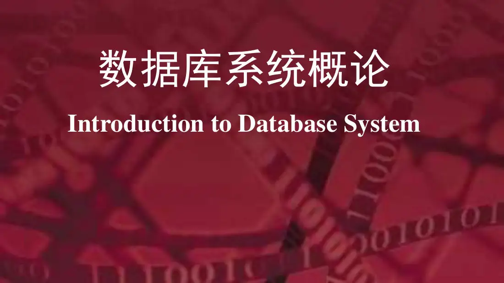

原文：

数据库系统概论

Introduction to Database System

### 总学时：48学时（40+8）

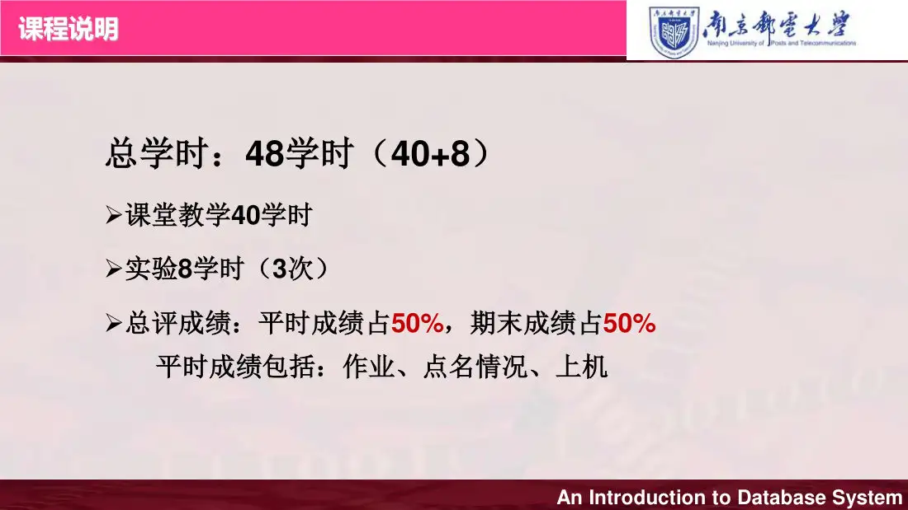

原文：

总学时：48学时（40+8）

▶课堂教学40学时

实验8学时（3次）

总评成绩：平时成绩占50%，期末成绩占50%

平时成绩包括：作业、点名情况、上机

课程说明

南京邮电大学
Nanjing University of Posts and Telecommunications

An Introduction to Database System

### 引言

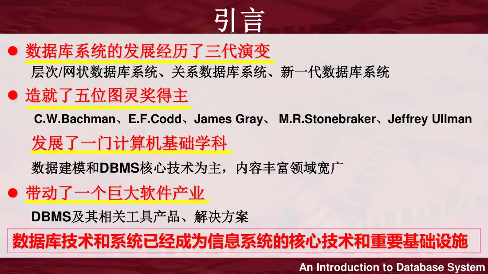

原文：

引言

- 数据库系统的发展经历了三代演变

层次/网状数据库系统、关系数据库系统、新一代数据库系统

● 造就了五位图灵奖得主

C.W.Bachman、E.F.Codd、James Gray、M.R.Stonebraker、Jeffrey Ullman
发展了一门计算机基础学科

数据建模和DBMS核心技术为主，内容丰富领域宽广

\- 带动了一个巨大软件产业

DBMS及其相关工具产品、解决方案

数据库技术和系统已经成为信息系统的核心技术和重要基础设施

An Introduction to Database System

### 五位图灵奖得主

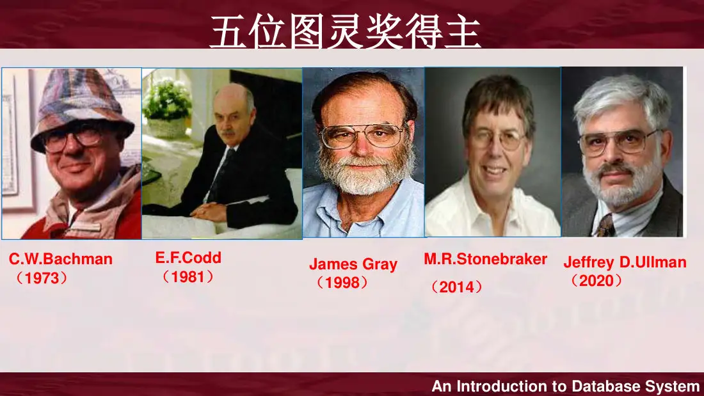

原文：

五位图灵奖得主

C.W.Bachman (1973)

An Introduction to Database System

### Charles.W.Bachman

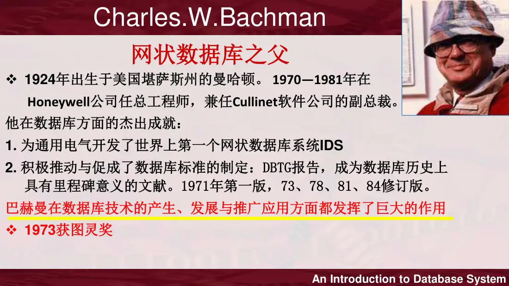

原文：

Charles.W.Bachman

网状数据库之父

✿ 1924年出生于美国堪萨斯州的曼哈顿。1970—1981年在 Honeywell公司任总工程师，兼任Cullinet软件公司的副总裁。他在数据库方面的杰出成就：

1. 为通用电气开发了世界上第一个网状数据库系统IDS

2. 积极推动与促成了数据库标准的制定：DBTG报告，成为数据库历史上具有里程碑意义的文献。1971年第一版，73、78、81、84修订版。

巴赫曼在数据库技术的产生、发展与推广应用方面都发挥了巨大的作用

1973获图灵奖

An Introduction to Database System

### Edgar F.Codd 博士

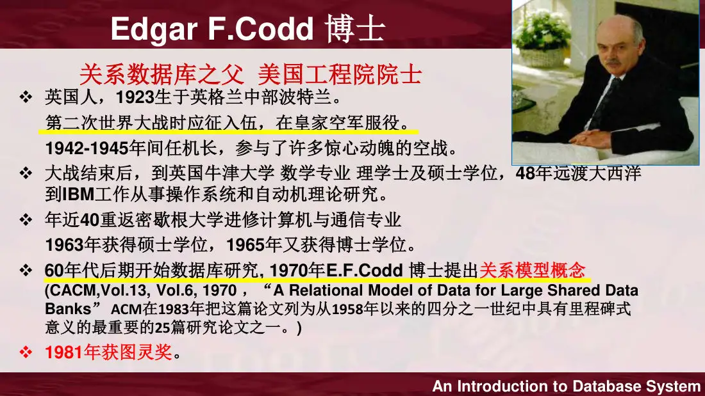

原文：

Edgar F.Codd 博士

关系数据库之父 美国工程院院士

\- 英国人，1923生于英格兰中部波特兰。
第二次世界大战时应征入伍，在皇家空军服役。
1942-1945年间任机长，参与了许多惊心动魄的空战。

✿ 大战结束后，到英国牛津大学 数学专业 理学士及硕士学位，48年远渡大西洋到IBM工作从事操作系统和自动机理论研究。

✿ 年近40重返密歇根大学进修计算机与通信专业1963年获得硕士学位，1965年又获得博士学位。

✿ 60年代后期开始数据库研究, 1970年E.F.Codd 博士提出关系模型概念 (CACM, Vol.13, Vol.6, 1970, “A Relational Model of Data for Large Shared Data Banks” ACM在1983年把这篇论文列为从1958年以来的四分之一世纪中具有里程碑式意义的最重要的25篇研究论文之一。)

1981年获图灵奖。

An Introduction to Database System

### James Gray

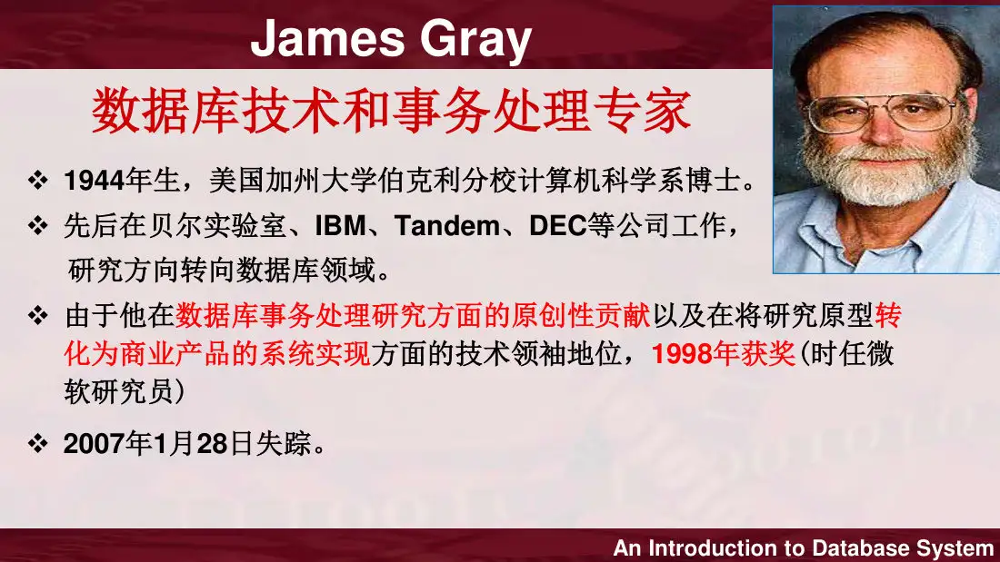

原文：

James Gray

数据库技术和事务处理专家

✿ 1944年生，美国加州大学伯克利分校计算机科学系博士。

❖ 先后在贝尔实验室、IBM、Tandem、DEC等公司工作，研究方向转向数据库领域。

由于他在数据库事务处理研究方面的原创性贡献以及在将研究原型转化为商业产品的系统实现方面的技术领袖地位，1998年获奖(时任微软研究员)

✿ 2007年1月28日失踪。

An Introduction to Database System

### Michael Stonebraker

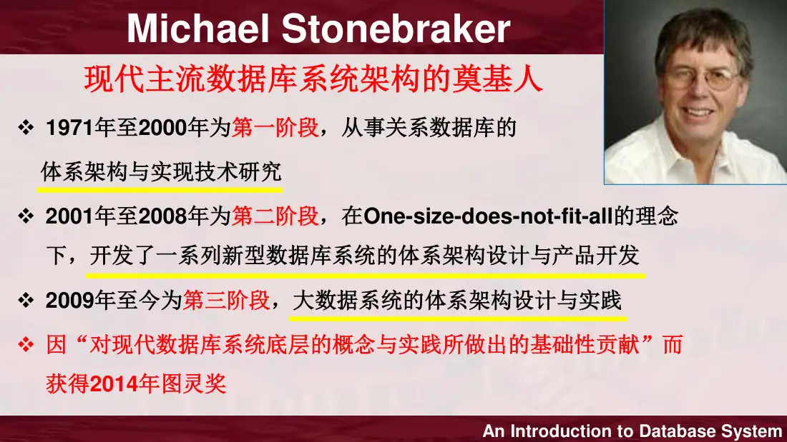

原文：

Michael Stonebraker

现代主流数据库系统架构的奠基人

✿ 1971年至2000年为第一阶段，从事关系数据库的体系架构与实现技术研究

2001年至2008年为第二阶段，在One-size-does-not-fit-all的理念下，开发了一系列新型数据库系统的体系架构设计与产品开发

2009年至今为第三阶段，大数据系统的体系架构设计与实践

因“对现代数据库系统底层的概念与实践所做出的基础性贡献”而获得2014年图灵奖

An Introduction to Database System

### Jeffrey D.Ullman

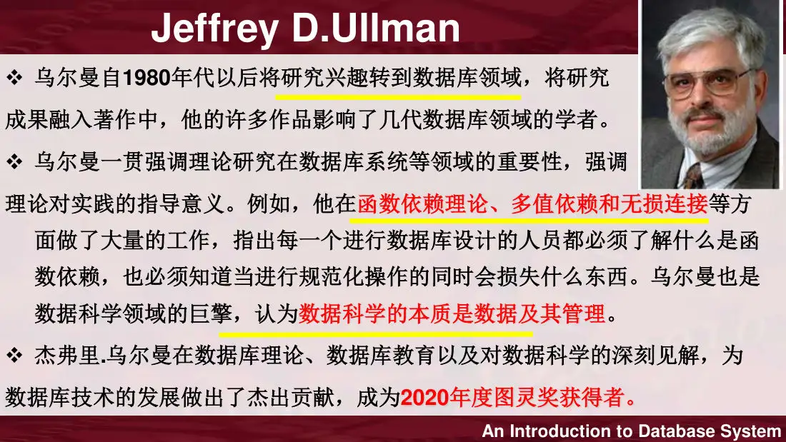

原文：

Jeffrey D.Ullman

✿ 乌尔曼自1980年代以后将研究兴趣转到数据库领域，将研究成果融入著作中，他的许多作品影响了几代数据库领域的学者。

✿ 乌尔曼一贯强调理论研究在数据库系统等领域的重要性，强调

理论对实践的指导意义。例如，他在函数依赖理论、多值依赖和无损连接等方面做了大量的工作，指出每一个进行数据库设计的人员都必须了解什么是函数依赖，也必须知道当进行规范化操作的同时会损失什么东西。乌尔曼也是数据科学领域的巨擎，认为数据科学的本质是数据及其管理。

✿ 杰弗里.乌尔曼在数据库理论、数据库教育以及对数据科学的深刻见解，为数据库技术的发展做出了杰出贡献，成为2020年度图灵奖获得者。

An Introduction to Database System

### 数据库:一个巨大的软件产业

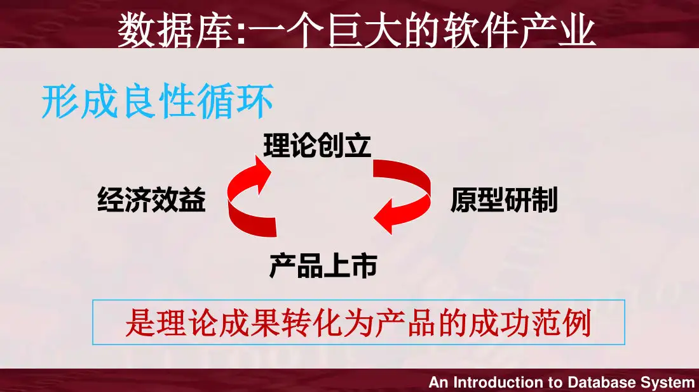

原文：

数据库:一个巨大的软件产业

形成良性循环

经济效益

理论创立

原型研制

产品上市

是理论成果转化为产品的成功范例

An Introduction to Database System

### 数据库系统概论

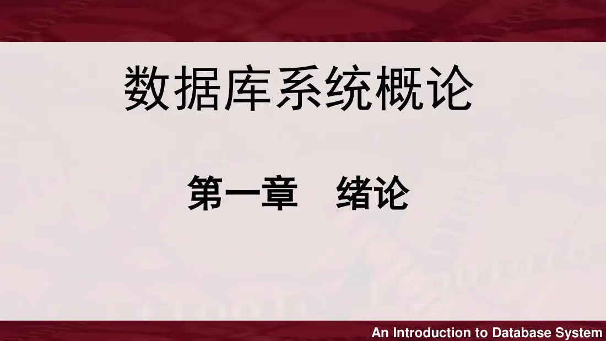

原文：

数据库系统概论

第一章 绪论

An Introduction to Database System

### 第一章 绪论

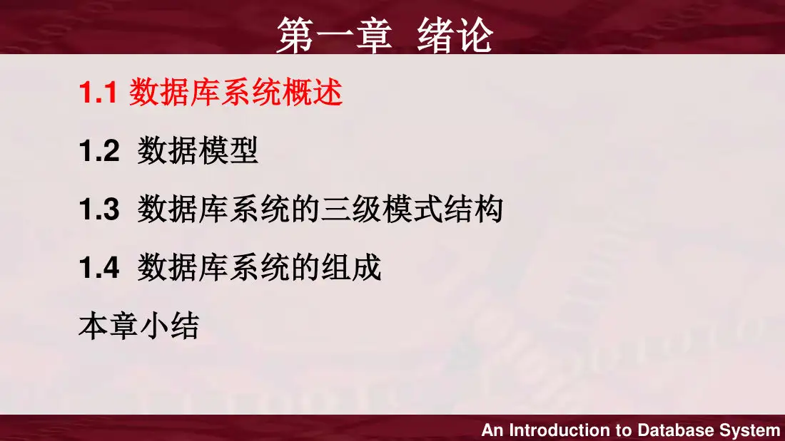

原文：

第一章 绪论

1.1 数据库系统概述

1.2 数据模型

1.3 数据库系统的三级模式结构

1.4 数据库系统的组成

本章小结

An Introduction to Database System

### 1.1 数据库系统概述

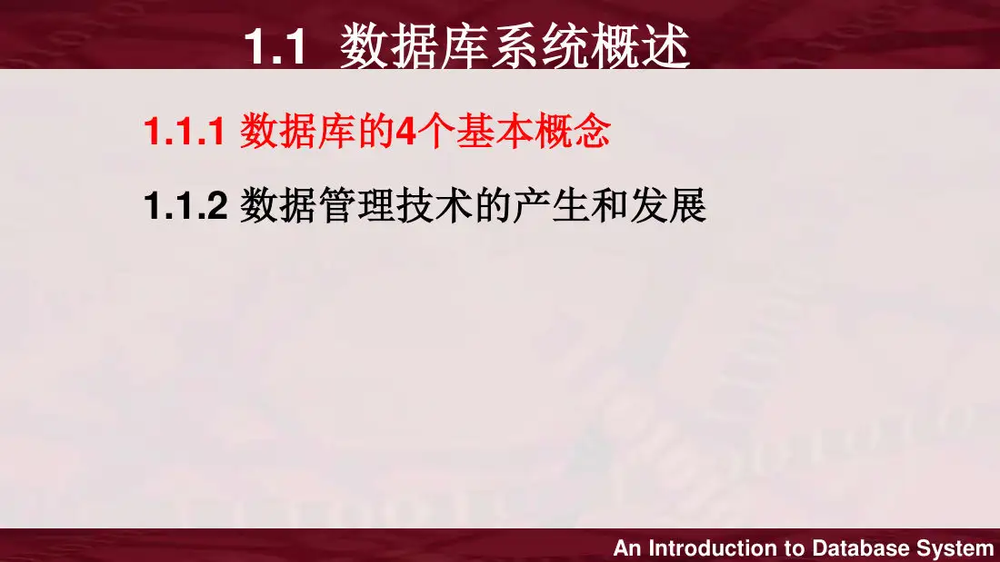

原文：

1.1 数据库系统概述

1.1.1 数据库的4个基本概念

1.1.2 数据管理技术的产生和发展

An Introduction to Database System

### 数据库的4个基本概念

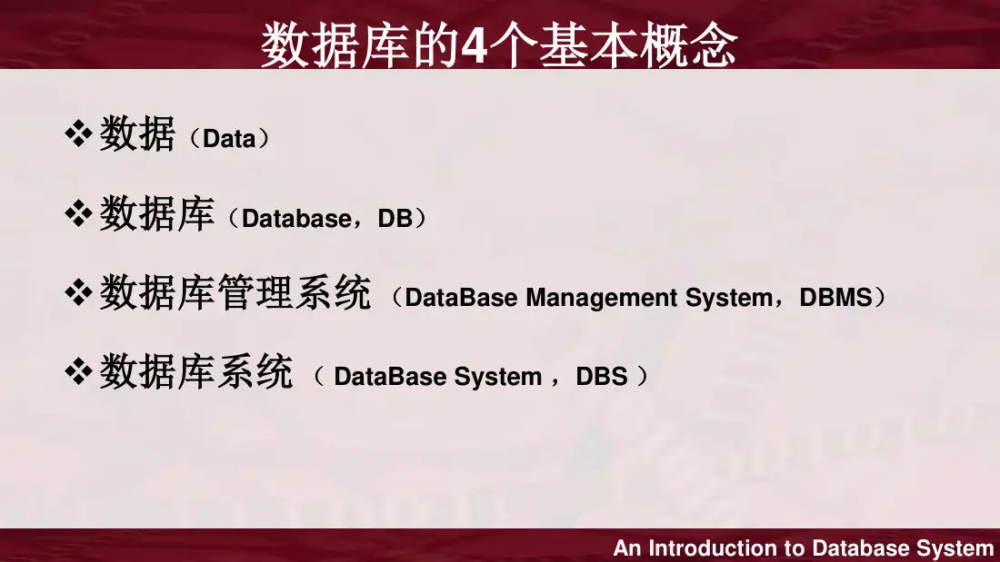

原文：

数据库的4个基本概念

数据（Data）

数据库（Database，DB）

数据库管理系统（DataBase Management System，DBMS）

数据库系统（DataBase System，DBS）

An Introduction to Database System

### 1. 数据

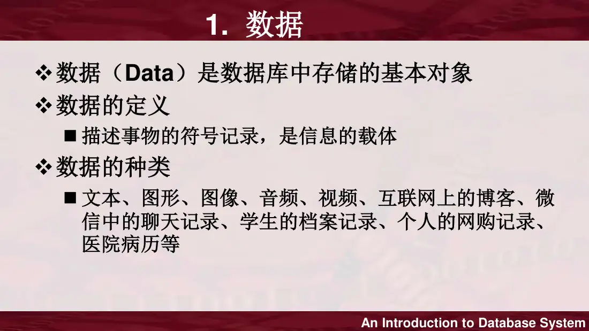

原文：

1. 数据

✿ 数据（Data）是数据库中存储的基本对象

◆ 数据的定义

■ 描述事物的符号记录，是信息的载体

◆ 数据的种类

■ 文本、图形、图像、音频、视频、互联网上的博客、微信中的聊天记录、学生的档案记录、个人的网购记录、医院病历等

An Introduction to Database System

### 数据举例

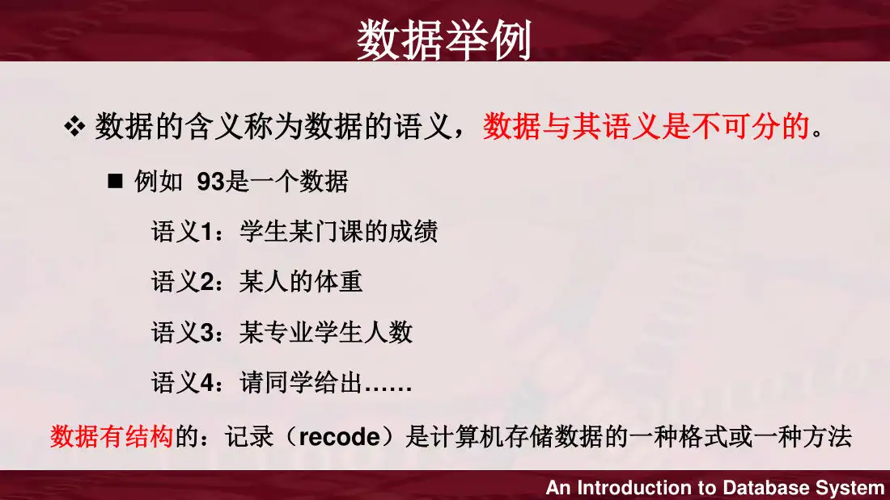

原文：

数据举例

◆ 数据的含义称为数据的语义，数据与其语义是不可分的。

■ 例如 93是一个数据

语义1：学生某门课的成绩

语义2: 某人的体重

语义3: 某专业学生人数

语义4：请同学给出……

数据有结构的：记录（recode）是计算机存储数据的一种格式或一种方法

An Introduction to Database System

### 2. 数据库

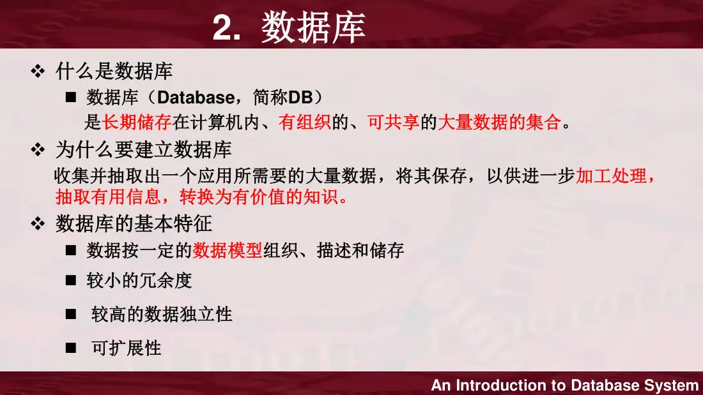

原文：

2. 数据库

什么是数据库

■ 数据库（Database，简称DB）

是长期储存在计算机内、有组织的、可共享的大量数据的集合。

为什么要建立数据库

收集并抽取出一个应用所需要的大量数据，将其保存，以供进一步加工处理，抽取有用信息，转换为有价值的知识。

数据库的基本特征

■ 数据按一定的数据模型组织、描述和储存

■ 较小的冗余度

■ 较高的数据独立性

■ 可扩展性

An Introduction to Database System

### 3. 数据库管理系统

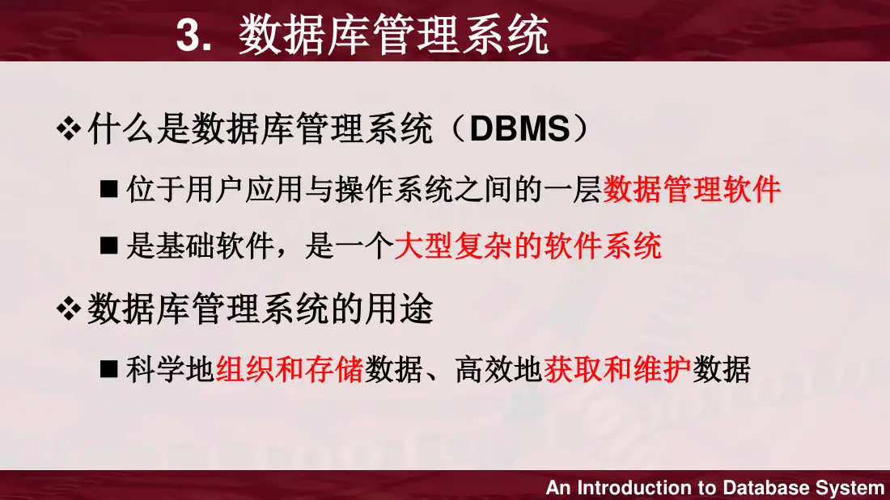

原文：

3. 数据库管理系统

什么是数据库管理系统（DBMS）

■ 位于用户应用与操作系统之间的一层数据管理软件

■ 是基础软件，是一个大型复杂的软件系统

数据库管理系统的用途

■ 科学地组织和存储数据、高效地获取和维护数据

An Introduction to Database System

### 数据库管理系统的主要功能

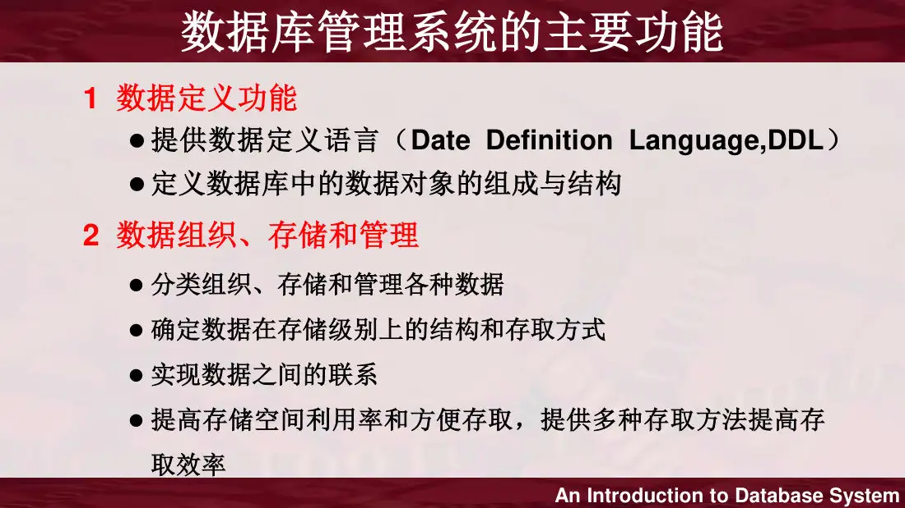

原文：

数据库管理系统的主要功能

1 数据定义功能

● 提供数据定义语言（Date Definition Language,DDL）

\- 定义数据库中的数据对象的组成与结构

2 数据组织、存储和管理

\- 分类组织、存储和管理各种数据

\- 确定数据在存储级别上的结构和存取方式

\- 实现数据之间的联系

\- 提高存储空间利用率和方便存取，提供多种存取方法提高存取效率

An Introduction to Database System

### 数据库管理系统的主要功能

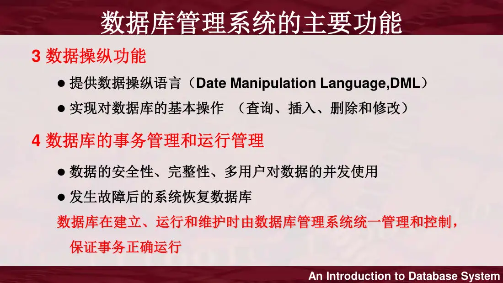

原文：

数据库管理系统的主要功能

3 数据操纵功能

● 提供数据操纵语言（Date Manipulation Language, DML）

● 实现对数据库的基本操作 （查询、插入、删除和修改）

4 数据库的事务管理和运行管理

● 数据的安全性、完整性、多用户对数据的并发使用

\- 发生故障后的系统恢复数据库

数据库在建立、运行和维护时由数据库管理系统统一管理和控制，

保证事务正确运行

An Introduction to Database System

### 数据库管理系统的主要功能

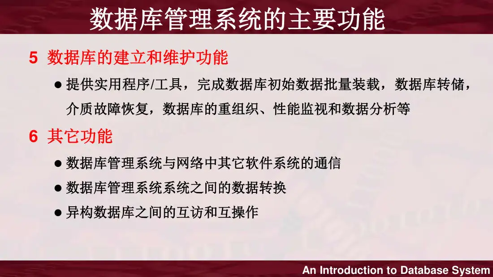

原文：

数据库管理系统的主要功能

5 数据库的建立和维护功能

\- 提供实用程序/工具，完成数据库初始数据批量装载，数据库转储，介质故障恢复，数据库的重组织、性能监视和数据分析等

6 其它功能

\- 数据库管理系统与网络中其它软件系统的通信

\- 数据库管理系统系统之间的数据转换

\- 异构数据库之间的互访和互操作

An Introduction to Database System

### 4.数据库系统

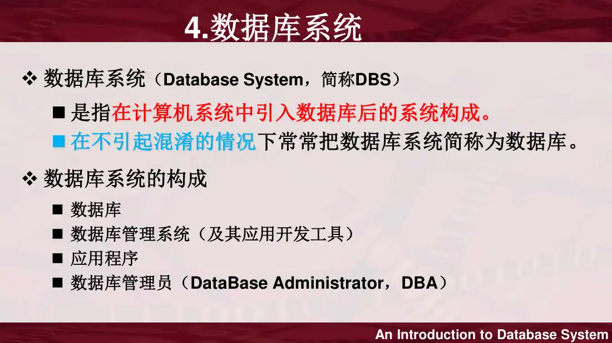

原文：

4.数据库系统

数据库系统（Database System，简称DBS）

■ 是指在计算机系统中引入数据库后的系统构成。

■ 在不引起混淆的情况下常常把数据库系统简称为数据库。

数据库系统的构成

■ 数据库

■ 数据库管理系统（及其应用开发工具）

■ 应用程序

■ 数据库管理员（DataBase Administrator，DBA）

An Introduction to Database System

### 数据库系统

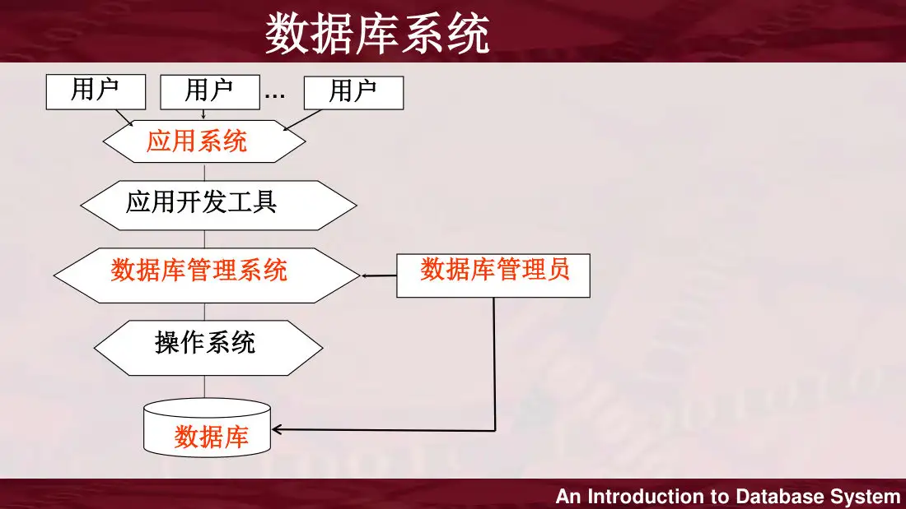

原文：

数据库系统

An Introduction to Database System

### 1.1 数据库系统概述

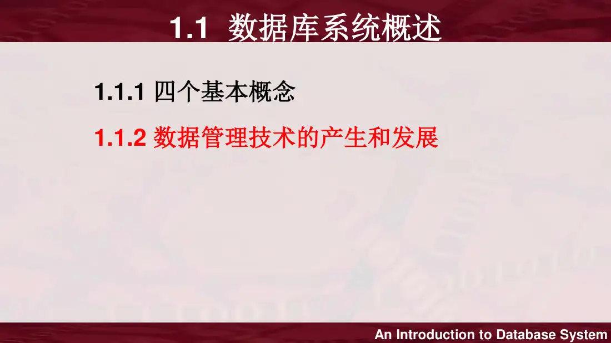

原文：

1.1 数据库系统概述

1.1.1 四个基本概念

1.1.2 数据管理技术的产生和发展

An Introduction to Database System

### 数据管理技术的产生和发展

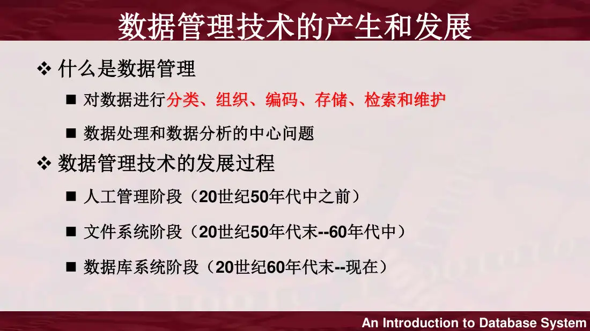

原文：

数据管理技术的产生和发展

什么是数据管理

■ 对数据进行分类、组织、编码、存储、检索和维护

■ 数据处理和数据分析的中心问题

✿ 数据管理技术的发展过程

■ 人工管理阶段（20世纪50年代中之前）

■ 文件系统阶段（20世纪50年代末--60年代中）

■ 数据库系统阶段（20世纪60年代末--现在）

An Introduction to Database System

### 1. 人工管理阶段

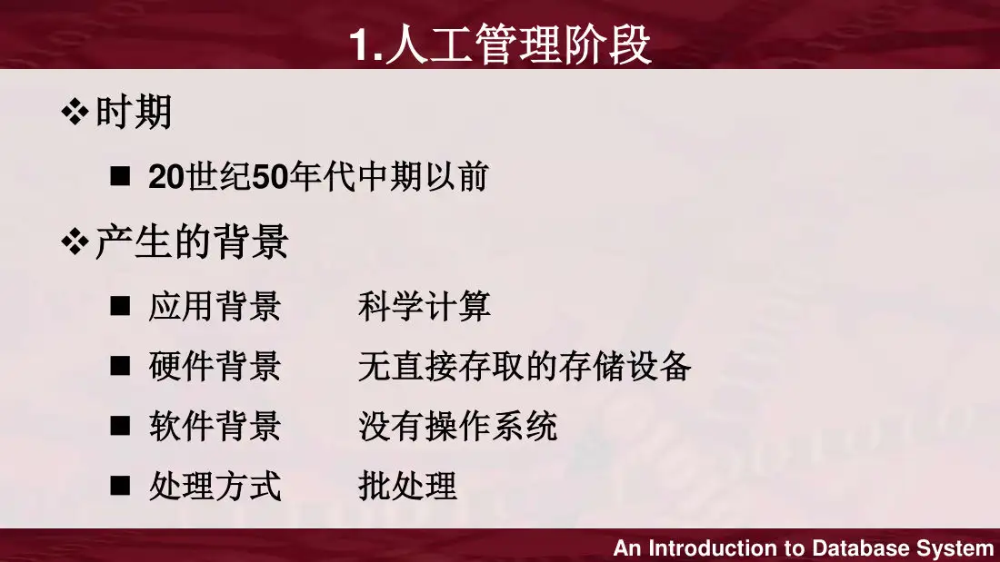

原文：

1. 人工管理阶段

时期

■ 20世纪50年代中期以前
❖产生的背景
■ 应用背景 科学计算
■ 硬件背景 无直接存取的存储设备
■ 软件背景 没有操作系统
■ 处理方式 批处理

An Introduction to Database System

### 人工管理阶段（续）

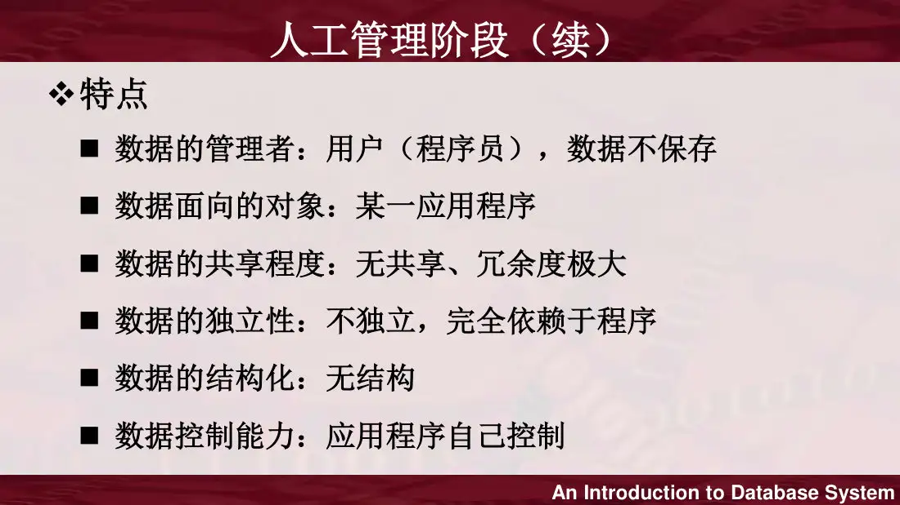

原文：

人工管理阶段（续）

◆ 特点

■ 数据的管理者：用户（程序员），数据不保存

■ 数据面向的对象：某一应用程序

■ 数据的共享程度：无共享、冗余度极大

■ 数据的独立性：不独立，完全依赖于程序

■ 数据的结构化：无结构

■ 数据控制能力：应用程序自己控制

An Introduction to Database System

### 应用程序与数据的对应关系（人工管理阶段）

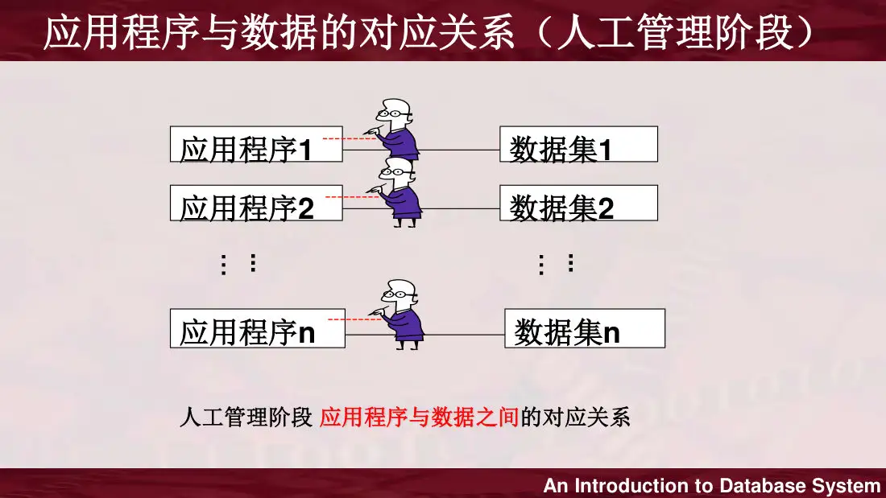

原文：

应用程序与数据的对应关系（人工管理阶段）

人工管理阶段 应用程序与数据之间的对应关系

An Introduction to Database System

### 2. 文件系统阶段

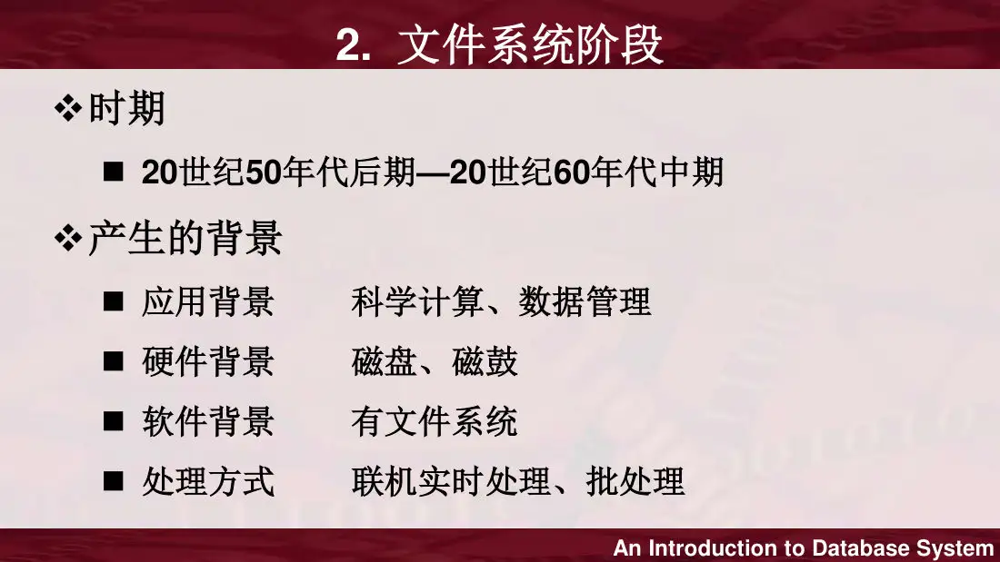

原文：

2. 文件系统阶段

时期

■ 20世纪50年代后期—20世纪60年代中期
❖产生的背景
■ 应用背景 科学计算、数据管理
■ 硬件背景 磁盘、磁鼓
■ 软件背景 有文件系统
■ 处理方式 联机实时处理、批处理

An Introduction to Database System

### 文件系统阶段（续）

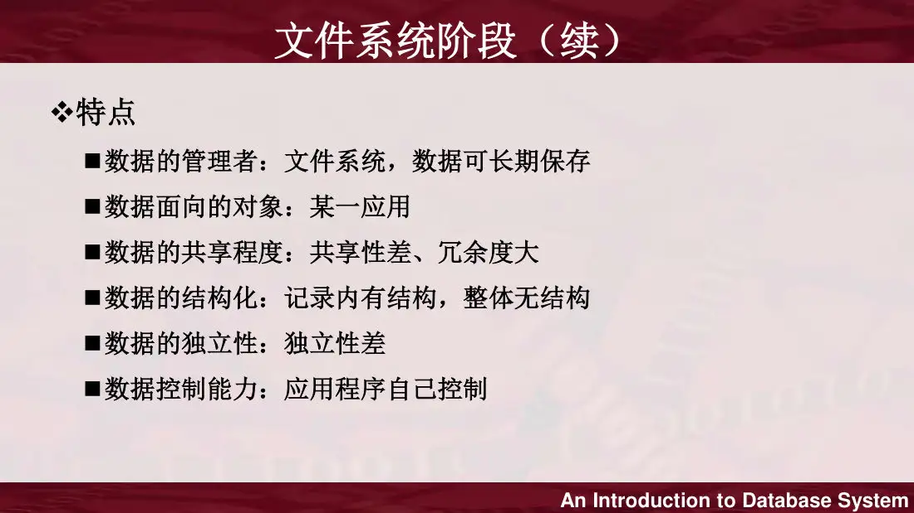

原文：

文件系统阶段（续）

◆ 特点

■数据的管理者：文件系统，数据可长期保存

■数据面向的对象：某一应用

■数据的共享程度：共享性差、冗余度大

■数据的结构化：记录内有结构，整体无结构

■数据的独立性：独立性差

■数据控制能力：应用程序自己控制

An Introduction to Database System

### 应用程序与数据的对应关系（文件系统阶段）

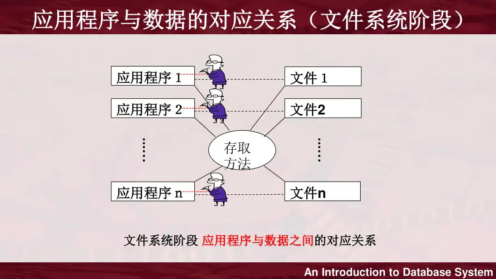

原文：

应用程序与数据的对应关系（文件系统阶段）

文件系统阶段 应用程序与数据之间的对应关系

An Introduction to Database System

### 3. 数据库系统阶段

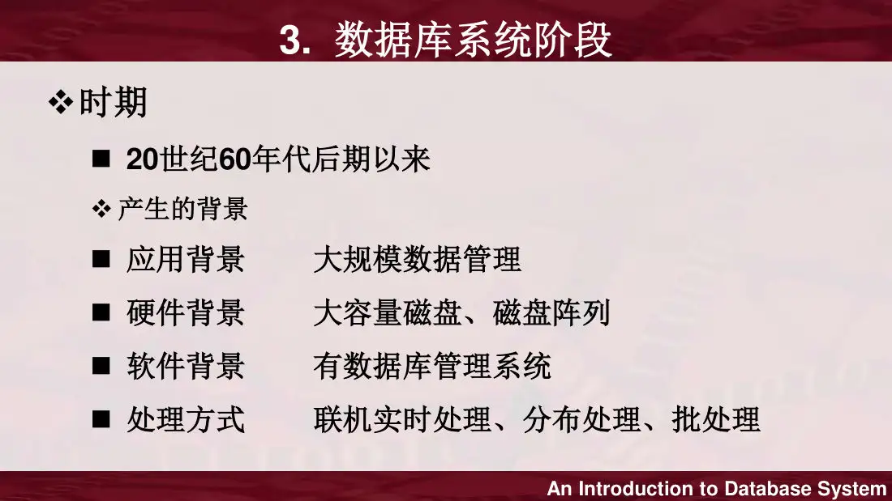

原文：

3. 数据库系统阶段

时期

■ 20世纪60年代后期以来
❖ 产生的背景
■ 应用背景 大规模数据管理
■ 硬件背景 大容量磁盘、磁盘阵列
■ 软件背景 有数据库管理系统
■ 处理方式 联机实时处理、分布处理、批处理

An Introduction to Database System

### 数据库系统管理数据的特点

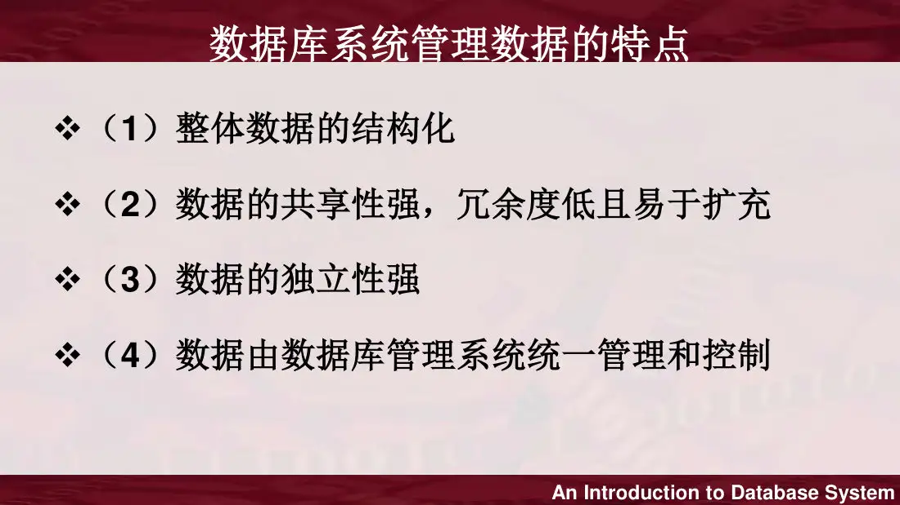

原文：

数据库系统管理数据的特点

◆（1）整体数据的结构化

(2) 数据的共享性强, 冗余度低且易于扩充

(3) 数据的独立性强

✿（4）数据由数据库管理系统统一管理和控制

An Introduction to Database System

### 应用程序与数据的对应关系（数据库系统阶段）

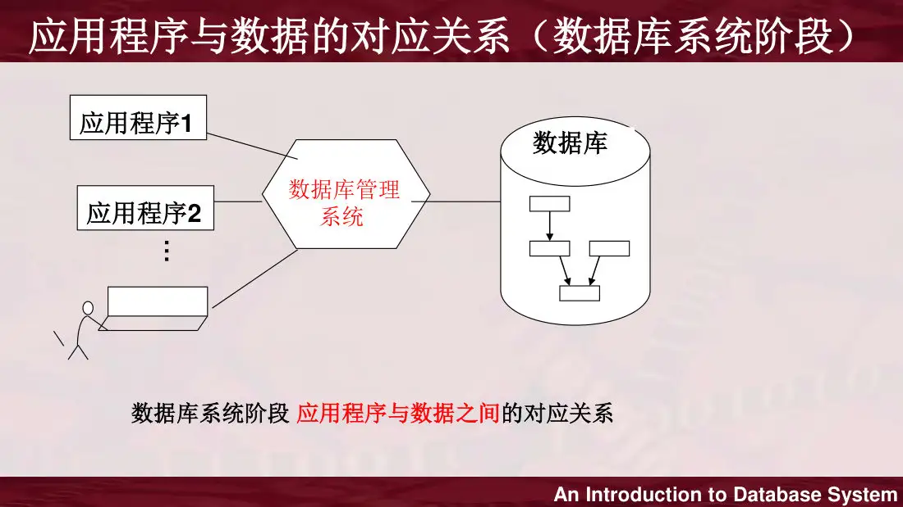

原文：

应用程序与数据的对应关系（数据库系统阶段）

An Introduction to Database System

### 表1.1 数据管理3个阶段的比较 P.7

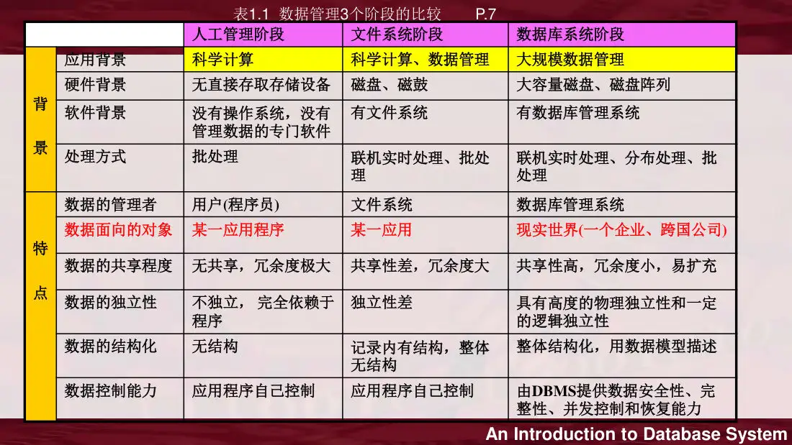

原文：

表1.1 数据管理3个阶段的比较 P.7
<table><tr><td colspan="2"></td><td>人工管理阶段</td><td>文件系统阶段</td><td>数据库系统阶段</td></tr><tr><td rowspan="4">背景</td><td>应用背景</td><td>科学计算</td><td>科学计算、数据管理</td><td>大规模数据管理</td></tr><tr><td>硬件背景</td><td>无直接存取存储设备</td><td>磁盘、磁鼓</td><td>大容量磁盘、磁盘阵列</td></tr><tr><td>软件背景</td><td>没有操作系统,没有管理数据的专门软件</td><td>有文件系统</td><td>有数据库管理系统</td></tr><tr><td>处理方式</td><td>批处理</td><td>联机实时处理、批处理</td><td>联机实时处理、分布处理、批处理</td></tr><tr><td rowspan="6">特点</td><td>数据的管理者</td><td>用户(程序员)</td><td>文件系统</td><td>数据库管理系统</td></tr><tr><td>数据面向的对象</td><td>某一应用程序</td><td>某一应用</td><td>现实世界(一个企业、跨国公司)</td></tr><tr><td>数据的共享程度</td><td>无共享,冗余度极大</td><td>共享性差,冗余度大</td><td>共享性高,冗余度小,易扩充</td></tr><tr><td>数据的独立性</td><td>不独立,完全依赖于程序</td><td>独立性差</td><td>具有高度的物理独立性和一定的逻辑独立性</td></tr><tr><td>数据的结构化</td><td>无结构</td><td>记录内有结构,整体无结构</td><td>整体结构化,用数据模型描述</td></tr><tr><td>数据控制能力</td><td>应用程序自己控制</td><td>应用程序自己控制</td><td>由DBMS提供数据安全性、完整性、并发控制和恢复能力</td></tr></table>

An Introduction to Database System

### 第一章 绪论

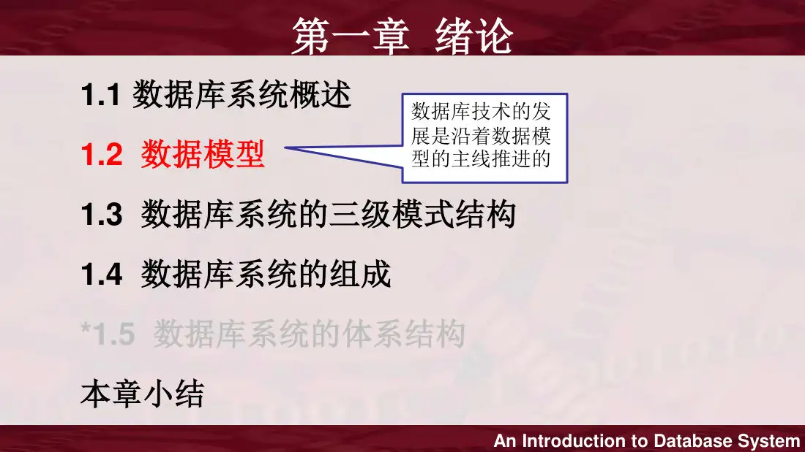

原文：

第一章 绪论

1.1 数据库系统概述

1.2 数据模型数据库技术的发展是沿着数据模型的主线推进的

1.3 数据库系统的三级模式结构

1.4 数据库系统的组成

\*1.5 数据库系统的体系结构

本章小结

An Introduction to Database System

### 1.2 数据模型

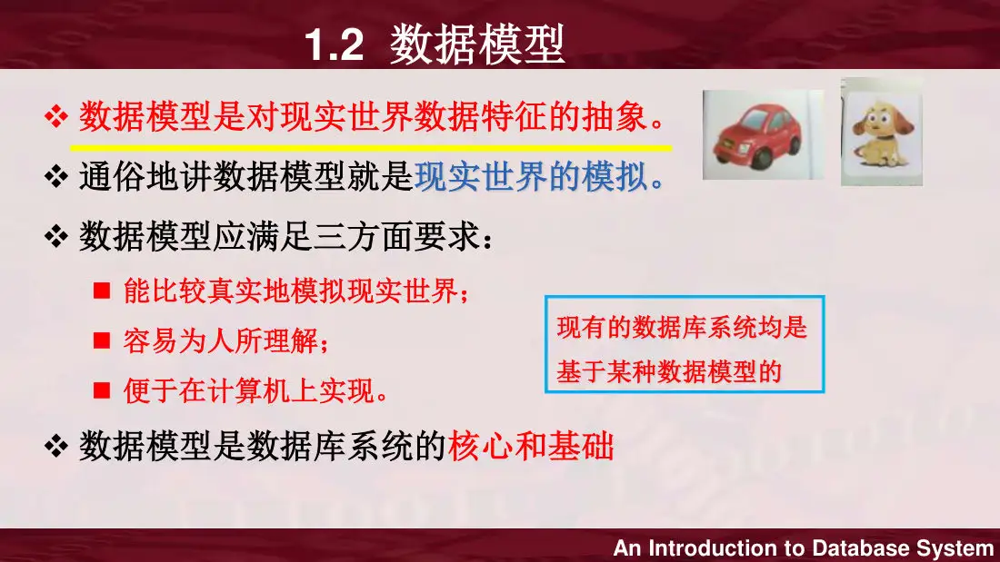

原文：

1.2 数据模型

◆ 数据模型是对现实世界数据特征的抽象。

✿ 通俗地讲数据模型就是现实世界的模拟。

✿ 数据模型应满足三方面要求:

■ 能比较真实地模拟现实世界；

■ 容易为人所理解;

现有的数据库系统均是

■ 便于在计算机上实现。

基于某种数据模型的

◆ 数据模型是数据库系统的核心和基础

An Introduction to Database System

### 1.2 数据模型

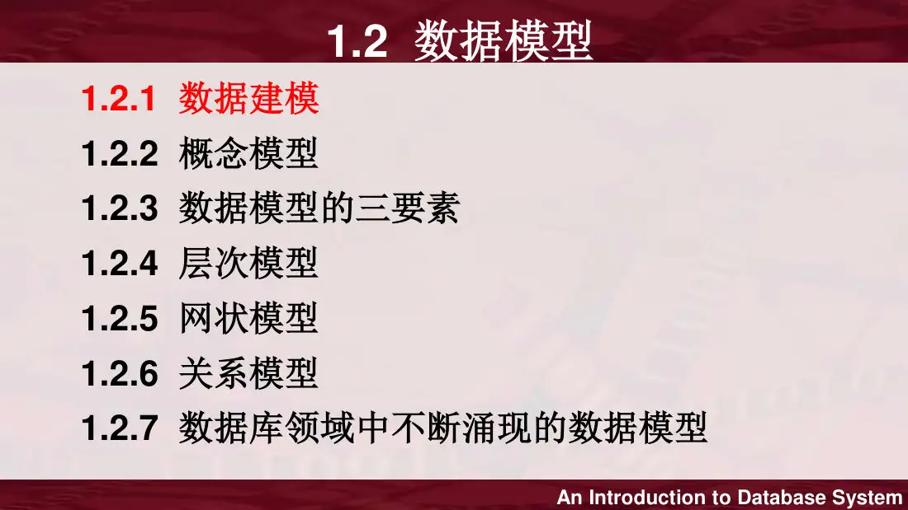

原文：

1.2 数据模型

1.2.1 数据建模
1.2.2 概念模型
1.2.3 数据模型的三要素
1.2.4 层次模型
1.2.5 网状模型
1.2.6 关系模型
1.2.7 数据库领域中不断涌现的数据模型

An Introduction to Database System

### 1.2.1 数据建模

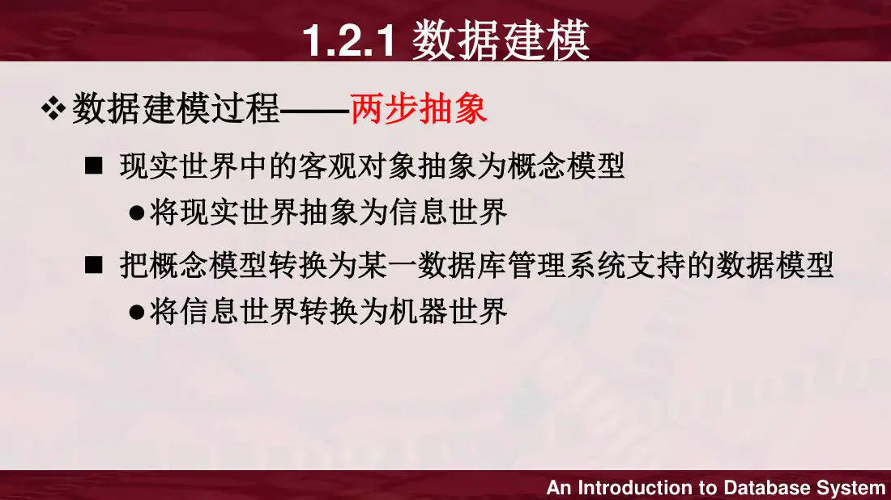

原文：

1.2.1 数据建模

✿ 数据建模过程——两步抽象

■ 现实世界中的客观对象抽象为概念模型

\- 将现实世界抽象为信息世界

■ 把概念模型转换为某一数据库管理系统支持的数据模型

\- 将信息世界转换为机器世界

An Introduction to Database System

### 数据建模

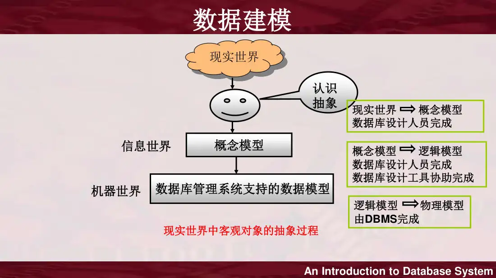

原文：

数据建模

现实世界 $\Rightarrow$ 概念模型数据库设计人员完成

概念模型 $\Rightarrow$ 逻辑模型数据库设计人员完成数据库设计工具协助完成

逻辑模型 $\Rightarrow$ 物理模型由DBMS完成

An Introduction to Database System

### 概念模型

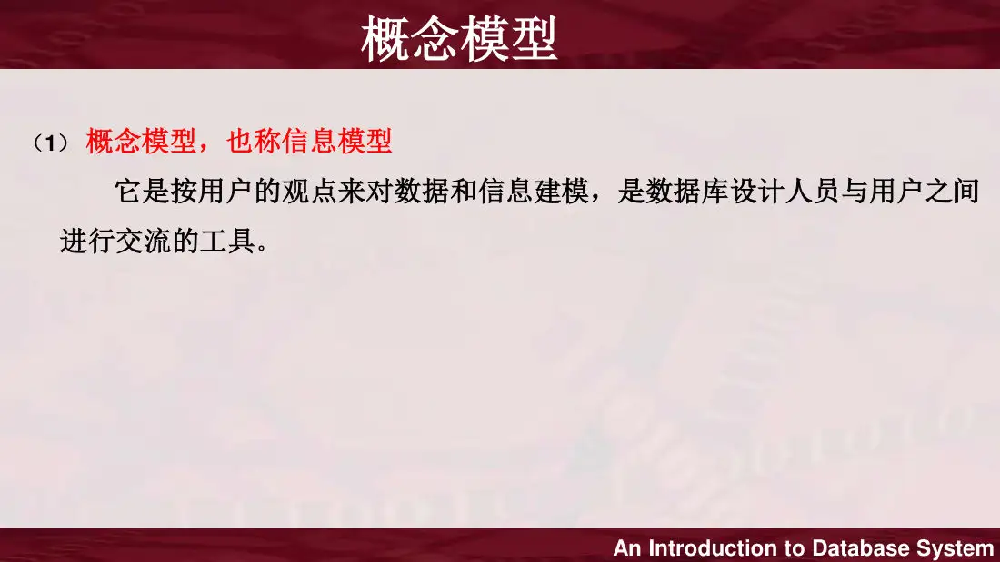

原文：

概念模型

(1) 概念模型，也称信息模型

它是按用户的观点来对数据和信息建模，是数据库设计人员与用户之间进行交流的工具。

An Introduction to Database System

### 两类数据模型

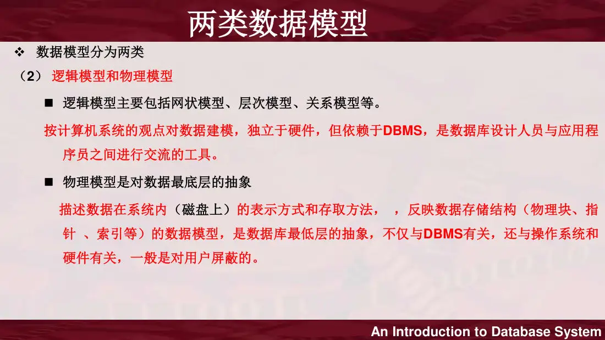

原文：

两类数据模型

◆ 数据模型分为两类

(2) 逻辑模型和物理模型

■ 逻辑模型主要包括网状模型、层次模型、关系模型等。

按计算机系统的观点对数据建模，独立于硬件，但依赖于DBMS，是数据库设计人员与应用程序员之间进行交流的工具。

■ 物理模型是对数据最底层的抽象

描述数据在系统内（磁盘上）的表示方式和存取方法，，反映数据存储结构（物理块、指针、索引等）的数据模型，是数据库最低层的抽象，不仅与DBMS有关，还与操作系统和硬件有关，一般是对用户屏蔽的。

An Introduction to Database System

### 概念模型

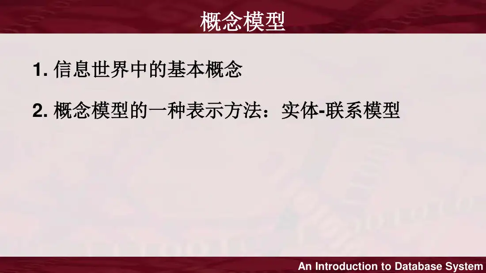

原文：

概念模型

1. 信息世界中的基本概念

2. 概念模型的一种表示方法：实体-联系模型

An Introduction to Database System

### 1. 信息世界中的基本概念

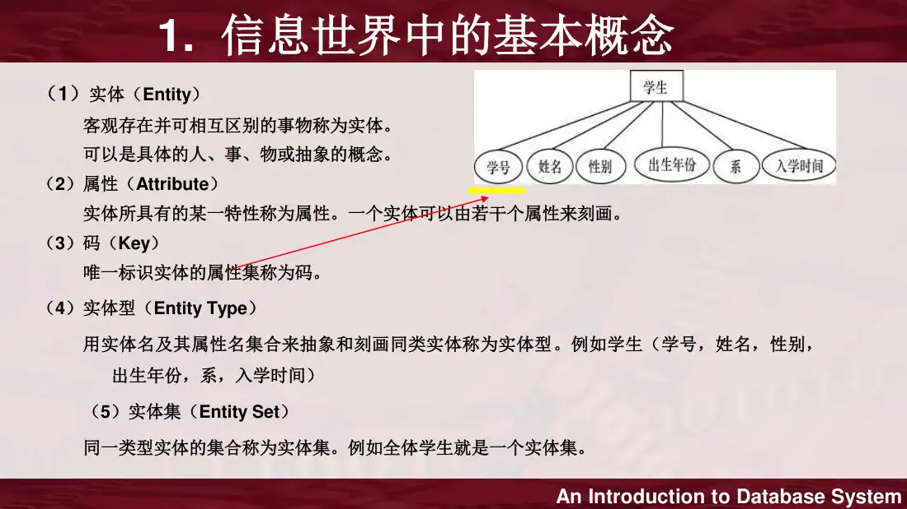

原文：

1. 信息世界中的基本概念

(1) 实体 (Entity)

客观存在并可相互区别的事物称为实体。

可以是具体的人、事、物或抽象的概念。

(2) 属性（Attribute）

实体所具有的某一特性称为属性。一个实体可以由若干个属性来刻画。

(3) 码 (Key)

唯一标识实体的属性集称为码。

(4) 实体型 (Entity Type)

用实体名及其属性名集合来抽象和刻画同类实体称为实体型。例如学生（学号，姓名，性别，出生年份，系，入学时间）

(5) 实体集 (Entity Set)

同一类型实体的集合称为实体集。例如全体学生就是一个实体集。

An Introduction to Database System

### 信息世界中的基本概念（续）

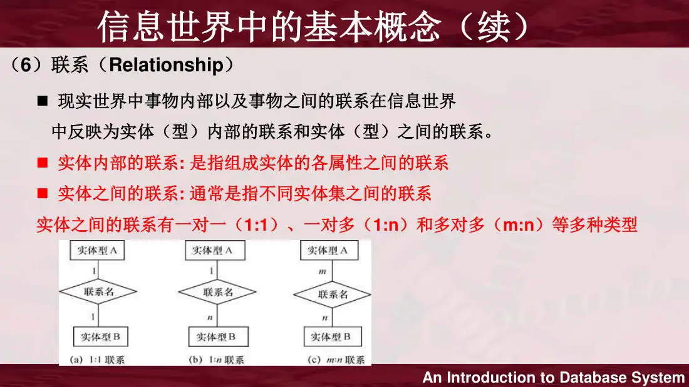

原文：

信息世界中的基本概念（续）

(6) 联系（Relationship）

■ 现实世界中事物内部以及事物之间的联系在信息世界中反映为实体（型）内部的联系和实体（型）之间的联系。

■ 实体内部的联系: 是指组成实体的各属性之间的联系

■ 实体之间的联系: 通常是指不同实体集之间的联系

实体之间的联系有一对一（1:1）、一对多（1:n）和多对多（m:n）等多种类型

An Introduction to Database System

### 2. 概念模型的一种表示方法：实体-联系模型

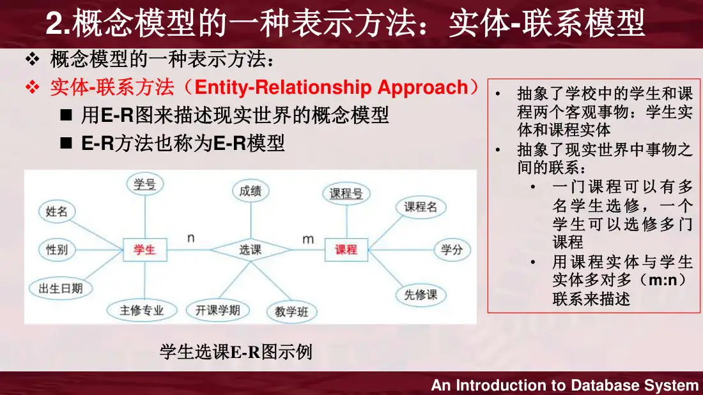

原文：

2. 概念模型的一种表示方法：实体-联系模型

概念模型的一种表示方法:

实体-联系方法（Entity-Relationship Approach）

■ 用E-R图来描述现实世界的概念模型

■ E-R方法也称为E-R模型- 抽象了学校中的学生和课程两个客观事物：学生实体和课程实体

\- 抽象了现实世界中事物之间的联系：

\- 一门课程可以有多名学生选修，一个学生可以选修多门课程

\- 用课程实体与学生实体多对多（m:n）联系来描述

An Introduction to Database System

### 1.2 数据模型

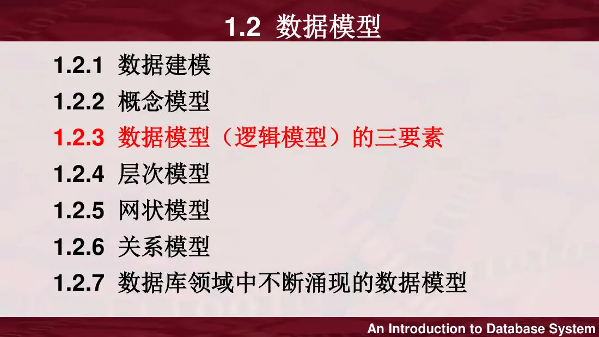

原文：

1.2 数据模型

1.2.1 数据建模
1.2.2 概念模型
1.2.3 数据模型（逻辑模型）的三要素
1.2.4 层次模型
1.2.5 网状模型
1.2.6 关系模型
1.2.7 数据库领域中不断涌现的数据模型

An Introduction to Database System

### 1.2.3 数据模型的组成要素

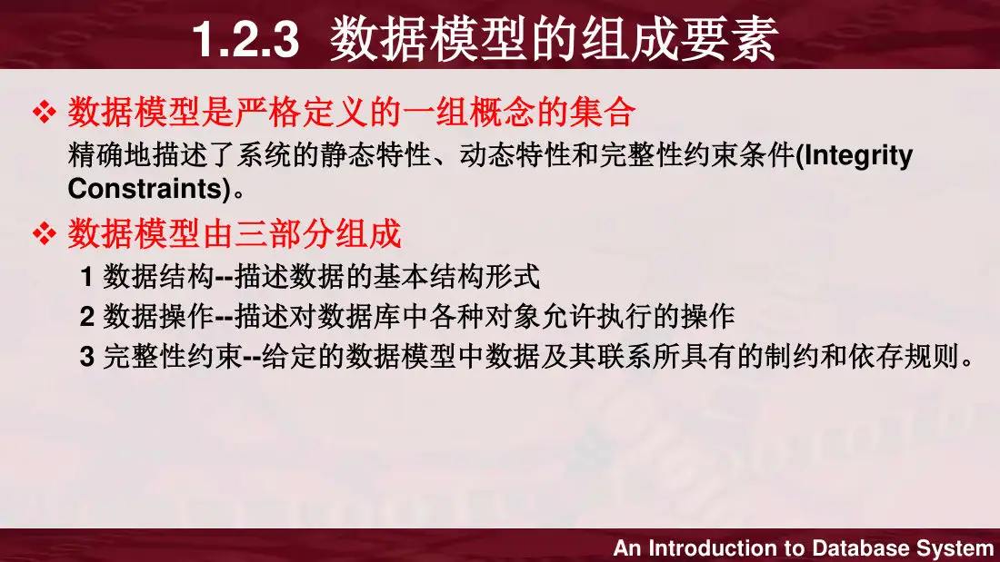

原文：

1.2.3 数据模型的组成要素

◆ 数据模型是严格定义的一组概念的集合

精确地描述了系统的静态特性、动态特性和完整性约束条件(Integrity Constraints)。

数据模型由三部分组成

1 数据结构--描述数据的基本结构形式

2 数据操作--描述对数据库中各种对象允许执行的操作

3 完整性约束--给定的数据模型中数据及其联系所具有的制约和依存规则。

An Introduction to Database System

### 1. 数据结构

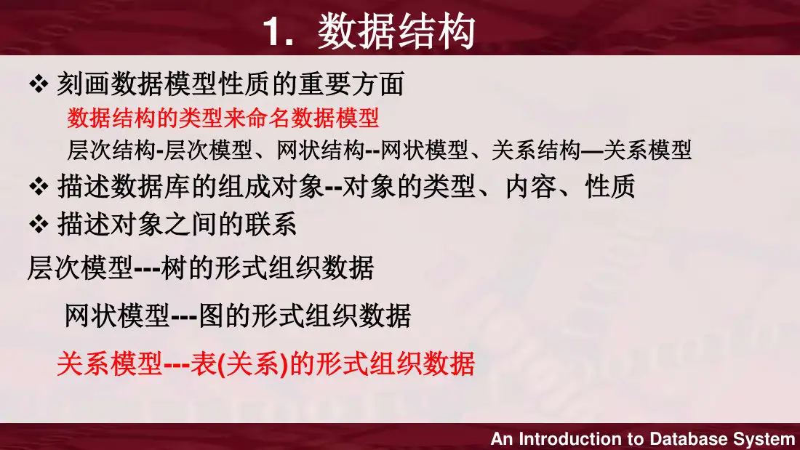

原文：

1. 数据结构

◆ 刻画数据模型性质的重要方面

数据结构的类型来命名数据模型

层次结构-层次模型、网状结构--网状模型、关系结构—关系模型

描述数据库的组成对象--对象的类型、内容、性质

描述对象之间的联系

层次模型---树的形式组织数据

网状模型---图的形式组织数据

关系模型---表(关系)的形式组织数据

An Introduction to Database System

### 2. 数据操作

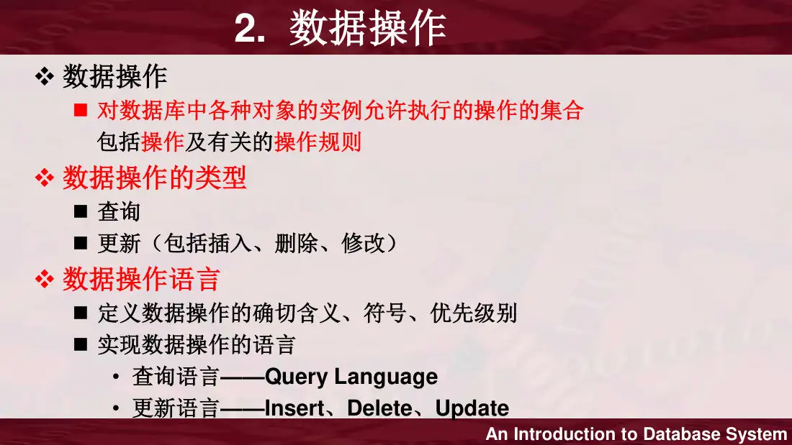

原文：

2. 数据操作

◆ 数据操作

■ 对数据库中各种对象的实例允许执行的操作的集合包括操作及有关的操作规则

数据操作的类型

■ 查询

■ 更新（包括插入、删除、修改）

数据操作语言

■ 定义数据操作的确切含义、符号、优先级别

■ 实现数据操作的语言

\- 查询语言——Query Language

\- 更新语言——Insert、Delete、Update

An Introduction to Database System

### 3. 完整性约束

原文：

3. 完整性约束

一组完整性规则的集合

■ 完整性规则：给定的数据模型中数据及其联系所具有的制约和依存规则。

■ 用以限定符合数据模型的数据库状态以及状态的变化，以保证数据的正确、有效和相容。

◆ 数据模型对完整性约束条件的定义

数据模型规定的约束

■ 反映和规定必须遵守的基本的通用的完整性约束条件。

■ 提供定义完整性约束条件的机制，以反映具体应用所涉及的数据必须遵守的特定的语义约束条件。

具体应用需要规定的约束（用户自定义的约束）

An Introduction to Database System

### 1.2 数据模型

原文：

1.2 数据模型

1.2.1 数据建模
1.2.2 概念模型
1.2.3 数据模型的三要素
1.2.4 层次模型---树的形式组织数据（略）
1.2.5 网状模型---图的形式组织数据（略）
1.2.6 关系模型---表的形式组织数据
1.2.7 数据库领域中不断涌现的数据模型

An Introduction to Database System

### 1.2.6 关系模型

原文：

1.2.6 关系模型

关系数据库系统采用关系模型作为数据的组织方式

✿ 1970年美国IBM公司San Jose研究室的研究员E.F.Codd首次提出了数据库系统的关系模型

✿ 1980年代以来，计算机厂商新推出的数据库管理系统几乎都支持关系模型

An Introduction to Database System

### 1. 关系模型的数据结构

原文：

1. 关系模型的数据结构

关系模型建立在严格的数学概念的基础上。在用户观点下，关系模型中数据的逻辑结构是一张规范化的二维表。

学生登记表

An Introduction to Database System

### 关系模型的数据结构（续）

原文：

关系模型的数据结构（续）

■ 关系（Relation）——一个关系对应通常说的一张表

■ 元组（Tuple）——表中的一行即为一个元组

■ 属性（Attribute）——表中的一列即为一个属性，给每一个属性起一个名称即属性名

■ 码（Key）——也称码键。表中的某个属性组，它可以唯一确定一个元组

■ 域（Domain）——是一组具有相同数据类型的值的集合。

属性的取值范围来自某个域。

例：学生年龄属性的域（15～45岁），

性别的域是（男，女），

主修专业的域是学生所在学院所有专业名称的集合。

■ 分量——元组中的一个属性值。

■ 关系模式——对关系的结构描述

关系名（属性1，属性2，…，属性n）

学生（学号，姓名，性别，出生日期，主修专业）

An Introduction to Database System

### 关系模型的数据结构（续）

原文：

关系模型的数据结构（续）

关系必须是规范化的，满足一定的规范条件

最基本的规范条件：关系的每一个分量必须是一个不可分的数据项，不允许表中还有表。下图中联系方式是可分的数据项，不符合关系模型要求

<table><tr><td rowspan="2">学号</td><td rowspan="2">姓名</td><td rowspan="2">性别</td><td rowspan="2">出生日期</td><td rowspan="2">主修专业</td><td colspan="3">联系方式</td></tr><tr><td>手机号</td><td>Email</td><td>微信号</td></tr><tr><td>20180001</td><td>李勇</td><td>男</td><td>2000-3-8</td><td>信息安全</td><td>18301200745</td><td>liyong@ qq. com</td><td>liyong@ ruc</td></tr><tr><td>⋮</td><td>⋮</td><td>⋮</td><td>⋮</td><td>⋮</td><td>⋮</td><td>⋮</td><td>⋮</td></tr></table>

非规范化的表（表中有表）示例

An Introduction to Database System

### 关系模型的数据结构（续）

原文：

关系模型的数据结构（续）

表1.4 关系术语与现实生活中表格使用的术语对比

<table><tr><td>关系术语</td><td>一般表格的术语</td></tr><tr><td>关系名</td><td>表名</td></tr><tr><td>关系模式</td><td>表头(表格的描述)</td></tr><tr><td>关系</td><td>(一张)二维表</td></tr><tr><td>元组</td><td>记录或行</td></tr><tr><td>属性</td><td>列</td></tr><tr><td>属性名</td><td>列名</td></tr><tr><td>属性值</td><td>列值</td></tr><tr><td>分量</td><td>一条记录中的一个列值</td></tr><tr><td>非规范关系</td><td>表中有表(大表中嵌有小表)</td></tr></table>

An Introduction to Database System

### 2. 关系模型的数据操纵与完整性约束

原文：

2. 关系模型的数据操纵与完整性约束

✿ 数据操作是集合操作，操作对象和操作结果都是关系，即若干元组的集合。

■ 查询

■插入

■ 删除

■ 更新

存取路径对用户透明，用户只要指出“干什么”，不必详细说明“怎么干”。

提高了数据的独立性，提高了用户生产率。

An Introduction to Database System

### 关系模型的操纵与完整性约束（续）

原文：

关系模型的操纵与完整性约束（续）

关系的完整性约束条件

■实体完整性

关系的两个不变性

■ 参照完整性

■ 用户定义的完整性

An Introduction to Database System

### 3. 关系模型的优缺点

原文：

3. 关系模型的优缺点

优点

◆ 建立在严格的数学概念的基础上

概念单一

\- 实体和各类联系都用关系来表示

\- 对数据的检索结果也是关系

关系模型的存取路径对用户是透明的

\- 具有更高的数据独立性，更好的安全保密性

\- 简化了程序员的工作和数据库开发建立的工作

缺点

存取路径对用户透明，查询效率往往不如格式化数据模型（层次、网状）

为提高性能，必须对用户的查询请求进行优化，增加了开发数据库管理系统的难度

An Introduction to Database System

### 1.2 数据模型

原文：

1.2 数据模型

1.2.1 数据建模
1.2.2 概念模型
1.2.3 数据模型的三要素
1.2.4 层次模型
1.2.5 网状模型
1.2.6 关系模型
1.2.7 数据库领域中不断涌现的数据模型

An Introduction to Database System

### 1.2.7 数据库领域中不断涌现的数据模型

原文：

1.2.7 数据库领域中不断涌现的数据模型

◆ 数据模型的发展进程

■ 层次模型、网状模型

■ 关系模型

■ 面向对象数据模型、对象关系数据模型

■ 半结构化的XML数据模型等

■ 新型数据模型

● 键值对数据模型(Key - Value)、文档数据模型、图数据模型、时序数据模型、时空数据模型、流数据模型、多媒体数据模型等

An Introduction to Database System

### 1.2 小结

原文：

1.2 小结

◆ 数据模型的初步概念

✿ 数据建模的过程划分为两个层次

■ 概念模型：按照用户的观点对数据和信息建模

■ 数据模型：按计算机系统的观点对数据建模

✿ 数据模型是对现实世界客观对象的抽象

✿ 数据模型应该满足三方面要求:

■ 比较真实地模拟世界、容易为人所理解、便于在计算机上实现

An Introduction to Database System

### 第一章 绪论

原文：

第一章 绪论

1.1 数据库系统概述

1.2 数据模型

1.3 数据库系统的三级模式结构

1.4 数据库系统的组成

本章小结

An Introduction to Database System

### 1.3 数据库系统的三级模式结构

原文：

1.3 数据库系统的三级模式结构

从数据库管理系统角度看，数据库系统通常采用三级模式结构，是数据库系统内部的体系结构

根据计算机的系统结构，从数据库最终用户角度看，数据库系统的外部体系结构分为：

■ 集中式结构

■ 客户机/服务器（浏览器/应用服务器/数据库服务器）

■ 并行结构

■ 分布式结构

■ 云结构

An Introduction to Database System

### 数据库系统的三级模式结构（续）

原文：

数据库系统的三级模式结构（续）
1.3.1 数据库系统中模式的概念
1.3.2 数据库系统的三级模式结构
1.3.3 数据库的两级映像与数据独立性

An Introduction to Database System

### 1.3.1 数据库系统中模式的概念

原文：

1.3.1 数据库系统中模式的概念

“型”和“值”的概念

■型（type）

\- 对某一类数据的结构和属性的说明

■ 值 (value)

\- 是型的一个具体赋值

例如，

学生记录:

(学号，姓名，性别，出生日期，主修专业)

一个记录值:

(20180003, 王敏, 女, 2001-8-1, 计算机科学与技术)

An Introduction to Database System

### 数据库系统中模式的概念（续）

原文：

数据库系统中模式的概念（续）

模式（Schema）

■ 是对数据库全体数据的逻辑结构和特征的描述

■ 是型的描述，不涉及具体值

■ 反映的是数据的结构及其联系

■ 模式是相对稳定的

实例（Instance）

■ 数据库某一时刻的状态——模式的一个具体值

■ 同一个模式可以有很多实例

■ 实例随数据库中的数据的更新而变动

An Introduction to Database System

### 数据库系统中模式的概念（续）

原文：

数据库系统中模式的概念（续）

例如：在学生选课数据库模式中，包含学生记录、课程记录和学生选课记录

■ 2020年“学生选课”数据库实例，包含：

\- 2020年学校中所有学生的记录

\- 学校开设的所有课程的记录

\- 所有学生选课的记录

■ “2019年学生选课” 数据库实例与“2020年学生选课”
数据库实例不同

An Introduction to Database System

### 数据库系统的三级模式结构（续）

原文：

数据库系统的三级模式结构（续）

1.3.1 数据库系统中模式的概念

1.3.2 数据库系统的三级模式结构

1.3.3 数据库的两级映像与数据独立性

An Introduction to Database System

### 1.3.2 数据库系统的三级模式结构

原文：

1.3.2 数据库系统的三级模式结构

❖模式（schema）

✿ 外模式（external schema）

❖ 内模式（internal schema）

An Introduction to Database System

### 数据库系统的三级模式结构（续）

原文：

数据库系统的三级模式结构（续）

An Introduction to Database System

### 1. 模式（Schema

原文：

1. 模式（Schema

模式（也称逻辑模式）

■ 数据库中全体数据的逻辑结构和特征的描述

■ 所有用户的公共数据视图

一般，某个应用的数据库有一个模式

模式是数据库系统模式结构的中心

■ 与数据的物理存储细节和硬件环境无关

■ 与具体的应用程序、开发工具及高级程序设计语言无关

定义模式

■ 由DBMS提供的模式定义语言（DDL）定义数据的逻辑结构，以某种数据模型为基础数据记录由哪些数据项构成，数据项的名字、类型、取值范围等

■ 定义数据之间的联系

■ 定义与数据有关的安全性、完整性要求

■ 比如：create table...语句学生表Student(Sno,Sname,Ssex,Sbirthdate,Smajor)  
课程表Course(Cno,Cname,Ccredit,Cpno)  
学生选课表SC(Sno,Cno,Grade,Semester,Teachingclass)

An Introduction to Database System

### 定义模式示例

原文：

定义模式示例

定义学生关系模式：Student(Sno,Sname,Ssex,Sbirthdate,Smajor)

CREATE TABLE Student

主码

(Sno CHAR(8) PRIMARY KEY,

/\* 列级完整性约束条件,Sno是主码\*/

Sname VARCHAR(20) UNIQUE,

/\* Sname取唯一值\*/

Ssex CHAR(6),

Sbirthdate Date,

UNIQUE 约束

Smajor VARCHAR(40)

An Introduction to Database System

### 2. 外模式（External Schema）

原文：

2. 外模式（External Schema）

外模式（也称子模式或用户模式）

数据库用户使用的局部数据的逻辑结构和特征的描述

数据库用户的数据视图，是与某一应用有关的数据的逻辑表示

外模式与模式的关系

■ 外模式通常是模式的子集、一个模式可以有多个外模式

反映了不同的用户的应用需求、看待数据的方式、对数据保密的要求

外模式的用途

■ 每个用户只能看见和访问所对应的外模式中的数据，简化用户视图，同时保证数据库安全性

外模式的定义

■ 由DBMS提供的外模式定义语言（DDL）定义，比如：create view...语句

外模式举例：学生成绩表：SC1(Sno, Sname, Cname, Grade)

辅导员希望直观了解每一个学生的绩点情况，也就是辅导员眼中的数据的逻辑结构的描述：

SGPA (Sno, Sname, Gpa)

An Introduction to Database System

### 定义外模式示例

原文：

定义外模式示例

✿ 学生成绩表：SC1(Sno, Sname, Cname, Grade)

CREATE VIEW SC1(Sno,Sname,Cname,Grade) AS

SELECT Student.Sno,Sname,Cname,Grade

FROM Student,SC,Course

WHERE Student.Sno=SC.Sno AND SC.Cno= Course.Cno;

An Introduction to Database System

学生表Student(Sno,Sname,Ssex,Sbirthdate,Smajor)  
课程表Course(Cno,Cname,Ccredit,Cpno)  
学生选课表SC(Sno,Cno,Grade,Semester,Teachingclass)

### 3. 内模式（Internal Schema

原文：

3. 内模式（Internal Schema

◆ 内模式（也称存储模式）

■ 是数据物理结构和存储方式的描述

■ 是数据在数据库内部的表示方式

\- 记录的存储方式

(例如, 顺序存储, 堆存储, Cluster存储等)

\- 索引的组织方式（B+树，Bitmap，Hash）

\- 数据是否压缩存储

\- 数据是否加密

\- 数据存储记录结构的规定—如定长/变长，记录是否可以跨页存放等

一个数据库只有一个内模式，通常不需要专门定义，可由DBMS自动完成数据的物理存储管理

An Introduction to Database System

### 数据库系统结构（续应用A

原文：

数据库系统结构（续应用A

1.3.1 数据库系统中模式的概念

1.3.2 数据库系统的三级模式结构

1.3.3 数据库的两级映像与数据独立性

An Introduction to Database System

### 数据库的两级映像与数据独立性

原文：

数据库的两级映像与数据独立性

三级模式是对数据的三个抽象级别

数据库管理系统内部提供二级映像

■ 外模式 / 模式映像

■ 模式 / 内模式映像

三个抽象层次的联系和转换

An Introduction to Database System

### 1. 外模式 / 模式映像

原文：

1. 外模式 / 模式映像

对每一个外模式，有一个外模式 / 模式映像定义外模式与模式之间的对应关系映像定义通常包含在各外模式的描述中

保证数据的逻辑独立性

■ 当模式改变时，数据库管理员对外模式 / 模式映像作相应改变，使外模式保持不变

■ 应用程序是依据数据的外模式编写的，应用程序不必修改，保证了数据与程序的逻辑独立性，简称数据的逻辑独立性

An Introduction to Database System

### 2. 模式 / 内模式映像

原文：

2. 模式 / 内模式映像

模式 / 内模式映象

定义了数据全局逻辑结构与存储结构之间的对应关系。如，说明某个逻辑记录对应何种存储结构。

数据库中模式 / 内模式映象是唯一的。
该映象定义通常包含在模式描述中。

保证数据的物理独立性

■ 当数据库的存储结构改变了（例如选用了另一种存储结构），数据库管理员修改模式 / 内模式映象，使模式保持不变。

■ 模式不变，则应用程序不变。保证了数据与程序的物理独立性，简称数据的物理独立性。

An Introduction to Database System

### 数据库的两级映像与数据独立性

原文：

数据库的两级映像与数据独立性

保证了应用程序的稳定性

除非应用需求本身发生变化，否则应用程序一般不需要修改。

从程序为中心——发展为以数据为中心

具有了数据与程序之间的独立性，使得数据的定义和描述可以从应用程序中分离出去。

◆ 数据的存取由数据库管理系统管理

■ 简化了应用程序的编制

■ 大大减少了应用程序的维护和修改

An Introduction to Database System

### 第一章 绪论

原文：

第一章 绪论

1.1 数据库系统概述

1.2 数据模型

1.3 数据库系统的三级模式结构

1.4 数据库系统的组成

本章小结

An Introduction to Database System

### 1.4 数据库系统的组成

原文：

1.4 数据库系统的组成

数据库

数据库管理系统(及其应用开发工具)

应用程序

数据库管理员

1. 硬件平台

2. 软件平台

3. 人员

An Introduction to Database System

### 1. 硬件平台

原文：

1. 硬件平台

■ 数据库管理系统建立在计算机硬件平台和操作系统之上，数据库存放在计算机存储设备中。

■ 硬件平台中存储器与处理器技术的升级推动了数据库技术从磁盘数据库到内存数据库的技术升级

■ 海量存储设备与高速处理器的硬件特性成为新型数据库存储引擎和查询处理引擎设计的重要因素

An Introduction to Database System

### 2. 软件平台

原文：

2. 软件平台

数据库管理系统

支持数据库管理系统运行的操作系统

◆ 开发应用系统的高级语言及其编译系统

以数据库管理系统为核心的应用开发工具

✿为特定应用环境开发的数据库应用系统

An Introduction to Database System

### 3. 人员

原文：

3. 人员

数据库管理员

系统分析员和数据库设计人员

应用程序员

最终用户

不同的人员涉及不同的数据抽象级别，具有不同的数据视图

An Introduction to Database System

### (1) 数据库管理员（DBA）

原文：

(1) 数据库管理员（DBA）

职责:

①设计与定义数据库

\- DBA必须参与数据库设计的全过程

\- 与用户、应用开发人员、系统分析员密切结合

\- 设计概念模式、数据库模式以及各个应用的外模式

\- 熟悉DBMS产品，决定数据库的存储结构和存取策略，设计数据库的内模式

②帮助最终用户使用数据库系统

③负责数据库系统的运维工作

\- DBA负责监视数据库系统的运行情况

\- 及时处理运行过程中出现的问题

\- 控制不同用户访问数据库的权限

\- 收集数据库的审计信息，保证数据库的安全性和完整性

An Introduction to Database System

### 数据库管理员（DBA）（续）

原文：

数据库管理员（DBA）（续）

职责：

④改进和重组数据库系统，调优数据库系统的性能

\- DBA负责监视、分析数据库系统的性能，包括空间利用率和处理效率。根据实际应用环境不断改进数据库设计

\- 数据库运行过程中不断地插入、删除、修改数据，DBA要定期地或按一定的策略对数据库进行重组织

⑤转储与恢复数据库

\- 为减少硬件、软件或人为故障对数据库系统的破坏，DBA必须定义和实施适当的后援和恢复策略

\- 一旦系统故障，DBA必须能够在最短时间内把数据库恢复到某一正确状态

⑥重构数据库

\- 用户应用需求改变时，DBA需要重新构造数据库，包括修改内模式或模式

An Introduction to Database System

### (2) 系统分析员、数据库设计人员 (3) 应用程序员 (4) 用户

原文：

(2) 系统分析员、数据库设计人员 (3) 应用程序员 (4) 用户

2. 系统分析员、数据库设计人员

■ 负责应用系统的需求分析与规范说明，进行总体设计

■ 与用户及DBA结合，进行数据库各级模式的设计

■ 确定系统的硬软件配置

3. 应用程序员

■ 以外模式为基础开发应用系统，编制具体的应用程序

■ 不必考虑数据的存储细节

4. 用户

■ 操作应用系统，通过应用系统客户端的用户界面使用数据库，完成其业务活动

An Introduction to Database System

### 本章小结

原文：

本章小结

数据库系统概述

■ 数据库的基本概念

■ 数据库技术产生和发展背景

■ 数据库系统的优点

◆ 数据模型

■ 数据模型的三个要素

■ 三种数据模型

An Introduction to Database System

### 本章小结（续）

原文：

本章小结（续）

数据库系统内部的体系结构

■ 数据库系统三级模式结构

■ 数据库的两级映像

数据库系统的组成

An Introduction to Database System
