# 《数据库系统》第2章 关系数据库（课件）

原件的每一页，下面附识别出的文字。

### 数据库系统概论

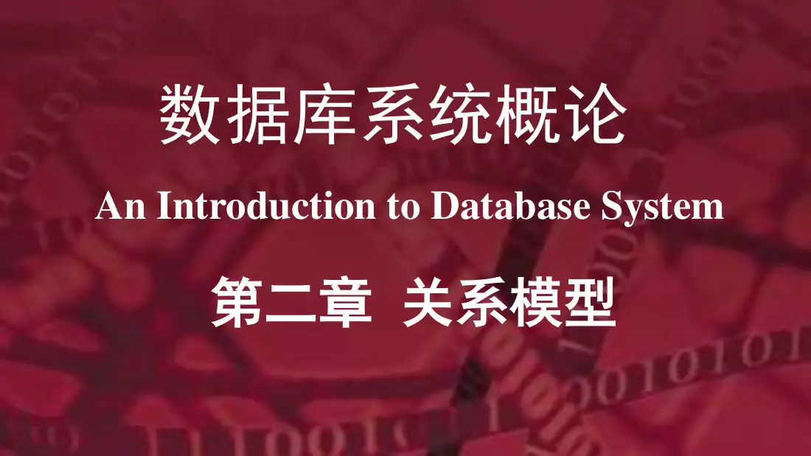

原文：

数据库系统概论

An Introduction to Database System

第二章 关系模型

### 第2章 关系数据库

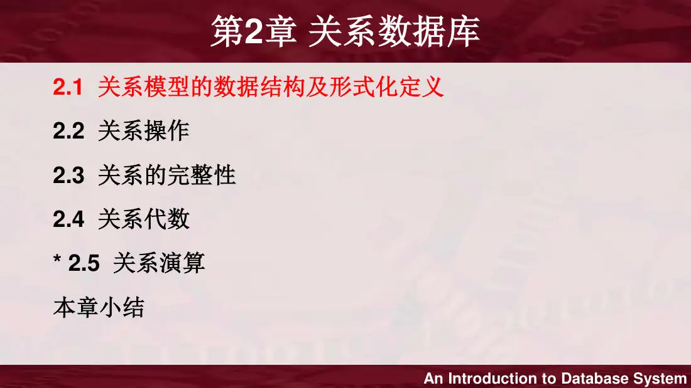

原文：

第2章 关系数据库

2.1 关系模型的数据结构及形式化定义

2.2 关系操作

2.3 关系的完整性

2.4 关系代数

\* 2.5 关系演算

本章小结

An Introduction to Database System

### 2.1 关系模型的数据结构及形式化定义

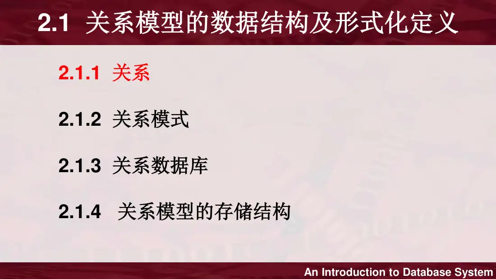

原文：

2.1 关系模型的数据结构及形式化定义

2.1.1 关系

2.1.2 关系模式

2.1.3 关系数据库

2.1.4 关系模型的存储结构

An Introduction to Database System

### 2.1.1 关系

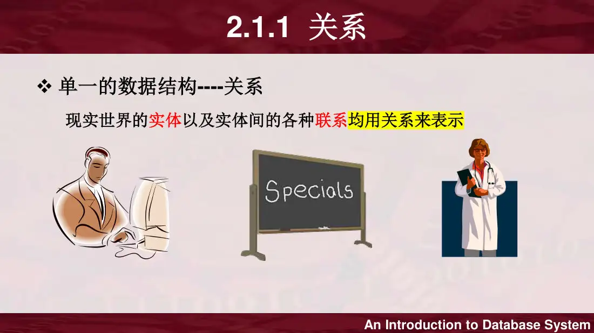

原文：

2.1.1 关系

◆ 单一的数据结构----关系

现实世界的实体以及实体间的各种联系均用关系来表示

Specials

An Introduction to Database System

### 关系（续）

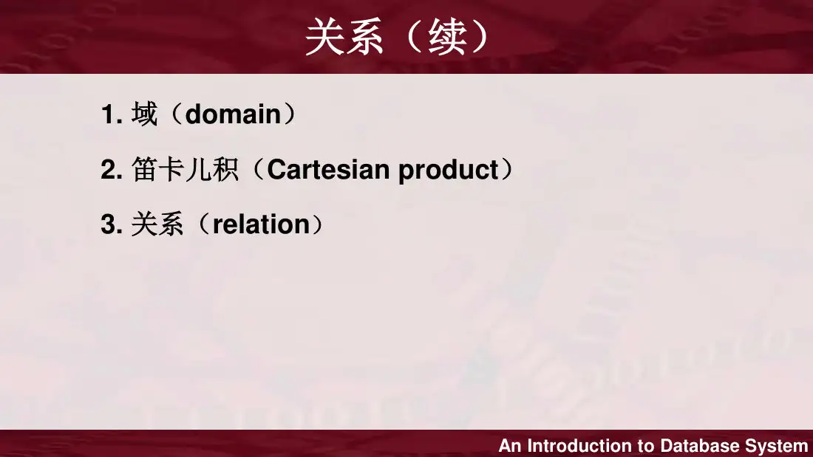

原文：

关系（续）

1. 域（domain）

2. 笛卡儿积（Cartesian product）

3. 关系（relation）

An Introduction to Database System

### 1. 域（Domain）

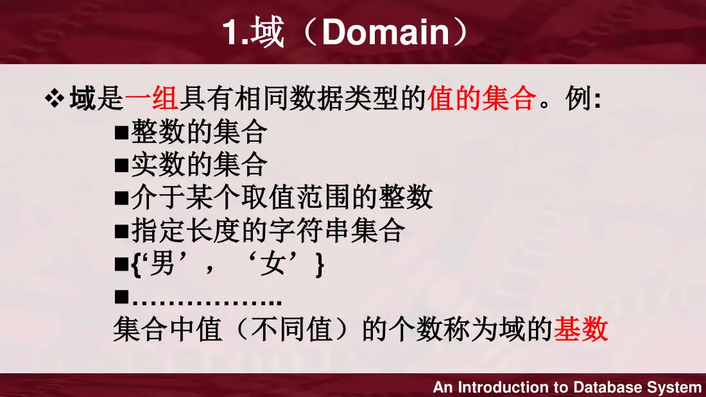

原文：

1. 域（Domain）

✿域是一组具有相同数据类型的值的集合。例:

■整数的集合

■实数的集合

■介于某个取值范围的整数

■指定长度的字符串集合

■{'男'，‘女'}

集合中值（不同值）的个数称为域的基数

An Introduction to Database System

### 2.笛卡尔积（Cartesian Product）

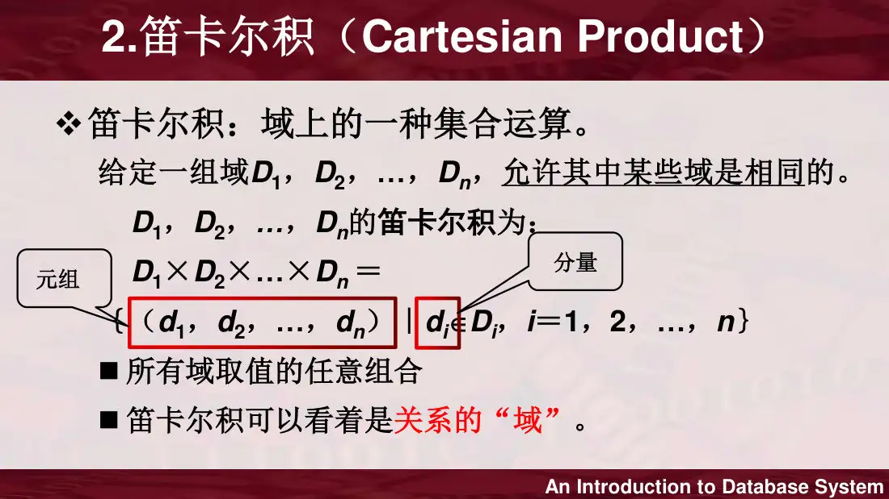

原文：

2.笛卡尔积（Cartesian Product）

笛卡尔积：域上的一种集合运算。

给定一组域 $D_{1}$ , $D_{2}$ , ..., $D_{n}$ , 允许其中某些域是相同的。

$D_{1}$ ， $D_{2}$ ，…， $D_{n}$ 的笛卡尔积为；

元组

$$
D _ {1} \times D _ {2} \times \dots \times D _ {n} =
$$

$$
d _ {i} \in D _ {i}, i = 1, 2, \dots , n \}
$$

■ 所有域取值的任意组合

■笛卡尔积可以看着是关系的“域”。

An Introduction to Database System

### 笛卡尔积（续）

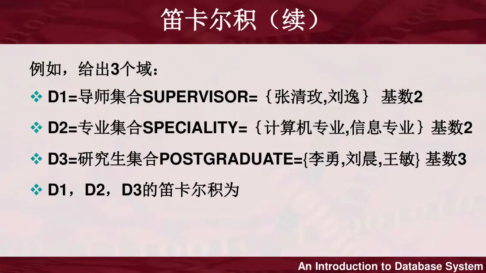

原文：

笛卡尔积（续）

例如，给出3个域:

D1=导师集合SUPERVISOR={张清玫,刘逸} 基数2

D2=专业集合SPECIALITY={计算机专业,信息专业}基数2

D3=研究生集合POSTGRADUATE={李勇,刘晨,王敏}基数3

D1，D2，D3的笛卡尔积为

An Introduction to Database System

### 笛卡尔积（续）

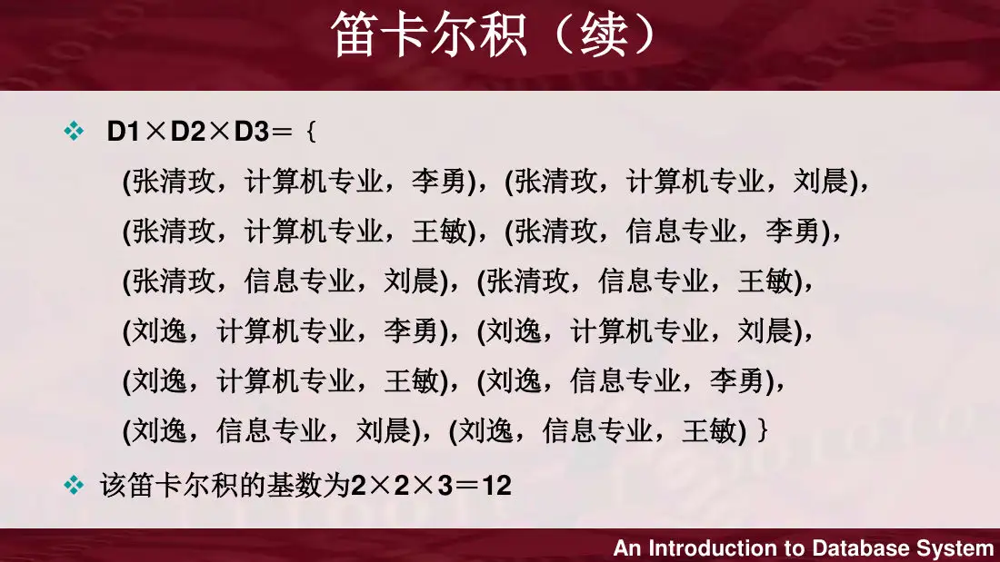

原文：

笛卡尔积（续）

D1×D2×D3={

(张清玫，计算机专业，李勇)，(张清玫，计算机专业，刘晨)，

(张清玫，计算机专业，王敏)，(张清玫，信息专业，李勇)，

(张清玫，信息专业，刘晨)，(张清玫，信息专业，王敏)，

(刘逸，计算机专业，李勇)，(刘逸，计算机专业，刘晨)，

(刘逸，计算机专业，王敏)，(刘逸，信息专业，李勇)，

(刘逸，信息专业，刘晨)，(刘逸，信息专业，王敏)

该笛卡尔积的基数为 $2 \times 2 \times 3 = 12$

An Introduction to Database System

### 笛卡儿积（续）

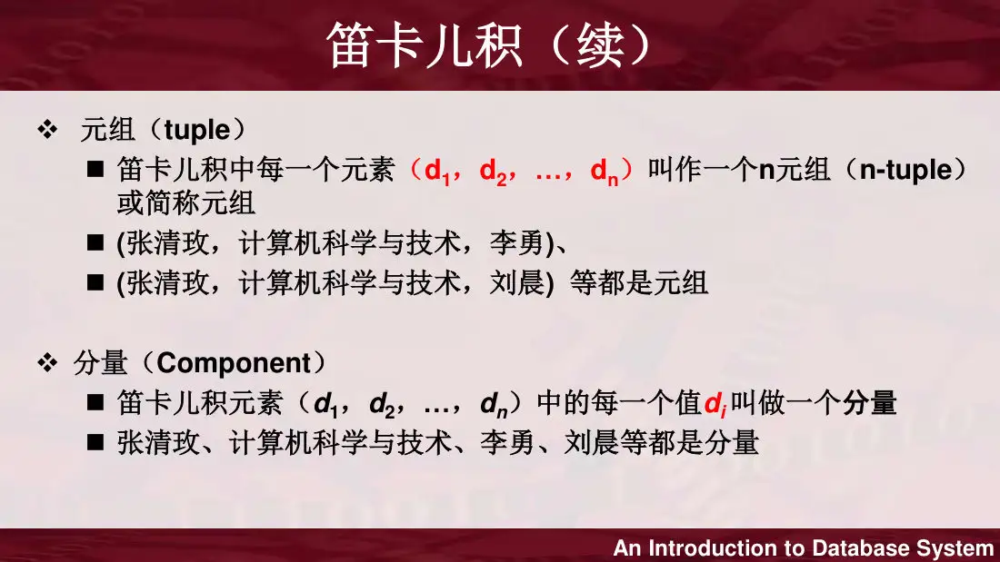

原文：

笛卡儿积（续）

元组（tuple）

■ 笛卡儿积中每一个元素（ $d_1, d_2, \ldots, d_n$ ）叫作一个n元组（n-tuple）或简称元组

■ (张清玫，计算机科学与技术，李勇)、

■ (张清玫，计算机科学与技术，刘晨) 等都是元组

分量（Component）

■ 笛卡儿积元素（ $d_{1}$ ， $d_{2}$ ，…， $d_{n}$ ）中的每一个值 $d_{i}$ 叫做一个分量

■ 张清玫、计算机科学与技术、李勇、刘晨等都是分量

An Introduction to Database System

### 笛卡尔积（续）

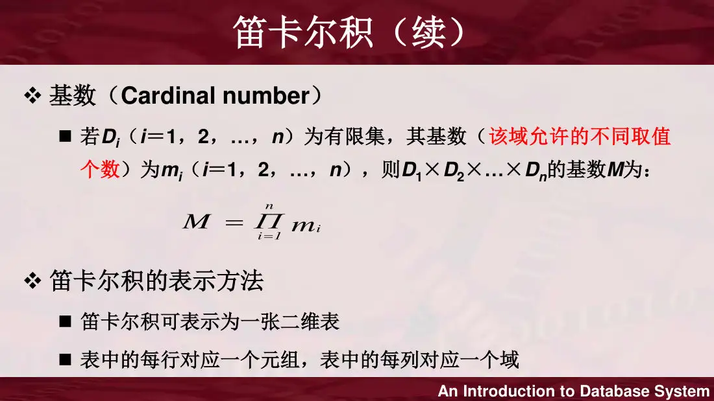

原文：

笛卡尔积（续）

✿ 基数（Cardinal number）

■ 若 $D_{i}$ (i=1, 2, ..., n) 为有限集，其基数（该域允许的不同取值个数）为 $m_{i}$ (i=1, 2, ..., n)，则 $D_{1} \times D_{2} \times \ldots \times D_{n}$ 的基数 $M$ 为：

$$
M = \prod_ {i = 1} ^ {n} m _ {i}
$$

◆笛卡尔积的表示方法

■笛卡尔积可表示为一张二维表

■ 表中的每行对应一个元组，表中的每列对应一个域

An Introduction to Database System

### 3. 关系（relation）

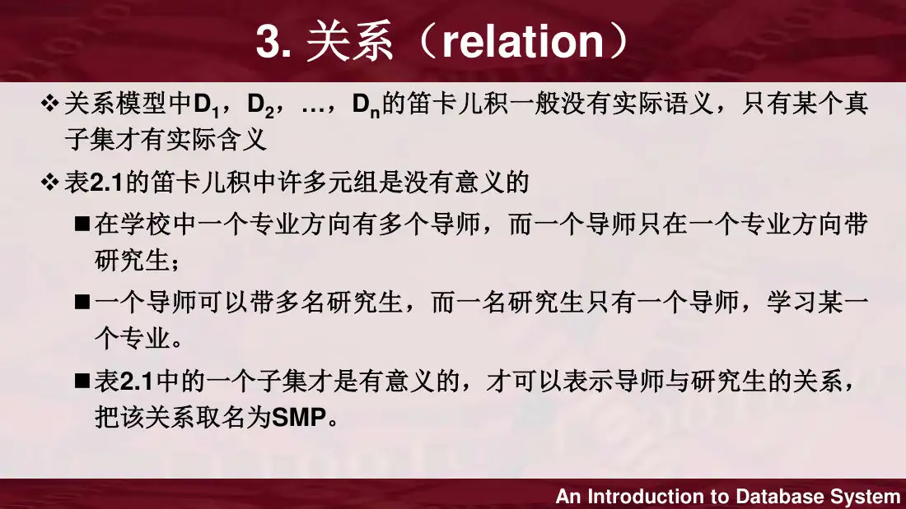

原文：

3. 关系（relation）

关系模型中 $D_{1}$ ， $D_{2}$ ，…， $D_{n}$ 的笛卡儿积一般没有实际语义，只有某个真子集才有实际含义

表2.1的笛卡儿积中许多元组是没有意义的

■在学校中一个专业方向有多个导师，而一个导师只在一个专业方向带研究生；

■一个导师可以带多名研究生，而一名研究生只有一个导师，学习某一个专业。

■表2.1中的一个子集才是有意义的，才可以表示导师与研究生的关系，把该关系取名为SMP。

An Introduction to Database System

### 关系（续）

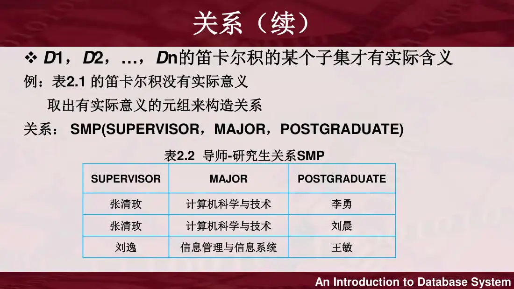

原文：

关系（续）

✿ D1, D2, ..., Dn的笛卡尔积的某个子集才有实际含义

例：表2.1 的笛卡尔积没有实际意义

取出有实际意义的元组来构造关系

关系：SMP(SUPERVISOR，MAJOR，POSTGRADUATE)

表2.2 导师-研究生关系SMP
<table><tr><td>SUPERVISOR</td><td>MAJOR</td><td>POSTGRADUATE</td></tr><tr><td>张清玫</td><td>计算机科学与技术</td><td>李勇</td></tr><tr><td>张清玫</td><td>计算机科学与技术</td><td>刘晨</td></tr><tr><td>刘逸</td><td>信息管理与信息系统</td><td>王敏</td></tr></table>

An Introduction to Database System

### 关系（续）

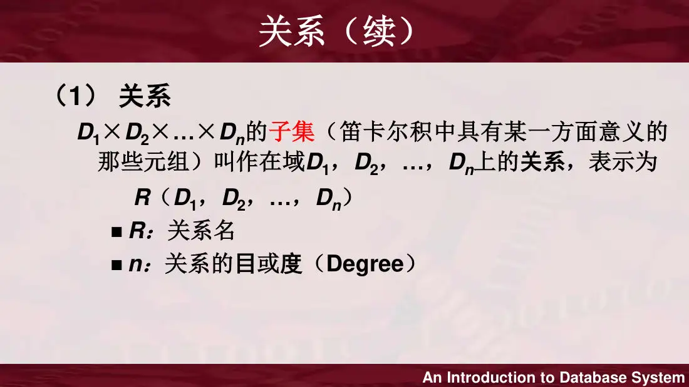

原文：

关系（续）

(1) 关系

$D_{1} \times D_{2} \times \ldots \times D_{n}$ 的子集（笛卡尔积中具有某一方面意义的那些元组）叫作在域 $D_{1}, D_{2}, \ldots, D_{n}$ 上的关系，表示为

$$
R \left(D _ {1}, D _ {2}, \dots , D _ {n}\right)
$$

■ R: 关系名

■ n: 关系的目或度（Degree）

An Introduction to Database System

### 关系（续）

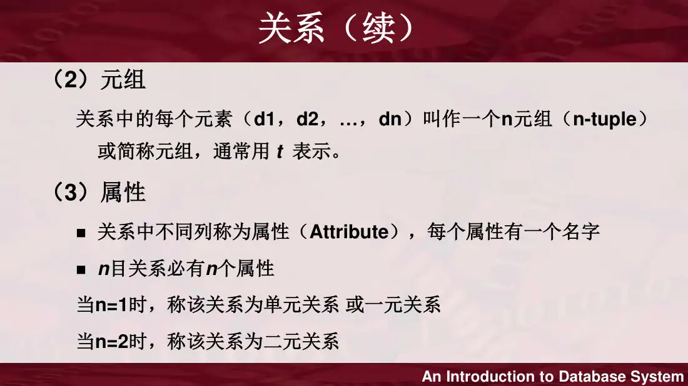

原文：

关系（续）

(2) 元组

关系中的每个元素（d1，d2，…，dn）叫作一个n元组（n-tuple）或简称元组，通常用 t 表示。

(3) 属性

■ 关系中不同列称为属性（Attribute），每个属性有一个名字

■ n目关系必有n个属性

当n=1时，称该关系为单元关系或一元关系

当 $n = 2$ 时，称该关系为二元关系

An Introduction to Database System

### 关系（续）

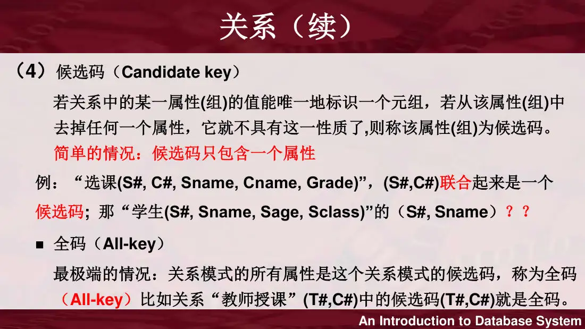

原文：

关系（续）

(4) 候选码（Candidate key）

若关系中的某一属性(组)的值能唯一地标识一个元组，若从该属性(组)中去掉任何一个属性，它就不具有这一性质了,则称该属性(组)为候选码。

简单的情况：候选码只包含一个属性

例：“选课(S#, C#, Sname, Cname, Grade)”, (S#, C#)联合起来是一个候选码；那“学生(S#, Sname, Sage, Sclass)”的（S#, Sname）？？

■ 全码（All-key）

最极端的情况：关系模式的所有属性是这个关系模式的候选码，称为全码（All-key）比如关系“教师授课”(T#,C#)中的候选码(T#,C#)就是全码。

An Introduction to Database System

### 关系（续）

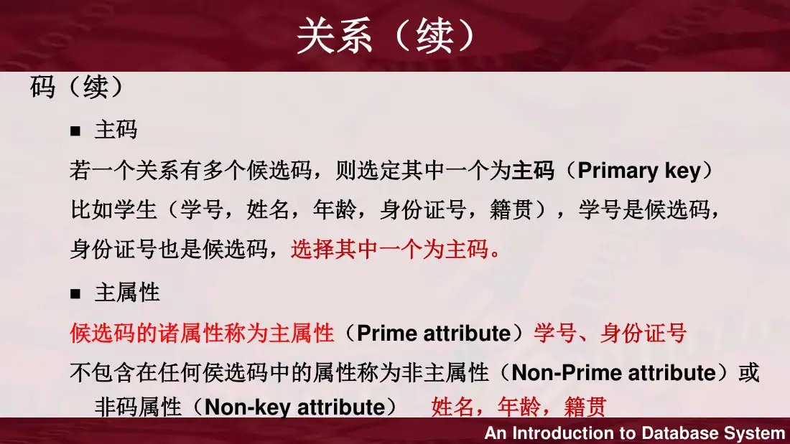

原文：

关系（续）

码（续）

■ 主码

若一个关系有多个候选码，则选定其中一个为主码（Primary key）比如学生（学号，姓名，年龄，身份证号，籍贯），学号是候选码，身份证号也是候选码，选择其中一个为主码。

■ 主属性

候选码的诸属性称为主属性（Prime attribute）学号、身份证号

不包含在任何侯选码中的属性称为非主属性（Non-Prime attribute）或

非码属性（Non-key attribute） 姓名，年龄，籍贯

An Introduction to Database System

### 关系（续）

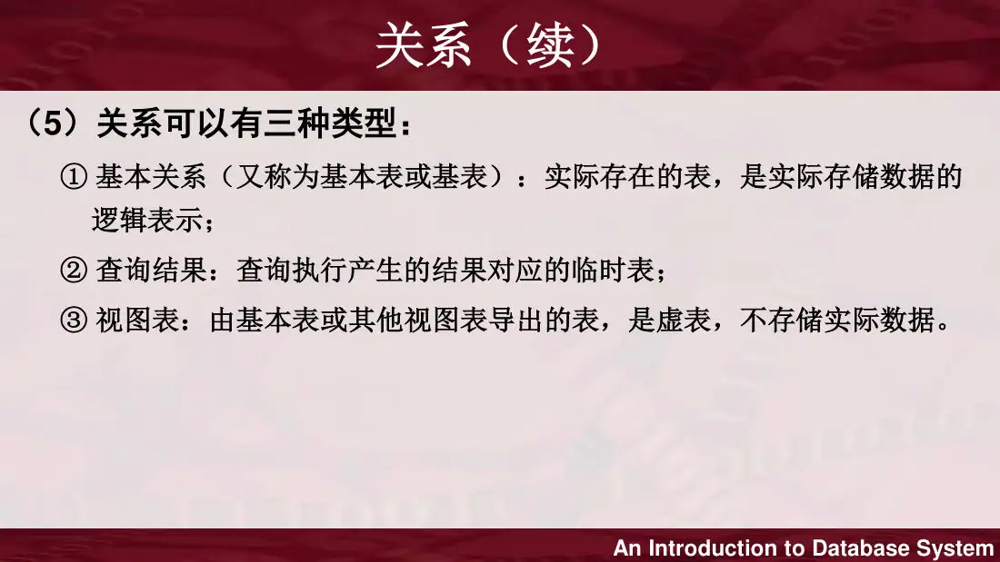

原文：

关系（续）

(5) 关系可以有三种类型:

① 基本关系（又称为基本表或基表）：实际存在的表，是实际存储数据的逻辑表示；

② 查询结果：查询执行产生的结果对应的临时表；

③ 视图表：由基本表或其他视图表导出的表，是虚表，不存储实际数据。

An Introduction to Database System

### 关系（续）

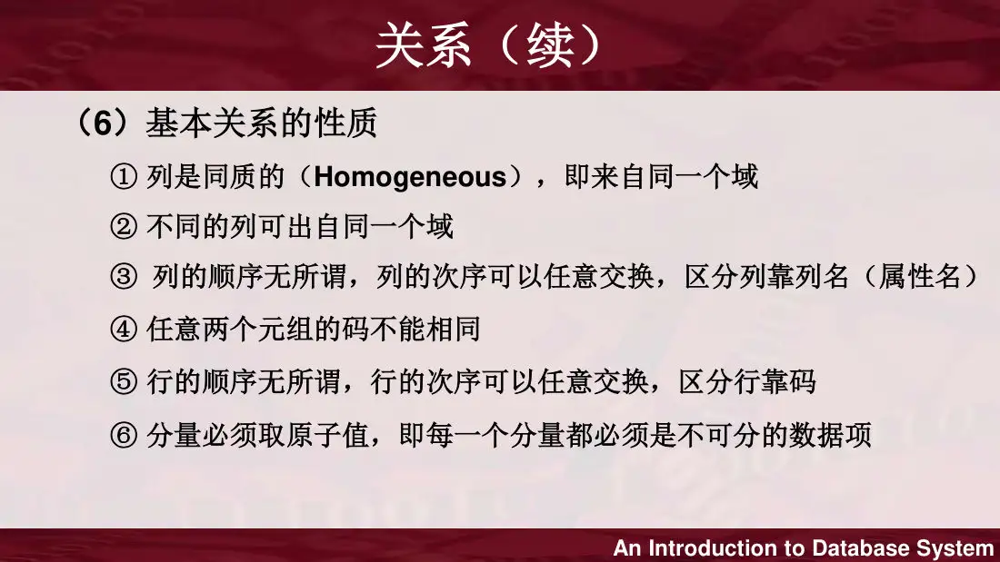

原文：

关系（续）

(6) 基本关系的性质

① 列是同质的（Homogeneous），即来自同一个域

② 不同的列可出自同一个域

③ 列的顺序无所谓，列的次序可以任意交换，区分列靠列名（属性名）

④ 任意两个元组的码不能相同

⑤ 行的顺序无所谓，行的次序可以任意交换，区分行靠码

⑥ 分量必须取原子值，即每一个分量都必须是不可分的数据项

An Introduction to Database System

### ⑥ 分量必须取原子值，即每一个分量都必须是不可分的数据项。

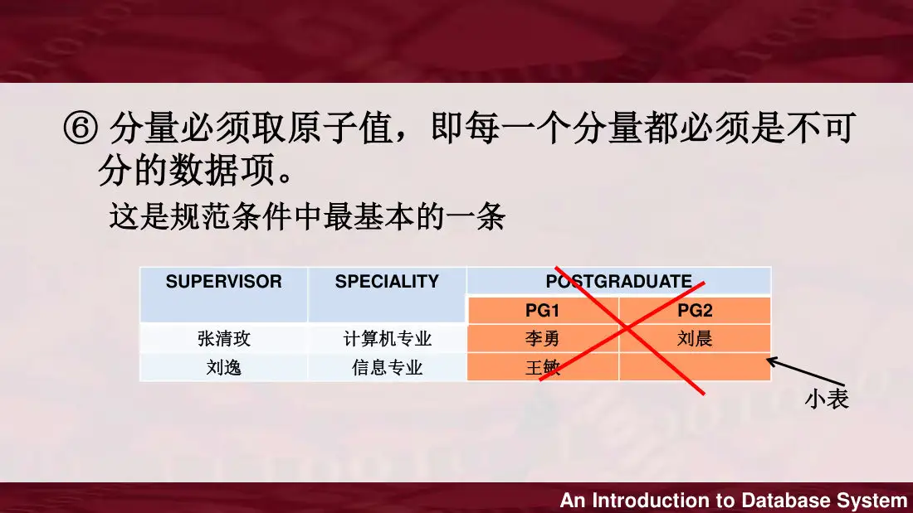

原文：

⑥ 分量必须取原子值，即每一个分量都必须是不可分的数据项。

这是规范条件中最基本的一条

An Introduction to Database System

### 2.1 关系模型的数据结构及形式化定义

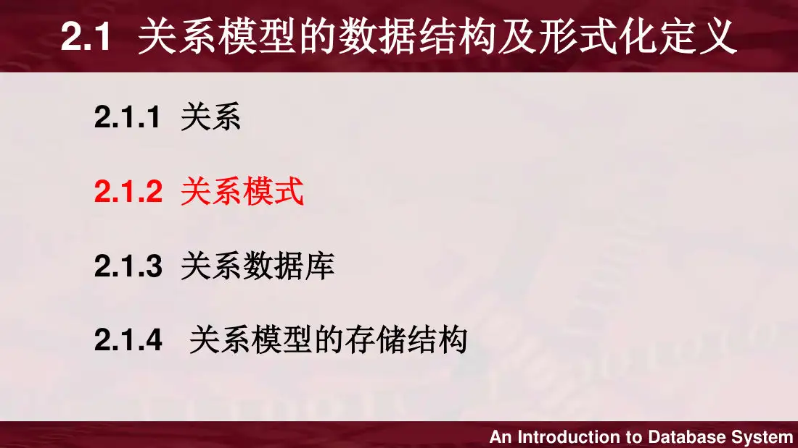

原文：

2.1 关系模型的数据结构及形式化定义

2.1.1 关系
2.1.2 关系模式
2.1.3 关系数据库
2.1.4 关系模型的存储结构

An Introduction to Database System

### 2.1.2 关系模式

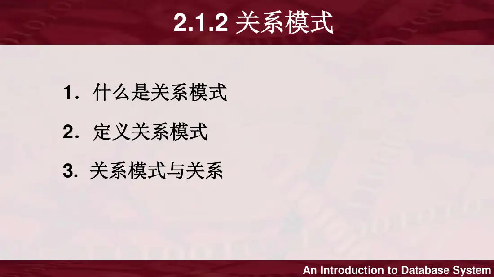

原文：

2.1.2 关系模式

1. 什么是关系模式

2. 定义关系模式

3. 关系模式与关系

An Introduction to Database System

### 1. 什么是关系模式

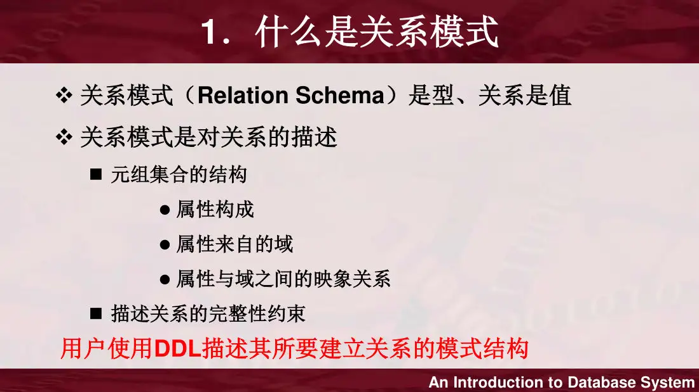

原文：

1. 什么是关系模式

关系模式（Relation Schema）是型、关系是值

关系模式是对关系的描述

■ 元组集合的结构

\- 属性构成

\- 属性来自的域

\- 属性与域之间的映象关系

■ 描述关系的完整性约束

用户使用DDL描述其所要建立关系的模式结构

An Introduction to Database System

### 2. 定义关系模式

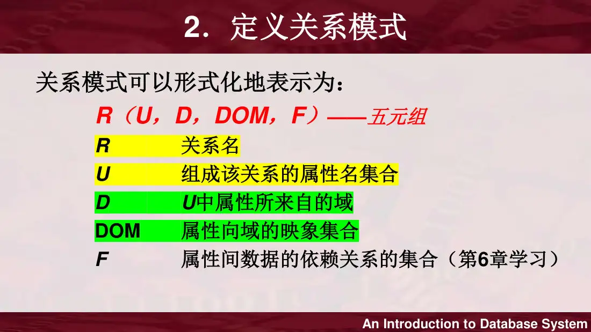

原文：

2. 定义关系模式

关系模式可以形式化地表示为:

R (U, D, DOM, F) ——五元组

R 关系名

U 组成该关系的属性名集合

D U中属性所来自的域

DOM 属性向域的映象集合

F 属性间数据的依赖关系的集合（第6章学习）

An Introduction to Database System

### 关系模式举例

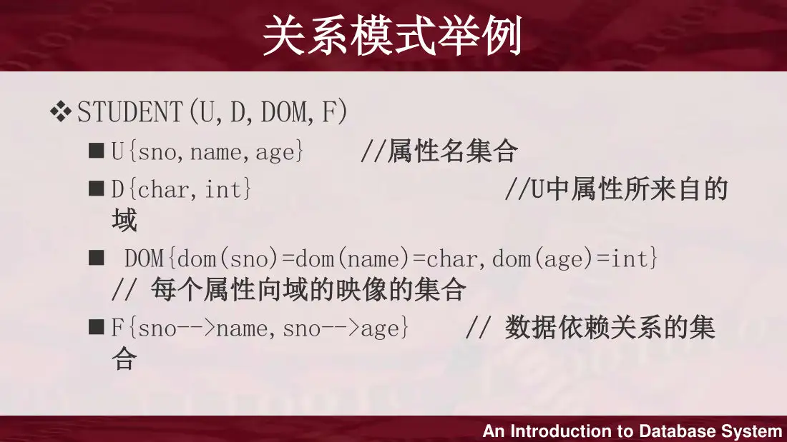

原文：

关系模式举例

◆ STUDENT (U, D, DOM, F)

■ U{sno, name, age} //属性名集合

■ D{char, int}
域

//U中属性所来自的

■ DOM{dom(sno)=dom(name)=char, dom(age)=int} // 每个属性向域的映像的集合

An Introduction to Database System

### 定义关系模式（续）

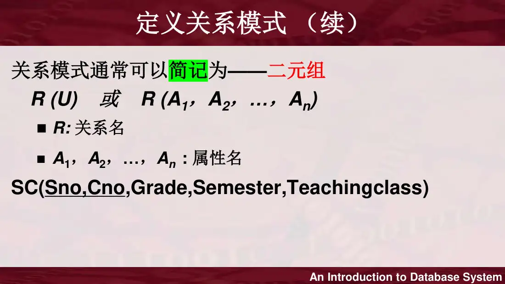

原文：

定义关系模式（续）

关系模式通常可以简记为——二元组

$R(U)$ 或 $R(A_{1}, A_{2}, \ldots, A_{n})$

■ R: 关系名

■ $A_{1}$ , $A_{2}$ , ..., $A_{n}$ : 属性名

SC(Sno,Cno,Grade,Semester,Teachingclass)

An Introduction to Database System

### 3. 关系模式与关系

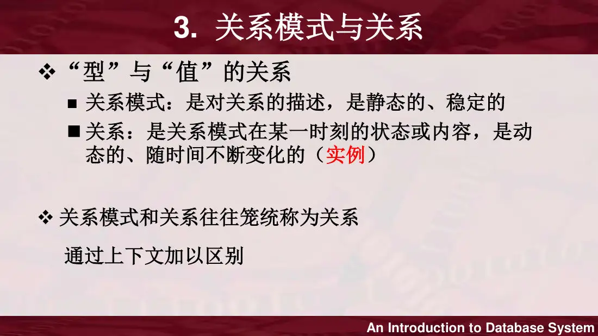

原文：

3. 关系模式与关系

“型”与“值”的关系

■ 关系模式：是对关系的描述，是静态的、稳定的

■ 关系：是关系模式在某一时刻的状态或内容，是动态的、随时间不断变化的（实例）

关系模式和关系往往笼统称为关系

通过上下文加以区别

An Introduction to Database System

### 2.1.1 关系

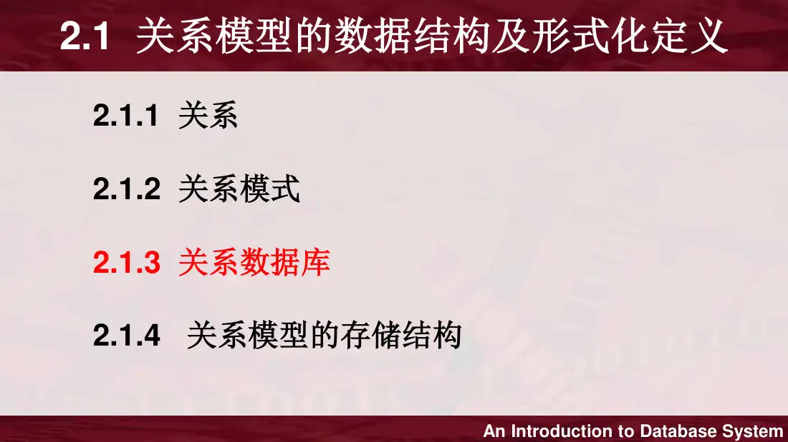

原文：

2.1.1 关系
2.1.2 关系模式
2.1.3 关系数据库
2.1.4 关系模型的存储结构

2.1 关系模型的数据结构及形式化定义

An Introduction to Database System

### 2.1.3 关系数据库

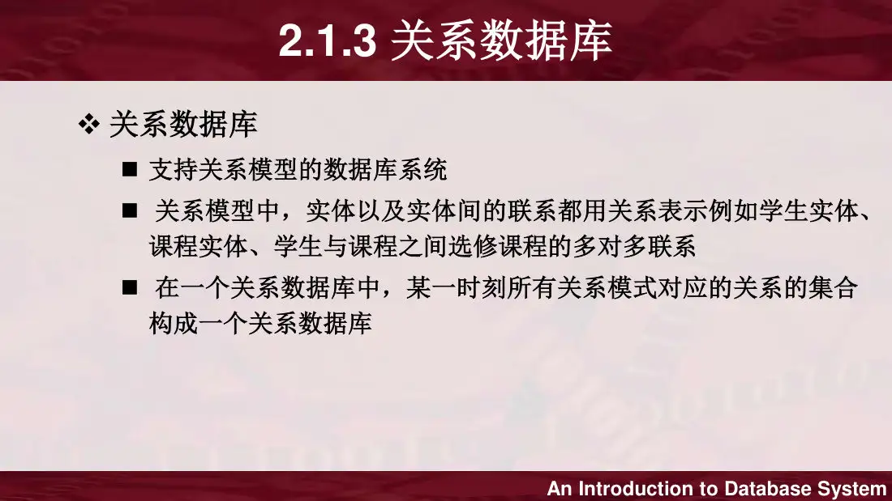

原文：

2.1.3 关系数据库

关系数据库

■ 支持关系模型的数据库系统

■ 关系模型中，实体以及实体间的联系都用关系表示例如学生实体、课程实体、学生与课程之间选修课程的多对多联系

■ 在一个关系数据库中，某一时刻所有关系模式对应的关系的集合构成一个关系数据库

An Introduction to Database System

### 关系数据库（续）

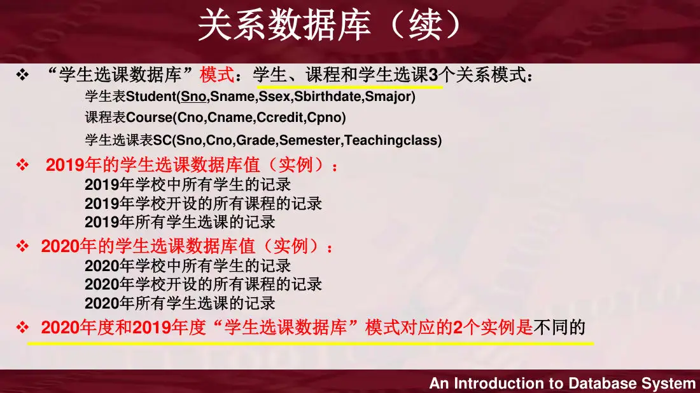

原文：

关系数据库（续）

“学生选课数据库”模式：学生、课程和学生选课3个关系模式：

学生表Student(Sno,Sname,Ssex,Sbirthdate,Smajor)

课程表Course(Cno,Cname,Ccredit,Cpno)

2020年的学生选课数据库值（实例）：
2020年学校中所有学生的记录
2020年学校开设的所有课程的记录
2020年所有学生选课的记录

2020年度和2019年度“学生选课数据库”模式对应的2个实例是不同的

An Introduction to Database System

### 关系数据库（续）

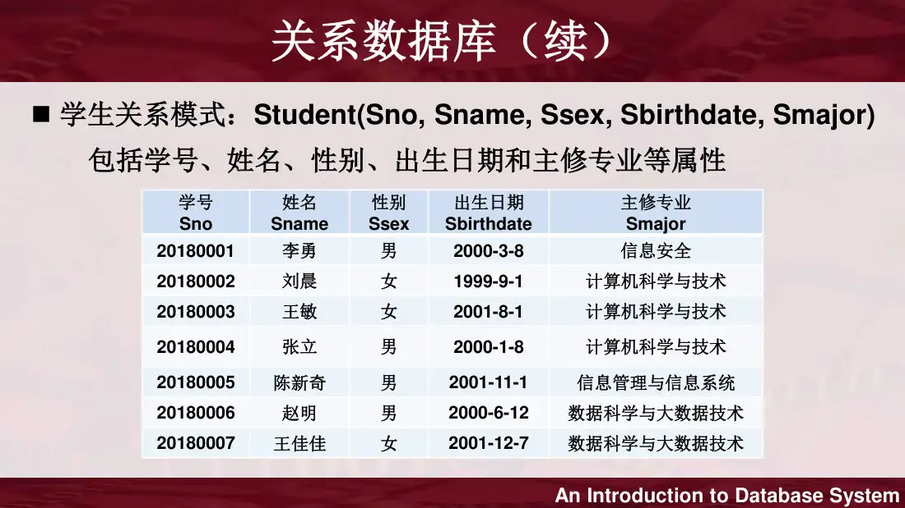

原文：

关系数据库（续）

■ 学生关系模式：Student(Sno, Sname, Ssex, Sbirthdate, Smajor)包括学号、姓名、性别、出生日期和主修专业等属性

<table><tr><td>学号Sno</td><td>姓名Sname</td><td>性别Ssex</td><td>出生日期Sbirthdate</td><td>主修专业Smajor</td></tr><tr><td>20180001</td><td>李勇</td><td>男</td><td>2000-3-8</td><td>信息安全</td></tr><tr><td>20180002</td><td>刘晨</td><td>女</td><td>1999-9-1</td><td>计算机科学与技术</td></tr><tr><td>20180003</td><td>王敏</td><td>女</td><td>2001-8-1</td><td>计算机科学与技术</td></tr><tr><td>20180004</td><td>张立</td><td>男</td><td>2000-1-8</td><td>计算机科学与技术</td></tr><tr><td>20180005</td><td>陈新奇</td><td>男</td><td>2001-11-1</td><td>信息管理与信息系统</td></tr><tr><td>20180006</td><td>赵明</td><td>男</td><td>2000-6-12</td><td>数据科学与大数据技术</td></tr><tr><td>20180007</td><td>王佳佳</td><td>女</td><td>2001-12-7</td><td>数据科学与大数据技术</td></tr></table>

An Introduction to Database System

### 关系数据库（续）

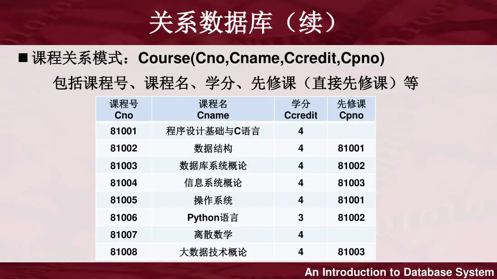

原文：

关系数据库（续）

■ 课程关系模式：Course(Cno,Cname,Ccredit,Cpno)

包括课程号、课程名、学分、先修课（直接先修课）等

<table><tr><td>课程号Cno</td><td>课程名Cname</td><td>学分Ccredit</td><td>先修课Cpno</td></tr><tr><td>81001</td><td>程序设计基础与C语言</td><td>4</td><td></td></tr><tr><td>81002</td><td>数据结构</td><td>4</td><td>81001</td></tr><tr><td>81003</td><td>数据库系统概论</td><td>4</td><td>81002</td></tr><tr><td>81004</td><td>信息系统概论</td><td>4</td><td>81003</td></tr><tr><td>81005</td><td>操作系统</td><td>4</td><td>81001</td></tr><tr><td>81006</td><td>Python语言</td><td>3</td><td>81002</td></tr><tr><td>81007</td><td>离散数学</td><td>4</td><td></td></tr><tr><td>81008</td><td>大数据技术概论</td><td>4</td><td>81003</td></tr></table>

An Introduction to Database System

### 关系数据库（续）

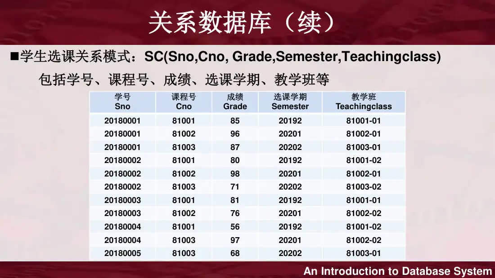

原文：

关系数据库（续）

■学生选课关系模式：SC(Sno,Cno, Grade,Semester,Teachingclass)

包括学号、课程号、成绩、选课学期、教学班等

<table><tr><td>学号Sno</td><td>课程号Cno</td><td>成绩Grade</td><td>选课学期Semester</td><td>教学班Teachingclass</td></tr><tr><td>20180001</td><td>81001</td><td>85</td><td>20192</td><td>81001-01</td></tr><tr><td>20180001</td><td>81002</td><td>96</td><td>20201</td><td>81002-01</td></tr><tr><td>20180001</td><td>81003</td><td>87</td><td>20202</td><td>81003-01</td></tr><tr><td>20180002</td><td>81001</td><td>80</td><td>20192</td><td>81001-02</td></tr><tr><td>20180002</td><td>81002</td><td>98</td><td>20201</td><td>81002-01</td></tr><tr><td>20180002</td><td>81003</td><td>71</td><td>20202</td><td>81003-02</td></tr><tr><td>20180003</td><td>81001</td><td>81</td><td>20192</td><td>81001-01</td></tr><tr><td>20180003</td><td>81002</td><td>76</td><td>20201</td><td>81002-02</td></tr><tr><td>20180004</td><td>81001</td><td>56</td><td>20192</td><td>81001-02</td></tr><tr><td>20180004</td><td>81003</td><td>97</td><td>20201</td><td>81002-02</td></tr><tr><td>20180005</td><td>81003</td><td>68</td><td>20202</td><td>81003-01</td></tr></table>

An Introduction to Database System

### 2.1.1 关系

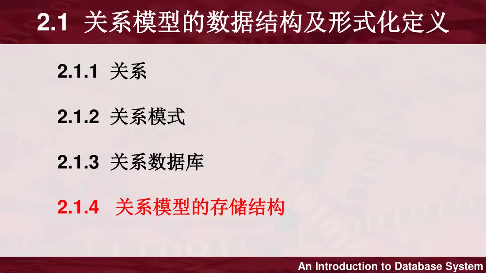

原文：

2.1.1 关系
2.1.2 关系模式
2.1.3 关系数据库
2.1.4 关系模型的存储结构

2.1 关系模型的数据结构及形式化定义

An Introduction to Database System

### 2.1.4 关系模型的存储结构

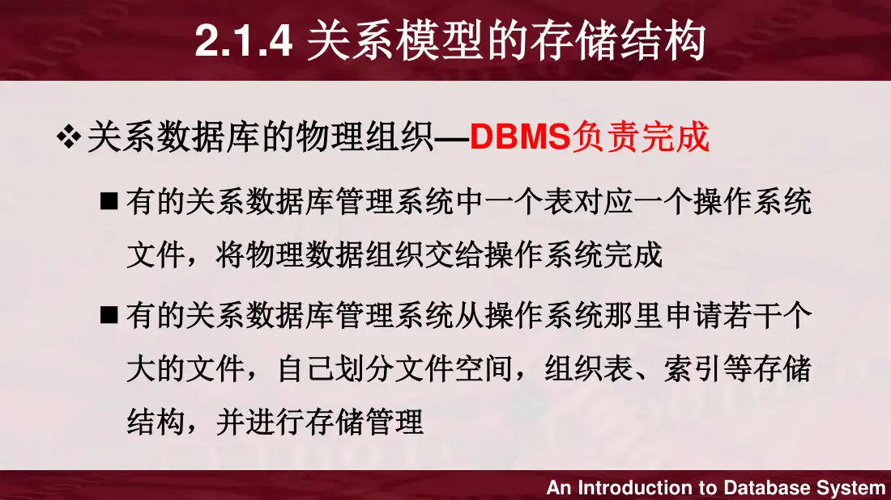

原文：

2.1.4 关系模型的存储结构

关系数据库的物理组织—DBMS负责完成

■有的关系数据库管理系统中一个表对应一个操作系统文件，将物理数据组织交给操作系统完成

■有的关系数据库管理系统从操作系统那里申请若干个大的文件，自己划分文件空间，组织表、索引等存储结构，并进行存储管理

An Introduction to Database System

### 第2章 关系数据库

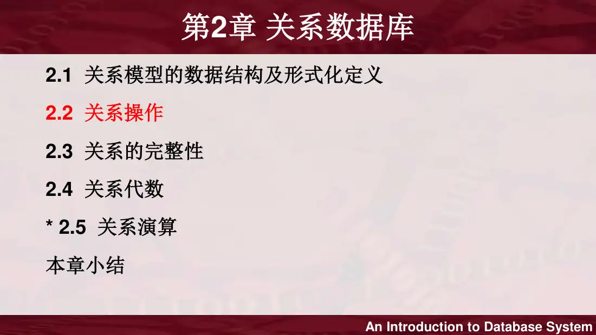

原文：

第2章 关系数据库

2.1 关系模型的数据结构及形式化定义

2.2 关系操作

2.3 关系的完整性

2.4 关系代数

\* 2.5 关系演算

本章小结

An Introduction to Database System

### 2.2 关系操作

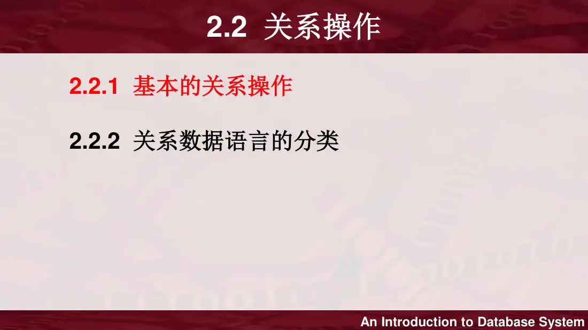

原文：

2.2 关系操作

2.2.1 基本的关系操作

2.2.2 关系数据语言的分类

An Introduction to Database System

### 2.2.1 基本的关系操作

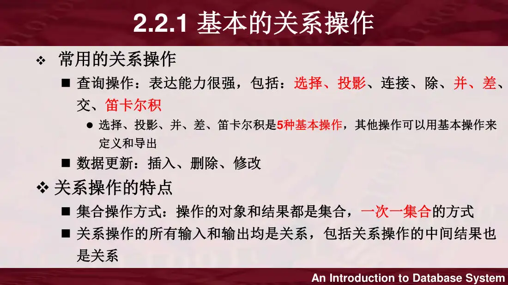

原文：

2.2.1 基本的关系操作

常用的关系操作

■ 查询操作：表达能力很强，包括：选择、投影、连接、除、并、差、交、笛卡尔积

\- 选择、投影、并、差、笛卡尔积是5种基本操作，其他操作可以用基本操作来定义和导出

■ 数据更新：插入、删除、修改

关系操作的特点

■ 集合操作方式：操作的对象和结果都是集合，一次一集合的方式

■ 关系操作的所有输入和输出均是关系，包括关系操作的中间结果也是关系

An Introduction to Database System

### 第2章 关系数据库

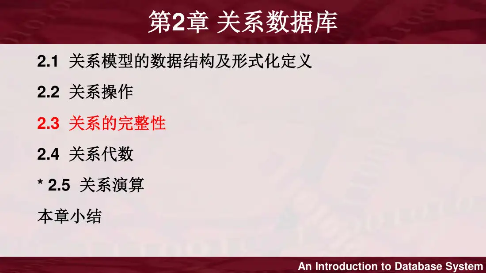

原文：

第2章 关系数据库

2.1 关系模型的数据结构及形式化定义

2.2 关系操作

2.3 关系的完整性

2.4 关系代数

\* 2.5 关系演算

本章小结

An Introduction to Database System

### 关系的三类完整性约束

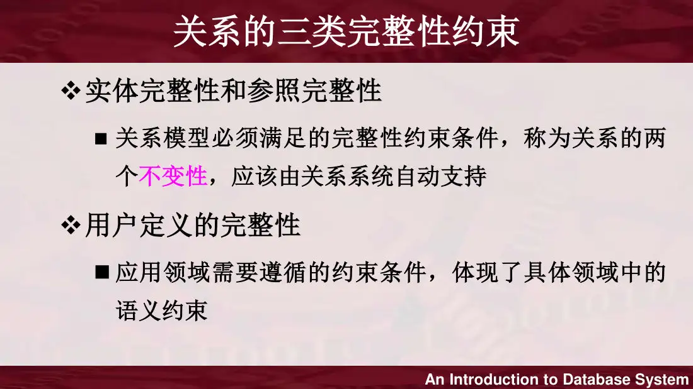

原文：

关系的三类完整性约束

实体完整性和参照完整性

■ 关系模型必须满足的完整性约束条件，称为关系的两个不变性，应该由关系系统自动支持

◆ 用户定义的完整性

■ 应用领域需要遵循的约束条件，体现了具体领域中的语义约束

An Introduction to Database System

### 2.3 关系的完整性

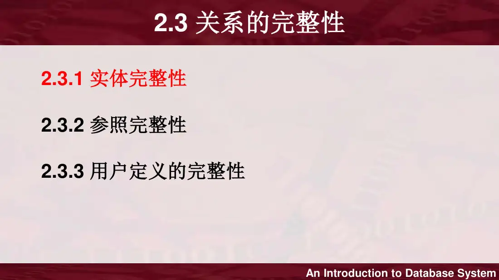

原文：

2.3 关系的完整性

2.3.1 实体完整性

2.3.2 参照完整性

2.3.3 用户定义的完整性

An Introduction to Database System

### 2.3.1 实体完整性

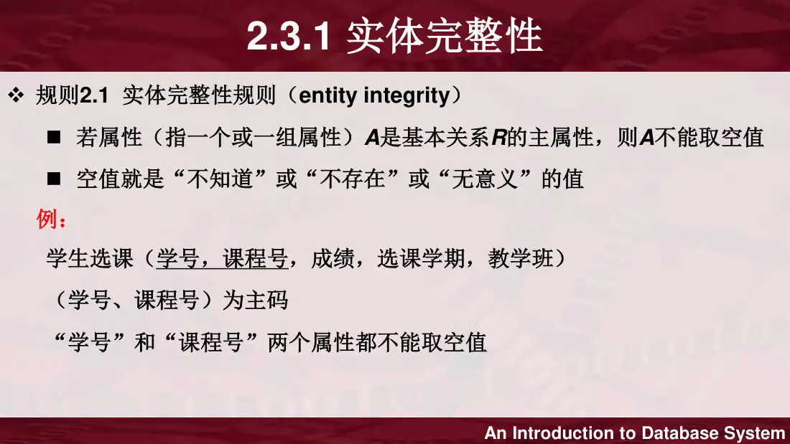

原文：

2.3.1 实体完整性

◆ 规则2.1 实体完整性规则（entity integrity）

■ 若属性（指一个或一组属性）A是基本关系R的主属性，则A不能取空值

■ 空值就是 “不知道” 或 “不存在” 或 “无意义” 的值

例:

学生选课（学号，课程号，成绩，选课学期，教学班）

(学号、课程号)为主码

“学号”和“课程号”两个属性都不能取空值

An Introduction to Database System

### 实体完整性（续）

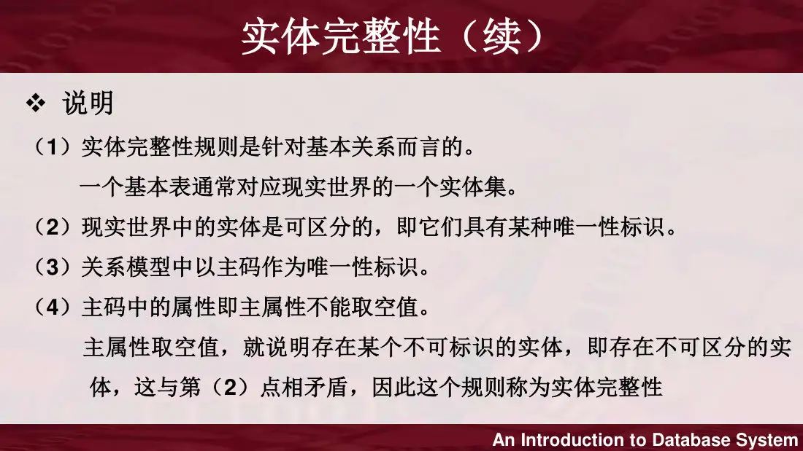

原文：

实体完整性（续）

说明

(1) 实体完整性规则是针对基本关系而言的。一个基本表通常对应现实世界的一个实体集。

(2) 现实世界中的实体是可区分的, 即它们具有某种唯一性标识。

(3) 关系模型中以主码作为唯一性标识。

(4) 主码中的属性即主属性不能取空值。

主属性取空值，就说明存在某个不可标识的实体，即存在不可区分的实体，这与第（2）点相矛盾，因此这个规则称为实体完整性

An Introduction to Database System

### 实体完整性（续）

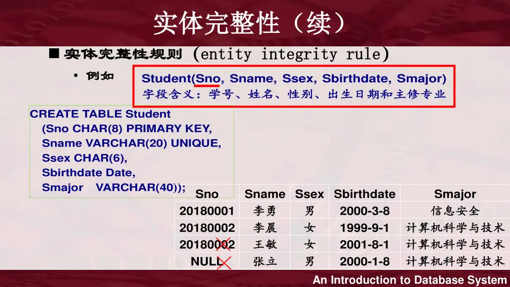

原文：

<table><tr><td colspan="6">Smajor VARCHAR(40));</td></tr><tr><td rowspan="5"></td><td>Sno</td><td>Sname</td><td>Ssex</td><td>Sbirthdate</td><td>Smajor</td></tr><tr><td>20180001</td><td>李勇</td><td>男</td><td>2000-3-8</td><td>信息安全</td></tr><tr><td>20180002</td><td>李晨</td><td>女</td><td>1999-9-1</td><td>计算机科学与技术</td></tr><tr><td>20180002</td><td>王敏</td><td>女</td><td>2001-8-1</td><td>计算机科学与技术</td></tr><tr><td>NULL</td><td>张立</td><td>男</td><td>2000-1-8</td><td>计算机科学与技术</td></tr></table>

实体完整性（续）

实体完整性规则 (entity integrity rule)

\- 例如

Student(Sno, Sname, Ssex, Sbirthdate, Smajor)字段含义：学号、姓名、性别、出生日期和主修专业

CREATE TABLE Student

(Sno CHAR(8) PRIMARY KEY,

Sname VARCHAR(20) UNIQUE,

Ssex CHAR(6),

Sbirthdate Date,

An Introduction to Database System

### 2.3 关系的完整性

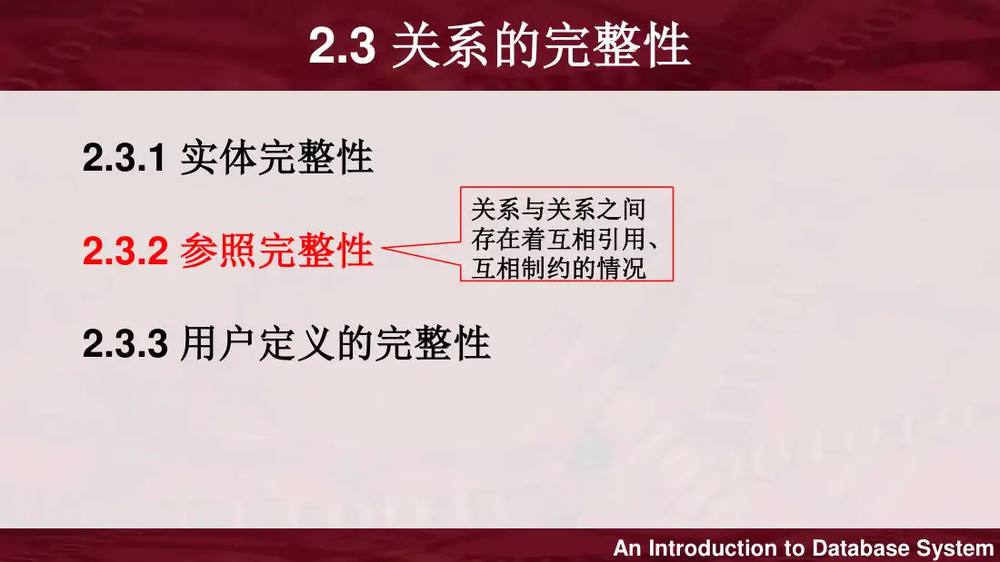

原文：

2.3 关系的完整性

2.3.1 实体完整性

2.3.2 参照完整性关系与关系之间存在着互相引用、互相制约的情况

2.3.3 用户定义的完整性

An Introduction to Database System

### 2.3.2 参照完整性

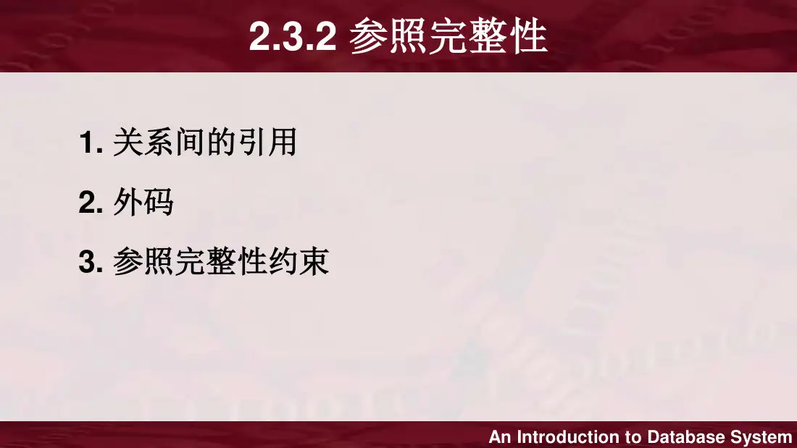

原文：

2.3.2 参照完整性

1. 关系间的引用

2. 外码

3. 参照完整性约束

An Introduction to Database System

### 1. 关系间的引用

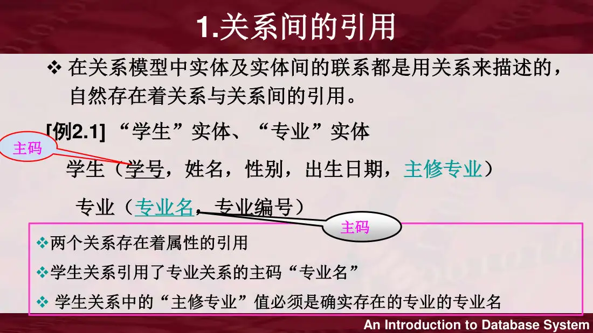

原文：

1. 关系间的引用

✿ 在关系模型中实体及实体间的联系都是用关系来描述的，自然存在着关系与关系间的引用。

[例2.1] “学生”实体、“专业”实体

主码

学生（学号，姓名，性别，出生日期，主修专业）

专业（专业名，专业编号）

主码

两个关系存在着属性的引用

学生关系引用了专业关系的主码“专业名”

学生关系中的“主修专业”值必须是确实存在的专业的专业名

An Introduction to Database System

### 关系间的引用（续）

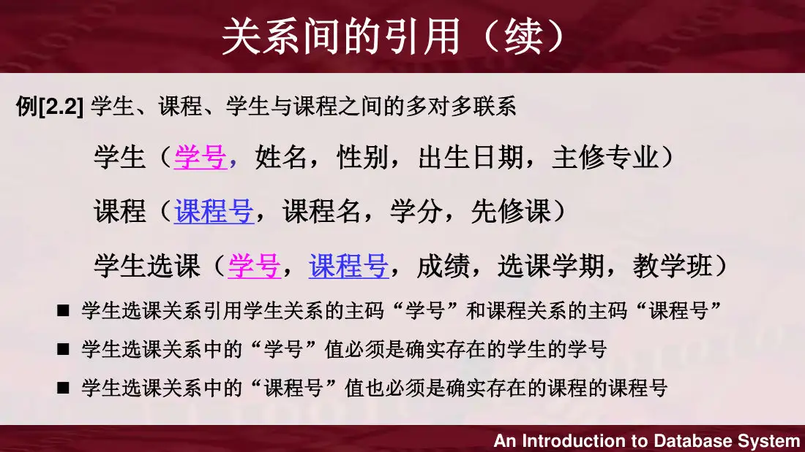

原文：

关系间的引用（续）

例[2.2] 学生、课程、学生与课程之间的多对多联系

学生（学号，姓名，性别，出生日期，主修专业）

课程（课程号，课程名，学分，先修课）

学生选课（学号，课程号，成绩，选课学期，教学班）

■ 学生选课关系引用学生关系的主码“学号”和课程关系的主码“课程号”

■ 学生选课关系中的“学号”值必须是确实存在的学生的学号

■ 学生选课关系中的“课程号”值也必须是确实存在的课程的课程号

An Introduction to Database System

### 关系间的引用（续）

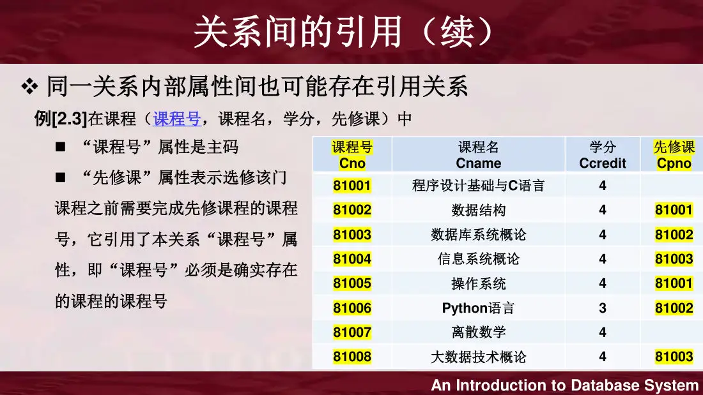

原文：

关系间的引用（续）

✿ 同一关系内部属性间也可能存在引用关系

例[2.3]在课程（课程号，课程名，学分，先修课）中

■ “课程号”属性是主码

■ “先修课”属性表示选修该门课程之前需要完成先修课程的课程号，它引用了本关系“课程号”属性，即“课程号”必须是确实存在的课程的课程号

<table><tr><td>课程号Cno</td><td>课程名Cname</td><td>学分Ccredit</td><td>先修课Cpno</td></tr><tr><td>81001</td><td>程序设计基础与C语言</td><td>4</td><td></td></tr><tr><td>81002</td><td>数据结构</td><td>4</td><td>81001</td></tr><tr><td>81003</td><td>数据库系统概论</td><td>4</td><td>81002</td></tr><tr><td>81004</td><td>信息系统概论</td><td>4</td><td>81003</td></tr><tr><td>81005</td><td>操作系统</td><td>4</td><td>81001</td></tr><tr><td>81006</td><td>Python语言</td><td>3</td><td>81002</td></tr><tr><td>81007</td><td>离散数学</td><td>4</td><td></td></tr><tr><td>81008</td><td>大数据技术概论</td><td>4</td><td>81003</td></tr></table>

An Introduction to Database System

### 2. 外码（Foreign Key）

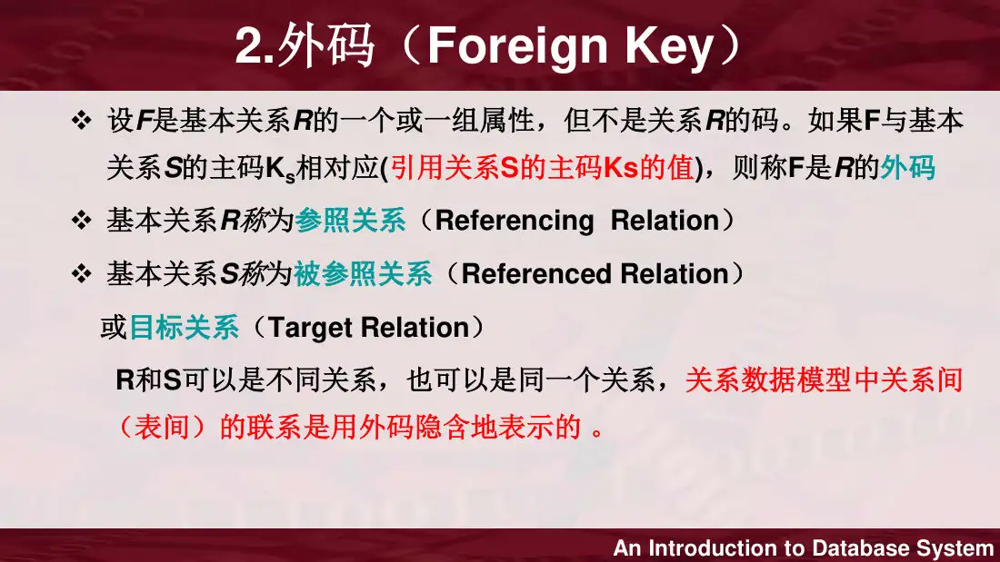

原文：

2. 外码（Foreign Key）

设F是基本关系R的一个或一组属性，但不是关系R的码。如果F与基本关系S的主码 $K_{s}$ 相对应(引用关系S的主码Ks的值)，则称F是R的外码

基本关系R称为参照关系（Referencing Relation）

✿ 基本关系S称为被参照关系（Referenced Relation）

或目标关系（Target Relation）

R和S可以是不同关系，也可以是同一个关系，关系数据模型中关系间（表间）的联系是用外码隐含地表示的。

An Introduction to Database System

### 外码（续）

原文：

外码（续）

✿ [例2.1]中学生关系的“主修专业”与专业关系的主码“专业名”相对应

■ “主修专业”属性是学生关系的外码

■ “专业”关系是被参照关系，“学生”关系为参照关系

$$
\text { “学生”关系 } \xrightarrow {\text { 主修专业 }} \text { “专业”关系 } \tag {a}
$$

An Introduction to Database System

### 外码（续）

原文：

外码（续）

✿ [例2.2]中

■ “学生选课”关系的“学号”与“学生”关系的主码“学号”相对应

■ “学生选课”关系的“课程号”与“课程”关系的主码“课程号”相对应

■ “学号”和“课程号”是“学生选课”关系的外码

■ “学生”关系和“课程”关系均为被参照关系

■ “学生选课”关系为参照关系

An Introduction to Database System

### 外码（续）

原文：

外码（续）

✿ [例2.3] “课程”关系中“先修课”属性与本身的主码“课程号”属性相对应
■ “先修课”是外码
■ “课程”关系既是参照关系也是被参照关系

An Introduction to Database System

### 外码（续）

原文：

外码（续）

关系R和S不一定是不同的关系

目标关系S的主码 $K_{s}$ 和参照关系的外码F必须定义
在同一个（或一组）域上

✿ 外码并不一定要与相应的主码同名
当外码与相应的主码属于不同关系时，往往取相同的名字，以便于识别

An Introduction to Database System

### 3.参照完整性约束

原文：

3.参照完整性约束

参照完整性约束

若属性（或属性组） $F$ 是基本关系 $R$ 的外码，它与基本关系 $S$ 的主码 $K_{s}$ 相对应（基本关系 $R$ 和 $S$ 不一定是不同的关系），则对于 $R$ 中每个元组在 $F$ 上的值必须为：

■ 或者取空值（F的每个属性值均为空值）

■ 或者等于S中某个元组的主码值

An Introduction to Database System

### 参照完整性约束（续）

原文：

参照完整性约束（续）

[例2.1]中

“学生”关系中每个元组的“主修专业”属性只取两类值:

(1) 空值, 表示该学生尚未选择主修专业

(2) 非空值, 这时该值必须是专业关系中某个元组的 “专业名” 值, 表示该学生不可能选一个不存在的专业

An Introduction to Database System

### 参照完整性约束（续）

原文：

参照完整性约束（续）

[例2.2] 中

学生选课（学号，课程号，成绩，选课学期，教学班）

“学号”和“课程号”可能的取值：

(1) 学生选课关系中的主属性，不能取空值

(2) 只能取相应被参照关系中已经存在的主码值

An Introduction to Database System

### 参照完整性约束（续）

原文：

参照完整性约束（续）

[例2.3] 中

课程（课程号，课程名，学分，先修课）

“先修课”属性值可以取两类值:

(1) 空值, 表示该门课程不存在先修课

(2) 非空值, 该值必须是本关系中某个元组的课程号

An Introduction to Database System

### 2.3 关系的完整性

原文：

2.3 关系的完整性

2.3.1 实体完整性

2.3.2 参照完整性

2.3.3 用户定义的完整性

An Introduction to Database System

### 2.3.3 用户定义的完整性

原文：

2.3.3 用户定义的完整性

针对某一具体关系数据库的约束条件，反映某一具体应用所涉及的数据必须满足的语义要求

关系模型应提供定义和检验这类完整性的机制，以便用统一的系统的方法处理它们，而不需由应用程序承担这一功能

An Introduction to Database System

### 用户定义的完整性（续）

原文：

用户定义的完整性（续）

例2.1 “学生”关系中

■ 若要求学生不能没有姓名，则可以定义学生“姓名”不能取空值

■ “学生选课”关系中“成绩”的取值范围可以定义在0～100之间

An Introduction to Database System

### 用户定义的完整性(续)

原文：

用户定义的完整性(续)

✿ DBMS系统通常提供了如下机制:

✿(1) 使用户可以自行定义有关的完整性约束条件

✿(2)当有更新操作发生时，DBMS将自动按照完整性约束条件检验更新操作的正确性，即是否符合用户自定义的完整性

An Introduction to Database System

### 第2章 关系数据库

原文：

第2章 关系数据库

2.1 关系模型的数据结构及形式化定义

2.2 关系操作

2.3 关系的完整性

2.4 关系代数

\* 2.5 关系演算

本章小结

An Introduction to Database System

### 2.4 关系代数

原文：

2.4 关系代数

关系代数是一种抽象的查询语言，它用对关系的运算来表达查询

关系代数

■运算对象是关系

■运算结果亦为关系 $\Pi_{\mathrm{S}\# ,\mathrm{SNAME}}(\sigma_{\mathrm{C}\# = 'c2},(\mathrm{S}\bowtie \mathrm{SC}))$

■关系代数的运算符有两类：传统的集合运算符和专门的关系运算符

✿ 传统的集合运算是从关系的“水平”方向即行的角度进行

◆ 专门的关系运算不仅涉及行而且涉及列

An Introduction to Database System

### 关系代数运算符

原文：

关系代数运算符

<table><tr><td colspan="2">运算符</td><td>含义</td></tr><tr><td rowspan="4">集合运算符</td><td>U</td><td>并</td></tr><tr><td>-</td><td>差</td></tr><tr><td>∩</td><td>交</td></tr><tr><td>×</td><td>笛卡尔积</td></tr><tr><td rowspan="4">专门的关系运算符</td><td>σ</td><td>选择</td></tr><tr><td>π</td><td>投影</td></tr><tr><td>∞</td><td>连接</td></tr><tr><td>÷</td><td>除</td></tr></table>

An Introduction to Database System

### 2.4 关系代数

原文：

2.4 关系代数

2.4.1 传统的集合运算

2.4.2 专门的关系运算

An Introduction to Database System

### 1 并（Union）

原文：

1 并（Union）

RUS

■ 具有相同的目 $n$ （即两个关系都有 $n$ 个属性），结果仍为 $n$ 目关系，由属于 $R$ 或属于 $S$ 的元组组成

$$
R \cup S = \{t | t \in R \lor t \in S \}
$$

并运算是将两个关系的元组合并成一个关系，在合并时去掉重复的元组。

An Introduction to Database System

### 并（续）

原文：

并（续）

R
<table><tr><td>A</td><td>B</td><td>C</td></tr><tr><td>a1</td><td>b1</td><td>c1</td></tr><tr><td>a1</td><td>b2</td><td>c2</td></tr><tr><td>a2</td><td>b2</td><td>c1</td></tr></table>

S
<table><tr><td>A</td><td>B</td><td>C</td></tr><tr><td>a1</td><td>b2</td><td>c2</td></tr><tr><td>a1</td><td>b3</td><td>c2</td></tr><tr><td>a2</td><td>b2</td><td>c1</td></tr></table>

RUS

<table><tr><td>A</td><td>B</td><td>C</td></tr><tr><td>a1</td><td>b1</td><td>c1</td></tr><tr><td>a1</td><td>b2</td><td>c2</td></tr><tr><td>a2</td><td>b2</td><td>c1</td></tr><tr><td>a1</td><td>b3</td><td>c2</td></tr></table>

An Introduction to Database System

### 并操作的语义

原文：

并操作的语义

若R为计算机学院的学生，S为材料学院的学生则：R US为

若R为学过数据库课程的学生，S为学过软件工程课程的学生

则: RUS为

汉语中的“或者…或者…”通常意义是并运算的要求。

首先要准确理解汉语的查询要求，然后再找到正确的操作

An Introduction to Database System

### 2 差（Difference）

原文：

2 差（Difference）

$$
\diamondsuit R - S
$$

■ 仍为n目关系，由属于R但不属于S的所有元组组成

$$
R \text {-} S = \{t | t \in R \land t \notin S \}
$$

✿R-S与S-R是不同的

An Introduction to Database System

### 差（续）

原文：

差（续）

<table><tr><td>A</td><td>B</td><td>C</td></tr><tr><td>a1</td><td>b1</td><td>c1</td></tr><tr><td>a1</td><td>b2</td><td>c2</td></tr><tr><td>a2</td><td>b2</td><td>c1</td></tr><tr><td colspan="3">S</td></tr><tr><td>A</td><td>B</td><td>C</td></tr><tr><td>a1</td><td>b2</td><td>c2</td></tr><tr><td>a1</td><td>b3</td><td>c2</td></tr><tr><td>a2</td><td>b2</td><td>c1</td></tr></table>

<table><tr><td>A</td><td>B</td><td>C</td></tr><tr><td>a1</td><td>b1</td><td>c1</td></tr></table>

An Introduction to Database System

### 差操作的语义

原文：

差操作的语义

若R为计算机学院的学生，S为四年级的学生，则：

R-S为

S-R为

若R为学过数据库课程的学生，S为学过软件工程课程的学生，则：

R-S为

❖ 汉语中的“是…但不含…”通常意义是差运算的要求。

An Introduction to Database System

### 3 交 (Intersection)

原文：

3 交 (Intersection)

RnS

■ 仍为n目关系，由既属于R又属于S的元组组成

$$
R \cap S = \{t | t \in R \land t \in S \}
$$

$$
R \cap S = R - (R - S) = S - (S - R) = S \cap R
$$

An Introduction to Database System

### 交（续）

原文：

交（续）

R

<table><tr><td>A</td><td>B</td><td>C</td></tr><tr><td>a1</td><td>b1</td><td>c1</td></tr><tr><td>a1</td><td>b2</td><td>c2</td></tr><tr><td>a2</td><td>b2</td><td>c1</td></tr></table>

R ∩ S

<table><tr><td>A</td><td>B</td><td>C</td></tr><tr><td>a1</td><td>b2</td><td>c2</td></tr><tr><td>a2</td><td>b2</td><td>c1</td></tr></table>

S

<table><tr><td>A</td><td>B</td><td>C</td></tr><tr><td>a1</td><td>b2</td><td>c2</td></tr><tr><td>a1</td><td>b3</td><td>c2</td></tr><tr><td>a2</td><td>b2</td><td>c1</td></tr></table>

An Introduction to Database System

### 交操作的语义

原文：

交操作的语义

✿ 若R为年龄小于20岁的学生，S为计算机学院的学生，则：R ∩ S 为

✿ 若R为学过数据库课程的学生，S为学过软件工程课程的学生，则：

❖ 汉语中的 “既...又...”，“..., 并且...”通常意义是交运算的要求

An Introduction to Database System

### 4 笛卡尔积（Cartesian Product）

原文：

4 笛卡尔积（Cartesian Product）

✿ R: n目关系， $k_{1}$ 个元组；S: m目关系， $k_{2}$ 个元组

RXS

■列：（ $n+m$ ）列元组的集合

\- 元组的前 $n$ 列是关系 $\mathsf{R}$ 的一个元组

\- 后 $m$ 列是关系 $\mathbf{S}$ 的一个元组

■ 行: $k_{1} \times k_{2}$ 个元组

$$
\bullet R \times S = \{\widehat {t _ {r} t _ {s}} | t _ {r} \in R \land t _ {s} \in S \}
$$

$$
R \times S = S \times R
$$

An Introduction to Database System

### 笛卡尔积（续）

原文：

笛卡尔积（续）

R
<table><tr><td colspan="6">R × S</td></tr><tr><td>R.A</td><td>R.B</td><td>R.C</td><td>S.A</td><td>S.B</td><td>S.C</td></tr><tr><td>a1</td><td>b1</td><td>c1</td><td>a1</td><td>b2</td><td>c2</td></tr><tr><td>a1</td><td>b1</td><td>c1</td><td>a1</td><td>b3</td><td>c2</td></tr><tr><td>a1</td><td>b1</td><td>c1</td><td>a2</td><td>b2</td><td>c1</td></tr><tr><td>a1</td><td>b2</td><td>c2</td><td>a1</td><td>b2</td><td>c2</td></tr><tr><td>a1</td><td>b2</td><td>c2</td><td>a1</td><td>b3</td><td>c2</td></tr><tr><td>a1</td><td>b2</td><td>c2</td><td>a2</td><td>b2</td><td>c1</td></tr><tr><td>a2</td><td>b2</td><td>c1</td><td>a1</td><td>b2</td><td>c2</td></tr><tr><td>a2</td><td>b2</td><td>c1</td><td>a1</td><td>b3</td><td>c2</td></tr><tr><td>a2</td><td>b2</td><td>c1</td><td>a2</td><td>b2</td><td>c1</td></tr></table>

An Introduction to Database System

### 2.4 关系代数

原文：

2.4 关系代数

2.4.1 传统的集合运算

2.4.2 专门的关系运算

An Introduction to Database System

### 学生-课程数据库

原文：

学生-课程数据库

学生关系Student、课程关系Course和学生选课关系SC

<table><tr><td rowspan="8">Student</td><td>学号Sno</td><td>姓名Sname</td><td>性别Ssex</td><td>出生日期Sbirthdate</td><td>主修专业Smajor</td></tr><tr><td>20180001</td><td>李勇</td><td>男</td><td>2000-3-8</td><td>信息安全</td></tr><tr><td>20180002</td><td>刘晨</td><td>女</td><td>1999-9-1</td><td>计算机科学与技术</td></tr><tr><td>20180003</td><td>王敏</td><td>女</td><td>2001-8-1</td><td>计算机科学与技术</td></tr><tr><td>20180004</td><td>张立</td><td>男</td><td>2000-1-8</td><td>计算机科学与技术</td></tr><tr><td>20180005</td><td>陈新奇</td><td>男</td><td>2001-11-1</td><td>信息管理与信息系统</td></tr><tr><td>20180006</td><td>赵明</td><td>男</td><td>2000-6-12</td><td>数据科学与大数据技术</td></tr><tr><td>20180007</td><td>王佳佳</td><td>女</td><td>2001-12-7</td><td>数据科学与大数据技术</td></tr></table>
(a)

An Introduction to Database System

### 学生-课程数据库

原文：

学生-课程数据库

Course

<table><tr><td>课程号Cno</td><td>课程名Cname</td><td>学分Ccredit</td><td>先修课Cpno</td></tr><tr><td>81001</td><td>程序设计基础与C语言</td><td>4</td><td></td></tr><tr><td>81002</td><td>数据结构</td><td>4</td><td>81001</td></tr><tr><td>81003</td><td>数据库系统概论</td><td>4</td><td>81002</td></tr><tr><td>81004</td><td>信息系统概论</td><td>4</td><td>81003</td></tr><tr><td>81005</td><td>操作系统</td><td>4</td><td>81001</td></tr><tr><td>81006</td><td>Python语言</td><td>3</td><td>81002</td></tr><tr><td>81007</td><td>离散数学</td><td>4</td><td></td></tr><tr><td>81008</td><td>大数据技术概论</td><td>4</td><td>81003</td></tr></table>

(b)

An Introduction to Database System

### (c)

原文：

<table><tr><td>学号Sno</td><td>课程号Cno</td><td>成绩Grade</td><td>选课学期Semester</td><td>教学班Teachingclass</td></tr><tr><td>20180001</td><td>81001</td><td>85</td><td>20192</td><td>81001-01</td></tr><tr><td>20180001</td><td>81002</td><td>96</td><td>20201</td><td>81002-01</td></tr><tr><td>20180001</td><td>81003</td><td>87</td><td>20202</td><td>81003-01</td></tr><tr><td>20180002</td><td>81001</td><td>80</td><td>20192</td><td>81001-02</td></tr><tr><td>20180002</td><td>81002</td><td>98</td><td>20201</td><td>81002-01</td></tr><tr><td>20180002</td><td>81003</td><td>71</td><td>20202</td><td>81003-02</td></tr><tr><td>20180003</td><td>81001</td><td>81</td><td>20192</td><td>81001-01</td></tr><tr><td>20180003</td><td>81002</td><td>76</td><td>20201</td><td>81002-02</td></tr><tr><td>20180004</td><td>81001</td><td>56</td><td>20192</td><td>81001-02</td></tr><tr><td>20180004</td><td>81003</td><td>97</td><td>20201</td><td>81002-02</td></tr><tr><td>20180005</td><td>81003</td><td>68</td><td>20202</td><td>81003-01</td></tr></table>

(c)

sc

学生-课程数据库

An Introduction to Database System

### 一些记号

原文：

一些记号

(1) R, $t \in R$ , $t[A_{i}]$

设关系模式为 $R(A_{1}, A_{2}, \ldots, A_{n})$

它的一个关系设为 $R$

$t \in R$ 表示t是R的一个元组

$t[A_{i}]$ 则表示元组t中相应于属性 $A_{i}$ 的一个分量

An Introduction to Database System

### 一些记号（续）

原文：

一些记号（续）

(2) A, t[A], A

若 $A=\{A_{i1}, A_{i2}, \ldots, A_{ik}\}$ ，其中 $A_{i1}, A_{i2}, \ldots, A_{ik}$ 是

$A_{1}, A_{2}, \ldots, A_{n}$ 中的一部分，则A称为属性列或属性组。

$t[A]=(t[A_{i1}],\quad t[A_{i2}],\quad \ldots,\quad t[A_{ik}])$ 表示元组t在属性列A上诸分量的集合。

全部属性

A 则表示 $\{A_{1}, A_{2}, \ldots, A_{n}\}$ 中去掉 $\{A_{i1}, A_{i2}, \ldots, A_{ik}\}$ 后剩余的属性组。

An Introduction to Database System

### 一些记号（续）

原文：

一些记号（续）

(3) $\widehat{t_{r}t_{s}}$

R为n目关系，S为m目关系。

$t_{r} \in R, \quad t_{s} \in S, \quad t_{r} \widehat{t}_{s}$ 称为元组的连接。

$t_{r}t_{s}$ 是一个 $n+m$ 列的元组，前n个分量为R中的一个n元组，后m个分量为S中的一个m元组。

An Introduction to Database System

### 一些

原文：

一些

喵喵在表A中的象集为 $\{1, 2\}$ :

(4) 象集 $Z_{\mathrm{x}}$

比较抽象，先举个例子

<table><tr><td>姓名</td><td>书号</td></tr><tr><td>喵喵</td><td>1</td></tr><tr><td>喵喵</td><td>2</td></tr><tr><td>汪汪</td><td>1</td></tr><tr><td>汪汪</td><td>3</td></tr><tr><td>萌萌</td><td>2</td></tr><tr><td>萌萌</td><td>3</td></tr></table>

$$
\begin{array}{c c} \hline & 1 \\ \hline & 2 \\ \hline \end{array}
$$

汪汪在表A中的象集为 $\{1, 3\}$ :

$$
\begin{array}{c c} \hline & 1 \\ \hline & 3 \\ \hline \end{array}
$$

萌萌在表A中的象集为 $\{2, 3\}$ :

$$
\begin{array}{c} \framebox {2} \\ \framebox {3} \end{array}
$$

象集：本质上是一次选择行的运算和一次选择列的运算。

求x1在表A中的象集，就是先选出所有x属性中x=x1的那些行，然后选择出不包含x1的那些列。

An Introduction to Database System

### 一些记号（续）

原文：

一些记号（续）

(4) 象集 $Z_{\mathrm{x}}$

正式的定义

给定一个关系 $R(X, Z)$ ， $X$ 和 $Z$ 为属性组。

当 $t[X]=x$ 时，x在R中的象集（Images Set）为：

$$
Z _ {x} = \{t [ Z ] | t \in R, t [ X ] = x \}
$$

它表示R中属性组X上值为x的诸元组在Z上分量的集合

An Introduction to Database System

### 一些记号

原文：

一些记号

<table><tr><td colspan="2"> $R$ </td></tr><tr><td> $x_{1}$ </td><td> $Z_{1}$ </td></tr><tr><td> $x_{1}$ </td><td> $Z_{2}$ </td></tr><tr><td> $x_{1}$ </td><td> $Z_{3}$ </td></tr><tr><td> $x_{2}$ </td><td> $Z_{2}$ </td></tr><tr><td> $x_{2}$ </td><td> $Z_{3}$ </td></tr><tr><td> $x_{3}$ </td><td> $Z_{1}$ </td></tr><tr><td> $x_{3}$ </td><td> $Z_{3}$ </td></tr></table>
象集举例

$x_{1}$ 在 $R$ 中的象集

$$
Z _ {x 1} = \{Z _ {1}, Z _ {2}, Z _ {3} \},
$$

$x_{2}$ 在R中的象集

$$
Z _ {\mathrm{x2}} = \{Z _ {2}, Z _ {3} \},
$$

✿ $x_{3}$ 在 R 中的象集

$$
Z _ {x 3} = \{Z _ {1}, Z _ {3} \}
$$

An Introduction to Database System

### 2.4.2 专门的关系运算

原文：

2.4.2 专门的关系运算

1. 选择

2. 投影

3. 连接

4. 除运算

An Introduction to Database System

### 1. 选择 (Selection)

原文：

1. 选择 (Selection)

选择又称为限制（Restriction）

选择运算符的含义

7 命题的“非”运算

^ 命题的“合取”（“与”）运算

■ 在关系R中选择满足给定条件的诸元组

v 命题的“析取”（“或”，“可兼或”）运算

$$
\sigma_ {F} (R) = \{t | t \in R \wedge F (t) = ^ {\prime} \text {真} ^ {\prime} \}
$$

■ F：选择条件，是一个逻辑表达式，取值为“真”或“假”

\- 基本形式为: $X_{1} \theta Y_{1}$

\- $X_{1}$ , $Y_{1}$ 是属性名, 或为常量, 或为简单函数; 也可以用它的序号来代替

\- θ表示比较运算符，它可以是＞，≥，＜，≤，=或<>

\- 可通过逻辑运算符进一步进行与、或、非运算

An Introduction to Database System

### 选择（续）

原文：

选择（续）

✿选择运算是从关系R中选取使逻辑表达式F为真的元组，是从行的角度进行的运算

An Introduction to Database System

### 选择（续）

原文：

选择（续）

[例2.4] 查询信息安全专业全体学生。

结果:

<table><tr><td>Sno</td><td>Sname</td><td>Ssex</td><td>Sbirthdate</td><td>Smajor</td></tr><tr><td>20180001</td><td>李勇</td><td>男</td><td>2000-3-8</td><td>信息安全</td></tr></table>

An Introduction to Database System

### 选择（续）

原文：

选择（续）

[例2.5] 查询2001年之后（包括2001年）出生的学生。

<table><tr><td rowspan="4">结果:</td><td>Sno</td><td>Sname</td><td>Ssex</td><td>Sbirthdate</td><td>Smajor</td></tr><tr><td>20180003</td><td>王敏</td><td>女</td><td>2001-8-1</td><td>计算机科学与技术</td></tr><tr><td>20180005</td><td>陈新奇</td><td>男</td><td>2001-11-1</td><td>信息管理与信息系统</td></tr><tr><td>20180007</td><td>王佳佳</td><td>女</td><td>2001-12-7</td><td>数据科学与大数据技术</td></tr></table>

进一步:

查询信息安全专业且2001年之后（包括2001年）出生的学生？

查询信息安全专业或2001年之后（包括2001年）出生的学生？

An Introduction to Database System

### 2. 投影（Projection）

原文：

2. 投影（Projection）

■ 从R中选择出若干属性列组成新的关系

$\pi_A(R) = \{t[A] \mid t \in R\}$ , $A: R$ 中的属性列

■ 投影操作主要是从列的角度进行运算

■ 投影之后不仅取消了原关系中的某些列，而且还可能取消某些元组（避免重复行）

An Introduction to Database System

### 投影（续）

原文：

投影（续）

✿[例2.6] 查询学生的姓名和主修专业。

即求Student关系上学生姓名和主修专业两个属性上的投影

<table><tr><td>学号Sno</td><td>专业 Smajor</td></tr><tr><td>20180001</td><td>信息安全</td></tr><tr><td>20180002</td><td>计算机科学与技术</td></tr><tr><td>20180003</td><td>计算机科学与技术</td></tr><tr><td>20180004</td><td>计算机科学与技术</td></tr><tr><td>20180005</td><td>信息管理与信息系统</td></tr><tr><td>20180006</td><td>数据科学与大数据技术</td></tr><tr><td>20180007</td><td>数据科学与大数据技术</td></tr></table>

An Introduction to Database System

### 投影（续）

原文：

投影（续）

[例2.7] 查询学生关系Student中都主修了哪些专业。

结果：去掉了重复的值

专业Smajor

信息安全

计算机科学与技术

信息管理与信息系统

数据科学与大数据技术

An Introduction to Database System

### 3. 连接（Join）

原文：

3. 连接（Join）

✿ 连接也称为θ连接

连接运算的含义

从两个关系的笛卡尔积中选取属性间满足一定条件的元组

$$
R \underset {A \theta B} {\bowtie} S = \{\widehat {\left. t _ {r} t _ {s} \right|} t _ {r} \in R \wedge t _ {s} \in S \wedge t _ {r} [ A ] \theta t _ {s} [ B ] \}
$$

\- A和B: 分别为R和S上度数相等且可比的属性组

\- $\theta$ : 比较运算符

■ 连接运算从R和S的广义笛卡尔积 $R \times S$ 中选取R关系在A属性组上的值与S关系在B属性组上的值满足比较关系 $\theta$ 的元组

■ $R_{i\theta j}$ $S=\sigma_{i\theta(r+j)}(R\times S)$ 选择和笛卡尔积的组合

An Introduction to Database System

### 连接（续）

原文：

连接（续）

✿ 两类常用连接运算

■ 等值连接（equijoin）

\- θ为“=”的连接运算称为等值连接

\- 从关系 $R$ 与 $S$ 的广义笛卡尔积中选取 $A$ 、 $B$ 属性值相等的那些元组，即等值连接为：

$$
R \bowtie_ {A = B} S = \{\widehat {t _ {\mathrm{r}} t _ {\mathrm{s}}} | t _ {\mathrm{r}} \in R \wedge t _ {\mathrm{s}} \in S \wedge t _ {\mathrm{r}} [ A ] = t _ {\mathrm{s}} [ B ] \}
$$

An Introduction to Database System

### 连接（续）

原文：

连接（续）

■自然连接（Natural join）

\- 自然连接是一种特殊的等值连接

两个关系中进行比较的分量必须是相同的属性组

在结果中把重复的属性列去掉

\- 自然连接的含义

R和S具有相同的属性组B

$$
\begin{array}{c} R \quad S = \{\quad [ U - B ] \mid t _ {r} \in R \land t _ {s} \in S \land t _ {r} [ B ] = t _ {s} [ B ] \} \\ \widehat {\times} \quad \widehat {t _ {r} t _ {s}} \end{array}
$$

An Introduction to Database System

### 连接（续）

原文：

连接（续）

一般的连接操作是从行的角度进行运算。

R

自然连接还需要取消重复列，所以是同时从行和列的角度进行运算。

An Introduction to Database System

### 连接（续）

原文：

连接（续）

R ≡ S
R.a=S.a

R.a

S.a

R × S

两个a列去掉一个

等值
连接自然连接

An Introduction to Database System

### \- $\mathbf{R}_{\text {叉}}$ S的计算过程:

原文：

\- $\mathbf{R}_{\text {叉}}$ S的计算过程:

(1)计算R×S

(2)设R和S的公共属性是 $B_{1}$ ，…， $B_{k}$ ，

挑选R×S中满足R.B $_{1}$ =S.B $_{1}$ , ..., R.B $_{k}$ =S.B $_{k}$ 的元组

(3)去掉冗余属性 $S.B_{1}$ ，…， $S.B_{k}$

两个关系没有公共属性，自然连接就转化为笛卡儿积操作

An Introduction to Database System

### 连接（续）

原文：

连接（续）

[例2.8]关系R和关系S如下所示:

R

<table><tr><td>A</td><td>B</td><td>C</td></tr><tr><td>a1</td><td>b1</td><td>5</td></tr><tr><td>a1</td><td>b2</td><td>6</td></tr><tr><td>a2</td><td>b3</td><td>8</td></tr><tr><td>a2</td><td>b4</td><td>12</td></tr></table>

s

<table><tr><td>B</td><td>E</td></tr><tr><td>b1</td><td>3</td></tr><tr><td>b2</td><td>7</td></tr><tr><td>b3</td><td>10</td></tr><tr><td>b3</td><td>2</td></tr><tr><td>b2</td><td>2</td></tr></table>

An Introduction to Database System

### 连接(续)

原文：

连接(续)

一般连接 $\mathbf{R}_{C < E}^{\otimes}\mathbf{S}$ 的结果如下：

<table><tr><td>A</td><td>B</td><td>C</td></tr><tr><td> $a_{1}$ </td><td> $b_{1}$ </td><td>5</td></tr><tr><td> $a_{1}$ </td><td> $b_{2}$ </td><td>6</td></tr><tr><td> $a_{2}$ </td><td> $b_{3}$ </td><td>8</td></tr><tr><td> $a_{2}$ </td><td> $b_{4}$ </td><td>12</td></tr></table>

An Introduction to Database System

### 连接（续）

原文：

连接（续）

等值连接 $R \bowtie_{R.B=S.B} S$ 的结果如下:

<table><tr><td>A</td><td>R.B</td><td>C</td><td>S.B</td><td>E</td></tr><tr><td>a1</td><td>b1</td><td>5</td><td>b1</td><td>3</td></tr><tr><td>a1</td><td>b2</td><td>6</td><td>b2</td><td>7</td></tr><tr><td>a1</td><td>b2</td><td>6</td><td>b2</td><td>2</td></tr><tr><td>a2</td><td>b3</td><td>8</td><td>b3</td><td>10</td></tr><tr><td>a2</td><td>b3</td><td>8</td><td>b3</td><td>2</td></tr></table>

R
<table><tr><td>A</td><td>B</td><td>C</td></tr><tr><td>a1</td><td>b1</td><td>5</td></tr><tr><td>a1</td><td>b2</td><td>6</td></tr><tr><td>a2</td><td>b3</td><td>8</td></tr><tr><td>a2</td><td>b4</td><td>12</td></tr></table>

S

<table><tr><td>B</td><td>E</td></tr><tr><td>b1</td><td>3</td></tr><tr><td>b2</td><td>7</td></tr><tr><td>b3</td><td>10</td></tr><tr><td>b3</td><td>2</td></tr><tr><td>b2</td><td>2</td></tr></table>

An Introduction to Database System

### 连接（续）

原文：

连接（续）

自然连接 R ≡ S 的结果如下:

<table><tr><td>A</td><td>B</td><td>C</td><td>E</td></tr><tr><td>a1</td><td>b1</td><td>5</td><td>3</td></tr><tr><td>a1</td><td>b2</td><td>6</td><td>7</td></tr><tr><td>a1</td><td>b2</td><td>6</td><td>2</td></tr><tr><td>a2</td><td>b3</td><td>8</td><td>10</td></tr><tr><td>a2</td><td>b3</td><td>8</td><td>2</td></tr></table>

An Introduction to Database System

### 思考题

原文：

思考题

对学生-课程数据库中的关系进行查询，得到以下相应的结果，请写出对应的关系表达式。

<table><tr><td>Sname</td><td>Cname</td><td>Grade</td></tr><tr><td>刘晨</td><td>程序设计基础与C语言</td><td>80</td></tr><tr><td>刘晨</td><td>数据结构</td><td>98</td></tr><tr><td>刘晨</td><td>数据库系统概论</td><td>71</td></tr><tr><td>张立</td><td>程序设计基础与C语言</td><td>56</td></tr><tr><td>张立</td><td>数据库系统概论</td><td>97</td></tr><tr><td>李勇</td><td>程序设计基础与C语言</td><td>85</td></tr><tr><td>李勇</td><td>数据结构</td><td>96</td></tr><tr><td>李勇</td><td>数据库系统概论</td><td>87</td></tr><tr><td>王敏</td><td>程序设计基础与C语言</td><td>81</td></tr><tr><td>王敏</td><td>数据结构</td><td>76</td></tr><tr><td>陈新奇</td><td>数据库系统概论</td><td>68</td></tr></table>

An Introduction to Database System

### 课堂练习

原文：

课堂练习

请对学生-课程数据库中的学生关系Student、学生选课关系SC进行自然连接，给出相应的结果。 Student $\times$ SC

<table><tr><td>学号Sno</td><td>姓名Sname</td><td>性别Ssex</td><td>出生日期Sbirthdate</td><td>主修专业Smajor</td></tr><tr><td>20180001</td><td>李勇</td><td>男</td><td>2000-3-8</td><td>信息安全</td></tr><tr><td>20180002</td><td>刘晨</td><td>女</td><td>1999-9-1</td><td>计算机科学与技术</td></tr><tr><td>20180003</td><td>王敏</td><td>女</td><td>2001-8-1</td><td>计算机科学与技术</td></tr><tr><td>20180004</td><td>张立</td><td>男</td><td>2000-1-8</td><td>计算机科学与技术</td></tr><tr><td>20180005</td><td>陈新奇</td><td>男</td><td>2001-11-1</td><td>信息管理与信息系统</td></tr><tr><td>20180006</td><td>赵明</td><td>男</td><td>2000-6-12</td><td>数据科学与大数据技术</td></tr><tr><td>20180007</td><td>王佳佳</td><td>女</td><td>2001-12-7</td><td>数据科学与大数据技术</td></tr></table>

<table><tr><td>学号Sno</td><td>课程号Cno</td><td>成绩Grade</td><td>选课学期Semester</td><td>教学班Teachingclass</td></tr><tr><td>20180001</td><td>81001</td><td>85</td><td>20192</td><td>81001-01</td></tr><tr><td>20180001</td><td>81002</td><td>96</td><td>20201</td><td>81002-01</td></tr><tr><td>20180001</td><td>81003</td><td>87</td><td>20202</td><td>81003-01</td></tr><tr><td>20180002</td><td>81001</td><td>80</td><td>20192</td><td>81001-02</td></tr><tr><td>20180002</td><td>81002</td><td>98</td><td>20201</td><td>81002-01</td></tr><tr><td>20180002</td><td>81003</td><td>71</td><td>20202</td><td>81003-02</td></tr><tr><td>20180003</td><td>81001</td><td>81</td><td>20192</td><td>81001-01</td></tr><tr><td>20180003</td><td>81002</td><td>76</td><td>20201</td><td>81002-02</td></tr><tr><td>20180004</td><td>81001</td><td>56</td><td>20192</td><td>81001-02</td></tr><tr><td>20180004</td><td>81003</td><td>97</td><td>20201</td><td>81002-02</td></tr><tr><td>20180005</td><td>81003</td><td>68</td><td>20202</td><td>81003-01</td></tr></table>

An Introduction to Database System

### 自然连接

原文：

自然连接

执行结果:

<table><tr><td>Sno</td><td>Sname</td><td>Ssex</td><td>Sbirthdate</td><td>Smajor</td><td>Cno</td><td>Grade</td><td>Semester</td><td>Teachingclass</td></tr><tr><td>20180001</td><td>李勇</td><td>男</td><td>2000-03-08</td><td>信息安全</td><td>81001</td><td>85</td><td>20192</td><td>81001-01</td></tr><tr><td>20180001</td><td>李勇</td><td>男</td><td>2000-03-08</td><td>信息安全</td><td>81002</td><td>96</td><td>20201</td><td>81002-01</td></tr><tr><td>20180001</td><td>李勇</td><td>男</td><td>2000-03-08</td><td>信息安全</td><td>81003</td><td>87</td><td>20202</td><td>81003-01</td></tr><tr><td>20180002</td><td>刘晨</td><td>女</td><td>1999-09-01</td><td>计算机科学与技术</td><td>81001</td><td>80</td><td>20192</td><td>81001-02</td></tr><tr><td>20180002</td><td>刘晨</td><td>女</td><td>1999-09-01</td><td>计算机科学与技术</td><td>81002</td><td>98</td><td>20201</td><td>81002-01</td></tr><tr><td>20180002</td><td>刘晨</td><td>女</td><td>1999-09-01</td><td>计算机科学与技术</td><td>81003</td><td>71</td><td>20202</td><td>81003-02</td></tr><tr><td>20180003</td><td>王敏</td><td>女</td><td>2001-08-01</td><td>计算机科学与技术</td><td>81001</td><td>81</td><td>20192</td><td>81001-01</td></tr><tr><td>20180003</td><td>王敏</td><td>女</td><td>2001-08-01</td><td>计算机科学与技术</td><td>81002</td><td>76</td><td>20201</td><td>81002-02</td></tr><tr><td>20180004</td><td>张立</td><td>男</td><td>2000-01-08</td><td>计算机科学与技术</td><td>81001</td><td>56</td><td>20192</td><td>81001-02</td></tr><tr><td>20180004</td><td>张立</td><td>男</td><td>2000-01-08</td><td>计算机科学与技术</td><td>81003</td><td>97</td><td>20201</td><td>81002-02</td></tr><tr><td>20180005</td><td>陈新奇</td><td>男</td><td>2001-11-01</td><td>信息管理与信息...</td><td>81003</td><td>68</td><td>20202</td><td>81003-01</td></tr></table>

赵明和王佳佳同学呢？--被舍弃的元组称为悬浮元组

An Introduction to Database System

### 连接（续）

原文：

连接（续）

❖ 悬浮元组（Dangling tuple）

■ 两个关系R和S在做自然连接时，关系R中某些元组有可能在S中不存在公共属性上值相等的元组，从而造成R中这些元组在操作时被舍弃了，这些被舍弃的元组称为悬浮元组。（同样情况，S中也可能存在悬浮元组）

An Introduction to Database System

### 悬浮元组

原文：

悬浮元组

R
<table><tr><td>A</td><td>B</td><td>C</td></tr><tr><td>1</td><td>1</td><td>1</td></tr><tr><td>2</td><td>2</td><td>2</td></tr></table>

悬浮元组

<table><tr><td>C</td><td>D</td></tr><tr><td>2</td><td>1</td></tr><tr><td>3</td><td>1</td></tr></table>

R×S
<table><tr><td>A</td><td>B</td><td>C</td><td>D</td></tr><tr><td>2</td><td>2</td><td>2</td><td>1</td></tr></table>

An Introduction to Database System

### 连接（续）

原文：

连接（续）

✿ 外连接（Outer Join）

■ 如果把悬浮元组也保存在结果关系中，而在其他属性上填空值(Null)，就叫做外连接

■ 左外连接(LEFT OUTER JOIN或LEFT JOIN)

\- 只保留左边关系 $R$ 中的悬浮元组

■ 右外连接(RIGHT OUTER JOIN或RIGHT JOIN)

\- 只保留右边关系S中的悬浮元组

An Introduction to Database System

### 外连接X

原文：

外连接X

<table><tr><td>A</td><td>B</td><td>C</td></tr><tr><td>1</td><td>1</td><td>1</td></tr><tr><td>2</td><td>2</td><td>2</td></tr></table>

悬浮元组

<table><tr><td>C</td><td>D</td></tr><tr><td>2</td><td>1</td></tr><tr><td>3</td><td>1</td></tr></table>
左外连接

悬浮元组

外连接

RMS

<table><tr><td>A</td><td>B</td><td>C</td><td>D</td></tr><tr><td>2</td><td>2</td><td>2</td><td>1</td></tr><tr><td>1</td><td>1</td><td>1</td><td>null</td></tr><tr><td>null</td><td>null</td><td>3</td><td>1</td></tr></table>

RMS

<table><tr><td>A</td><td>B</td><td>C</td><td>D</td></tr><tr><td>1</td><td>1</td><td>1</td><td>null</td></tr><tr><td>2</td><td>2</td><td>2</td><td>1</td></tr></table>

右外连接

R×S

<table><tr><td>A</td><td>B</td><td>C</td><td>D</td></tr><tr><td>2</td><td>2</td><td>2</td><td>1</td></tr><tr><td>null</td><td>null</td><td>3</td><td>1</td></tr></table>

An Introduction to Database System

### 课堂练习

原文：

课堂练习

请对学生-课程数据库中的学生关系Student、选修关系SC进行左外连接，给出相应的结果。

An Introduction to Database System

### 左外连接

原文：

左外连接

执行结果:

StudentMSC

<table><tr><td>Sno</td><td>Sname</td><td>Ssex</td><td>Sbirthdate</td><td>Smajor</td><td>Cno</td><td>Grade</td><td>Semester</td><td>Teachingclass</td></tr><tr><td>20180001</td><td>李勇</td><td>男</td><td>2000-03-08</td><td>信息安全</td><td>81001</td><td>85</td><td>20192</td><td>81001-01</td></tr><tr><td>20180001</td><td>李勇</td><td>男</td><td>2000-03-08</td><td>信息安全</td><td>81002</td><td>96</td><td>20201</td><td>81002-01</td></tr><tr><td>20180001</td><td>李勇</td><td>男</td><td>2000-03-08</td><td>信息安全</td><td>81003</td><td>87</td><td>20202</td><td>81003-01</td></tr><tr><td>20180002</td><td>刘晨</td><td>女</td><td>1999-09-01</td><td>计算机科学与技术</td><td>81001</td><td>80</td><td>20192</td><td>81001-02</td></tr><tr><td>20180002</td><td>刘晨</td><td>女</td><td>1999-09-01</td><td>计算机科学与技术</td><td>81002</td><td>98</td><td>20201</td><td>81002-01</td></tr><tr><td>20180002</td><td>刘晨</td><td>女</td><td>1999-09-01</td><td>计算机科学与技术</td><td>81003</td><td>71</td><td>20202</td><td>81003-02</td></tr><tr><td>20180003</td><td>王敏</td><td>女</td><td>2001-08-01</td><td>计算机科学与技术</td><td>81001</td><td>81</td><td>20192</td><td>81001-01</td></tr><tr><td>20180003</td><td>王敏</td><td>女</td><td>2001-08-01</td><td>计算机科学与技术</td><td>81002</td><td>76</td><td>20201</td><td>81002-02</td></tr><tr><td>20180004</td><td>张立</td><td>男</td><td>2000-01-08</td><td>计算机科学与技术</td><td>81001</td><td>56</td><td>20192</td><td>81001-02</td></tr><tr><td>20180004</td><td>张立</td><td>男</td><td>2000-01-08</td><td>计算机科学与技术</td><td>81003</td><td>97</td><td>20201</td><td>81002-02</td></tr><tr><td>20180005</td><td>陈新奇</td><td>男</td><td>2001-11-01</td><td>信息管理与信息...</td><td>81003</td><td>68</td><td>20202</td><td>81003-01</td></tr><tr><td>20180006</td><td>赵明</td><td>男</td><td>2006-06-12</td><td>数据科学与大数...</td><td></td><td></td><td></td><td></td></tr><tr><td>20180007</td><td>王佳佳</td><td>女</td><td>2001-12-07</td><td>数据科学与大数...</td><td></td><td></td><td></td><td></td></tr></table>

An Introduction to Database System

### 4. 除运算（Division）

原文：

4. 除运算（Division）

给定关系R (X, Y) 和S (Y, Z)，其中X，Y，Z为属性组。

R中的Y与S中的Y出自相同的域集。

R与S的除运算得到一个新的关系P(X)，P是R中满足下列条件的元组在

X 属性列上的投影:

元组在 $X$ 上分量值 $x$ 的象集 $Y_{x}$ 包含 $S$ 在 $Y$ 上全部投影的集合, 记作:

$$
R \div S = \{t _ {r} [ X ] | t _ {r} \in R \land \pi_ {Y} (S) \subseteq Y _ {x} \}
$$

$Y_{x}$ : x在R中的象集， $x = t_{r}[X]$

An Introduction to Database System

### 除运算（续）

原文：

除运算（续）

[例2.9]设关系R、S分别为下图的(a)和(b),

$R \div S$ 的结果为图(c)

R

<table><tr><td>A</td><td>B</td><td>C</td></tr><tr><td>a1</td><td>b1</td><td>c2</td></tr><tr><td>a1</td><td>b2</td><td>C1</td></tr><tr><td>a1</td><td>b2</td><td>C3</td></tr><tr><td>a2</td><td>b3</td><td>C7</td></tr><tr><td>a2</td><td>b2</td><td>C3</td></tr><tr><td>a3</td><td>b4</td><td>C6</td></tr><tr><td>a4</td><td>b6</td><td>c6</td></tr></table>

<table><tr><td colspan="3">S</td></tr><tr><td>B</td><td>C</td><td>D</td></tr><tr><td>b1</td><td>c2</td><td>d1</td></tr><tr><td>b2</td><td>c1</td><td>d1</td></tr><tr><td>b2</td><td>c3</td><td>d2</td></tr></table>
R÷S 图b 图a

An Introduction to Database System

### 除运算（续）

原文：

除运算（续）

✿ 在关系R中，A可以取四个值{a1，a2，a3，a4}

$a_{1}$ 的象集为 $\{(b_{1}, c_{2}), (b_{2}, c_{3}), (b_{2}, c_{1})\}$

$a_{2}$ 的象集为 $\{(b_{3}, c_{7}), (b_{2}, c_{3})\}$

$a_{3}$ 的象集为 $\{(b_{4}, c_{6})\}$

$a_{4}$ 的象集为 $\{(b_{6}, c_{6})\}$

✿ S在(B, C)上的投影为

$\{(b1, c2), (b2, c1), (b2, c3)\}$

✿ 只有 $a_{1}$ 的象集包含了S在(B, C)属性组上的投影

所以 $R \div S = \{a_{1}\}$

R
<table><tr><td>A</td><td>B</td><td>C</td></tr><tr><td>a1</td><td>b1</td><td>c2</td></tr><tr><td>a1</td><td>b2</td><td>C1</td></tr><tr><td>a1</td><td>b2</td><td>C3</td></tr><tr><td>a2</td><td>b3</td><td>C7</td></tr><tr><td>a2</td><td>b2</td><td>C3</td></tr><tr><td>a3</td><td>b4</td><td>C6</td></tr><tr><td>a4</td><td>b6</td><td>c6</td></tr></table>

<table><tr><td colspan="3">S</td></tr><tr><td>B</td><td>C</td><td>D</td></tr><tr><td>b1</td><td>c2</td><td>d1</td></tr><tr><td>b2</td><td>c1</td><td>d1</td></tr><tr><td>b2</td><td>c3</td><td>d2</td></tr></table>

An Introduction to Database System

### 除运算（续）

原文：

除运算（续）

An Introduction to Database System

### 除运算的结果列

原文：

除运算的结果列

$R(A,B,C,D) \div S(C,D) = T(A,B)$

$R(A,B,C,D,E)\div S(C,D)=T(A,B,E)$

R(A,B,C,D) ÷ S(B,C,D)=T(A)

An Introduction to Database System

### 除运算（示例）

原文：

除运算（示例）

选课

<table><tr><td>Sno</td><td>Cno</td><td>GRADE</td></tr><tr><td>S1</td><td>C1</td><td>80</td></tr><tr><td>S3</td><td>C1</td><td>90</td></tr><tr><td>S1</td><td>C2</td><td>70</td></tr><tr><td>S3</td><td>C2</td><td>85</td></tr><tr><td>S1</td><td>C3</td><td>95</td></tr><tr><td>S4</td><td>C4</td><td>70</td></tr></table>
课程

<table><tr><td>Cno</td><td>CNAME</td><td>TEACHER</td></tr><tr><td>C1</td><td>Maths</td><td>Ma</td></tr><tr><td>C2</td><td>Physics</td><td>Shi</td></tr><tr><td>C3</td><td>Chemistry</td><td>Zhou</td></tr></table>

检索：学习全部课程的学生学号
全体学生(学号,课号)÷ 所有课程的(课号)=(学号)
↓    ↓
π Sno,cno (选课) ÷ π Cno (课程)

An Introduction to Database System

### 关系代数

原文：

关系代数

(综合训练)

An Introduction to Database System

### 综合举例

原文：

综合举例

[例2.10]查询至少选修81001号课程和81003号课程的学生学号。

首先建立一个临时关系 $K$ :

$$
\begin{array}{c} \hline \text {Cno} \\ \hline 8 1 0 0 1 \\ \hline 8 1 0 0 3 \\ \hline \end{array}
$$

然后求: $\pi_{\mathrm{Sno,Cno}}(\mathrm{SC}) \div K = \{20180001, 20180002\}$

An Introduction to Database System

### 综合举例（续）

原文：

综合举例（续）
<table><tr><td></td><td>sno</td><td>cno</td></tr><tr><td rowspan="11">❖ [例2.10]续 $\Pi_{\text{Sno,Cno}}(\text{SC})$ 20180001象集{81001, 81002, 81003}20180002象集{81001, 81002, 81003}20180003象集{81001, 81002}20180004象集{81001, 81003}20180005象集{81003}K={81001, 81003}于是: $\Pi_{\text{Sno,Cno}}(\text{SC}) \div K=\{20180001,20180002\}$ </td><td>20180001</td><td>81001</td></tr><tr><td>20180002</td><td>81001</td></tr><tr><td>20180003</td><td>81001</td></tr><tr><td>20180004</td><td>81001</td></tr><tr><td>20180001</td><td>81002</td></tr><tr><td>20180002</td><td>81002</td></tr><tr><td>20180003</td><td>81002</td></tr><tr><td>20180001</td><td>81003</td></tr><tr><td>20180002</td><td>81003</td></tr><tr><td>20180004</td><td>81003</td></tr><tr><td>20180005</td><td>81003</td></tr></table>

An Introduction to Database System

### 综合举例（续）

原文：

综合举例（续）

[例2.11] 查询选修了81002号课程的学生的学号。

$$
\pi_ {\mathrm{Sno}} (\sigma_ {\mathrm {Cno = ^ {\prime} 81002}}, (\mathrm{SC})) = \{2 0 1 8 0 0 0 1, 2 0 1 8 0 0 0 2, 2 0 1 8 0 0 0 3 \}
$$

An Introduction to Database System

### 综合举例（续）

原文：

综合举例（续）

[例2.12] 查询至少选修了一门其直接先行课为81003号课程的学生姓名

An Introduction to Database System

### 综合举例（续）

原文：

综合举例（续）

[例2.12]查询至少选修了一门其直接先行课为81003号课程的学生姓名

$$
\pi_ {\text { Sname }} \left(\sigma_ {\text { Cpno } = ^ {\prime} 8 1 0 0 3 ^ {\prime}} (\text { Course } \bowtie \text { SC } _ {\bowtie} \text { Student })\right)
$$

$$
\Pi_ {\text {Sname}} \left(\Pi_ {\text {Sno}} \left(\sigma_ {\text {Cpno} = ^ {\prime} 8 1 0 0 3} \cdot (\text {Course}) \bowtie \text {SC}\right) \bowtie \Pi_ {\text {Sno,Sname}} \right.
$$

(Student))

An Introduction to Database System

### 综合举例（续）

原文：

综合举例（续）

[例2.13] 查询选修了全部课程的学生学号和姓名。

第一步：求出选修了全部课程的学生的学生学号

$$
\pi_ {\mathrm{Sno,Cno}} (\mathrm{SC}) \div \pi_ {\mathrm{Cno}} (\mathrm{Course})
$$

第二步：通过学号求学生姓名

$$
\pi_ {\mathrm{Sno}, \mathrm{Cno}} (\mathrm{SC}) \div \pi_ {\mathrm{Cno}} (\text {Course}) \bowtie \pi_ {\mathrm{Sno}, \mathrm{Sname}} (\text {Student})
$$

An Introduction to Database System

### 综合举例（续）

原文：

综合举例（续）

用关系代数表达式表达以下每个查询：

第一步：分析操作的数据库对象

单表、多表（×或类型）

第二步：分析元组条件

做选择运算(σ)保留所需的行/元组

第三步：分析需要的属性

做投影运算(Ⅱ)保留所需的列/属性

(1)检索选修了81002号课程的学生的学号与成绩

$\Pi_{\text{Sno,Grade}}(\sigma_{\text{Cno} = '81002},(\text{SC}))$ 或 $\Pi_{1,3}(\sigma_{2= '81002},(\text{SC}))$

(2)检索选修了c2号课程的学生的学号与姓名

$\Pi_{\mathrm{Sno,Sname}}(\sigma_{\mathrm{Cno} = '81002},(\mathrm{Student}\bowtie \mathrm{SC}))$

An Introduction to Database System

### 综合举例（续）

原文：

综合举例（续）

(3)检索选修了课程数据结构的学生的学号与姓名

$$
\Pi_ {\mathrm{Sno}, \mathrm{Sname}} (\sigma_ {\mathrm{Cname} = ‘ \text {数据结构}}, (\mathrm{Student} \bowtie \mathrm{SC} \bowtie \mathrm{Course}))
$$

(4)检索选修了81001或81003号课程的学生的学号

$$
\Pi_ {\mathrm{Sno}} (\sigma_ {\mathrm{Cno} = ^ {\prime} 8 1 0 0 1}, \vee_ {\mathrm{Cno} = ^ {\prime} 8 1 0 0 3}, (\mathrm{SC}))
$$

(5)检索至少选修了81001和81003号课程的学生的学号

$$
\Pi_ {\mathrm{Sno}} (\sigma_ {\mathrm{Cno} = ^ {\prime} 8 1 0 0} \textcircled {X} _ {\mathrm{Cno} = ^ {\prime} 8 1 0 0 3}, (\mathrm{SC})) \quad ??
$$

An Introduction to Database System

### 综合举例（续）

原文：

综合举例（续）

SC

<table><tr><td>Sno</td><td>Cno</td><td>Grade</td><td>Semester</td><td>Teachingclass</td></tr><tr><td>20180001</td><td>81001</td><td>85</td><td>20192</td><td>81001-01</td></tr><tr><td>20180001</td><td>81002</td><td>96</td><td>20201</td><td>81002-01</td></tr><tr><td>20180001</td><td>81003</td><td>87</td><td>20202</td><td>81003-01</td></tr><tr><td>20180002</td><td>81001</td><td>80</td><td>20192</td><td>81001-02</td></tr><tr><td>20180002</td><td>81002</td><td>98</td><td>20201</td><td>81002-01</td></tr><tr><td>20180002</td><td>81003</td><td>71</td><td>20202</td><td>81003-02</td></tr><tr><td>20180003</td><td>81001</td><td>81</td><td>20192</td><td>81001-01</td></tr><tr><td>20180003</td><td>81002</td><td>76</td><td>20201</td><td>81002-02</td></tr><tr><td>20180004</td><td>81001</td><td>56</td><td>20192</td><td>81001-02</td></tr><tr><td>20180004</td><td>81003</td><td>97</td><td>20201</td><td>81002-02</td></tr><tr><td>20180005</td><td>81003</td><td>68</td><td>20202</td><td>81003-01</td></tr></table>

SC

<table><tr><td>Sno</td><td>Cno</td><td>Grade</td><td>Semester</td><td>Teachingclass</td></tr><tr><td>20180001</td><td>81001</td><td>85</td><td>20192</td><td>81001-01</td></tr><tr><td>20180001</td><td>81002</td><td>96</td><td>20201</td><td>81002-01</td></tr><tr><td>20180001</td><td>81003</td><td>87</td><td>20202</td><td>81003-01</td></tr><tr><td>20180002</td><td>81001</td><td>80</td><td>20192</td><td>81001-02</td></tr><tr><td>20180002</td><td>81002</td><td>98</td><td>20201</td><td>81002-01</td></tr><tr><td>20180002</td><td>81003</td><td>71</td><td>20202</td><td>81003-02</td></tr><tr><td>20180003</td><td>81001</td><td>81</td><td>20192</td><td>81001-01</td></tr><tr><td>20180003</td><td>81002</td><td>76</td><td>20201</td><td>81002-02</td></tr><tr><td>20180004</td><td>81001</td><td>56</td><td>20192</td><td>81001-02</td></tr><tr><td>20180004</td><td>81003</td><td>97</td><td>20201</td><td>81002-02</td></tr><tr><td>20180005</td><td>81003</td><td>68</td><td>20202</td><td>81003-01</td></tr></table>

An Introduction to Database System

### 综合举例（续）

原文：

综合举例（续）

SC×SC

从中选择：

1、第一列和第六列相等的记录（同一名学生选修了两门课）

2、第二列是81001并且第七列是81003（选修了81001和81003这两门课）

<table><tr><td>Sno</td><td>Cno</td><td>Grade</td><td>Semester</td><td>Teachingclass</td><td>Sno</td><td>Cno</td><td>Grade</td><td>Semester</td><td>Teachingclass</td></tr><tr><td>20180001</td><td>81003</td><td>87</td><td>20202</td><td>81003-01</td><td>20180001</td><td>81003</td><td>87</td><td>20202</td><td>81003-01</td></tr></table>

<table><tr><td>20180001</td><td>81002</td><td>96</td><td>20201</td><td>81002-01</td><td>20180001</td><td>81003</td><td>87</td><td>20202</td><td>81003-01</td></tr><tr><td></td><td>1001</td><td>85</td><td>20192</td><td>81001-01</td><td>20180001</td><td>81003</td><td>87</td><td>20202</td><td>81003-01</td></tr><tr><td>20180005</td><td>81003</td><td>68</td><td>20202</td><td>81003-01</td><td>20180002</td><td>81001</td><td>80</td><td>20192</td><td>81001-02</td></tr><tr><td>20180004</td><td>81003</td><td>97</td><td>20201</td><td>81002-02</td><td>20180002</td><td>81001</td><td>80</td><td>20192</td><td>81001-02</td></tr><tr><td>20180004</td><td>81001</td><td>56</td><td>20192</td><td>81001-02</td><td>20180002</td><td>81001</td><td>80</td><td>20192</td><td>81001-02</td></tr><tr><td>20180003</td><td>81002</td><td>76</td><td>20201</td><td>81002-02</td><td>20180002</td><td>81001</td><td>80</td><td>20192</td><td>81001-02</td></tr><tr><td>20180003</td><td>81001</td><td>81</td><td>20192</td><td>81001-01</td><td>20180002</td><td>81001</td><td>80</td><td>20192</td><td>81001-02</td></tr><tr><td>20180002</td><td>81003</td><td>71</td><td>20202</td><td>81003-02</td><td>20180002</td><td>81001</td><td>80</td><td>20192</td><td>81001-02</td></tr><tr><td>20180002</td><td>81002</td><td>98</td><td>20201</td><td>81002-01</td><td>20180002</td><td>81001</td><td>80</td><td>20192</td><td>81001-02</td></tr><tr><td>20180002</td><td>81001</td><td>80</td><td>20192</td><td>81001-02</td><td>20180002</td><td>81001</td><td>80</td><td>20192</td><td>81001-02</td></tr><tr><td>20180001</td><td>81003</td><td>87</td><td>20202</td><td>81003-01</td><td>20180002</td><td>81001</td><td>80</td><td>20192</td><td>81001-02</td></tr><tr><td>20180001</td><td>81002</td><td>96</td><td>20201</td><td>81002-01</td><td>20180002</td><td>81001</td><td>80</td><td>20192</td><td>81001-02</td></tr><tr><td>20180001</td><td>81001</td><td>85</td><td>20192</td><td>81001-01</td><td>20180002</td><td>81001</td><td>80</td><td>20192</td><td>81001-02</td></tr></table>

An Introduction to Database System

### 综合举例（续）

原文：

综合举例（续）

(5)检索至少选修了81001和81003号课程的学生的学号

$$
\Pi_ {1} (\sigma_ {1 = 6 \land 2 = ^ {\prime} 8 1 0 0 1 ^ {\prime} \land 7 = ^ {\prime} 8 1 0 0 3}, (S C \times S C))
$$

$$
\Pi_ {\mathrm{Sno}, \mathrm{Cno}} (\mathrm{SC}) \div \Pi_ {\mathrm{Cno}} (\sigma_ {\mathrm{Cno} = ‘ 8 1 0 0 1 ’ \vee \mathrm{C} \# = ‘ 8 1 0 0 3 ’} (\mathrm{Course})) \surd
$$

交操作呢？大家思考一下

An Introduction to Database System

### 综合举例（续）

原文：

综合举例（续）

(6)检索不选81002号课程的学生的姓名—差操作注意并兼容性 $\Pi_{\text{Sname}}(\text{Student}) - \Pi_{\text{Sname}}(\sigma_{\text{Cno} = '81002}, (\text{Student} \bowtie \text{SC}))$

(7)检索学习全部课程的学生姓名

学生选课情况表示为:

全部课程的课程号为:

学了全部课程的学号可用除法操作表示为:

从S#求学生姓名为:

An Introduction to Database System

### 综合举例（续）

原文：

综合举例（续）

(8)检索所学课程包含学生20180003所学课程的学生学号

学生选课情况表示为：

学生20180003所学课程表示为：

所学课程包含学生20180003所学课程的学生学号为：

An Introduction to Database System

### 总结:

原文：

总结:

◆书写关系代数表达式的基本思路

√ 检索是否涉及多个表，如不涉及，则可直接采用并、差、交、选择与投影，只要注意条件书写正确与否即可，当不同运算符在一起时，要注意运算符的优先次序，优先次序自高至低为{括弧；θ；¬；^；∨}

√ 如涉及多个表，则检查

1. 能否使用自然连接, 将多个表连接起来(多数情况是这样的)

2. 如不能，能否使用等值或不等值连接( $\theta$ -连接)

3. 还不能，则使用广义笛卡尔积，注意相关条件的书写

√ 连接完后，可以继续使用选择、投影等运算

$$
\Pi_ {\mathrm{Sno}, \mathrm{Sname}} (\sigma_ {\mathrm{Cno} = ^ {\prime} 8 1 0 0 1}, (\text {Student} \bowtie \mathrm{SC}))
$$

An Introduction to Database System

### 第2章 关系数据库

原文：

第2章 关系数据库

2.1 关系模型的数据结构及形式化定义

2.2 关系操作

2.3 关系的完整性

2.4 关系代数

\* 2.5 关系演算（略）

本章小结

An Introduction to Database System

### 本章小结（续）

原文：

本章小结（续）

关系数据结构

■ 关系

● 域

\- 笛卡尔积

\- 关系

关系，属性，元组

➢ 候选码，主码，主属性

基本关系的性质

■ 关系模式

■ 关系数据库

■关系模型的存储结构

An Introduction to Database System

### 本章小结（续）

原文：

本章小结（续）

关系操作

■ 查询

● 选择、投影、连接、除、并、交、差、笛卡儿积等

■ 数据更新

\- 插入、删除、修改

An Introduction to Database System

### 本章小结（续）

原文：

本章小结（续）

关系的完整性
■实体完整性
■参照完整性
●外码
■用户定义的完整性

An Introduction to Database System

### 本章小结（续）

原文：

本章小结（续）

关系代数运算

■ 五个基本运算： $\{\sigma, \Pi, \cup, -, \times\}$ ,

■ 理解各种代数运算的含义，难点是连接、除运算，

■ 理解所构成的表达式的含义。

An Introduction to Database System
