# 《数据库系统》第3章 关系数据库标准语言SQL（1）（课件）

原件的每一页，下面附识别出的文字。

### 数据库系统概论

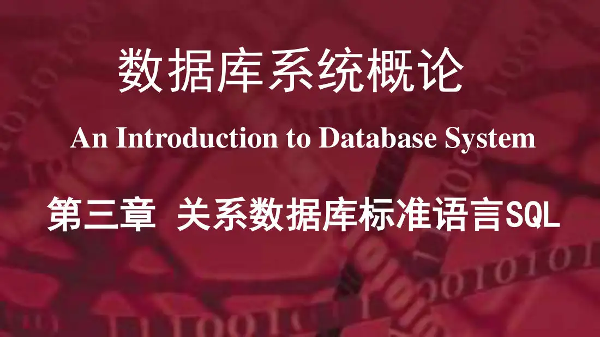

原文：

数据库系统概论

An Introduction to Database System

第三章 关系数据库标准语言SQL

### SQL概述

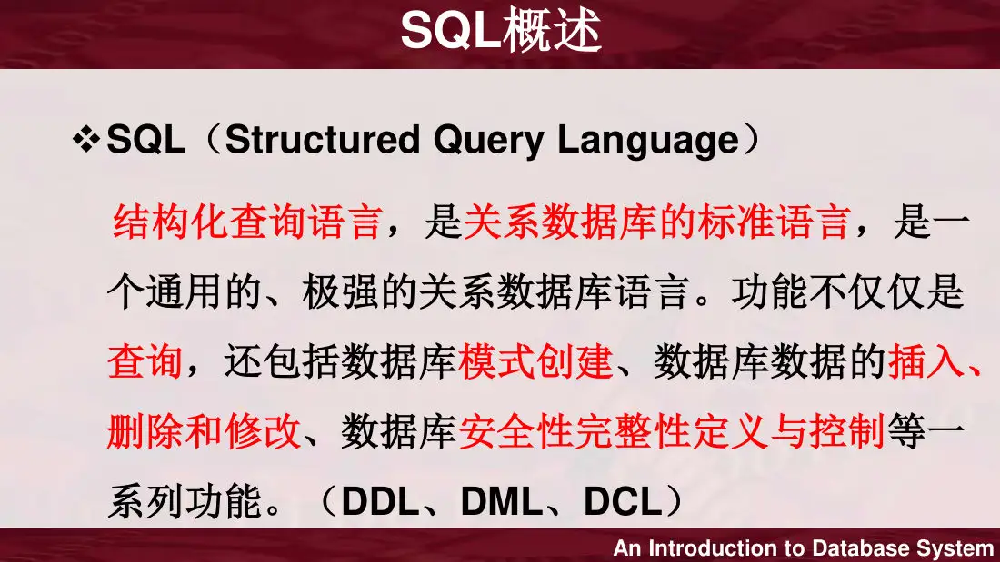

原文：

SQL概述

SQL（Structured Query Language）

结构化查询语言，是关系数据库的标准语言，是一个通用的、极强的关系数据库语言。功能不仅仅是查询，还包括数据库模式创建、数据库数据的插入、删除和修改、数据库安全性完整性定义与控制等一系列功能。（DDL、DML、DCL）

An Introduction to Database System

### SQL历史

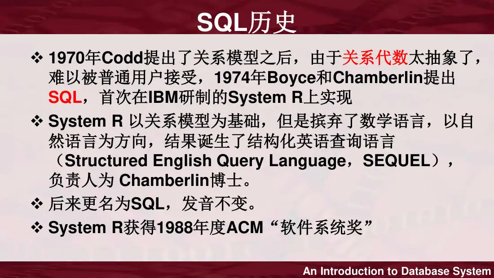

原文：

SQL历史

✿ 1970年Codd提出了关系模型之后，由于关系代数太抽象了，难以被普通用户接受，1974年Boyce和Chamberlin提出SQL，首次在IBM研制的System R上实现

✿ System R 以关系模型为基础，但是摈弃了数学语言，以自然语言为方向，结果诞生了结构化英语查询语言（Structured English Query Language, SEQUEL），负责人为 Chamberlin 博士。

◆ 后来更名为SQL，发音不变。

System R获得1988年度ACM“软件系统奖”

An Introduction to Database System

### SQL标准的进展过程

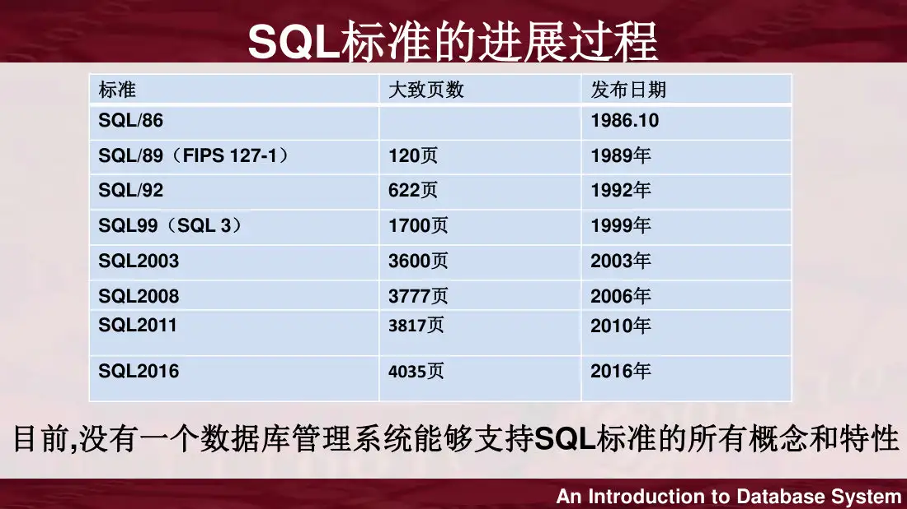

原文：

SQL标准的进展过程
<table><tr><td>标准</td><td>大致页数</td><td>发布日期</td></tr><tr><td>SQL/86</td><td></td><td>1986.10</td></tr><tr><td>SQL/89 (FIPS 127-1)</td><td>120页</td><td>1989年</td></tr><tr><td>SQL/92</td><td>622页</td><td>1992年</td></tr><tr><td>SQL99 (SQL 3)</td><td>1700页</td><td>1999年</td></tr><tr><td>SQL2003</td><td>3600页</td><td>2003年</td></tr><tr><td>SQL2008</td><td>3777页</td><td>2006年</td></tr><tr><td>SQL2011</td><td>3817页</td><td>2010年</td></tr><tr><td>SQL2016</td><td>4035页</td><td>2016年</td></tr></table>

目前,没有一个数据库管理系统能够支持SQL标准的所有概念和特性

An Introduction to Database System

### SQL最新2023标准

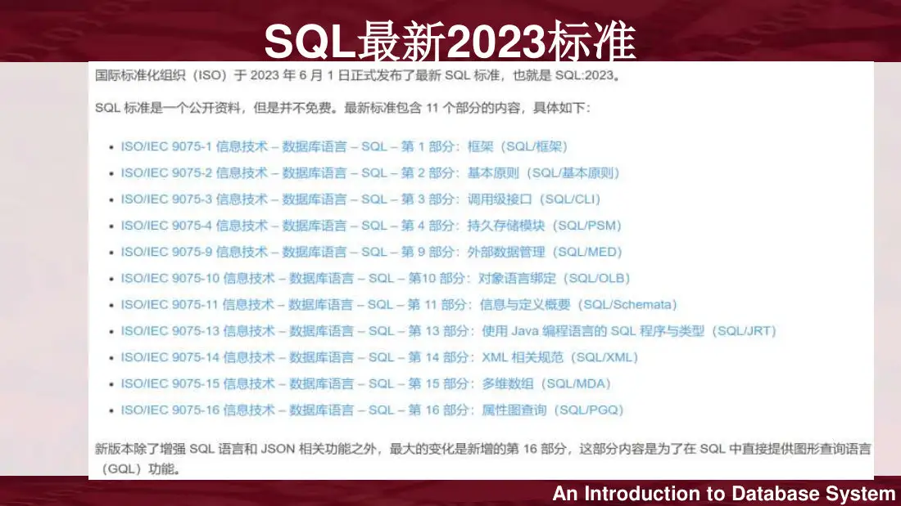

原文：

SQL最新2023标准

国际标准化组织（ISO）于2023年6月1日正式发布了最新SQL标准，也就是SQL:2023。

SQL 标准是一个公开资料，但是并不免费。最新标准包含 11 个部分的内容，具体如下：

$$
\bullet \text { ISO / IEC   9075 - 1   信息技术 } - \text { 数据库语言 } - \text { SQL } - \text { 第 } 1 \text { 部分：框架（SQL/框架） }
$$

$$
\bullet \text { ISO / IEC   9075 - 2   信息技术 } - \text { 数据库语言 } - \text { SQL } - \text { 第 } 2 \text { 部分：基本原则（SQL/基本原则） }
$$

\- ISO/IEC 9075-3 信息技术 - 数据库语言 - SQL - 第 3 部分：调用级接口 (SQL/CLI)

\- ISO/IEC 9075-4 信息技术 - 数据库语言 - SQL - 第 4 部分：持久存储模块（SQL/PSM）

$$
\bullet \text { ISO / IEC   9075 - 9   信息技术 } - \text { 数据库语言 } - \text { SQL } - \text { 第 } 9 \text { 部分：外部数据管理（SQL / MED） }
$$

$$
\bullet \text { ISO / IEC   9075 - 10   信息技术 } - \text { 数据库语言 } - \text { SQL } - \text { 第10部分：对象语言绑定（SQL / OLB） }
$$

$$
\bullet \text { ISO / IEC 9075 - 11   信息技术 } - \text { 数据库语言 } - \text { SQL } - \text { 第 } 1 1 \text { 部分：信息与定义概要（SQL / Schemata） }
$$

\- ISO/IEC 9075-13 信息技术 - 数据库语言 - SQL - 第 13 部分：使用 Java 编程语言的 SQL 程序与类型（SQL/JRT）

$$
\bullet \text { ISO / IEC   9075 - 14   信息技术 } - \text { 数据库语言 } - \text { SQL } - \text { 第 } 1 4 \text { 部分：XML   相关规范（SQL / XML） }
$$

$$
\bullet \text { ISO / IEC   9075 - 15   信息技术 } - \text { 数据库语言 } - \text { SQL } - \text { 第 } 1 5 \text { 部分：多维数组（SQL / MDA） }
$$

$$
\bullet \text { ISO / IEC   9075 - 16   信息技术 } - \text { 数据库语言 } - \text { SQL } - \text { 第 } 1 6 \text { 部分：属性图查询（SQL / PGQ） }
$$

新版本除了增强 SQL 语言和 JSON 相关功能之外，最大的变化是新增的第 16 部分，这部分内容是为了在 SQL 中直接提供图形查询语言（GQL）功能。

An Introduction to Database System

### 1986年ANSI/ISO推出SQL标准：SQL-86

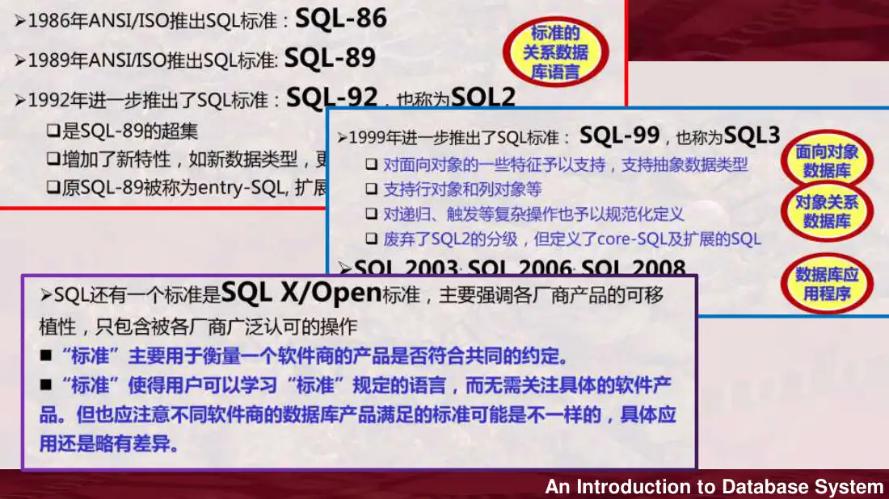

原文：

1986年ANSI/ISO推出SQL标准：SQL-86

➢1989年ANSI/ISO推出SQL标准: SQL-89

>1992年进一步推出了SQL标准：SQL-92，也称为SOL2

>1992年进一步推出了SQL标准：SQ
□是SQL-89的超集

□增加了新特性，如新数据类型，更

□原SQL-89被称为entry-SQL,扩展

>1999年进一步推出了SQL标准：SQL-99，也称为SQL3

☐ 对面向对象的一些特征予以支持，支持抽象数据类型

□ 支持行对象和列对象等

□ 对递归、触发等复杂操作也予以规范化定义

□ 废弃了SQL2的分级，但定义了core-SQL及扩展的SQL

>SOL 2003 SOL 2006 SOL 2008

对象关系数据库

>SQL还有一个标准是SQL X/Open标准，主要强调各厂商产品的可移植性，只包含被各厂商广泛认可的操作

■ “标准”主要用于衡量一个软件商的产品是否符合共同的约定。

■ “标准”使得用户可以学习“标准”规定的语言，而无需关注具体的软件产品。但也应注意不同软件商的数据库产品满足的标准可能是不一样的，具体应用还是略有差异。

An Introduction to Database System

### SQL的特点

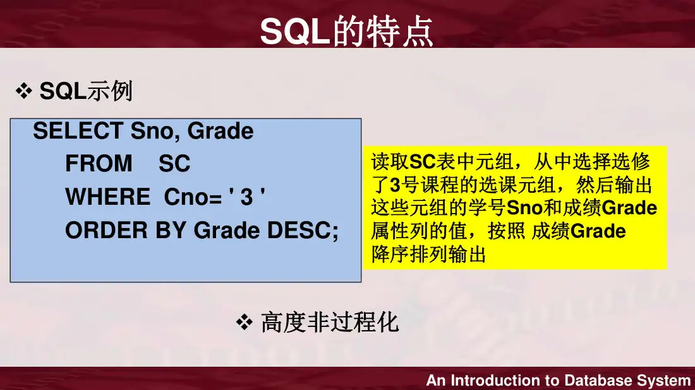

原文：

SQL的特点

SQL示例

读取SC表中元组，从中选择选修了3号课程的选课元组，然后输出这些元组的学号Sno和成绩Grade属性列的值，按照成绩Grade降序排列输出

◆ 高度非过程化

An Introduction to Database System

### SQL的特点

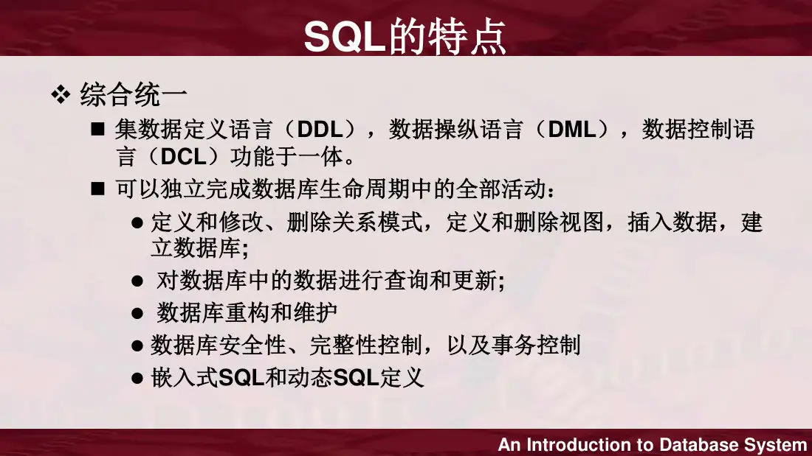

原文：

SQL的特点

综合统一

■ 集数据定义语言（DDL），数据操纵语言（DML），数据控制语言（DCL）功能于一体。

■ 可以独立完成数据库生命周期中的全部活动：

\- 定义和修改、删除关系模式，定义和删除视图，插入数据，建立数据库；

\- 对数据库中的数据进行查询和更新;

\- 数据库重构和维护

\- 数据库安全性、完整性控制，以及事务控制

\- 嵌入式SQL和动态SQL定义

An Introduction to Database System

### SQL的特点

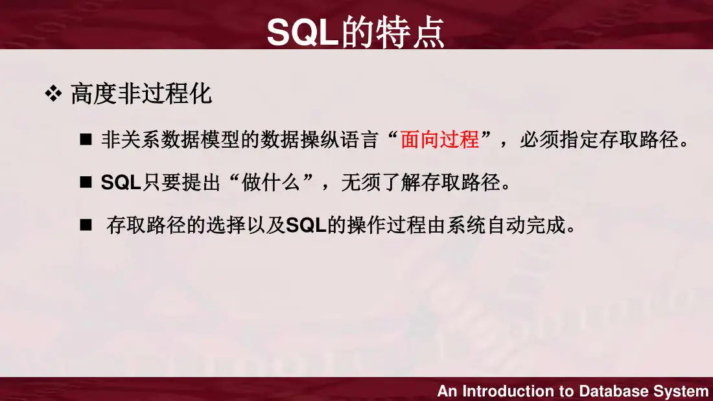

原文：

SQL的特点

◆ 高度非过程化

■ 非关系数据模型的数据操纵语言 “面向过程”，必须指定存取路径。

■ SQL只要提出“做什么”，无须了解存取路径。

■ 存取路径的选择以及SQL的操作过程由系统自动完成。

An Introduction to Database System

### SQL的特点

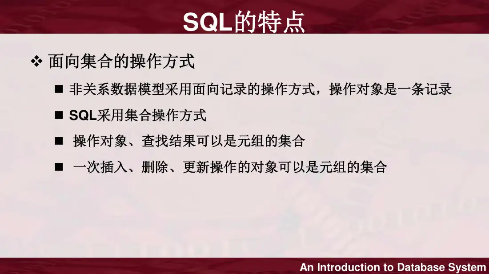

原文：

SQL的特点

面向集合的操作方式

■ 非关系数据模型采用面向记录的操作方式，操作对象是一条记录

■ SQL采用集合操作方式

■ 操作对象、查找结果可以是元组的集合

■ 一次插入、删除、更新操作的对象可以是元组的集合

An Introduction to Database System

### SQL的特点

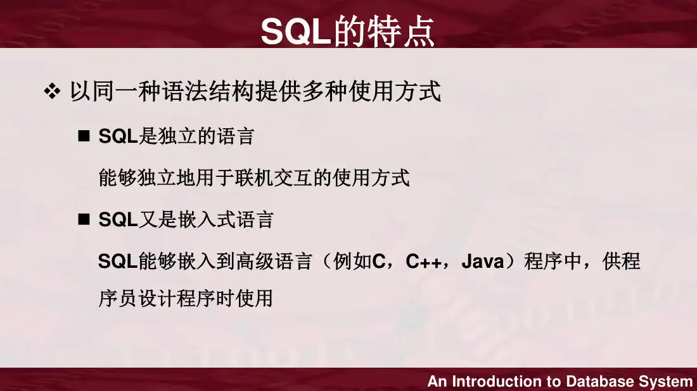

原文：

SQL的特点

以同一种语法结构提供多种使用方式

■ SQL是独立的语言

能够独立地用于联机交互的使用方式

■ SQL又是嵌入式语言

SQL能够嵌入到高级语言（例如C，C++, Java）程序中，供程序员设计程序时使用

An Introduction to Database System

### SQL的特点

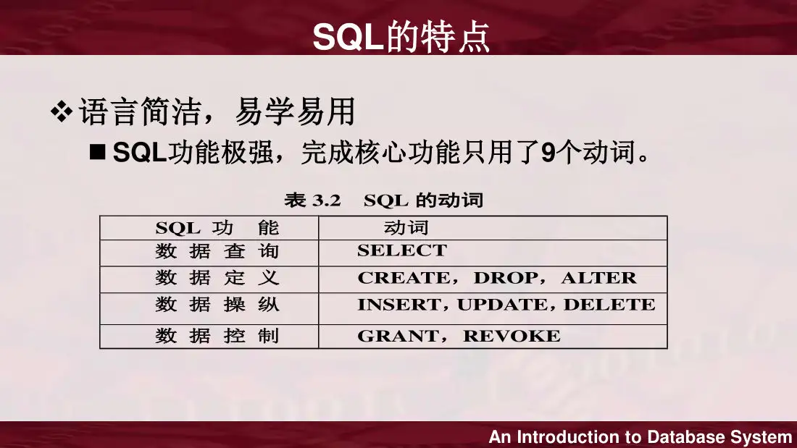

原文：

SQL的特点

✿语言简洁，易学易用

■ SQL功能极强，完成核心功能只用了9个动词。

表 3.2 SQL 的动词
<table><tr><td>SQL 功能</td><td>动词</td></tr><tr><td>数据查询</td><td>SELECT</td></tr><tr><td>数据定义</td><td>CREATE, DROP, ALTER</td></tr><tr><td>数据操纵</td><td>INSERT, UPDATE, DELETE</td></tr><tr><td>数据控制</td><td>GRANT, REVOKE</td></tr></table>

An Introduction to Database System

### SQL的基本概念（续）

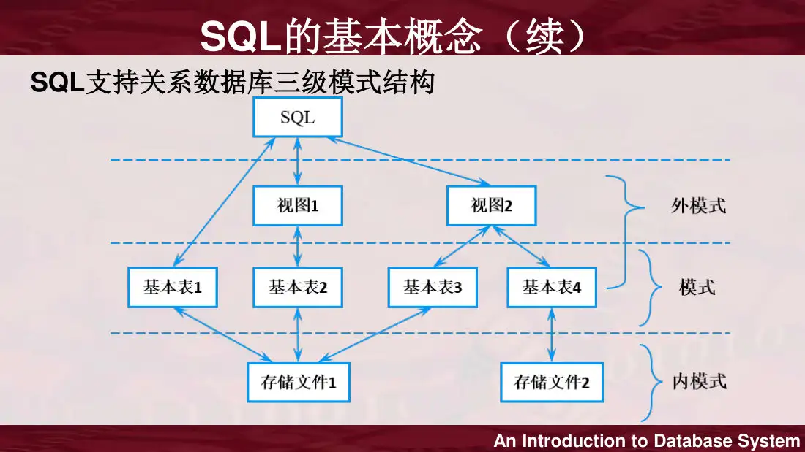

原文：

SQL的基本概念（续）

SQL支持关系数据库三级模式结构

An Introduction to Database System

### SQL的基本概念（续）

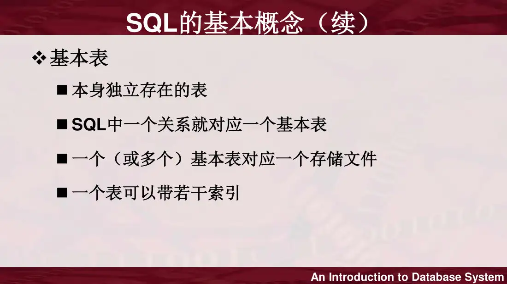

原文：

SQL的基本概念（续）

基本表

■ 本身独立存在的表

■ SQL中一个关系就对应一个基本表

■一个（或多个）基本表对应一个存储文件

■ 一个表可以带若干索引

An Introduction to Database System

### SQL的基本概念（续）

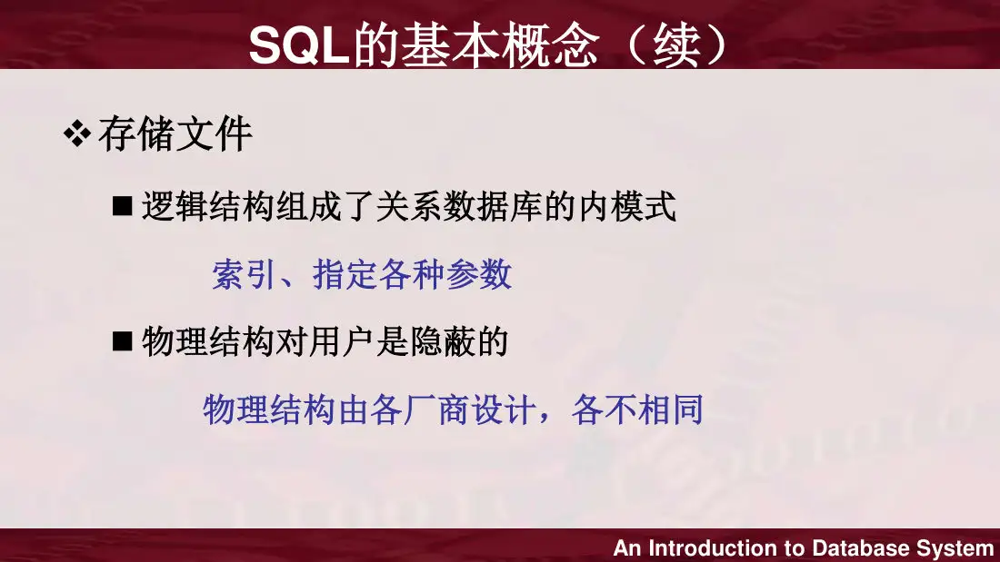

原文：

SQL的基本概念（续）

存储文件

■逻辑结构组成了关系数据库的内模式

索引、指定各种参数

■ 物理结构对用户是隐蔽的

物理结构由各厂商设计，各不相同

An Introduction to Database System

### SQL的基本概念（续）

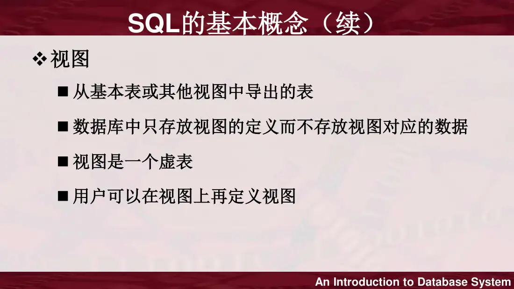

原文：

SQL的基本概念（续）

视图

■从基本表或其他视图中导出的表

■ 数据库中只存放视图的定义而不存放视图对应的数据

■ 视图是一个虚表

■ 用户可以在视图上再定义视图

An Introduction to Database System

### 学生-课程 数据库

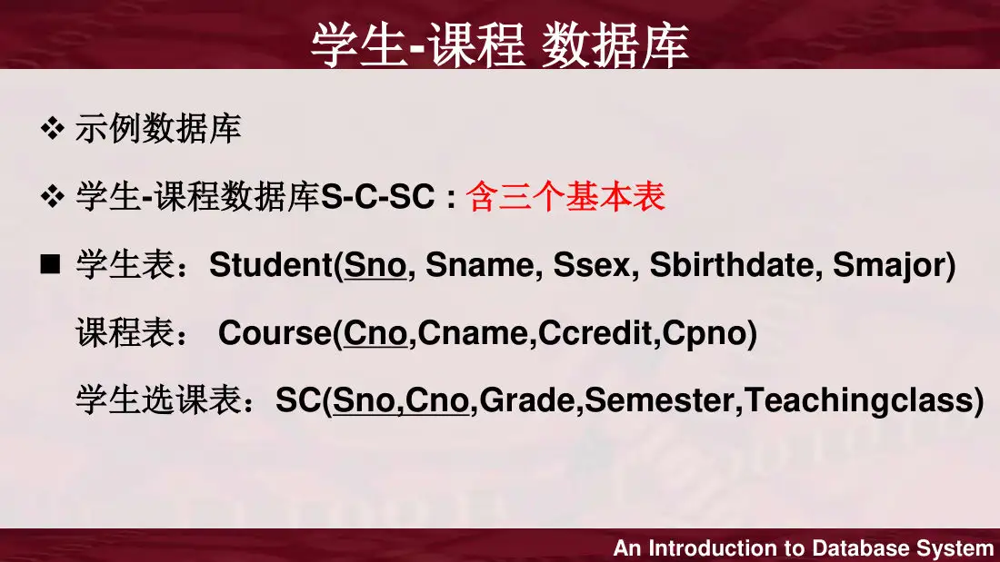

原文：

学生-课程 数据库

示例数据库

✿ 学生-课程数据库S-C-SC：含三个基本表

■ 学生表：Student(Sno, Sname, Ssex, Sbirthdate, Smajor)

课程表: Course(Cno,Cname,Ccredit,Cpno)

学生选课表：SC(Sno,Cno,Grade,Semester,Teachingclass)

An Introduction to Database System

### Student表

原文：

Student表

<table><tr><td>学号Sno</td><td>姓名Sname</td><td>性别Ssex</td><td>出生日期Sbirthdate</td><td>主修专业Smajor</td></tr><tr><td>20180001</td><td>李勇</td><td>男</td><td>2000-3-8</td><td>信息安全</td></tr><tr><td>20180002</td><td>刘晨</td><td>女</td><td>1999-9-1</td><td>计算机科学与技术</td></tr><tr><td>20180003</td><td>王敏</td><td>女</td><td>2001-8-1</td><td>计算机科学与技术</td></tr><tr><td>20180004</td><td>张立</td><td>男</td><td>2000-1-8</td><td>计算机科学与技术</td></tr><tr><td>20180205</td><td>陈新奇</td><td>男</td><td>2001-11-1</td><td>信息管理与信息系统</td></tr><tr><td>20180306</td><td>赵明</td><td>男</td><td>2000-6-12</td><td>数据科学与大数据技术</td></tr><tr><td>20180307</td><td>王佳佳</td><td>女</td><td>2001-12-7</td><td>数据科学与大数据技术</td></tr></table>

An Introduction to Database System

### Course表

原文：

Course表

<table><tr><td>课程号Cno</td><td>课程名Cname</td><td>学分Ccredit</td><td>先修课Cpno</td></tr><tr><td>81001</td><td>程序设计基础与C语言</td><td>4</td><td></td></tr><tr><td>81002</td><td>数据结构</td><td>4</td><td>81001</td></tr><tr><td>81003</td><td>数据库系统概论</td><td>4</td><td>81002</td></tr><tr><td>81004</td><td>信息系统概论</td><td>4</td><td>81003</td></tr><tr><td>81005</td><td>操作系统</td><td>4</td><td>81001</td></tr><tr><td>81006</td><td>Python语言</td><td>3</td><td>81002</td></tr><tr><td>81007</td><td>离散数学</td><td>4</td><td></td></tr><tr><td>81008</td><td>大数据技术概论</td><td>4</td><td>81003</td></tr></table>

An Introduction to Database System

### SC表

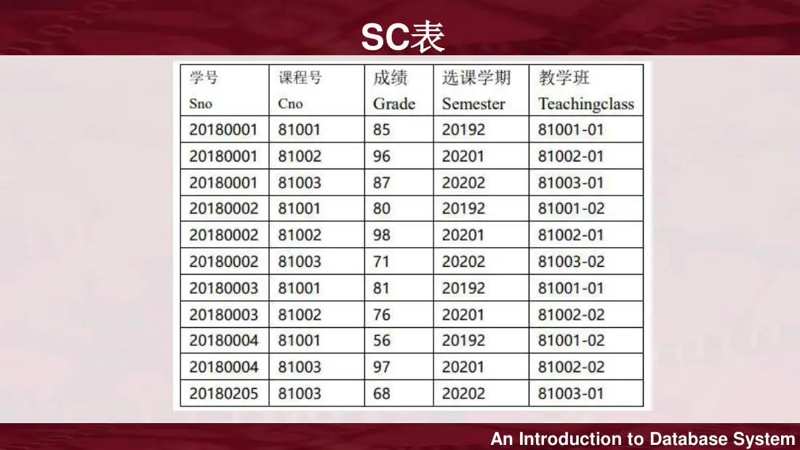

原文：

SC表

<table><tr><td>学号Sno</td><td>课程号Cno</td><td>成绩Grade</td><td>选课学期Semester</td><td>教学班Teachingclass</td></tr><tr><td>20180001</td><td>81001</td><td>85</td><td>20192</td><td>81001-01</td></tr><tr><td>20180001</td><td>81002</td><td>96</td><td>20201</td><td>81002-01</td></tr><tr><td>20180001</td><td>81003</td><td>87</td><td>20202</td><td>81003-01</td></tr><tr><td>20180002</td><td>81001</td><td>80</td><td>20192</td><td>81001-02</td></tr><tr><td>20180002</td><td>81002</td><td>98</td><td>20201</td><td>81002-01</td></tr><tr><td>20180002</td><td>81003</td><td>71</td><td>20202</td><td>81003-02</td></tr><tr><td>20180003</td><td>81001</td><td>81</td><td>20192</td><td>81001-01</td></tr><tr><td>20180003</td><td>81002</td><td>76</td><td>20201</td><td>81002-02</td></tr><tr><td>20180004</td><td>81001</td><td>56</td><td>20192</td><td>81001-02</td></tr><tr><td>20180004</td><td>81003</td><td>97</td><td>20201</td><td>81002-02</td></tr><tr><td>20180205</td><td>81003</td><td>68</td><td>20202</td><td>81003-01</td></tr></table>

An Introduction to Database System

### 视图

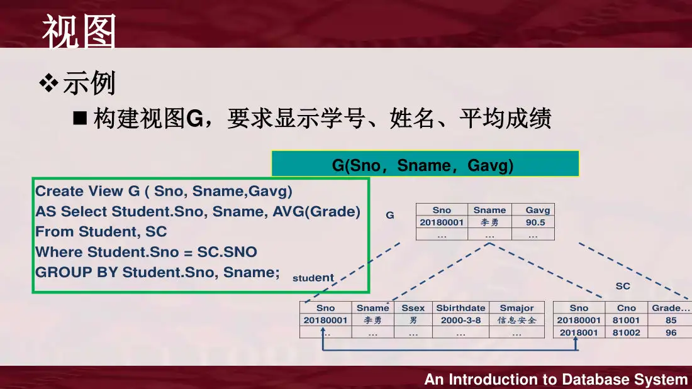

原文：

视图

◆ 示例

■构建视图G，要求显示学号、姓名、平均成绩

G(Sno, Sname, Gavg)

Create View G ( Sno, Sname,Gavg)
AS Select Student.Sno, Sname, AVG(Grade)
From Student, SC
Where Student.Sno = SC.SNO
GROUP BY Student.Sno, Sname; student

<table><tr><td>Sno</td><td>Sname</td><td>Gavg</td></tr><tr><td>20180001</td><td>李勇</td><td>90.5</td></tr><tr><td>...</td><td>...</td><td>...</td></tr></table>

An Introduction to Database System

### 数据定义

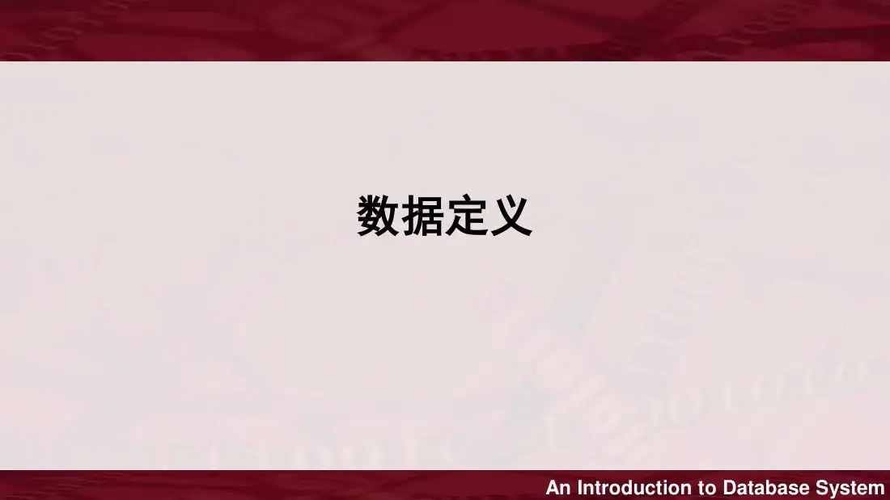

原文：

数据定义

An Introduction to Database System

### 数据定义

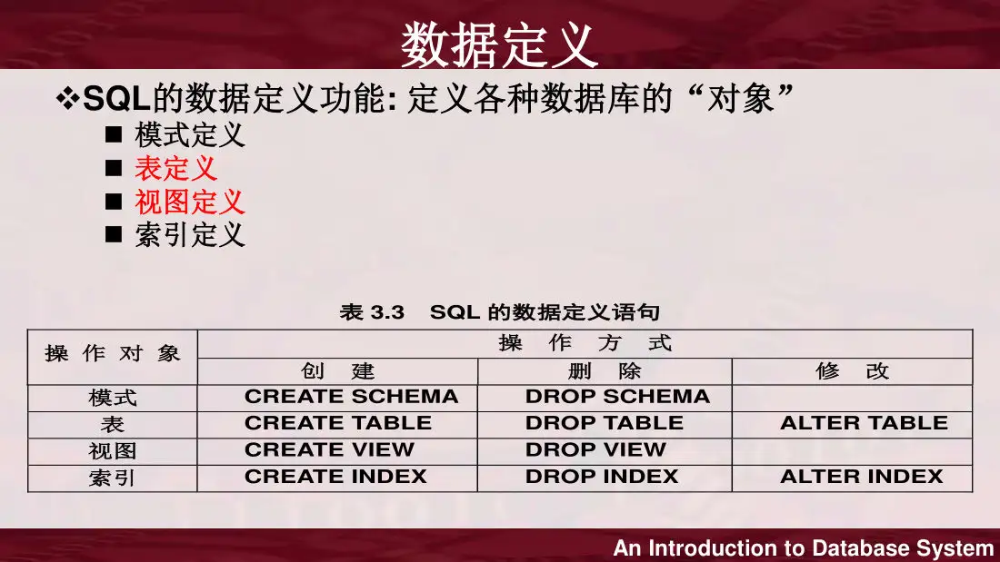

原文：

数据定义

SQL的数据定义功能: 定义各种数据库的“对象”

■ 模式定义

表定义

■ 视图定义

■ 索引定义

表 3.3 SQL 的数据定义语句
<table><tr><td rowspan="2">操作对象</td><td colspan="3">操作方式</td></tr><tr><td>创建</td><td>删除</td><td>修改</td></tr><tr><td>模式</td><td>CREATE SCHEMA</td><td>DROP SCHEMA</td><td></td></tr><tr><td>表</td><td>CREATE TABLE</td><td>DROP TABLE</td><td>ALTER TABLE</td></tr><tr><td>视图</td><td>CREATE VIEW</td><td>DROP VIEW</td><td></td></tr><tr><td>索引</td><td>CREATE INDEX</td><td>DROP INDEX</td><td>ALTER INDEX</td></tr></table>

An Introduction to Database System

### 各种数据库“对象”

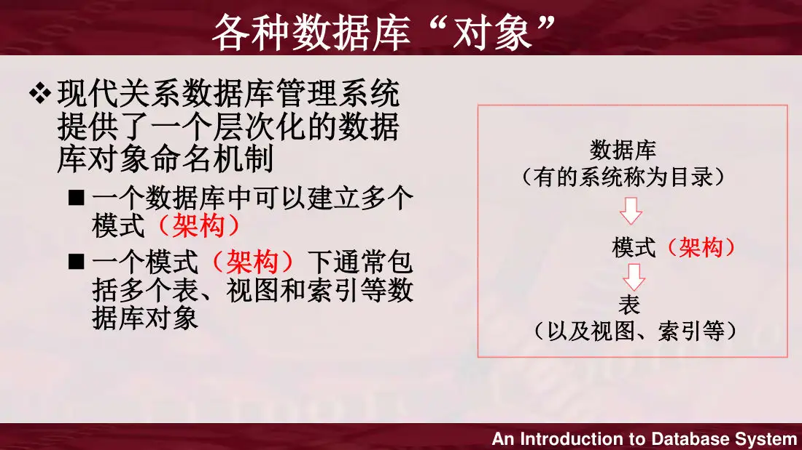

原文：

各种数据库“对象”

现代关系数据库管理系统提供了一个层次化的数据库对象命名机制

■ 一个数据库中可以建立多个模式（架构）

■ 一个模式（架构）下通常包括多个表、视图和索引等数据库对象

数据库
(有的系统称为目录)

模式（架构）

表

(以及视图、索引等)

An Introduction to Database System

### 数据定义

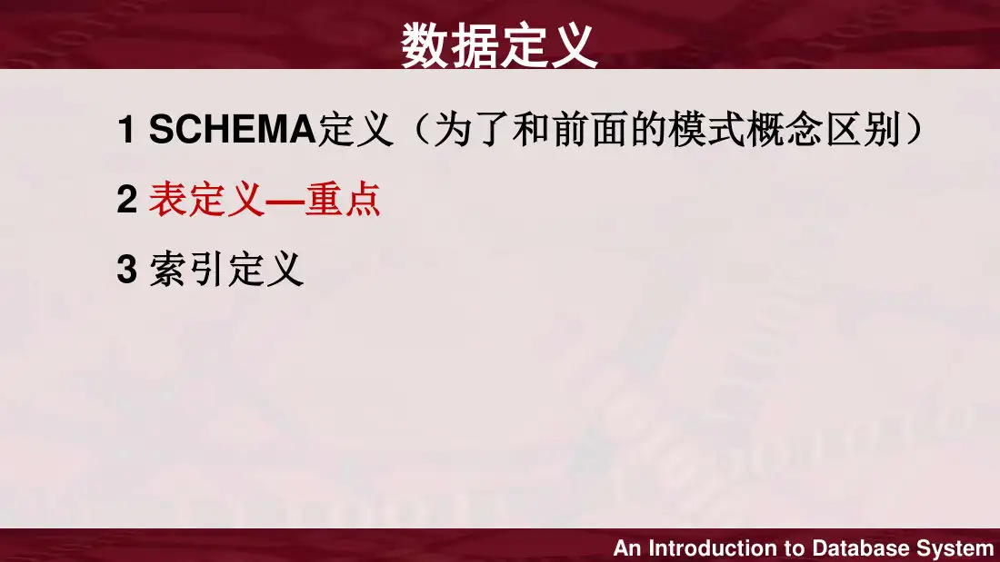

原文：

数据定义

1 SCHEMA定义（为了和前面的模式概念区别）

2 表定义—重点

3 索引定义

An Introduction to Database System

### 1.SCHEMA定义

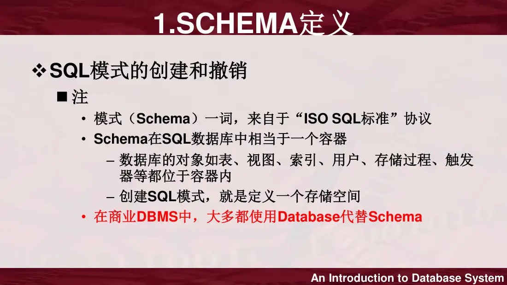

原文：

1.SCHEMA定义

SQL模式的创建和撤销

注

\- 模式（Schema）一词，来自于“ISO SQL标准”协议

\- Schema在SQL数据库中相当于一个容器

\- 数据库的对象如表、视图、索引、用户、存储过程、触发器等都位于容器内

\- 创建SQL模式，就是定义一个存储空间

\- 在商业DBMS中，大多都使用Database代替Schema

An Introduction to Database System

### 1.SCHEMA定义（续）

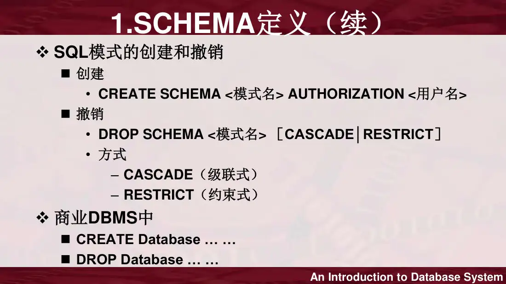

原文：

1.SCHEMA定义（续）

SQL模式的创建和撤销

■ 创建

\- CREATE SCHEMA <模式名> AUTHORIZATION <用户名>

■ 撤销

\- DROP SCHEMA <模式名> [CASCADE|RESTRICT]

\- 方式

\- CASCADE（级联式）

\- RESTRICT（约束式）

商业DBMS中

■ CREATE Database ....

■ DROP Database ....

An Introduction to Database System

### 1.SCHEMA定义（续）

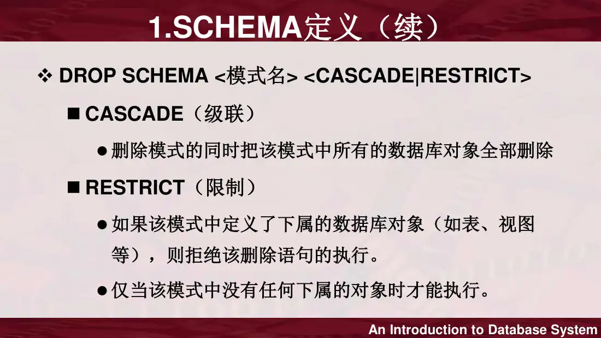

原文：

1.SCHEMA定义（续）

✿ DROP SCHEMA <模式名> <CASCADE|RESTRICT>

■ CASCADE（级联）

\- 删除模式的同时把该模式中所有的数据库对象全部删除

■ RESTRICT（限制）

\- 如果该模式中定义了下属的数据库对象（如表、视图等），则拒绝该删除语句的执行。

\- 仅当该模式中没有任何下属的对象时才能执行。

An Introduction to Database System

### 2 基本表的定义

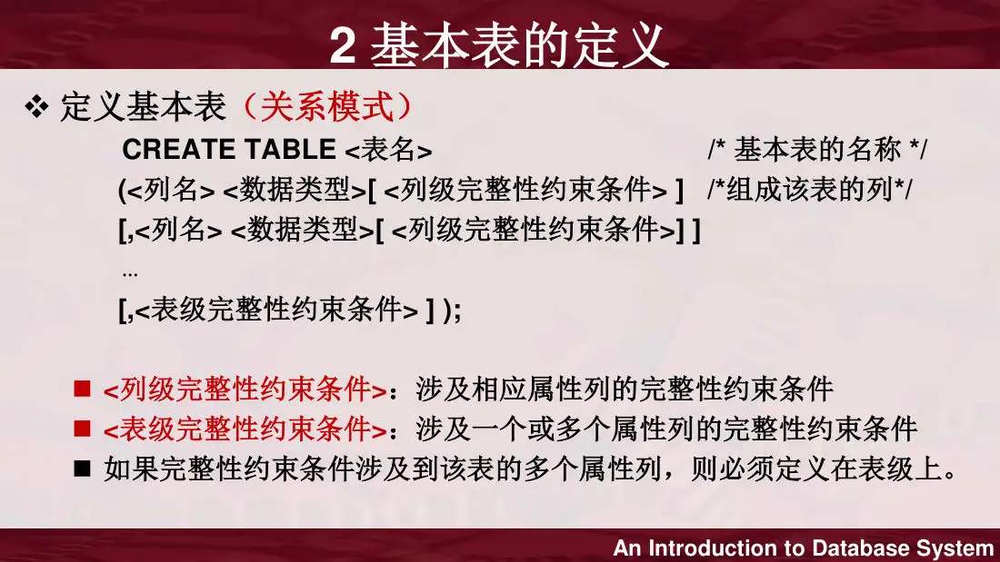

原文：

2 基本表的定义

定义基本表（关系模式）

CREATE TABLE <表名>

/\* 基本表的名称 \*/

(<列名><数据类型>[<列级完整性约束条件>] /\*组成该表的列\*/

[,<列名><数据类型>[<列级完整性约束条件>]]

[,<表级完整性约束条件>]);

■ <列级完整性约束条件>：涉及相应属性列的完整性约束条件

■ <表级完整性约束条件>：涉及一个或多个属性列的完整性约束条件

■ 如果完整性约束条件涉及到该表的多个属性列，则必须定义在表级上。

An Introduction to Database System

### 2 基本表的定义(续)

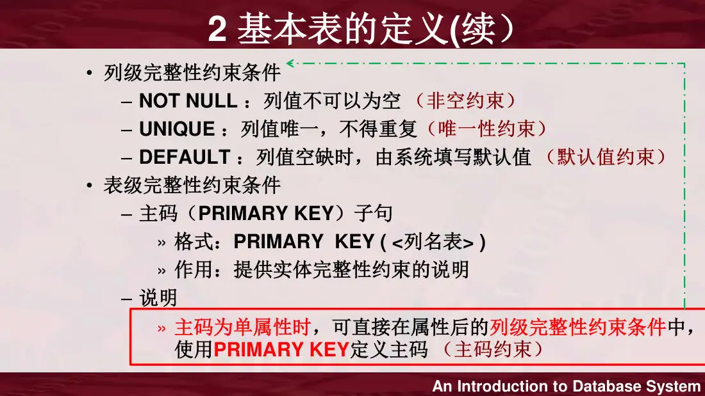

原文：

2 基本表的定义(续)

- 列级完整性约束条件

\- NOT NULL：列值不可以为空（非空约束）

\- UNIQUE：列值唯一，不得重复（唯一性约束）

\- DEFAULT：列值空缺时，由系统填写默认值（默认值约束）

- 表级完整性约束条件

\- 主码（PRIMARY KEY）子句

》格式：PRIMARY KEY (<列名表>)

》作用：提供实体完整性约束的说明

- 说明

》主码为单属性时，可直接在属性后的列级完整性约束条件中，使用PRIMARY KEY定义主码（主码约束）

An Introduction to Database System

### 2 基本表的定义(续)

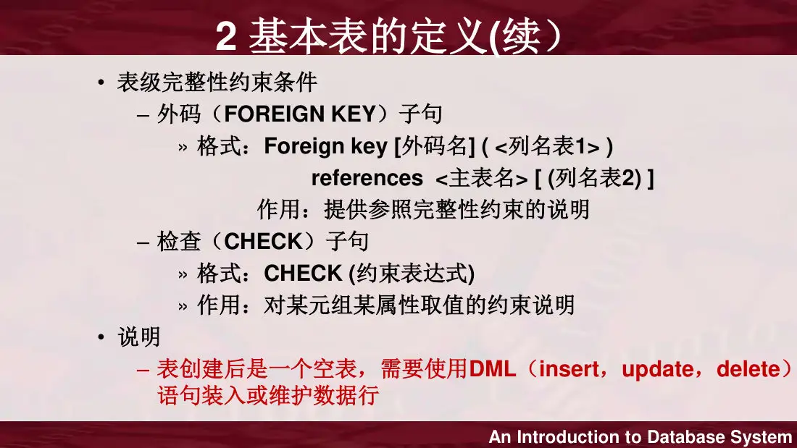

原文：

2 基本表的定义(续)

- 表级完整性约束条件

\- 外码（FOREIGN KEY）子句

》格式：Foreign key [外码名] (<列名表1>)
references <主表名> [(列名表2)]

作用：提供参照完整性约束的说明

\- 检查（CHECK）子句

》格式：CHECK (约束表达式)

》作用：对某元组某属性取值的约束说明

\- 说明

\- 表创建后是一个空表，需要使用DML（insert, update, delete）语句装入或维护数据行

An Introduction to Database System

### 学生表Student

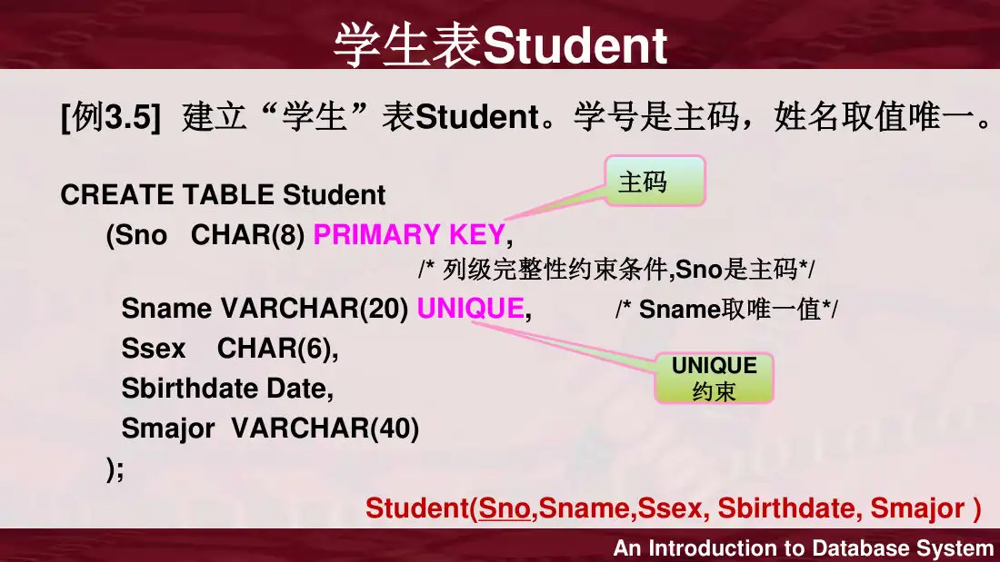

原文：

学生表Student

[例3.5] 建立“学生”表Student。学号是主码，姓名取值唯一。

CREATE TABLE Student

主码

(Sno CHAR(8) PRIMARY KEY,

/\* 列级完整性约束条件,Sno是主码\*/

Sname VARCHAR(20) UNIQUE,

/\* Sname取唯一值\*/

Ssex CHAR(6),

Sbirthdate Date,

UNIQUE 约束

Smajor VARCHAR(40)

);

Student(Sno,Sname,Ssex, Sbirthdate, Smajor )

An Introduction to Database System

### 课程表Course

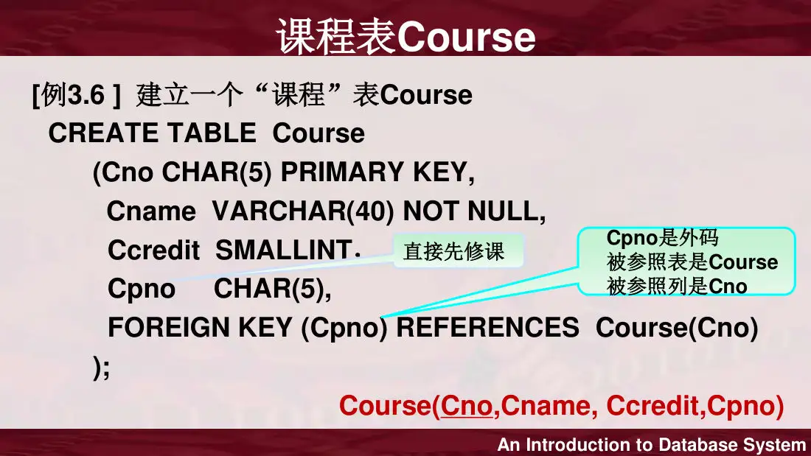

原文：

课程表Course

Course(Cno,Cname, Ccredit,Cpno)

An Introduction to Database System

### 学生选课表SC

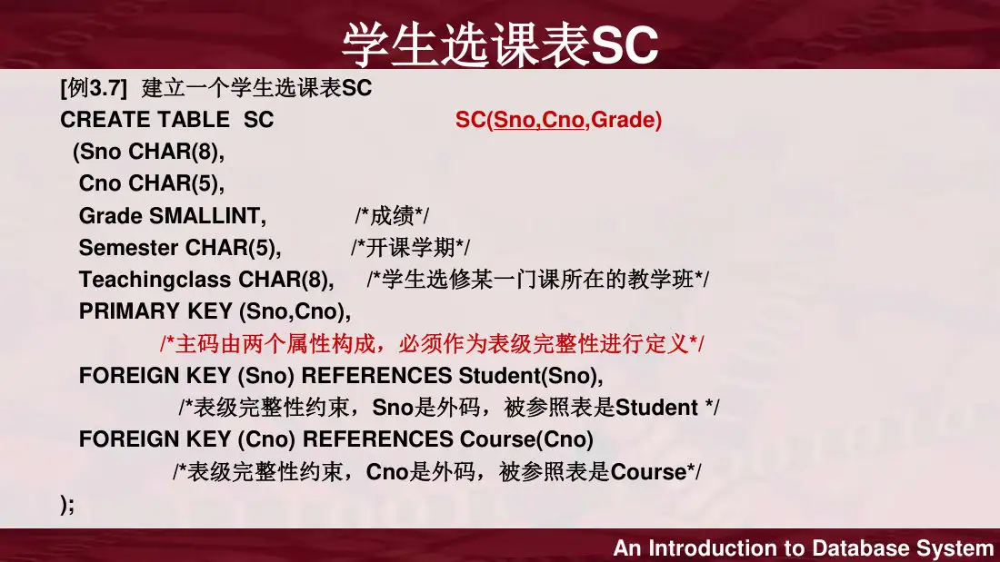

原文：

学生选课表SC

An Introduction to Database System

### MySQL中查看表结构

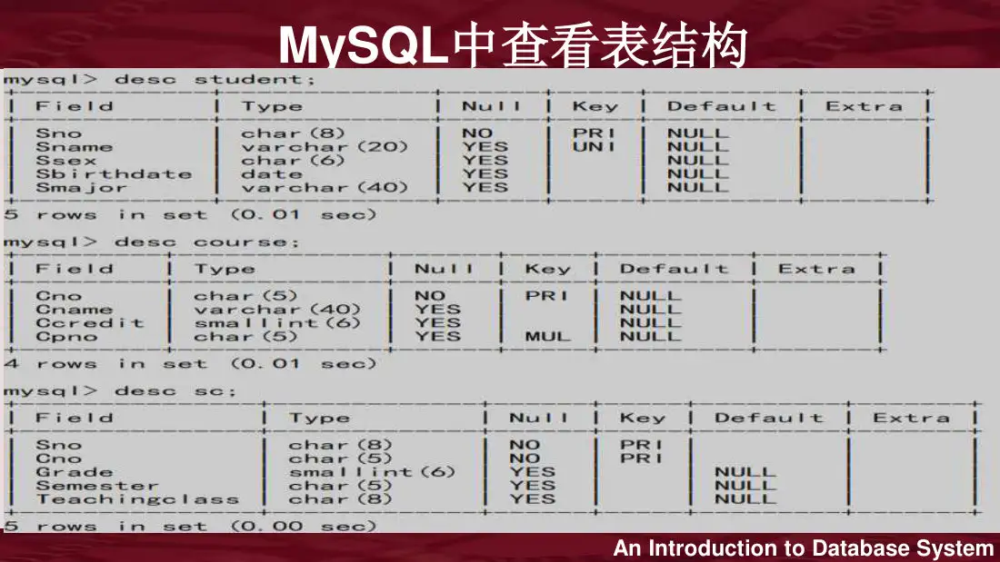

原文：

MySQL中查看表结构

mysql> desc student;

<table><tr><td>Field</td><td>Type</td><td>Null</td><td>Key</td><td>Default</td><td>Extra</td></tr><tr><td>Sno</td><td>char (8)</td><td>NO</td><td>PRI</td><td>NULL</td><td></td></tr><tr><td>Sname</td><td>varchar (20)</td><td>YES</td><td>UNI</td><td>NULL</td><td></td></tr><tr><td>Ssex</td><td>char (6)</td><td>YES</td><td></td><td>NULL</td><td></td></tr><tr><td>Sbirthdate</td><td>date</td><td>YES</td><td></td><td>NULL</td><td></td></tr><tr><td>Smajor</td><td>varchar (40)</td><td>YES</td><td></td><td>NULL</td><td></td></tr></table>
5 rows in set (0.01 sec)

mysql> desc course;
<table><tr><td>Field</td><td>Type</td><td>Null</td><td>Key</td><td>Default</td><td>Extra</td></tr><tr><td>Cno</td><td>char (5)</td><td>NO</td><td>PRI</td><td>NULL</td><td></td></tr><tr><td>Cname</td><td>varchar (40)</td><td>YES</td><td></td><td>NULL</td><td></td></tr><tr><td>Ccredit</td><td>smallint (6)</td><td>YES</td><td></td><td>NULL</td><td></td></tr><tr><td>Cpno</td><td>char (5)</td><td>YES</td><td>MUL</td><td>NULL</td><td></td></tr></table>
4 rows in set (0.01 sec)

mysql> desc sc;

<table><tr><td>Field</td><td>Type</td><td>Null</td><td>Key</td><td>Default</td><td>Extra</td></tr><tr><td>Sno</td><td>char (8)</td><td>NO</td><td>PRI</td><td></td><td></td></tr><tr><td>Cno</td><td>char (5)</td><td>NO</td><td>PRI</td><td></td><td></td></tr><tr><td>Grade</td><td>smallint (6)</td><td>YES</td><td></td><td>NULL</td><td></td></tr><tr><td>Semester</td><td>char (5)</td><td>YES</td><td></td><td>NULL</td><td></td></tr><tr><td>Teachingclass</td><td>char (8)</td><td>YES</td><td></td><td>NULL</td><td></td></tr></table>
5 rows in set (0.00 sec)

An Introduction to Database System

### MySQL中查看表结构

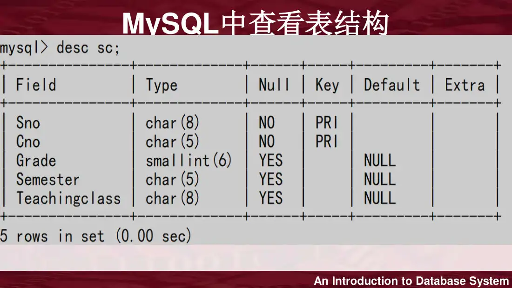

原文：

MySQL中查看表结构

mysql> desc sc;

<table><tr><td>Field</td><td>Type</td><td>Null</td><td>Key</td><td>Default</td><td>Extra</td></tr><tr><td>Sno</td><td>char (8)</td><td>NO</td><td>PRI</td><td></td><td></td></tr><tr><td>Cno</td><td>char (5)</td><td>NO</td><td>PRI</td><td></td><td></td></tr><tr><td>Grade</td><td>smallint (6)</td><td>YES</td><td></td><td>NULL</td><td></td></tr><tr><td>Semester</td><td>char (5)</td><td>YES</td><td></td><td>NULL</td><td></td></tr><tr><td>Teachingclass</td><td>char (8)</td><td>YES</td><td></td><td>NULL</td><td></td></tr></table>

An Introduction to Database System

### 数据类型

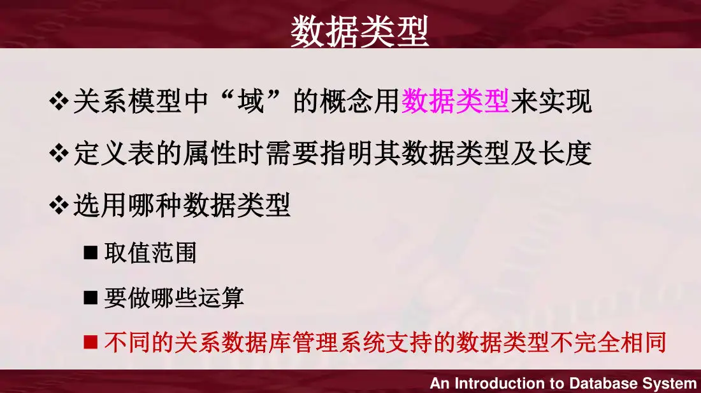

原文：

数据类型

关系模型中“域”的概念用数据类型来实现

定义表的属性时需要指明其数据类型及长度

◆ 选用哪种数据类型

■ 取值范围

■要做哪些运算

■ 不同的关系数据库管理系统支持的数据类型不完全相同

An Introduction to Database System

### 数据类型（续）

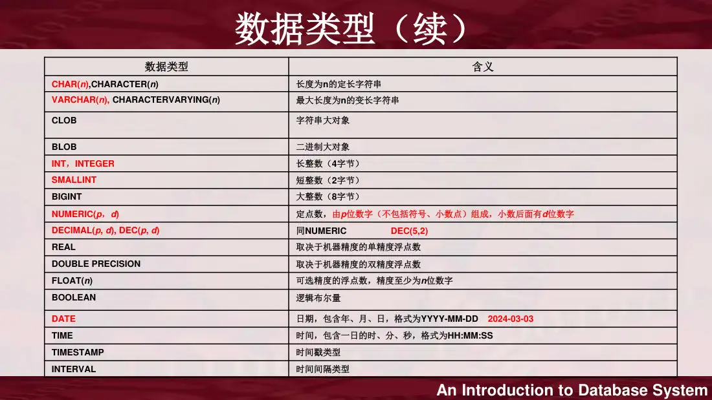

原文：

数据类型（续）

<table><tr><td>数据类型</td><td>含义</td></tr><tr><td>CHAR(n),CHARACTER(n)</td><td>长度为n的定长字符串</td></tr><tr><td>VARCHAR(n),CHARACTERVARYING(n)</td><td>最大长度为n的变长字符串</td></tr><tr><td>CLOB</td><td>字符串大对象</td></tr><tr><td>BLOB</td><td>二进制大对象</td></tr><tr><td>INT,INTEGER</td><td>长整数(4字节)</td></tr><tr><td>SMALLINT</td><td>短整数(2字节)</td></tr><tr><td>BIGINT</td><td>大整数(8字节)</td></tr><tr><td>NUMERIC(p,d)</td><td>定点数,由p位数字(不包括符号、小数点)组成,小数后面有d位数字</td></tr><tr><td>DECIMAL(p,d),DEC(p,d)</td><td>同NUMERIC DEC(5,2)</td></tr><tr><td>REAL</td><td>取决于机器精度的单精度浮点数</td></tr><tr><td>DOUBLE PRECISION</td><td>取决于机器精度的双精度浮点数</td></tr><tr><td>FLOAT(n)</td><td>可选精度的浮点数,精度至少为n位数字</td></tr><tr><td>BOOLEAN</td><td>逻辑布尔量</td></tr><tr><td>DATE</td><td>日期,包含年、月、日,格式为YYYY-MM-DD 2024-03-03</td></tr><tr><td>TIME</td><td>时间,包含一日的时、分、秒,格式为HH:MM:SS</td></tr><tr><td>TIMESTAMP</td><td>时间戳类型</td></tr><tr><td>INTERVAL</td><td>时间间隔类型</td></tr></table>

An Introduction to Database System

### 提交

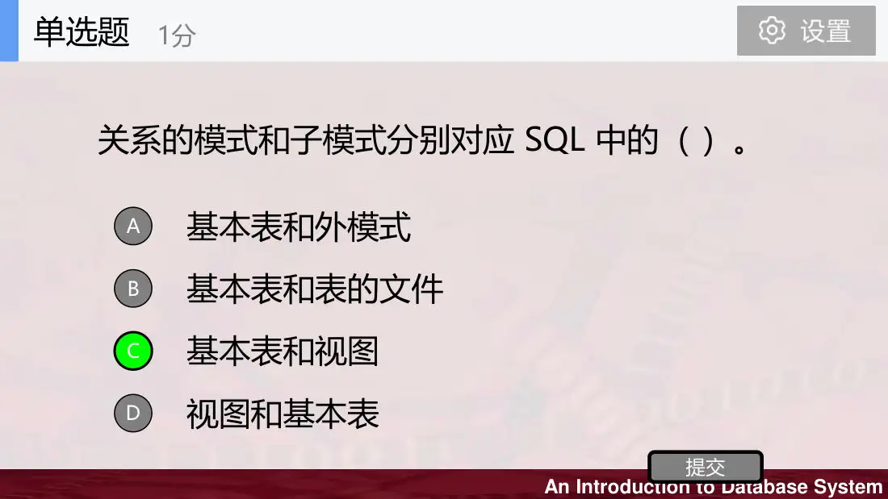

原文：

关系的模式和子模式分别对应 SQL 中的（）。 A 基本表和外模式 B 基本表和表的文件 C 基本表和视图 D 视图和基本表

提交

单选题 1分

设置

An Introduction to Database System

### 修改基本表

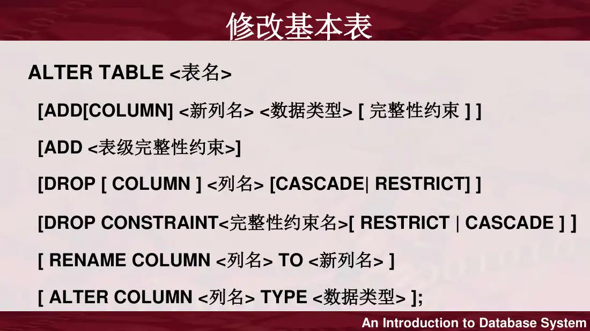

原文：

修改基本表

ALTER TABLE <表名>

[ADD[COLUMN] <新列名> <数据类型> [完整性约束] ]

[ADD <表级完整性约束>]

[DROP [ COLUMN ] <列名> [CASCADE| RESTRICT] ]

[DROP CONSTRAINT<完整性约束名>[RESTRICT | CASCADE] ]

[RENAME COLUMN <列名> TO <新列名>]

[ ALTER COLUMN <列名> TYPE <数据类型> ];

An Introduction to Database System

### 修改基本表（续）

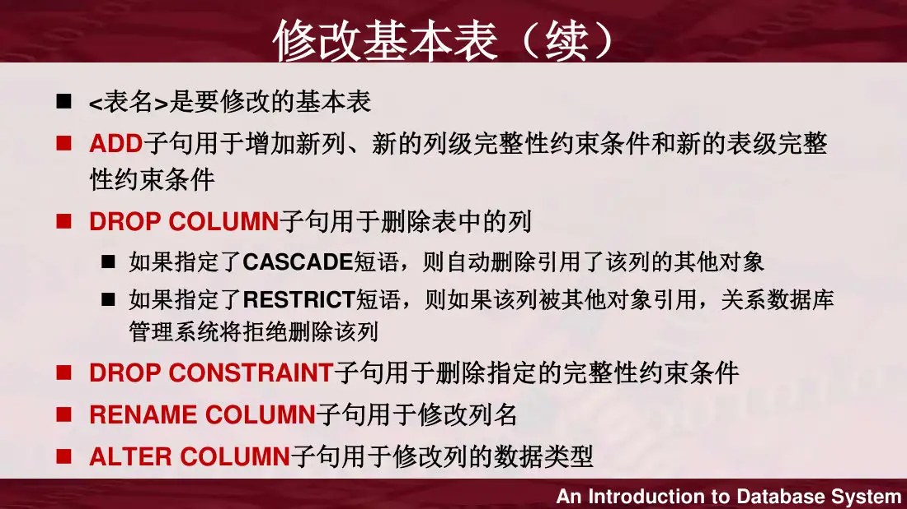

原文：

修改基本表（续）

■ <表名>是要修改的基本表

■ ADD子句用于增加新列、新的列级完整性约束条件和新的表级完整性约束条件

■ DROP COLUMN子句用于删除表中的列

■ 如果指定了CASCADE短语，则自动删除引用了该列的其他对象

■ 如果指定了RESTRICT短语，则如果该列被其他对象引用，关系数据库管理系统将拒绝删除该列

■ DROP CONSTRAINT子句用于删除指定的完整性约束条件

■ RENAME COLUMN子句用于修改列名

■ ALTER COLUMN子句用于修改列的数据类型

An Introduction to Database System

### 修改基本表（续）

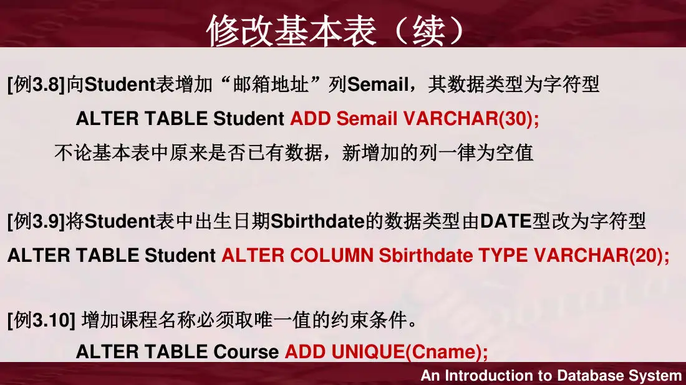

原文：

修改基本表（续）

[例3.8]向Student表增加“邮箱地址”列Semail，其数据类型为字符型

ALTER TABLE Student ADD Semail VARCHAR(30);

不论基本表中原来是否已有数据，新增加的列一律为空值

[例3.9]将Student表中出生日期Sbirthdate的数据类型由DATE型改为字符型
ALTER TABLE Student ALTER COLUMN Sbirthdate TYPE VARCHAR(20);

[例3.10] 增加课程名称必须取唯一值的约束条件。

ALTER TABLE Course ADD UNIQUE(Cname);

An Introduction to Database System

### MySQL中的实现

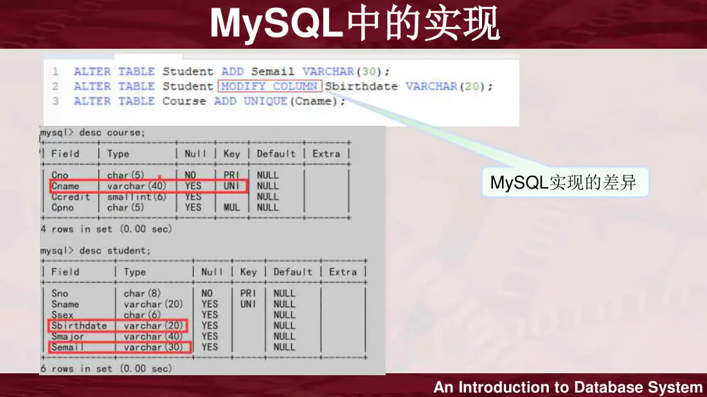

原文：

MySQL中的实现

1 ALTER TABLE Student ADD Semail VARCHAR(30);

2 ALTER TABLE Student MODIFY COLUMN Sbirthdate VARCHAR(20);

3 ALTER TABLE Course ADD UNIQUE (Cname);

<table><tr><td colspan="6">mysql&gt; desc course;</td></tr><tr><td>Field</td><td>Type</td><td>Null</td><td>Key</td><td>Default</td><td>Extra</td></tr><tr><td>Cno</td><td>char(5)</td><td>NO</td><td>PRI</td><td>NULL</td><td></td></tr><tr><td>Cname</td><td>varchar(40)</td><td>YES</td><td>UNI</td><td>NULL</td><td></td></tr><tr><td>Ccredit</td><td>smallint(6)</td><td>YES</td><td></td><td>NULL</td><td></td></tr><tr><td>Cpno</td><td>char(5)</td><td>YES</td><td>MUL</td><td>NULL</td><td></td></tr></table>

MySQL实现的差异

mysql> desc student;

<table><tr><td>Field</td><td>Type</td><td>Null</td><td>Key</td><td>Default</td><td>Extra</td></tr><tr><td>Sno</td><td>char (8)</td><td>NO</td><td>PRI</td><td>NULL</td><td></td></tr><tr><td>Sname</td><td>varchar (20)</td><td>YES</td><td>UNI</td><td>NULL</td><td></td></tr><tr><td>Ssex</td><td>char (6)</td><td>YES</td><td></td><td>NULL</td><td></td></tr><tr><td>Sbirthdate</td><td>varchar (20)</td><td>YES</td><td></td><td>NULL</td><td></td></tr><tr><td>Smajor</td><td>varchar (40)</td><td>YES</td><td></td><td>NULL</td><td></td></tr><tr><td>Semail</td><td>varchar (30)</td><td>YES</td><td></td><td>NULL</td><td></td></tr></table>
6 rows in set (0.00 sec)

An Introduction to Database System

### 删除基本表

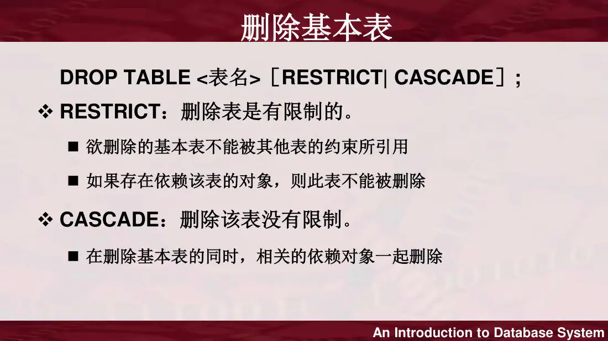

原文：

删除基本表

DROP TABLE <表名> [RESTRICT| CASCADE] ;

✿ RESTRICT：删除表是有限制的。

■ 欲删除的基本表不能被其他表的约束所引用

■ 如果存在依赖该表的对象，则此表不能被删除

✿ CASCADE：删除该表没有限制。

■ 在删除基本表的同时，相关的依赖对象一起删除

An Introduction to Database System

### 删除基本表（续）

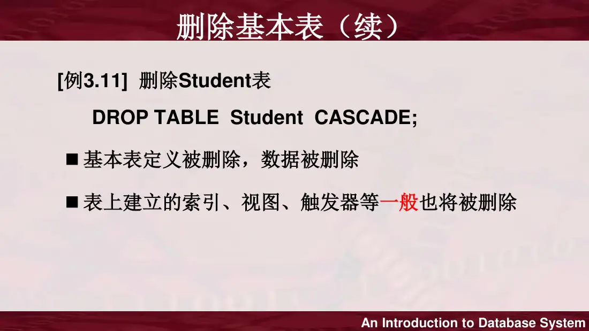

原文：

删除基本表（续）

[例3.11] 删除Student表

DROP TABLE Student CASCADE;

■基本表定义被删除，数据被删除

■表上建立的索引、视图、触发器等一般也将被删除

An Introduction to Database System

### 删除基本表（续）

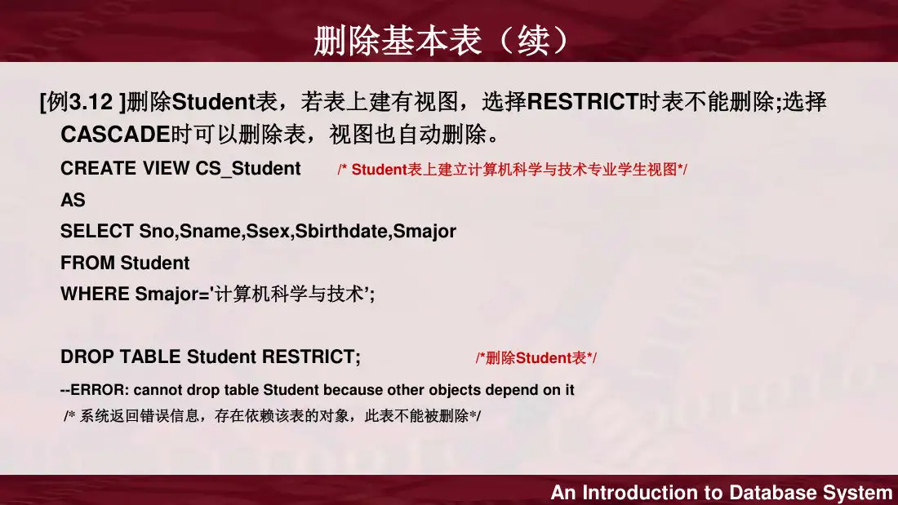

原文：

删除基本表（续）

[例3.12]删除Student表，若表上建有视图，选择RESTRICT时表不能删除；选择CASCADE时可以删除表，视图也自动删除。

CREATE VIEW CS\_Student /\* Student表上建立计算机科学与技术专业学生视图\*/

AS

SELECT Sno,Sname,Ssex,Sbirthdate,Smajor

FROM Student

WHERE Smajor='计算机科学与技术';

DROP TABLE Student RESTRICT; /\*删除Student表\*/

--ERROR: cannot drop table Student because other objects depend on it

/\* 系统返回错误信息，存在依赖该表的对象，此表不能被删除\*/

An Introduction to Database System

### 删除基本表（续）

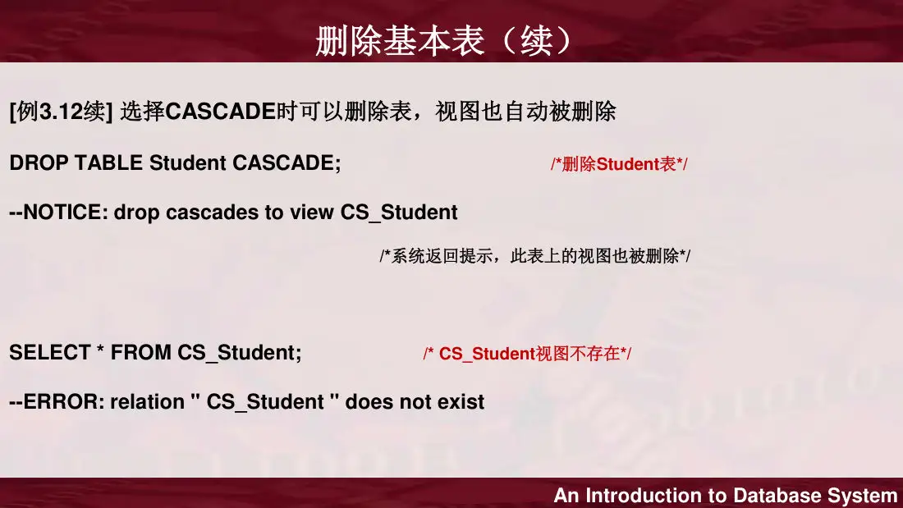

原文：

删除基本表（续）

[例3.12续] 选择CASCADE时可以删除表，视图也自动被删除

DROP TABLE Student CASCADE;

/\*删除Student表\*/

--NOTICE: drop cascades to view CS\_Student

/\*系统返回提示，此表上的视图也被删除\*/

SELECT \* FROM CS\_Student;

/\* CS\_Student视图不存在\*/

--ERROR: relation "CS\_Student" does not exist

An Introduction to Database System

### 删除基本表（续）

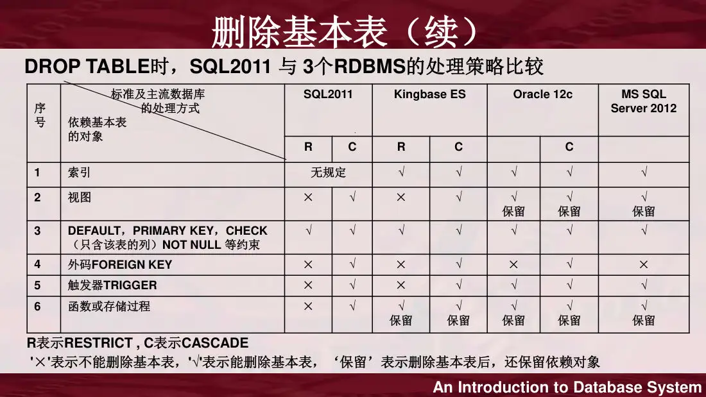

原文：

删除基本表（续）

DROP TABLE时，SQL2011与3个RDBMS的处理策略比较

<table><tr><td rowspan="2">序号</td><td rowspan="2">标准及主流数据库的处理方式依赖基本表的对象</td><td colspan="2">SQL2011</td><td colspan="2">Kingbase ES</td><td colspan="2">Oracle 12c</td><td>MS SQL Server 2012</td></tr><tr><td>R</td><td>C</td><td>R</td><td>C</td><td></td><td>C</td><td></td></tr><tr><td>1</td><td>索引</td><td colspan="2">无规定</td><td>√</td><td>√</td><td>√</td><td>√</td><td>√</td></tr><tr><td>2</td><td>视图</td><td>×</td><td>√</td><td>×</td><td>√</td><td>√保留</td><td>√保留</td><td>√保留</td></tr><tr><td>3</td><td>DEFAULT, PRIMARY KEY, CHECK(只含该表的列) NOT NULL 等约束</td><td>√</td><td>√</td><td>√</td><td>√</td><td>√</td><td>√</td><td>√</td></tr><tr><td>4</td><td>外码FOREIGN KEY</td><td>×</td><td>√</td><td>×</td><td>√</td><td>×</td><td>√</td><td>×</td></tr><tr><td>5</td><td>触发器TRIGGER</td><td>×</td><td>√</td><td>×</td><td>√</td><td>√</td><td>√</td><td>√</td></tr><tr><td>6</td><td>函数或存储过程</td><td>×</td><td>√</td><td>√保留</td><td>√保留</td><td>√保留</td><td>√保留</td><td>√保留</td></tr></table>
R表示RESTRICT，C表示CASCADE

'×'表示不能删除基本表，'√'表示能删除基本表，‘保留’表示删除基本表后，还保留依赖对象

An Introduction to Database System

### 3 索引的定义

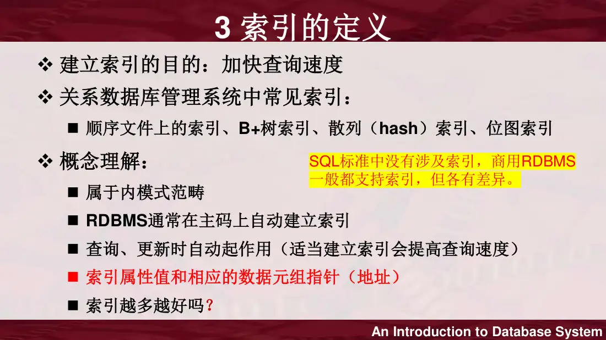

原文：

3 索引的定义

◆ 建立索引的目的：加快查询速度

关系数据库管理系统中常见索引：

■ 顺序文件上的索引、B+树索引、散列（hash）索引、位图索引

概念理解:

SQL标准中没有涉及索引，商用RDBMS一般都支持索引，但各有差异。

■ 属于内模式范畴

■ RDBMS通常在主码上自动建立索引

■ 查询、更新时自动起作用（适当建立索引会提高查询速度）

■ 索引属性值和相应的数据元组指针（地址）

■ 索引越多越好吗？

An Introduction to Database System

### 索引

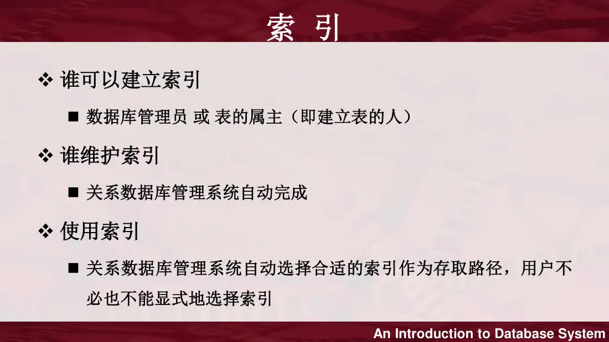

原文：

索引

谁可以建立索引

■ 数据库管理员 或 表的属主（即建立表的人）

谁维护索引

■ 关系数据库管理系统自动完成

◆ 使用索引

■ 关系数据库管理系统自动选择合适的索引作为存取路径，用户不必也不能显式地选择索引

An Introduction to Database System

### (1). 建立索引

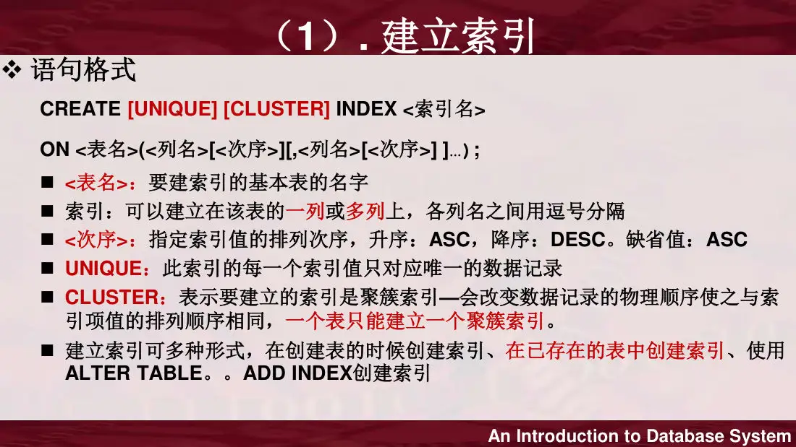

原文：

(1). 建立索引

✿ 语句格式

CREATE [UNIQUE] [CLUSTER] INDEX <索引名>

ON <表名>(<列名>[<次序>][,<列名>[<次序>]]...)；

■ <表名>: 要建索引的基本表的名字

■ 索引：可以建立在该表的一列或多列上，各列名之间用逗号分隔

■ <次序>: 指定索引值的排列次序, 升序: ASC, 降序: DESC。缺省值: ASC

■ UNIQUE：此索引的每一个索引值只对应唯一的数据记录

■ CLUSTER：表示要建立的索引是聚簇索引—会改变数据记录的物理顺序使之与索引项值的排列顺序相同，一个表只能建立一个聚簇索引。

■ 建立索引可多种形式，在创建表的时候创建索引、在已存在的表中创建索引、使用 ALTER TABLE。。ADD INDEX创建索引

An Introduction to Database System

### 建立索引（续）

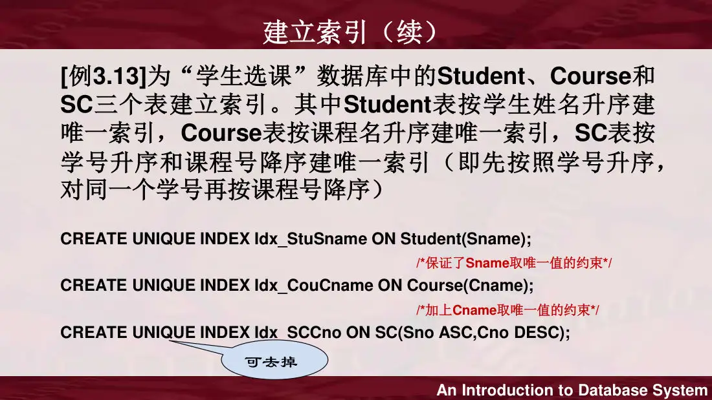

原文：

建立索引（续）

[例3.13]为“学生选课”数据库中的Student、Course和SC三个表建立索引。其中Student表按学生姓名升序建唯一索引，Course表按课程名升序建唯一索引，SC表按学号升序和课程号降序建唯一索引（即先按照学号升序，对同一个学号再按课程号降序）

CREATE UNIQUE INDEX Idx\_StuSname ON Student(Sname);

/\*保证了Sname取唯一值的约束\*/

CREATE UNIQUE INDEX Idx\_CouCname ON Course(Cname);

/\*加上Cname取唯一值的约束\*/

CREATE UNIQUE INDEX Idx SCCno ON SC(Sno ASC,Cno DESC);

可去掉

An Introduction to Database System

### MySQL中的实现

原文：

MySQL中的实现

查询创建工具 查询编辑器

1 show index from course;

信息 结果1 概况 状态

<table><tr><td>Table</td><td>Non_unique</td><td>Key_name</td><td>Seq_in_index</td><td>Column_name</td><td>Collation</td><td>Cardinality</td><td>Sub_part</td><td>Packed</td><td>Null</td><td>Index_type</td><td>Comment</td><td>Index_comment</td></tr><tr><td>course</td><td>0</td><td>PRIMARY</td><td>1</td><td>Cno</td><td>A</td><td>2</td><td>(Null)</td><td>(Null)</td><td></td><td>BTREE</td><td></td><td></td></tr><tr><td>course</td><td>0</td><td>Idx_CouCname</td><td>1</td><td>Cname</td><td>A</td><td>8</td><td>(Null)</td><td>(Null)</td><td>YES</td><td>BTREE</td><td></td><td></td></tr><tr><td>course</td><td>1</td><td>Cpno</td><td>1</td><td>Cpno</td><td>A</td><td>2</td><td>(Null)</td><td>(Null)</td><td>YES</td><td>BTREE</td><td></td><td></td></tr></table>

An Introduction to Database System

### 2.修改索引

原文：

2.修改索引

ALTER INDEX <旧索引名> RENAME TO <新索引名>

[例3.14] 将SC表的Idx\_SCCno索引名改为Idx\_SCSnoCno

ALTER INDEX Idx\_SCCno RENAME TO Idx\_SCSnoCno;

在MySQL中，索引无法直接修改，可以通过删除原索引，再根据需要创建一个新索引，从而实现修改索引的操作。

An Introduction to Database System

### 3. 删除索引

原文：

3. 删除索引

DROP INDEX <索引名>;

删除索引时，系统会从数据字典中删去有关该索引的描述

[例3.15] 删除Student表的Idx\_StuSname索引

DROP INDEX Idx\_StuSname;

An Introduction to Database System

### MySQL中的实现

原文：

MySQL中的实现

查询创建工具 查询编辑器

1 drop index Idx\_CouCname on Course;

2 show index from course;

<table><tr><td>信息</td><td>结果1</td><td>概况</td><td>状态</td><td colspan="9"></td></tr><tr><td>Table</td><td colspan="2">Non_unique</td><td>Key_name</td><td>Seq_in_index</td><td>Column_name</td><td>Collation</td><td>Cardinality</td><td>Sub_part</td><td>Packed</td><td>Null</td><td colspan="2">Index_type</td></tr><tr><td>course</td><td colspan="2">0</td><td>PRIMARY</td><td>1</td><td>Cno</td><td>A</td><td>8</td><td>(Null)</td><td>(Null)</td><td></td><td colspan="2">BTREE</td></tr><tr><td>course</td><td colspan="2">1</td><td>Cpno</td><td>1</td><td>Cpno</td><td>A</td><td>8</td><td>(Null)</td><td>(Null)</td><td>YES</td><td colspan="2">BTREE</td></tr></table>

An Introduction to Database System

### CREATE TABLE Course

原文：

CREATE TABLE Course
(Cno CHAR(5) PRIMARY KEY,
Cname VARCHAR(40),
Ccredit SMALLINT,
Cpno CHAR(5),
FOREIGN KEY (Cpno)
REFERENCES Course(Cno));

SQL语言翻译与处理程序

数据字典
(以表的方式存储)

An Introduction to Database System

### 数据字典

原文：

数据字典

✿ 数据字典是关系数据库管理系统内部的一组系统表，它记录了数据库中所有定义信息：

■关系模式定义

■视图定义

■索引定义

■ 完整性约束定义

■ 各类用户对数据库的操作权限

■ 统计信息等

关系数据库管理系统在执行SQL的数据定义语句时，实际上就是在更新数据字典表中的相应信息。

An Introduction to Database System

### 复习

原文：

复习

✿ 建立数据库，包括两件事：定义数据库和表（使用DDL），向表中追加元组（使用DML）

✿ DDL: Data Definition Language
创建数据库(DB)—Create Database
创建DB中的Table(定义关系模式)---Create Table
定义Table及其各个属性的约束条件(定义完整性约束)
定义View (定义外模式)—后续介绍
定义Index ……等(定义内模式范畴)
上述各种定义的撤消与修改

An Introduction to Database System

### 定义学生选课表SC

原文：

定义学生选课表SC

建立一个学生选课表SC (Sno,Cno,Grade)

CREATE TABLE SC

(Sno CHAR(8),

Cno CHAR(5),

Grade SMALLINT, /\*成绩\*/

Semester CHAR(5), /\*开课学期\*/

Teachingclass CHAR(8), /\*学生选修某一门课所在的教学班\*/

PRIMARY KEY (Sno,Cno),  
/\*主码由两个属性构成，必须作为表级完整性进行定义\*/

FOREIGN KEY (Sno) REFERENCES Student(Sno),  
/\*表级完整性约束，Sno是外码，被参照表是Student \*/

FOREIGN KEY (Cno) REFERENCES Course(Cno)

/\*表级完整性约束，Cno是外码，被参照表是Course\*/

An Introduction to Database System

### 数据查询：数据库核心操作（单表查询）

原文：

数据查询：数据库核心操作（单表查询）

An Introduction to Database System

### 学生-课程 数据库

原文：

学生-课程 数据库

示例数据库

✿ 学生-课程数据库S-C-SC：含三个基本表

■ 学生表：Student(Sno, Sname, Ssex, Sbirthdate, Smajor)

课程表: Course(Cno,Cname,Ccredit,Cpno)

学生选课表：SC(Sno,Cno,Grade,Semester,Teachingclass)

An Introduction to Database System

### Student表

原文：

Student表

<table><tr><td>学号Sno</td><td>姓名Sname</td><td>性别Ssex</td><td>出生日期Sbirthdate</td><td>主修专业Smajor</td></tr><tr><td>20180001</td><td>李勇</td><td>男</td><td>2000-3-8</td><td>信息安全</td></tr><tr><td>20180002</td><td>刘晨</td><td>女</td><td>1999-9-1</td><td>计算机科学与技术</td></tr><tr><td>20180003</td><td>王敏</td><td>女</td><td>2001-8-1</td><td>计算机科学与技术</td></tr><tr><td>20180004</td><td>张立</td><td>男</td><td>2000-1-8</td><td>计算机科学与技术</td></tr><tr><td>20180205</td><td>陈新奇</td><td>男</td><td>2001-11-1</td><td>信息管理与信息系统</td></tr><tr><td>20180306</td><td>赵明</td><td>男</td><td>2000-6-12</td><td>数据科学与大数据技术</td></tr><tr><td>20180307</td><td>王佳佳</td><td>女</td><td>2001-12-7</td><td>数据科学与大数据技术</td></tr></table>

An Introduction to Database System

### Course表

原文：

Course表

<table><tr><td>课程号Cno</td><td>课程名Cname</td><td>学分Ccredit</td><td>先修课Cpno</td></tr><tr><td>81001</td><td>程序设计基础与C语言</td><td>4</td><td></td></tr><tr><td>81002</td><td>数据结构</td><td>4</td><td>81001</td></tr><tr><td>81003</td><td>数据库系统概论</td><td>4</td><td>81002</td></tr><tr><td>81004</td><td>信息系统概论</td><td>4</td><td>81003</td></tr><tr><td>81005</td><td>操作系统</td><td>4</td><td>81001</td></tr><tr><td>81006</td><td>Python语言</td><td>3</td><td>81002</td></tr><tr><td>81007</td><td>离散数学</td><td>4</td><td></td></tr><tr><td>81008</td><td>大数据技术概论</td><td>4</td><td>81003</td></tr></table>

An Introduction to Database System

### SC表

原文：

SC表

<table><tr><td>学号Sno</td><td>课程号Cno</td><td>成绩Grade</td><td>选课学期Semester</td><td>教学班Teachingclass</td></tr><tr><td>20180001</td><td>81001</td><td>85</td><td>20192</td><td>81001-01</td></tr><tr><td>20180001</td><td>81002</td><td>96</td><td>20201</td><td>81002-01</td></tr><tr><td>20180001</td><td>81003</td><td>87</td><td>20202</td><td>81003-01</td></tr><tr><td>20180002</td><td>81001</td><td>80</td><td>20192</td><td>81001-02</td></tr><tr><td>20180002</td><td>81002</td><td>98</td><td>20201</td><td>81002-01</td></tr><tr><td>20180002</td><td>81003</td><td>71</td><td>20202</td><td>81003-02</td></tr><tr><td>20180003</td><td>81001</td><td>81</td><td>20192</td><td>81001-01</td></tr><tr><td>20180003</td><td>81002</td><td>76</td><td>20201</td><td>81002-02</td></tr><tr><td>20180004</td><td>81001</td><td>56</td><td>20192</td><td>81001-02</td></tr><tr><td>20180004</td><td>81003</td><td>97</td><td>20201</td><td>81002-02</td></tr><tr><td>20180205</td><td>81003</td><td>68</td><td>20202</td><td>81003-01</td></tr></table>

An Introduction to Database System

### 数据查询

原文：

数据查询

✿ SELECT语句的最基本结构

■句型

\- SELECT <目标表的列名或列表达式序列>

FROM <表名、视图名或导出表序列>

WHERE <行条件表达式>

\- 只有SELECT和FROM子句是每个SQL查询语句所必需的

■ 语义
SELECT A $_{1}$ , ..., A $_{n}$ FROM R $_{1}$ , ..., R $_{n}$ → Π $_{A1, ..., An}$ (σ $_{F}$ (R $_{1}$ × ... × R $_{n}$ )) 
WHERE F ;

示例：SELECT Sno,Grade FROM SC WHERE Cno='3'

An Introduction to Database System

### 数据查询

原文：

数据查询

◆ 一般语句格式

SELECT [ALL|DISTINCT] <目标列表表达式>[,<目标列表表达式>] ...

FROM <表名或视图名>[,<表名或视图名> ]... | (SELECT 语句)

[AS]<别名>

[WHERE <条件表达式>]

[ GROUP BY <列名1> [ HAVING <条件表达式> ] ]

[ ORDER BY <列名2> [ ASC|DESC ];

[LIMIT <行数1>[ OFFSET <行数2>]];

An Introduction to Database System

### 数据查询

原文：

数据查询

■ SELECT子句：指定要显示的属性列

■ FROM子句：指定查询对象（基本表或视图），执行笛卡尔积 1

■ WHERE子句：指定查询条件

■ GROUP BY子句：对查询结果按指定列的值分组，该属性列值相等的元组为一个组。通常会在每组中作用聚集函数。3

■ HAVING短语：只有满足指定条件的组才予以输出 4

■ ORDER BY子句：对查询结果表按指定列值的升序或降序排序 6

■ LIMIT子句:限制SELECT语句查询结果的数量为<行数1>行,OFFSET <行数2>, 表示在计算<行数1>行前忽略<行数2>行 7

An Introduction to Database System

### 单表查询

原文：

单表查询

✿ 查询仅涉及一个表

1. 选择表中的若干列

2. 选择表中的若干元组

3.ORDER BY子句

4.聚集函数

5.GROUP BY子句

6.LIMIT子句

An Introduction to Database System

### 1. 选择表中的若干列

原文：

1. 选择表中的若干列

◆ 查询指定列

[例3.16] 查询全体学生的学号与姓名

SELECT Sno,Sname FROM Student;

<table><tr><td>Sno</td><td>Sname</td></tr><tr><td>20180002</td><td>刘晨</td></tr><tr><td>20180004</td><td>张立</td></tr><tr><td>20180001</td><td>李勇</td></tr><tr><td>20180307</td><td>王佳佳</td></tr><tr><td>20180003</td><td>王敏</td></tr><tr><td>20180306</td><td>赵明</td></tr><tr><td>20180205</td><td>陈新奇</td></tr></table>

[例3.17] 查询全体学生的姓名、学号、主修专业。

<table><tr><td colspan="4">SELECT Sname,Sno,SmajorFROM Student;</td></tr><tr><td></td><td>Sname</td><td>Sno</td><td>Smajor</td></tr><tr><td></td><td>李勇</td><td>20180001</td><td>信息安全</td></tr><tr><td></td><td>刘晨</td><td>20180002</td><td>计算机科学与技术</td></tr><tr><td></td><td>王敏</td><td>20180003</td><td>计算机科学与技术</td></tr><tr><td></td><td>张立</td><td>20180004</td><td>计算机科学与技术</td></tr><tr><td></td><td>陈新奇</td><td>20180205</td><td>信息管理与信息系统</td></tr><tr><td></td><td>赵明</td><td>20180306</td><td>数据科学与大数据技术</td></tr><tr><td></td><td>王佳佳</td><td>20180307</td><td>数据科学与大数据技术</td></tr></table>

An Introduction to Database System

### 选择表中的若干列（续）

原文：

选择表中的若干列（续）

◆ 查询全部列

■ 选出所有属性列:

\- 在SELECT关键字后面列出所有列名

\- 将<目标列表达式>指定为 \*

[例3.18] 查询全体学生的详细记录

SELECT Sno,Sname,Ssex,Sbirthdate,Smajor FROM Student;

或

SELECT \*

FROM Student;

An Introduction to Database System

### 查询经过计算的值（续）

原文：

查询经过计算的值（续）

■ SELECT子句的<目标列表达式>可以是算术表达式、字符串

常量、函数等

[例3.19] 查全体学生的姓名及其年龄指定了“年龄”别名改变查询结果的列标题:

SELECT Sname, (extract(year from current\_date) - extract(year from Sbirthdate)) "年龄"

FROM Student;

输出结果:

<table><tr><td>Sname</td><td>年龄</td></tr><tr><td>李勇</td><td>24</td></tr><tr><td>刘晨</td><td>25</td></tr><tr><td>王敏</td><td>23</td></tr><tr><td>张立</td><td>24</td></tr><tr><td>陈新奇</td><td>23</td></tr><tr><td>赵明</td><td>18</td></tr><tr><td>王佳佳</td><td>23</td></tr></table>

An Introduction to Database System

### 查询经过计算的值（续）

原文：

查询经过计算的值（续）

[例3.20] 查询全体学生的姓名、出生日期和主修专业

SELECT Sname, 'Date of Birth:', Sbirthdate, Smajor

FROM Student;

输出结果:

常量

<table><tr><td>Sname</td><td>Date of Birth:</td><td>Sbirthdate</td><td>Smajor</td></tr><tr><td>李勇</td><td>Date of Birth:</td><td>2000-3-8</td><td>信息安全</td></tr><tr><td>刘晨</td><td>Date of Birth:</td><td>1999-9-1</td><td>计算机科学与技术</td></tr><tr><td>王敏</td><td>Date of Birth:</td><td>2001-8-1</td><td>计算机科学与技术</td></tr><tr><td>张立</td><td>Date of Birth:</td><td>2000-1-8</td><td>计算机科学与技术</td></tr><tr><td>陈新奇</td><td>Date of Birth:</td><td>2001-11-1</td><td>信息管理与信息系统</td></tr><tr><td>赵明</td><td>Date of Birth:</td><td>2000-6-12</td><td>数据科学与大数据技术</td></tr><tr><td>王佳佳</td><td>Date of Birth:</td><td>2001-12-7</td><td>数据科学与大数据技术</td></tr></table>

An Introduction to Database System

### 2. 选择表中的若干元组

原文：

2. 选择表中的若干元组

❖ 消除取值重复的行

关系模型不允许出现重复元组。但现实DBMS，却允许出现重复元组，但也允许无重复元组。在Table中要求无重复元组是通过定义Primary key或Unique来保证的；而在检索结果中要求无重复元组，是通过DISTINCT关键词的使用来实现的。如果没有指定

DISTINCT关键词，则缺省为ALL。

[例3.21] 查询选修了课程的学生学号。

SELECT Sno FROM SC;

等价于:

SELECT ALL Sno

FROM SC;

结果为:

<table><tr><td>sno</td></tr><tr><td>20180001</td></tr><tr><td>20180002</td></tr><tr><td>20180003</td></tr><tr><td>20180004</td></tr><tr><td>20180001</td></tr><tr><td>20180002</td></tr><tr><td>20180003</td></tr><tr><td>20180001</td></tr><tr><td>20180002</td></tr><tr><td>20180004</td></tr><tr><td>20180205</td></tr></table>

An Introduction to Database System

### 消除取值重复的行（续）

原文：

消除取值重复的行（续）

◆ 指定DISTINCT关键词，去掉表中重复的行

SELECT DISTINCT Sno
FROM SC;

执行结果:

An Introduction to Database System

### (2) 查询满足条件的元组

原文：

(2) 查询满足条件的元组

表3.5 常用的查询条件
<table><tr><td>查询条件</td><td>谓词</td></tr><tr><td>比较</td><td>=, &gt;, &lt;, &gt;=, &lt;=, !=, &lt;&gt;, !&gt;, !&lt;; NOT+上述比较运算符</td></tr><tr><td>确定范围</td><td>BETWEEN AND, NOT BETWEEN AND</td></tr><tr><td>确定集合</td><td>IN, NOT IN</td></tr><tr><td>字符匹配</td><td>LIKE, NOT LIKE</td></tr><tr><td>空值</td><td>IS NULL, IS NOT NULL</td></tr><tr><td>多重条件(逻辑运算)</td><td>AND, OR, NOT</td></tr></table>

An Introduction to Database System

### ① 比较大小

原文：

① 比较大小

[例3.22] 查询主修计算机科学与技术专业全体学生的姓名

刘晨
王敏
张立

[例3.23]查询所有2000年后（包括2000年）出生的学生姓名及其性别

[例3.24]查询考试成绩不及格的学生的学号

An Introduction to Database System

### ② 确定范围

原文：

② 确定范围

✿ 谓词: BETWEEN ... AND ...

NOT BETWEEN ... AND ...

[例3.25]查询年龄在20\~23岁（包括20岁和23岁）之间的学生的学生的姓名、出生年月和主修专业

<table><tr><td>Sname</td><td>Sbirthdate</td><td>Smajor</td></tr><tr><td>王敏</td><td>2001-08-01</td><td>计算机科学与技术</td></tr><tr><td>陈新奇</td><td>2001-11-01</td><td>信息管理与信息系统</td></tr><tr><td>王佳佳</td><td>2001-12-07</td><td>数据科学与大数据技术</td></tr></table>

An Introduction to Database System

### ② 确定范围

原文：

② 确定范围

✿ 谓词: BETWEEN ... AND ...
NOT BETWEEN ... AND ...

[例3.26]查询年龄不在20\~23岁之间的学生姓名、出生年月和主修专业

SELECT Sname, Sbirthdate, Smajor FROM Student
WHERE extract(year from current\_date) - extract(year from Sbirthdate)
NOT BETWEEN 20 AND 23;

<table><tr><td>Sname</td><td>Sbirthdate</td><td>Smajor</td></tr><tr><td>李勇</td><td>2000-03-08</td><td>信息安全</td></tr><tr><td>刘晨</td><td>1999-09-01</td><td>计算机科学与技术</td></tr><tr><td>张立</td><td>2000-01-08</td><td>计算机科学与技术</td></tr><tr><td>赵明</td><td>2006-06-12</td><td>数据科学与大数据技术</td></tr></table>

An Introduction to Database System

### ③ 确定集合

原文：

③ 确定集合

✿ 谓词：IN <值表>，NOT IN <值表>

[例3.27]查询计算机科学与技术专业和信息安全专业学生的姓名和性别

SELECT Sname,Ssex FROM Student WHERE Smajor IN ('计算机科学与技术','信息安全');

[例3.28] 查询既不是计算机科学与技术专业也不是信息安全专业学生的姓名和性别

<table><tr><td>Sname</td><td>Ssex</td></tr><tr><td>李勇</td><td>男</td></tr><tr><td>刘晨</td><td>女</td></tr><tr><td>王敏</td><td>女</td></tr><tr><td>张立</td><td>男</td></tr></table>

SELECT Sname,Ssex FROM Student
WHERE Smajor NOT IN ('计算机科学与技术','信息安全');

An Introduction to Database System

### ④ 字符匹配

原文：

④ 字符匹配

✿ 谓词: [NOT] LIKE ‘<匹配串>’ [ESCAPE ‘ <换码字符>’]

<匹配串>可以是一个完整的字符串，也可以含有通配符%和\_

■ %（百分号） 代表任意长度（长度可以为0）的字符串例如a%b表示以a开头，以b结尾的任意长度的字符串

■ \_（下横线）代表任意单个字符。

例如a\_b表示以a开头，以b结尾的长度为3的任意字符串

An Introduction to Database System

### 字符匹配（续）

原文：

字符匹配（续）

■ 匹配串为固定字符串

[例3.29]查询学号为20180003的学生的详细情况

等价于:

<table><tr><td>Sno</td><td>Sname</td><td>Ssex</td><td>Sbirthdate</td><td>Smajor</td></tr><tr><td>20180003</td><td>王敏</td><td>女</td><td>2001-08-01</td><td>计算机科学与技术</td></tr></table>

An Introduction to Database System

### 字符匹配（续）

原文：

字符匹配（续）

■ 匹配串为含通配符的字符串

[例3.30]查询所有姓刘学生的姓名、学号和性别

[例3.31]查询2018级学生的学号和姓名

/\*学号、姓名的数据类型是字符，用字符匹配\*/

<table><tr><td>Sname</td><td>Sno</td><td>Ssex</td></tr><tr><td>刘晨</td><td>20180002</td><td>女</td></tr><tr><td></td><td>Sno</td><td>Sname</td></tr><tr><td rowspan="7">奇匹配*/</td><td>20180001</td><td>李勇</td></tr><tr><td>20180002</td><td>刘晨</td></tr><tr><td>20180003</td><td>王敏</td></tr><tr><td>20180004</td><td>张立</td></tr><tr><td>20180205</td><td>陈新奇</td></tr><tr><td>20180306</td><td>赵明</td></tr><tr><td>20180307</td><td>王佳佳</td></tr></table>

An Introduction to Database System

### 字符匹配（续）

原文：

字符匹配（续）

[例3.32] 查询课程号为81开头，最后一位是6的课程名称和课程号

[例3.33] 查询所有不姓刘的学生姓名、学号和性别

<table><tr><td>Cname</td><td>Cno</td></tr><tr><td>Python语言</td><td>81006</td></tr></table>

<table><tr><td>Sname</td><td>Sno</td><td>Ssex</td></tr><tr><td>李勇</td><td>20180001</td><td>男</td></tr><tr><td>王敏</td><td>20180003</td><td>女</td></tr><tr><td>张立</td><td>20180004</td><td>男</td></tr><tr><td>陈新奇</td><td>20180205</td><td>男</td></tr><tr><td>赵明</td><td>20180306</td><td>男</td></tr><tr><td>王佳佳</td><td>20180307</td><td>女</td></tr></table>

An Introduction to Database System

### 字符匹配（续）

原文：

字符匹配（续）

■ 使用换码字符将通配符转义为普通字符

[例3.34] 查询DB\_Design课程的课程号和学分

<table><tr><td>Cno</td><td>Ccredit</td></tr><tr><td>81009</td><td>4</td></tr></table>

[例3.35] 查询以“DB\_”开头，且倒数第三个字符为i的课程的详细情况

■ ESCAPE '\'表示“\”为换码字符

■ 第一个\_前面有换码字符\，被转义为普通的\_字符

■ i后面的两个\_的前面均没有换码字符\，仍作为通配符

<table><tr><td>Cno</td><td>Cname</td><td>Ccredit</td><td>Cpno</td></tr><tr><td>81009</td><td>DB_Design</td><td>4</td><td>81003</td></tr></table>

<table><tr><td>Cno</td><td>Cname</td><td>Ccredit</td><td>Cpno</td></tr><tr><td>81001</td><td>程序设计基础与C语言</td><td>4</td><td>NULL</td></tr><tr><td>81002</td><td>数据结构</td><td>4</td><td>81001</td></tr><tr><td>81003</td><td>数据库系统概论</td><td>4</td><td>81002</td></tr><tr><td>81004</td><td>信息系统概论</td><td>4</td><td>81003</td></tr><tr><td>81005</td><td>操作系统</td><td>4</td><td>81001</td></tr><tr><td>81006</td><td>Python语言</td><td>3</td><td>81002</td></tr><tr><td>81007</td><td>离散数学</td><td>4</td><td>NULL</td></tr><tr><td>81008</td><td>大数据技术概论</td><td>4</td><td>81003</td></tr><tr><td>81009</td><td>DB_Design</td><td>4</td><td>81003</td></tr></table>

An Introduction to Database System

### ⑤ 涉及空值的查询

原文：

⑤ 涉及空值的查询

✿谓词：IS NULL 或 IS NOT NULL

■ “IS” 不能用 “=” 代替

[例3.36] 某些学生选修课程后没有参加考试，所以有选课记录，但没有考试成绩。查询缺少成绩的学生的学号和相应的课程号。

SELECT Sno, Cno

FROM SC

WHERE Grade IS NULL;

An Introduction to Database System

### ⑤ 涉及空值的查询

原文：

⑤ 涉及空值的查询

✿谓词：IS NULL 或 IS NOT NULL

■ “IS”不能用“=”代替

[例3.37] 查所有有成绩的学生学号和课程号。

SELECT Sno,Cno

FROM SC

WHERE Grade IS NOT NULL;

An Introduction to Database System

### ⑥多重条件查询

原文：

⑥多重条件查询

✿逻辑运算符：AND和OR来连接多个查询条件

■ AND的优先级高于OR，可以用括号改变优先级

[例3.38] 查询主修计算机科学与技术专业2000年（包括2000年）以后出生的学生学号、姓名和性别。

例3.27中的IN谓词实际上是多个OR运算符的缩写：

<table><tr><td>Sno</td><td>Sname</td><td>Ssex</td></tr><tr><td>20180003</td><td>王敏</td><td>女</td></tr><tr><td>20180004</td><td>张立</td><td>男</td></tr></table>

An Introduction to Database System

### 多重条件查询（续）

原文：

多重条件查询（续）

与关系代数表达式的条件书写一样，只是其逻辑运算符用 and, or, not 来表示, 同时也要注意运算符的优先次序及括弧的使用，优先次序自高至低为{括弧；θ；not；and；or}

思考：查询主修计算机科学与技术专业2001年（包括2001年）以后出生或者该专业2000年（不包括2000年）之前出生的学生学号、姓名和性别(注意对自然语言检索条件的正确理解)

SELECT Sno,Sname,Ssex FROM Student

SELECT Sno,Sname,Ssex FROM Student

AB哪个答案是正确的？

WHERE Smajor='计算机科学与技术' AND (extract(year from Sbirthdate)>=2001 OR extract(year from Sbirthdate)<2000); B

An Introduction to Database System

### 3.ORDER BY子句

原文：

3.ORDER BY子句

ORDER BY子句

■ 可以按一个或多个属性列排序

■升序：ASC;降序：DESC;缺省值为升序

对于空值，排序时显示的次序由具体系统实现来决定

An Introduction to Database System

### ORDER BY子句（续）

原文：

ORDER BY子句（续）

[例3.39]查询选修了81003号课程的学生的学号及其成绩，查询结

果按分数的降序排列

SELECT Sno,Grade 
FROM SC 
WHERE Cno='81003' 
ORDER BY Grade DESC;

<table><tr><td></td><td>Sno</td><td>Grade</td></tr><tr><td rowspan="4">/*DESC需要明确写出来*/</td><td>20180004</td><td>97</td></tr><tr><td>20180001</td><td>87</td></tr><tr><td>20180002</td><td>71</td></tr><tr><td>20180205</td><td>68</td></tr></table>

<table><tr><td>Sno</td><td>Cno</td><td>Grade</td></tr><tr><td>20180001</td><td>81001</td><td>85</td></tr><tr><td>20180001</td><td>81002</td><td>96</td></tr><tr><td>20180001</td><td>81003</td><td>87</td></tr><tr><td>20180002</td><td>81001</td><td>80</td></tr><tr><td>20180002</td><td>81002</td><td>98</td></tr><tr><td>20180002</td><td>81003</td><td>71</td></tr><tr><td>20180003</td><td>81001</td><td>81</td></tr><tr><td>20180003</td><td>81002</td><td>76</td></tr><tr><td>20180004</td><td>81001</td><td>56</td></tr><tr><td>20180004</td><td>81003</td><td>97</td></tr><tr><td>20180205</td><td>81003</td><td>68</td></tr></table>

An Introduction to Database System

### ORDER BY子句（续）

原文：

ORDER BY子句（续）

[例3.40]查询全体学生选修课程情况，查询结果先按照课程号升序排列，同一课程中按成绩降序排列。

SELECT \* FROM SC

ORDER BY Cno,grade DESC;

<table><tr><td>Sno</td><td>Cno</td><td>Grade</td><td>Semester</td><td>Teachingclass</td></tr><tr><td>20180001</td><td>81001</td><td>85</td><td>20192</td><td>81001-01</td></tr><tr><td>20180003</td><td>81001</td><td>81</td><td>20192</td><td>81001-01</td></tr><tr><td>20180002</td><td>81001</td><td>80</td><td>20192</td><td>81001-02</td></tr><tr><td>20180004</td><td>81001</td><td>56</td><td>20192</td><td>81001-02</td></tr><tr><td>20180002</td><td>81002</td><td>98</td><td>20201</td><td>81002-01</td></tr><tr><td>20180001</td><td>81002</td><td>96</td><td>20201</td><td>81002-01</td></tr><tr><td>20180003</td><td>81002</td><td>76</td><td>20201</td><td>81002-02</td></tr><tr><td>20180004</td><td>81003</td><td>97</td><td>20201</td><td>81002-02</td></tr><tr><td>20180001</td><td>81003</td><td>87</td><td>20202</td><td>81003-01</td></tr><tr><td>20180002</td><td>81003</td><td>71</td><td>20202</td><td>81003-02</td></tr><tr><td>20180205</td><td>81003</td><td>68</td><td>20202</td><td>81003-01</td></tr></table>

An Introduction to Database System

### 数据查询

原文：

数据查询

■ SELECT子句：指定要显示的属性列

■ FROM子句：指定查询对象（基本表或视图），执行笛卡尔积 1

■ WHERE子句：指定查询条件

■ GROUP BY子句：对查询结果按指定列的值分组，该属性列值相等的元组为一个组。通常会在每组中作用聚集函数。3

■ HAVING短语：只有满足指定条件的组才予以输出 4

■ ORDER BY子句：对查询结果表按指定列值的升序或降序排序 6

■ LIMIT子句:限制SELECT语句查询结果的数量为<行数1>行,OFFSET <行数2>, 表示在计算<行数1>行前忽略<行数2>行 7

An Introduction to Database System

### 4. 聚集函数

原文：

4. 聚集函数

◆ 聚集函数:

■ 统计元组个数
COUNT(\*)

■ 统计一列中值的个数
COUNT([DISTINCT|ALL] <列名>)

■ 计算一列值的总和（此列必须为数值型）
SUM([DISTINCT|ALL] <列名>)

■ 计算一列值的平均值（此列必须为数值型）
AVG([DISTINCT|ALL] <列名>)

■ 求一列中的最大值和最小值

MAX([DISTINCT|ALL] <列名>)

MIN([DISTINCT|ALL] <列名>)

An Introduction to Database System

### 聚集函数（续）

原文：

聚集函数（续）

[例3.41] 查询学生总人数。SELECT COUNT(\*) FROM Student;

[例3.42] 查询选修了课程的学生人数。

SELECT COUNT(DISTINCT Sno) FROM SC; SELECT COUNT (Sno) FROM SC; 有何区别?

An Introduction to Database System

### 聚集函数（续）

原文：

聚集函数（续）

[例3.43] 计算81001号课程的学生平均成绩。

<table><tr><td>Sno</td><td>Cno</td><td>Grade</td><td>Semester</td><td>Teachingclass</td></tr><tr><td>20180001</td><td>81001</td><td>85</td><td>20192</td><td>81001-01</td></tr><tr><td>20180001</td><td>81002</td><td>96</td><td>20201</td><td>81002-01</td></tr><tr><td>20180001</td><td>81003</td><td>87</td><td>20202</td><td>81003-01</td></tr><tr><td>20180002</td><td>81001</td><td>80</td><td>20192</td><td>81001-02</td></tr><tr><td>20180002</td><td>81002</td><td>98</td><td>20201</td><td>81002-01</td></tr><tr><td>20180002</td><td>81003</td><td>71</td><td>20202</td><td>81003-02</td></tr><tr><td>20180003</td><td>81001</td><td>81</td><td>20192</td><td>81001-01</td></tr><tr><td>20180003</td><td>81002</td><td>76</td><td>20201</td><td>81002-02</td></tr><tr><td>20180004</td><td>81001</td><td>56</td><td>20192</td><td>81001-02</td></tr><tr><td>20180004</td><td>81003</td><td>97</td><td>20201</td><td>81002-02</td></tr><tr><td>20180205</td><td>81003</td><td>68</td><td>20202</td><td>81003-01</td></tr></table>

An Introduction to Database System

### 聚集函数（续）

原文：

聚集函数（续）

[例3.44] 查询选修81001号课程的学生最高分数。
SELECT MAX(Grade)
FROM SC
WHERE Cno='81001';

[例3.45] 查询学生20180003选修课程的总学分数。
SELECT SUM(Ccredit)
FROM SC,Course
WHERE Sno='20180003' AND SC.Cno=Course.Cno;

An Introduction to Database System

### 聚集函数（续）

原文：

聚集函数（续）

![[ [例3.45 ] 查询学生20180003选修课程的总学分数。分步骤理解](数据库系统第3章-关系数据库标准语言SQL1课件.assets/原件图1.jpg)

<table><tr><td>Sno</td><td>Cno</td><td>Grade</td><td>Semester</td><td>Teachingclass</td><td>Cno1</td><td>Cname</td><td>Ccredit</td><td>Cpno</td></tr><tr><td>20180001</td><td>81001</td><td></td><td>85 20192</td><td>81001-01</td><td>81001</td><td>程序设计基础与C语言</td><td></td><td>4 (Null)</td></tr><tr><td>20180002</td><td>81001</td><td></td><td>80 20192</td><td>81001-02</td><td>81001</td><td>程序设计基础与C语言</td><td></td><td>4 (Null)</td></tr><tr><td>20180003</td><td>81001</td><td></td><td>81 20192</td><td>81001-01</td><td>81001</td><td>程序设计基础与C语言</td><td></td><td>4 (Null)</td></tr><tr><td>20180004</td><td>81001</td><td></td><td>56 20192</td><td>81001-02</td><td>81001</td><td>程序设计基础与C语言</td><td></td><td>4 (Null)</td></tr><tr><td>20180001</td><td>81002</td><td></td><td>96 20201</td><td>81002-01</td><td>81002</td><td>数据结构</td><td></td><td>4 81001</td></tr><tr><td>20180002</td><td>81002</td><td></td><td>98 20201</td><td>81002-01</td><td>81002</td><td>数据结构</td><td></td><td>4 81001</td></tr><tr><td>20180003</td><td>81002</td><td></td><td>76 20201</td><td>81002-02</td><td>81002</td><td>数据结构</td><td></td><td>4 81001</td></tr><tr><td>20180001</td><td>81003</td><td></td><td>87 20202</td><td>81003-01</td><td>81003</td><td>数据库系统概论</td><td></td><td>4 81002</td></tr><tr><td>20180002</td><td>81003</td><td></td><td>71 20202</td><td>81003-02</td><td>81003</td><td>数据库系统概论</td><td></td><td>4 81002</td></tr><tr><td>20180004</td><td>81003</td><td></td><td>97 20201</td><td>81002-02</td><td>81003</td><td>数据库系统概论</td><td></td><td>4 81002</td></tr><tr><td>20180205</td><td>81003</td><td></td><td>68 20202</td><td>81003-01</td><td>81003</td><td>数据库系统概论</td><td></td><td>4 81002</td></tr></table>

<table><tr><td>信息</td><td>结果1</td><td>概况</td><td>状态</td><td></td><td></td><td></td><td></td><td></td></tr><tr><td colspan="2">Sno</td><td>Cno</td><td>Grade</td><td>Semester</td><td>Teachingclass</td><td>Cno1</td><td>Cname</td><td rowspan="3"></td></tr><tr><td rowspan="2">▶</td><td>20180003</td><td>81001</td><td>81</td><td>20192</td><td>81001-01</td><td>81001</td><td>程序设计基础与C语言</td></tr><tr><td>20180003</td><td>81002</td><td>76</td><td>20201</td><td>81002-02</td><td>81002</td><td>数据结构</td></tr></table>

An Introduction to Database System

### 5. GROUP BY子句

原文：

5. GROUP BY子句

GROUP BY子句分组:

细化聚集函数的作用对象

■ 如果未对查询结果分组，聚集函数将作用于整个查询结果

■ 对查询结果分组后，聚集函数将分别作用于每个组

■ 按指定的一列或多列值分组，值相等的为一组

An Introduction to Database System

### GROUP BY子句（续）

原文：

GROUP BY子句（续）

[例] 求每一个学生的平均成绩
SELECT Sno, AVG(Grade)
FROM SC GROUP BY Sno;

<table><tr><td>Sno</td><td>AVG(Grade)</td></tr><tr><td>20180001</td><td>89.3333</td></tr><tr><td>20180002</td><td>83</td></tr><tr><td>20180003</td><td>78.5</td></tr><tr><td>20180004</td><td>76.5</td></tr><tr><td>20180205</td><td>68</td></tr></table>

[例3.46] 求各个课程号及相应的选课人数。SELECT Cno, COUNT(Sno)

FROM SC

GROUP BY Cno;

聚集函数遇到空值时，

除了COUNT(\*)外，

都跳过空值而去处理非空值。

<table><tr><td>Cno</td><td>COUNT(Sno)</td></tr><tr><td>81001</td><td>4</td></tr><tr><td>81002</td><td>3</td></tr><tr><td>81003</td><td>4</td></tr></table>

<table><tr><td>sno</td><td>cno</td><td>grade</td></tr><tr><td>20180001</td><td>81001</td><td>85</td></tr><tr><td>20180001</td><td>81002</td><td>96</td></tr><tr><td>20180001</td><td>81003</td><td>87</td></tr><tr><td>20180002</td><td>81001</td><td>80</td></tr><tr><td>20180002</td><td>81002</td><td>98</td></tr><tr><td>20180002</td><td>81003</td><td>71</td></tr><tr><td>20180003</td><td>81001</td><td>81</td></tr><tr><td>20180003</td><td>81002</td><td>76</td></tr><tr><td>20180004</td><td>81001</td><td>56</td></tr><tr><td>20180004</td><td>81003</td><td>97</td></tr><tr><td>20180205</td><td>81003</td><td>68</td></tr></table>

An Introduction to Database System

### GROUP BY子句（续）

原文：

GROUP BY子句（续）

[例3.47] 查询2019年第2学期选修了1门以上课程的学生学号

SELECT Sno FROM SC

WHERE Semester='20192'

GROUP BY Sno

HAVING COUNT(\*) >1;

20180001

/\*先求出2019年第2学期选课的所有学生\*/

/\*用GROUP BY子句按Sno进行分组\*/

/\* 用聚集函数COUNT对每一组计数 \*/

<table><tr><td>Sno</td><td>Cno</td><td>Grade</td><td>Semester</td><td>Teachingclass</td></tr><tr><td>20180001</td><td>81001</td><td>85</td><td>20192</td><td>81001-01</td></tr><tr><td>20180001</td><td>81007</td><td>75</td><td>20192</td><td>81001-01</td></tr><tr><td>20180002</td><td>81001</td><td>80</td><td>20192</td><td>81001-02</td></tr><tr><td>20180003</td><td>81001</td><td>81</td><td>20192</td><td>81001-01</td></tr><tr><td>20180004</td><td>81001</td><td>56</td><td>20192</td><td>81001-02</td></tr></table>

如果分组后还要求按一定条件对这些组进行筛选，使用HAVING短语指定筛选条件。

An Introduction to Database System

### GROUP BY子句（续）

原文：

GROUP BY子句（续）

[例3.48] 查询平均成绩大于等于80分的学生学号和平均成绩下面的语句是不对的:

因为WHERE子句中是不能用聚集函数作为条件表达式

正确的查询语句应该是:

<table><tr><td>Sno</td><td>AVG(Grade)</td></tr><tr><td>20180001</td><td>85.75</td></tr><tr><td>20180002</td><td>83</td></tr><tr><td>20180003</td><td>78.5</td></tr><tr><td>20180004</td><td>76.5</td></tr><tr><td>20180205</td><td>68</td></tr></table>

<table><tr><td>Sno</td><td>cno</td><td>grade</td></tr><tr><td>20180001</td><td>81001</td><td>85</td></tr><tr><td>20180001</td><td>81002</td><td>96</td></tr><tr><td>20180001</td><td>81003</td><td>87</td></tr><tr><td>20180001</td><td>81007</td><td>75</td></tr><tr><td>20180002</td><td>81001</td><td>80</td></tr><tr><td>20180002</td><td>81002</td><td>98</td></tr><tr><td>20180002</td><td>81003</td><td>71</td></tr><tr><td>20180003</td><td>81001</td><td>81</td></tr><tr><td>20180003</td><td>81002</td><td>76</td></tr><tr><td>20180004</td><td>81001</td><td>56</td></tr><tr><td>20180004</td><td>81003</td><td>97</td></tr><tr><td>20180205</td><td>81003</td><td>68</td></tr></table>

<table><tr><td>Sno</td><td>AVG(Grade)</td></tr><tr><td>20180001</td><td>85.75</td></tr><tr><td>20180002</td><td>83</td></tr></table>

An Introduction to Database System

### GROUP BY子句（续）

原文：

GROUP BY子句（续）

✿ HAVING短语与WHERE子句的区别:

■ 作用对象不同

■ WHERE子句作用于基表或视图，从中选择满足条件的元组，聚集函数是不允许用于Where子句中的

■ HAVING短语作用于组，从中选择满足条件的组。

An Introduction to Database System

### 6.LIMIT子句

原文：

6.LIMIT子句

LIMIT子句用于限制SELECT语句查询结果的（元组）数量

LIMIT <行数1>[ OFFSET <行数2>];

■语义是忽略前<行数2>行，然后取<行数1>作为查询结果数据

■OFFSET可以省略，代表不忽略任何行

■LIMIT子句经常和ORDER BY子句一起使用

An Introduction to Database System

### LIMIT子句（续）

原文：

LIMIT子句（续）

[例3.49]查询选修了数据库系统概论课程的成绩排名前2名的学生学号

SELECT Sno

FROM SC,Course

WHERE Course.Cname='数据库系统概论'

AND SC.Cno=Course.Cno

ORDER BY GRADE DESC

LIMIT 2; /\*取前2行数据为查询结果\*/

<table><tr><td>Sno</td><td>GRADE</td></tr><tr><td>20180004</td><td>97</td></tr><tr><td>20180001</td><td>87</td></tr><tr><td>20180002</td><td>71</td></tr><tr><td>20180205</td><td>68</td></tr></table>

An Introduction to Database System

### LIMIT子句（续）

原文：

LIMIT子句（续）

[例3.50]查询平均成绩排名在3-4名的学生学号和平均成绩

FROM SC

<table><tr><td>Sno</td><td>AVG(Grade)</td></tr><tr><td>20180003</td><td>78.5</td></tr><tr><td>20180004</td><td>76.5</td></tr></table>

<table><tr><td>Sno</td><td>AVG(Grade)</td></tr><tr><td>20180001</td><td>85.75</td></tr><tr><td>20180002</td><td>83</td></tr><tr><td>20180003</td><td>78.5</td></tr><tr><td>20180004</td><td>76.5</td></tr><tr><td>20180205</td><td>68</td></tr></table>

GROUP BY Sno

ORDER BY AVG(Grade) DESC

LIMIT 2 OFFSET 2; /\*根据排序的结果，忽略前2行,取2行数据为查询结果数据\*/

？2-4名？

<table><tr><td>Sno</td><td>AVG(Grade)</td></tr><tr><td>20180002</td><td>83</td></tr><tr><td>20180003</td><td>78.5</td></tr><tr><td>20180004</td><td>76.5</td></tr></table>

An Introduction to Database System

### 重点回顾

原文：

重点回顾

GROUP BY子句分组:

细化聚集函数的作用对象

■ 未对查询结果分组，聚集函数将作用于整个查询结果

■ 对查询结果分组后，聚集函数将分别作用于每个组

■ 作用对象是查询的中间结果表

■ 按指定的一列或多列值分组，值相等的为一组

An Introduction to Database System

### 重点回顾(续)

原文：

重点回顾(续)

■ [GROUP BY <列名序列> [HAVING <组条件表达式>] ]

\- 作用

\- 1）数据按GROUP BY子句列名序列中的列值进行分组

\- 2）组内数据按SELECT子句中的聚集函数进行计算

\- 3）提取满足HAVING子句的条件表达式值的分组

\- 注意

\- HAVING子句支持聚集函数

{列名表 1} ⊆ {列名表 2}

Select {列名表 1}，聚集函数

\- WHERE子句不支持聚集函数

\- SELECT子句只能取聚集函数或GROUP BY子句指的列

Group By {列名表 2}

An Introduction to Database System

### 重点回顾（续）

原文：

重点回顾（续）

✿ HAVING短语与WHERE子句的区别:

■ 作用对象不同

■ WHERE子句作用于基表或视图，从中选择满足条件的元组

■ HAVING短语作用于组，从中选择满足条件的组。

An Introduction to Database System

### 重点回顾（续）

原文：

重点回顾（续）

[ORDER BY <列名 | 列序号> [ASC | DESC]

[ {,<列名 | 列序号> [ASC | DESC] } ]

\- 对查询结果按子句中指定列的值排序，如果ORDER BY后有多个列名

\- 先按第一列名值排序

\- 再对于第一列值相同的行，按第二列名值排序

\- 依次类推……

\- 列序号是在SELECT子句中出现的序号（选的列是聚集函数或表达式时）

\- ASC表示升序，DESC表示降序，缺省时表示升序

An Introduction to Database System

### 应用示例

原文：

应用示例

C (CNO, CNAME, Credit, CreditHours, CPNO, TNO)
S (SNO, SNAME, AGE, SEX, NativePlace)
T (TNO, TNAME, TITLE, SEX)
SC (SNO, CNO, Grade)

1. 统计每门课程的学生选修人数，要求显示课程号、课程名和学生人数

\- Select C.Cno, Cname, COUNT(Sno) as 学生人数

<table><tr><td></td><td>Cno</td><td>Cname</td><td>学生人数</td></tr><tr><td>1</td><td>C1</td><td>Math</td><td>2</td></tr><tr><td>2</td><td>C2</td><td>English</td><td>3</td></tr><tr><td>3</td><td>C3</td><td>PM</td><td>2</td></tr><tr><td>4</td><td>C4</td><td>DB</td><td>4</td></tr></table>

<table><tr><td>CNO</td><td>CNAME</td><td>Credit</td><td>CreditHours</td><td>CPNO</td><td>TNO</td></tr><tr><td>C1</td><td>Math</td><td>3</td><td>48</td><td>NULL</td><td>T1</td></tr><tr><td>C2</td><td>English</td><td>4</td><td>64</td><td>NULL</td><td>T2</td></tr><tr><td>C3</td><td>PM</td><td>2</td><td>32</td><td>C2</td><td>T2</td></tr><tr><td>C4</td><td>DB</td><td>3.5</td><td>56</td><td>C1</td><td>T1</td></tr></table>

<table><tr><td>SNO</td><td>CNO</td><td>Grade</td></tr><tr><td>S1</td><td>C2</td><td>80</td></tr><tr><td>S1</td><td>C3</td><td>70</td></tr><tr><td>S1</td><td>C4</td><td>85</td></tr><tr><td>S2</td><td>C1</td><td>60</td></tr><tr><td>S2</td><td>C2</td><td>75</td></tr><tr><td>S2</td><td>C3</td><td>90</td></tr><tr><td>S2</td><td>C4</td><td>NULL</td></tr><tr><td>S3</td><td>C1</td><td>85</td></tr><tr><td>S3</td><td>C4</td><td>80</td></tr><tr><td>S4</td><td>C2</td><td>85</td></tr><tr><td>S4</td><td>C4</td><td>75</td></tr></table>

An Introduction to Database System

### 应用示例（续）

原文：

应用示例（续）

2. 按教师号统计每位教师每门课程的学生选修人数，要求：

\- 1）仅显示选修人数在3人（>=3）以上的信息

\- 2）显示TNO、CNO和选修人数

\- 3）显示时，查询结果按选修人数降序排列，人数相同按TNO升序、CNO降序排列

An Introduction to Database System

### 应用示例（续）

原文：

应用示例（续）

C (CNO, CNAME, Credit, CreditHours, CPNO, TNO)
S (SNO, SNAME, AGE, SEX, NativePlace)
T (TNO, TNAME, TITLE, SEX)
SC (SNO, CNO, Grade)

\- Select Tno, C.Cno, COUNT(Sno) as 选修人数
From C, SC Where C.Cno = SC.Cno
Group By Tno, C.Cno
Having COUNT(\*)>=3
Order By 3 DESC, Tno, C.Cno DESC

<table><tr><td>SNO</td><td>CNO</td><td>Grade</td></tr><tr><td>S1</td><td>C2</td><td>80</td></tr><tr><td>S1</td><td>C3</td><td>70</td></tr><tr><td>S1</td><td>C4</td><td>85</td></tr><tr><td>S2</td><td>C1</td><td>60</td></tr><tr><td>S2</td><td>C2</td><td>75</td></tr><tr><td>S2</td><td>C3</td><td>90</td></tr><tr><td>S2</td><td>C4</td><td>NULL</td></tr><tr><td>S3</td><td>C1</td><td>85</td></tr><tr><td>S3</td><td>C4</td><td>80</td></tr><tr><td>S4</td><td>C2</td><td>85</td></tr><tr><td>S4</td><td>C4</td><td>75</td></tr></table>

<table><tr><td></td><td>Tno</td><td>Cno</td><td>选修人数</td></tr><tr><td>1</td><td>T1</td><td>C4</td><td>4</td></tr><tr><td>2</td><td>T2</td><td>C2</td><td>3</td></tr><tr><td>3</td><td>T1</td><td>C1</td><td>2</td></tr><tr><td>4</td><td>T2</td><td>C3</td><td>2</td></tr></table>

<table><tr><td></td><td>Tno</td><td>Cno</td><td>选修人数</td></tr><tr><td>1</td><td>T1</td><td>C4</td><td>4</td></tr><tr><td>2</td><td>T2</td><td>C2</td><td>3</td></tr></table>

<table><tr><td>CNO</td><td>CNAME</td><td>Credit</td><td>CreditHours</td><td>CPNO</td><td>TNO</td></tr><tr><td>C1</td><td>Math</td><td>3</td><td>48</td><td>NULL</td><td>T1</td></tr><tr><td>C2</td><td>English</td><td>4</td><td>64</td><td>NULL</td><td>T2</td></tr><tr><td>C3</td><td>PM</td><td>2</td><td>32</td><td>C2</td><td>T2</td></tr><tr><td>C4</td><td>DB</td><td>3.5</td><td>56</td><td>C1</td><td>T1</td></tr></table>

An Introduction to Database System
