# 《数据库系统》第3章 关系数据库标准语言SQL（2）（课件）

原件的每一页，下面附识别出的文字。

### 第 1 页

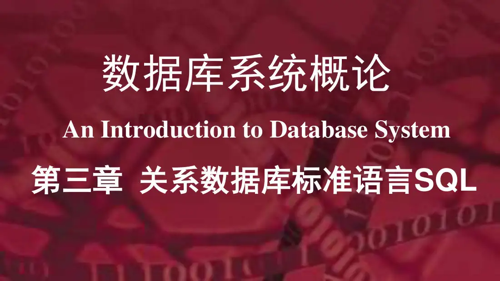

原文：

数据库系统概论 An Introduction to Database System 第三章 关系数据库标准语言SQL

### 数据查询 (多表连接查询)

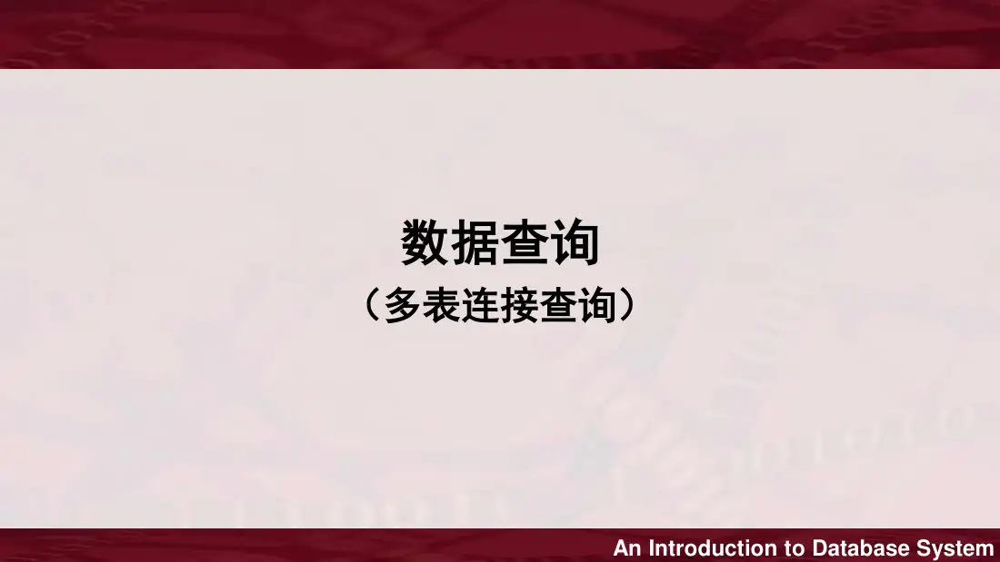

原文：

数据查询 (多表连接查询)

An Introduction to Database System

### 3.4.2 连接查询

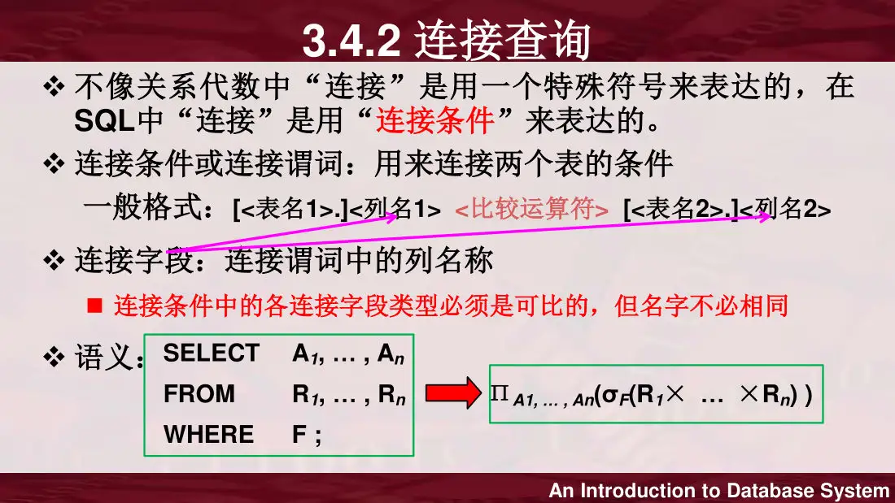

原文：

3.4.2 连接查询

✿ 不像关系代数中“连接”是用一个特殊符号来表达的，在SQL中“连接”是用“连接条件”来表达的。

✿ 连接条件或连接谓词：用来连接两个表的条件
一般格式：[<表名1>.]<列名1> <比较运算符> [<表名2>.]<列名2>

✿ 连接字段：连接谓词中的列名称

■ 连接条件中的各连接字段类型必须是可比的，但名字不必相同

✿ 语义: SELECT A $_{1}$ , ..., A $_{n}$ FROM R $_{1}$ , ..., R $_{n}$ WHERE F;
→ Π $_{A1, ..., An}$ (σ $_{F}$ (R $_{1}$ × ... × R $_{n}$ ))

An Introduction to Database System

### 连接查询（续）

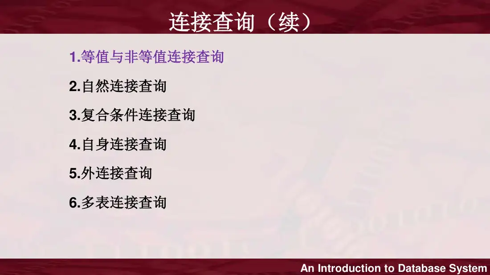

原文：

连接查询（续）

1. 等值与非等值连接查询

2.自然连接查询

3. 复合条件连接查询

4.自身连接查询

5.外连接查询

6. 多表连接查询

An Introduction to Database System

### 1. 等值与非等值连接查询

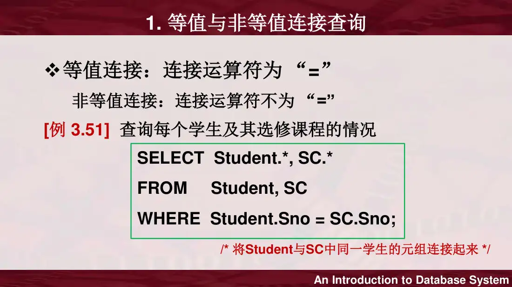

原文：

1. 等值与非等值连接查询

✿等值连接：连接运算符为“=”

非等值连接：连接运算符不为“=”

[例 3.51] 查询每个学生及其选修课程的情况

/\* 将Student与SC中同一学生的元组连接起来 \*/

An Introduction to Database System

### 等值与非等值连接查询（续）

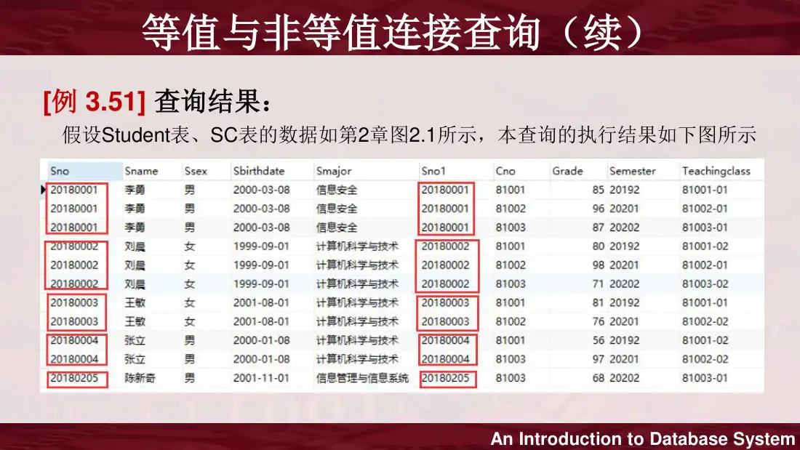

原文：

等值与非等值连接查询（续）

[例 3.51] 查询结果:

假设Student表、SC表的数据如第2章图2.1所示，本查询的执行结果如下图所示

<table><tr><td>Sno</td><td>Sname</td><td>Ssex</td><td>Sbirthdate</td><td>Smajor</td><td>Sno1</td><td>Cno</td><td>Grade</td><td>Semester</td><td>Teachingclass</td></tr><tr><td>20180001</td><td>李勇</td><td>男</td><td>2000-03-08</td><td>信息安全</td><td>20180001</td><td>81001</td><td>85</td><td>20192</td><td>81001-01</td></tr><tr><td>20180001</td><td>李勇</td><td>男</td><td>2000-03-08</td><td>信息安全</td><td>20180001</td><td>81002</td><td>96</td><td>20201</td><td>81002-01</td></tr><tr><td>20180001</td><td>李勇</td><td>男</td><td>2000-03-08</td><td>信息安全</td><td>20180001</td><td>81003</td><td>87</td><td>20202</td><td>81003-01</td></tr><tr><td>20180002</td><td>刘晨</td><td>女</td><td>1999-09-01</td><td>计算机科学与技术</td><td>20180002</td><td>81001</td><td>80</td><td>20192</td><td>81001-02</td></tr><tr><td>20180002</td><td>刘晨</td><td>女</td><td>1999-09-01</td><td>计算机科学与技术</td><td>20180002</td><td>81002</td><td>98</td><td>20201</td><td>81002-01</td></tr><tr><td>20180002</td><td>刘晨</td><td>女</td><td>1999-09-01</td><td>计算机科学与技术</td><td>20180002</td><td>81003</td><td>71</td><td>20202</td><td>81003-02</td></tr><tr><td>20180003</td><td>王敏</td><td>女</td><td>2001-08-01</td><td>计算机科学与技术</td><td>20180003</td><td>81001</td><td>81</td><td>20192</td><td>81001-01</td></tr><tr><td>20180003</td><td>王敏</td><td>女</td><td>2001-08-01</td><td>计算机科学与技术</td><td>20180003</td><td>81002</td><td>76</td><td>20201</td><td>81002-02</td></tr><tr><td>20180004</td><td>张立</td><td>男</td><td>2000-01-08</td><td>计算机科学与技术</td><td>20180004</td><td>81001</td><td>56</td><td>20192</td><td>81001-02</td></tr><tr><td>20180004</td><td>张立</td><td>男</td><td>2000-01-08</td><td>计算机科学与技术</td><td>20180004</td><td>81003</td><td>97</td><td>20201</td><td>81002-02</td></tr><tr><td>20180205</td><td>陈新奇</td><td>男</td><td>2001-11-01</td><td>信息管理与信息系统</td><td>20180205</td><td>81003</td><td>68</td><td>20202</td><td>81003-01</td></tr></table>

An Introduction to Database System

### 连接操作的执行过程

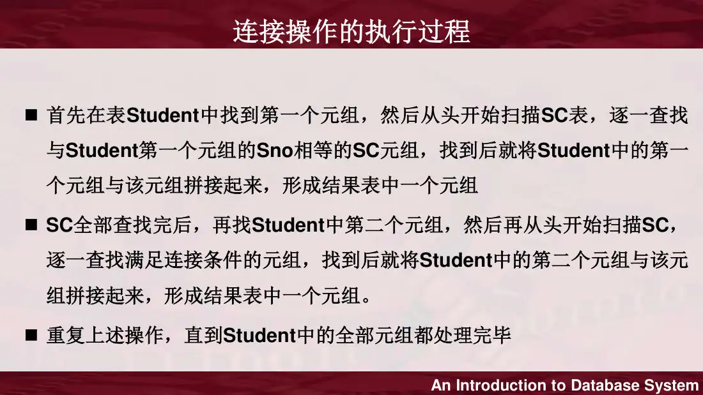

原文：

连接操作的执行过程

■ 首先在表Student中找到第一个元组，然后从头开始扫描SC表，逐一查找与Student第一个元组的Sno相等的SC元组，找到后就将Student中的第一个元组与该元组拼接起来，形成结果表中一个元组

■ SC全部查找完后，再找Student中第二个元组，然后再从头开始扫描SC，逐一查找满足连接条件的元组，找到后就将Student中的第二个元组与该元组拼接起来，形成结果表中一个元组。

■ 重复上述操作，直到Student中的全部元组都处理完毕

An Introduction to Database System

### 2. 自然连接查询

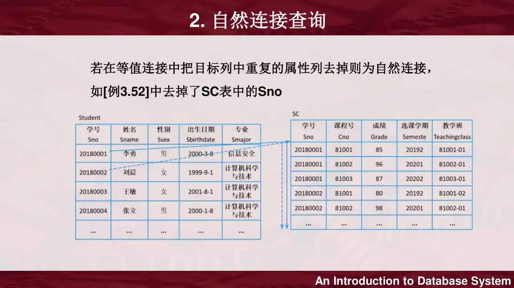

原文：

2. 自然连接查询

若在等值连接中把目标列中重复的属性列去掉则为自然连接，如[例3.52]中去掉了SC表中的Sno

Student

<table><tr><td>学号Sno</td><td>姓名Sname</td><td>性别Ssex</td><td>出生日期Sbirthdate</td><td>专业Smajor</td></tr><tr><td>20180001</td><td>李勇</td><td>男</td><td>2000-3-8</td><td>信息安全</td></tr><tr><td>20180002</td><td>刘晨</td><td>女</td><td>1999-9-1</td><td>计算机科学与技术</td></tr><tr><td>20180003</td><td>王敏</td><td>女</td><td>2001-8-1</td><td>计算机科学与技术</td></tr><tr><td>20180004</td><td>张立</td><td>男</td><td>2000-1-8</td><td>计算机科学与技术</td></tr><tr><td>...</td><td>...</td><td>...</td><td>...</td><td>...</td></tr></table>

<table><tr><td>学号Sno</td><td>课程号Cno</td><td>成绩Grade</td><td>选课学期Semeste</td><td>教学班Teachingclass</td></tr><tr><td>20180001</td><td>81001</td><td>85</td><td>20192</td><td>81001-01</td></tr><tr><td>20180001</td><td>81002</td><td>96</td><td>20201</td><td>81002-01</td></tr><tr><td>20180001</td><td>81003</td><td>87</td><td>20202</td><td>81003-01</td></tr><tr><td>20180002</td><td>81001</td><td>80</td><td>20192</td><td>81001-02</td></tr><tr><td>20180002</td><td>81002</td><td>98</td><td>20201</td><td>81002-01</td></tr><tr><td>...</td><td>...</td><td>...</td><td>...</td><td>...</td></tr></table>

An Introduction to Database System

### 自然连接查询（续）

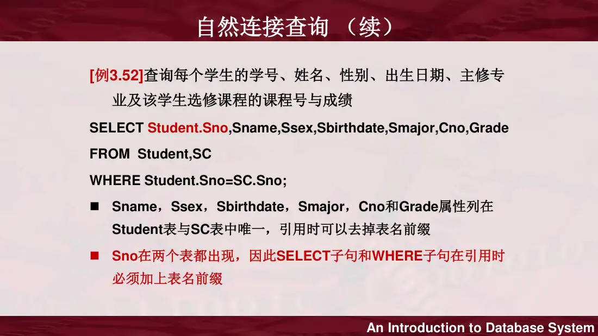

原文：

自然连接查询（续）

[例3.52]查询每个学生的学号、姓名、性别、出生日期、主修专业及该学生选修课程的课程号与成绩

SELECT Student.Sno,Sname,Ssex,Sbirthdate,Smajor,Cno,Grade FROM Student,SC

WHERE Student.Sno=SC.Sno;

■ Sname, Ssex, Sbirthdate, Smajor, Cno和Grade属性列在Student表与SC表中唯一，引用时可以去掉表名前缀

■ Sno在两个表都出现，因此SELECT子句和WHERE子句在引用时必须加上表名前缀

An Introduction to Database System

### 等值与非等值连接查询（续）

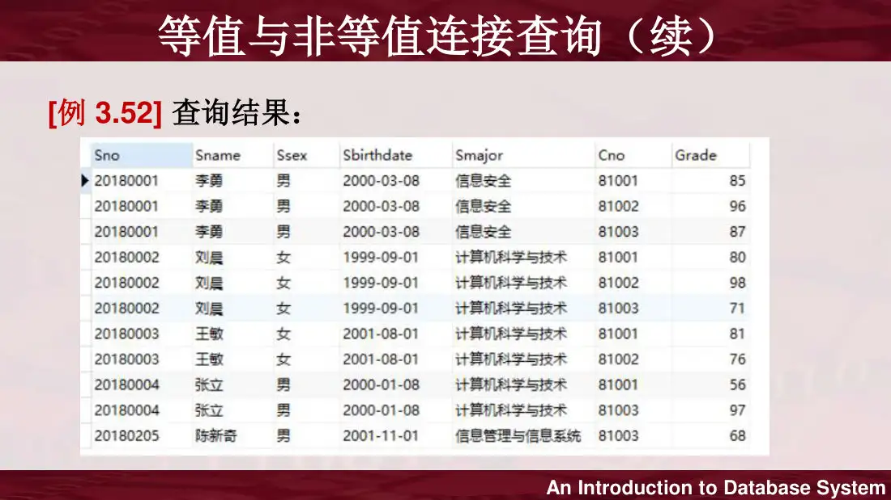

原文：

等值与非等值连接查询（续）

[例 3.52] 查询结果:

<table><tr><td>Sno</td><td>Sname</td><td>Ssex</td><td>Sbirthdate</td><td>Smajor</td><td>Cno</td><td>Grade</td></tr><tr><td>20180001</td><td>李勇</td><td>男</td><td>2000-03-08</td><td>信息安全</td><td>81001</td><td>85</td></tr><tr><td>20180001</td><td>李勇</td><td>男</td><td>2000-03-08</td><td>信息安全</td><td>81002</td><td>96</td></tr><tr><td>20180001</td><td>李勇</td><td>男</td><td>2000-03-08</td><td>信息安全</td><td>81003</td><td>87</td></tr><tr><td>20180002</td><td>刘晨</td><td>女</td><td>1999-09-01</td><td>计算机科学与技术</td><td>81001</td><td>80</td></tr><tr><td>20180002</td><td>刘晨</td><td>女</td><td>1999-09-01</td><td>计算机科学与技术</td><td>81002</td><td>98</td></tr><tr><td>20180002</td><td>刘晨</td><td>女</td><td>1999-09-01</td><td>计算机科学与技术</td><td>81003</td><td>71</td></tr><tr><td>20180003</td><td>王敏</td><td>女</td><td>2001-08-01</td><td>计算机科学与技术</td><td>81001</td><td>81</td></tr><tr><td>20180003</td><td>王敏</td><td>女</td><td>2001-08-01</td><td>计算机科学与技术</td><td>81002</td><td>76</td></tr><tr><td>20180004</td><td>张立</td><td>男</td><td>2000-01-08</td><td>计算机科学与技术</td><td>81001</td><td>56</td></tr><tr><td>20180004</td><td>张立</td><td>男</td><td>2000-01-08</td><td>计算机科学与技术</td><td>81003</td><td>97</td></tr><tr><td>20180205</td><td>陈新奇</td><td>男</td><td>2001-11-01</td><td>信息管理与信息系统</td><td>81003</td><td>68</td></tr></table>

An Introduction to Database System

### 3. 复合条件连接查询

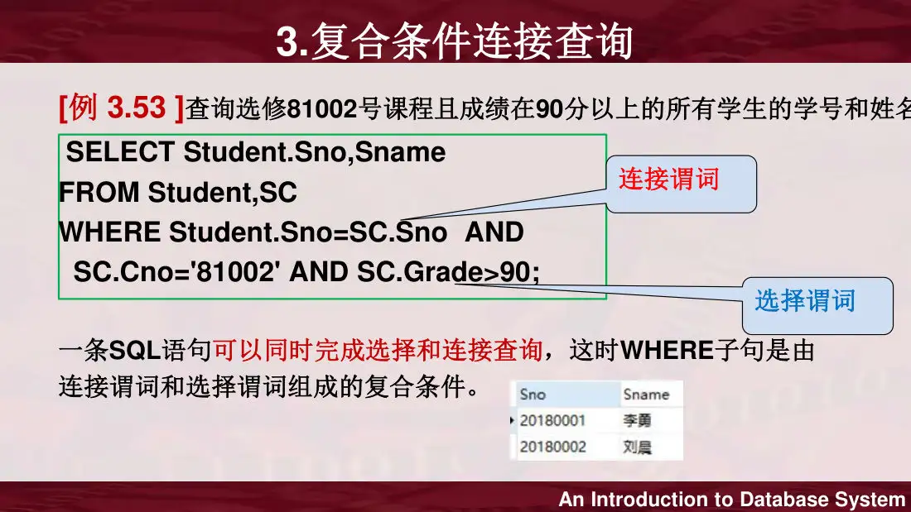

原文：

3. 复合条件连接查询

[例 3.53] 查询选修81002号课程且成绩在90分以上的所有学生的学号和姓名

连接谓词

选择谓词

一条SQL语句可以同时完成选择和连接查询，这时WHERE子句是由连接谓词和选择谓词组成的复合条件。Sno Sname

An Introduction to Database System

### 4. 自身连接

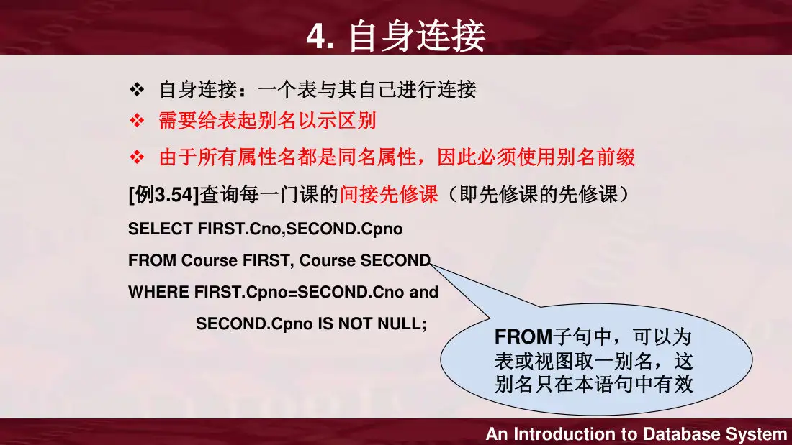

原文：

4. 自身连接

✿ 自身连接：一个表与其自己进行连接

需要给表起别名以示区别

由于所有属性名都是同名属性，因此必须使用别名前缀

[例3.54]查询每一门课的间接先修课（即先修课的先修课）

SELECT FIRST.Cno,SECOND.Cpno

FROM Course FIRST, Course SECOND

WHERE FIRST.Cpno=SECOND.Cno and

SECOND.Cpno IS NOT NULL;

FROM子句中，可以为表或视图取一别名，这别名只在本语句中有效

An Introduction to Database System

### 自身连接（续）

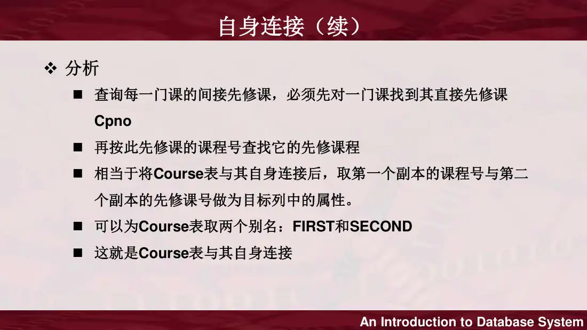

原文：

自身连接（续）

分析

■ 查询每一门课的间接先修课，必须先对一门课找到其直接先修课
Cpno

■ 再按此先修课的课程号查找它的先修课程

■ 相当于将Course表与其自身连接后，取第一个副本的课程号与第二个副本的先修课号做为目标列中的属性。

■ 可以为Course表取两个别名：FIRST和SECOND

■ 这就是Course表与其自身连接

An Introduction to Database System

### 自身连接（续）

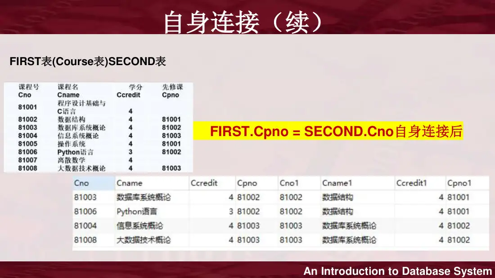

原文：

自身连接（续）

FIRST表(Course表)SECOND表

<table><tr><td>课程号</td><td>课程名</td><td>学分</td><td>先修课</td><td></td><td></td><td></td><td></td><td></td></tr><tr><td>Cno</td><td>Cname</td><td>Ccredit</td><td>Cpno</td><td></td><td></td><td></td><td></td><td></td></tr><tr><td>81001</td><td>程序设计基础与C语言</td><td>4</td><td></td><td></td><td></td><td></td><td></td><td></td></tr><tr><td>81002</td><td>数据结构</td><td>4</td><td>81001</td><td></td><td></td><td></td><td></td><td></td></tr><tr><td>81003</td><td>数据库系统概论</td><td>4</td><td>81002</td><td></td><td></td><td></td><td></td><td></td></tr><tr><td>81004</td><td>信息系统概论</td><td>4</td><td>81003</td><td></td><td></td><td></td><td></td><td></td></tr><tr><td>81005</td><td>操作系统</td><td>4</td><td>81001</td><td></td><td></td><td></td><td></td><td></td></tr><tr><td>81006</td><td>Python语言</td><td>3</td><td>81002</td><td></td><td></td><td></td><td></td><td></td></tr><tr><td>81007</td><td>离散数学</td><td>4</td><td></td><td></td><td></td><td></td><td></td><td></td></tr><tr><td>81008</td><td>大数据技术概论</td><td>4</td><td>81003</td><td></td><td></td><td></td><td></td><td></td></tr><tr><td></td><td>Cno</td><td>Cname</td><td>Ccredit</td><td>Cpno</td><td>Cno1</td><td>Cname1</td><td>Ccredit1</td><td>Cpno1</td></tr><tr><td></td><td>81003</td><td>数据库系统概论</td><td>4</td><td>81002</td><td>81002</td><td>数据结构</td><td>4</td><td>81001</td></tr><tr><td></td><td>81006</td><td>Python语言</td><td>3</td><td>81002</td><td>81002</td><td>数据结构</td><td>4</td><td>81001</td></tr><tr><td></td><td>81004</td><td>信息系统概论</td><td>4</td><td>81003</td><td>81003</td><td>数据库系统概论</td><td>4</td><td>81002</td></tr><tr><td></td><td>81008</td><td>大数据技术概论</td><td>4</td><td>81003</td><td>81003</td><td>数据库系统概论</td><td>4</td><td>81002</td></tr></table>

An Introduction to Database System

### 自身连接（续）

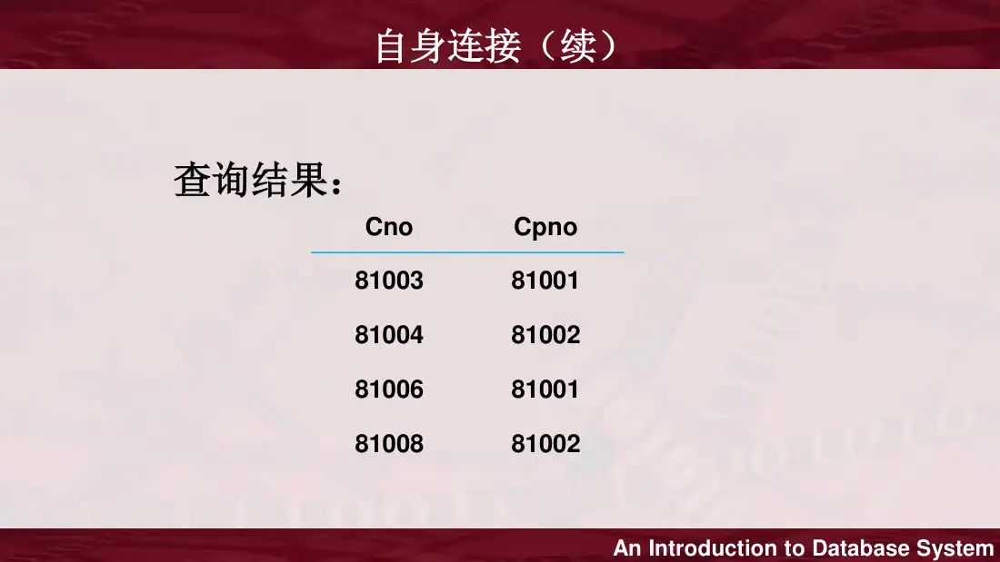

原文：

自身连接（续）

查询结果:

<table><tr><td>Cno</td><td>Cpno</td></tr><tr><td>81003</td><td>81001</td></tr><tr><td>81004</td><td>81002</td></tr><tr><td>81006</td><td>81001</td></tr><tr><td>81008</td><td>81002</td></tr></table>

An Introduction to Database System

### 5. 外连接查询

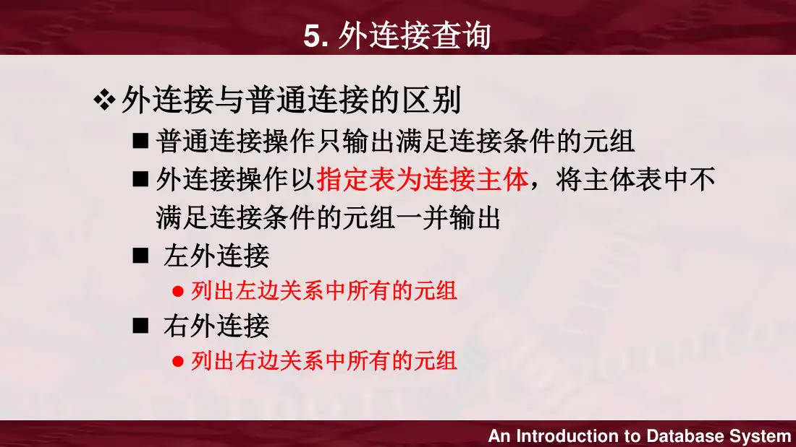

原文：

5. 外连接查询

◆ 外连接与普通连接的区别

■ 普通连接操作只输出满足连接条件的元组

■ 外连接操作以指定表为连接主体，将主体表中不满足连接条件的元组一并输出

左外连接

\- 列出左边关系中所有的元组

■ 右外连接

\- 列出右边关系中所有的元组

An Introduction to Database System

### 1）inner join：内连接，显示符合on指定连接条件的记录

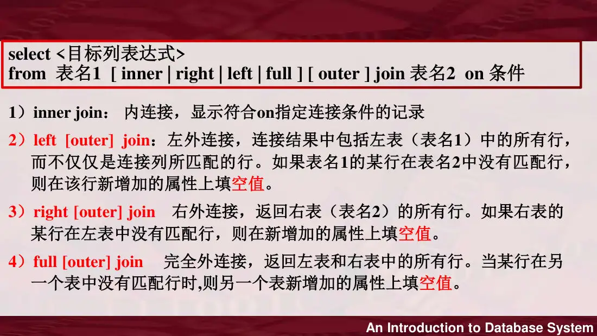

原文：

select <目标列表达式> from 表名1 [inner | right | left | full ] [outer] join 表名2 on 条件

1）inner join：内连接，显示符合on指定连接条件的记录

2）left [outer] join：左外连接，连接结果中包括左表（表名1）中的所有行，而不仅仅是连接列所匹配的行。如果表名1的某行在表名2中没有匹配行，则在该行新增加的属性上填空值。

3) right [outer] join 右外连接，返回右表（表名2）的所有行。如果右表的某行在左表中没有匹配行，则在新增加的属性上填空值。

4) full [outer] join 完全外连接，返回左表和右表中的所有行。当某行在另一个表中没有匹配行时,则另一个表新增加的属性上填空值。

An Introduction to Database System

### 外连接（续）

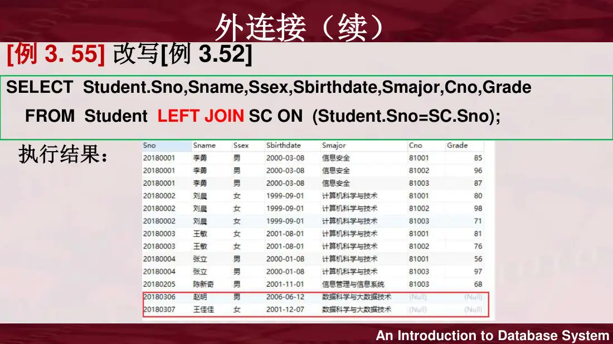

原文：

外连接（续）

[例 3.55] 改写[例 3.52]

SELECT Student.Sno,Sname,Ssex,Sbirthdate,Smajor,Cno,Grade

FROM Student LEFT JOIN SC ON (Student.Sno=SC.Sno);

执行结果:

<table><tr><td>Sno</td><td>Sname</td><td>Ssex</td><td>Sbirthdate</td><td>Smajor</td><td>Cno</td><td>Grade</td></tr><tr><td>20180001</td><td>李勇</td><td>男</td><td>2000-03-08</td><td>信息安全</td><td>81001</td><td>85</td></tr><tr><td>20180001</td><td>李勇</td><td>男</td><td>2000-03-08</td><td>信息安全</td><td>81002</td><td>96</td></tr><tr><td>20180001</td><td>李勇</td><td>男</td><td>2000-03-08</td><td>信息安全</td><td>81003</td><td>87</td></tr><tr><td>20180002</td><td>刘晨</td><td>女</td><td>1999-09-01</td><td>计算机科学与技术</td><td>81001</td><td>80</td></tr><tr><td>20180002</td><td>刘晨</td><td>女</td><td>1999-09-01</td><td>计算机科学与技术</td><td>81002</td><td>98</td></tr><tr><td>20180002</td><td>刘晨</td><td>女</td><td>1999-09-01</td><td>计算机科学与技术</td><td>81003</td><td>71</td></tr><tr><td>20180003</td><td>王敏</td><td>女</td><td>2001-08-01</td><td>计算机科学与技术</td><td>81001</td><td>81</td></tr><tr><td>20180003</td><td>王敏</td><td>女</td><td>2001-08-01</td><td>计算机科学与技术</td><td>81002</td><td>76</td></tr><tr><td>20180004</td><td>张立</td><td>男</td><td>2000-01-08</td><td>计算机科学与技术</td><td>81001</td><td>56</td></tr><tr><td>20180004</td><td>张立</td><td>男</td><td>2000-01-08</td><td>计算机科学与技术</td><td>81003</td><td>97</td></tr><tr><td>20180205</td><td>陈新奇</td><td>男</td><td>2001-11-01</td><td>信息管理与信息系统</td><td>81003</td><td>68</td></tr><tr><td>20180306</td><td>赵明</td><td>男</td><td>2006-06-12</td><td>数据科学与大数据技术</td><td>(Null)</td><td>(Null)</td></tr><tr><td>20180307</td><td>王佳佳</td><td>女</td><td>2001-12-07</td><td>数据科学与大数据技术</td><td>(Null)</td><td>(Null)</td></tr></table>

An Introduction to Database System

### 6. 多表连接

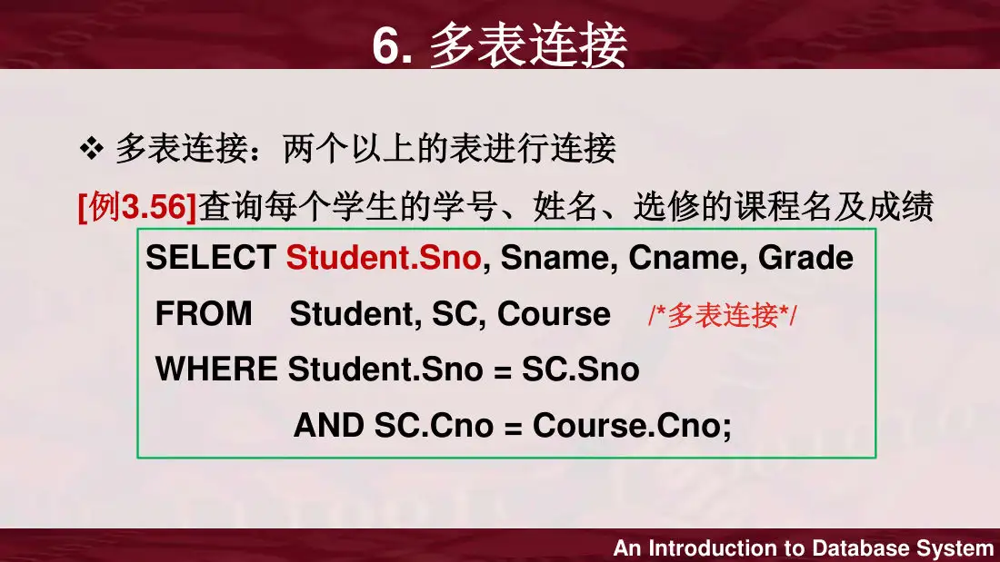

原文：

6. 多表连接

多表连接：两个以上的表进行连接

[例3.56]查询每个学生的学号、姓名、选修的课程名及成绩

An Introduction to Database System

### 多表连接（续）

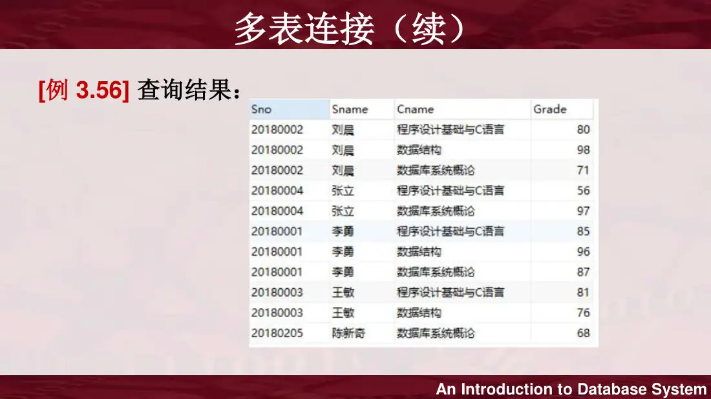

原文：

多表连接（续）

[例 3.56] 查询结果:

<table><tr><td>Sno</td><td>Sname</td><td>Cname</td><td>Grade</td></tr><tr><td>20180002</td><td>刘晨</td><td>程序设计基础与C语言</td><td>80</td></tr><tr><td>20180002</td><td>刘晨</td><td>数据结构</td><td>98</td></tr><tr><td>20180002</td><td>刘晨</td><td>数据库系统概论</td><td>71</td></tr><tr><td>20180004</td><td>张立</td><td>程序设计基础与C语言</td><td>56</td></tr><tr><td>20180004</td><td>张立</td><td>数据库系统概论</td><td>97</td></tr><tr><td>20180001</td><td>李勇</td><td>程序设计基础与C语言</td><td>85</td></tr><tr><td>20180001</td><td>李勇</td><td>数据结构</td><td>96</td></tr><tr><td>20180001</td><td>李勇</td><td>数据库系统概论</td><td>87</td></tr><tr><td>20180003</td><td>王敏</td><td>程序设计基础与C语言</td><td>81</td></tr><tr><td>20180003</td><td>王敏</td><td>数据结构</td><td>76</td></tr><tr><td>20180205</td><td>陈新奇</td><td>数据库系统概论</td><td>68</td></tr></table>

An Introduction to Database System

### 数据查询 (嵌套查询)

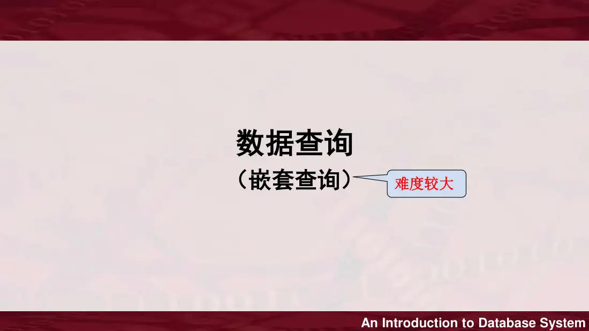

原文：

数据查询 (嵌套查询)

难度较大

An Introduction to Database System

### 嵌套查询

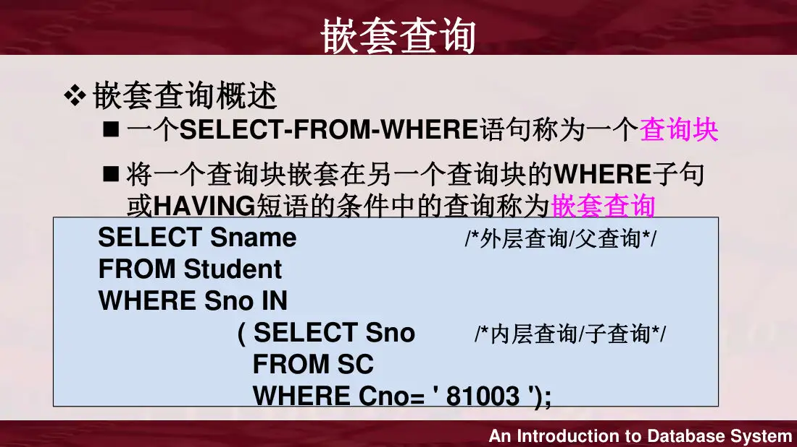

原文：

嵌套查询

嵌套查询概述

■ 一个SELECT-FROM-WHERE语句称为一个查询块

■ 将一个查询块嵌套在另一个查询块的WHERE子句或HAVING短语的条件中的查询称为嵌套查询

SELECT Sname

/\*外层查询/父查询\*/

FROM Student

WHERE Sno IN

( SELECT Sno

/\*内层查询/子查询\*/

FROM SC

WHERE Cno='81003');

An Introduction to Database System

### 嵌套查询（续）

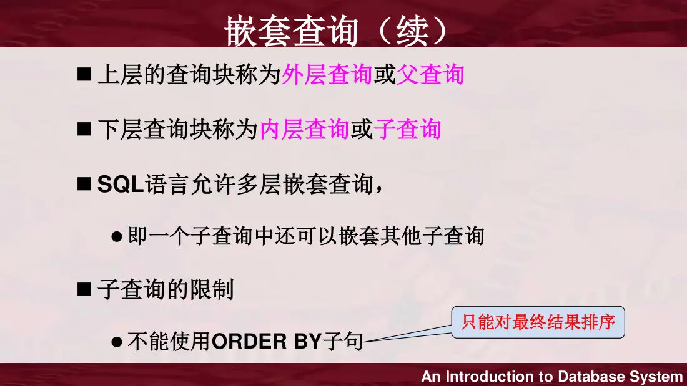

原文：

嵌套查询（续）

■ 上层的查询块称为外层查询或父查询

■ 下层查询块称为内层查询或子查询

■ SQL语言允许多层嵌套查询，

\- 即一个子查询中还可以嵌套其他子查询

■ 子查询的限制

只能对最终结果排序

\- 不能使用ORDER BY子句

An Introduction to Database System

### 嵌套查询求解方法

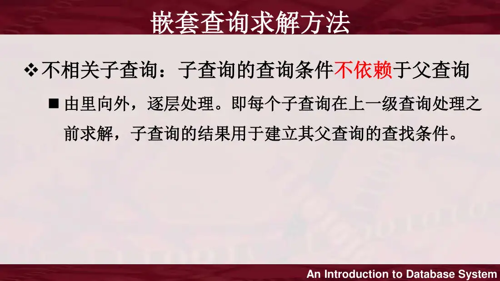

原文：

嵌套查询求解方法

✿ 不相关子查询：子查询的查询条件不依赖于父查询

■由里向外，逐层处理。即每个子查询在上一级查询处理之前求解，子查询的结果用于建立其父查询的查找条件。

An Introduction to Database System

### 嵌套查询求解方法（续）

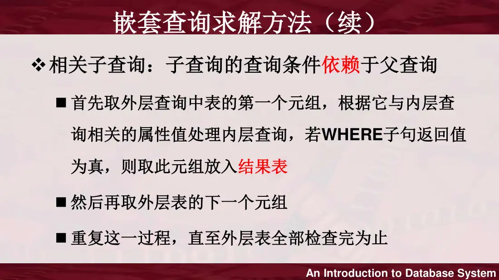

原文：

嵌套查询求解方法（续）

相关子查询：子查询的查询条件依赖于父查询

■ 首先取外层查询中表的第一个元组，根据它与内层查询相关的属性值处理内层查询，若WHERE子句返回值为真，则取此元组放入结果表

■然后再取外层表的下一个元组

■ 重复这一过程，直至外层表全部检查完为止

An Introduction to Database System

### 3.3.3 嵌套查询

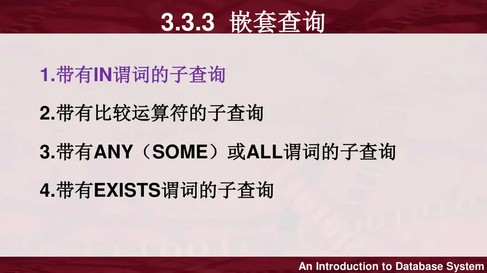

原文：

3.3.3 嵌套查询

1. 带有IN谓词的子查询

2. 带有比较运算符的子查询

3. 带有ANY（SOME）或ALL谓词的子查询

4. 带有 EXISTS 谓词的子查询

An Introduction to Database System

### 1. 带有IN谓词的子查询

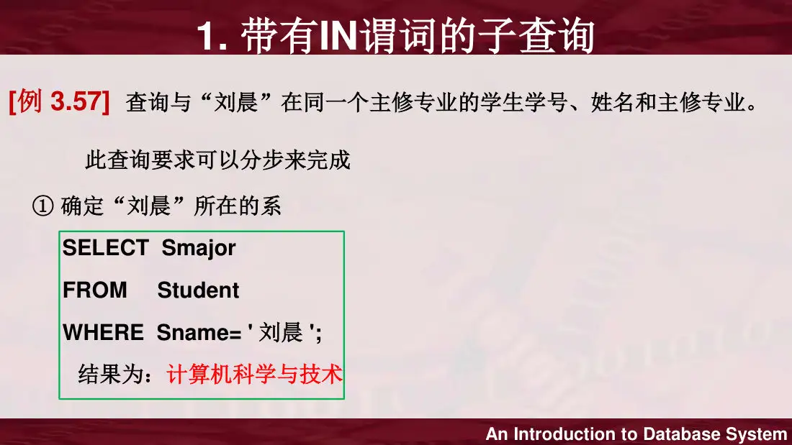

原文：

1. 带有IN谓词的子查询

[例 3.57] 查询与“刘晨”在同一个主修专业的学生学号、姓名和主修专业。

此查询要求可以分步来完成

① 确定 “刘晨” 所在的系

An Introduction to Database System

### 带有IN谓词的子查询（续）

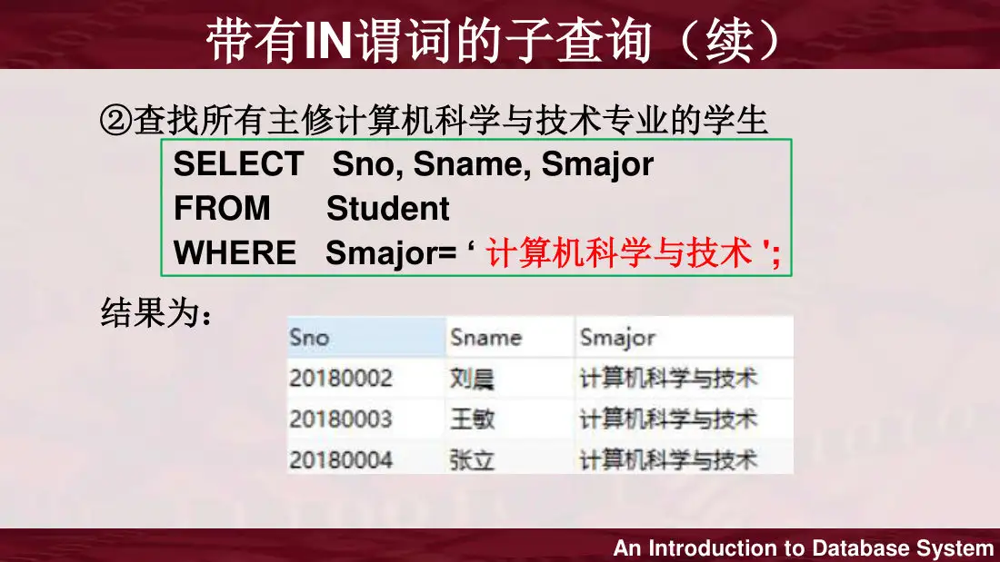

原文：

带有IN谓词的子查询（续）

②查找所有主修计算机科学与技术专业的学生

SELECT Sno, Sname, Smajor

FROM Student

WHERE Smajor='计算机科学与技术';

结果为:

<table><tr><td>Sno</td><td>Sname</td><td>Smajor</td></tr><tr><td>20180002</td><td>刘晨</td><td>计算机科学与技术</td></tr><tr><td>20180003</td><td>王敏</td><td>计算机科学与技术</td></tr><tr><td>20180004</td><td>张立</td><td>计算机科学与技术</td></tr></table>

An Introduction to Database System

### 带有IN谓词的子查询（续）

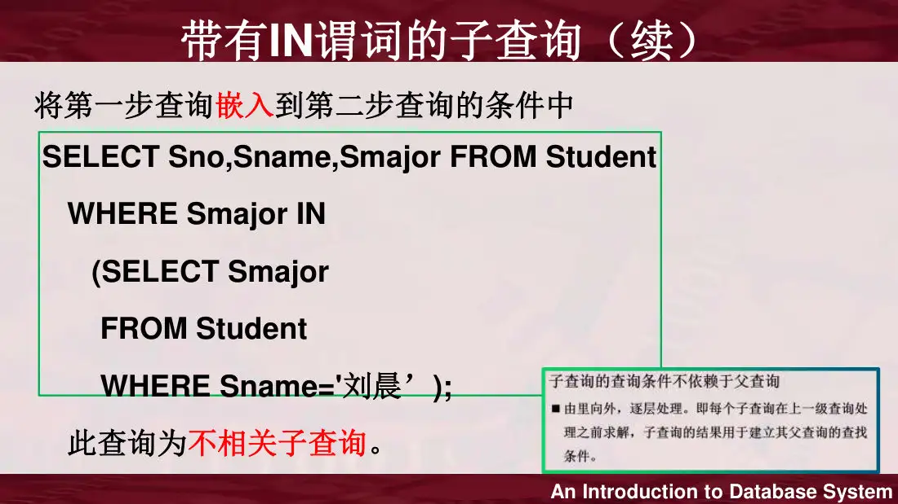

原文：

带有IN谓词的子查询（续）

将第一步查询嵌入到第二步查询的条件中

<table><tr><td>SELECT Sno,Sname,Smajor FROM StudentWHERE Smajor IN(SELECT SmajorFROM StudentWHERE Sname=&#x27;刘晨&#x27;);此查询为不相关子查询。</td><td>子查询的查询条件不依赖于父查询■由里向外,逐层处理。即每个子查询在上一级查询处理之前求解,子查询的结果用于建立其父查询的查找条件。</td></tr></table>

An Introduction to Database System

### 带有IN谓词的子查询（续）

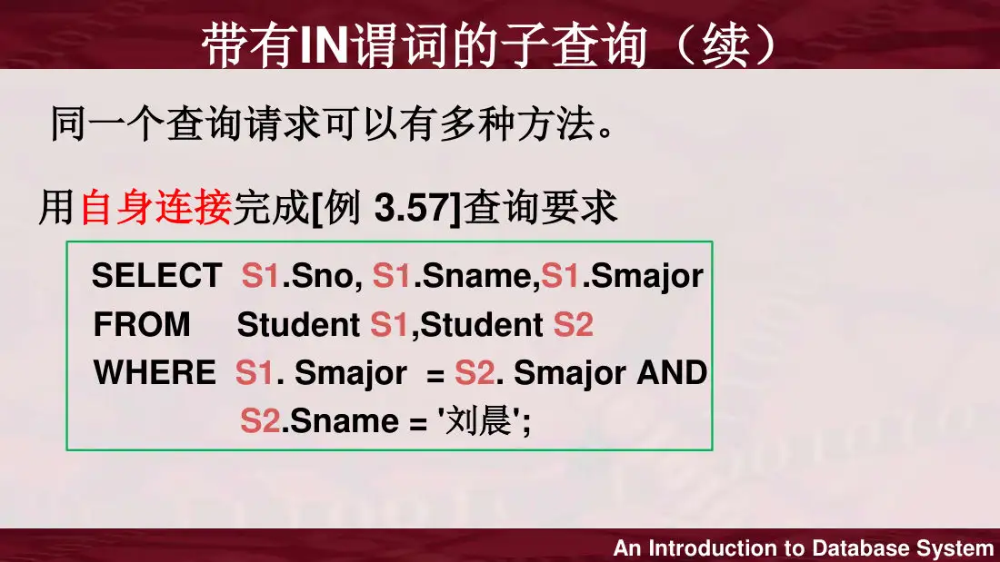

原文：

带有IN谓词的子查询（续）

同一个查询请求可以有多种方法。

用自身连接完成[例 3.57]查询要求

An Introduction to Database System

### 带有IN谓词的子查询（续）

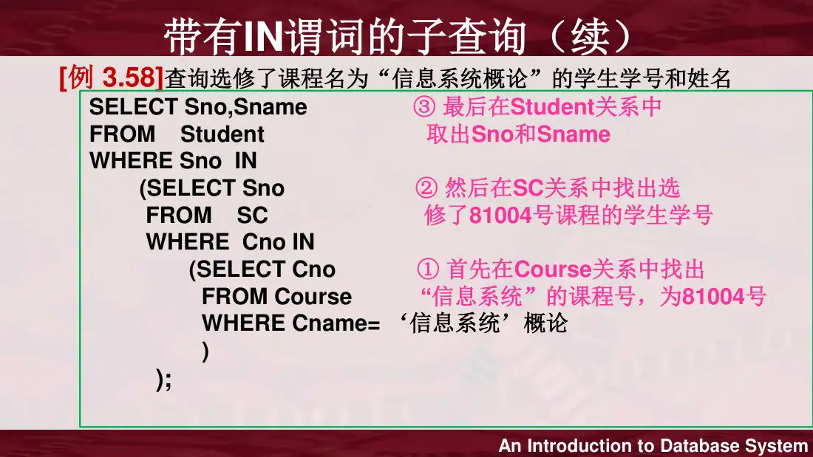

原文：

带有IN谓词的子查询（续）

[例 3.58]查询选修了课程名为“信息系统概论”的学生学号和姓名

An Introduction to Database System

### 带有IN谓词的子查询（续）

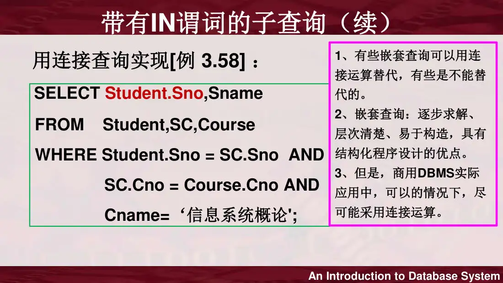

原文：

<table><tr><td colspan="2">用连接查询实现[例 3.58]:</td><td rowspan="2">1、有些嵌套查询可以用连接运算替代,有些是不能替代的。2、嵌套查询:逐步求解、层次清楚、易于构造,具有结构化程序设计的优点。3、但是,商用DBMS实际应用中,可以的情况下,尽可能采用连接运算。</td></tr><tr><td colspan="2">SELECT Student.Sno,SnameFROM Student,SC,CourseWHERE Student.Sno = SC.Sno ANDSC.Cno = Course.Cno ANDCname=‘信息系统概论&#x27;;</td></tr></table>

带有IN谓词的子查询（续）

An Introduction to Database System

### 3.3.3 嵌套查询

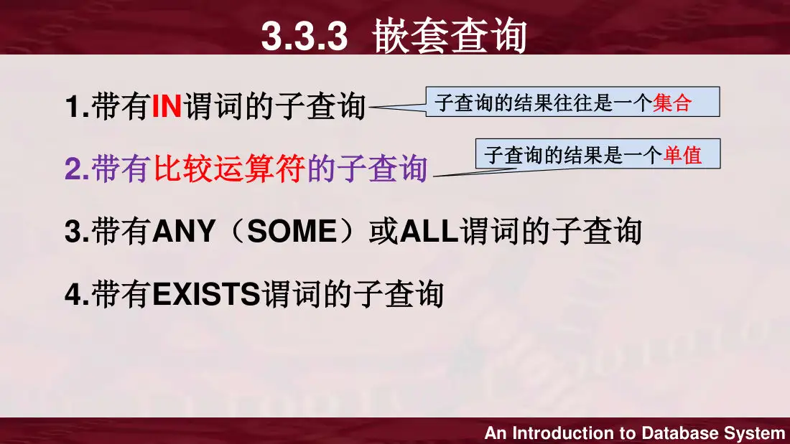

原文：

3.3.3 嵌套查询

1. 带有IN谓词的子查询

2.带有比较运算符的子查询

子查询的结果往往是一个集合

子查询的结果是一个单值

3. 带有ANY（SOME）或ALL谓词的子查询

4.带有EXISTS谓词的子查询

An Introduction to Database System

### 2. 带有比较运算符的子查询

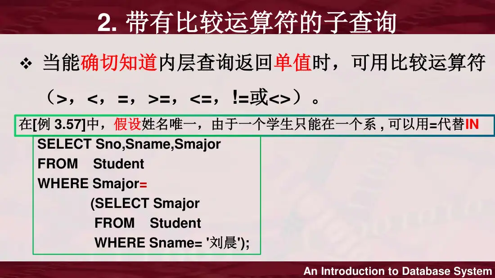

原文：

2. 带有比较运算符的子查询

✿ 当能确切知道内层查询返回单值时，可用比较运算符

(>, <, =, >=, <=, !=或<> )。

在[例 3.57]中，假设姓名唯一，由于一个学生只能在一个系，可以用=代替IN

An Introduction to Database System

### 带有比较运算符的子查询（续）

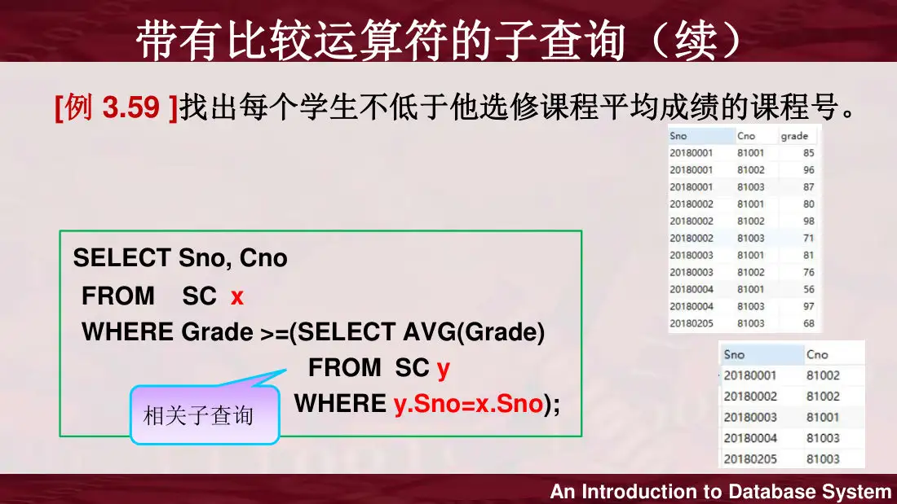

原文：

带有比较运算符的子查询（续）

[例 3.59]找出每个学生不低于他选修课程平均成绩的课程号。

SELECT Sno, Cno
FROM SC x
WHERE Grade >=(SELECT AVG(Grade)
FROM SC y
WHERE y.Sno=x.Sno);
相关子查询

<table><tr><td>Sno</td><td>Cno</td><td>grade</td></tr><tr><td>20180001</td><td>81001</td><td>85</td></tr><tr><td>20180001</td><td>81002</td><td>96</td></tr><tr><td>20180001</td><td>81003</td><td>87</td></tr><tr><td>20180002</td><td>81001</td><td>80</td></tr><tr><td>20180002</td><td>81002</td><td>98</td></tr><tr><td>20180002</td><td>81003</td><td>71</td></tr><tr><td>20180003</td><td>81001</td><td>81</td></tr><tr><td>20180003</td><td>81002</td><td>76</td></tr><tr><td>20180004</td><td>81001</td><td>56</td></tr><tr><td>20180004</td><td>81003</td><td>97</td></tr><tr><td>20180205</td><td>81003</td><td>68</td></tr></table>

<table><tr><td>Sno</td><td>Cno</td></tr><tr><td>20180001</td><td>81002</td></tr><tr><td>20180002</td><td>81002</td></tr><tr><td>20180003</td><td>81001</td></tr><tr><td>20180004</td><td>81003</td></tr><tr><td>20180205</td><td>81003</td></tr></table>

An Introduction to Database System

### 带有比较运算符的子查询（续）

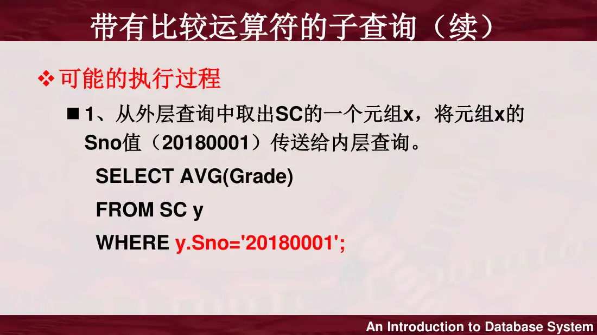

原文：

带有比较运算符的子查询（续）

可能的执行过程

■1、从外层查询中取出SC的一个元组x，将元组x的Sno值（20180001）传送给内层查询。
SELECT AVG(Grade)
FROM SC y
WHERE y.Sno='20180001';

An Introduction to Database System

### 带有比较运算符的子查询（续）

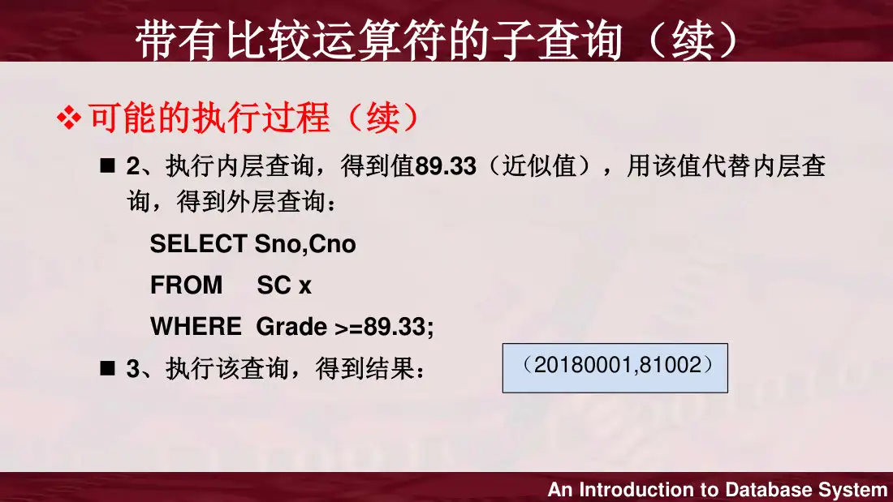

原文：

带有比较运算符的子查询（续）

可能的执行过程（续）

■ 2、执行内层查询，得到值89.33（近似值），用该值代替内层查询，得到外层查询：

SELECT Sno,Cno

FROM SC x

WHERE Grade >=89.33;

■ 3、执行该查询，得到结果：

(20180001,81002)

An Introduction to Database System

### 带有比较运算符的子查询（续）

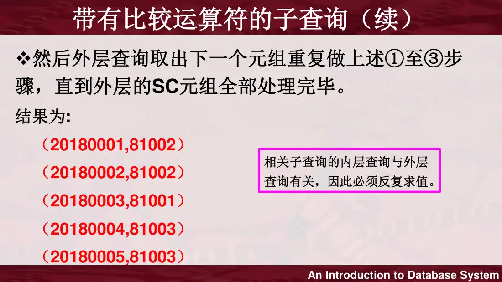

原文：

带有比较运算符的子查询（续）

◆然后外层查询取出下一个元组重复做上述①至③步骤，直到外层的SC元组全部处理完毕。

结果为:

(20180001,81002)

(20180002,81002)

(20180003,81001)

(20180004,81003)

(20180005,81003)

相关子查询的内层查询与外层查询有关，因此必须反复求值。

An Introduction to Database System

### 3.4.3 嵌套查询

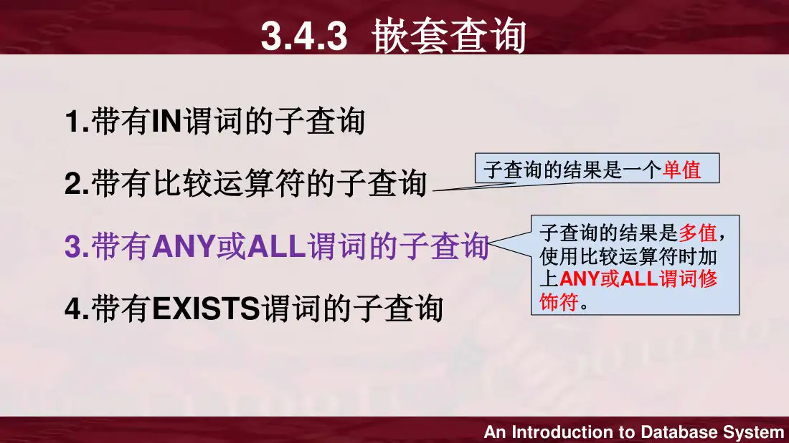

原文：

3.4.3 嵌套查询

1. 带有IN谓词的子查询

2. 带有比较运算符的子查询

3.带有ANY或ALL谓词的子查询

4.带有EXISTS谓词的子查询

子查询的结果是一个单值

子查询的结果是多值，使用比较运算符时加上ANY或ALL谓词修饰符。

An Introduction to Database System

### 带有ANY（SOME）或ALL谓词的子查询（续）

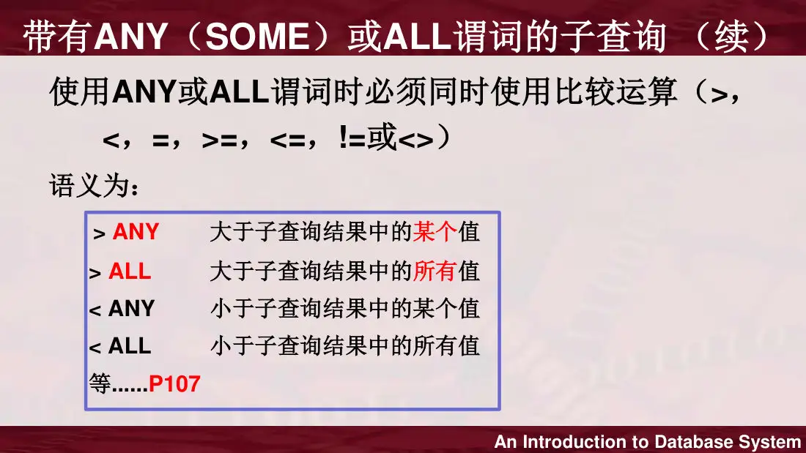

原文：

带有ANY（SOME）或ALL谓词的子查询（续）

使用ANY或ALL谓词时必须同时使用比较运算（>，

$$
<  , = , > = , <   = ,! = \text {或} <   >)
$$

语义为:

> ANY 大于子查询结果中的某个值

> ALL 大于子查询结果中的所有值

< ANY 小于子查询结果中的某个值

< ALL 小于子查询结果中的所有值等……P107

An Introduction to Database System

### 带有ANY（SOME）或ALL谓词的子查询（续）

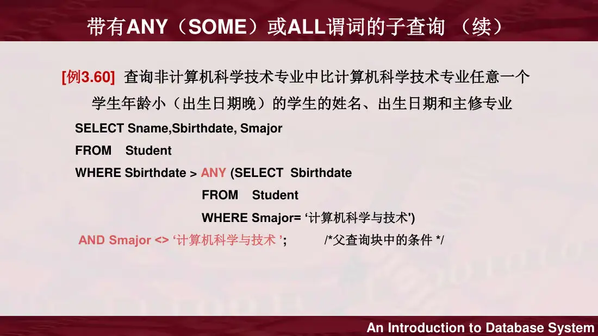

原文：

带有ANY（SOME）或ALL谓词的子查询（续）

[例3.60] 查询非计算机科学技术专业中比计算机科学技术专业任意一个学生年龄小（出生日期晚）的学生的姓名、出生日期和主修专业 SELECT Sname, Sbirthdate, Smajor

FROM Student

WHERE Sbirthdate > ANY (SELECT Sbirthdate

FROM Student

WHERE Smajor='计算机科学与技术')

AND Smajor <> ‘计算机科学与技术’; /\*父查询块中的条件 \*/

An Introduction to Database System

### 带有ANY（SOME）或ALL谓词的子查询（续）

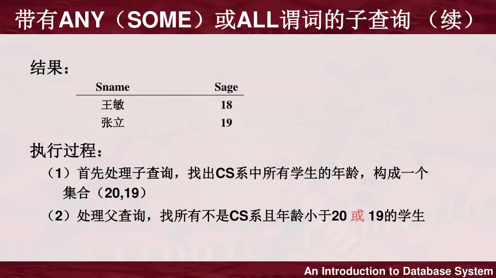

原文：

带有ANY（SOME）或ALL谓词的子查询（续）

结果:

<table><tr><td>Sname</td><td>Sage</td></tr><tr><td>王敏</td><td>18</td></tr><tr><td>张立</td><td>19</td></tr></table>

执行过程:

(1) 首先处理子查询, 找出CS系中所有学生的年龄, 构成一个集合 (20,19)

(2) 处理父查询, 找所有不是CS系且年龄小于20或19的学生

An Introduction to Database System

### 带有ANY（SOME）或ALL谓词的子查询（续）

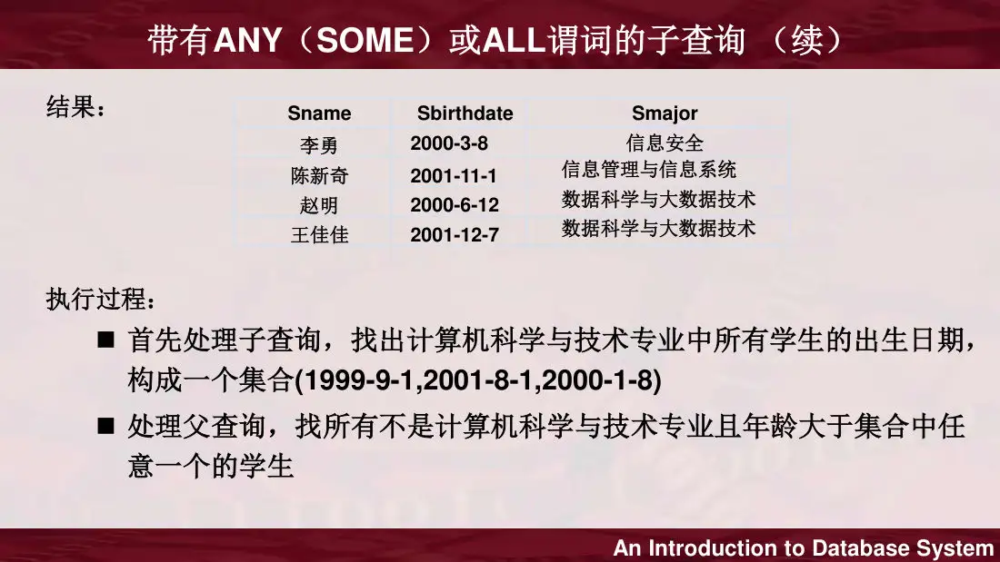

原文：

带有ANY（SOME）或ALL谓词的子查询（续）

结果:

<table><tr><td>Sname</td><td>Sbirthdate</td><td>Smajor</td></tr><tr><td>李勇</td><td>2000-3-8</td><td>信息安全</td></tr><tr><td>陈新奇</td><td>2001-11-1</td><td>信息管理与信息系统</td></tr><tr><td>赵明</td><td>2000-6-12</td><td>数据科学与大数据技术</td></tr><tr><td>王佳佳</td><td>2001-12-7</td><td>数据科学与大数据技术</td></tr></table>

执行过程:

■ 首先处理子查询，找出计算机科学与技术专业中所有学生的出生日期，构成一个集合(1999-9-1,2001-8-1,2000-1-8)

■ 处理父查询，找所有不是计算机科学与技术专业且年龄大于集合中任意一个的学生

An Introduction to Database System

### 带有ANY（SOME）或ALL谓词的子查询（续）

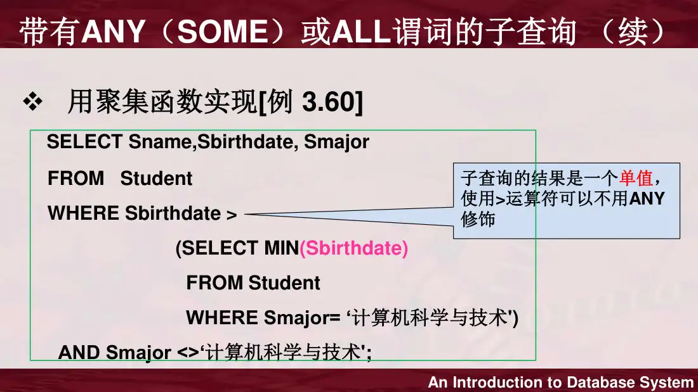

原文：

带有ANY（SOME）或ALL谓词的子查询（续）

✿ 用聚集函数实现[例 3.60]

An Introduction to Database System

### 带有ANY（SOME）或ALL谓词的子查询（续）

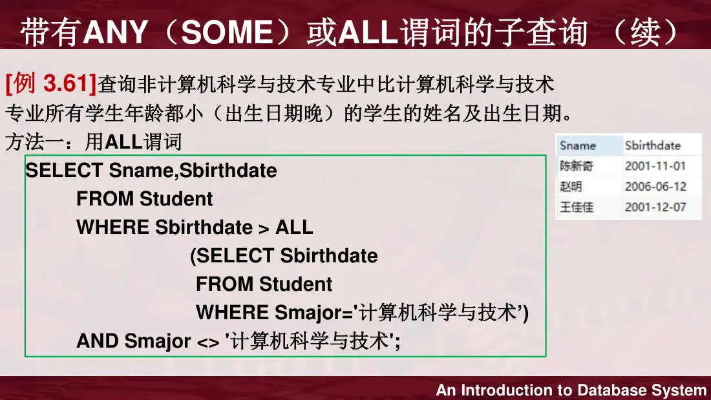

原文：

带有ANY（SOME）或ALL谓词的子查询（续）

[例 3.61]查询非计算机科学与技术专业中比计算机科学与技术专业所有学生年龄都小（出生日期晚）的学生的姓名及出生日期。

方法一：用ALL谓词

<table><tr><td>Sname</td><td>Sbirthdate</td></tr><tr><td>陈新奇</td><td>2001-11-01</td></tr><tr><td>赵明</td><td>2006-06-12</td></tr><tr><td>王佳佳</td><td>2001-12-07</td></tr></table>

An Introduction to Database System

### 带有ANY（SOME）或ALL谓词的子查询（续）

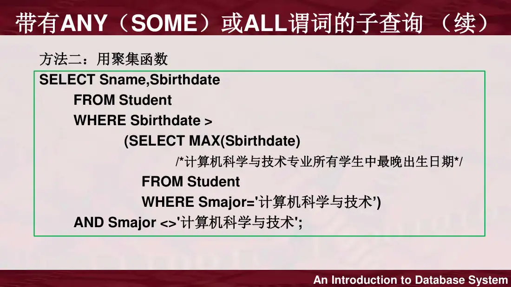

原文：

带有ANY（SOME）或ALL谓词的子查询（续）

方法二：用聚集函数

An Introduction to Database System

### 带有ANY（SOME）或ALL谓词的子查询（续）

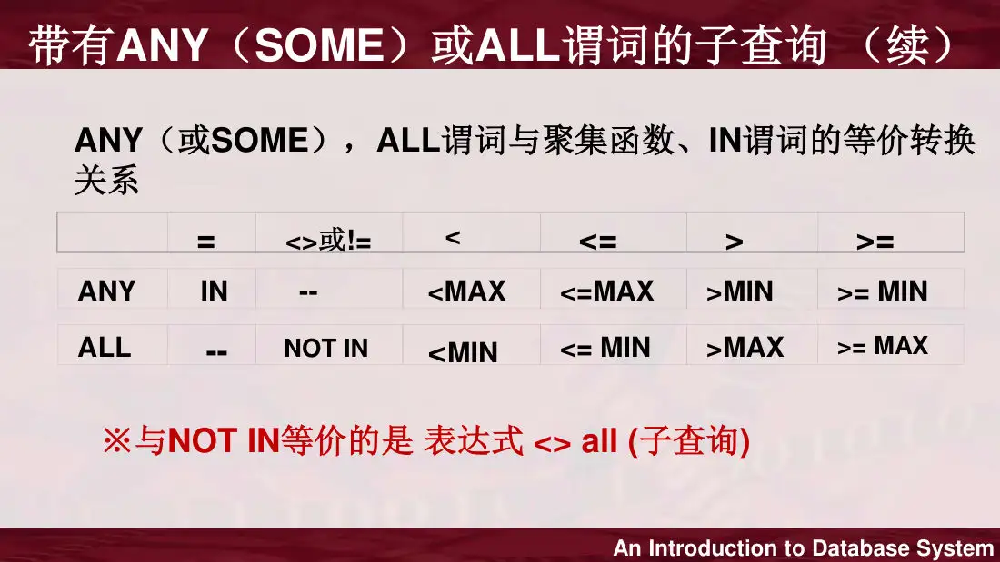

原文：

带有ANY（SOME）或ALL谓词的子查询（续）

ANY（或SOME），ALL谓词与聚集函数、IN谓词的等价转换关系

<table><tr><td></td><td>=</td><td>&lt;&gt;或!=</td><td>&lt;</td><td>&lt;=</td><td>&gt;</td><td>&gt;=</td></tr><tr><td>ANY</td><td>IN</td><td>--</td><td></td><td>&lt;=MAX</td><td>&gt;MIN</td><td>&gt;= MIN</td></tr><tr><td>ALL</td><td>--</td><td>NOT IN</td><td></td><td>&lt;= MIN</td><td>&gt;MAX</td><td>&gt;= MAX</td></tr></table>

※与NOT IN等价的是 表达式 <> all (子查询)

An Introduction to Database System

### 3.3.3 嵌套查询

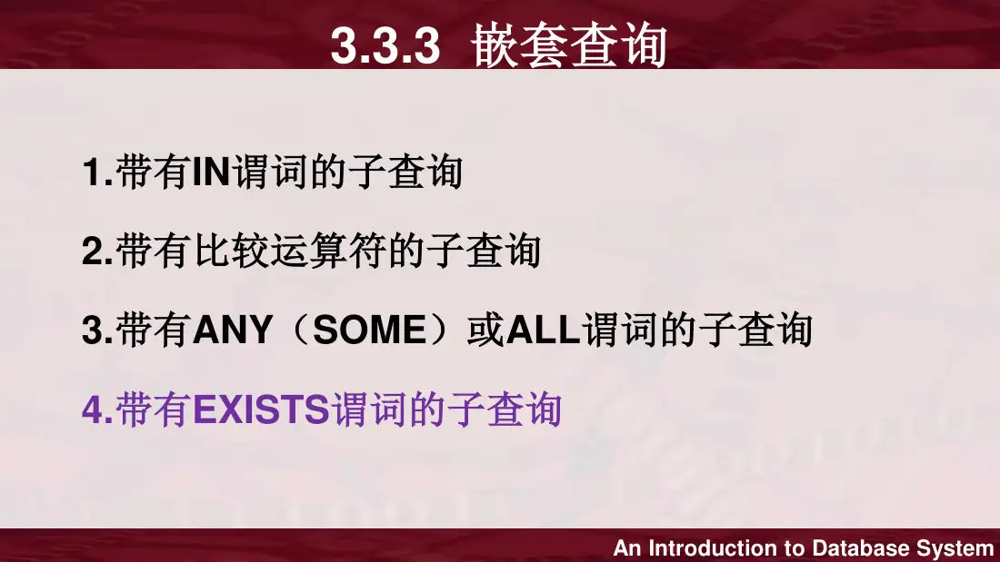

原文：

3.3.3 嵌套查询

1. 带有IN谓词的子查询

2. 带有比较运算符的子查询

3. 带有ANY（SOME）或ALL谓词的子查询

4.带有EXISTS谓词的子查询

An Introduction to Database System

### 带有EXISTS谓词的子查询

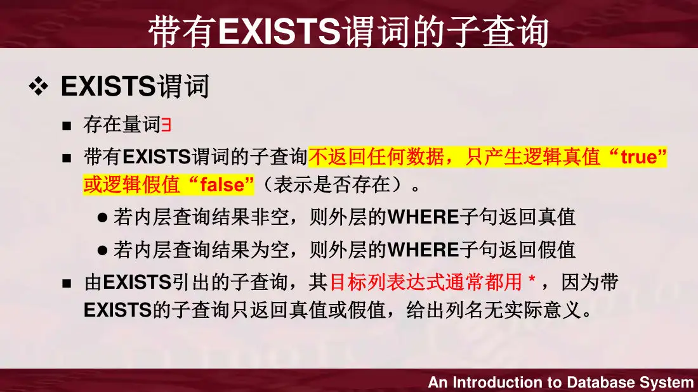

原文：

带有EXISTS谓词的子查询

✿ EXISTS谓词

■ 存在量词3

■ 带有 EXISTS 谓词的子查询不返回任何数据，只产生逻辑真值 “true” 或逻辑假值 “false”（表示是否存在）。

\- 若内层查询结果非空，则外层的WHERE子句返回真值

\- 若内层查询结果为空，则外层的WHERE子句返回假值

■ 由EXISTS引出的子查询，其目标列表达式通常都用 \*，因为带EXISTS的子查询只返回真值或假值，给出列名无实际意义。

An Introduction to Database System

### 带有EXISTS谓词的子查询（续）

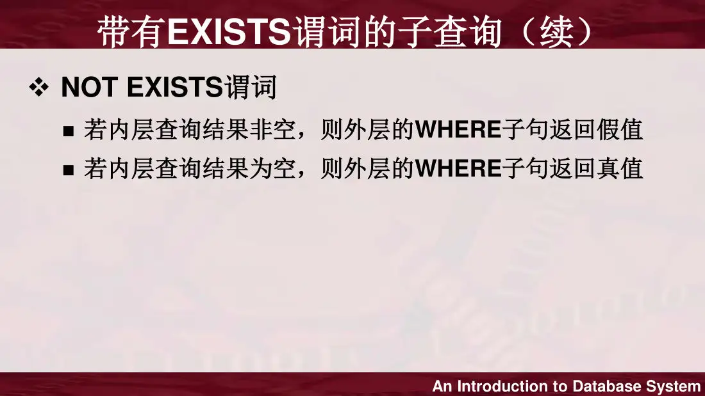

原文：

带有EXISTS谓词的子查询（续）

NOT EXISTS谓词

■ 若内层查询结果非空，则外层的WHERE子句返回假值

■ 若内层查询结果为空，则外层的WHERE子句返回真值

An Introduction to Database System

### 带有EXISTS谓词的子查询（续）

原文：

带有EXISTS谓词的子查询（续）

[例 3.62]查询所有选修了81001号课程的学生姓名。

思路分析:

■ 本查询涉及Student和SC关系

■ 在Student中首先取第一个元组的Sno值，用此值去检查SC表

■ 若SC中存在这样的元组，其Sno值等于此Student.Sno值，并且其Cno=‘81001’，则取此Student.Sname送入结果表

■ 再取Student表的下一个元组，重复上述过程，直至外层Student表全部检查完为止

An Introduction to Database System

### 带有EXISTS谓词的子查询（续）

原文：

带有EXISTS谓词的子查询（续）

An Introduction to Database System

### 其他方法

原文：

其他方法

1）连接查询

Select Sname

From Student, SC

Where Student.Sno=SC.Sno and Cno='81001';

2）IN嵌套查询

Select Sname From Student Where Sno in

( Select Sno From SC Where Cno='81001' );

An Introduction to Database System

### 不能用连接查询完成

原文：

带有EXISTS谓词的子查询（续） [例 3.61] 查询没有选修81001号课程的学生姓名。

$\Pi_{SNAME}(Student)-\Pi_{SNAME}(\sigma_{CNO='81001'}(Student \bowtie SC))$

或者：Select Sname From Student Where Sno not in(Select Sno From SC Where Cno='81001');

不能用连接查询完成

An Introduction to Database System

### 带有EXISTS谓词的子查询（续）

原文：

带有EXISTS谓词的子查询（续）

✿ 不同形式的查询间的替换

■ 一些带 EXISTS或NOT EXISTS谓词的子查询不能被其他形式的子查询等价替换

■ 所有带IN谓词、比较运算符、ANY和ALL谓词的子查询都能用带EXISTS谓词的子查询等价替换

An Introduction to Database System

### 带有EXISTS谓词的子查询（续）

原文：

带有EXISTS谓词的子查询（续）

✿ 用EXISTS/NOT EXISTS实现全称量词（难点）

■ SQL语言中没有全称量词∀（For all）

■ 可以把带有全称量词的谓词转换为等价的带有存在量词的谓词：

$$
(\forall x) P (x) \equiv \neg (\exists x (\neg P (x)))
$$

肯定句式

“ $(\forall x)P(x)$ ”的意思是：所有x都使得 $P(x)$ 为真

“ $\neg (\exists x (\neg P(x)))$ ”的意思是：不存在x使得P(x)不为真

SQL中用双 NOT EXISTS 实现除法运算

双重否定句式

An Introduction to Database System

### 带有EXISTS谓词的子查询（续）

原文：

带有EXISTS谓词的子查询（续）

[例 3.64] 查询选修了全部课程的学生姓名。（没有一门课程是他不选的）

$$
\Pi_ {S N A M E} (\text {Student} \bowtie (\Pi_ {S N O, C N O} (S C) \div \Pi_ {C N O} (\text {Course})))
$$

SELECT Sname
FROM Student

WHERE NOT EXISTS (SELECT \* FROM Course找出这样的学生

SQL中用双
NOT EXISTS
实现除法运算不存在这样的课程

FROM SC

是他没选过的

An Introduction to Database System

### 检索选修了全部课程的学生姓名

原文：

检索选修了全部课程的学生姓名

另一解法:

SELECT Sname

FROM Student,SC

HAVING COUNT(\*)=(

SELECT COUNT(Cno)

FROM Course);

An Introduction to Database System

### 带有EXISTS谓词的子查询（续）

原文：

带有EXISTS谓词的子查询（续）

✿ 用 EXISTS/NOT EXISTS 实现逻辑蕴涵（难点）

■ SQL语言中没有蕴涵（Implication）逻辑运算

■ 可以利用谓词演算将逻辑蕴涵谓词等价转换为:

$$
\mathsf {p} \rightarrow \mathsf {q} \equiv \lnot \mathsf {p} \lor \mathsf {q}
$$

理解为:

“如果p成立，则q一定成立”

等价于

“如果p不成立，则可以忽略q是否成立”

An Introduction to Database System

### 带有EXISTS谓词的子查询（续）

原文：

带有EXISTS谓词的子查询（续）

[例 3.65]查询至少选修了学生20180002选修的全部课程的学生的姓名可以用逻辑蕴涵来表达：查询学号为x的学生，对所有的课程y，只要20180002学生选修了课程y，则x也选修了y。

形式化表示如下:

用p表示谓词“学生20180002选修了课程y”

用q表示谓词“学生x选修了课程y”

则上述查询为: $(\forall y) p \rightarrow q$

An Introduction to Database System

### 带有EXISTS谓词的子查询（续）

原文：

带有EXISTS谓词的子查询（续）

■ 等价变换:

$$
\begin{array}{r l} (\forall \mathbf {y}) \mathsf {p} \to \mathsf {q} & \equiv \neg (\exists \mathbf {y} (\neg (\mathsf {p} \to \mathsf {q}))) \\ & \equiv \neg (\exists \mathbf {y} (\neg (\neg \mathsf {p} \lor \mathsf {q}))) \\ & \equiv \neg \exists \mathbf {y} (\mathsf {p} \land \neg \mathsf {q}) \end{array}
$$

■ 表达的语义为:

不存在这样的课程y，学生20180002选修了课程y，

而学生x没有选修课程y

An Introduction to Database System

### 带有EXISTS谓词的子查询（续）

原文：

带有EXISTS谓词的子查询（续）

SELECT Sname

FROM Student

WHERE NOT EXISTS

(SELECT \*这种情况是不存在的

FROM SC SCX

/\*这是一个相关子查询 \*/  
/\*父查询和子查询均引用了SC表\*/

WHERE SCX.Sno='20180002' AND NOT EXISTS (SELECT \*

学生20180002选修了课程y，而学生x没有选修课程y

FROM SC SCY

/\*用别名SCX

SCY将父查询\*/

WHERE SCY.Sno=Student.Sno AND SCY.Cno=SCX.Cno));

与子查询中的SC表区分开\*/

An Introduction to Database System

### 数据查询 (集合查询)

原文：

数据查询 (集合查询)

An Introduction to Database System

### 3.3.4 集合查询

原文：

3.3.4 集合查询

◆集合操作的种类

■ 并操作UNION

■ 交操作INTERSECT

■差操作EXCEPT

✿ 参加集合操作的各查询结果的列数必须相同；对应项的数据类型也必须相同（并相容性）

An Introduction to Database System

### 集合查询（续）

原文：

集合查询（续）

[例3.66]查询计算机科学与技术专业的学生及年龄不大于19岁（包括等于19岁）的学生

■ UNION：将多个查询结果合并起来时，系统自动去掉重复元组

■ UNION ALL：将多个查询结果合并起来时，保留重复元组

<table><tr><td>Sno</td><td>Sname</td><td>Ssex</td><td>Sbirthdate</td><td>Smajor</td></tr><tr><td>20180002</td><td>刘晨</td><td>女</td><td>1999-09-01</td><td>计算机科学与技术</td></tr><tr><td>20180003</td><td>王敏</td><td>女</td><td>2001-08-01</td><td>计算机科学与技术</td></tr><tr><td>20180004</td><td>张立</td><td>男</td><td>2000-01-08</td><td>计算机科学与技术</td></tr><tr><td>20180306</td><td>赵明</td><td>男</td><td>2006-06-12</td><td>数据科学与大数据技术</td></tr></table>

An Introduction to Database System

### 集合查询（续）

原文：

集合查询（续）

[例3.67]查询2020年第1学期选修了课程81002或者选修了课程81003的学生

<table><tr><td>Sno</td><td>Cno</td><td>Grade</td><td>Semester</td><td>Teachingclass</td></tr><tr><td>20180001</td><td>81001</td><td>85</td><td>20192</td><td>81001-01</td></tr><tr><td>20180001</td><td>81002</td><td>96</td><td>20201</td><td>81002-01</td></tr><tr><td>20180001</td><td>81003</td><td>87</td><td>20202</td><td>81003-01</td></tr><tr><td>20180002</td><td>81001</td><td>80</td><td>20192</td><td>81001-02</td></tr><tr><td>20180002</td><td>81002</td><td>98</td><td>20201</td><td>81002-01</td></tr><tr><td>20180002</td><td>81003</td><td>71</td><td>20202</td><td>81003-02</td></tr><tr><td>20180003</td><td>81001</td><td>81</td><td>20192</td><td>81001-01</td></tr><tr><td>20180003</td><td>81002</td><td>76</td><td>20201</td><td>81002-02</td></tr><tr><td>20180004</td><td>81001</td><td>56</td><td>20192</td><td>81001-02</td></tr><tr><td>20180004</td><td>81003</td><td>97</td><td>20201</td><td>81002-02</td></tr><tr><td>20180205</td><td>81003</td><td>68</td><td>20202</td><td>81003-01</td></tr></table>

An Introduction to Database System

### 集合查询（续）

原文：

集合查询（续）

[例3.68] 查询计算机科学与技术专业的学生与年龄不大于19岁的学生的交集 SELECT \*

FROM Student

WHERE Smajor='计算机科学与技术'

INTERSECT

SELECT \*

FROM Student

WHERE(extract(year from current\_date)-extract(year from Sbirthdate)) <=19;

An Introduction to Database System

### 集合查询（续）

原文：

集合查询（续）

[例3.68] 实际就是查询计算机科学系中年龄不大于19岁的学生

SELECT \*

FROM Student

WHERE Smajor='计算机科学与技术' AND

(extract(year from current\_date)-extract(year from Sbirthdate))<=19;

An Introduction to Database System

### 集合查询（续）

原文：

<table><tr><td>SELECT SnoFROM SCWHERE Cno=&#x27;81001&#x27;INTERSECTSELECT SnoFROM SCWHERE Cno=&#x27;81002&#x27;;</td></tr></table>

集合查询（续）

[例3.69]查询既选修了课程81001又选修了课程81002的学生。就是查询选修课程81001的学生集合与选修课程81002的学生集合的交集。

<table><tr><td>本例也可以表示为</td></tr><tr><td>SELECT Sno</td></tr><tr><td>FROM SC</td></tr><tr><td>WHERE Cno=&#x27;81001&#x27; AND Sno IN (SELECT Sno FROM SC WHERE Cno=&#x27;81002&#x27;);</td></tr></table>

An Introduction to Database System

### 集合查询（续）

原文：

集合查询（续）

自身连接 $\Pi_{1}(\sigma_{1=4\wedge 2= '81001',\wedge 5= '81002},(SC\times SC))$

Select X.Sno

From SC as X, SC as Y

$$
X. C n o = ^ {\prime} 8 1 0 0 1 ^ {\prime}
$$

and Y.Cno='81002';

An Introduction to Database System

### 集合查询（续）

原文：

集合查询（续）

[例3.70]查询计算机科学与技术专业的学生与年龄不大于19岁的学生的差集

就是查询计算机科学与技术专业中年龄大于19岁的学生

An Introduction to Database System

### 3.4.5 基于派生表的查询

原文：

3.4.5 基于派生表的查询

✿ 子查询不仅可以出现在WHERE子句中，还可以出现在FROM子句中，这时子查询生成的临时派生表（Derived Table）成为主查询的查询对象

[例3.59]找出每个学生不低于他自己选修课程平均成绩的课程号，可改写为：

An Introduction to Database System

### SC与临时派生表Avg\_sc的连接关系:

原文：

SC与临时派生表Avg\_sc的连接关系:

<table><tr><td>Sno</td><td>cno</td><td>grade</td></tr><tr><td>20180001</td><td>81001</td><td>85</td></tr><tr><td>20180001</td><td>81002</td><td>96</td></tr><tr><td>20180001</td><td>81003</td><td>87</td></tr><tr><td>20180002</td><td>81001</td><td>80</td></tr><tr><td>20180002</td><td>81002</td><td>98</td></tr><tr><td>20180002</td><td>81003</td><td>71</td></tr><tr><td>20180003</td><td>81001</td><td>81</td></tr><tr><td>20180003</td><td>81002</td><td>76</td></tr><tr><td>20180004</td><td>81001</td><td>56</td></tr><tr><td>20180004</td><td>81003</td><td>97</td></tr><tr><td>20180205</td><td>81003</td><td>68</td></tr></table>

<table><tr><td>avg_sno</td><td>avg_grade</td></tr><tr><td>20180001</td><td>89.3333</td></tr><tr><td>20180002</td><td>83</td></tr><tr><td>20180003</td><td>78.5</td></tr><tr><td>20180004</td><td>76.5</td></tr><tr><td>20180205</td><td>68</td></tr></table>

<table><tr><td>sno</td><td>cno</td><td>grade</td><td>avg_sno</td><td>avg_grade</td></tr><tr><td>20180001</td><td>81001</td><td>85</td><td>20180001</td><td>89.3333</td></tr><tr><td>20180001</td><td>81002</td><td>96</td><td>20180001</td><td>89.3333</td></tr><tr><td>20180001</td><td>81003</td><td>87</td><td>20180001</td><td>89.3333</td></tr><tr><td>20180002</td><td>81001</td><td>80</td><td>20180002</td><td>83</td></tr><tr><td>20180002</td><td>81002</td><td>98</td><td>20180002</td><td>83</td></tr><tr><td>20180002</td><td>81003</td><td>71</td><td>20180002</td><td>83</td></tr><tr><td>20180003</td><td>81001</td><td>81</td><td>20180003</td><td>78.5</td></tr><tr><td>20180003</td><td>81002</td><td>76</td><td>20180003</td><td>78.5</td></tr><tr><td>20180004</td><td>81001</td><td>56</td><td>20180004</td><td>76.5</td></tr><tr><td>20180004</td><td>81003</td><td>97</td><td>20180004</td><td>76.5</td></tr><tr><td>20180205</td><td>81003</td><td>68</td><td>20180205</td><td>68</td></tr></table>

<table><tr><td>sno</td><td>cno</td></tr><tr><td>20180001</td><td>81002</td></tr><tr><td>20180002</td><td>81002</td></tr><tr><td>20180003</td><td>81001</td></tr><tr><td>20180004</td><td>81003</td></tr><tr><td>20180205</td><td>81003</td></tr></table>

An Introduction to Database System

### 基于派生表的查询（续）

原文：

基于派生表的查询（续）

如果子查询中没有聚集函数，派生表可以不指定属性列，子查询 SELECT 子句后面的列名为其缺省属性。

[例3.62]查询所有选修了81001号课程的学生姓名

SELECT Sname

FROM Student,

(SELECT Sno FROM SC WHERE Cno='81001') AS SC1

WHERE Student.Sno=SC1.Sno;

■ FROM子句生成派生表时，AS关键字可省略，必须为派生关系指定一个别名

■ 派生表是一个中间结果表，查询完成后派生表将被系统自动清除

An Introduction to Database System

### 小结: SELECT语句的一般格式

原文：

小结: SELECT语句的一般格式

SELECT [ALL|DISTINCT]

<目标列表达式> [别名] [, <目标列表达式> [别名]] ...

FROM <表名或视图名> [别名]

[,<表名或视图名> [别名]] ...

|(<SELECT语句>)[AS]<别名>

[WHERE <条件表达式>]

[GROUP BY <列名1>[HAVING<条件表达式>]]

[ORDER BY <列名2> [ASC|DESC]];

An Introduction to Database System

### 1. 目标列表达式的可选格式

原文：

1. 目标列表达式的可选格式

目标列表达式格式

(1) \*

(2) <表名>.\*

(3) COUNT([DISTINCT|ALL]\*)

(4) [<表名>.]<属性列名表达式>[,<表名>.]<属性列名表达式>...
其中<属性列名表达式>可以是由属性列、作用于属性列的
聚集函数和常量的任意算术运算（+，-，\*，/）组成的
运算公式

An Introduction to Database System

### 2. 聚集函数的一般格式

原文：

2. 聚集函数的一般格式

([DISTINCT|ALL]<列名>)

An Introduction to Database System

### 3. WHERE子句的条件表达式的可选格式

原文：

3. WHERE子句的条件表达式的可选格式

(1)

<属性列名>

<属性列名>θ.

<常量>

`[ANY|ALL](SELECT语句)`

(2)

<属性列名>

<属性列名>

<属性列名>[NOT] BETWEEN

<常量>

AND

<常量>

(SELECT语句)

(SELECT语句)

An Introduction to Database System

### WHERE子句的条件表达式的可选格式（续）

原文：

WHERE子句的条件表达式的可选格式（续）

(3)
<属性列名>[NOT] IN
(<值1>[,<值2>]...)
(SELECT语句)

(4) <属性列名> [NOT] LIKE <匹配串>

(5) <属性列名> IS [NOT] NULL

(6) [NOT] EXISTS (SELECT语句)

An Introduction to Database System

### WHERE子句的条件表达式的可选格式（续）

原文：

WHERE子句的条件表达式的可选格式（续）

(7)
<条件表达式> $\left\{\begin{array}{c}AND\\OR\end{array}\right\}$ <条件表达式> $\left\{\begin{array}{c}AND\\OR\end{array}\right\}$ <条件表达> ...

An Introduction to Database System

### 思考题

原文：

思考题

查询有两门以上不及格课程同学的学号及其平均成绩。

An Introduction to Database System

### 思考题

原文：

思考题

查询有两门以上不及格课程同学的学号及其平均成绩

下面的语句是不对的:

注意语义的理解与正确表达

因为上例SQL语句求出的是“有两门以上不及格课程的同学那几门不及格课程的平均成绩”，而不是“这些同学所有课程的平均成绩”。

An Introduction to Database System

### 思考题

原文：

思考题

查询有两门以上不及格课程同学的学号及其平均成绩

正确的查询语句应该是:

An Introduction to Database System
