# 《数据库系统》第3章 关系数据库标准语言SQL（3）数据更新（课件）

原件的每一页，下面附识别出的文字。

### 数据库系统概论

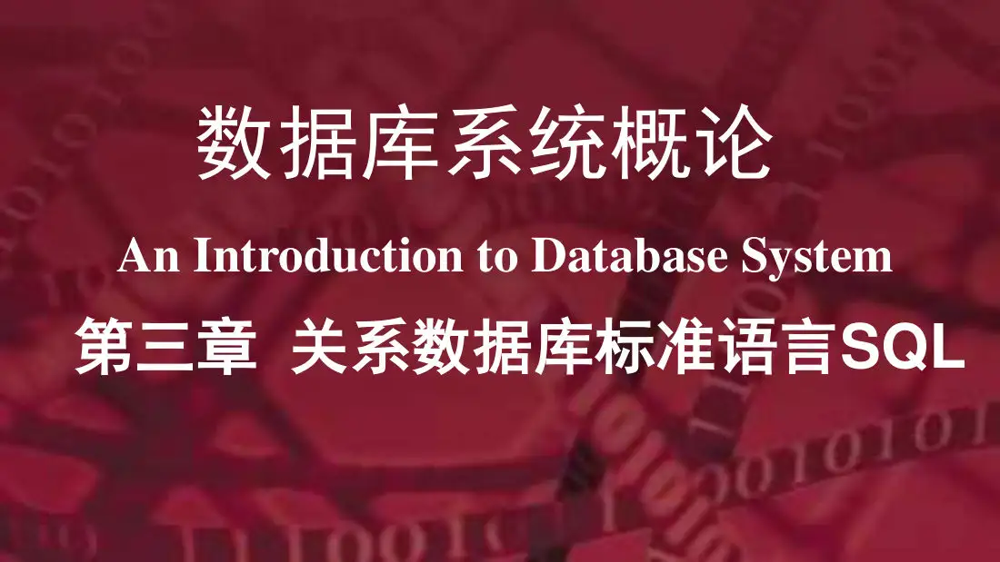

原文：

数据库系统概论

An Introduction to Database System 第三章 关系数据库标准语言SQL

### 数据更新 (不能违反完整性约束)

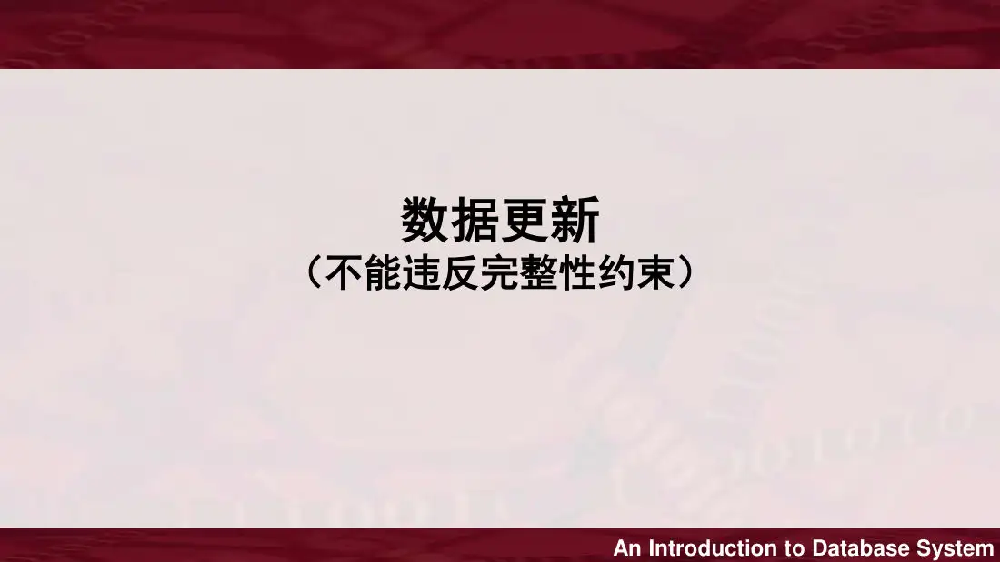

原文：

数据更新 (不能违反完整性约束)

An Introduction to Database System

### 3.4 数据更新

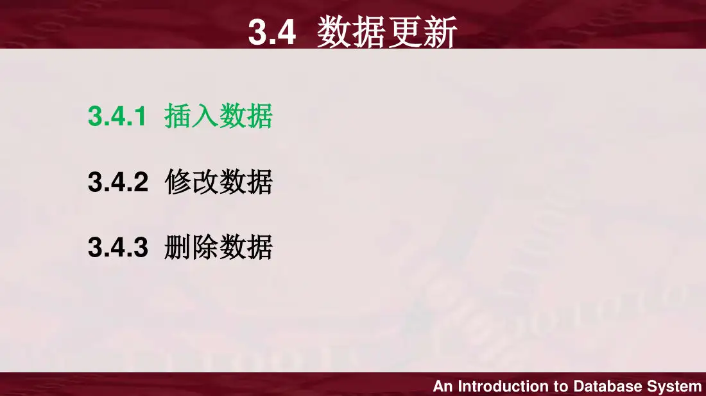

原文：

3.4 数据更新

3.4.1 插入数据

3.4.2 修改数据

3.4.3 删除数据

An Introduction to Database System

### 3.5.1 插入数据

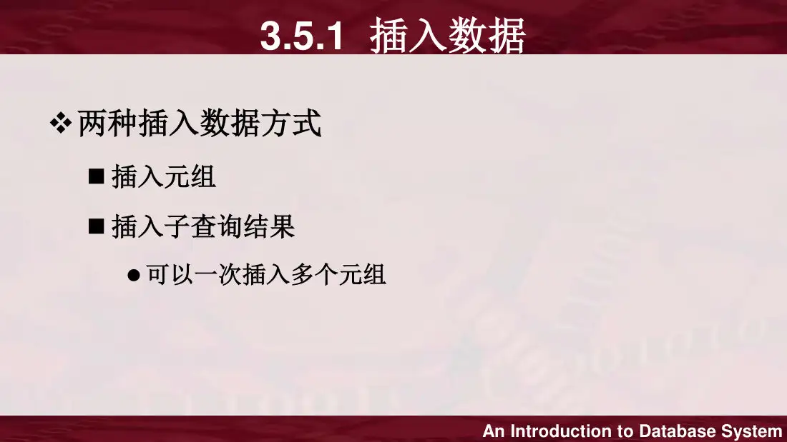

原文：

3.5.1 插入数据

两种插入数据方式

■ 插入元组

■ 插入子查询结果

\- 可以一次插入多个元组

An Introduction to Database System

### 1. 插入元组

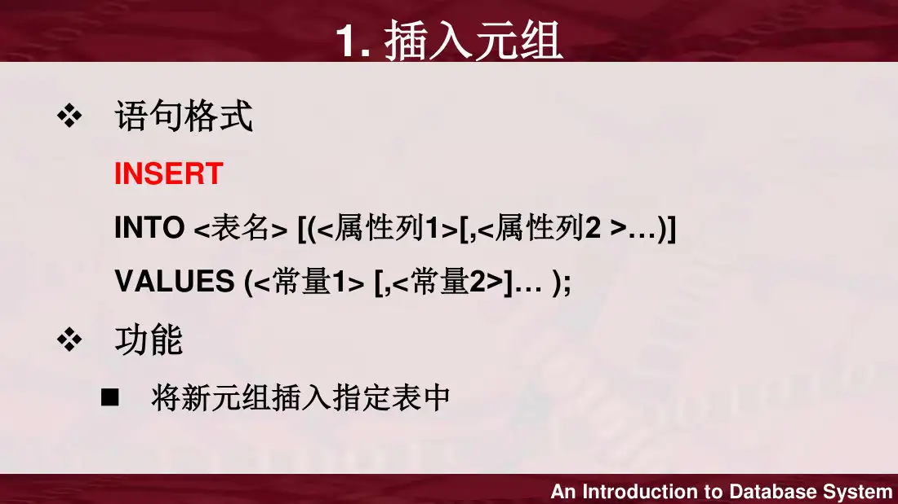

原文：

1. 插入元组

语句格式

INSERT

INTO <表名>[(<属性列1>[,<属性列2>...)]

VALUES (<常量1> [,<常量2>]...);

功能

■ 将新元组插入指定表中

An Introduction to Database System

### 插入元组（续）

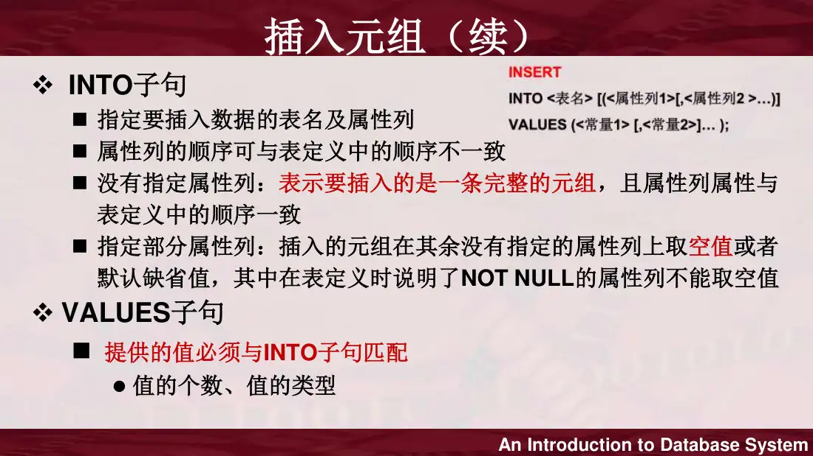

原文：

插入元组（续）

INTO子句

■ 指定要插入数据的表名及属性列

INSERT

INTO <表名> [(<属性列1>[,<属性列2>...)]
VALUES (<常量1>[,<常量2>...);

■ 属性列的顺序可与表定义中的顺序不一致

■ 没有指定属性列：表示要插入的是一条完整的元组，且属性列属性与表定义中的顺序一致

■ 指定部分属性列：插入的元组在其余没有指定的属性列上取空值或者默认缺省值，其中在表定义时说明了NOT NULL的属性列不能取空值

◆ VALUES子句

提供的值必须与INTO子句匹配

\- 值的个数、值的类型

An Introduction to Database System

### 插入一个元组（续）

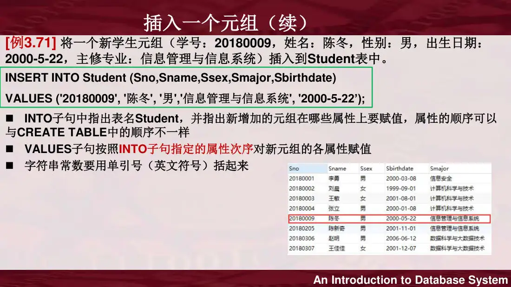

原文：

插入一个元组（续）

[例3.71] 将一个新学生元组（学号：20180009，姓名：陈冬，性别：男，出生日期：2000-5-22，主修专业：信息管理与信息系统）插入到Student表中。

INSERT INTO Student (Sno,Sname,Ssex,Smajor,Sbirthdate)

VALUES ('20180009', '陈冬', '男', '信息管理与信息系统', '2000-5-22');

■ INTO子句中指出表名Student，并指出新增加的元组在哪些属性上要赋值，属性的顺序可以与CREATE TABLE中的顺序不一样

■ VALUES子句按照INTO子句指定的属性次序对新元组的各属性赋值

■ 字符串常数要用单引号（英文符号）括起来

<table><tr><td>Sno</td><td>Sname</td><td>Ssex</td><td>Sbirthdate</td><td>Smajor</td></tr><tr><td>20180001</td><td>李勇</td><td>男</td><td>2000-03-08</td><td>信息安全</td></tr><tr><td>20180002</td><td>刘晨</td><td>女</td><td>1999-09-01</td><td>计算机科学与技术</td></tr><tr><td>20180003</td><td>王敏</td><td>女</td><td>2001-08-01</td><td>计算机科学与技术</td></tr><tr><td>20180004</td><td>张立</td><td>男</td><td>2000-01-08</td><td>计算机科学与技术</td></tr><tr><td>20180009</td><td>陈冬</td><td>男</td><td>2000-05-22</td><td>信息管理与信息系统</td></tr><tr><td>20180205</td><td>陈新奇</td><td>男</td><td>2001-11-01</td><td>信息管理与信息系统</td></tr><tr><td>20180306</td><td>赵明</td><td>男</td><td>2006-06-12</td><td>数据科学与大数据技术</td></tr><tr><td>20180307</td><td>王佳佳</td><td>女</td><td>2001-12-07</td><td>数据科学与大数据技术</td></tr></table>

An Introduction to Database System

### 插入一个元组（续）

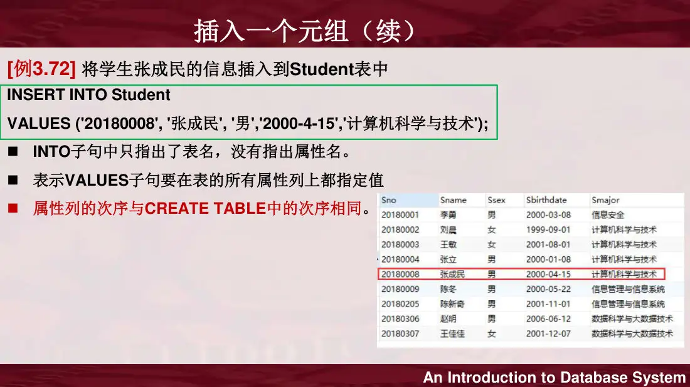

原文：

插入一个元组（续）

[例3.72] 将学生张成民的信息插入到Student表中

INSERT INTO Student

VALUES ('20180008', '张成民', '男', '2000-4-15', '计算机科学与技术');

■ INTO子句中只指出了表名，没有指出属性名。

■ 表示VALUES子句要在表的所有属性列上都指定值

■ 属性列的次序与CREATE TABLE中的次序相同。

<table><tr><td>Sno</td><td>Sname</td><td>Ssex</td><td>Sbirthdate</td><td>Smajor</td></tr><tr><td>20180001</td><td>李勇</td><td>男</td><td>2000-03-08</td><td>信息安全</td></tr><tr><td>20180002</td><td>刘晨</td><td>女</td><td>1999-09-01</td><td>计算机科学与技术</td></tr><tr><td>20180003</td><td>王敏</td><td>女</td><td>2001-08-01</td><td>计算机科学与技术</td></tr><tr><td>20180004</td><td>张立</td><td>男</td><td>2000-01-08</td><td>计算机科学与技术</td></tr><tr><td>20180008</td><td>张成民</td><td>男</td><td>2000-04-15</td><td>计算机科学与技术</td></tr><tr><td>20180009</td><td>陈冬</td><td>男</td><td>2000-05-22</td><td>信息管理与信息系统</td></tr><tr><td>20180205</td><td>陈新奇</td><td>男</td><td>2001-11-01</td><td>信息管理与信息系统</td></tr><tr><td>20180306</td><td>赵明</td><td>男</td><td>2006-06-12</td><td>数据科学与大数据技术</td></tr><tr><td>20180307</td><td>王佳佳</td><td>女</td><td>2001-12-07</td><td>数据科学与大数据技术</td></tr></table>

An Introduction to Database System

### 插入一个元组（续）

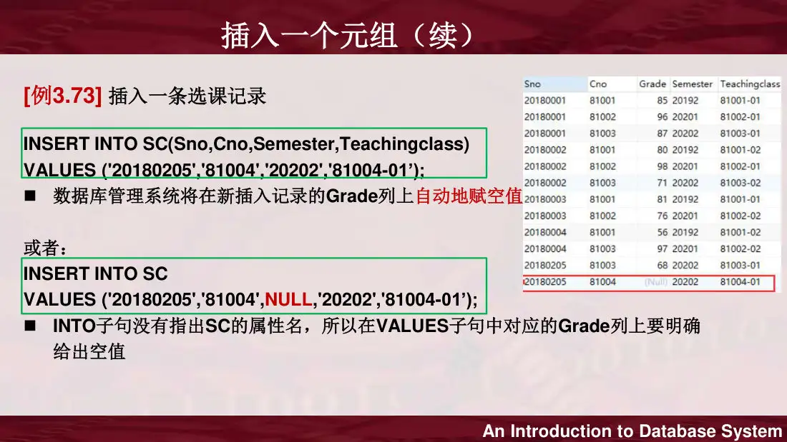

原文：

插入一个元组（续）

[例3.73] 插入一条选课记录

INSERT INTO SC(Sno,Cno,Semester,Teachingclass) VALUES ('20180205','81004','20202','81004-01');

■ 数据库管理系统将在新插入记录的Grade列上自动地赋空值

<table><tr><td>Sno</td><td>Cno</td><td>Grade</td><td>Semester</td><td>Teachingclass</td></tr><tr><td>20180001</td><td>81001</td><td>85</td><td>20192</td><td>81001-01</td></tr><tr><td>20180001</td><td>81002</td><td>96</td><td>20201</td><td>81002-01</td></tr><tr><td>20180001</td><td>81003</td><td>87</td><td>20202</td><td>81003-01</td></tr><tr><td>20180002</td><td>81001</td><td>80</td><td>20192</td><td>81001-02</td></tr><tr><td>20180002</td><td>81002</td><td>98</td><td>20201</td><td>81002-01</td></tr><tr><td>20180002</td><td>81003</td><td>71</td><td>20202</td><td>81003-02</td></tr><tr><td>20180003</td><td>81001</td><td>81</td><td>20192</td><td>81001-01</td></tr><tr><td>20180003</td><td>81002</td><td>76</td><td>20201</td><td>81002-02</td></tr><tr><td>20180004</td><td>81001</td><td>56</td><td>20192</td><td>81001-02</td></tr><tr><td>20180004</td><td>81003</td><td>97</td><td>20201</td><td>81002-02</td></tr><tr><td>20180205</td><td>81003</td><td>68</td><td>20202</td><td>81003-01</td></tr><tr><td>20180205</td><td>81004</td><td>(Null)</td><td>20202</td><td>81004-01</td></tr></table>

或者：

INSERT INTO SC
VALUES ('20180205','81004',NULL,'20202','81004-01');

■ INTO子句没有指出SC的属性名，所以在VALUES子句中对应的Grade列上要明确给出空值

An Introduction to Database System

### 2. 插入子查询结果

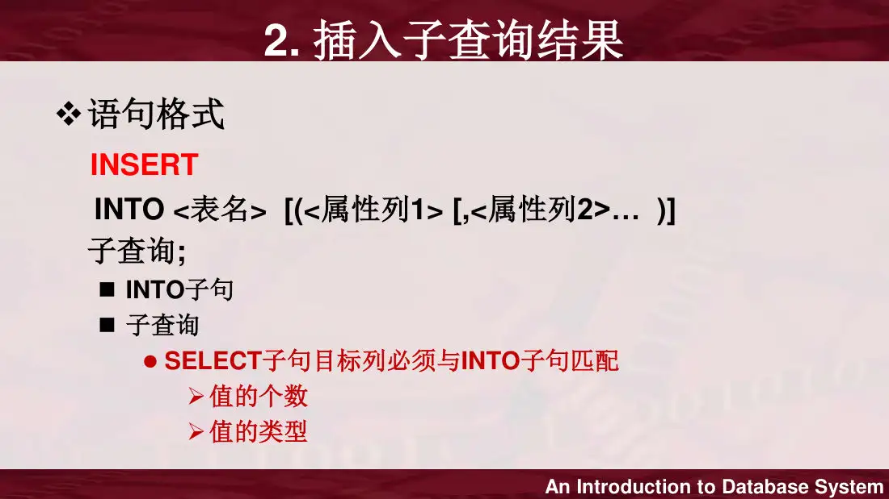

原文：

2. 插入子查询结果

✿语句格式

INSERT

INTO <表名> [(<属性列1> [,<属性列2>...)]

子查询;

■ INTO子句

■ 子查询

\- SELECT子句目标列必须与INTO子句匹配

值的个数

值的类型

An Introduction to Database System

### 插入子查询结果（续）

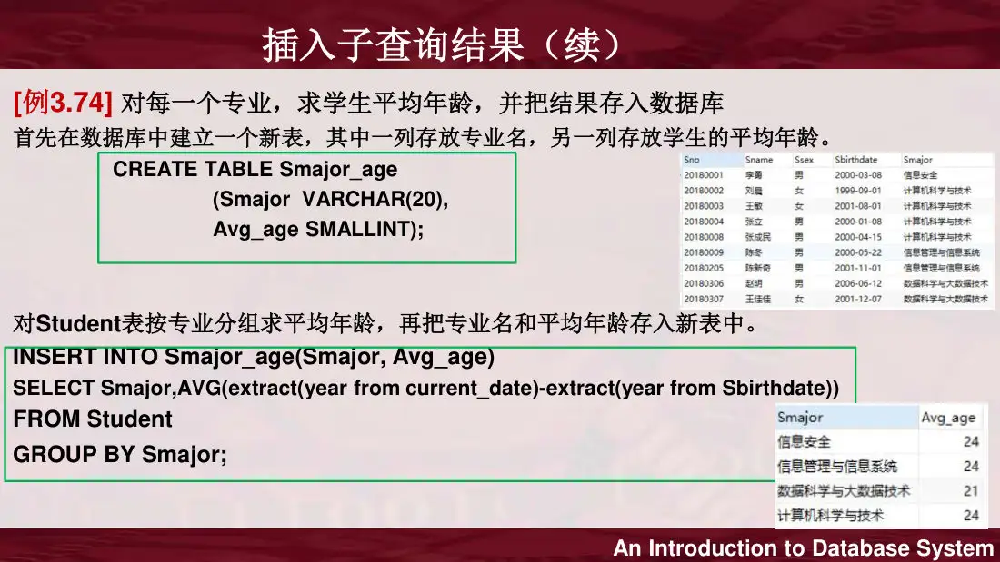

原文：

插入子查询结果（续）

[例3.74] 对每一个专业，求学生平均年龄，并把结果存入数据库

首先在数据库中建立一个新表，其中一列存放专业名，另一列存放学生的平均年龄。

<table><tr><td>Sno</td><td>Sname</td><td>Ssex</td><td>Sbirthdate</td><td>Smajor</td></tr><tr><td>20180001</td><td>李勇</td><td>男</td><td>2000-03-08</td><td>信息安全</td></tr><tr><td>20180002</td><td>刘晨</td><td>女</td><td>1999-09-01</td><td>计算机科学与技术</td></tr><tr><td>20180003</td><td>王敏</td><td>女</td><td>2001-08-01</td><td>计算机科学与技术</td></tr><tr><td>20180004</td><td>张立</td><td>男</td><td>2000-01-08</td><td>计算机科学与技术</td></tr><tr><td>20180008</td><td>张成民</td><td>男</td><td>2000-04-15</td><td>计算机科学与技术</td></tr><tr><td>20180009</td><td>陈冬</td><td>男</td><td>2000-05-22</td><td>信息管理与信息系统</td></tr><tr><td>20180205</td><td>陈新奇</td><td>男</td><td>2001-11-01</td><td>信息管理与信息系统</td></tr><tr><td>20180306</td><td>赵明</td><td>男</td><td>2006-06-12</td><td>数据科学与大数据技术</td></tr><tr><td>20180307</td><td>王佳佳</td><td>女</td><td>2001-12-07</td><td>数据科学与大数据技术</td></tr></table>

对Student表按专业分组求平均年龄，再把专业名和平均年龄存入新表中。

An Introduction to Database System

### 插入子查询结果（续）

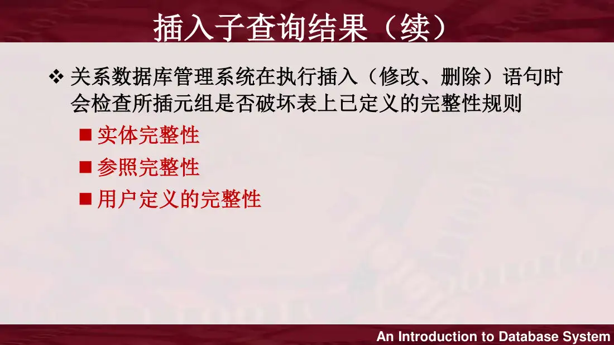

原文：

插入子查询结果（续）

关系数据库管理系统在执行插入（修改、删除）语句时会检查所插元组是否破坏表上已定义的完整性规则

■ 实体完整性

■ 参照完整性

■ 用户定义的完整性

An Introduction to Database System

### 3.4 数据更新

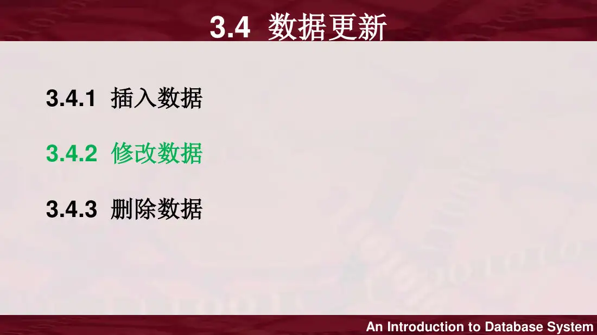

原文：

3.4 数据更新

3.4.1 插入数据

3.4.2 修改数据

3.4.3 删除数据

An Introduction to Database System

### 3.5.2 修改数据

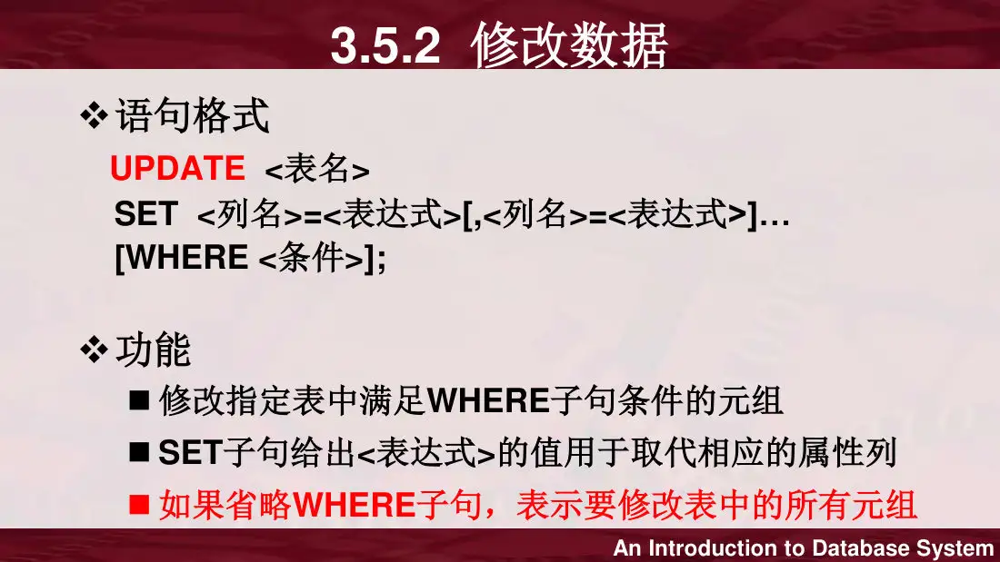

原文：

3.5.2 修改数据

✿语句格式

UPDATE <表名>

SET <列名>=<表达式>[,<列名>=<表达式>]...

[WHERE <条件>];

功能

■ 修改指定表中满足WHERE子句条件的元组

■ SET子句给出<表达式>的值用于取代相应的属性列

■ 如果省略WHERE子句，表示要修改表中的所有元组

An Introduction to Database System

### 修改数据（续）

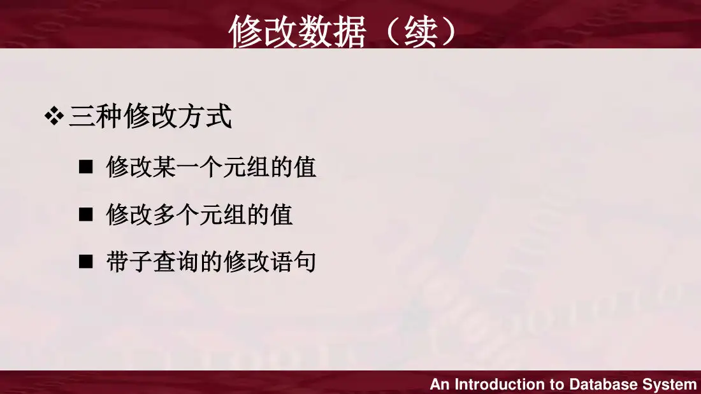

原文：

修改数据（续）

三种修改方式

■ 修改某一个元组的值

■ 修改多个元组的值

■ 带子查询的修改语句

An Introduction to Database System

### 1. 修改某一个元组的值

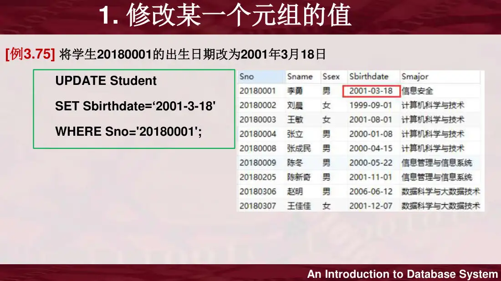

原文：

1. 修改某一个元组的值

[例3.75] 将学生20180001的出生日期改为2001年3月18日

<table><tr><td>Sno</td><td>Sname</td><td>Ssex</td><td>Sbirthdate</td><td>Smajor</td></tr><tr><td>20180001</td><td>李勇</td><td>男</td><td>2001-03-18</td><td>信息安全</td></tr><tr><td>20180002</td><td>刘晨</td><td>女</td><td>1999-09-01</td><td>计算机科学与技术</td></tr><tr><td>20180003</td><td>王敏</td><td>女</td><td>2001-08-01</td><td>计算机科学与技术</td></tr><tr><td>20180004</td><td>张立</td><td>男</td><td>2000-01-08</td><td>计算机科学与技术</td></tr><tr><td>20180008</td><td>张成民</td><td>男</td><td>2000-04-15</td><td>计算机科学与技术</td></tr><tr><td>20180009</td><td>陈冬</td><td>男</td><td>2000-05-22</td><td>信息管理与信息系统</td></tr><tr><td>20180205</td><td>陈新奇</td><td>男</td><td>2001-11-01</td><td>信息管理与信息系统</td></tr><tr><td>20180306</td><td>赵明</td><td>男</td><td>2006-06-12</td><td>数据科学与大数据技术</td></tr><tr><td>20180307</td><td>王佳佳</td><td>女</td><td>2001-12-07</td><td>数据科学与大数据技术</td></tr></table>

An Introduction to Database System

### 2. 修改多个元组的值

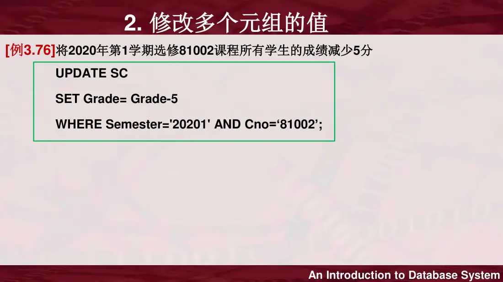

原文：

2. 修改多个元组的值

[例3.76]将2020年第1学期选修81002课程所有学生的成绩减少5分

UPDATE SC

An Introduction to Database System

### 3. 带子查询的修改语句

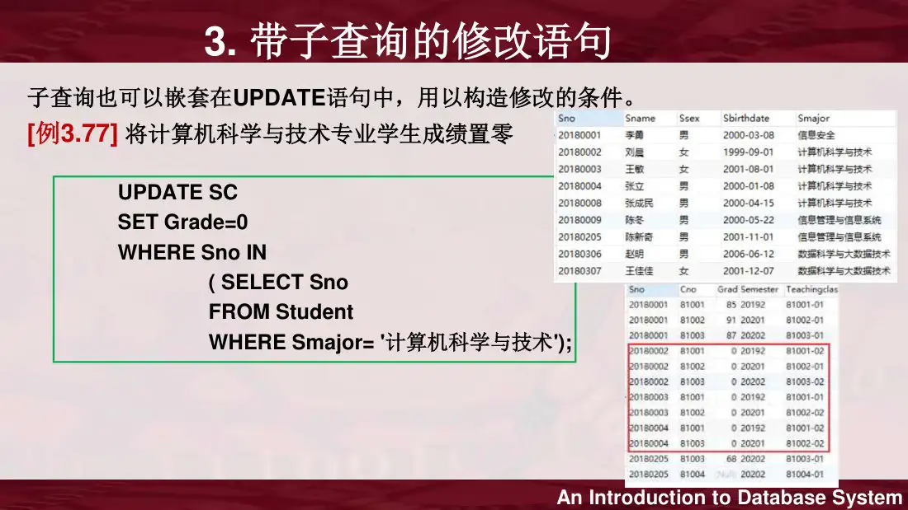

原文：

3. 带子查询的修改语句

子查询也可以嵌套在UPDATE语句中，用以构造修改的条件。

[例3.77] 将计算机科学与技术专业学生成绩置零

<table><tr><td>Sno</td><td>Sname</td><td>Ssex</td><td>Sbirthdate</td><td>Smajor</td></tr><tr><td>20180001</td><td>李勇</td><td>男</td><td>2000-03-08</td><td>信息安全</td></tr><tr><td>20180002</td><td>刘晨</td><td>女</td><td>1999-09-01</td><td>计算机科学与技术</td></tr><tr><td>20180003</td><td>王敏</td><td>女</td><td>2001-08-01</td><td>计算机科学与技术</td></tr><tr><td>20180004</td><td>张立</td><td>男</td><td>2000-01-08</td><td>计算机科学与技术</td></tr><tr><td>20180008</td><td>张成民</td><td>男</td><td>2000-04-15</td><td>计算机科学与技术</td></tr><tr><td>20180009</td><td>陈冬</td><td>男</td><td>2000-05-22</td><td>信息管理与信息系统</td></tr><tr><td>20180205</td><td>陈新奇</td><td>男</td><td>2001-11-01</td><td>信息管理与信息系统</td></tr><tr><td>20180306</td><td>赵明</td><td>男</td><td>2006-06-12</td><td>数据科学与大数据技术</td></tr><tr><td>20180307</td><td>王佳佳</td><td>女</td><td>2001-12-07</td><td>数据科学与大数据技术</td></tr></table>

<table><tr><td>Sno</td><td>Cno</td><td>Grad Semester</td><td>Teachingclas</td></tr><tr><td>20180001</td><td>81001</td><td>85 20192</td><td>81001-01</td></tr><tr><td>20180001</td><td>81002</td><td>91 20201</td><td>81002-01</td></tr><tr><td>20180001</td><td>81003</td><td>87 20202</td><td>81003-01</td></tr><tr><td>20180002</td><td>81001</td><td>0 20192</td><td>81001-02</td></tr><tr><td>20180002</td><td>81002</td><td>0 20201</td><td>81002-01</td></tr><tr><td>20180002</td><td>81003</td><td>0 20202</td><td>81003-02</td></tr><tr><td>20180003</td><td>81001</td><td>0 20192</td><td>81001-01</td></tr><tr><td>20180003</td><td>81002</td><td>0 20201</td><td>81002-02</td></tr><tr><td>20180004</td><td>81001</td><td>0 20192</td><td>81001-02</td></tr><tr><td>20180004</td><td>81003</td><td>0 20201</td><td>81002-02</td></tr><tr><td>20180205</td><td>81003</td><td>68 20202</td><td>81003-01</td></tr><tr><td>20180205</td><td>81004</td><td>Null 20202</td><td>81004-01</td></tr></table>

An Introduction to Database System

### 3.4.1 插入数据

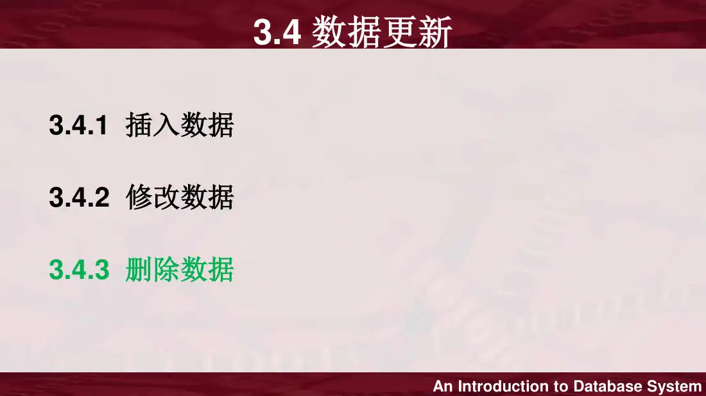

原文：

3.4.1 插入数据
3.4.2 修改数据
3.4.3 删除数据

3.4 数据更新

An Introduction to Database System

### 3.4.3 删除数据

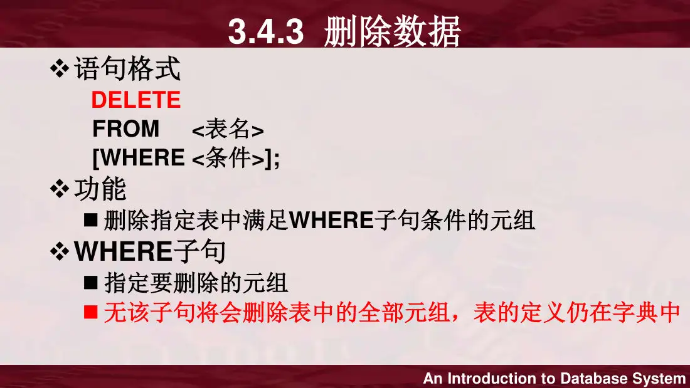

原文：

3.4.3 删除数据

✿语句格式

DELETE

FROM <表名>

[WHERE <条件>];

功能

■ 删除指定表中满足WHERE子句条件的元组

WHERE子句

■ 指定要删除的元组

■无该子句将会删除表中的全部元组，表的定义仍在字典中

An Introduction to Database System

### 删除数据（续）

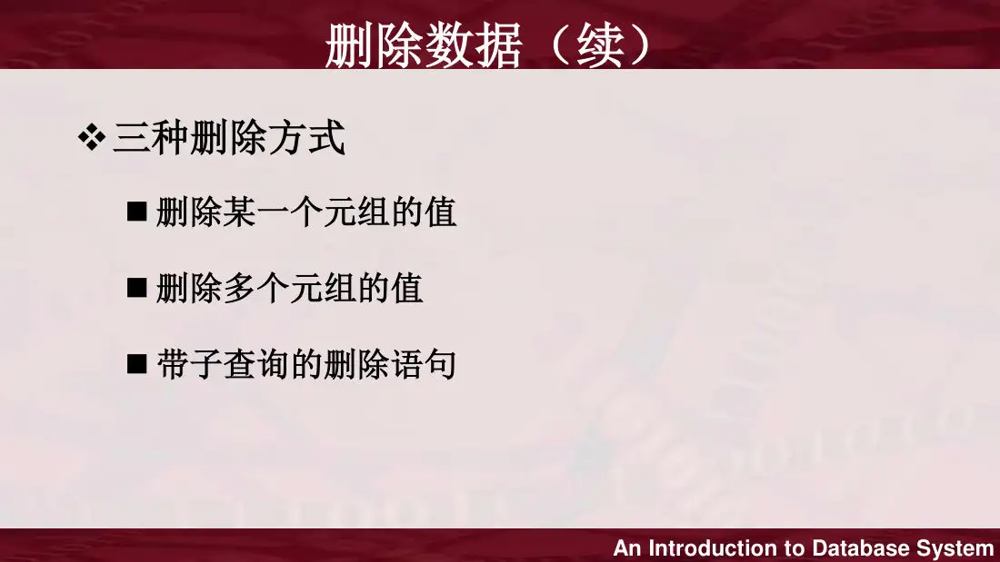

原文：

删除数据（续）

三种删除方式

■ 删除某一个元组的值

■ 删除多个元组的值

■ 带子查询的删除语句

An Introduction to Database System

### 1. 删除某一个元组的值

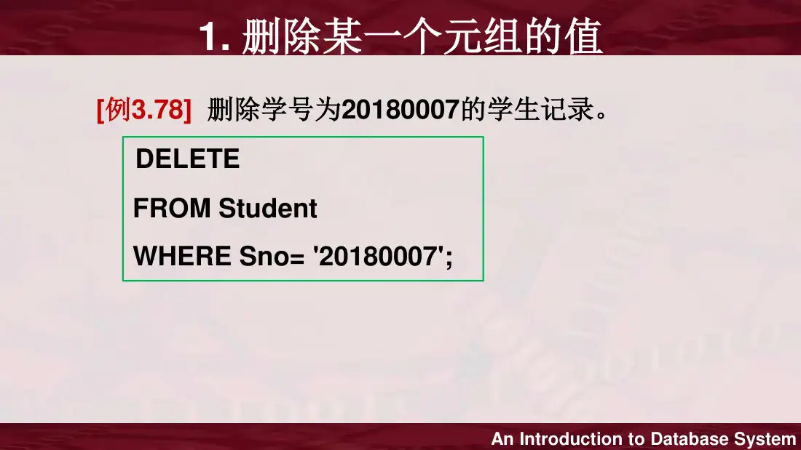

原文：

1. 删除某一个元组的值

[例3.78] 删除学号为20180007的学生记录。

An Introduction to Database System

### 2. 删除多个元组的值

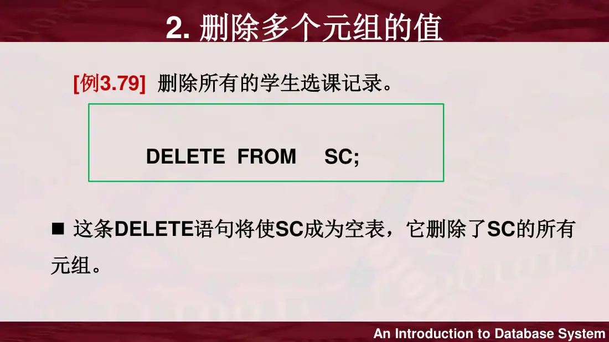

原文：

2. 删除多个元组的值

[例3.79] 删除所有的学生选课记录。

■ 这条DELETE语句将使SC成为空表，它删除了SC的所有元组。

An Introduction to Database System

### 3. 带子查询的删除语句

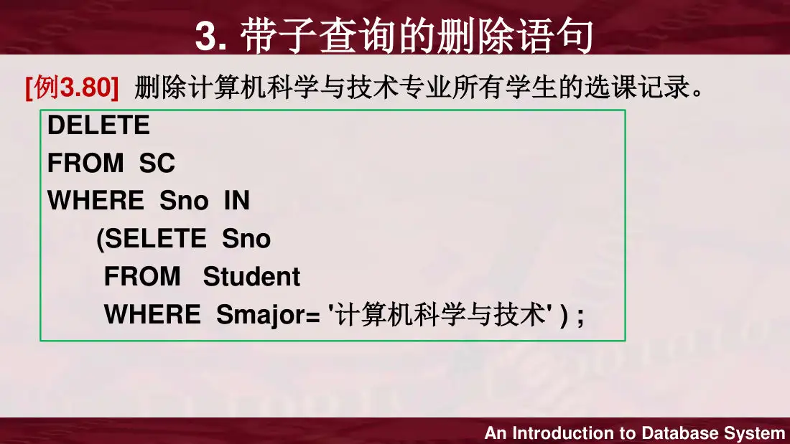

原文：

3. 带子查询的删除语句

[例3.80] 删除计算机科学与技术专业所有学生的选课记录。

An Introduction to Database System

### 空值处理

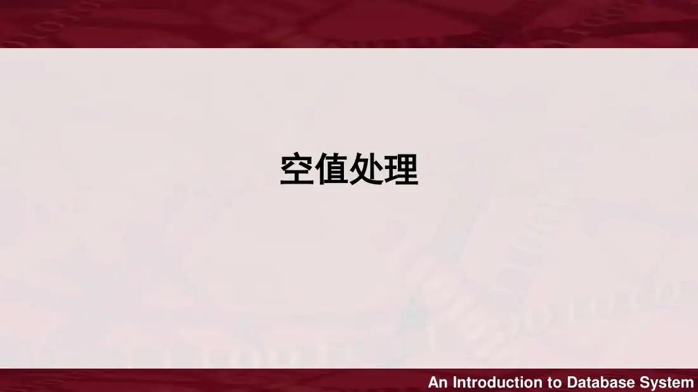

原文：

空值处理

An Introduction to Database System

### 3.5 空值的处理

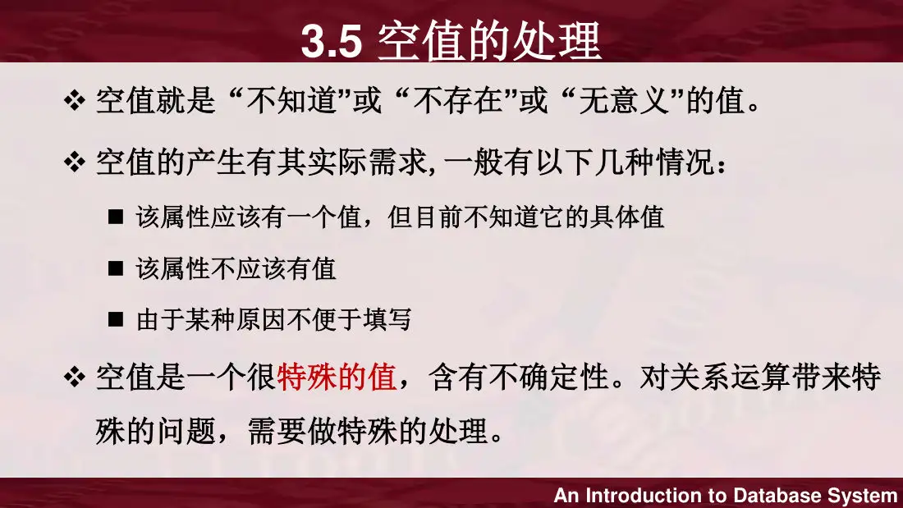

原文：

3.5 空值的处理

空值就是“不知道”或“不存在”或“无意义”的值。

✿ 空值的产生有其实际需求, 一般有以下几种情况:

■ 该属性应该有一个值，但目前不知道它的具体值

■ 该属性不应该有值

■ 由于某种原因不便于填写

✿ 空值是一个很特殊的值，含有不确定性。对关系运算带来特殊的问题，需要做特殊的处理。

An Introduction to Database System

### 1. 空值的产生

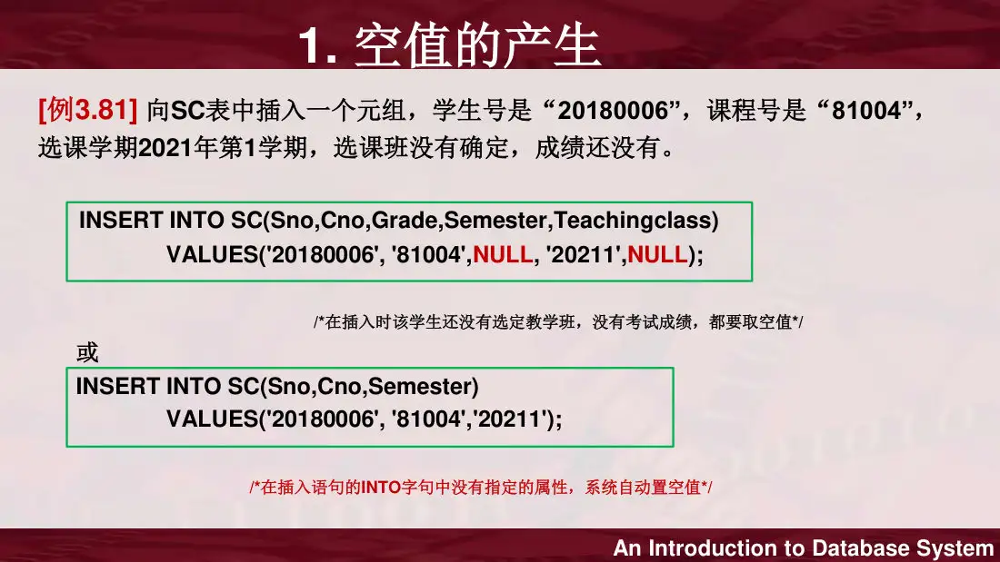

原文：

1. 空值的产生

[例3.81] 向SC表中插入一个元组，学生号是“20180006”，课程号是“81004”，选课学期2021年第1学期，选课班没有确定，成绩还没有。

INSERT INTO SC(Sno,Cno,Grade,Semester,Teachingclass) VALUES('20180006', '81004',NULL, '20211',NULL);

/\*在插入时该学生还没有选定教学班，没有考试成绩，都要取空值\*/

或

INSERT INTO SC(Sno,Cno,Semester)

VALUES('20180006', '81004', '20211');

/\*在插入语句的INTO字句中没有指定的属性，系统自动置空值\*/

An Introduction to Database System

### 空值的产生（续）

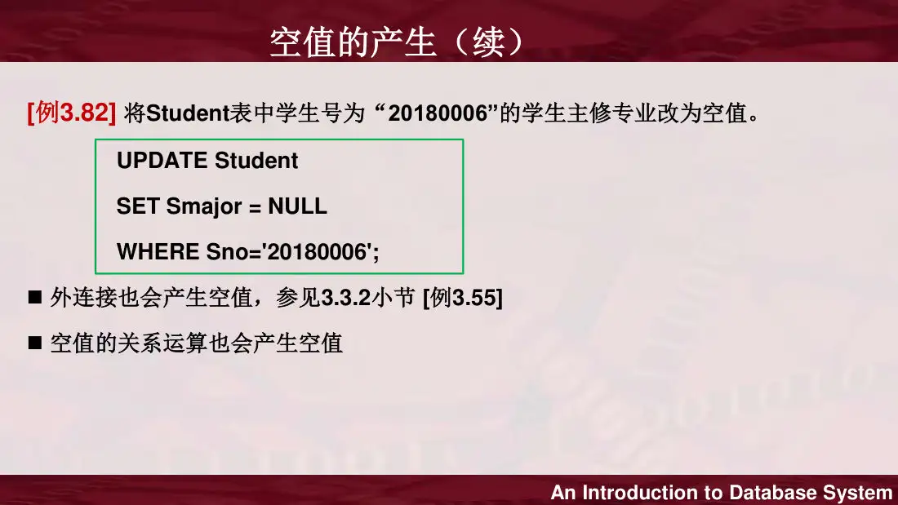

原文：

空值的产生（续）

[例3.82] 将Student表中学生号为“20180006”的学生主修专业改为空值。

UPDATE Student

SET Smajor = NULL

WHERE Sno='20180006';

■ 外连接也会产生空值，参见3.3.2小节 [例3.55]

■ 空值的关系运算也会产生空值

An Introduction to Database System

### 空值的处理

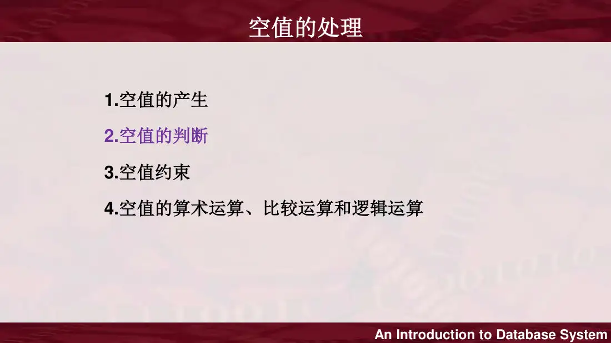

原文：

空值的处理

1. 空值的产生

2. 空值的判断

3.空值约束

4. 空值的算术运算、比较运算和逻辑运算

An Introduction to Database System

### 2. 空值的判断

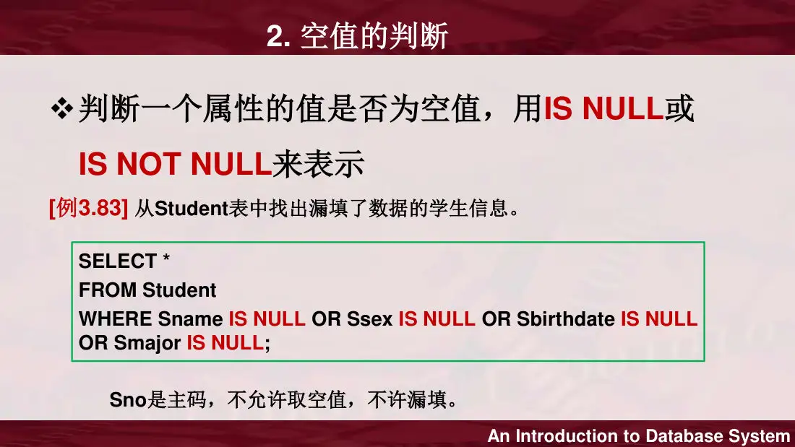

原文：

2. 空值的判断

◆ 判断一个属性的值是否为空值，用IS NULL或

IS NOT NULL来表示

[例3.83] 从Student表中找出漏填了数据的学生信息。

Sno是主码，不允许取空值，不许漏填。

An Introduction to Database System

### 3. 空值的约束条件

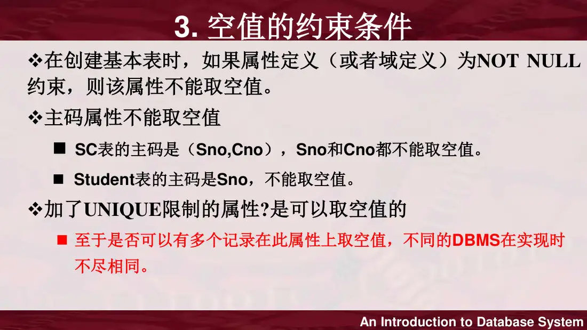

原文：

3. 空值的约束条件

✿在创建基本表时，如果属性定义（或者域定义）为NOT NULL 约束，则该属性不能取空值。

主码属性不能取空值

■ SC表的主码是（Sno,Cno），Sno和Cno都不能取空值。

■ Student表的主码是Sno，不能取空值。

✿加了UNIQUE限制的属性?是可以取空值的

■ 至于是否可以有多个记录在此属性上取空值，不同的DBMS在实现时不尽相同。

An Introduction to Database System

### 4. 空值的算术运算、比较运算和逻辑运算

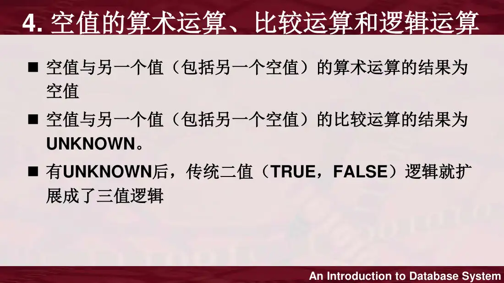

原文：

4. 空值的算术运算、比较运算和逻辑运算

■ 空值与另一个值（包括另一个空值）的算术运算的结果为空值

■ 空值与另一个值（包括另一个空值）的比较运算的结果为UNKNOWN。

■ 有UNKNOWN后，传统二值（TRUE，FALSE）逻辑就扩展成了三值逻辑

An Introduction to Database System

### 空值的算术运算、比较运算和逻辑运算(续)

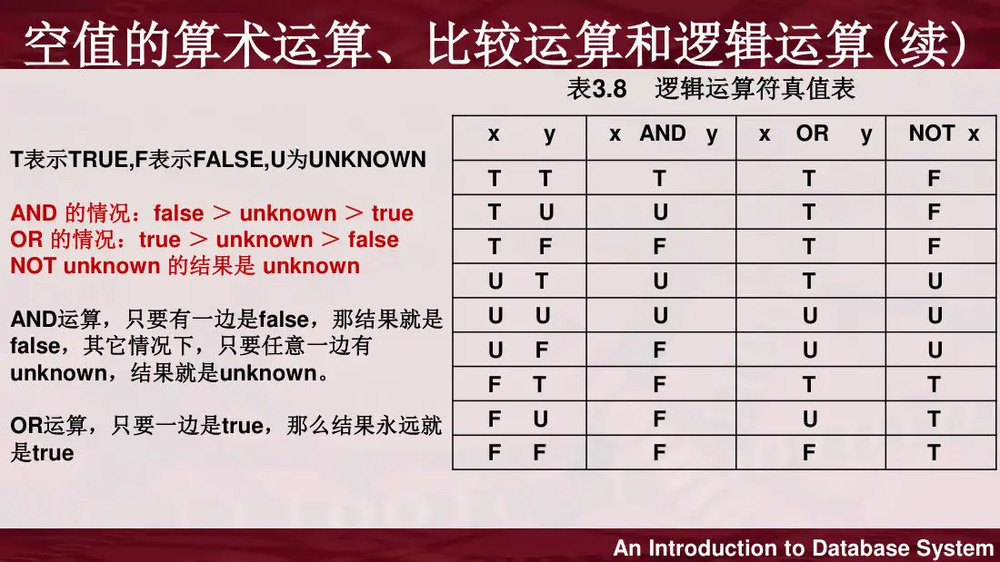

原文：

空值的算术运算、比较运算和逻辑运算(续)

T表示TRUE,F表示FALSE,U为UNKNOWN

AND 的情况：false > unknown > true
OR 的情况：true > unknown > false
NOT unknown 的结果是 unknown

AND运算，只要有一边是false，那结果就是false，其它情况下，只要任意一边有unknown，结果就是unknown。

OR运算，只要一边是true，那么结果永远就是true

表3.8 逻辑运算符真值表
<table><tr><td>x y</td><td>x AND y</td><td>x OR y</td><td>NOT x</td></tr><tr><td>T T</td><td>T</td><td>T</td><td>F</td></tr><tr><td>T U</td><td>U</td><td>T</td><td>F</td></tr><tr><td>T F</td><td>F</td><td>T</td><td>F</td></tr><tr><td>U T</td><td>U</td><td>T</td><td>U</td></tr><tr><td>U U</td><td>U</td><td>U</td><td>U</td></tr><tr><td>U F</td><td>F</td><td>U</td><td>U</td></tr><tr><td>F T</td><td>F</td><td>T</td><td>T</td></tr><tr><td>F U</td><td>F</td><td>U</td><td>T</td></tr><tr><td>F F</td><td>F</td><td>F</td><td>T</td></tr></table>

An Introduction to Database System

### 空值的算术运算、比较运算和逻辑运算（续）

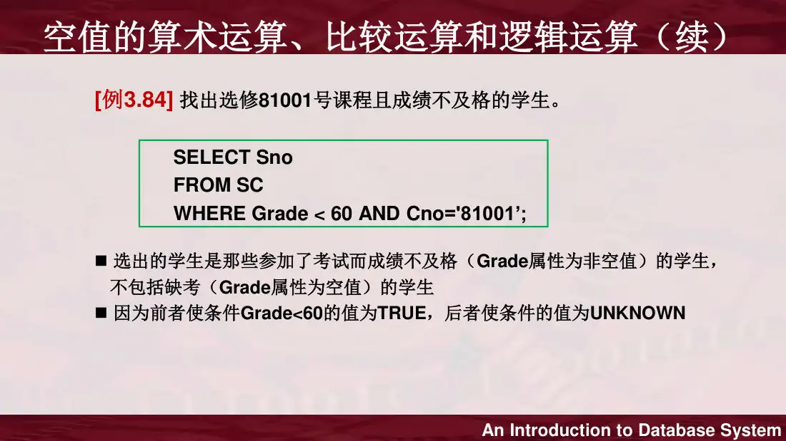

原文：

空值的算术运算、比较运算和逻辑运算（续）

[例3.84] 找出选修81001号课程且成绩不及格的学生。

SELECT Sno

FROM SC

WHERE Grade < 60 AND Cno='81001';

■ 选出的学生是那些参加了考试而成绩不及格（Grade属性为非空值）的学生，不包括缺考（Grade属性为空值）的学生

■ 因为前者使条件Grade<60的值为TRUE，后者使条件的值为UNKNOWN

An Introduction to Database System

### 空值的算术运算、比较运算和逻辑运算（续）

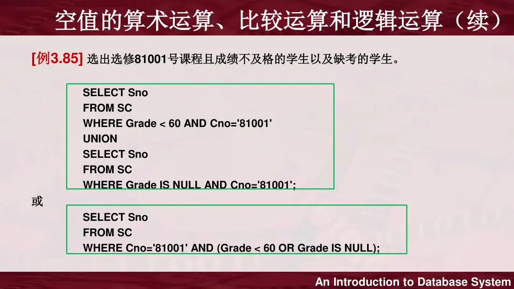

原文：

空值的算术运算、比较运算和逻辑运算（续）

[例3.85] 选出选修81001号课程且成绩不及格的学生以及缺考的学生。

或

An Introduction to Database System

### 3.6 视图（外模式）

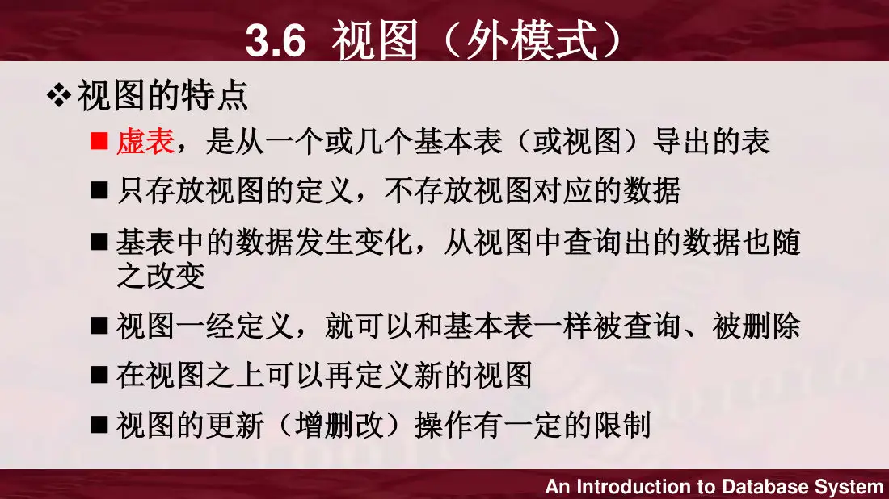

原文：

3.6 视图（外模式）

视图的特点

■ 虚表，是从一个或几个基本表（或视图）导出的表

■ 只存放视图的定义，不存放视图对应的数据

■ 基表中的数据发生变化，从视图中查询出的数据也随之改变

■视图一经定义，就可以和基本表一样被查询、被删除

■ 在视图之上可以再定义新的视图

■视图的更新（增删改）操作有一定的限制

An Introduction to Database System

### 1. 建立视图

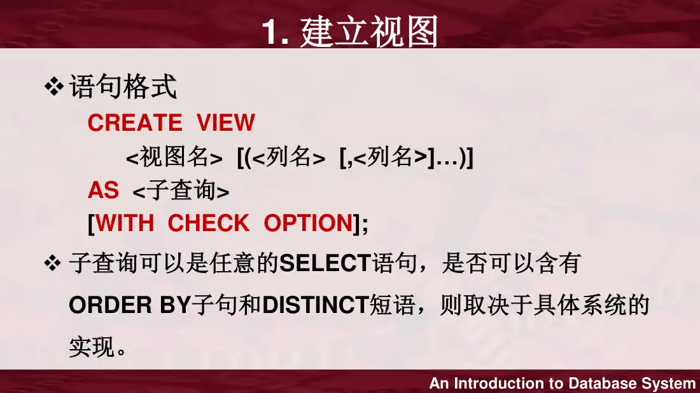

原文：

1. 建立视图

✿语句格式

CREATE VIEW

<视图名> [(<列名> [,<列名>] $\cdots$ ]

AS <子查询>

[WITH CHECK OPTION];

◆ 子查询可以是任意的SELECT语句，是否可以含有ORDER BY子句和DISTINCT短语，则取决于具体系统的实现。

An Introduction to Database System

### 建立视图（续

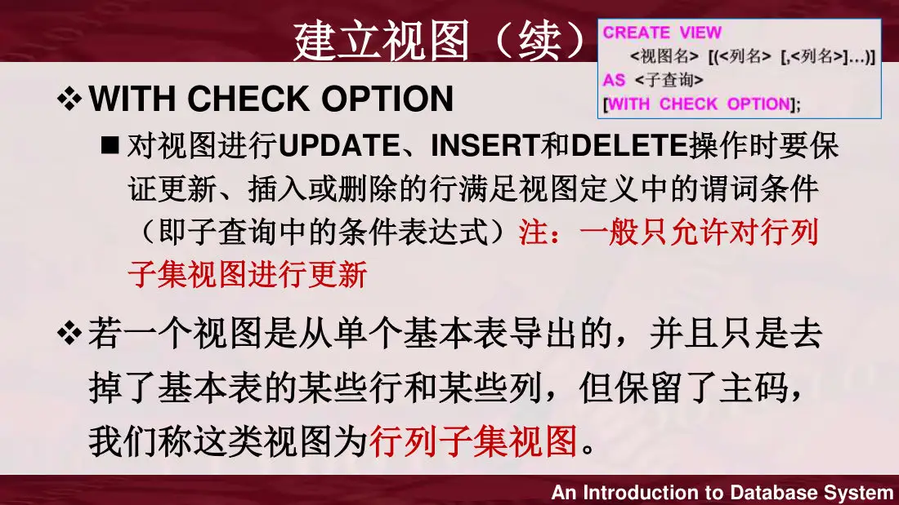

原文：

建立视图（续

WITH CHECK OPTION

CREATE VIEW
<视图名> [(<列名> [,<列名>]]...]
AS <子查询>
[WITH CHECK OPTION];

■ 对视图进行UPDATE、INSERT和DELETE操作时要保证更新、插入或删除的行满足视图定义中的谓词条件（即子查询中的条件表达式）注：一般只允许对行列子集视图进行更新

若一个视图是从单个基本表导出的，并且只是去掉了基本表的某些行和某些列，但保留了主码，我们称这类视图为行列子集视图。

An Introduction to Database System

### 建立视图（续）

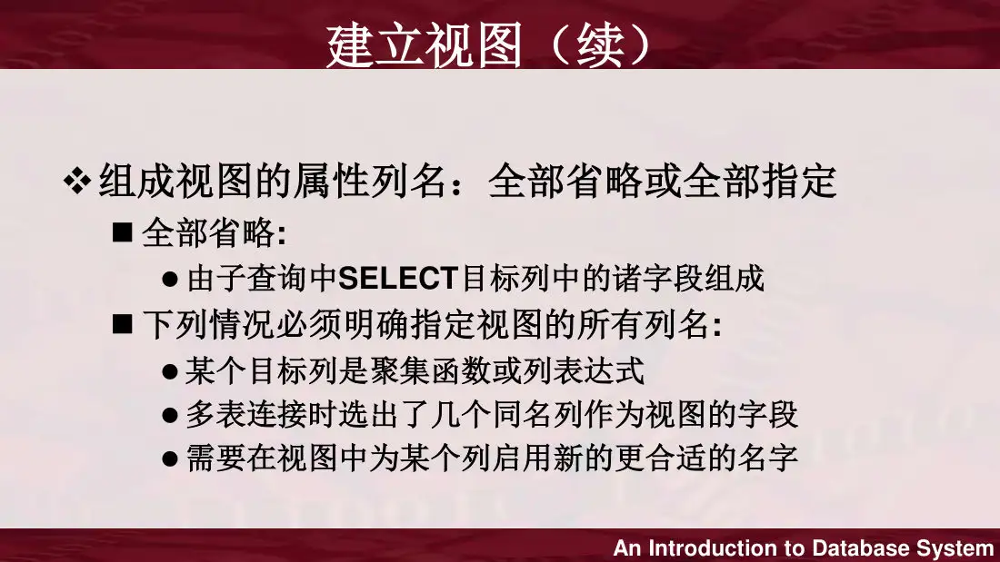

原文：

建立视图（续）

✿ 组成视图的属性列名：全部省略或全部指定

■全部省略:

\- 由子查询中SELECT目标列中的诸字段组成

■ 下列情况必须明确指定视图的所有列名:

\- 某个目标列是聚集函数或列表达式

\- 多表连接时选出了几个同名列作为视图的字段

\- 需要在视图中为某个列启用新的更合适的名字

An Introduction to Database System

### 建立视图（续）

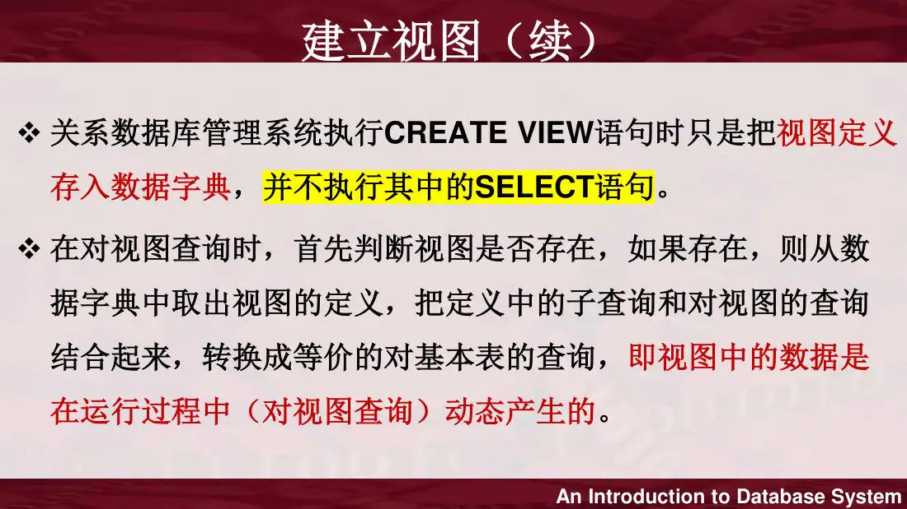

原文：

建立视图（续）

关系数据库管理系统执行CREATE VIEW语句时只是把视图定义存入数据字典，并不执行其中的SELECT语句。

✿ 在对视图查询时，首先判断视图是否存在，如果存在，则从数据字典中取出视图的定义，把定义中的子查询和对视图的查询结合起来，转换成等价的对基本表的查询，即视图中的数据是在运行过程中（对视图查询）动态产生的。

An Introduction to Database System

### 建立视图（续）

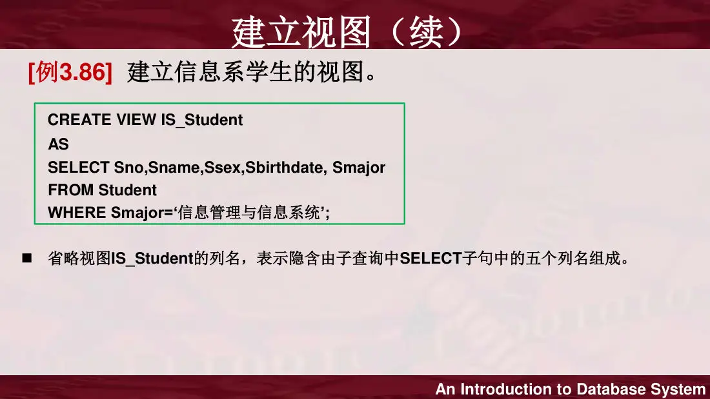

原文：

建立视图（续）

[例3.86] 建立信息系学生的视图。

■ 省略视图IS\_Student的列名，表示隐含由子查询中SELECT子句中的五个列名组成。

An Introduction to Database System

### 建立视图（续）

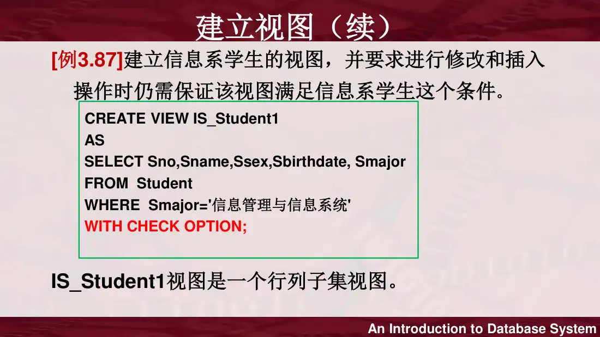

原文：

建立视图（续）

[例3.87]建立信息系学生的视图，并要求进行修改和插入操作时仍需保证该视图满足信息系学生这个条件。

IS\_Student1视图是一个行列子集视图。

An Introduction to Database System

### 建立视图（续）

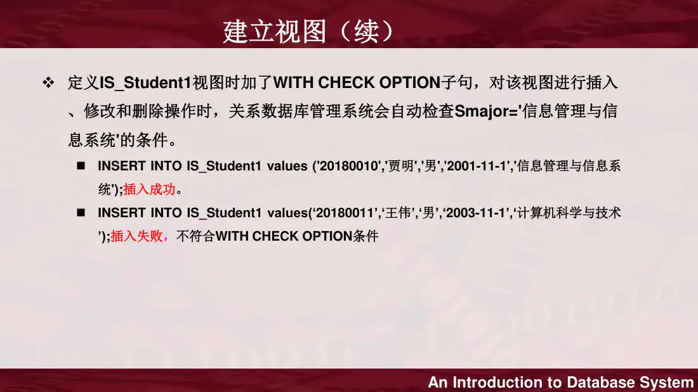

原文：

建立视图（续）

定义IS\_Student1视图时加了WITH CHECK OPTION子句，对该视图进行插入、修改和删除操作时，关系数据库管理系统会自动检查Smajor='信息管理与信息系统'的条件。

■ INSERT INTO IS\_Student1 values ('20180010','贾明','男','2001-11-1','信息管理与信息系统');插入成功。

■ INSERT INTO IS\_Student1 values('20180011', '王伟', '男', '2003-11-1', '计算机科学与技术'); 插入失败，不符合WITH CHECK OPTION条件

An Introduction to Database System

### 建立视图（续）

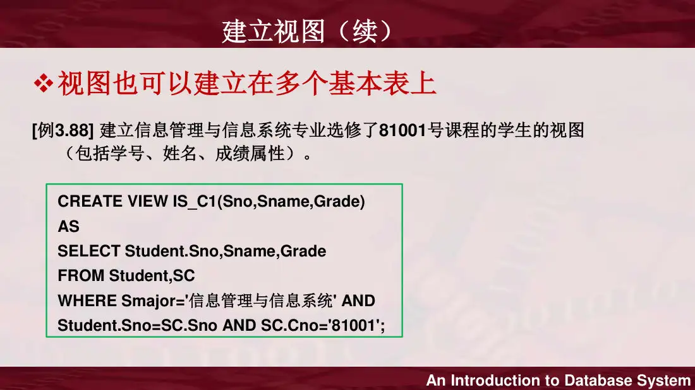

原文：

建立视图（续）

视图也可以建立在多个基本表上

[例3.88] 建立信息管理与信息系统专业选修了81001号课程的学生的视图（包括学号、姓名、成绩属性）。

An Introduction to Database System

### 建立视图（续）

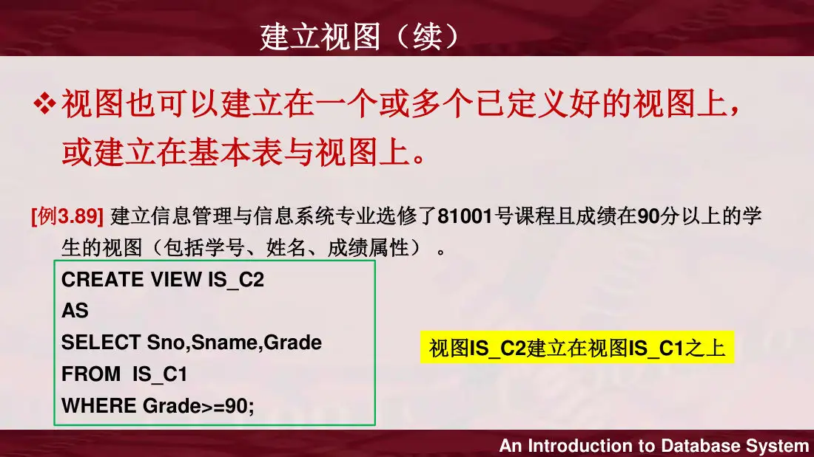

原文：

建立视图（续）

✿视图也可以建立在一个或多个已定义好的视图上，或建立在基本表与视图上。

[例3.89] 建立信息管理与信息系统专业选修了81001号课程且成绩在90分以上的学生的视图（包括学号、姓名、成绩属性）。

视图IS\_C2建立在视图IS\_C1之上

An Introduction to Database System

### 建立视图（续）

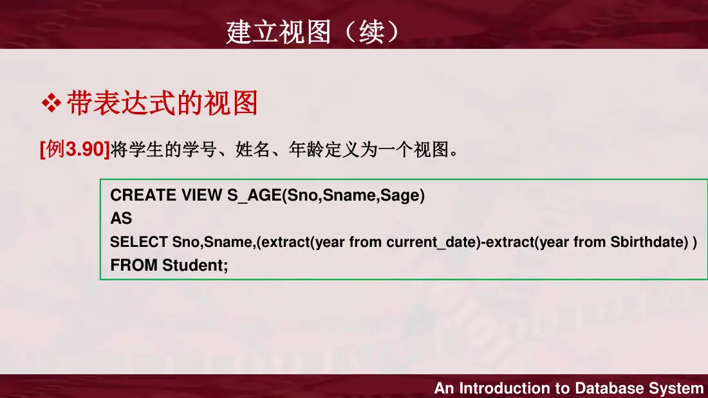

原文：

建立视图（续）

带表达式的视图

[例3.90]将学生的学号、姓名、年龄定义为一个视图。

An Introduction to Database System

### 建立视图（续）

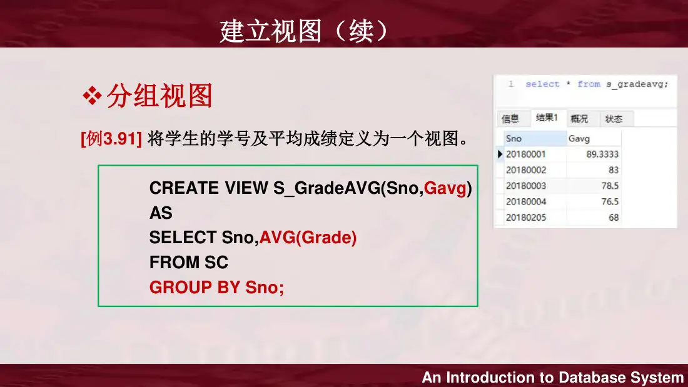

原文：

建立视图（续）

分组视图

[例3.91] 将学生的学号及平均成绩定义为一个视图。

<table><tr><td>信息</td><td>结果1</td><td>概况</td><td>状态</td></tr><tr><td colspan="2">Sno</td><td>Gavg</td><td rowspan="6"></td></tr><tr><td colspan="2">20180001</td><td>89.3333</td></tr><tr><td colspan="2">20180002</td><td>83</td></tr><tr><td colspan="2">20180003</td><td>78.5</td></tr><tr><td colspan="2">20180004</td><td>76.5</td></tr><tr><td colspan="2">20180205</td><td>68</td></tr></table>

An Introduction to Database System

### 建立视图（续）

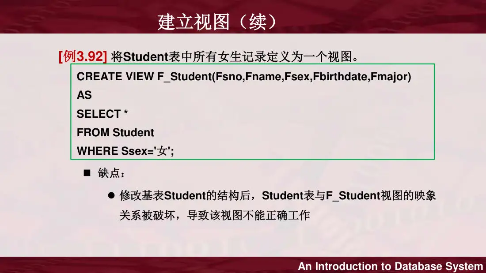

原文：

建立视图（续）

[例3.92] 将Student表中所有女生记录定义为一个视图。

■ 缺点:

\- 修改基表Student的结构后，Student表与F\_Student视图的映象关系被破坏，导致该视图不能正确工作

An Introduction to Database System

### 2. 删除视图

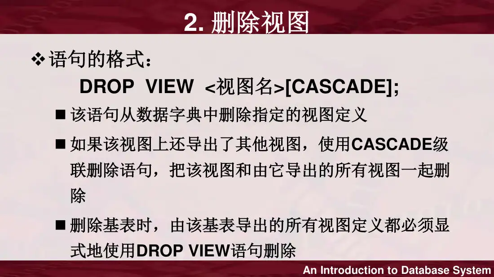

原文：

2. 删除视图

✿语句的格式:

DROP VIEW <视图名>[CASCADE];

■该语句从数据字典中删除指定的视图定义

■ 如果该视图上还导出了其他视图，使用CASCADE级联删除语句，把该视图和由它导出的所有视图一起删除

■ 删除基表时，由该基表导出的所有视图定义都必须显式地使用DROP VIEW语句删除

An Introduction to Database System

### 删除视图（续）

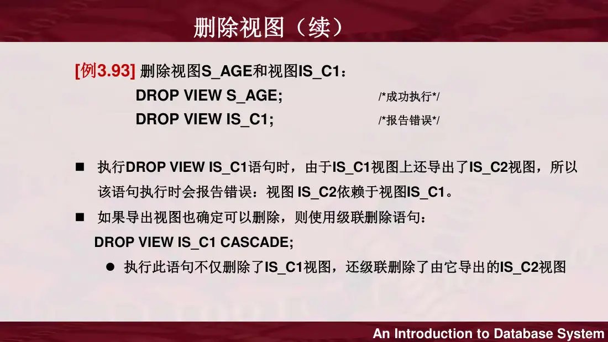

原文：

删除视图（续）

[例3.93] 删除视图S\_AGE和视图IS\_C1: DROP VIEW S\_AGE; /\*成功执行\*/ DROP VIEW IS\_C1; /\*报告错误\*/

■ 执行DROP VIEW IS\_C1语句时，由于IS\_C1视图上还导出了IS\_C2视图，所以该语句执行时会报告错误：视图 IS\_C2依赖于视图IS\_C1。

■ 如果导出视图也确定可以删除，则使用级联删除语句：DROP VIEW IS\_C1 CASCADE;

\- 执行此语句不仅删除了IS\_C1视图，还级联删除了由它导出的IS\_C2视图

An Introduction to Database System

### 3.6 视图

原文：

3.6 视图

3.6.1 定义视图
3.6.2 查询视图
3.6.3 更新视图
3.6.4 视图的作用

An Introduction to Database System

### 3.6.2 查询视图

原文：

3.6.2 查询视图

◆ 用户角度：查询视图与查询基本表相同

关系数据库管理系统实现视图查询的方法

■ 视图消解法（View Resolution）

\- 进行有效性检查

\- 转换成等价的对基本表的查询

\- 执行修正后的查询

An Introduction to Database System

### 查询视图（续）

原文：

查询视图（续）

[例3.94]在信息管理与信息系统专业学生的视图中，找出年龄小于等于23岁的学生（包括学生的学号和出生日期）

An Introduction to Database System

### 查询视图（续）

原文：

查询视图（续）

视图消解:

1. 先找到视图IS\_Student的定义

CREATE VIEW IS\_Student

AS

SELECT Sno,Sname,Ssex,Sbirthdate

FROM Student

WHERE Smajor='信息管理与信息系统'

WITH CHECK OPTION;

An Introduction to Database System

### 查询视图（续）

原文：

查询视图（续）

2. 进行视图消解，转换后的查询语句为:

SELECT Sno,Sbirthdate

FROM Student

WHERE Smajor='信息管理与信息系统' AND

(extract(year from current\_date)-extract(year from Sbirthdate))<=23;

An Introduction to Database System

### 查询视图（续）

原文：

查询视图（续）

[例3.95]查询选修了81001号课程的信息管理与信息系统专业学生。

关系数据库管理系统先从数据字典中取出视图IS\_Student的定义，然后进行视图消解，把上面查询转换为：

An Introduction to Database System

### 查询视图（续）

原文：

查询视图（续）

[例3.96]在S\_GradeAVG视图（例3.91中定义的视图）中查询平均成绩在90分以上的学生学号和平均成绩

SELECT \*

FROM S\_GradeAVG

WHERE Gavg>=90;

CREATE VIEW S GradeAVG(Sno,Gavg)
AS

SELECT Sno.AVG(Grade)

FROM SC

GROUP BY Sno;

An Introduction to Database System

### 查询视图（续）

原文：

查询视图（续）

错误:

SELECT Sno, AVG(Grade)

FROM SC

WHERE AVG(Grade)>=90

GROUP BY Sno;

正确:

SELECT Sno, AVG(Grade)

FROM SC

GROUP BY Sno

HAVING AVG(Grade)>=90;

An Introduction to Database System

### 3.6 视图

原文：

3.6 视图

3.6.1 定义视图
3.6.2 查询视图
3.6.3 更新视图
3.6.4 视图的作用

An Introduction to Database System

### 3.6.3 更新视图

原文：

3.6.3 更新视图

■ 更新视图：通过视图来插入（INSERT）、删除（DELETE）和修改（UPDATE）数据。

■ 视图的更新操作通过视图消解，转换为对基本表的更新操作

■ 为防止用户有意无意地对不属于视图范围内的基本表数据进行操作，可在定义视图时加上WITH CHECK OPTION子句

\- 在视图上增、删、改数据时，关系数据库管理系统会检查视图定义中的条件，若不满足条件则拒绝执行该操作

An Introduction to Database System

### 更新视图（续）

原文：

更新视图（续）

[例3.97]将信息管理与信息系统专业学生视图IS\_Student中学号为“20180205”的学生姓名改为“刘新奇”。

视图是不实际存储数据的虚表，对视图的更新最终要转换为对基本表的更新。

对视图IS\_Student的更新语句转换为对基本表Student的更新：

An Introduction to Database System

### 更新视图（续）

原文：

更新视图（续）

[例3.98]向信息管理与信息系统专业学生视图IS\_Student中插入一个新的学生记录(20180207，赵新，男，2001-7-19)

转换为对基本表的更新:

INSERT INTO Student(Sno,Sname,Ssex,Sbirthdate,Smajor) VALUES('20180207','赵新','男','2001-7-19,'信息管理与信息系统');

系统自动将'信息管理与信息系统'放入VALUES子句中

注意：不同的系统处理方式不一样，MySQL会在专业名处自动填入NULL或者默认值

An Introduction to Database System

### [例3.98] MySQL中的实现

原文：

[例3.98] MySQL中的实现

❖1）通过IS\_Student视图插入一条新纪录

IS\_Student视图的定义

CREATE VIEW IS Student

AS

SELECT Sno, Sname, Ssex, Sbirthdate, Smajor

FROM Student

WHERE Smajor='信息管理与信息系统';

通过IS\_Student视图插入一条新纪录，没有指定Smajor的值，语句正确执行

查询创建工具 亘词编辑器

1 INSERT INTO IS Student(Sno, Sname, Ssex, Sbirthdate)

2 VALUES('20180207', '赵新', '男', '2001-7-19');

信息 概况 状态

[SQL] INSERT INTO IS Student(Sno, Sname, Ssex, Sbirthdate)

VALUES('20180207','赵新','男','2001-7-19');

受影响的行: 1

时间: 0.003s

插入后的Student表，新记录的Smajor填入NULL

<table><tr><td>Sno</td><td>Sname</td><td>Ssex</td><td>Sbirthdate</td><td>Smajor</td></tr><tr><td>20180001</td><td>李勇</td><td>男</td><td>2001-03-18</td><td>信息安全</td></tr><tr><td>20180002</td><td>刘晨</td><td>女</td><td>1999-09-01</td><td>计算机科学与技术</td></tr><tr><td>20180003</td><td>王敏</td><td>女</td><td>2001-08-01</td><td>计算机科学与技术</td></tr><tr><td>20180004</td><td>张立</td><td>男</td><td>2000-01-08</td><td>计算机科学与技术</td></tr><tr><td>20180008</td><td>张成民</td><td>男</td><td>2000-04-15</td><td>计算机科学与技术</td></tr><tr><td>20180009</td><td>陈冬</td><td>男</td><td>2000-05-22</td><td>信息管理与信息系统</td></tr><tr><td>20180205</td><td>陈新奇</td><td>男</td><td>2001-11-01</td><td>信息管理与信息系统</td></tr><tr><td>20180207</td><td>赵新</td><td>男</td><td>2001-07-19</td><td>(Null)</td></tr><tr><td>20180306</td><td>赵明</td><td>男</td><td>2006-06-12</td><td>数据科学与大数据技术</td></tr><tr><td>20180307</td><td>王佳佳</td><td>女</td><td>2001-12-07</td><td>数据科学与大数据技术</td></tr></table>

An Introduction to Database System

### [例3.98] MySQL中的实现

原文：

[例3.98] MySQL中的实现

◆2）通过IS\_Student1视图插入一条新纪录

IS\_Student1视图的定义

CREATE VIEW IS\_Student1 AS

SELECT Sno,Sname,Ssex,Sbirthdate, Smajor FROM Student

WHERE Smajor='信息管理与信息系统'
WITH CHECK OPTION;

通过IS\_Student1视图插入一条新纪录，没有指定Smajor的值，语句不能正确执行，因为CHECK OPTION检查问题

信息 概况 状态

[SQL] INSERT INTO IS\_Student1(Sno, Sname, Ssex, Sbirthdate)
VALUES('20180207', '赵新', '男', '2001-7-19');
[Err] 1369 - CHECK OPTION failed 'ty.is\_student1'

An Introduction to Database System

### 更新视图（续）

原文：

更新视图（续）

并不是所有的视图都是可更新的

例3.91定义的视图S\_GradeAVG是由学号和平均成绩两个属性列组成的，平均成绩是由Student表中对元组分组后计算平均

值得来

CREATE VIEW S\_GradeAVG(Sno,Gavg)

AS

SELECT Sno, AVG(Grade)

FROM SC

GROUP BY Sno;

An Introduction to Database System

### 更新视图（续）

原文：

更新视图（续）

如果想把视图S\_GradeAVG中学号为“20180001”学生的平均成绩改成90分

UPDATE S\_GradeAVG

SET Gavg=90

WHERE Sno='20180001';

■ 对视图的更新是无法转换成对基本表SC的更新，因为系统无法修改各科成绩，以使20180001学生平均成绩成为90

■ 所以S\_GradeAVG视图是不可更新的

一般地，行列子集视图是可更新的！

An Introduction to Database System

### 3.6 视图

原文：

3.6 视图

3.6.1 定义视图
3.6.2 查询视图
3.6.3 更新视图
3.6.4 视图的作用

An Introduction to Database System

### 视图的作用（续）

原文：

视图的作用（续）

1. 视图能够对机密数据提供安全保护

■ 对不同的用户定义不同的视图，使机密数据不出现在不应看到这些数据的用户视图上

■ 自动提供了对机密数据的安全保护功能

■ 例如，Student表涉及全校30个院系的学生数据

\- 可以在其上定义30个视图

\- 每个视图只包含一个院系的学生数据

\- 只允许每个院系的主任查询和修改本院系的学生视图

An Introduction to Database System

### 视图的作用（续）

原文：

视图的作用（续）

2.视图对重构数据库提供了一定程度的逻辑独立性

■ 数据的逻辑独立性是指当数据库重构构造时，如增加新的关系或对原有关系增加新的字段等，用户的应用程序不会受影响

■ 数据库重构：

例：学生关系Student(Sno,Sname,Ssex,Sbirthdate,Smajor)

“垂直”地分成两个基本表:

SX(Sno,Sname,Sbirthdate)

SY(Sno,Ssex,Smajor)

An Introduction to Database System

### 视图的作用（续）

原文：

视图的作用（续）

通过建立一个视图Student:

■使用户的外模式保持不变，用户的应用程序通过视图仍然能够查找数据

■ 视图只能在一定程度上提供数据的逻辑独立性

\- 对视图的更新是有条件的，因此应用程序中修改数据的语句可能仍会因基本表结构的改变而相应修改

An Introduction to Database System

### 视图的作用（续）

原文：

视图的作用（续）

✿ 3.视图能够简化用户的操作

当视图中数据不是直接来自基本表时，定义视图能够简化用户的操作

■ 基于多张表连接形成的视图

■ 基于复杂嵌套查询的视图

■ 含导出属性的视图

An Introduction to Database System

### 视图的作用（续）

原文：

视图的作用（续）

适当的利用视图可以更清晰的表达查询

■ 经常查询“对每个同学找出他获得最高成绩的课程号”

■ 可以先定义一个视图，求出每个同学获得的最高成绩

■ 然后用如下的查询语句完成查询:

An Introduction to Database System

### 视图的作用（续）

原文：

视图的作用（续）

4.视图使用户能以多种角度看待同一数据

■ 视图机制能使不同用户以不同方式看待同一数据，适应数据库共享的需要

■ 希望了解学生的平均成绩，学生的最高成绩和最低成绩，都可以在基本表SC上定义自己感兴趣的视图，直接对这些视图查询

An Introduction to Database System

### 本章小结

原文：

本章小结

SQL可以分为数据定义、数据查询、数据更新、数据控制四大部分。

✿ 数据控制中的数据安全性和完整性控制将在第4章和第5章中讲解。

SQL是关系数据库的标准语言

SQL的数据查询功能非常丰富，也比较复杂。

An Introduction to Database System
