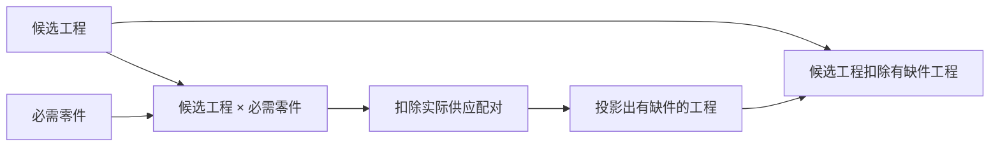

# 《数据库系统》第3章习题

档名为“第3章习题”，原件封面题为“《数据库系统》习题一”，实际涵盖第 2–5 章。下文合并重复出现的题面，按原页码对照。原件给出的解法用转述或规范化 SQL 表达；不同口径、边界和改写分别标为**订正**或**补充**，不冒充原件自带答案。

## 一、到底从哪张表开始？（原件第 2–5 页）

设 `S(SNO,SNAME,STATUS,CITY)` 为供应商，`P(PNO,PNAME,COLOR,WEIGHT)` 为零件，`J(JNO,JNAME,CITY)` 为工程，`SPJ(SNO,PNO,JNO,QTY)` 为供应。先确定结果粒度：一个供应商、一个工程，还是一条供应记录？然后才问需要哪张表判断条件。

| 原题目标 | 关系代数或等价推导 |
| --- | --- |
| 给工程 J1 供货的供应商 | $\pi_{SNO}(\sigma_{JNO='J1'}(SPJ))$ |
| 给工程 J1 供应 P1 的供应商 | $\pi_{SNO}(\sigma_{JNO='J1'\land PNO='P1'}(SPJ))$ |
| 给工程 J1 供应红色零件的供应商 | 将 $SPJ$ 按 $PNO$ 连接 $P$，选择 J1 且颜色为红，再投影 $SNO$ |
| 没使用天津供应商所供红色零件的工程 | 只把供应事实与供应商、零件按编号连接，取符合天津和红色的工程编号为坏集 $B$；答案是候选工程集合 $U-B$ |
| 至少用了 S1 所供应的全部零件的工程 | 令 $X=\pi_{JNO,PNO}(SPJ)$，$Y=\pi_{PNO}(\sigma_{SNO='S1'}(SPJ))$，答案为 $U-\pi_{JNO}((U\times Y)-X)$ |

**订正（候选域）**：原件第 4 页以 $U=\pi_{JNO}(SPJ)$ 求差，第 5 页使用 $X$ 除以 $Y$；这两种写法都只会考虑有供应记录的工程。若题意是“所有已登记工程”，应取 $U=\pi_{JNO}(J)$，否则会漏掉尚未开工的工程。两种口径应明确，不应直接判一个答案总是错。例如某工程已登记而无供货，它一定没有用天津红件；若 S1 的应覆盖零件集合为空，全称条件对它也成立。

> [!TIP]
> 读到 ==至少用了全部==，先配对“每个候选工程 × 每个必需零件”，再减掉实际存在的配对，剩下的是缺件证据。只要每个必需零件有来源即可，不要求该工程从 S1 采购，也不排斥额外零件。



**补充**：把同一工程里“零件不同”的供应记录做笛卡尔积，会把已全部覆盖的工程也找出来。例如需求 P1、P2，工程 J1 两者齐全，但任取交叉配对就有 P1 不等于 P2。原件指出的错误并不是缺一个连接条件，而是把“存在不同件”误当成“存在缺件”。

知识点：[关系代数基础](../../../topics/数据库系统/关系代数基础.md)、[关系代数专门运算](../../../topics/数据库系统/关系代数专门运算.md)、[嵌套查询](../../../topics/数据库系统/嵌套查询.md)。

## 二、把六个代数式写成 SQL（原件第 6–7 页）

本节的 `S(A,B,C,D)`、`T(C,D,E,F)` 与供应商模式无关。取连接条件前先看属性名：自然连接同时匹配 C、D，只按 C 连接则允许两个 D 不同。要把 SQL 读成关系代数的==集合==，在输出存在重行的情形加 `DISTINCT`；以下以无空值的经典关系代数为准。

| 原题运算 | 查询（同名列需要分别保留时显式重命名） |
| --- | --- |
| 选择 $A=10$ | `SELECT DISTINCT * FROM S WHERE A=10` |
| 投影 $(A,B)$ | `SELECT DISTINCT A,B FROM S` |
| 自然连接 | `SELECT DISTINCT S.A,S.B,S.C,S.D,T.E,T.F FROM S JOIN T ON S.C=T.C AND S.D=T.D` |
| 仅 C 相等的连接 | `SELECT DISTINCT S.A,S.B,S.C AS SC,S.D AS SD,T.C AS TC,T.D AS TD,T.E,T.F FROM S JOIN T ON S.C=T.C` |
| $A<E$ 的条件连接 | 将上一问的 `ON S.C=T.C` 改为 `ON S.A<T.E` |
| $\pi_{C,D}(S)\times T$ | `SELECT DISTINCT S.C AS SC,S.D AS SD,T.C AS TC,T.D AS TD,T.E,T.F FROM S CROSS JOIN T` |

**补充**：原件投影使用 `SELECT A,B`；若 S 有两行 A、B 相同而 C、D 不同，SQL 会显示两行，集合投影只剩一行。最后一题在最终 SELECT 去重等价于先对左侧 C、D 去重再做乘积。

知识点：[自然连接与外连接](../../../topics/数据库系统/自然连接与外连接.md)、[连接查询](../../../topics/数据库系统/连接查询.md)、[单表查询](../../../topics/数据库系统/单表查询.md)。

## 三、把供应关系建出来，再检验条件（原件第 8–14 页）

原件第 10 页有完整的 J 表定义。对供应商==编号更新==要让外键跟随；更改供应商姓名不需要级联。删除还被供应记录引用的零件则应报错。两条规则对象和方向不同。

```sql
CREATE TABLE S(SNO CHAR(2) PRIMARY KEY,SNAME VARCHAR(10),STATUS CHAR(2),CITY VARCHAR(10));
CREATE TABLE P(PNO CHAR(2) PRIMARY KEY,PNAME VARCHAR(10),COLOR CHAR(2),WEIGHT INT);
CREATE TABLE J(JNO CHAR(2) PRIMARY KEY,JNAME VARCHAR(10),CITY VARCHAR(10));
CREATE TABLE SPJ(
  SNO CHAR(2) NOT NULL, PNO CHAR(2) NOT NULL, JNO CHAR(2) NOT NULL, QTY INT,
  PRIMARY KEY(SNO,PNO,JNO),
  FOREIGN KEY(SNO) REFERENCES S(SNO) ON UPDATE CASCADE,
  FOREIGN KEY(PNO) REFERENCES P(PNO) ON DELETE NO ACTION,
  FOREIGN KEY(JNO) REFERENCES J(JNO)
);
```

**订正（SQL 口径）**：前三问在关系代数上投影去重；第 4、5 问以下从 J 取候选域，若按讲义“已有供应的工程”口径，可把外层 `J j` 改成 `(SELECT DISTINCT JNO FROM SPJ) j`。第 5 问用 `'S1'`，不在字符串内部加入排版空格。

```sql
SELECT DISTINCT SNO FROM SPJ WHERE JNO='J1';
SELECT DISTINCT SNO FROM SPJ WHERE JNO='J1' AND PNO='P1';
SELECT DISTINCT q.SNO FROM SPJ q JOIN P p ON p.PNO=q.PNO
WHERE q.JNO='J1' AND p.COLOR='红';
SELECT j.JNO FROM J j WHERE NOT EXISTS (
  SELECT 1 FROM SPJ q JOIN S s ON s.SNO=q.SNO JOIN P p ON p.PNO=q.PNO
  WHERE q.JNO=j.JNO AND s.CITY='天津' AND p.COLOR='红'
);
SELECT j.JNO FROM J j WHERE NOT EXISTS (
  SELECT 1 FROM SPJ needed WHERE needed.SNO='S1' AND NOT EXISTS (
    SELECT 1 FROM SPJ have WHERE have.JNO=j.JNO AND have.PNO=needed.PNO
  )
);
```

> [!WARNING]
> 不要把 J 与 P 自然连接：它们在给出的结构中没有共同列，相当于笛卡尔积。也不要把 S 与 J 按同名 CITY 自然连接：供应商可向异地工程供货。

知识点：[数据定义](../../../topics/数据库系统/数据定义.md)、[参照完整性](../../../topics/数据库系统/参照完整性定义.md)、[嵌套查询](../../../topics/数据库系统/嵌套查询.md)。

## 四、十一道供应 SQL 和两种统计粒度（原件第 15–22 页）

第 1–7 问按原题顺序是：供应商名和城市；零件名称、颜色、重量；用过 S1 所供零件的工程号；J2 的零件名和数量；上海厂商所供零件号；使用上海件的工程名；没用天津件的工程号。称“某地所产”沿用原题的供应商城市口径，不代表可从表中另推断制造地点。第 4 问与讲义一样列供应明细；若问每种零件总量，应按 PNO 分组（名称未必唯一）。

```sql
SELECT SNAME,CITY FROM S;
SELECT PNAME,COLOR,WEIGHT FROM P;
SELECT DISTINCT JNO FROM SPJ WHERE SNO='S1';
SELECT p.PNAME,q.QTY FROM SPJ q JOIN P p ON p.PNO=q.PNO WHERE q.JNO='J2';
SELECT DISTINCT q.PNO FROM SPJ q JOIN S s ON s.SNO=q.SNO WHERE s.CITY='上海';
SELECT DISTINCT j.JNAME FROM J j JOIN SPJ q ON q.JNO=j.JNO
JOIN S s ON s.SNO=q.SNO WHERE s.CITY='上海';
SELECT j.JNO FROM J j WHERE NOT EXISTS (
  SELECT 1 FROM SPJ q JOIN S s ON s.SNO=q.SNO WHERE q.JNO=j.JNO AND s.CITY='天津'
);
```

第 8–11 问是红件改蓝、转移特定供应关系、删除 S2 及其供应记录、插入指定供应记录。题 11 的元组按 `SNO,JNO,PNO,QTY` 书写，与建表的 PNO、JNO 顺序不同，所以必须保留显式列名。四问是独立练习，特别是==删除 S2==之后，不能直接插入引用 S2 的行。**补充**：第 9 问若新三元主码本就存在，更新会冲突；是否合并及如何合并数量必须由业务规则规定。第 10 问两条 DELETE 实务上放同一事务中，先删子表再删父表。

```sql
UPDATE P SET COLOR='蓝' WHERE COLOR='红';
UPDATE SPJ SET SNO='S3' WHERE SNO='S5' AND JNO='J4' AND PNO='P6';
DELETE FROM SPJ WHERE SNO='S2';
DELETE FROM S WHERE SNO='S2';
INSERT INTO SPJ(SNO,JNO,PNO,QTY) VALUES('S2','J6','P4',200);
```

第 20–21 页的“三建”视图按工程名称筛选供应关系，只暴露 SNO、PNO、QTY。讲义给出两个“零件代码及其数量”口径：按供应记录显示 QTY，与按零件分组显示总量。如“三建”名称对应多个工程，该视图会把它们纳入；只查单一工程实例应先确定 JNO。

```sql
CREATE VIEW SANJIAN_SPJ(SNO,PNO,QTY) AS
SELECT q.SNO,q.PNO,q.QTY FROM SPJ q JOIN J j ON j.JNO=q.JNO WHERE j.JNAME='三建';
SELECT PNO,QTY FROM SANJIAN_SPJ;
SELECT PNO,SUM(QTY) AS total_qty FROM SANJIAN_SPJ GROUP BY PNO;
SELECT SNO,PNO,QTY FROM SANJIAN_SPJ WHERE SNO='S1';
SELECT SNO,PNO,SUM(QTY) AS total_qty FROM SPJ
GROUP BY SNO,PNO HAVING SUM(QTY)>=500 ORDER BY total_qty DESC,SNO ASC,PNO DESC;
```

**补充**：最后一题筛选的是组总量而非单笔数量。两笔 300+250 都低于 500，却合为 550；若先在 WHERE 去掉这两笔，就无法得到正确结果。

知识点：[数据更新](../../../topics/数据库系统/数据更新.md)、[视图](../../../topics/数据库系统/视图.md)、[单表查询](../../../topics/数据库系统/单表查询.md)。

## 五、授权对象与授权传播是两件事（原件第 23–28 页）

| 原题 | 目标权限与对象 | 传播 |
| --- | --- | --- |
| 习题 6（1）U1 | 学生、班级两表的全部可授予对象权限 | 允许转授对象权限 |
| 6（2）U2 | 学生表 SELECT；只对家庭住址列 UPDATE | 不加转授选项 |
| 6（3）所有用户 | 班级表 SELECT 授给 PUBLIC | 不加转授选项 |
| 6（4）R1 | 角色 R1 对学生表 SELECT、UPDATE | 不加转授选项 |
| 6（5）U1 | 授予角色 R1 | 允许转授角色 |
| 习题 7（1）王明 | 部门、职工两表 SELECT | 不加转授选项 |
| 7（2）李勇 | 两表 INSERT、DELETE | 不加转授选项 |
| 7（4）刘星 | 职工表 SELECT；只对工资列 UPDATE | 不加转授选项 |
| 7（5）张新 | 修改两表结构 | 核对目标系统的 ALTER 权限或所有者规则 |
| 7（6）周平 | 按括号中的“读、插、改、删”授予两表四项 DML 权限 | 允许转授对象权限 |
| 7（7）杨兰 | 仅授予部门工资聚合视图 SELECT，不授予底表读权限 | 不加转授选项 |

**订正**：习题 7 原件题号跳过（3），不要补造。原件在（5）用 `GRANT ALTER TABLE ON TABLE ...` 表述，不当做可移植语法，某些系统的改表权归对象所有者，另一些系统可授予 `ALTER`。原件（6）用 `ALL PRIVILEGES`；如果题意严格限于括号中的四项，则应显式列出 `SELECT, INSERT, UPDATE, DELETE`，防止授权范围超出。原件建工资视图时“部门模式给名称、视图正文用部门名”，实现时统一使用实际模式。对象权限的 `WITH GRANT OPTION` 与角色转授的 `WITH ADMIN OPTION` 不互换。以下表示课堂常见语法，角色、列级权限及多表列表是否支持以目标系统为准。

```sql
GRANT ALL PRIVILEGES ON TABLE 学生, 班级 TO U1 WITH GRANT OPTION;
GRANT SELECT, UPDATE(家庭住址) ON TABLE 学生 TO U2;
GRANT SELECT ON TABLE 班级 TO PUBLIC;
GRANT SELECT, UPDATE ON TABLE 学生 TO R1;
GRANT R1 TO U1 WITH ADMIN OPTION;
GRANT SELECT ON TABLE 部门, 职工 TO 王明;
GRANT INSERT, DELETE ON TABLE 部门, 职工 TO 李勇;
GRANT SELECT, UPDATE(工资) ON TABLE 职工 TO 刘星;
GRANT SELECT, INSERT, UPDATE, DELETE ON TABLE 职工, 部门 TO 周平 WITH GRANT OPTION;
GRANT SELECT ON TABLE 部门工资统计 TO 杨兰;
```

下例以原件给出的部门模式列名“名称”为准，按部门号与名称分组（有职工的部门才有统计值）。

```sql
CREATE VIEW 部门工资统计(部门号,部门名,最高工资,最低工资,平均工资) AS
SELECT d.部门号,d.名称,MAX(e.工资),MIN(e.工资),AVG(e.工资)
FROM 部门 d JOIN 职工 e ON e.部门号=d.部门号
GROUP BY d.部门号,d.名称;
```

**补充**：只让杨兰读按部门分组的 `MAX(工资),MIN(工资),AVG(工资)` 视图可以隔离底表读取，但不等价于统计隐私：若部门只有一位职工，三个统计量都等于其工资。原题只要求隔离读取对象；若还要防推断，应另立小组抑制等规则。

知识点：[自主存取控制](../../../topics/数据库系统/自主存取控制.md)、[视图与审计](../../../topics/数据库系统/视图与审计.md)。

## 六、约束放在哪里？空集又该如何？（原件第 29–31 页）

第 29–30 页题要求分别约束部门、职工主码，令职工部门号参照部门主码，并禁止年龄超过 60。讲义的 `CHECK(年龄<=60)` 正好表达“有年龄则不得超过 60”，但不禁止空年龄；若题意还要求必填，显式加 `NOT NULL`，不要把 CHECK 当作必填。外键同理：要强制归属部门，必须再限制职工的部门号列不得为空。

```sql
CREATE TABLE 部门(
  部门号 CHAR(4) PRIMARY KEY, 部门名 VARCHAR(40), 经理名 VARCHAR(10), 电话 VARCHAR(11)
);
CREATE TABLE 职工(
  职工号 CHAR(10) PRIMARY KEY, 姓名 VARCHAR(10), 年龄 INT CHECK(年龄<=60),
  职务 VARCHAR(10), 工资 FLOAT, 部门号 CHAR(4),
  FOREIGN KEY(部门号) REFERENCES 部门(部门号)
);
```

第 31 页 **补充（参考解答）**：查询选修了全部课程的学生姓名。课程集合由 COURSE 给出；以学生号区分学生，不按姓名合并同名学生。原件通过内连接、分组和行数相等作答，该解法要求 SC 的课程号均非空且有效、同一学生同一课程最多一条记录；当课程表为空时，内连接分组会漏掉无选课记录的所有学生。按“找不到该学生没选的一门课”写，不因空课程表或重复选课记录而改变语义。

```sql
SELECT s.SNAME FROM STUDENT s
WHERE NOT EXISTS (
  SELECT 1 FROM COURSE c WHERE NOT EXISTS (
    SELECT 1 FROM SC x WHERE x.SNO=s.SNO AND x.CNO=c.CNO
  )
);
```

同一逻辑在工程题里叫“没有缺的零件”，在选课题里叫“没有漏选的课程”。两题的共同结构是候选集合减掉拥有反例的候选，而不是先数配对有多少。

知识点：[用户定义完整性](../../../topics/数据库系统/用户定义完整性.md)、[空值处理](../../../topics/数据库系统/空值处理.md)、[嵌套查询](../../../topics/数据库系统/嵌套查询.md)。
