# 《数据库系统》第4章 数据库安全性（课件）

原件的每一页，下面附识别出的文字。

### 第四章 数据库安全性

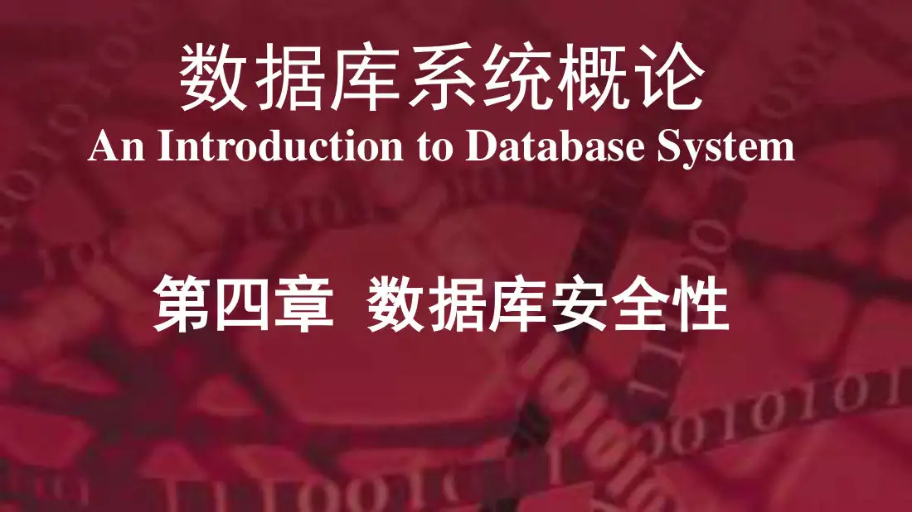

原文：

数据库系统概论 An Introduction to Database System

第四章 数据库安全性

### 数据库安全性

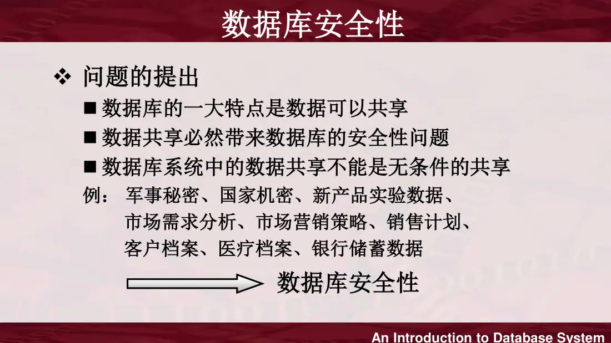

原文：

数据库安全性

问题的提出

■ 数据库的一大特点是数据可以共享

■ 数据共享必然带来数据库的安全性问题

■ 数据库系统中的数据共享不能是无条件的共享

例：军事秘密、国家机密、新产品实验数据、市场需求分析、市场营销策略、销售计划、客户档案、医疗档案、银行储蓄数据

数据库安全性

An Introduction to Database System

### 数据库安全性（续）

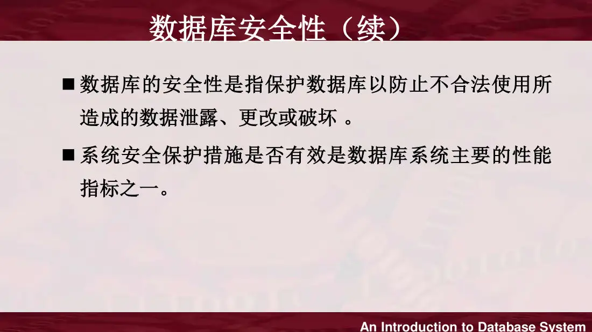

原文：

数据库安全性（续）

■数据库的安全性是指保护数据库以防止不合法使用所造成的数据泄露、更改或破坏。

■ 系统安全保护措施是否有效是数据库系统主要的性能指标之一。

An Introduction to Database System

### 第四章 数据库安全性

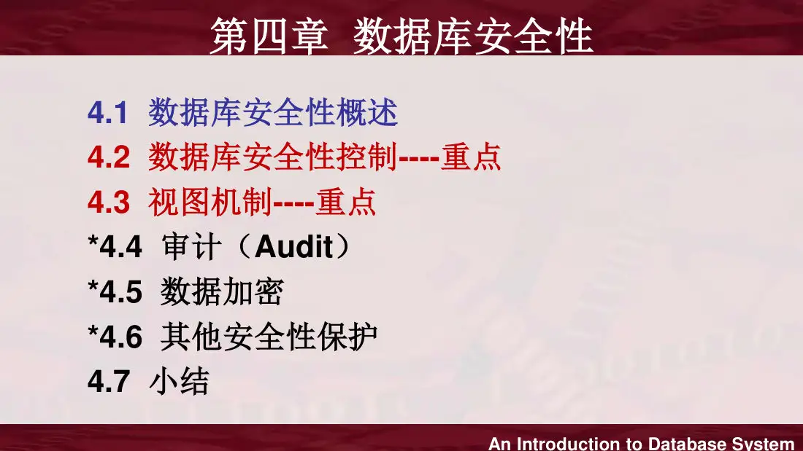

原文：

第四章 数据库安全性

4.1 数据库安全性概述
4.2 数据库安全性控制----重点
4.3 视图机制----重点
\*4.4 审计（Audit）
\*4.5 数据加密
\*4.6 其他安全性保护
4.7 小结

An Introduction to Database System

### 4.1.1 数据库的不安全因素

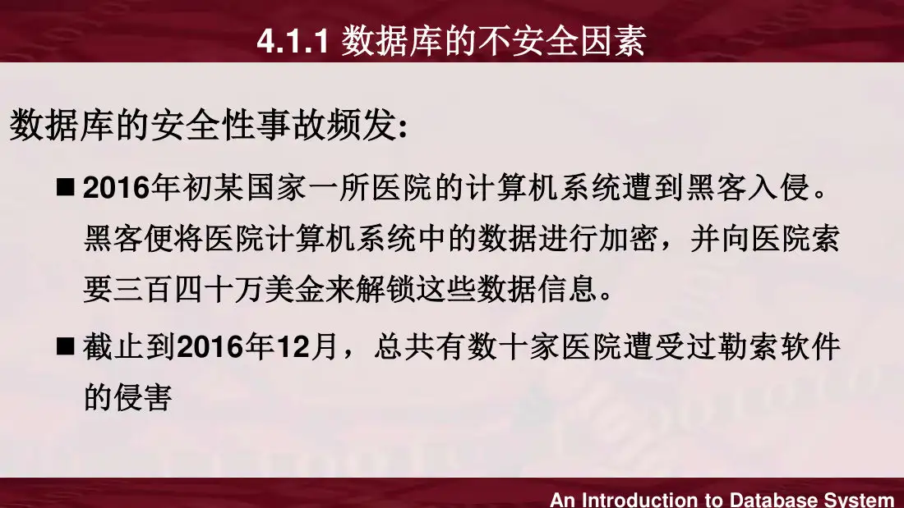

原文：

4.1.1 数据库的不安全因素

数据库的安全性事故频发:

■2016年初某国家一所医院的计算机系统遭到黑客入侵。黑客便将医院计算机系统中的数据进行加密，并向医院索要三百四十万美金来解锁这些数据信息。

■ 截止到2016年12月，总共有数十家医院遭受过勒索软件的侵害

An Introduction to Database System

### 数据库的不安全因素（续）

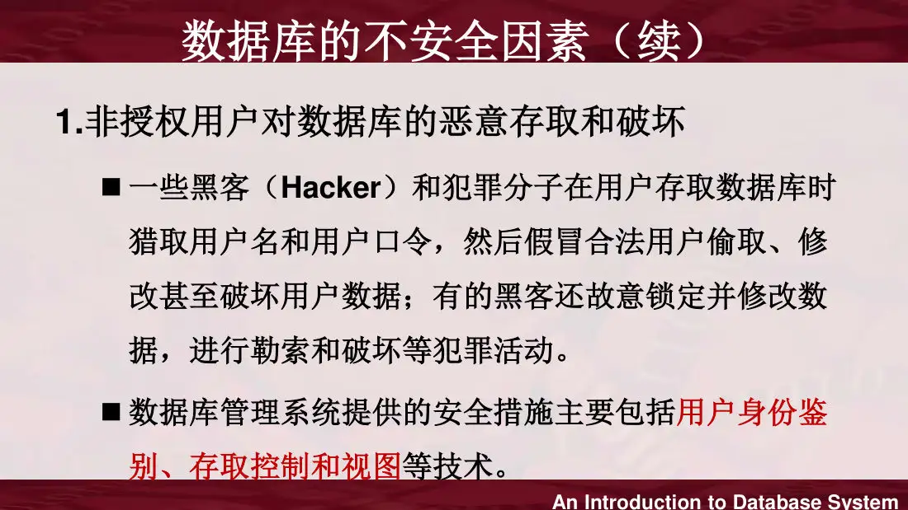

原文：

数据库的不安全因素（续）

1. 非授权用户对数据库的恶意存取和破坏

■一些黑客（Hacker）和犯罪分子在用户存取数据库时猎取用户名和用户口令，然后假冒合法用户偷取、修改甚至破坏用户数据；有的黑客还故意锁定并修改数据，进行勒索和破坏等犯罪活动。

■ 数据库管理系统提供的安全措施主要包括用户身份鉴别、存取控制和视图等技术。

An Introduction to Database System

### 数据库的不安全因素（续）

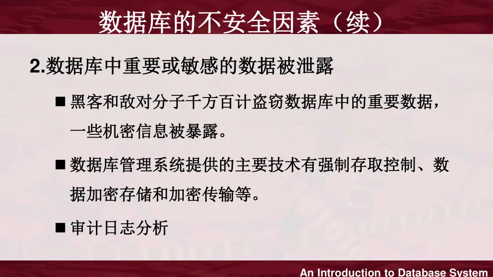

原文：

数据库的不安全因素（续）

2. 数据库中重要或敏感的数据被泄露

■ 黑客和敌对分子千方百计盗窃数据库中的重要数据，一些机密信息被暴露。

■ 数据库管理系统提供的主要技术有强制存取控制、数据加密存储和加密传输等。

■ 审计日志分析

An Introduction to Database System

### 数据库的不安全因素（续）

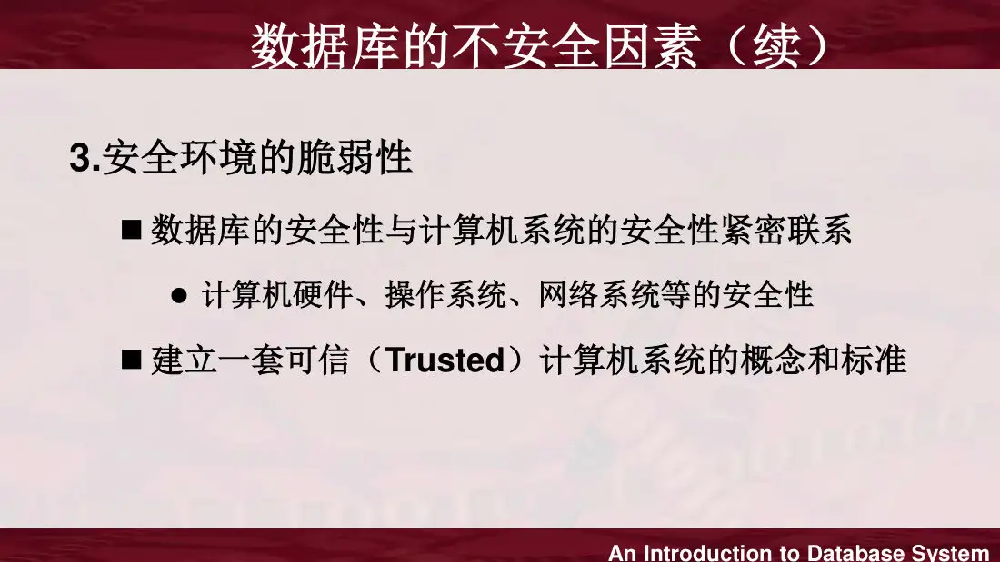

原文：

数据库的不安全因素（续）

3. 安全环境的脆弱性

■ 数据库的安全性与计算机系统的安全性紧密联系

\- 计算机硬件、操作系统、网络系统等的安全性

■ 建立一套可信（Trusted）计算机系统的概念和标准

An Introduction to Database System

### 4.1 数据库安全性概述

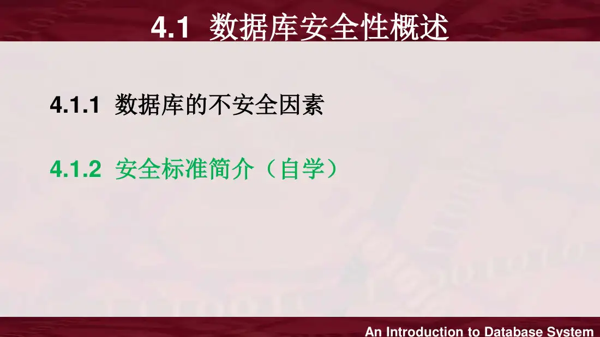

原文：

4.1 数据库安全性概述

4.1.1 数据库的不安全因素

4.1.2 安全标准简介（自学）

An Introduction to Database System

### 第四章 数据库安全性

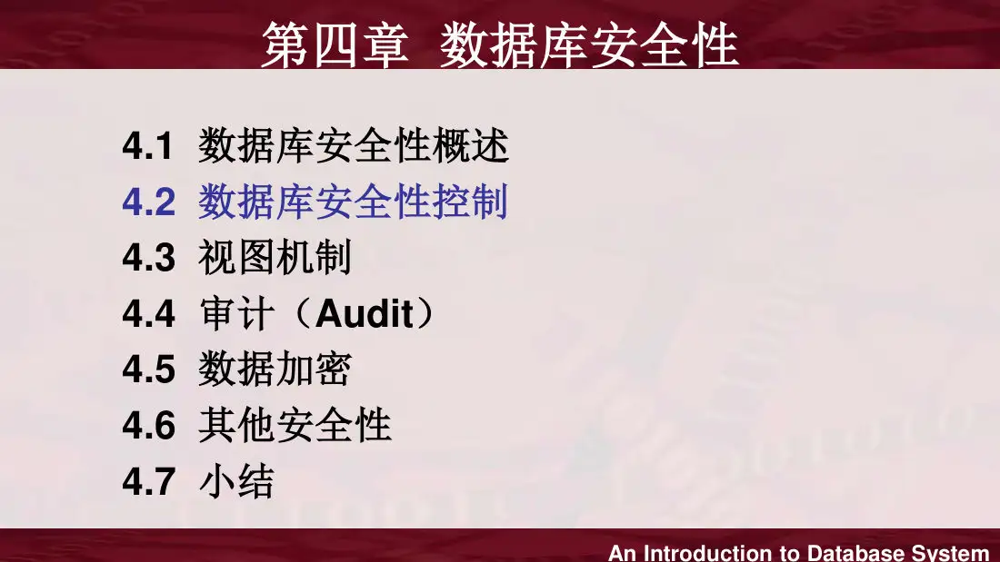

原文：

第四章 数据库安全性

4.1 数据库安全性概述
4.2 数据库安全性控制
4.3 视图机制
4.4 审计（Audit）
4.5 数据加密
4.6 其他安全性
4.7 小结

An Introduction to Database System

### 4.2 数据库安全性控制

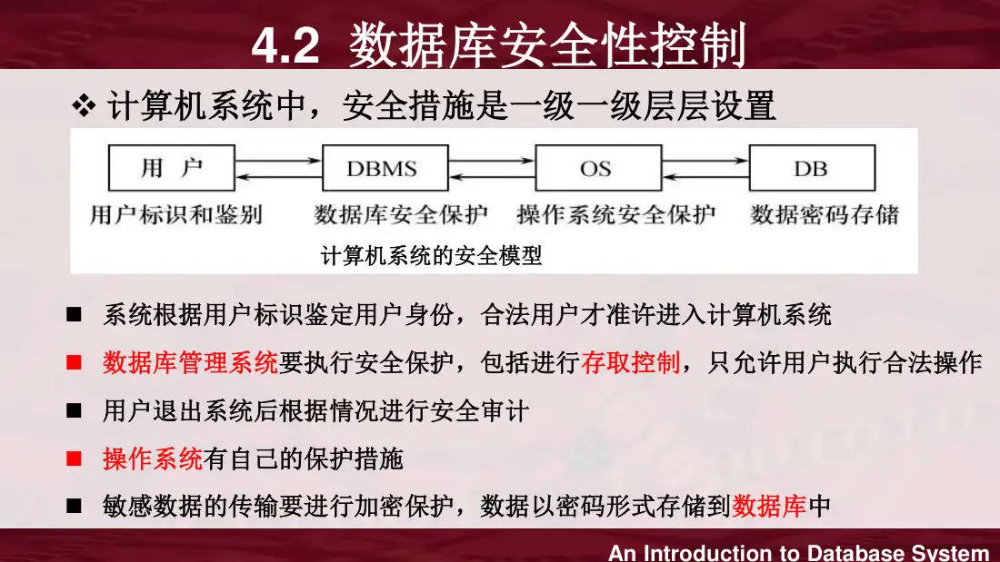

原文：

4.2 数据库安全性控制

计算机系统中，安全措施是一级一级层层设置

■ 系统根据用户标识鉴定用户身份，合法用户才准许进入计算机系统

■ 数据库管理系统要执行安全保护，包括进行存取控制，只允许用户执行合法操作

■ 用户退出系统后根据情况进行安全审计

■ 操作系统有自己的保护措施

■ 敏感数据的传输要进行加密保护，数据以密码形式存储到数据库中

An Introduction to Database System

### 数据库安全性控制（续）

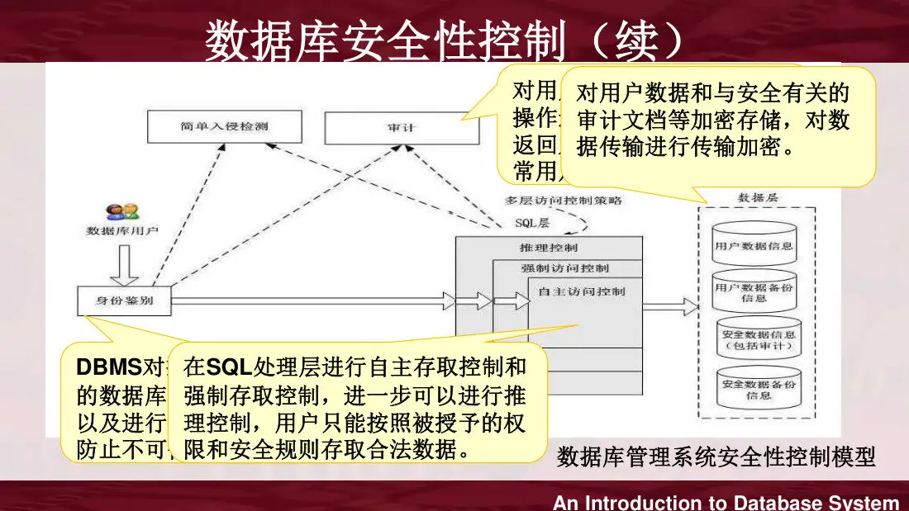

原文：

数据库安全性控制（续）

审计对用操作返回常用

对用户数据和与安全有关的审计文档等加密存储，对数据传输进行传输加密。

DBMS对在SQL处理层进行自主存取控制和的数据库强制存取控制，进一步可以进行推理控制，用户只能按照被授予的权限和安全规则存取合法数据。

数据库管理系统安全性控制模型

An Introduction to Database System

### 数据库安全性控制（续）

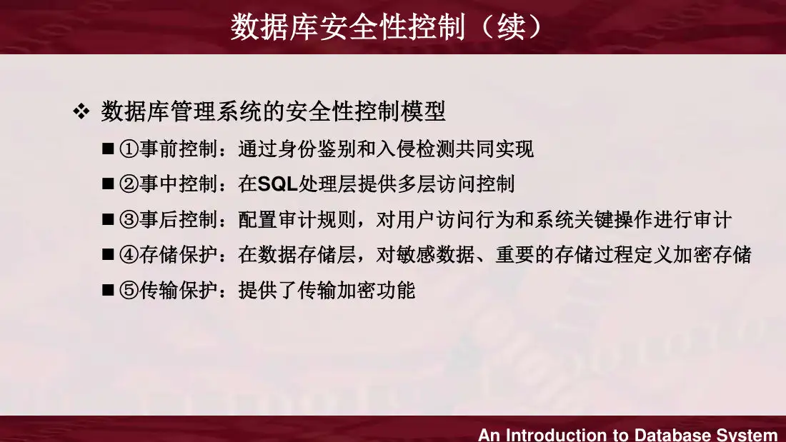

原文：

数据库安全性控制（续）

数据库管理系统的安全性控制模型

■①事前控制：通过身份鉴别和入侵检测共同实现

■②事中控制：在SQL处理层提供多层访问控制

■③事后控制：配置审计规则，对用户访问行为和系统关键操作进行审计

■④存储保护：在数据存储层，对敏感数据、重要的存储过程定义加密存储

■⑤传输保护：提供了传输加密功能

An Introduction to Database System

### 数据库安全性控制（续）

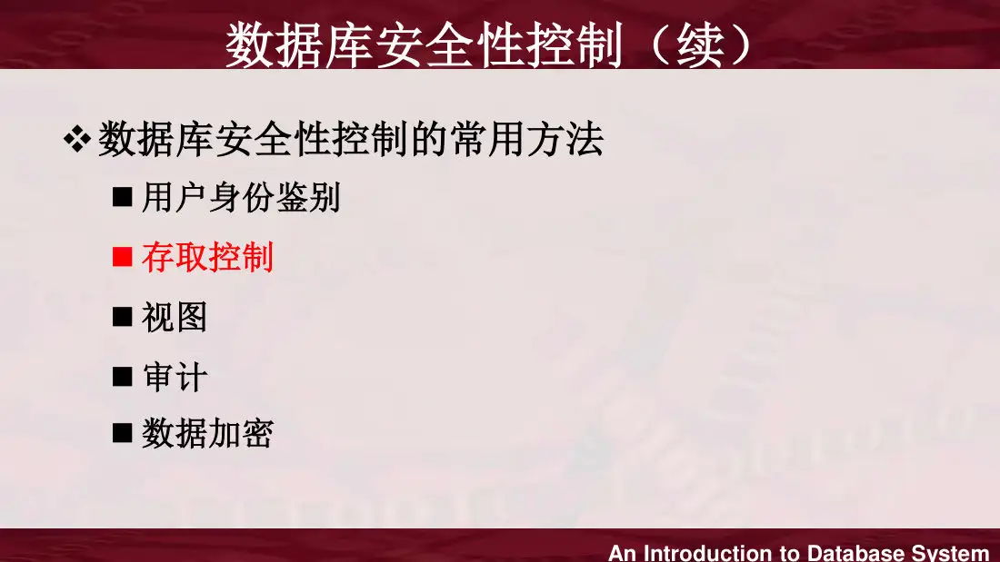

原文：

数据库安全性控制（续）

数据库安全性控制的常用方法

■ 用户身份鉴别

■ 存取控制

■视图

■ 审计

■ 数据加密

An Introduction to Database System

### 4.2.1 用户身份鉴别

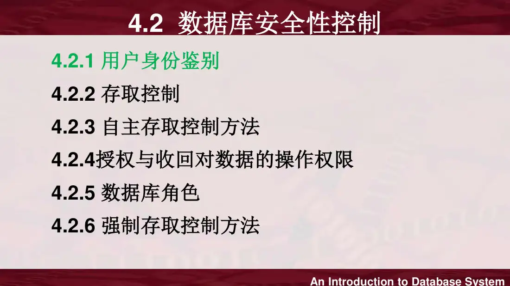

原文：

4.2.1 用户身份鉴别
4.2.2 存取控制
4.2.3 自主存取控制方法
4.2.4 授权与收回对数据的操作权限
4.2.5 数据库角色
4.2.6 强制存取控制方法

4.2 数据库安全性控制

An Introduction to Database System

### 4.2.1 用户身份鉴别

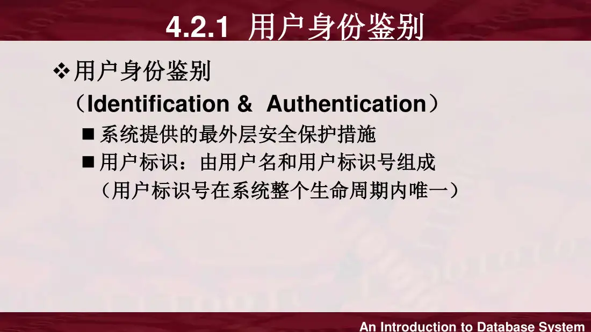

原文：

4.2.1 用户身份鉴别

◆ 用户身份鉴别

(Identification & Authentication)

■ 系统提供的最外层安全保护措施

■ 用户标识：由用户名和用户标识号组成（用户标识号在系统整个生命周期内唯一）

An Introduction to Database System

### 用户身份鉴别（续）----系统提供的最外层安全保护措施

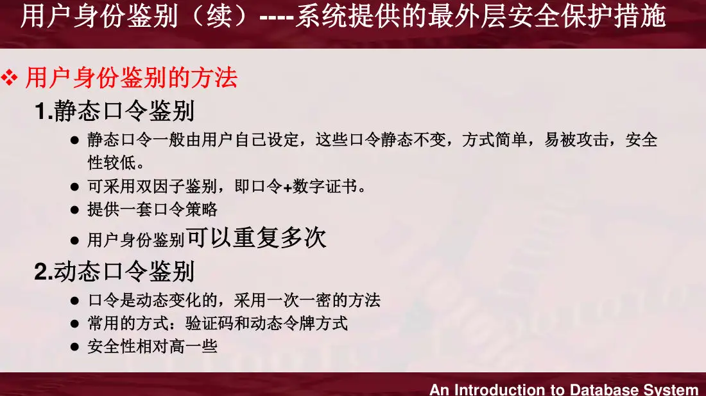

原文：

用户身份鉴别（续）----系统提供的最外层安全保护措施

◆ 用户身份鉴别的方法

1. 静态口令鉴别

\- 静态口令一般由用户自己设定，这些口令静态不变，方式简单，易被攻击，安全性较低。

\- 可采用双因子鉴别，即口令+数字证书。

\- 提供一套口令策略

\- 用户身份鉴别可以重复多次

2. 动态口令鉴别

\- 口令是动态变化的，采用一次一密的方法

\- 常用的方式：验证码和动态令牌方式

\- 安全性相对高一些

An Introduction to Database System

### 用户身份鉴别（续）

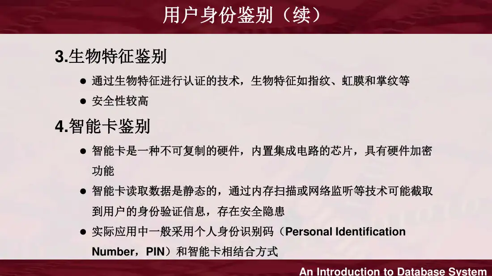

原文：

用户身份鉴别（续）

3.生物特征鉴别

● 通过生物特征进行认证的技术，生物特征如指纹、虹膜和掌纹等

\- 安全性较高

4.智能卡鉴别

\- 智能卡是一种不可复制的硬件，内置集成电路的芯片，具有硬件加密功能

\- 智能卡读取数据是静态的，通过内存扫描或网络监听等技术可能截取到用户的身份验证信息，存在安全隐患

\- 实际应用中一般采用个人身份识别码（Personal Identification Number，PIN）和智能卡相结合方式

An Introduction to Database System

### 用户身份鉴别（续）

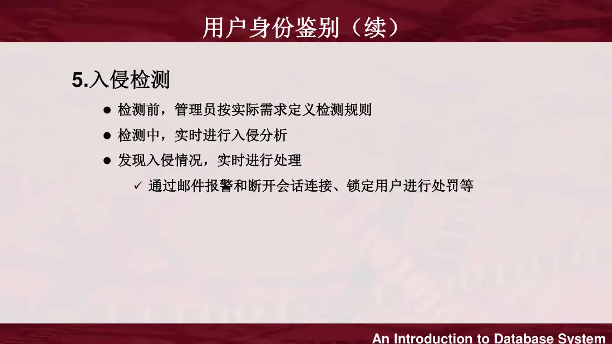

原文：

用户身份鉴别（续）

5.入侵检测

\- 检测前，管理员按实际需求定义检测规则

\- 检测中，实时进行入侵分析

\- 发现入侵情况，实时进行处理

√ 通过邮件报警和断开会话连接、锁定用户进行处罚等

An Introduction to Database System

### 4.2 数据库安全性控制

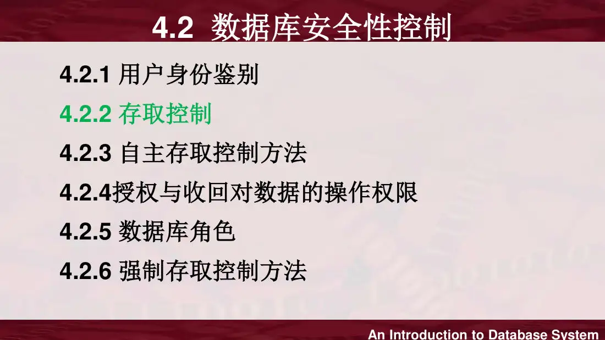

原文：

4.2 数据库安全性控制

4.2.1 用户身份鉴别
4.2.2 存取控制
4.2.3 自主存取控制方法
4.2.4 授权与收回对数据的操作权限
4.2.5 数据库角色
4.2.6 强制存取控制方法

An Introduction to Database System

### 4.2.2 存取控制

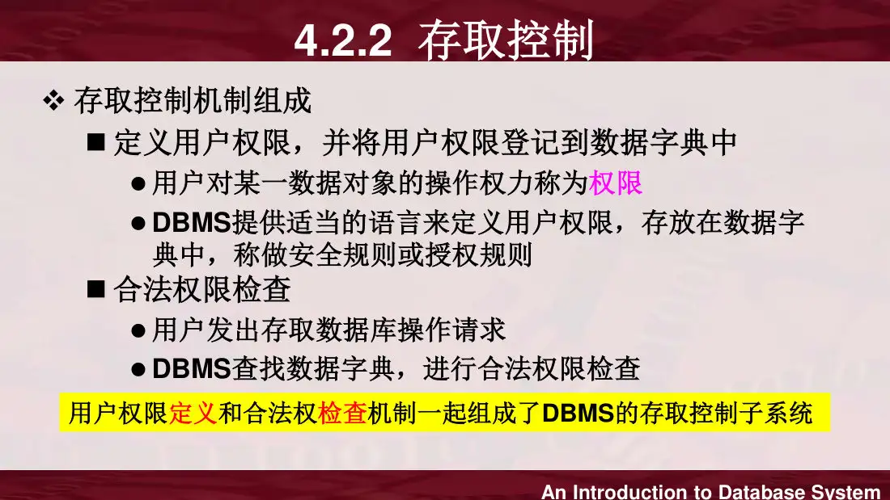

原文：

4.2.2 存取控制

◆ 存取控制机制组成

■ 定义用户权限，并将用户权限登记到数据字典中

\- 用户对某一数据对象的操作权力称为权限

\- DBMS提供适当的语言来定义用户权限，存放在数据字典中，称做安全规则或授权规则

■ 合法权限检查

\- 用户发出存取数据库操作请求

\- DBMS查找数据字典，进行合法权限检查

用户权限定义和合法权检查机制一起组成了DBMS的存取控制子系统

An Introduction to Database System

### 存取控制（续）

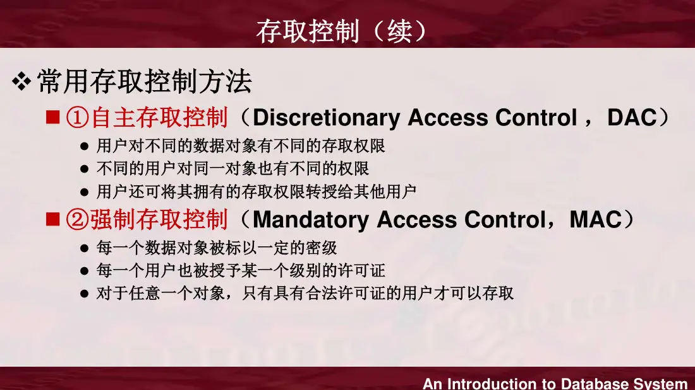

原文：

存取控制（续）

✿ 常用存取控制方法

■①自主存取控制（Discretionary Access Control，DAC）

\- 用户对不同的数据对象有不同的存取权限

\- 不同的用户对同一对象也有不同的权限

\- 用户还可将其拥有的存取权限转授给其他用户

■②强制存取控制（Mandatory Access Control, MAC）

\- 每一个数据对象被标以一定的密级

\- 每一个用户也被授予某一个级别的许可证

\- 对于任意一个对象，只有具有合法许可证的用户才可以存取

An Introduction to Database System

### 4.2 数据库安全性控制

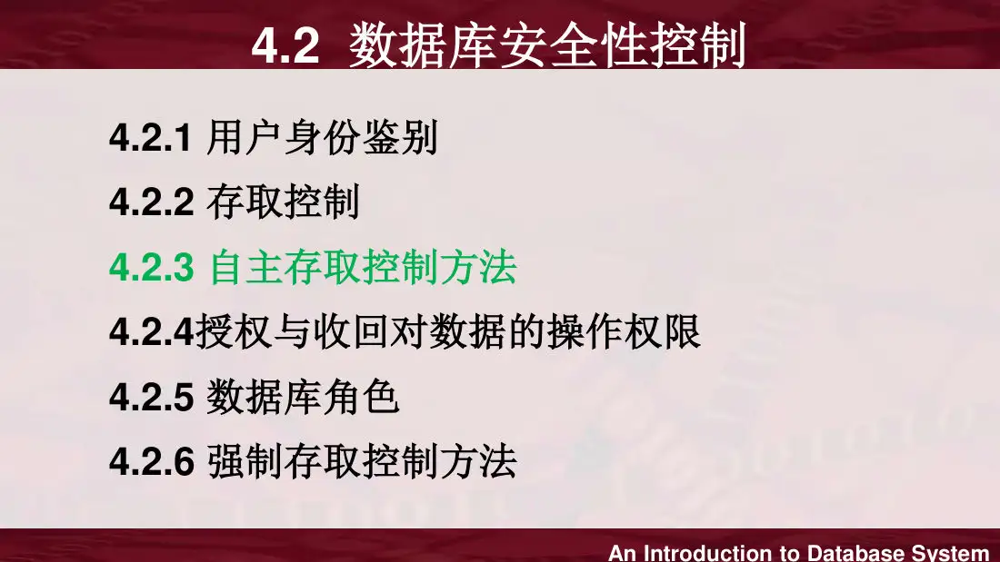

原文：

4.2 数据库安全性控制

4.2.1 用户身份鉴别
4.2.2 存取控制
4.2.3 自主存取控制方法
4.2.4 授权与收回对数据的操作权限
4.2.5 数据库角色
4.2.6 强制存取控制方法

An Introduction to Database System

### 4.2.3 自主存取控制方法

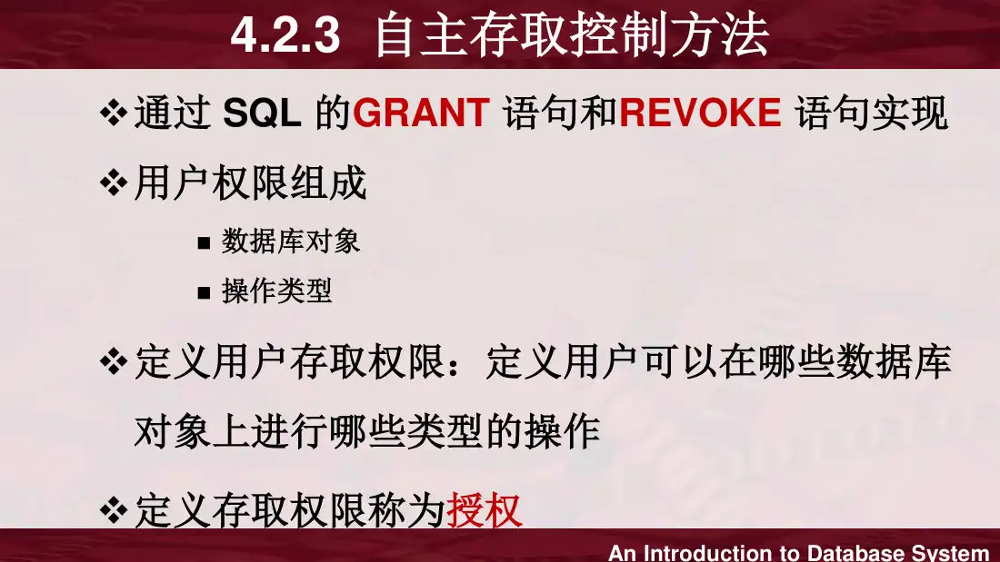

原文：

4.2.3 自主存取控制方法

通过 SQL 的GRANT 语句和REVOKE 语句实现

◆ 用户权限组成

■ 数据库对象

■ 操作类型

定义用户存取权限：定义用户可以在哪些数据库对象上进行哪些类型的操作

定义存取权限称为授权

An Introduction to Database System

### 自主存取控制方法（续）

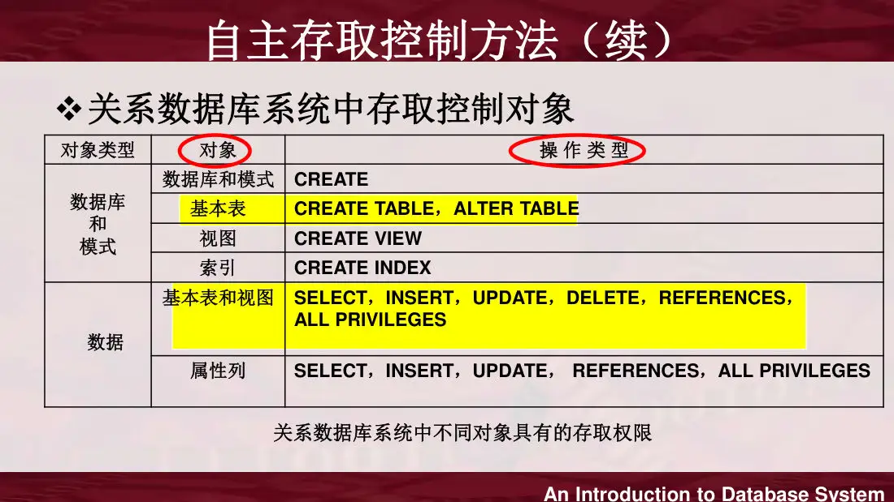

原文：

自主存取控制方法（续）

关系数据库系统中存取控制对象

<table><tr><td>对象类型</td><td>对象</td><td>操作类型</td></tr><tr><td rowspan="4">数据库和模式</td><td>数据库和模式</td><td>CREATE</td></tr><tr><td>基本表</td><td>CREATE TABLE, ALTER TABLE</td></tr><tr><td>视图</td><td>CREATE VIEW</td></tr><tr><td>索引</td><td>CREATE INDEX</td></tr><tr><td rowspan="2">数据</td><td>基本表和视图</td><td>SELECT, INSERT, UPDATE, DELETE, REFERENCES, ALL PRIVILEGES</td></tr><tr><td>属性列</td><td>SELECT, INSERT, UPDATE, REFERENCES, ALL PRIVILEGES</td></tr></table>

关系数据库系统中不同对象具有的存取权限

An Introduction to Database System

### 4.2 数据库安全性控制

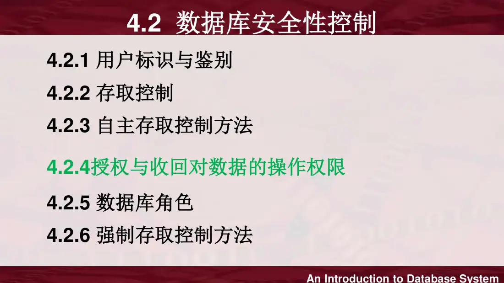

原文：

4.2 数据库安全性控制

4.2.1 用户标识与鉴别
4.2.2 存取控制
4.2.3 自主存取控制方法
4.2.4授权与收回对数据的操作权限
4.2.5 数据库角色
4.2.6 强制存取控制方法

An Introduction to Database System

### 1. 权限授予: GRANT

原文：

1. 权限授予: GRANT

✿ GRANT语句的一般格式

### GRANT（续）

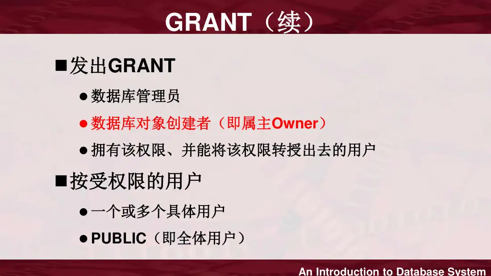

原文：

GRANT（续）

■发出GRANT

\- 数据库管理员

● 数据库对象创建者（即属主Owner）

● 拥有该权限、并能将该权限转授出去的用户

■按受权限的用户

\- 一个或多个具体用户

\- PUBLIC（即全体用户）

An Introduction to Database System

### 例题

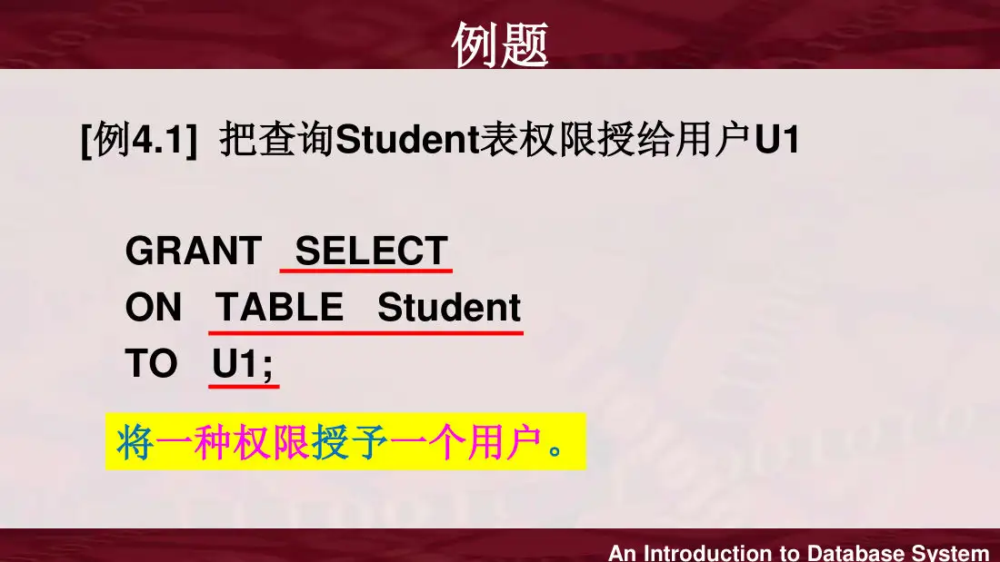

原文：

例题

[例4.1] 把查询Student表权限授给用户U1

GRANT SELECT
ON TABLE Student
TO U1;

将一种权限授予一个用户。

An Introduction to Database System

### 例题（续）

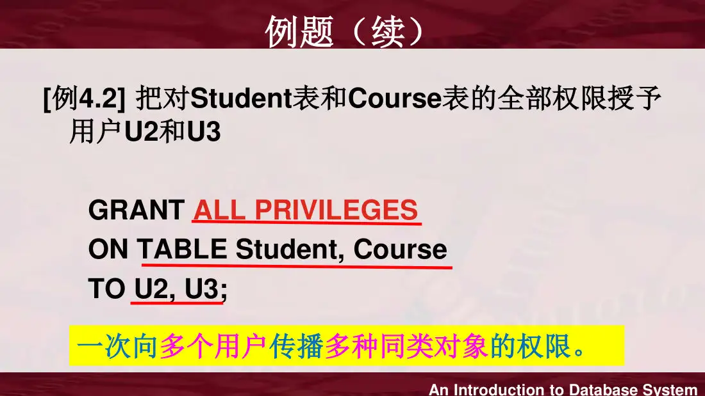

原文：

例题（续）

[例4.2] 把对Student表和Course表的全部权限授予用户U2和U3

GRANT ALL PRIVILEGES
ON TABLE Student, Course
TO U2, U3;

一次向多个用户传播多种同类对象的权限。

An Introduction to Database System

### 例题（续）

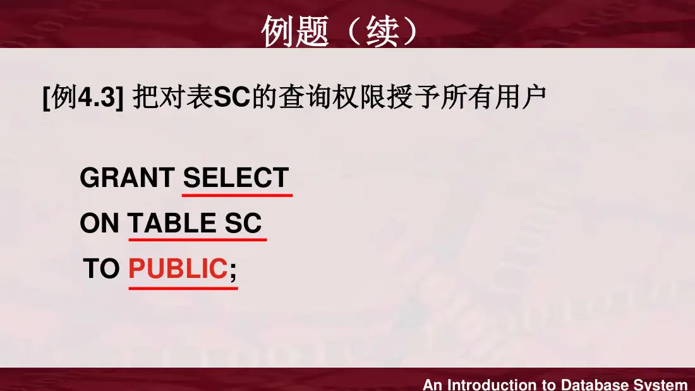

原文：

例题（续）

[例4.3] 把对表SC的查询权限授予所有用户

GRANT SELECT
ON TABLE SC
TO PUBLIC;

An Introduction to Database System

### 例题（续）

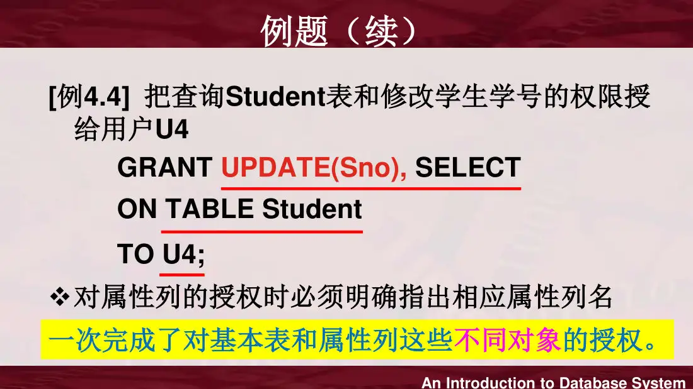

原文：

例题（续）

[例4.4] 把查询Student表和修改学生学号的权限授给用户U4

GRANT UPDATE(Sno), SELECT ON TABLE Student

TO U4;

✿ 对属性列的授权时必须明确指出相应属性列名

一次完成了对基本表和属性列这些不同对象的授权。

An Introduction to Database System

### 例题（续）

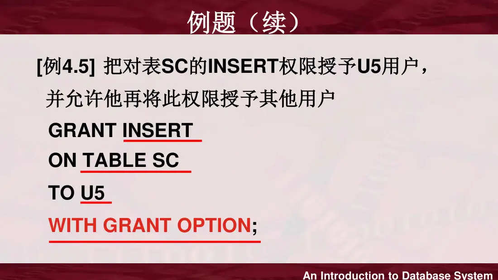

原文：

例题（续）

[例4.5] 把对表SC的INSERT权限授予U5用户，并允许他再将此权限授予其他用户
GRANT INSERT
ON TABLE SC
TO U5
WITH GRANT OPTION;

An Introduction to Database System

### 传播权限

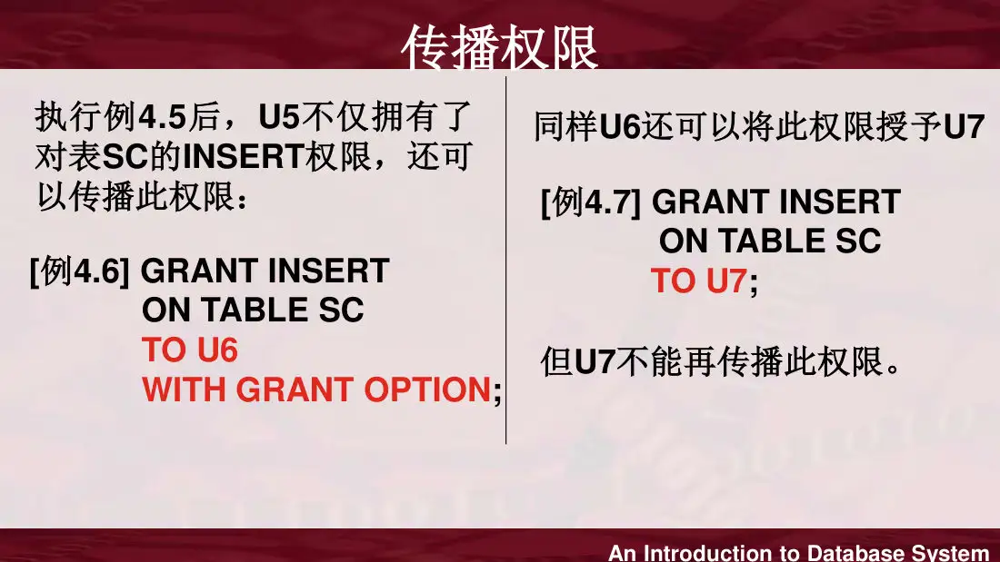

原文：

传播权限

执行例4.5后，U5不仅拥有了对表SC的INSERT权限，还可以传播此权限：

[例4.6] GRANT INSERT ON TABLE SC TO U6 WITH GRANT OPTION;

同样U6还可以将此权限授予U7

[例4.7] GRANT INSERT ON TABLE SC TO U7;

但U7不能再传播此权限。

An Introduction to Database System

### 2. 权限回收: REVOKE

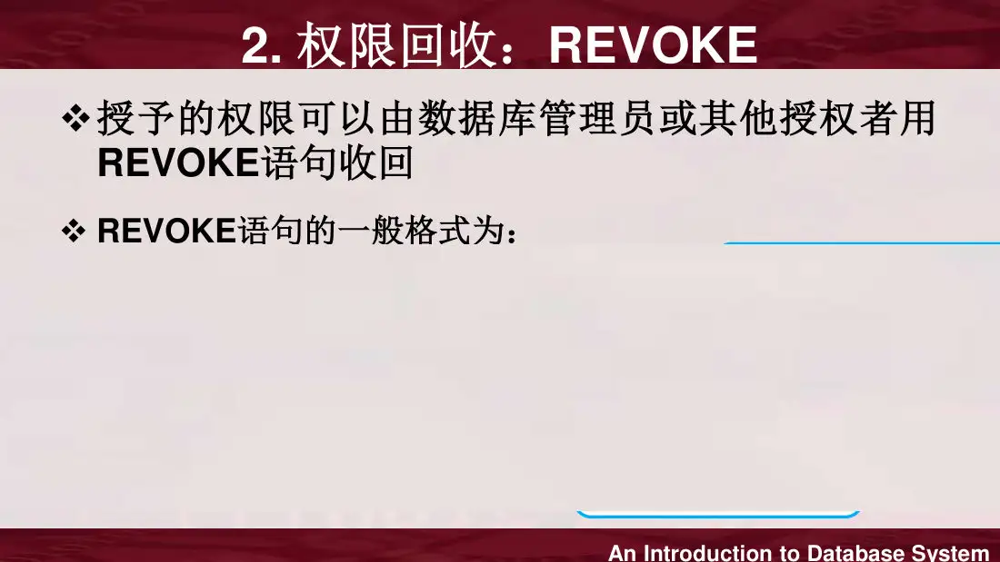

原文：

2. 权限回收: REVOKE

✿授予的权限可以由数据库管理员或其他授权者用REVOKE语句收回

✿ REVOKE语句的一般格式为:

An Introduction to Database System

### 例题

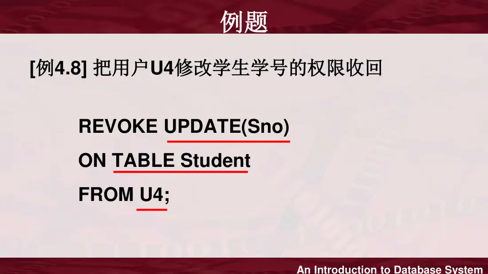

原文：

例题

[例4.8] 把用户U4修改学生学号的权限收回

REVOKE UPDATE(Sno)

ON TABLE Student

FROM U4;

An Introduction to Database System

### 例题（续）

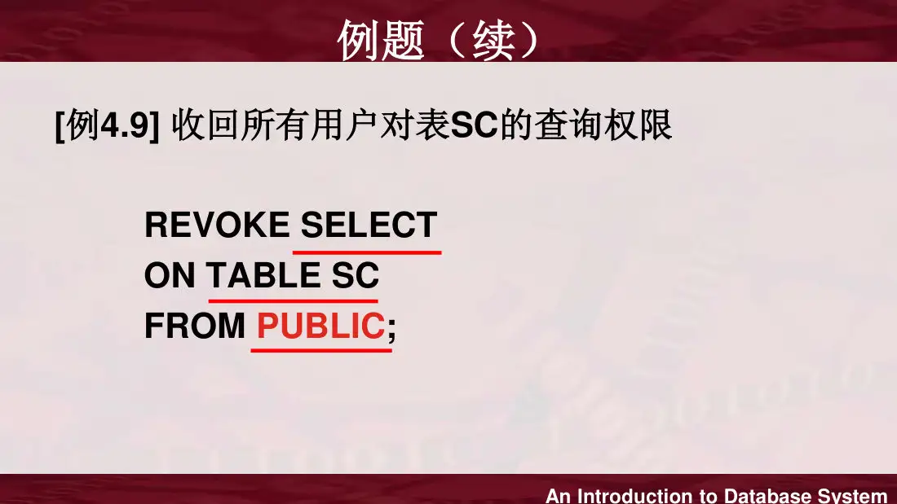

原文：

例题（续）

[例4.9] 收回所有用户对表SC的查询权限

REVOKE SELECT
ON TABLE SC
FROM PUBLIC;

An Introduction to Database System

### 例题（续）

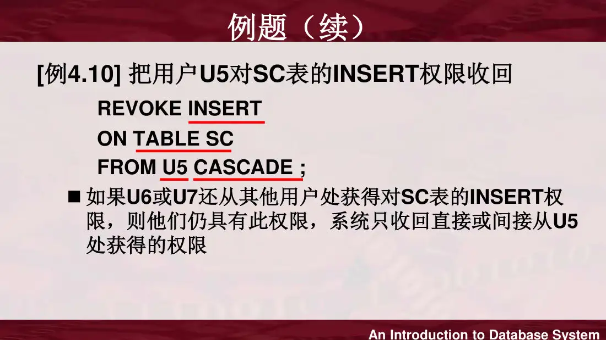

原文：

例题（续）

[例4.10] 把用户U5对SC表的INSERT权限收回
REVOKE INSERT
ON TABLE SC
FROM U5 CASCADE ;

■ 如果U6或U7还从其他用户处获得对SC表的INSERT权限，则他们仍具有此权限，系统只收回直接或间接从U5处获得的权限

An Introduction to Database System

### 4.2 数据库安全性控制

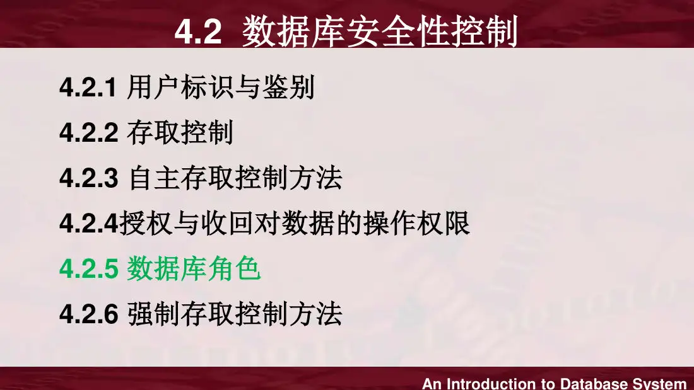

原文：

4.2 数据库安全性控制

4.2.1 用户标识与鉴别
4.2.2 存取控制
4.2.3 自主存取控制方法
4.2.4 授权与收回对数据的操作权限
4.2.5 数据库角色
4.2.6 强制存取控制方法

An Introduction to Database System

### 数据库角色的引入

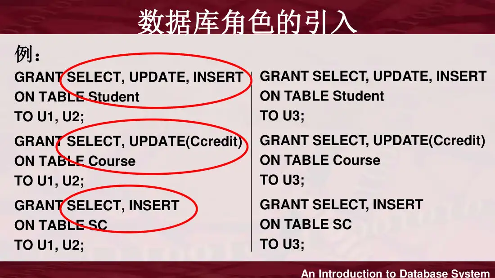

原文：

数据库角色的引入

GRANT SELECT, INSERT

GRANT SELECT, UPDATE, INSERT
ON TABLE Student
TO U3;

GRANT SELECT, UPDATE(Ccredit)
ON TABLE Course
TO U3;

An Introduction to Database System

### 数据库角色的引入

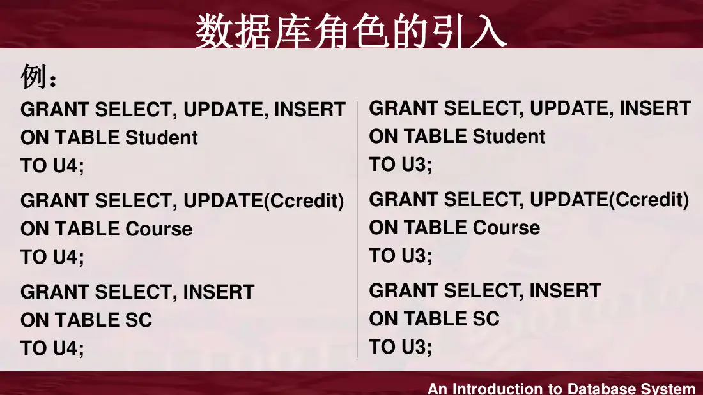

原文：

数据库角色的引入

例:

GRANT SELECT, UPDATE, INSERT ON TABLE Student TO U4;

GRANT SELECT, UPDATE(Ccredit)
ON TABLE Course
TO U4;

GRANT SELECT, INSERT
ON TABLE SC
TO U4;

GRANT SELECT, UPDATE, INSERT
ON TABLE Student
TO U3;
GRANT SELECT, UPDATE(Ccredit)
ON TABLE Course
TO U3;
GRANT SELECT, INSERT
ON TABLE SC
TO U3;

An Introduction to Database System

### 数据库角色的引入

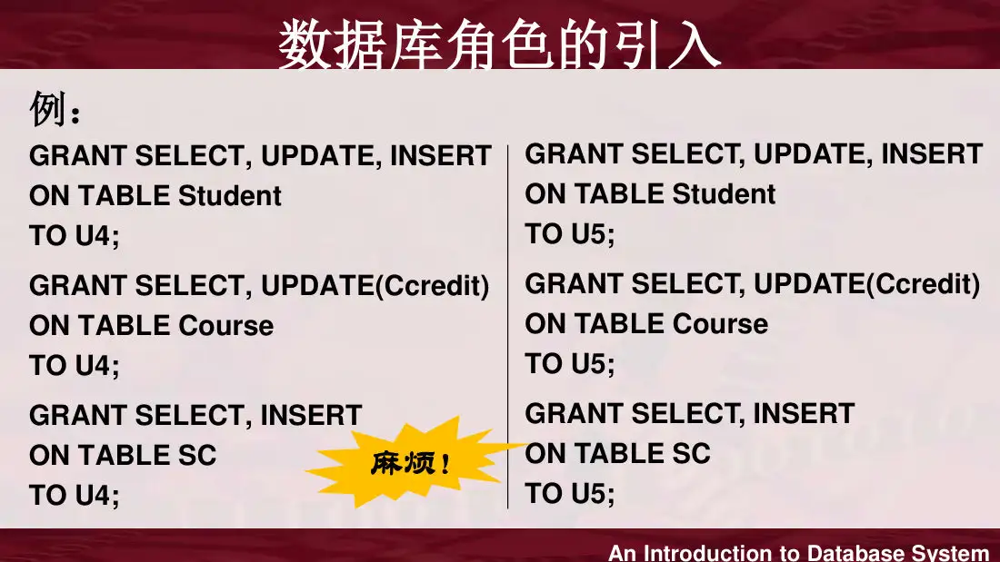

原文：

数据库角色的引入

例:

GRANT SELECT, UPDATE, INSERT
ON TABLE Student
TO U4;

GRANT SELECT, UPDATE(Ccredit)
ON TABLE Course
TO U4;

GRANT SELECT, INSERT ON TABLE SC TO U4;

麻烦！

GRANT SELECT, UPDATE, INSERT
ON TABLE Student
TO U5;
GRANT SELECT, UPDATE(Ccredit)
ON TABLE Course
TO U5;
GRANT SELECT, INSERT
ON TABLE SC
TO U5;

An Introduction to Database System

### 什么是数据库角色

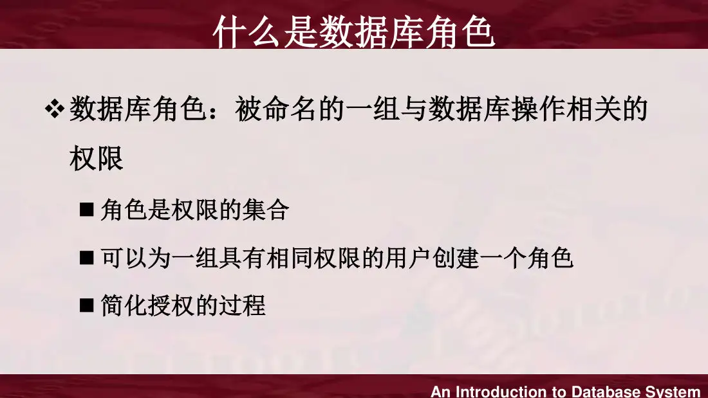

原文：

什么是数据库角色

✿ 数据库角色：被命名的一组与数据库操作相关的权限

■角色是权限的集合

■ 可以为一组具有相同权限的用户创建一个角色

■ 简化授权的过程

An Introduction to Database System

### 什么是数据库角色（续）

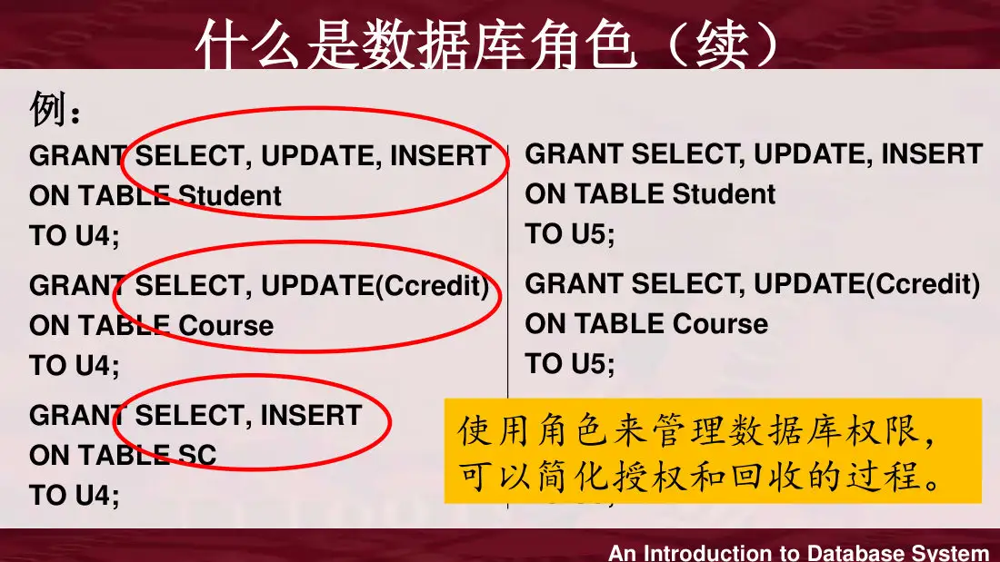

原文：

什么是数据库角色（续）

例:

GRANT SELECT, UPDATE, INSERT ON TABLE Student

TO U4;

GRANT SELECT, UPDATE(Ccredit) ON TABLE Course

GRANT SELECT, INSERT ON TABLE SC

TO U4;

GRANT SELECT, UPDATE, INSERT
ON TABLE Student
TO U5;

GRANT SELECT, UPDATE(Ccredit)
ON TABLE Course
TO U5;

使用角色来管理数据库权限，可以简化授权和回收的过程。

An Introduction to Database System

### 使用角色管理数据库权限

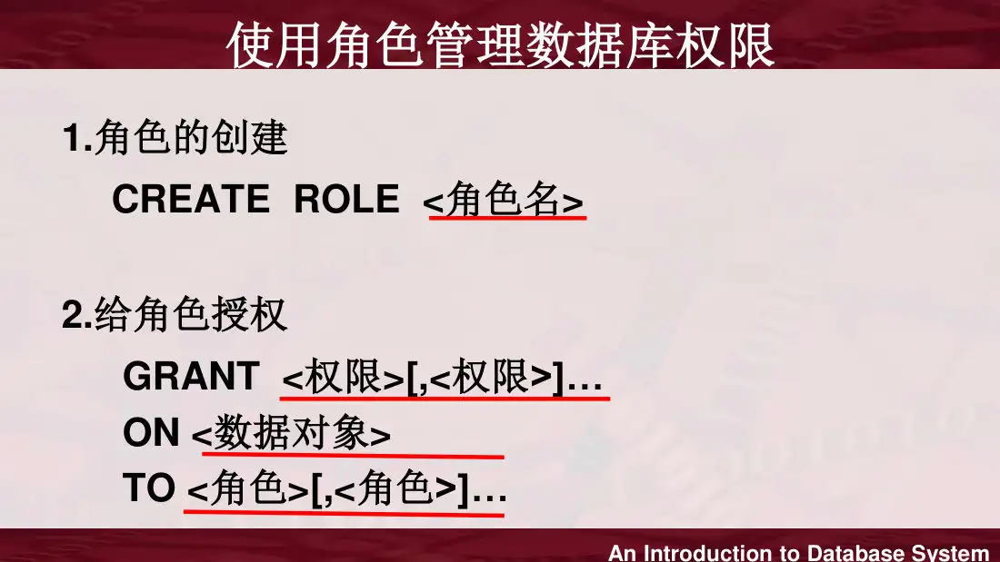

原文：

使用角色管理数据库权限

1.角色的创建

CREATE ROLE <角色名>

2. 给角色授权

GRANT <权限>[,<权限>]...

ON <数据对象>

TO <角色>[,<角色>] $\cdots$

An Introduction to Database System

### 使用角色管理数据库权限（续）

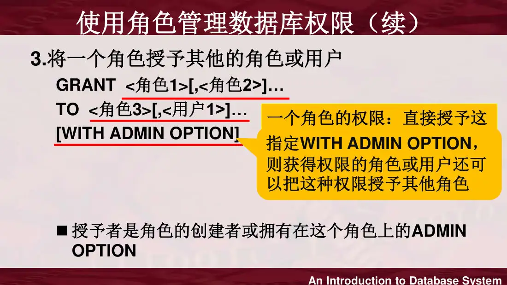

原文：

使用角色管理数据库权限（续）

3. 将一个角色授予其他的角色或用户 GRANT <角色1>[,<角色2>]...

TO <角色3>[,<用户1>]...
[WITH ADMIN OPTION]一个角色的权限：直接授予这指定WITH ADMIN OPTION，则获得权限的角色或用户还可以把这种权限授予其他角色

■ 授予者是角色的创建者或拥有在这个角色上的ADMIN OPTION

An Introduction to Database System

### 使用角色管理数据库权限（续）

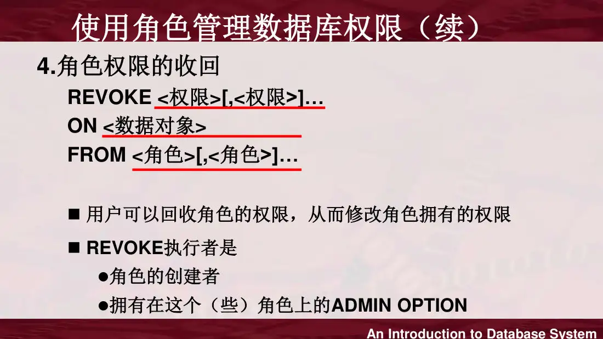

原文：

使用角色管理数据库权限（续）

4.角色权限的收回

REVOKE <权限>[,<权限>]...

ON <数据对象>

FROM <角色>[,<角色>]...

■ 用户可以回收角色的权限，从而修改角色拥有的权限

■ REVOKE执行者是

\- 角色的创建者

●拥有在这个（些）角色上的ADMIN OPTION

An Introduction to Database System

### 例题

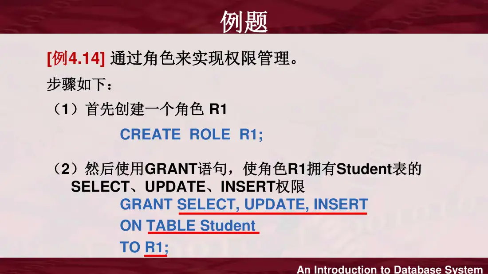

原文：

例题

[例4.14] 通过角色来实现权限管理。

步骤如下:

(1) 首先创建一个角色 R1

CREATE ROLE R1;

(2) 然后使用GRANT语句, 使角色R1拥有Student表的SELECT、UPDATE、INSERT权限 GRANT SELECT, UPDATE, INSERT ON TABLE Student TO R1;

An Introduction to Database System

### 例题（续）

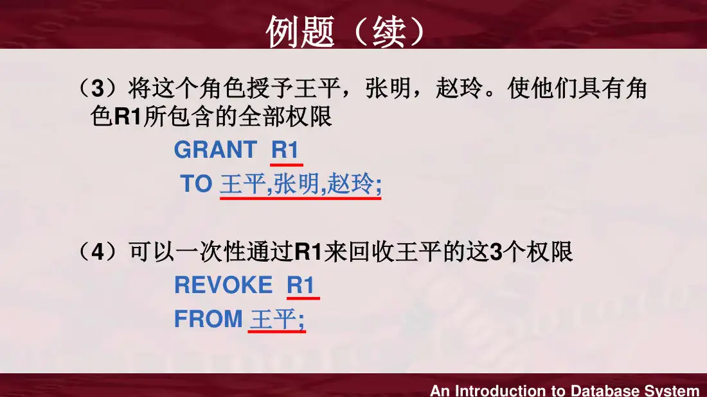

原文：

例题（续）

(3) 将这个角色授予王平, 张明, 赵玲。使他们具有角色R1所包含的全部权限 GRANT R1 TO 王平, 张明, 赵玲;

(4) 可以一次性通过R1来回收王平的这3个权限
REVOKE R1
FROM 王平;

An Introduction to Database System

### 例题（续）

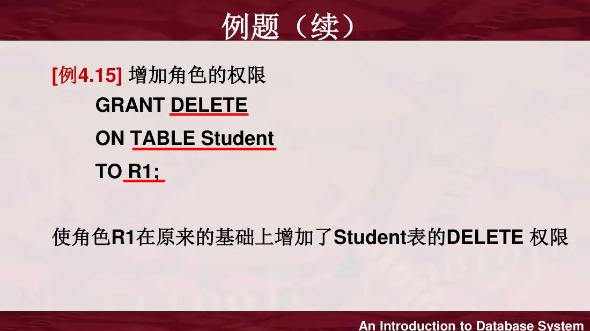

原文：

例题（续）

[例4.15] 增加角色的权限
GRANT DELETE
ON TABLE Student
TO R1;

使角色R1在原来的基础上增加了Student表的DELETE权限

An Introduction to Database System

### 例题（续）

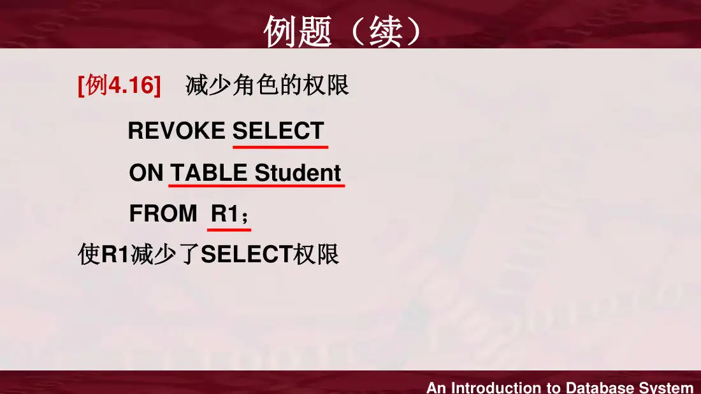

原文：

例题（续）

[例4.16] 减少角色的权限

REVOKE SELECT

ON TABLE Student

FROM R1;

使R1减少了SELECT权限

An Introduction to Database System

### 4.2 数据库安全性控制

原文：

4.2 数据库安全性控制

4.2.1 用户标识与鉴别
4.2.2 存取控制
4.2.3 自主存取控制方法
4.2.4授权与收回对数据的操作权限
4.2.5 数据库角色
4.2.6 强制存取控制方法

An Introduction to Database System

### 自主存取控制缺点

原文：

自主存取控制缺点

◆ 可能存在数据的“无意泄露”

例: 只有财务人员有权访问职工工资表EMP-Salary CREATE TABLE Salary-copy AS SELECT End Name, Salary

Grant SELECT

ON TABLE Salary-copy

TO PUBLIC;

自主存取控制仅仅通过对数据的存取权限来进行安全控制，而数据本身并无安全性标记

职工工资信息被泄露！

An Introduction to Database System

### 4.2.6 强制存取控制方法

原文：

4.2.6 强制存取控制方法

解决：对系统控制下的所有主客体实施强制存取控制策略

◆ 强制存取控制（MAC）

■ 保证更高程度的安全性

■ 用户不能直接感知或进行控制

■适用于对数据有严格而固定密级分类的部门

\- 军事部门

\- 政府部门

An Introduction to Database System

### 强制存取控制方法（续）

原文：

强制存取控制方法（续）

✿ 在强制存取控制中，数据库管理系统所管理的全部实体被分为主体和客体两大类

主体是系统中的活动实体

■ 数据库管理系统所管理的实际用户

■ 代表用户的各进程

客体是系统中的被动实体，受主体操纵

■ 文件、基本表、索引、视图

An Introduction to Database System

### 强制存取控制方法（续）

原文：

强制存取控制方法（续）

◆ 敏感度标记（Label）

■ 对于主体和客体，DBMS为它们每个实例（值）指派一个敏感度标记（Label）

■ 敏感度标记分成若干级别

\- 绝密（Top Secret，TS）

\- 机密（Secret，S）

\- 可信（Confidential，C）

\- 公开（Public，P）

\- TS>=S>=C>=P- 主体的敏感度标记称为许可证级别（Clearance Level）

\- 客体的敏感度标记称为密级（Classification Level）

An Introduction to Database System

### 强制存取控制方法（续）

原文：

强制存取控制方法（续）

◆ 强制存取控制规则

(1) 仅当主体的许可证级别大于或等于客体的密级时,该主体才能读取相应的客体

机密

An Introduction to Database System

### 强制存取控制方法（续）

原文：

强制存取控制方法（续）

◆ 强制存取控制规则

(2) 仅当主体的许可证级别小于或等于客体的密级时,该主体才能写相应的客体

机密

An Introduction to Database System

### 强制存取控制方法（续）

原文：

强制存取控制方法（续）

强制存取控制是对数据本身进行密级标记，无论数据如何复制，标记与数据是一个不可分的整体，只有符合密级标记要求的用户才可以操纵数据。

CREATE TABLE Salary-copy AS SELECT Eno, Name, Salary FROM EMP-Salary;

Grant SELECT

ON TABLE Salary-copy

TO PUBLIC;

财务人员A: 绝密

EMP-Salary: 绝密数据

Salary-copy: 绝密数据

许可证级别不是绝密的用户仍然不能访问Salary-copy表

An Introduction to Database System

### 第四章 数据库安全性

原文：

第四章 数据库安全性

4.1 数据库安全性概述
4.2 数据库安全性控制
4.3 视图机制
4.4 审计（Audit）
4.5 数据加密
4.6 其他安全性保护
4.7 小结

An Introduction to Database System

### 4.3 视图机制

原文：

4.3 视图机制

✿ 视图机制配合授权机制,把要保密的数据对无权存取这些数据的用户隐藏起来，对数据提供一定程度的安全保护

An Introduction to Database System

### 视图机制（续）

原文：

视图机制（续）

[例4.17] 建立计算机科学与技术专业学生的视图，把对该视图的SELECT权限授于王平，把该视图上的所有操作权限授于张明。

CREATE VIEW CS\_Student

/\*先建立视图CS\_Student\*/

AS

SELECT \*

FROM Student

WHERE Smajor='计算机科学与技术'

WITH CHECK OPTION

/\*对该视图进行增删改时，必须满足Smajor='计算机科学与技术'的条件\*/

An Introduction to Database System

### 视图机制（续）

原文：

视图机制（续）

(2) 在视图上进一步定义存取权限
GRANT SELECT
ON CS\_Student
TO 王平;

GRANT ALL PRIVILIGES
ON CS\_Student
TO 张明;

An Introduction to Database System

### 第四章 数据库安全性

原文：

第四章 数据库安全性

4.1 数据库安全性概述
4.2 数据库安全性控制
4.3 视图机制
4.4 审计（Audit）
4.5 数据加密
4.6 其他安全性保护
4.7 小结

An Introduction to Database System

### 4.4 审计

原文：

4.4 审计

数据库安全性控制措施

用户身份鉴别
自主存取控制
强制存取控制
视图

审计

预防性措施

监控措施

An Introduction to Database System

### 4.4 审计

原文：

4.4 审计

什么是审计

■ 启用一个专用的审计日志（Audit Log）
将用户对数据库的所有操作记录在上面

■ 审计员利用审计日志

监控数据库中的各种行为

发现非法存取，发现潜在威胁

■ C2以上安全级别的DBMS必须具有审计功能

An Introduction to Database System

### 第四章 数据库安全性

原文：

第四章 数据库安全性

4.1 数据库安全性概述
4.2 数据库安全性控制
4.3 视图机制
4.4 审计（Audit）
4.5 数据加密
4.6 其他安全性保护
4.7 小结

An Introduction to Database System

### 4.5 数据加密

原文：

4.5 数据加密

◆ 数据加密

■ 防止数据库中数据在存储和传输中失密的有效手段

◆ 加密的基本思想

■ 根据一定的算法将原始数据—明文（plain text）经过一系列复杂计算，变换为不可直接识别的格式—密文（cipher text）

◆ 加密方法

■ 存储加密

■ 传输加密

An Introduction to Database System

### 数据加密（续）

原文：

数据加密（续）

◆ 1.存储加密

透明存储加密

● 内核级加密保护方式，对用户完全透明

● 数据在写到磁盘时对数据进行加密，授权用户读取数据时再对其进行解密

\- 数据库的应用程序不需要做任何修改，只需在创建表语句中说明需加密的字段即可

内核级加密方法: 性能较好，安全性较高

非透明存储加密

● 通过多个加密函数实现

An Introduction to Database System

### 数据加密（续）

原文：

数据加密（续）

◆2.传输加密

■ 链路加密

\- 在链路层进行加密

● 传输信息由报头和报文两部分组成

\- 报文和报头均加密

■ 端到端加密

\- 在发送端加密，接收端解密

\- 只加密报文,不加密报头

● 发送端和接收端需要密码设备，中间节点不需要密码设备

\- 所需密码设备相对较少，容易被非法监听者获取敏感信息

An Introduction to Database System

### 第四章 数据库安全性

原文：

第四章 数据库安全性

4.1 数据库安全性概述
4.2 数据库安全性控制
4.3 视图机制
4.4 审计（Audit）
4.5 数据加密
4.6 其他安全性保护
4.7 小结

An Introduction to Database System

### 4.6 其他安全性保护

原文：

4.6 其他安全性保护

❖1.推理控制

■ 处理强制存取控制未解决的问题

■ 避免用户利用能够访问的数据推知更高密级的数据

■ 常用方法

\- 基于函数依赖的推理控制

\- 基于敏感关联的推理控制

◆2.隐蔽信道

■ 处理强制存取控制未解决的问题

An Introduction to Database System

### 其他安全性保护（续）

原文：

其他安全性保护（续）

✿3.数据隐私

■ 控制不愿他人知道或他人不便知道的个人数据的能力

■ 范围很广：数据收集、数据存储、数据处理和数据发布等各个阶段

✿4. “三权分立”的安全管理机制

■ 解决数据库管理员权限过于集中的问题，遵照 GB/T20273-2019，引进“三权分立”的安全管理机制

An Introduction to Database System

### 第四章 数据库安全性

原文：

第四章 数据库安全性

4.1 数据库安全性概述
4.2 数据库安全性控制
4.3 视图机制
4.4 审计（Audit）
4.5 数据加密
4.6 其他安全性保护
4.7 小结

An Introduction to Database System

### 4.7 小结

原文：

4.7 小结

◆ 实现数据库系统安全性的技术和方法

■ 用户身份鉴别

■ 入侵检测

■ 存取控制技术：自主存取控制和强制存取控制

■ 视图技术

■ 审计技术

■ 数据加密：加密存储和加密传输

An Introduction to Database System

### 小结（续）

原文：

小结（续）

本章重点

■ 使用GRANT 语句和 REVOKE 语句实现自主存取控制功能

■ 使用CREATE ROLE语句创建角色，用GRANT语句给角色授权

■ 掌握视图机制在数据库安全保护中的作用

■ 难点：强制存取控制机制的存取规则

An Introduction to Database System
