# 《数据库系统》第5章 数据库完整性（课件）

原件的每一页，下面附识别出的文字。

### 第五章 数据库完整性

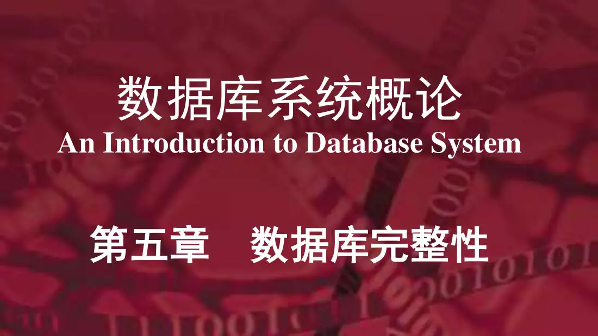

原文：

数据库系统概论 An Introduction to Database System

第五章 数据库完整性

### 第5章 数据库完整性

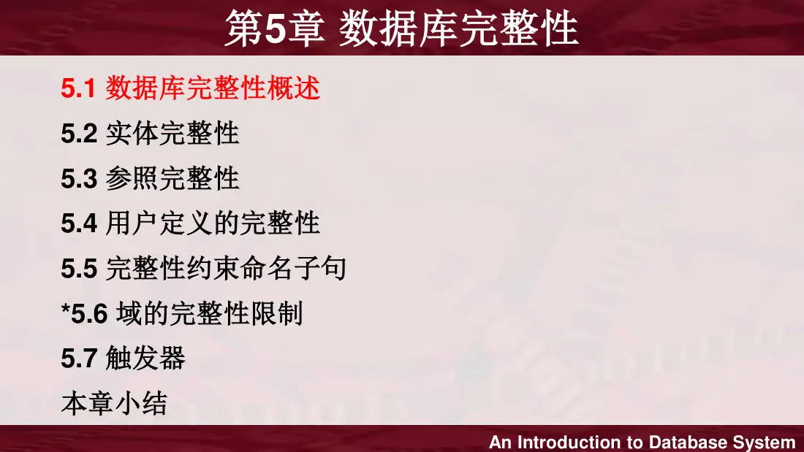

原文：

第5章 数据库完整性

5.1 数据库完整性概述

5.2 实体完整性

5.3 参照完整性

5.4 用户定义的完整性

5.5 完整性约束命名子句

\*5.6 域的完整性限制

5.7 触发器

本章小结

An Introduction to Database System

### 5.1 数据库完整性概述

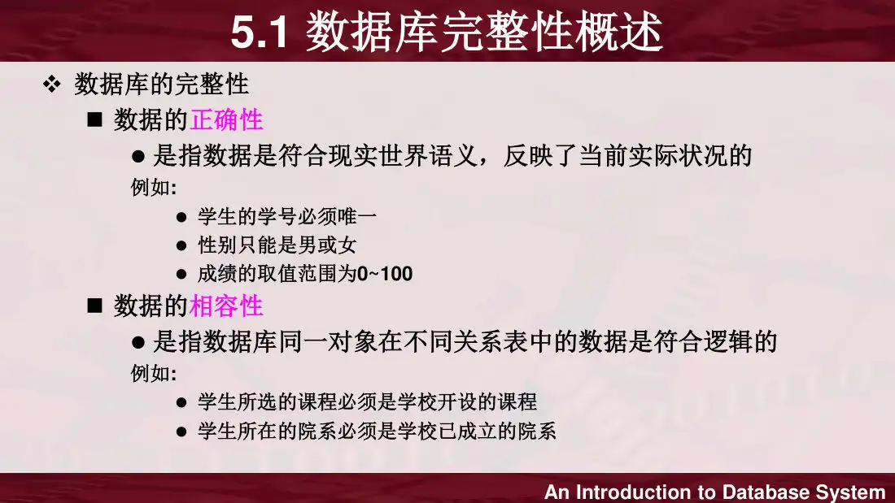

原文：

5.1 数据库完整性概述

数据库的完整性

■ 数据的正确性

\- 是指数据是符合现实世界语义，反映了当前实际状况的例如：

\- 学生的学号必须唯一

\- 性别只能是男或女

\- 成绩的取值范围为0\~100

■ 数据的相容性

\- 是指数据库同一对象在不同关系表中的数据是符合逻辑的例如:

\- 学生所选的课程必须是学校开设的课程

\- 学生所在的院系必须是学校已成立的院系

An Introduction to Database System

### 数据库完整性概述（续）

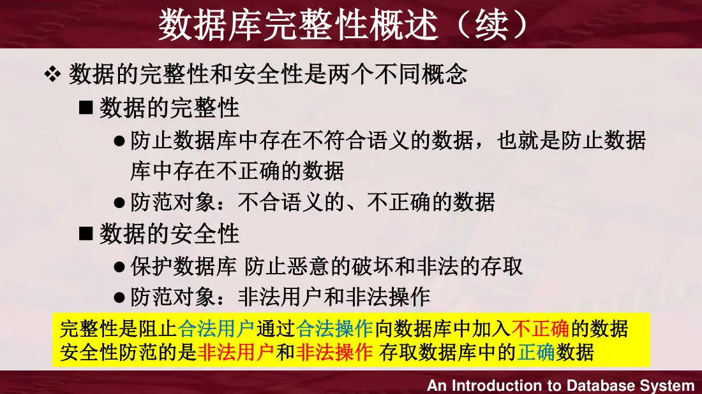

原文：

数据库完整性概述（续）

◆ 数据的完整性和安全性是两个不同概念

■ 数据的完整性

\- 防止数据库中存在不符合语义的数据，也就是防止数据库中存在不正确的数据

● 防范对象：不合语义的、不正确的数据

■ 数据的安全性

● 保护数据库 防止恶意的破坏和非法的存取

● 防范对象：非法用户和非法操作

完整性是阻止合法用户通过合法操作向数据库中加入不正确的数据安全性防范的是非法用户和非法操作 存取数据库中的正确数据

An Introduction to Database System

### 数据库完整性概述（续）

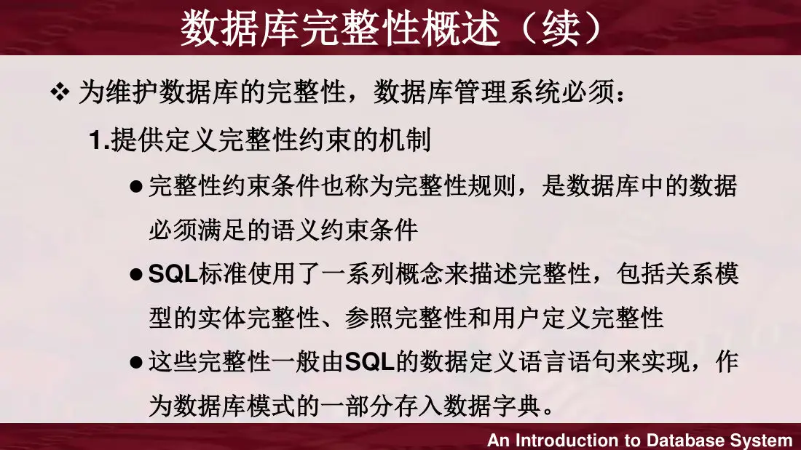

原文：

数据库完整性概述（续）

✿ 为维护数据库的完整性，数据库管理系统必须：

1. 提供定义完整性约束的机制

\- 完整性约束条件也称为完整性规则，是数据库中的数据必须满足的语义约束条件

\- SQL标准使用了一系列概念来描述完整性，包括关系模型的实体完整性、参照完整性和用户定义完整性

\- 这些完整性一般由SQL的数据定义语言语句来实现，作为数据库模式的一部分存入数据字典。

An Introduction to Database System

### 数据库完整性概述（续）

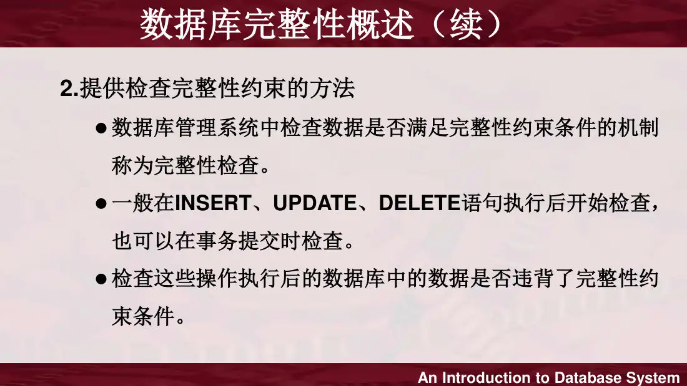

原文：

数据库完整性概述（续）

2. 提供检查完整性约束的方法

\- 数据库管理系统中检查数据是否满足完整性约束条件的机制称为完整性检查。

\- 一般在INSERT、UPDATE、DELETE语句执行后开始检查，也可以在事务提交时检查。

\- 检查这些操作执行后的数据库中的数据是否违背了完整性约束条件。

An Introduction to Database System

### 数据库完整性概述（续）

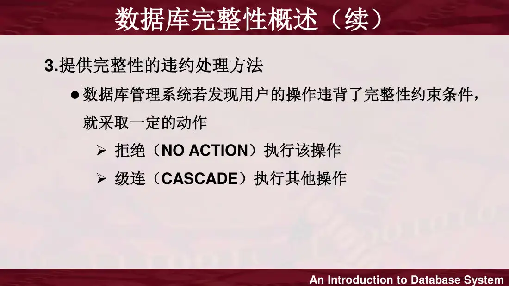

原文：

数据库完整性概述（续）

3. 提供完整性的违约处理方法

\- 数据库管理系统若发现用户的操作违背了完整性约束条件，就采取一定的动作

➢ 拒绝（NO ACTION）执行该操作

级连（CASCADE）执行其他操作

An Introduction to Database System

### 数据库完整性概述（续）

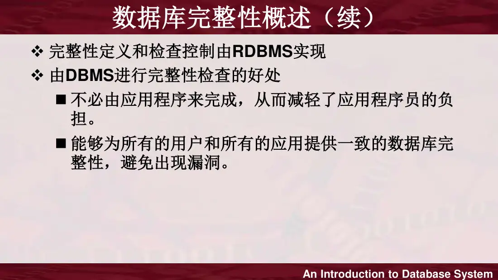

原文：

数据库完整性概述（续）

◆ 完整性定义和检查控制由RDBMS实现

由DBMS进行完整性检查的好处

■ 不必由应用程序来完成，从而减轻了应用程序员的负担。

■能够为所有的用户和所有的应用提供一致的数据库完整性，避免出现漏洞。

An Introduction to Database System

### 第5章 数据库完整性

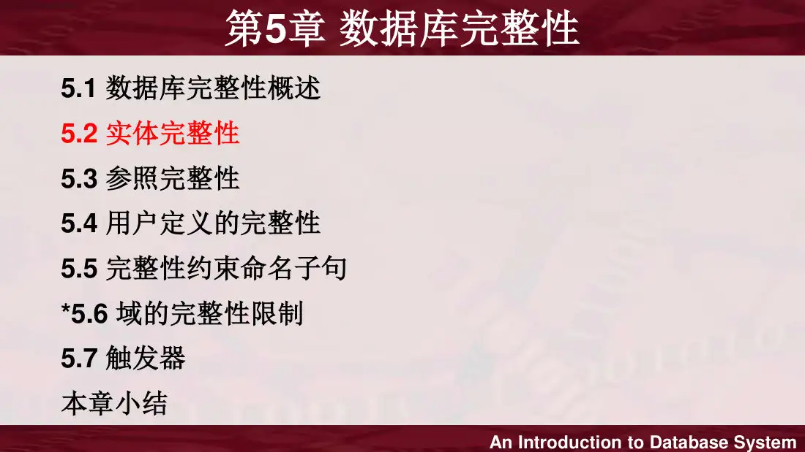

原文：

第5章 数据库完整性

5.1 数据库完整性概述

5.2 实体完整性

5.3 参照完整性

5.4 用户定义的完整性

5.5 完整性约束命名子句

\*5.6 域的完整性限制

5.7 触发器

本章小结

An Introduction to Database System

### 5.2 实体完整性

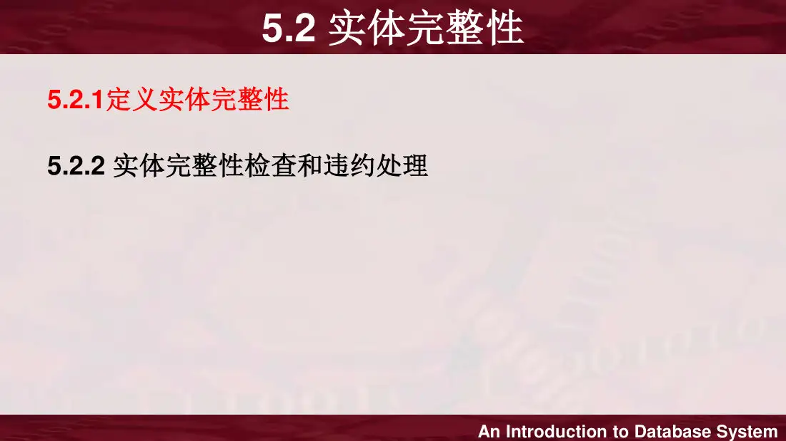

原文：

5.2 实体完整性

5.2.1 定义实体完整性

5.2.2 实体完整性检查和违约处理

An Introduction to Database System

### 5.2.1 定义实体完整性

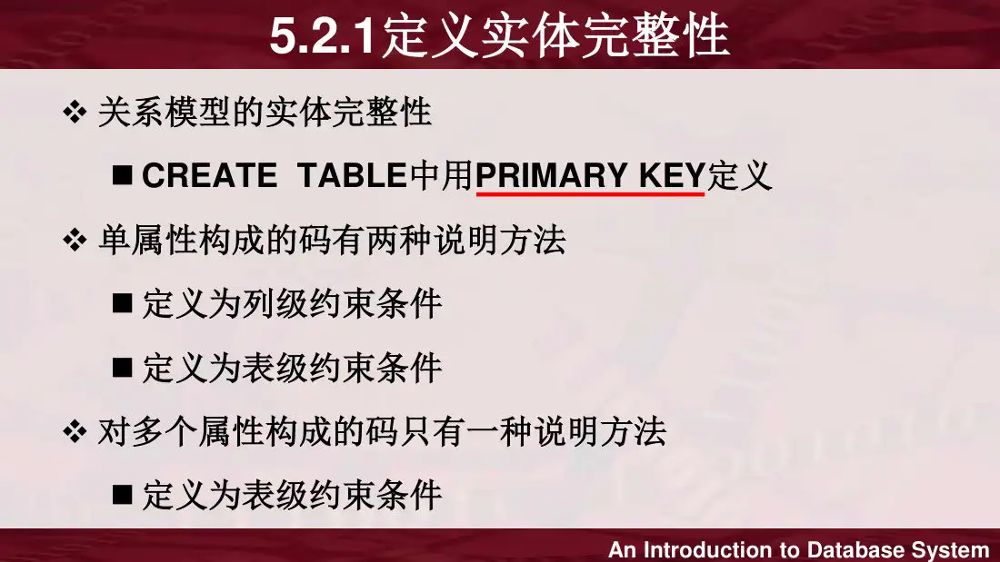

原文：

5.2.1 定义实体完整性

关系模型的实体完整性

■ CREATE TABLE中用PRIMARY KEY定义

单属性构成的码有两种说明方法

■ 定义为列级约束条件

■ 定义为表级约束条件

✿ 对多个属性构成的码只有一种说明方法

■ 定义为表级约束条件

An Introduction to Database System

### 定义实体完整性（续）

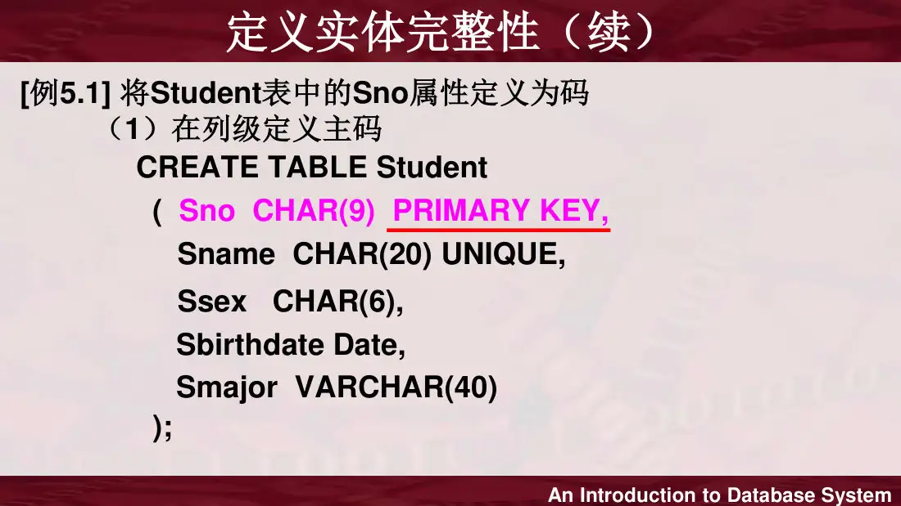

原文：

定义实体完整性（续）

[例5.1] 将Student表中的Sno属性定义为码

An Introduction to Database System

### 定义实体完整性（续）

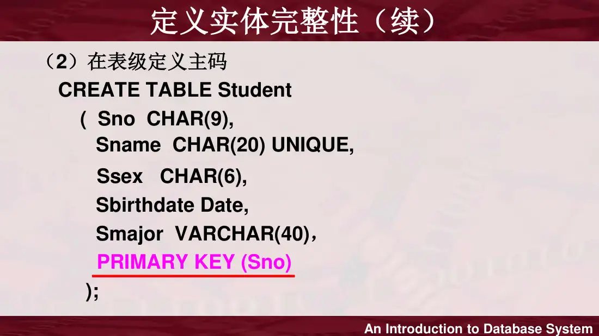

原文：

定义实体完整性（续）

An Introduction to Database System

### 定义实体完整性（续）

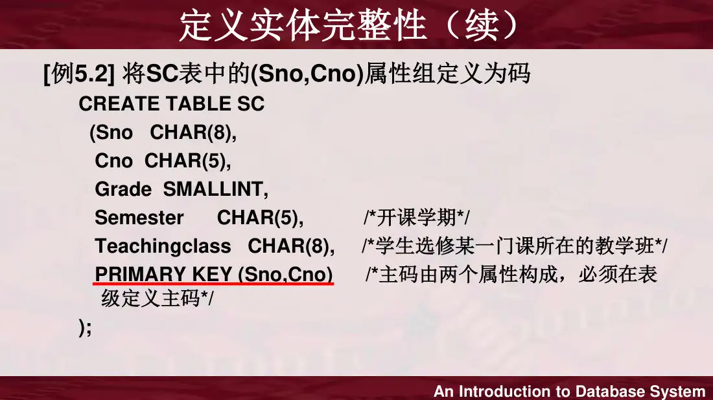

原文：

定义实体完整性（续）

[例5.2] 将SC表中的(Sno,Cno)属性组定义为码
CREATE TABLE SC
(Sno CHAR(8),
Cno CHAR(5),
Grade SMALLINT,
Semester CHAR(5), /\*开课学期\*/
Teachingclass CHAR(8), /\*学生选修某一门课所在的教学班\*/
PRIMARY KEY (Sno,Cno) /\*主码由两个属性构成，必须在表
级定义主码\*/
);

An Introduction to Database System

### 5.2 实体完整性

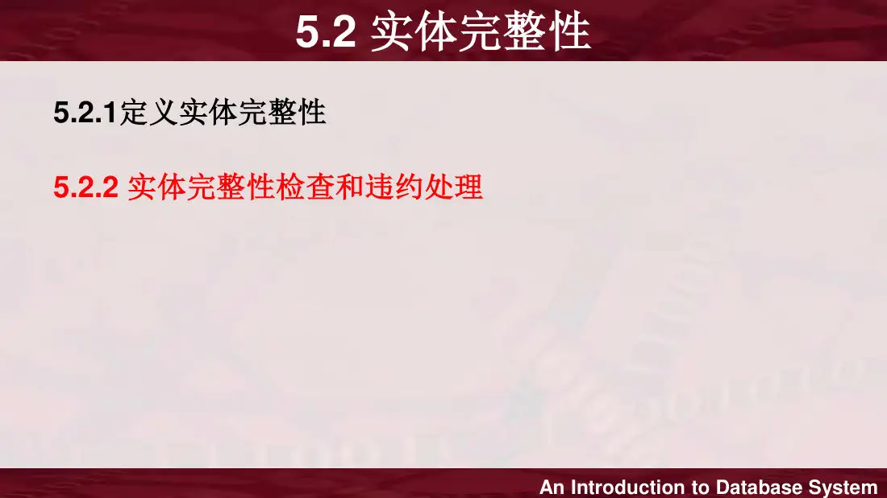

原文：

5.2 实体完整性

5.2.1定义实体完整性

5.2.2 实体完整性检查和违约处理

An Introduction to Database System

### 5.2.2 实体完整性检查和违约处理

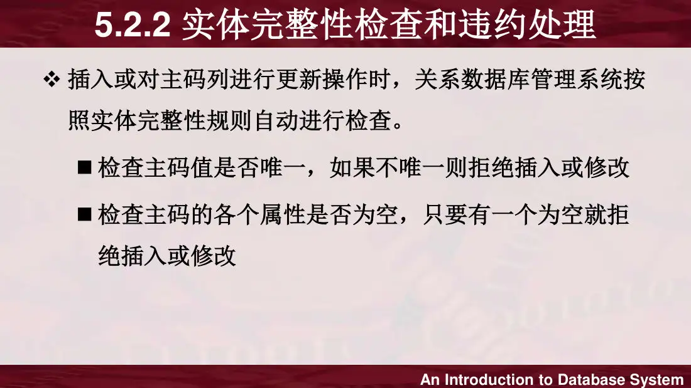

原文：

5.2.2 实体完整性检查和违约处理

❖ 插入或对主码列进行更新操作时，关系数据库管理系统按照实体完整性规则自动进行检查。

■ 检查主码值是否唯一，如果不唯一则拒绝插入或修改

■ 检查主码的各个属性是否为空，只要有一个为空就拒绝插入或修改

An Introduction to Database System

### 实体完整性检查和违约处理（续）

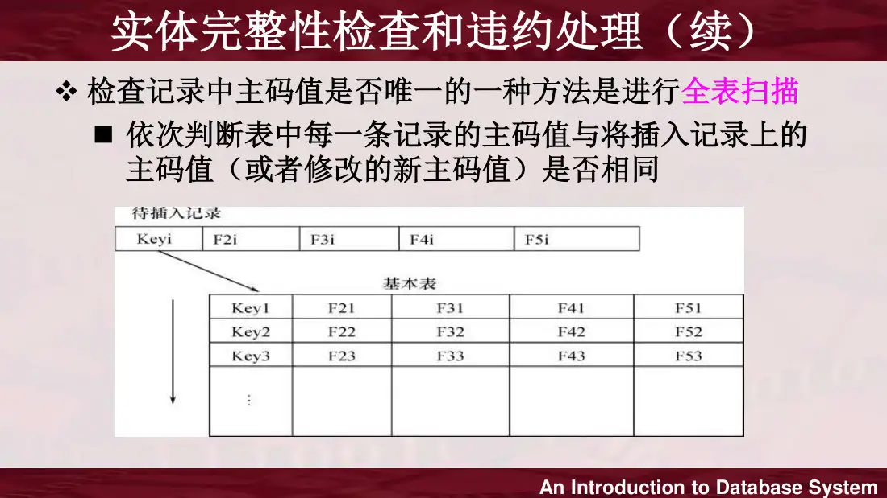

原文：

实体完整性检查和违约处理（续）

✿ 检查记录中主码值是否唯一的一种方法是进行全表扫描

■ 依次判断表中每一条记录的主码值与将插入记录上的主码值（或者修改的新主码值）是否相同

待插入记录

<table><tr><td>Keyi</td><td>F2i</td><td>F3i</td><td>F4i</td><td>F5i</td><td></td></tr><tr><td colspan="6">基本表</td></tr><tr><td>Key1</td><td>F21</td><td>F31</td><td>F41</td><td>F51</td><td></td></tr><tr><td>Key2</td><td>F22</td><td>F32</td><td>F42</td><td>F52</td><td></td></tr><tr><td>Key3</td><td>F23</td><td>F33</td><td>F43</td><td>F53</td><td></td></tr><tr><td> $\vdots$ </td><td></td><td></td><td></td><td></td><td></td></tr></table>

An Introduction to Database System

### 实体完整性检查和违约处理（续）

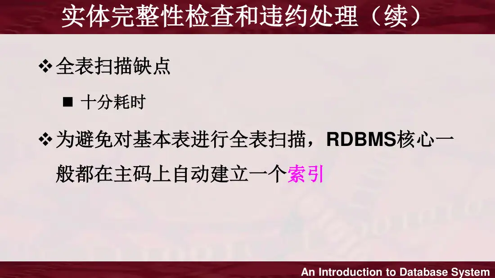

原文：

实体完整性检查和违约处理（续）

全表扫描缺点

■ 十分耗时

✿为避免对基本表进行全表扫描，RDBMS核心一般都在主码上自动建立一个索引

An Introduction to Database System

### 实体完整性检查和违约处理（续）

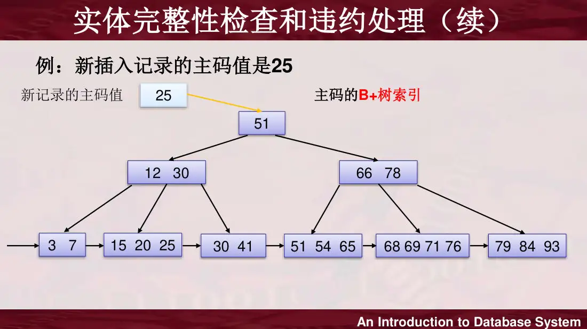

原文：

实体完整性检查和违约处理（续）

例：新插入记录的主码值是25

An Introduction to Database System

### 实体完整性检查和违约处理（续）

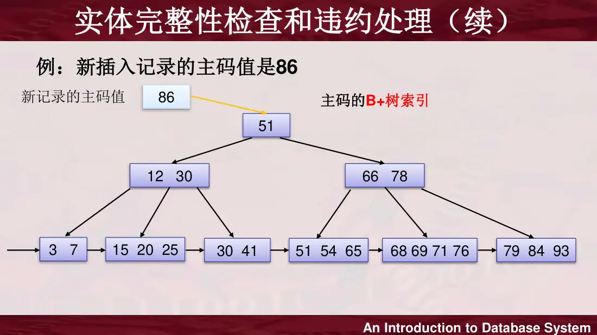

原文：

实体完整性检查和违约处理（续）

例：新插入记录的主码值是86

An Introduction to Database System

### 第5章 数据库完整性

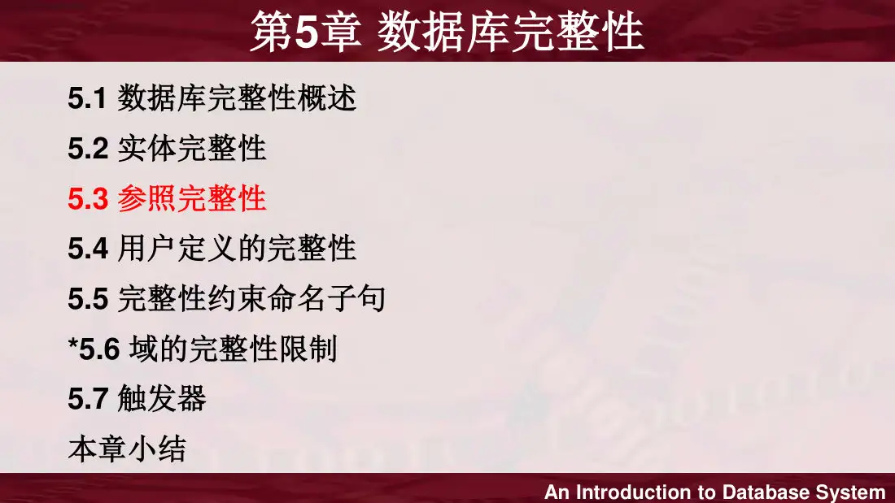

原文：

第5章 数据库完整性

5.1 数据库完整性概述

5.2 实体完整性

5.3 参照完整性

5.4 用户定义的完整性

5.5 完整性约束命名子句

\*5.6 域的完整性限制

5.7 触发器

本章小结

An Introduction to Database System

### 5.3 参照完整性

原文：

5.3 参照完整性

5.3.1 定义参照完整性

5.3.2 参照完整性检查和违约处理

An Introduction to Database System

### 参照完整性规则

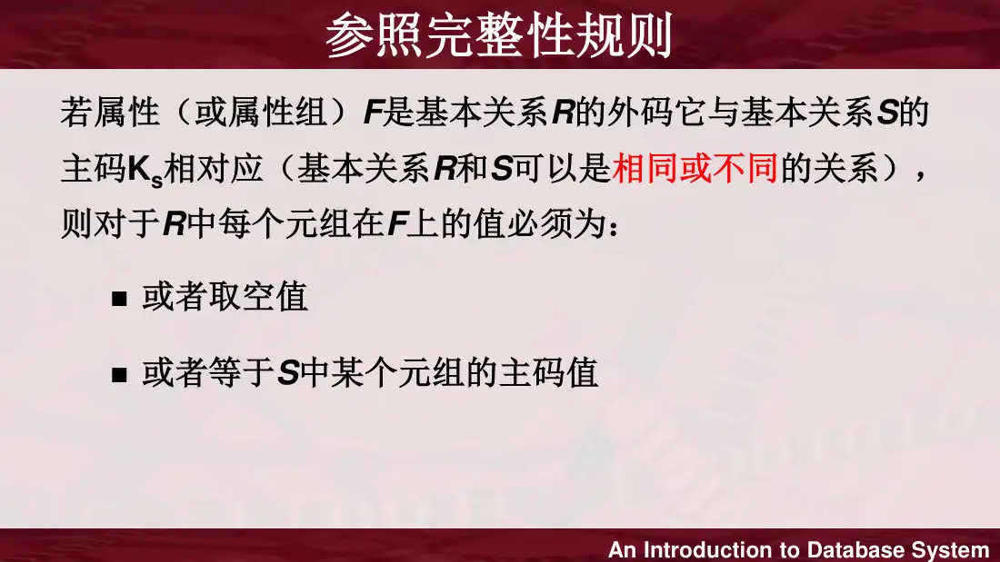

原文：

参照完整性规则

若属性（或属性组） $F$ 是基本关系 $R$ 的外码它与基本关系 $S$ 的主码 $K_{s}$ 相对应（基本关系 $R$ 和 $S$ 可以是相同或不同的关系），则对于 $R$ 中每个元组在 $F$ 上的值必须为：

■ 或者取空值

■ 或者等于S中某个元组的主码值

An Introduction to Database System

### 参照完整性规则（续）

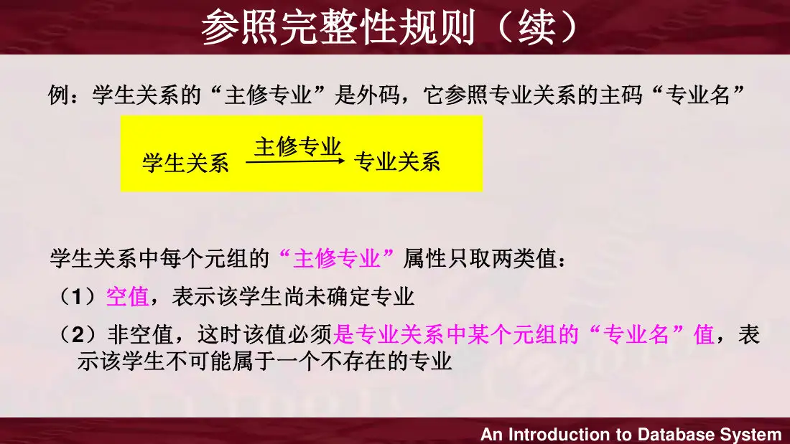

原文：

参照完整性规则（续）

例：学生关系的“主修专业”是外码，它参照专业关系的主码“专业名”

学生关系 $\xrightarrow{主修专业}$ 专业关系

学生关系中每个元组的“主修专业”属性只取两类值：

(1) 空值, 表示该学生尚未确定专业

(2) 非空值, 这时该值必须是专业关系中某个元组的 “专业名” 值, 表示该学生不可能属于一个不存在的专业

An Introduction to Database System

### 5.3.1 定义参照完整性

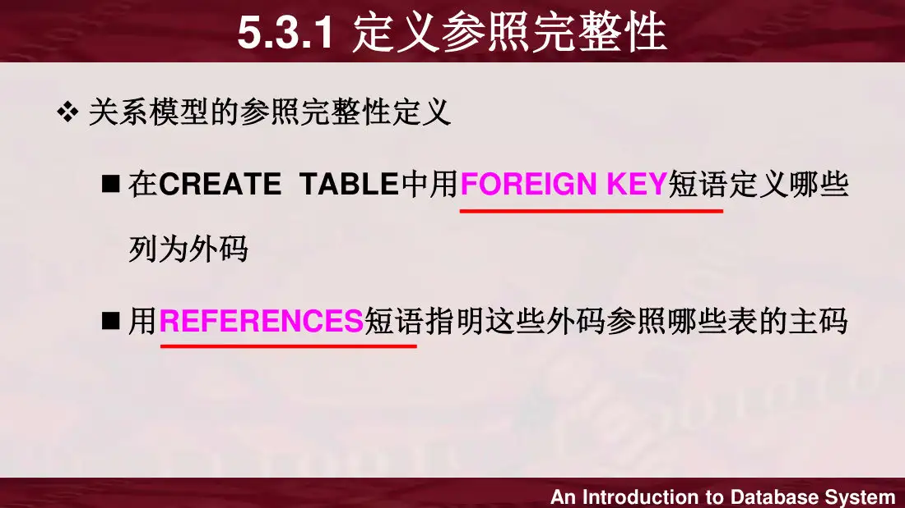

原文：

5.3.1 定义参照完整性

关系模型的参照完整性定义

■ 在CREATE TABLE中用FOREIGN KEY短语定义哪些列为外码

■ 用REFERENCES短语指明这些外码参照哪些表的主码

An Introduction to Database System

### 定义参照完整性（续）

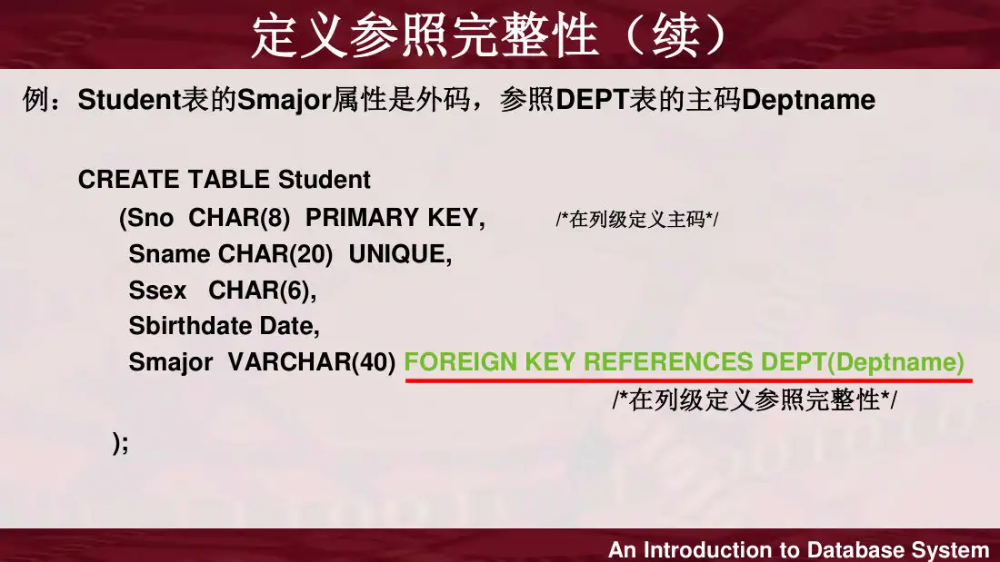

原文：

定义参照完整性（续）

例：Student表的Smajor属性是外码，参照DEPT表的主码Deptname

);

An Introduction to Database System

### 定义参照完整性（续）

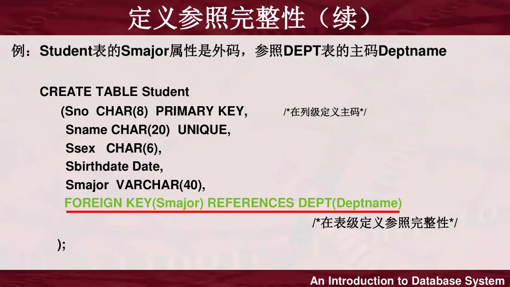

原文：

定义参照完整性（续）

例：Student表的Smajor属性是外码，参照DEPT表的主码Deptname

/\*在表级定义参照完整性\*/

);

An Introduction to Database System

### 参照完整性定义（续）

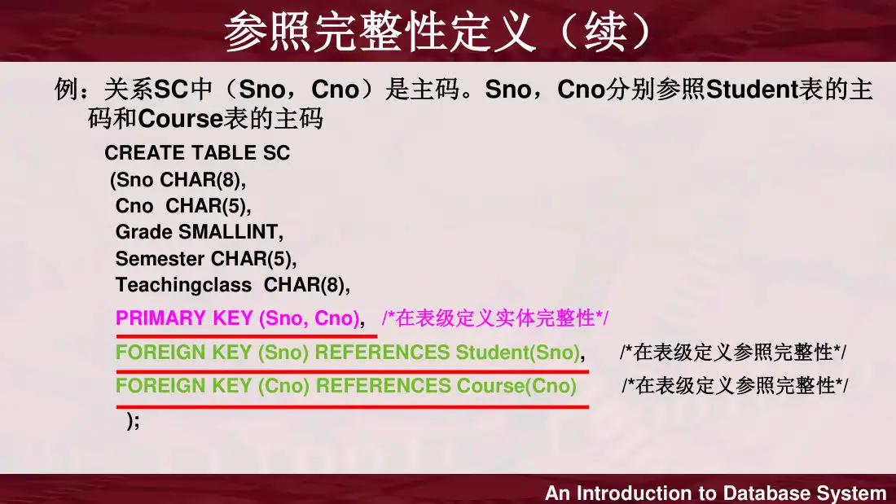

原文：

参照完整性定义（续）

例：关系SC中（Sno，Cno）是主码。Sno，Cno分别参照Student表的主码和Course表的主码
CREATE TABLE SC
(Sno CHAR(8),
Cno CHAR(5),
Grade SMALLINT,
Semester CHAR(5),
Teachingclass CHAR(8),
PRIMARY KEY (Sno, Cno), /\*在表级定义实体完整性\*/
FOREIGN KEY (Sno) REFERENCES Student(Sno), /\*在表级定义参照完整性\*/
FOREIGN KEY (Cno) REFERENCES Course(Cno)
);

An Introduction to Database System

### 5.3 参照完整性

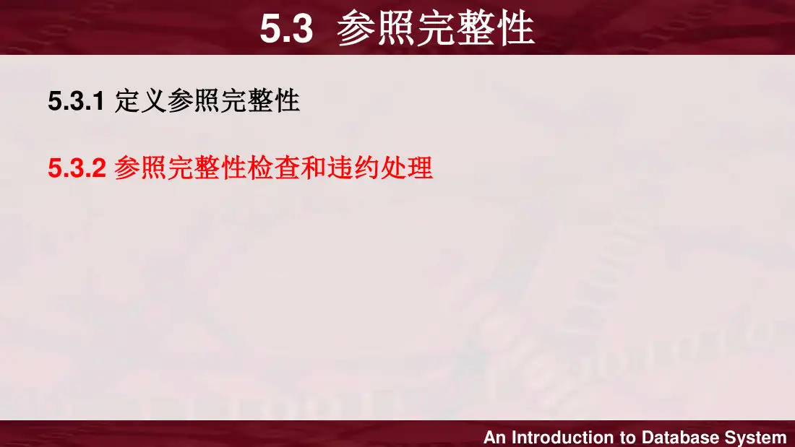

原文：

5.3 参照完整性

5.3.1 定义参照完整性

5.3.2 参照完整性检查和违约处理

An Introduction to Database System

### 5.3.2 参照完整性检查和违约处理

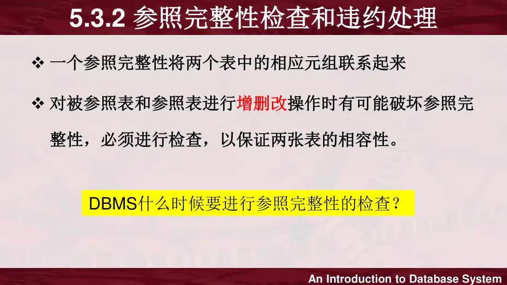

原文：

5.3.2 参照完整性检查和违约处理

◆ 一个参照完整性将两个表中的相应元组联系起来

对被参照表和参照表进行增删改操作时有可能破坏参照完整性，必须进行检查，以保证两张表的相容性。

DBMS什么时候要进行参照完整性的检查？

An Introduction to Database System

### 例:表SC和Student有四种可能破坏参照完整性的情况(1)

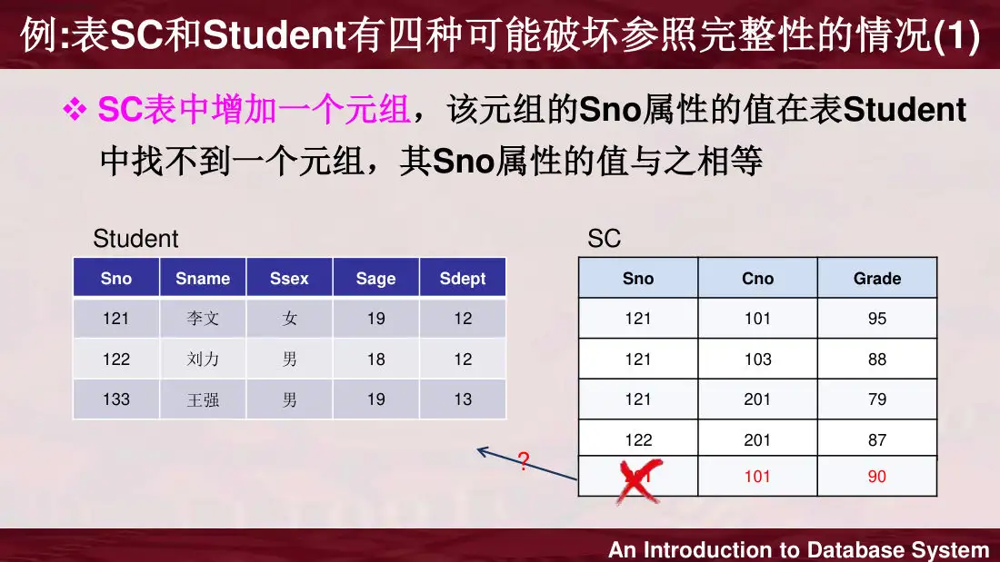

原文：

例:表SC和Student有四种可能破坏参照完整性的情况(1)

✿ SC表中增加一个元组，该元组的Sno属性的值在表Student中找不到一个元组，其Sno属性的值与之相等

Student

<table><tr><td>Sno</td><td>Sname</td><td>Ssex</td><td>Sage</td><td>Sdept</td></tr><tr><td>121</td><td>李文</td><td>女</td><td>19</td><td>12</td></tr><tr><td>122</td><td>刘力</td><td>男</td><td>18</td><td>12</td></tr><tr><td>133</td><td>王强</td><td>男</td><td>19</td><td>13</td></tr></table>
SC

<table><tr><td>Sno</td><td>Cno</td><td>Grade</td></tr><tr><td>121</td><td>101</td><td>95</td></tr><tr><td>121</td><td>103</td><td>88</td></tr><tr><td>121</td><td>201</td><td>79</td></tr><tr><td>122</td><td>201</td><td>87</td></tr><tr><td>201</td><td>101</td><td>90</td></tr></table>

An Introduction to Database System

### 例:表SC和Student有四种可能破坏参照完整性的情况(2)

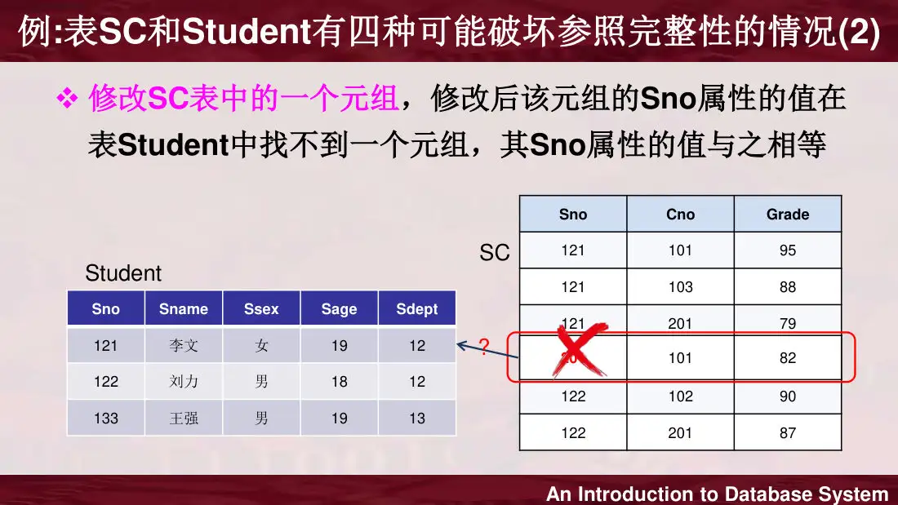

原文：

例:表SC和Student有四种可能破坏参照完整性的情况(2)

修改SC表中的一个元组，修改后该元组的Sno属性的值在表Student中找不到一个元组，其Sno属性的值与之相等

Student

<table><tr><td>Sno</td><td>Sname</td><td>Ssex</td><td>Sage</td><td>Sdept</td></tr><tr><td>121</td><td>李文</td><td>女</td><td>19</td><td>12</td></tr><tr><td>122</td><td>刘力</td><td>男</td><td>18</td><td>12</td></tr><tr><td>133</td><td>王强</td><td>男</td><td>19</td><td>13</td></tr></table>

<table><tr><td>Sno</td><td>Cno</td><td>Grade</td></tr><tr><td>121</td><td>101</td><td>95</td></tr><tr><td>121</td><td>103</td><td>88</td></tr><tr><td>121</td><td>201</td><td>79</td></tr><tr><td>10</td><td>101</td><td>82</td></tr><tr><td>122</td><td>102</td><td>90</td></tr><tr><td>122</td><td>201</td><td>87</td></tr></table>

An Introduction to Database System

### 例:表SC和Student有四种可能破坏参照完整性的情况(3)

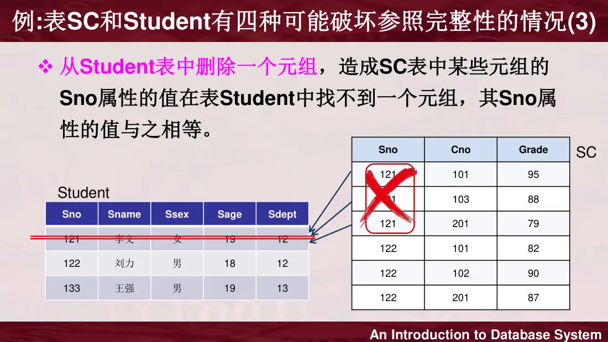

原文：

例:表SC和Student有四种可能破坏参照完整性的情况(3)

从Student表中删除一个元组，造成SC表中某些元组的Sno属性的值在表Student中找不到一个元组，其Sno属性的值与之相等。

Student

<table><tr><td>Sno</td><td>Sname</td><td>Ssex</td><td>Sage</td><td>Sdept</td></tr><tr><td>121</td><td>李义</td><td>女</td><td>19</td><td>12</td></tr><tr><td>122</td><td>刘力</td><td>男</td><td>18</td><td>12</td></tr><tr><td>133</td><td>王强</td><td>男</td><td>19</td><td>13</td></tr></table>

<table><tr><td>Sno</td><td>Cno</td><td>Grade</td></tr><tr><td>121</td><td>101</td><td>95</td></tr><tr><td>121</td><td>103</td><td>88</td></tr><tr><td>121</td><td>201</td><td>79</td></tr><tr><td>122</td><td>101</td><td>82</td></tr><tr><td>122</td><td>102</td><td>90</td></tr><tr><td>122</td><td>201</td><td>87</td></tr></table>

SC

An Introduction to Database System

### 例:表SC和Student有四种可能破坏参照完整性的情况(4)

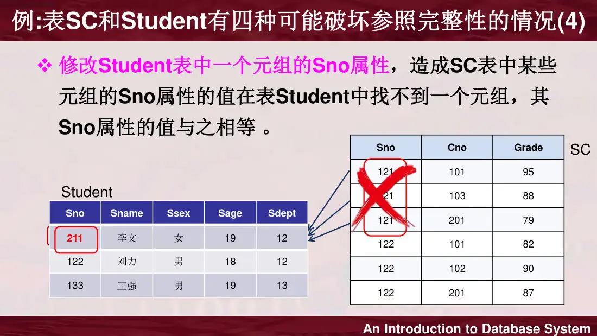

原文：

例:表SC和Student有四种可能破坏参照完整性的情况(4)

修改Student表中一个元组的Sno属性，造成SC表中某些元组的Sno属性的值在表Student中找不到一个元组，其Sno属性的值与之相等。

Student
<table><tr><td>Sno</td><td>Sname</td><td>Ssex</td><td>Sage</td><td>Sdept</td></tr><tr><td>211</td><td>李文</td><td>女</td><td>19</td><td>12</td></tr><tr><td>122</td><td>刘力</td><td>男</td><td>18</td><td>12</td></tr><tr><td>133</td><td>王强</td><td>男</td><td>19</td><td>13</td></tr></table>

<table><tr><td>Sno</td><td>Cno</td><td>Grade</td></tr><tr><td>121</td><td>101</td><td>95</td></tr><tr><td>21</td><td>103</td><td>88</td></tr><tr><td>121</td><td>201</td><td>79</td></tr><tr><td>122</td><td>101</td><td>82</td></tr><tr><td>122</td><td>102</td><td>90</td></tr><tr><td>122</td><td>201</td><td>87</td></tr></table>

An Introduction to Database System

### 参照完整性检查和违约处理（续）

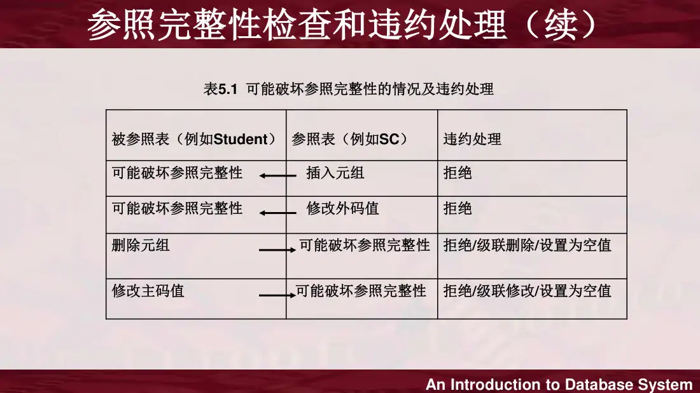

原文：

参照完整性检查和违约处理（续）

表5.1 可能破坏参照完整性的情况及违约处理
<table><tr><td>被参照表(例如Student)</td><td>参照表(例如SC)</td><td>违约处理</td></tr><tr><td>可能破坏参照完整性←</td><td>插入元组</td><td>拒绝</td></tr><tr><td>可能破坏参照完整性←</td><td>修改外码值</td><td>拒绝</td></tr><tr><td>删除元组→</td><td>可能破坏参照完整性</td><td>拒绝/级联删除/设置为空值</td></tr><tr><td>修改主码值→</td><td>可能破坏参照完整性</td><td>拒绝/级联修改/设置为空值</td></tr></table>

An Introduction to Database System

### 参照完整性检查和违约处理（续）

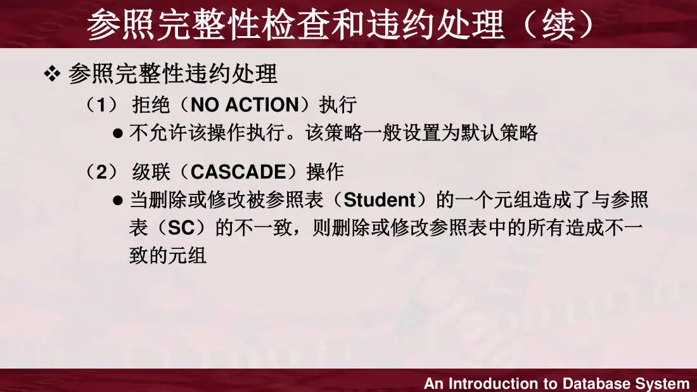

原文：

参照完整性检查和违约处理（续）

参照完整性违约处理

(1) 拒绝（NO ACTION）执行

\- 不允许该操作执行。该策略一般设置为默认策略

(2) 级联（CASCADE）操作

\- 当删除或修改被参照表（Student）的一个元组造成了与参照表（SC）的不一致，则删除或修改参照表中的所有造成不一致的元组

An Introduction to Database System

### 参照完整性检查和违约处理（续）

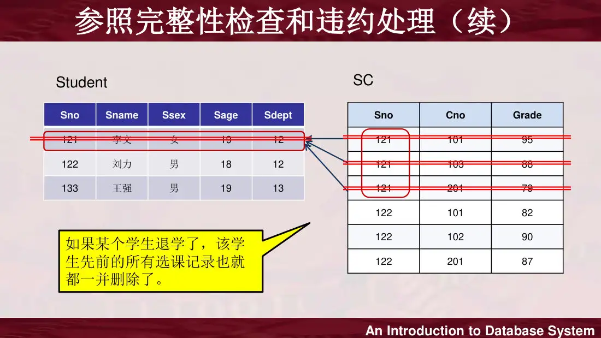

原文：

参照完整性检查和违约处理（续）

Student

<table><tr><td>Sno</td><td>Sname</td><td>Ssex</td><td>Sage</td><td>Sdept</td></tr><tr><td>121</td><td>李文</td><td>女</td><td>19</td><td>12</td></tr><tr><td>122</td><td>刘力</td><td>男</td><td>18</td><td>12</td></tr><tr><td>133</td><td>王强</td><td>男</td><td>19</td><td>13</td></tr></table>

如果某个学生退学了，该学生先前的所有选课记录也就都一并删除了。

SC

<table><tr><td>Sno</td><td>Cno</td><td>Grade</td></tr><tr><td>121</td><td>101</td><td>95</td></tr><tr><td>121</td><td>103</td><td>88</td></tr><tr><td>121</td><td>201</td><td>79</td></tr><tr><td>122</td><td>101</td><td>82</td></tr><tr><td>122</td><td>102</td><td>90</td></tr><tr><td>122</td><td>201</td><td>87</td></tr></table>

An Introduction to Database System

### 参照完整性检查和违约处理（续）

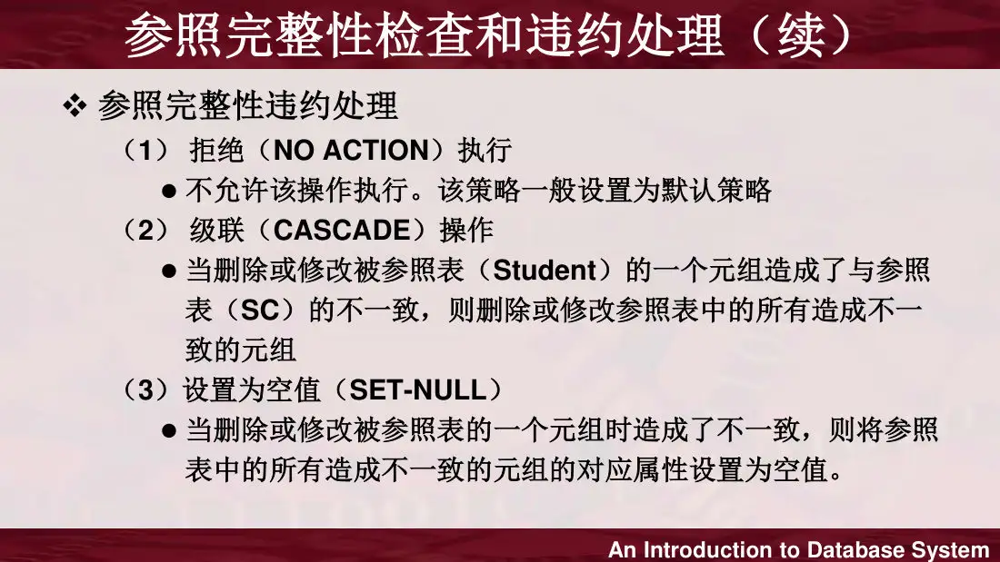

原文：

参照完整性检查和违约处理（续）

参照完整性违约处理

(1) 拒绝（NO ACTION）执行

\- 不允许该操作执行。该策略一般设置为默认策略

(2) 级联（CASCADE）操作

\- 当删除或修改被参照表（Student）的一个元组造成了与参照表（SC）的不一致，则删除或修改参照表中的所有造成不一致的元组

(3) 设置为空值 (SET-NULL)

\- 当删除或修改被参照表的一个元组时造成了不一致，则将参照表中的所有造成不一致的元组的对应属性设置为空值。

An Introduction to Database System

### 参照完整性检查和违约处理（续）

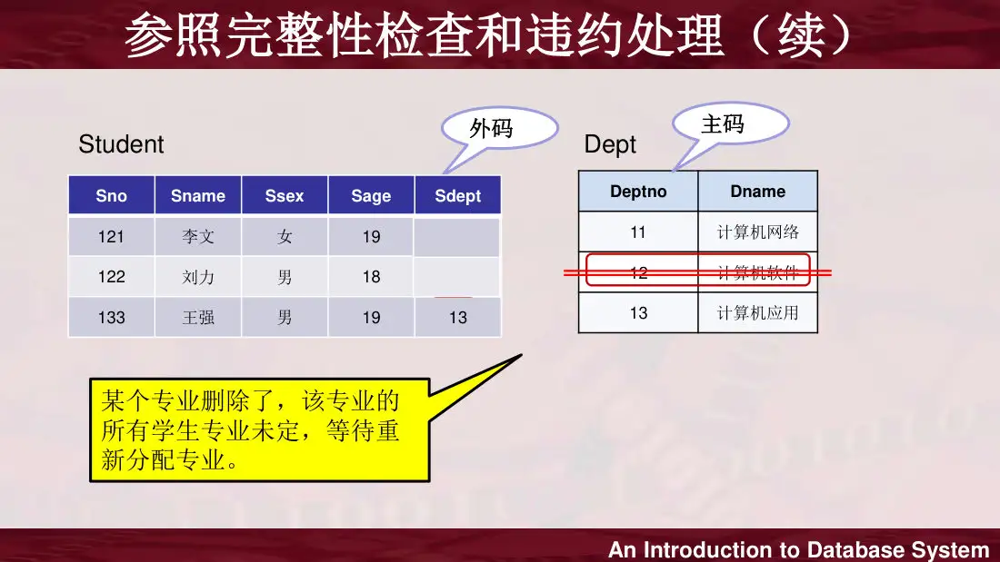

原文：

参照完整性检查和违约处理（续）

Student

外码

<table><tr><td>Sno</td><td>Sname</td><td>Ssex</td><td>Sage</td><td>Sdept</td></tr><tr><td>121</td><td>李文</td><td>女</td><td>19</td><td></td></tr><tr><td>122</td><td>刘力</td><td>男</td><td>18</td><td></td></tr><tr><td>133</td><td>王强</td><td>男</td><td>19</td><td>13</td></tr></table>

主码

Dept

<table><tr><td>Deptno</td><td>Dname</td></tr><tr><td>11</td><td>计算机网络</td></tr><tr><td>12</td><td>计算机软件</td></tr><tr><td>13</td><td>计算机应用</td></tr></table>

某个专业删除了，该专业的所有学生专业未定，等待重新分配专业。

An Introduction to Database System

### 参照完整性检查和违约处理（续）

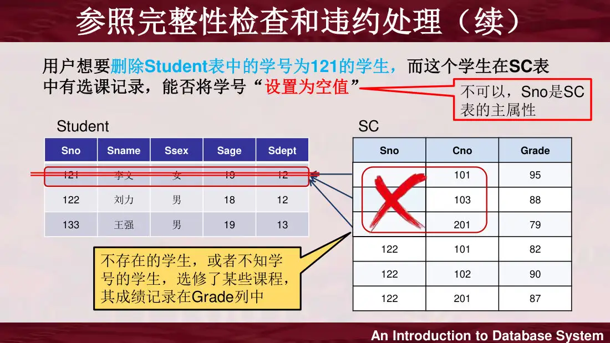

原文：

参照完整性检查和违约处理（续）

用户想要删除Student表中的学号为121的学生，而这个学生在SC表中有选课记录，能否将学号“设置为空值”不可以，Sno

Student

<table><tr><td>Sno</td><td>Sname</td><td>Ssex</td><td>Sage</td><td>Sdept</td></tr><tr><td>121</td><td>李文</td><td>女</td><td>19</td><td>12</td></tr><tr><td>122</td><td>刘力</td><td>男</td><td>18</td><td>12</td></tr><tr><td>133</td><td>王强</td><td>男</td><td>19</td><td>13</td></tr></table>
SC

不存在的学生，或者不知学号的学生，选修了某些课程，其成绩记录在Grade列中

不可以，Sno是SC表的主属性

<table><tr><td>Sno</td><td>Cno</td><td>Grade</td></tr><tr><td></td><td>101</td><td>95</td></tr><tr><td></td><td>103</td><td>88</td></tr><tr><td></td><td>201</td><td>79</td></tr><tr><td>122</td><td>101</td><td>82</td></tr><tr><td>122</td><td>102</td><td>90</td></tr><tr><td>122</td><td>201</td><td>87</td></tr></table>

An Introduction to Database System

### 参照完整性检查和违约处理（续）

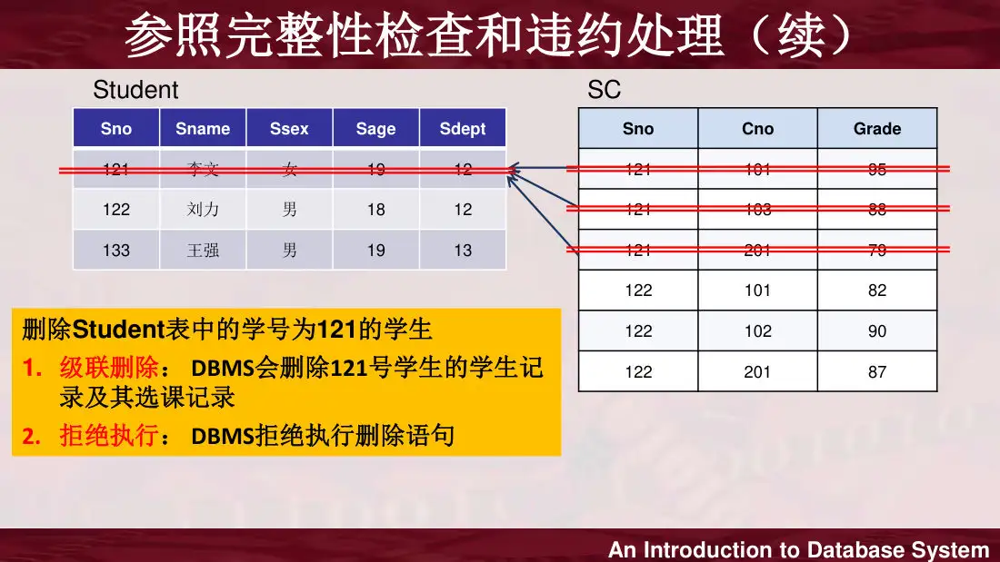

原文：

参照完整性检查和违约处理（续）

Student
<table><tr><td>Sno</td><td>Sname</td><td>Ssex</td><td>Sage</td><td>Sdept</td></tr><tr><td>121</td><td>李文</td><td>女</td><td>19</td><td>12</td></tr><tr><td>122</td><td>刘力</td><td>男</td><td>18</td><td>12</td></tr><tr><td>133</td><td>王强</td><td>男</td><td>19</td><td>13</td></tr></table>

删除Student表中的学号为121的学生

1. 级联删除：DBMS会删除121号学生的学生记录及其选课记录

2. 拒绝执行：DBMS拒绝执行删除语句

SC
<table><tr><td>Sno</td><td>Cno</td><td>Grade</td></tr><tr><td>121</td><td>101</td><td>95</td></tr><tr><td>121</td><td>103</td><td>88</td></tr><tr><td>121</td><td>201</td><td>79</td></tr><tr><td>122</td><td>101</td><td>82</td></tr><tr><td>122</td><td>102</td><td>90</td></tr><tr><td>122</td><td>201</td><td>87</td></tr></table>

An Introduction to Database System

### Dept

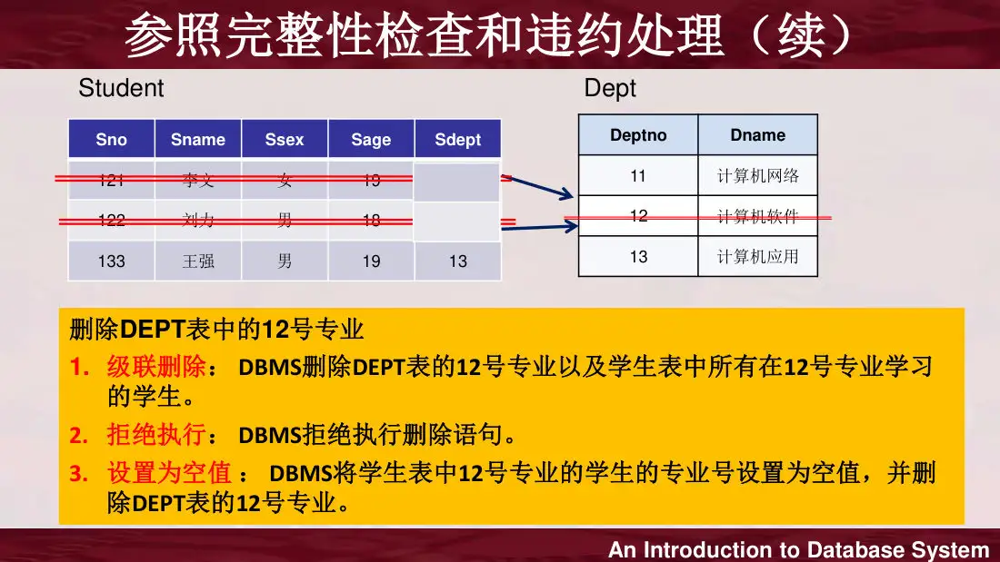

原文：

Dept

参照完整性检查和违约处理（续）

Student

<table><tr><td>Sno</td><td>Sname</td><td>Ssex</td><td>Sage</td><td>Sdept</td></tr><tr><td>121</td><td>李文</td><td>女</td><td>19</td><td></td></tr><tr><td>122</td><td>刘力</td><td>男</td><td>18</td><td></td></tr><tr><td>133</td><td>王强</td><td>男</td><td>19</td><td>13</td></tr></table>

<table><tr><td>Deptno</td><td>Dname</td></tr><tr><td>11</td><td>计算机网络</td></tr><tr><td>12</td><td>计算机软件</td></tr><tr><td>13</td><td>计算机应用</td></tr></table>

删除DEPT表中的12号专业

1. 级联删除：DBMS删除DEPT表的12号专业以及学生表中所有在12号专业学习的学生。

2. 拒绝执行：DBMS拒绝执行删除语句。

3. 设置为空值：DBMS将学生表中12号专业的学生的专业号设置为空值，并删除DEPT表的12号专业。

An Introduction to Database System

### 参照完整性检查和违约处理（续）

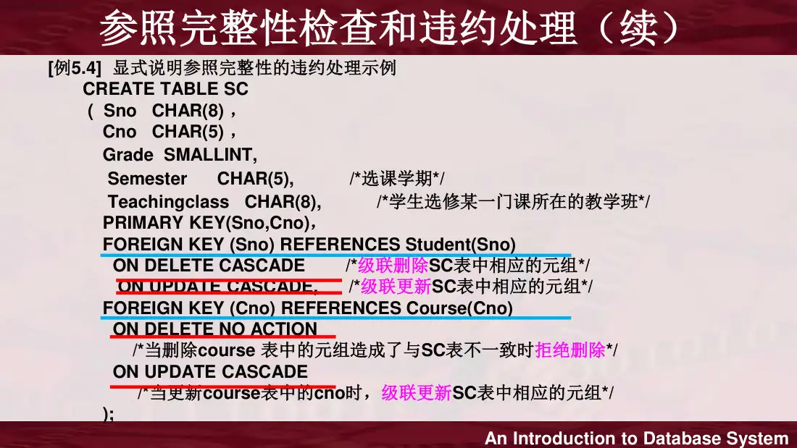

原文：

参照完整性检查和违约处理（续）

An Introduction to Database System

### 小结

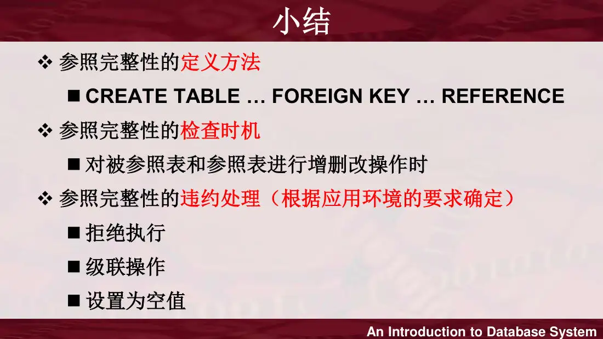

原文：

小结

参照完整性的定义方法

■ CREATE TABLE ... FOREIGN KEY ... REFERENCE

参照完整性的检查时机

■ 对被参照表和参照表进行增删改操作时

参照完整性的违约处理（根据应用环境的要求确定）

■拒绝执行

■级联操作

■ 设置为空值

An Introduction to Database System

### 第5章 数据库完整性

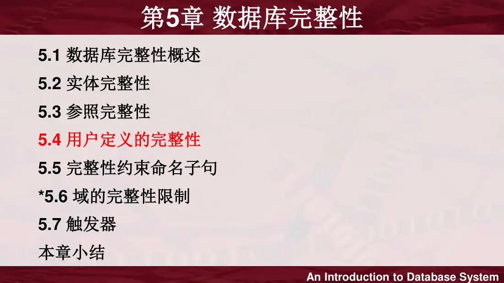

原文：

第5章 数据库完整性

5.1 数据库完整性概述

5.2 实体完整性

5.3 参照完整性

5.4 用户定义的完整性

5.5 完整性约束命名子句

\*5.6 域的完整性限制

5.7 触发器

本章小结

An Introduction to Database System

### 5.4 用户定义的完整性

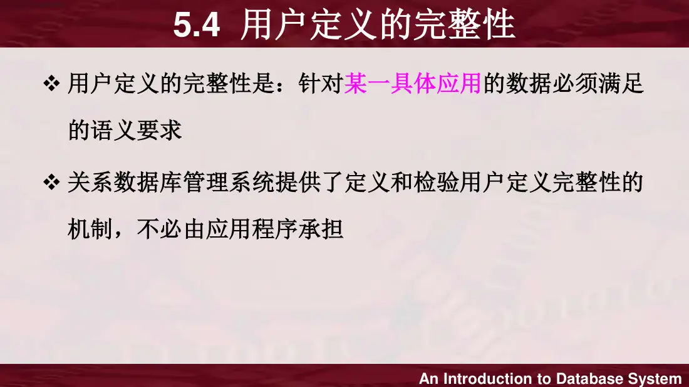

原文：

5.4 用户定义的完整性

◆ 用户定义的完整性是：针对某一具体应用的数据必须满足的语义要求

关系数据库管理系统提供了定义和检验用户定义完整性的机制，不必由应用程序承担

An Introduction to Database System

### 5.4 用户定义的完整性

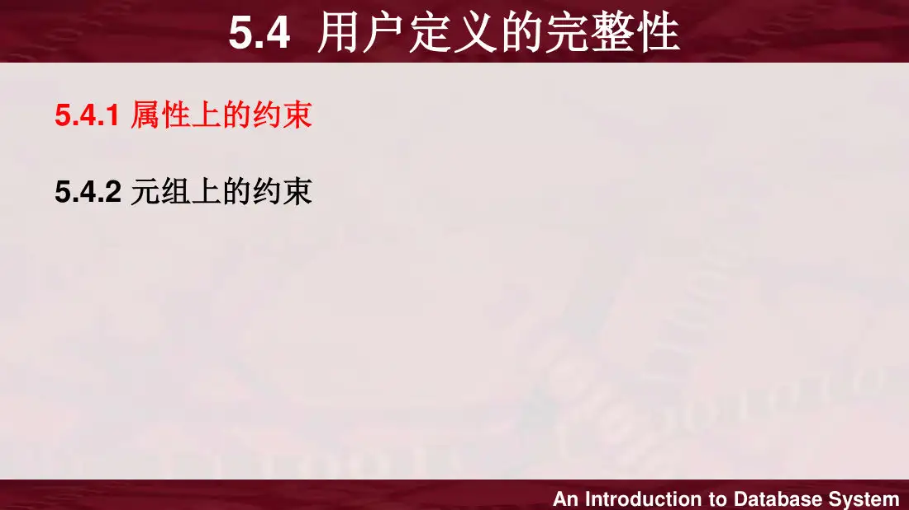

原文：

5.4 用户定义的完整性

5.4.1 属性上的约束

5.4.2 元组上的约束

An Introduction to Database System

### 5.4.1 属性上的约束

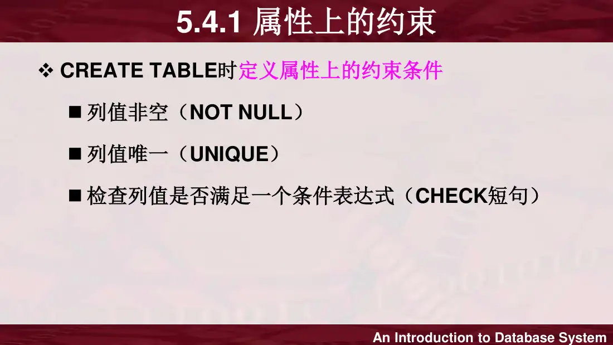

原文：

5.4.1 属性上的约束

CREATE TABLE时定义属性上的约束条件

■列值非空（NOT NULL）

■ 列值唯一（UNIQUE）

■ 检查列值是否满足一个条件表达式（CHECK短句）

An Introduction to Database System

### 属性上的约束（续）

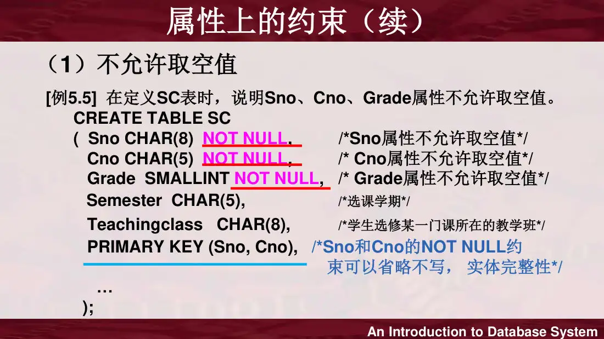

原文：

属性上的约束（续）

(1) 不允许取空值

[例5.5] 在定义SC表时，说明Sno、Cno、Grade属性不允许取空值。
CREATE TABLE SC
( Sno CHAR(8) NOT NULL, /\*Sno属性不允许取空值\*/
Cno CHAR(5) NOT NULL, /\* Cno属性不允许取空值\*/
Grade SMALLINT NOT NULL, /\* Grade属性不允许取空值\*/
Semester CHAR(5), /\*选课学期\*/
Teachingclass CHAR(8), /\*学生选修某一门课所在的教学班\*/
PRIMARY KEY (Sno, Cno), /\*Sno和Cno的NOT NULL约束可以省略不写，实体完整性\*/
...);

An Introduction to Database System

### 属性上的约束（续）

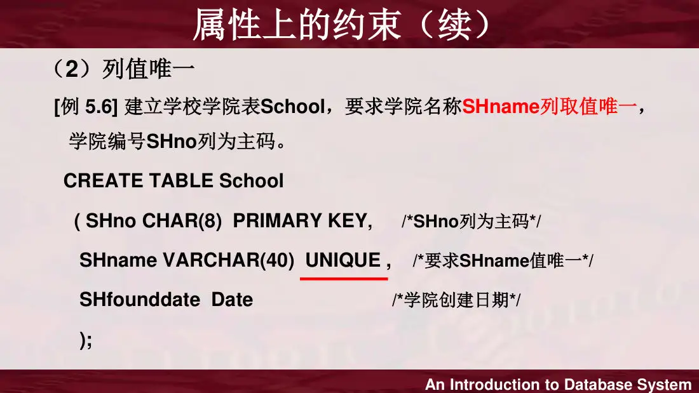

原文：

属性上的约束（续）

(2) 列值唯一

[例 5.6] 建立学校学院表School，要求学院名称SHname列取值唯一，学院编号SHno列为主码。

CREATE TABLE School

( SHno CHAR(8) PRIMARY KEY, /\*SHno列为主码\*/
SHname VARCHAR(40) UNIQUE, /\*要求SHname值唯一\*/
SHfounddate Date    /\*学院创建日期\*/
);

An Introduction to Database System

### 属性上的约束（续）

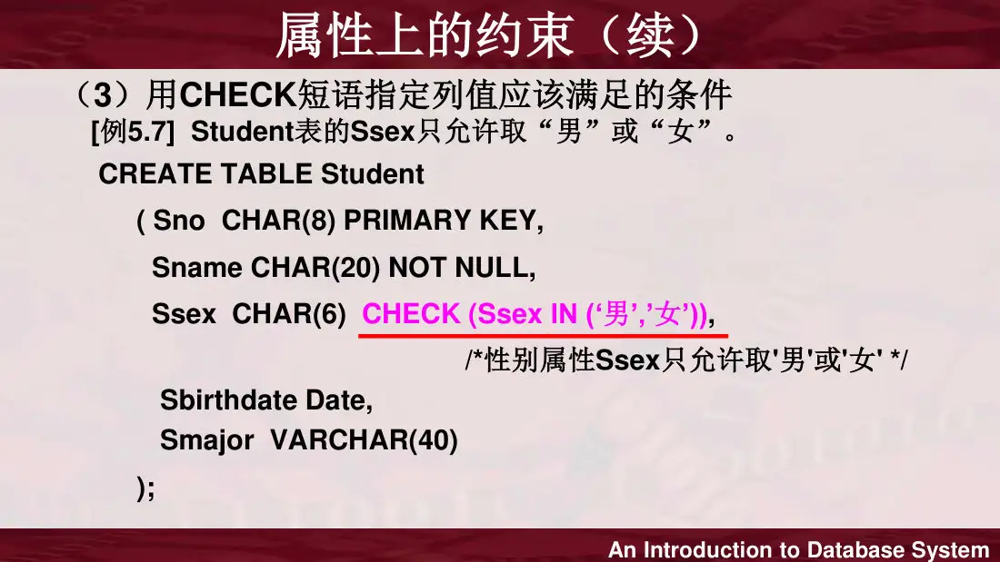

原文：

属性上的约束（续）

(3) 用CHECK短语指定列值应该满足的条件[例5.7] Student表的Ssex只允许取“男”或“女”。

CREATE TABLE Student

( Sno CHAR(8) PRIMARY KEY,

Sname CHAR(20) NOT NULL,

Ssex CHAR(6) CHECK (Ssex IN ('男', '女')),

/\*性别属性Ssex只允许取'男'或'女'\*/

Sbirthdate Date,

Smajor VARCHAR(40)

An Introduction to Database System

### 属性上的约束（续）

原文：

属性上的约束（续）

An Introduction to Database System

### 属性上的约束（续）

原文：

属性上的约束（续）

(4) 属性上的约束条件检查和违约处理

■ 插入元组或修改属性的值时，关系数据库管理系统检查属性上的约束条件是否被满足

■ 如果不满足则操作被拒绝执行

An Introduction to Database System

### 5.4 用户定义的完整性

原文：

5.4 用户定义的完整性

5.4.1 属性上的约束

5.4.2 元组上的约束

An Introduction to Database System

### 5.4.2 元组上的约束

原文：

5.4.2 元组上的约束

属性上的约束条件：只涉及单个属性

An Introduction to Database System

### 元组上的约束（续）

原文：

元组上的约束（续）

属性上的约束条件：只涉及单个属性

❖ 元组级的限制：可以设置不同属性之间的取值的相互约束条件

✿ 在CREATE TABLE时可以用CHECK子句定义元组上的约束条件

An Introduction to Database System

### 元组上的约束（续）

原文：

元组上的约束（续）

[例5.9]当学生的性别是男时，其名字不能以Ms.打头。

/\*定义了元组中Sname和 Ssex两个属性值之间的约束条件\*/);

√ 性别是女性的元组都能通过该项检查，因为Ssex='女'成立;

√ 当性别是男性时，要通过检查则名字一定不能以Ms.打头

An Introduction to Database System

### 元组上的约束（续）

原文：

元组上的约束（续）

❖ 元组上的约束条件检查和违约处理

■ 插入元组或修改属性的值时，关系数据库管理系统检查元组上的约束条件是否被满足

■ 如果不满足则操作被拒绝执行

An Introduction to Database System

### 小结

原文：

小结

属性上的用户定义完整性
■ 定义方法
■ 检查时机
■ 违约处理
元组上的用户定义完整性
■ 定义方法
■ 检查时机
■ 违约处理

An Introduction to Database System

### 小结

原文：

小结

<table><tr><td></td><td>实体完整性</td><td>参照完整性</td><td>用户定义的完整性</td></tr><tr><td>定义方法</td><td>CREATE TABLE</td><td>CREATE TABLE</td><td>CREATE TABLE</td></tr><tr><td>检查时机</td><td>执行插入修改操作</td><td>参照表:插入/修改被参照表:删除/修改</td><td>执行插入修改操作</td></tr><tr><td>违约处理</td><td>拒绝执行</td><td>拒绝执行/级联操作/设置为空值</td><td>拒绝执行</td></tr></table>

An Introduction to Database System

### 第5章 数据库完整性

原文：

第5章 数据库完整性

5.1 数据库完整性概述

5.2 实体完整性

5.3 参照完整性

5.4 用户定义的完整性

5.5 完整性约束命名子句

\*5.6 域的完整性限制

5.7 触发器

本章小结

An Introduction to Database System

### 5.5 完整性约束命名子句

原文：

5.5 完整性约束命名子句

1. 完整性约束命名子句格式

CONSTRAINT <完整性约束条件名><完整性约束条件>

■ <完整性约束条件>包括NOT NULL、UNIQUE、PRIMARY KEY短语、FOREIGN KEY短语、CHECK短语等

可以灵活地增加、删除一个完整性约束条件

An Introduction to Database System

### 完整性约束命名子句（续）

原文：

完整性约束命名子句（续）

[例5.10]建立学生登记表Student，要求学号10000000～29999999之间，姓名不能取空值，出生日期在1980年之后，性别只能是“男”或“女”。

CREATE TABLE Student

(Sno CHAR(8))

CONSTRAINT C1 CHECK (Sno BETWEEN '10000000' AND '29999999'),

Sname CHAR(20)

CONSTRAINT C2 NOT NULL,

Sbirthdate Date

CONSTRAINT C3 CHECK (Sbirthdate >'1980-1-1'),

Ssex CHAR(6)

CONSTRAINT C4 CHECK (Ssex IN ('男', '女')),

Smajor VARCHAR(40),

CONSTRAINT StudentKey PRIMARY KEY(Sno)

An Introduction to Database System

### 完整性约束命名子句（续）

原文：

完整性约束命名子句（续）

[例5.11]建立教师表TEACHER，要求每个教师的应发工资不低于3000元。应发工资是工资列Sal与扣除项Deduct之和。

CREATE TABLE TEACHER

An Introduction to Database System

### 完整性约束命名子句（续）

原文：

完整性约束命名子句（续）

2. 修改表中的完整性限制

■ 使用ALTER TABLE语句修改表中的完整性限制

[例5.12]去掉例5.10 Student表中对出生日期的限制。

ALTER TABLE Student

DROP CONSTRAINT C3;

An Introduction to Database System

### . 修改表中的完整性限制（续）

原文：

. 修改表中的完整性限制（续）

[例5.13] 修改表Student中的约束条件，要求学号改为在900000\~999999之间，出生日期改为1985年之后。

■ 可以先删除原来的约束条件，再增加新的约束条件

■ ALTER TABLE Student DROP CONSTRAINT C1;

■ ALTER TABLE Student
ADD CONSTRAINT C1 CHECK (Sno BETWEEN '900000' AND '999999'),

■ ALTER TABLE Student DROP CONSTRAINT C3;

■ ALTER TABLE Student
ADD CONSTRAINT C3 CHECK(Sbirthdate >'1985-1-1');

An Introduction to Database System

### 第5章 数据库完整性

原文：

第5章 数据库完整性

5.1 数据库完整性概述

5.2 实体完整性

5.3 参照完整性

5.4 用户定义的完整性

5.5 完整性约束命名子句

\*5.6 域的完整性限制

5.7 触发器

本章小结

An Introduction to Database System

### 第5章 数据库完整性

原文：

第5章 数据库完整性

5.1 数据库完整性概述

5.2 实体完整性

5.3 参照完整性

5.4 用户定义的完整性

5.5 完整性约束命名子句

\*5.6 域的完整性限制

5.7 触发器

本章小结

An Introduction to Database System

### 5.7 触发器

原文：

5.7 触发器

✿ 触发器（trigger）是用户定义在关系表上的一类由事件驱动的特殊过程

■ 触发器可以实施更为复杂的检查和操作，具有更精细和更强大的数据控制能力

■ 触发器保存在数据库服务器中

■ 任何用户对表的增、删、改操作均由服务器自动激活相应的触发器，在关系数据库管理系统核心层进行集中的完整性控制

An Introduction to Database System

### 5.7 触发器

原文：

5.7 触发器

5.7.1 定义触发器

5.7.2 执行触发器

5.7.3 删除触发器

An Introduction to Database System

### 5.7.1 定义触发器

原文：

5.7.1 定义触发器

✿ 触发器：做事件-条件-动作规则（event-condition-action rule, ECA rule）

■ 当特定的系统事件发生时，对规则的条件进行检查

■ 如果条件成立则执行规则中的动作，否则不执行该动作

■ 规则中的动作体可以很复杂，通常是一段SQL存储过程

CREATE TRIGGER语法格式

CREATE TRIGGER <触发器名>

{BEFORE | AFTER} <触发事件> ON <表名>

REFERENCING NEW|OLD AS<变量>

FOR EACH {ROW | STATEMENT}

[WHEN <触发条件>] <触发动作体>

An Introduction to Database System

### 定义触发器（续）

原文：

定义触发器（续）

定义触发器的语法说明

(1) 创建触发器。表的拥有者才可以在表上创建触发器

(2) 触发器名

\- 可以包含模式名，也可以不包含模式名

\- 同一模式下，触发器名必须是唯一的

\- 触发器名和表名必须在同一模式下

(3) 表名

\- 触发器只能定义在基本表上，不能定义在视图上

\- 当基本表的数据发生变化时，将激活定义在该表上相应触发事件的触发器

An Introduction to Database System

### 定义触发器（续）

原文：

定义触发器（续）

(4) 触发事件

\- 触发事件可以是INSERT、DELETE或UPDATE

也可以是这几个事件的组合

\- 还可以UPDATE OF<触发列，...>，即进一步指明修改哪些列时激活触发器

\- AFTER/BEFORE是触发的时机

➢ AFTER表示在触发事件的操作执行之后激活触发器

BEFORE表示在触发事件的操作执行之前激活触发器

An Introduction to Database System

### 定义触发器（续）

原文：

定义触发器（续）

(5) 触发器类型

➢ 行级触发器（FOR EACH ROW）

➢ 语句级触发器（FOR EACH STATEMENT）

\- 如果是语句级触发器，执行完UPDATE语句后触发动作体将执行一次

\- 如果是行级触发器，UPDATE 语句影响多少行，就触发多少次

(6) 触发条件

\- 触发器被激活时，只有当触发条件为真时触发动作体才执行；否则触发动作体不执行

\- 如果省略WHEN触发条件，则触发动作体在触发器激活后立即执行

An Introduction to Database System

### 定义触发器（续）

原文：

定义触发器（续）

(7) 触发动作体

\- 触发动作体可以是一个匿名PL/SQL过程块也可以是对已创建存储过程的调用

\- 如果是行级触发器，用户可以在过程体中使用NEW和OLD引用UPDATE/INSERT事件之后（前）的新（旧）值

\- 如果是语句级触发器，不能在触发动作体中使用NEW或OLD进行引用

\- 如果触发动作体执行失败，激活触发器的事件就会终止执行，触发器的目标表或触发器可能影响的其他对象不发生任何变化

An Introduction to Database System

### 定义触发器（续）

原文：

定义触发器（续）

[例5.18] 当对表SC的Grade属性进行修改时，若分数增加了 $10\%$ ，则将此次操作记录到另一个表SC\_U（Sno CHAR(8)、Cno CHAR(5)、Oldgrade SMALLINT、Newgrade SMALLINT）中，其中Oldgrade是修改前的分数，Newgrade是修改后的分数

CREATE TRIGGER SC\_T

/\*SC\_T是触发器的名字\*/

AFTER UPDATE ON SC

/\*UPDATE ON SC是触发事件\*/

/\* AFTER是触发的时机，表示当对SC的Grade属性修改完后再触发下面的规则\*/

REFERENCING

OLD AS OldTuple,

NEW AS NewTuple

FOR EACH ROW

/\*行级触发器，即每执行一次Grade的更新，下面的规则就执行一次\*/

WHEN (NewTuple.Grade >= 1.1 \* OldTuple.Grade)

/\*触发条件，只有该条件为真时才执行下面的insert操作\*/

BEGIN

INSERT INTO SC\_U (Sno,Cno,OldGrade,NewGrade)

/\*触发动作体\*/

VALUES(OldTuple.Sno, OldTuple.Cno, OldTuple.Grade, NewTuple.Grade)

END

An Introduction to Database System

### 定义触发器（续）

原文：

定义触发器（续）

[例 5.19]将每次对表Student的插入操作所增加的学生个数记录到表Student InsertLog(numbers INT)中,运行触发器之前需要创建此表

CREATE TRIGGER Student\_Count

AFTER INSERT ON Student

/\*指明触发器激活的时间是在执行INSERT后\*/

REFERENCING

NEWTABLE AS Delta

FOR EACH STATEMENT /\*语句级触发器，即执行完INSERT语句后下面的触发动作体才执行一次\*/
BEGIN

INSERT INTO StudentInsertLog (Numbers)
SELECT COUNT(\*) FROM Delta

END

An Introduction to Database System

### 定义触发器（续）

原文：

定义触发器（续）

[例5.20] 定义一个BEFORE行级触发器，为教师表Teacher定义完整性规则：教授的工资不得低于4000元，如果低于4000元，自动改为4000元。

CREATE TRIGGER Update\_Sal

BEFORE UPDATE ON Teacher

REFERENCING NEW AS newTuple

FOR EACH ROW/\*对教师表插入或更新时激活触发器\*/
/\*BEFORE触发事件\*/

/\*这是行级触发器\*/

BEGIN

/\*定义触发动作体，这是一个PL/SQL过程块\*/

IF (newTuple.job='教授') AND (newTuple.sal < 4000) /\*因为是行级触发器，可在过程体中\*/

THEN newTuple.sal :=4000;

/\*使用插入或更新操作后的新值\*/

END IF;

END;

/\*触发动作体结束\*/

An Introduction to Database System

### 5.7 触发器

原文：

5.7 触发器

5.7.1 定义触发器

5.7.2 执行触发器

5.7.3 删除触发器

An Introduction to Database System

### 5.7.2 执行触发器

原文：

5.7.2 执行触发器

✿ 触发器的执行，是由触发事件激活，并由数据库服务器自动执行

◆ 一个数据表上可能定义了多个触发器，遵循执行顺序:

(1) 执行该表上的BEFORE触发器

(2) 激活触发器的SQL语句

(3) 执行该表上的AFTER触发器

An Introduction to Database System

### 5.7 触发器

原文：

5.7 触发器

5.7.1 定义触发器

5.7.2 执行触发器

5.7.3 删除触发器

An Introduction to Database System

### 5.7.3 删除触发器

原文：

5.7.3 删除触发器

✿ 删除触发器的SQL语法:

DROP TRIGGER <触发器名> ON <表名>;

✿ 触发器必须是一个已经创建的触发器，只能由具有相应权限的用户删除。

An Introduction to Database System

### 第5章 数据库完整性

原文：

第5章 数据库完整性

5.1 数据库完整性概述

5.2 实体完整性

5.3 参照完整性

5.4 用户定义的完整性

5.5 完整性约束命名子句

\*5.6 域的完整性限制

5.7 触发器

本章小结

An Introduction to Database System

### 本章小结

原文：

本章小结

关系数据库管理系统完整性实现的机制

■ 完整性约束的定义机制

■ 完整性约束的检查方法

■ 违背完整性约束时应采取的动作

触发器

■ 可以实施更为复杂的完整性定义、检查和违约操作

■ 具有更精细和更强大的数据控制能力

■ 触发器规则中的动作体可以很复杂，通常是一段过程化SQL

An Introduction to Database System
