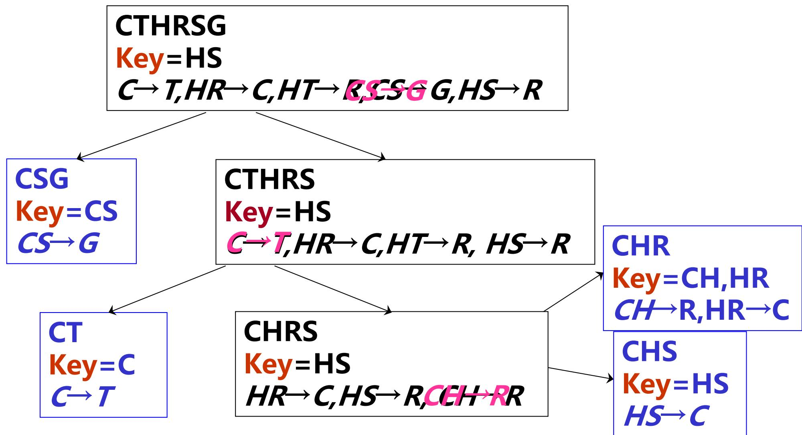

# 《数据库系统》第6章 习题

原件经识别和整理；“参考解答”是我们补的。

例：设有关系模式 CTHRSG（C，T，H，R，S，G），满足下列函数依赖：

- C→T：每门课程仅有一位教师讲授
- HR→C：在任一时间，每个教室只能上一门课程
- HT→R：在一个时间，一位教师只能在一个教室上课
- CS→G：每个学生的每门课程只有一个成绩
- HS→R：在一个时间，每个学生只能在一个教室

即 $F = \{C \to T,\ HR \to C,\ HT \to R,\ CS \to G,\ HS \to R\}$

将其分解成 BCNF，且分解具有连接不失真性（无损）。

### 解

(1) 求所有候选关键字 HS

(2) 分解

∴ CTHRSG 分解为 CSG，CT，CHR，CHS

- CSG：学生的各门课程成绩；
- CT：各门课的任课教师；
- CHR：每门课程的上课时间和每个时间的上课教室；
- CHS：每个学生的上课时间表

?

函数依赖 HT→R

设有关系模式 R(ABCD)，其上的 FD 集 $F = \{A \to B,\ B \to C,\ D \to B\}$

参考答案：

① R 分解成 $\rho = \{ACD,\ BD\}$，试求 F 在 ACD 和 BD 上的投影。

解：实际是求 $F^+$ 在 ACD 和 BD 上的投影

设：$R_1(ACD)$，$R_2(BD)$

由推理规则：$F_1 = \{A \to C,\ D \to C\}$ ← 传递性，$F_2 = \{D \to B\}$

R(ABCD)，$F = \{A \to B,\ B \to C,\ D \to B\}$

$$
F_1 = \{A \to C,\ D \to C\},\ F_2 = \{D \to B\}
$$

② ACD 和 BD 是 BCNF 吗？如不是，试分解成 BCNF。

解：分析出码 → 分析函数依赖类型或按定义 → 判断范式

(a) 用推理规则或求属性闭包法找出键

Key1: AD（不在任何函数依赖中的属性应列入键中）

Key2: D

(b) 对 $R_1$、$F_1$：$AD \to C$ 部分依赖，1NF 分解方法：算法 6.5

$\rho_1 = \{AC,\ AD\}$ 或 $\{AD,\ DC\}$

对 $R_2$、$F_2$：按定义 6.8 达 BCNF

设有 R(职工编号，日期，日营业额，部门名，部门经理)。

- 每职工每天一营业额：(职工编号，日期)→日营业额
- 每职工只在一部门工作：职工编号→部门名
- 每部门名只有一位部门经理：部门名→部门经理

参考答案：

(1) R 的基本函数依赖集

$F = \{(职工编号，日期) \to 日营业额，\ 职工编号 \to 部门名，\ 部门名 \to 部门经理\}$，Key: (职工编号，日期)

(2) ∵ (职工编号，日期)→部门名 ∴ 1NF；(职工编号，日期)→部门经理

消除部分依赖 职工编号→（部门名，部门经理）

$\rho = \{R_1,\ R_2\} = \{(职工编号，日期，日营业额)，(职工编号，部门名，部门经理)\}$

$F_1 = \{(职工编号，日期) \to 日营业额\}$

Key1: (职工编号，日期)，R1 无部分依赖，达 2NF

$F_2 = \{职工编号 \to 部门名，\ 部门名 \to 部门经理\}$

Key2: 职工编号，R2 无部分依赖，达 2NF

(3) 分解成 3NF

R1 无传递依赖，达 3NF

R2 中：职工编号→部门经理 是传递依赖关系，将 R2 分解为 3NF 模式集

R21(职工编号，部门名)

R22(部门名，部门经理)

ρ＝{(职工编号，日期，日营业额)，(职工编号，部门名)，(部门名，部门经理)}

设有关系模式 R(ABCD)，其上的 FD 集为

$$
F = \{AB \to C,\ C \to A,\ C \to D\},\ \rho = \{ACD,\ BC\}
$$

解：

(1) R 的关键码 AB、BC

(2) ρ 中有 $R_1(ACD)$、$R_2(BC)$，$U_1 \cap U_2 = C$，$U_1 - U_2 = AD$，由 F 经合并性推理得：$C \to AD$，ρ 无损

(3) $F_1 = \{C \to A,\ C \to D\}$，$F_2 = \Phi$，$(F_1 \cup F_2)^+ \neq F^+$，分解 ρ 不保持函数依赖

(4) $R_1$ 的 $F_1 = \{C \to A,\ C \to D\}$，Key1: C，按定义 6.8 $R_1$ 达 BCNF；$R_2$ 的 Key2: BC，$R_2$ 达 BCNF

扩展：②和⑤的关系模式 ρ 各达到第几范式？应该为数据库模式中的每个模式达到的范式

例：设有关系模式 R(ABC)，其上的 FD 集为 $F = \{B \to C,\ C \to A\}$，那么分解 $\rho = \{AB,\ AC\}$ 相对于 F 是否是无损分解和保持 FD？说明理由

解

(1) ρ 中有 $R_1(AB)$、$R_2(AC)$

$$
U_1 \cap U_2 = A,\quad U_1 - U_2 = B,\quad U_2 - U_1 = C
$$

在 F 中推导不出 $A \to B$ 或 $A \to C$，ρ 有损

(2) $F_1 = \{B \to A\}$，$F_2 = \{C \to A\}$，$(F_1 \cup F_2)^+ \neq F^+$，丢失 $B \to C$，分解 ρ 不保持函数依赖

例：有关系模式 R（ABCD），根据语义 R 的函数依赖集 $F = \{A \to B,\ B \to C,\ C \to D\}$。对 R 有分解 $\rho = \{R1(AB),\ R2(ACD)\}$。

解：

(1) R 的关键码 A

(2) R 最高达到第几范式，说明原因

2NF。理由：R 的非主属性为 B、C、D，不存在 B、C、D 对候选键 A 的局部依赖，R 达到 2NF。但存在非主属性 C、D 对候选键 A 的传递依赖，R 不能达到 3NF。

(3) 判断 ρ 是否无损，并说明原因

$$
U_1 \cap U_2 = A,\quad U_1 - U_2 = B,\quad \because F = \{A \to B,\ B \to C,\ C \to D\}
$$

$$
\text{即 } U_1 \cap U_2 \to U_1 - U_2 \text{ 成立。} \therefore \rho \text{ 无损}
$$

(4) 判断 ρ 是否保持了函数依赖，并说明理由。

$F_1 = \{A \to B\}$

$$
F_2 = \{A \to C,\ C \to D\},\quad \because (F_1 \cup F_2)^+ \neq F^+
$$

丢失了 $B \to C$ ∴ ρ 不保持函数依赖

例：设有关系模式 $R(A, B, C, D, E, F, G)$，其基本的函数依赖集 $F = \{A \to B,\ A \to C,\ E \to D,\ AE \to G\}$，其分解为 $\rho = \{R1(A, B, C),\ R2(A, D, E, F, G)\}$。请：(1) 找出 R 的候选键，直接给出结果。(A,E,F) 或 AEF

## 综合实例

设有关系模式 $R(A,B,C,D,E)$，其基本的函数依赖集为：$F=\{A\to B,\ C\to D,\ AC\to E\}$，有分解 $\rho=\{R_1(ACE),\ R_2(ABCD)\}$。

请：

1. 推出 $R$ 的候选键，直接给出结果。
2. 判断 $R$ 最高属于第几范式，说明理由。
3. 判断 $\rho$ 是否无损，说明理由。
4. 求 $R_1$ 的函数依赖集 $F_1$ 和 $R_2$ 的函数依赖集 $F_2$，直接给出结果。
5. 判断 $\rho$ 是否保持函数依赖，说明理由。
6. 如果 $R$ 未达到 3NF，将 $R$ 无损且保持依赖地分解为 3NF 的模式集 $\tau$，直接给出结果。

已知：$R(A,B,C,D,E)$，$F=\{A\to B,\ C\to D,\ AC\to E\}$，$\rho=\{R_1(ACE),\ R_2(ABCD)\}$。

知识点：[函数依赖（平凡/非平凡、完全/部分、传递函数依赖）](../../../topics/数据库系统/函数依赖.md)、[码（候选码、主码、外码）](../../../topics/数据库系统/码.md)、[范式（1NF、2NF、3NF、BCNF）](../../../topics/数据库系统/范式.md)、[关系模式的规范化（分解与优化）](../../../topics/数据库系统/规范化.md)

### 简答 1

找出 $R$ 的候选键，直接给出结果。

解：$(A,C)$ 即为候选键。如果有属性不在 $F$ 中，需要将其并入。

#### 求候选键的经验

先求只在左边的属性集的闭包，若含全部属性，则是唯一候选键；否则，将既左又右的属性逐一并到只左的集中，多次求闭包。

求属性集闭包的算法：

1. 令 $X^{(0)}=X$，$i=0$；
2. 对 $F$ 中的每一个函数依赖 $Y\to Z$，若 $Y\subseteq X^{(i)}$，令 $X^{(i+1)}=X^{(i)}\cup Z$；
3. 若 $X^{(i+1)}\neq X^{(i)}$，则用 $i+1$ 代替 $i$，转②；
4. 若 $X^{(i+1)}=X^{(i)}$，则 $X^{(i)}$ 即为 $X_F^+$，算法终止。

知识点：[函数依赖（平凡/非平凡、完全/部分、传递函数依赖）](../../../topics/数据库系统/函数依赖.md)、[求属性集X关于F的闭包X_F^+](../../../topics/数据库系统/属性集闭包.md)、[码（候选码、主码、外码）](../../../topics/数据库系统/码.md)

### 简答 2

判断 $R$ 最高属于第几范式，说明理由。

解：最高属于 1NF。存在非主属性对候选键的局部依赖，例如 $A\to B$，$B$ 部分依赖于候选键 $AC$。

需复习课件和教材中函数依赖类型和各级范式的定义。

判断范式级别的步骤与方法：函数依赖集 → 分析键 → 分析函数依赖类型或依据定义 → 判断范式级别（模式集：每个模式都达到的范式级别）。

属性都是原子数据的关系模式满足第一范式，记为 $R\in 1NF$。

对于 $F$ 中的每个非平凡的 FD $X\to Y$，都有 $X$ 是 $R$ 的超键，或者 $Y$ 的每个属性都是主属性，记为 $R\in 3NF$。

设 $F$ 是关系模式 $R$ 的 FD 集，如果对 $F$ 中每个非平凡的 FD $X\to Y$，都有 $X$ 是 $R$ 的超键，则称 $R$ 是 BCNF 模式。

知识点：[函数依赖（平凡/非平凡、完全/部分、传递函数依赖）](../../../topics/数据库系统/函数依赖.md)、[码（候选码、主码、外码）](../../../topics/数据库系统/码.md)、[范式（1NF、2NF、3NF、BCNF）](../../../topics/数据库系统/范式.md)

### 简答 3

判断 $\rho$ 是否无损，说明理由。

需复习课件和教材中定理 6.5。

$U_1\cap U_2\to U_1-U_2\in F^+$ 或 $U_1\cap U_2\to U_2-U_1\in F^+$（属性的交集和差集）。

知识点：[函数依赖（平凡/非平凡、完全/部分、传递函数依赖）](../../../topics/数据库系统/函数依赖.md)、[求属性集X关于F的闭包X_F^+](../../../topics/数据库系统/属性集闭包.md)、[关系模式的规范化（分解与优化）](../../../topics/数据库系统/规范化.md)

### 简答 4

求 $R_1$ 的函数依赖集 $F_1$ 和 $R_2$ 的函数依赖集 $F_2$，直接给出结果。

解：$F_1=\{AC\to E\}$，$F_2=\{A\to B,\ C\to D\}$。

已知：$R(A,B,C,D,E)$，$F=\{A\to B,\ C\to D,\ AC\to E\}$，$\rho=\{R_1(ACE),\ R_2(ABCD)\}$。

函数依赖集合 $\{X\to Y\mid X\to Y\in F^+\wedge XY\subseteq U_i\}$ 的一个覆盖 $F_i$ 叫作 $F$ 在属性 $U_i$ 上的投影。

知识点：[函数依赖（平凡/非平凡、完全/部分、传递函数依赖）](../../../topics/数据库系统/函数依赖.md)、[关系模式的规范化（分解与优化）](../../../topics/数据库系统/规范化.md)、[求属性集X关于F的闭包X_F^+](../../../topics/数据库系统/属性集闭包.md)

### 简答 5

判断 $\rho$ 是否保持函数依赖，说明理由。

解：$\because (F_1\cup F_2)=F\therefore \rho$ 保持函数依赖。

$$\diamondsuit\ F^+=(F_1\cup F_2\cup\dots\cup F_n)^+$$

知识点：[函数依赖（平凡/非平凡、完全/部分、传递函数依赖）](../../../topics/数据库系统/函数依赖.md)、[范式（1NF、2NF、3NF、BCNF）](../../../topics/数据库系统/范式.md)、[关系模式的规范化（分解与优化）](../../../topics/数据库系统/规范化.md)

### 简答 6

如果 $R$ 未达到 3NF，将 $R$ 无损且保持依赖地分解为 3NF 的模式集，直接给出结果。

解：$\tau=\{AB,\ CD,\ ACE\}$。

需复习课件和教材中的算法 6.4。

1. 先求出 $F$ 的最小依赖集，然后把最小依赖集中那些左部相同的 FD 合并；
2. 每个 FD $X\to Y$ 构成一个模式 $XY$；
3. 在构成的模式集中，如果每个模式都不包含 $R$ 的候选键，把候选键作为一个模式放入模式集中。

知识点：[范式（1NF、2NF、3NF、BCNF）](../../../topics/数据库系统/范式.md)、[函数依赖（平凡/非平凡、完全/部分、传递函数依赖）](../../../topics/数据库系统/函数依赖.md)、[关系模式的规范化（分解与优化）](../../../topics/数据库系统/规范化.md)

### 课堂练习

设有关系模式 $R(A,B,C,D,E)$，$R$ 的极小函数依赖集为：$F=\{A\to B,\ C\to D\}$。

请：

1. 找出 $R$ 的候选码，直接给出结果。
2. 将 $R$ 无损且保持依赖地分解为 3NF 的模式集 $\rho$，直接给出结果。

知识点：[函数依赖（平凡/非平凡、完全/部分、传递函数依赖）](../../../topics/数据库系统/函数依赖.md)、[码（候选码、主码、外码）](../../../topics/数据库系统/码.md)、[范式（1NF、2NF、3NF、BCNF）](../../../topics/数据库系统/范式.md)、[关系模式的规范化（分解与优化）](../../../topics/数据库系统/规范化.md)

### 答案

设有关系模式 $R(A,B,C,D,E)$，$R$ 的极小函数依赖集为：$F=\{A\to B,\ C\to D\}$。

1. 找出 $R$ 的候选码，直接给出结果。$R$ 的候选码为 $ACE$。
2. 将 $R$ 无损且保持依赖地分解为 3NF 的模式集 $\rho$，直接给出结果。$\rho=\{AB,\ CD,\ ACE\}$。

知识点：[函数依赖（平凡/非平凡、完全/部分、传递函数依赖）](../../../topics/数据库系统/函数依赖.md)、[码（候选码、主码、外码）](../../../topics/数据库系统/码.md)、[范式（1NF、2NF、3NF、BCNF）](../../../topics/数据库系统/范式.md)
