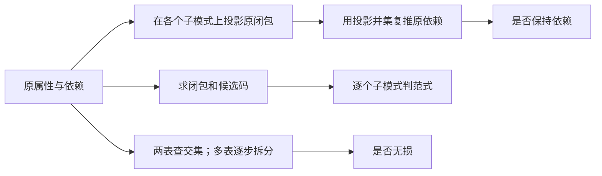

# 《数据库系统》第6章习题：闭包、无损连接与依赖保持

按原件第 1–21 页复核。下文推导和反例是参考解答，标为「订正」处与原件表述不同。字母连写表示属性集合。

> [!TIP]
> 先问是在==重建元组==还是==局部验证约束==：前者检验自然连接会不会拼出假元组，后者检验子模式的约束能不能合起来推出原依赖。“分到 BCNF”不能替代这两项检查。

两表的属性交集必须在**原依赖**下决定其中一侧的差集，才能直接判无损。求投影则要在原依赖下求闭包，再与子模式取交集，而不是只挑原表里字面上没有出界的依赖。可参看[属性集闭包](../../../topics/数据库系统/属性集闭包.md)、[函数依赖](../../../topics/数据库系统/函数依赖.md)和[规范化](../../../topics/数据库系统/规范化.md)。

## 课程、教师与教室（第 1–3 页）

原关系 $CTHRSG$ 中，$C,T,H,R,S,G$ 分别表示课程、教师、时刻、教室、学生和成绩。依赖为 $C\to T$、$HR\to C$、$HT\to R$、$CS\to G$、$HS\to R$。

**参考解答。** $H,S$ 从不出现在依赖右边，都必须进入码。由 $HS$ 先推出 $R$，再推出 $C,T,G$，故唯一候选码为 $HS$。沿三刀拆开：

| 拆分的原模式 | 两边及其交集 | 保证无损的依赖 |
| --- | --- | --- |
| CTHRSG | CSG、CTHRS，交集 CS | $CS\to G$ |
| CTHRS | CT、CHRS，交集 C | $C\to T$ |
| CHRS | CHR、CHS，交集 CH | $CH\to R$，由 $C\to T$ 和 $HT\to R$ 推出 |

在 CSG、CT、CHR、CHS 上的投影基分别为 $CS\to G$、$C\to T$、$\{CH\to R,HR\to C\}$、$HS\to C$。其中 CHR 的码是 CH 和 HR，其他三个子模式各自的依赖左部就是码，故四个子模式均为 BCNF。原件留问 $HT\to R$：在投影并集下从 $HT$ 出发闭包仍为 $HT$，这是此次分解损失的原依赖；并不违背无损结论。

## 看不见的中间属性（第 4–5 页）

原关系 $ABCD$，已知 $A\to B$、$B\to C$、$D\to B$，考察 ACD 和 BD。

**参考解答。** ACD 的投影由 $A\to C,D\to C$ 生成，中间用到被移出的 $B$；BD 的投影由 $D\to B$ 生成。ACD 唯一码为 AD，$C$ 对它有部分依赖，只到 1NF；BD 的码是 D，为 BCNF。按 $A\to C$ 可将 ACD 无损拆成 AC 与 AD；按 $D\to C$ 可拆成 DC 与 AD，所得两边各为 BCNF。

**补充。** 原先的 ACD、BD 已构成无损分解，交集 D 决定 BD 的额外属性 B。但投影并集下 A、B 的闭包分别是 AC、B，因此已丢掉 $A\to B$ 与 $B\to C$。

## 职工营业额（第 6–8 页）

以 $E,D,V,N,M$ 表示职工编号、日期、日营业额、部门名、部门经理。依赖为 $ED\to V$、$E\to N$、$N\to M$。

**参考解答。** 唯一码 ED，原关系因 $E\to N$ 只到 1NF。先拆成 EDV、ENM，公共列 E 能决定 ENM，故无损；EDV 为 BCNF，ENM 的码是 E，虽无部分依赖，但 $N\to M$ 违反 3NF，只到 2NF。再把 ENM 拆成 EN、NM，交集 N 能决定 NM。最终三个子模式都为 BCNF，三条原依赖也各落在一张表内。

## 候选码不止一个（第 9–10 页）

原关系 $ABCD$，依赖 $AB\to C,C\to A,C\to D$，拆为 ACD 与 BC。

**参考解答。** B 必须进码；AB 可推出 C，BC 可推出 A 和 D，候选码恰为 AB 与 BC。两表的交集 C 决定 AD，故无损。ACD 的投影基为 $C\to A,C\to D$，BC 没有非平凡投影依赖；分别以 C、BC 为码，均为 BCNF。投影并集下 AB 推不出 C，故不保持依赖。第 10 页问范式时应逐个子模式判断：前一组同名的 ACD 只到 1NF，此处 ACD 却是 BCNF，因为其**投影依赖**不同。

## 有损反例与无损反例（第 11–12 页）

**第 11 页参考解答。** 在 $ABC$ 上有 $B\to C,C\to A$，拆成 AB、AC，交集 A 不能决定 B 或 C。可取两个合法元组 $(a,b_1,c_1)$、$(a,b_2,c_2)$；连接还会拼出另两种交叉搭配。投影基分别为 $B\to A$、$C\to A$，从 B 推不出 C，所以分解既有损，也不保持依赖。

**第 12 页参考解答。** 在 $ABCD$ 上有链 $A\to B,B\to C,C\to D$，拆为 AB、ACD。原关系唯一码 A，满足 2NF；$B\to C$ 和 $C\to D$ 违反 3NF。交集 A 可决定 AB，所以无损；投影基是 $A\to B$ 与 $\{A\to C,C\to D\}$。AB 是 BCNF，ACD 中 $C\to D$ 仍违反 3NF。

> [!WARNING]
> **订正（第 12 页）。** 原件一边写投影并集闭包等于原闭包，一边说丢失 $B\to C$。投影并集下 B 的闭包只有 B，正确关系是不等；本拆分==无损但不保持依赖==。

## 较大属性组的合成（第 13 页）

原关系 $ABCDEFG$，依赖 $A\to B,A\to C,E\to D,AE\to G$，考察 ABC 与 ADEFG。

**参考解答。** A、E、F 均不在依赖右部，三者合起来又能推出其余属性，故唯一码 AEF；$A\to B$ 是部分依赖，原关系只到 1NF。ABC 与 ADEFG 的交集 A 决定 BC，所以无损；四条原依赖分处两边，故保持依赖。进一步合成 $\{ABC,DE,AEG,AEF\}$：前三个模式承载四条依赖，最后的 AEF 保留整关系候选码。从整关系按 $A\to BC$、$E\to D$、$AE\to G$ 逐步拆出前三个关系即可逐步证明无损，四个子模式至少都满足 3NF。

## 综合题与课堂练习（第 14–21 页）

**综合题参考解答。** 在 $ABCDE$ 上有 $A\to B,C\to D,AC\to E$，唯一码为 AC；$A\to B$ 与 $C\to D$ 均属部分依赖，原关系只到 1NF。ACE 与 ABCD 的交集 AC 决定 E，故无损；其投影基分别为 $AC\to E$ 与 $\{A\to B,C\to D\}$，分解保持依赖。ACE 是 BCNF，ABCD 只到 1NF。继续把 AB 和 CD 依次从全模式拆出，最终为 $\{AB,CD,ACE\}$。两刀都是交集决定拆出侧，所得三表均为 BCNF。

**末页练习参考解答。** 删除 $AC\to E$ 后，E 也不再出现在依赖右部，唯一码变成 ACE。同一三表结构仍无损且保持仅余的两条依赖，但此时 ACE 是必须补回的候选码关系，不承载 $AC\to E$。可对照[码](../../../topics/数据库系统/码.md)、[范式](../../../topics/数据库系统/范式.md)和[最小依赖集](../../../topics/数据库系统/最小依赖集.md)。
