# 《数据库系统》第6章 关系数据理论（课件）

原件的每一页，下面附识别出的文字。

### 第 1 页

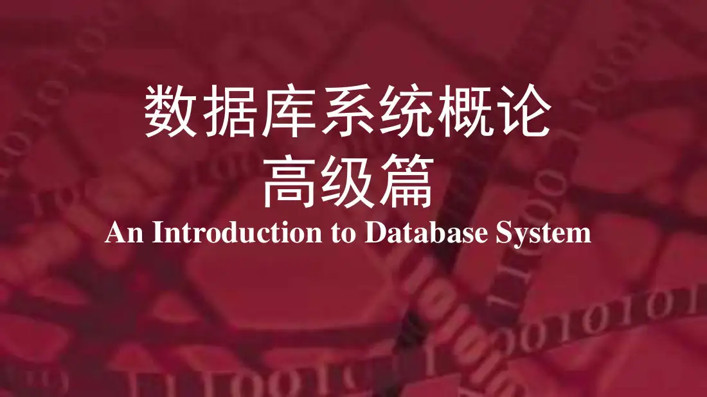

原文：

数据库系统概论 高级篇 An Introduction to Database System

### 数据库系统概论 基础篇

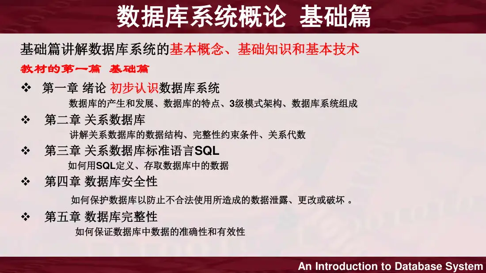

原文：

数据库系统概论 基础篇

基础篇讲解数据库系统的基本概念、基础知识和基本技术

教材的第一篇 基础篇

第一章 绪论 初步认识数据库系统

数据库的产生和发展、数据库的特点、3级模式架构、数据库系统组成

第二章 关系数据库

讲解关系数据库的数据结构、完整性约束条件、关系代数

第三章 关系数据库标准语言SQL

如何用SQL定义、存取数据库中的数据

第四章 数据库安全性

如何保护数据库以防止不合法使用所造成的数据泄露、更改或破坏。

第五章 数据库完整性

如何保证数据库中数据的准确性和有效性

An Introduction to Database System

### 数据库系统概论（高级篇）

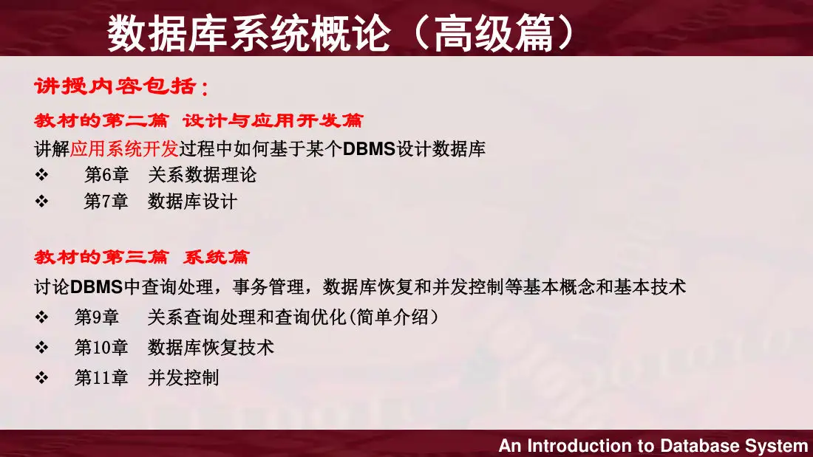

原文：

数据库系统概论（高级篇）

讲授内容包括：

教材的第二篇 设计与应用开发篇

讲解应用系统开发过程中如何基于某个DBMS设计数据库

第6章 关系数据理论

第7章 数据库设计

教材的第三篇 系统篇

讨论DBMS中查询处理，事务管理，数据库恢复和并发控制等基本概念和基本技术

第9章 关系查询处理和查询优化(简单介绍)

第10章 数据库恢复技术

第11章 并发控制

An Introduction to Database System

### 第六章 关系数据理论

原文：

第六章 关系数据理论

An Introduction to Database System

### 第六章 关系数据理论

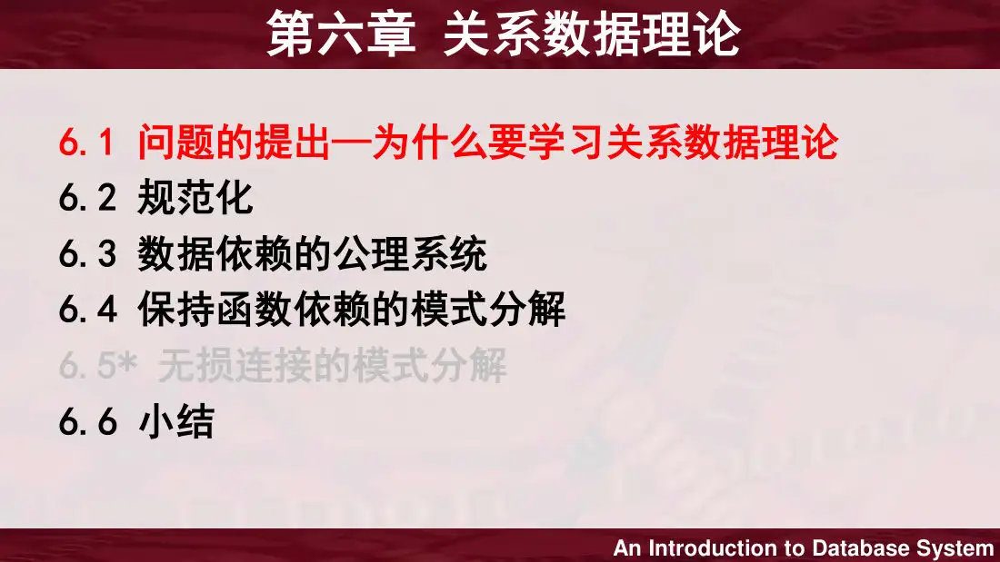

原文：

第六章 关系数据理论

6.1 问题的提出一为什么要学习关系数据理论

6.2 规范化

6.3 数据依赖的公理系统

6.4 保持函数依赖的模式分解

6.5\* 无损连接的模式分解

6.6 小结

An Introduction to Database System

### 6.1 问题的提出

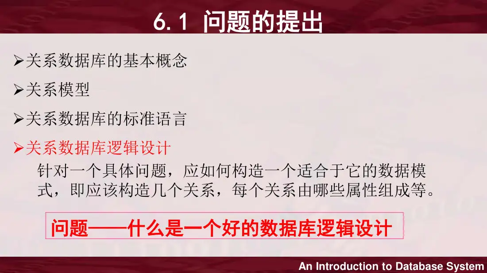

原文：

6.1 问题的提出

关系数据库的基本概念

关系模型

关系数据库的标准语言

关系数据库逻辑设计

针对一个具体问题，应如何构造一个适合于它的数据模式，即应该构造几个关系，每个关系由哪些属性组成等。

问题——什么是一个好的数据库逻辑设计

An Introduction to Database System

### 一个例子

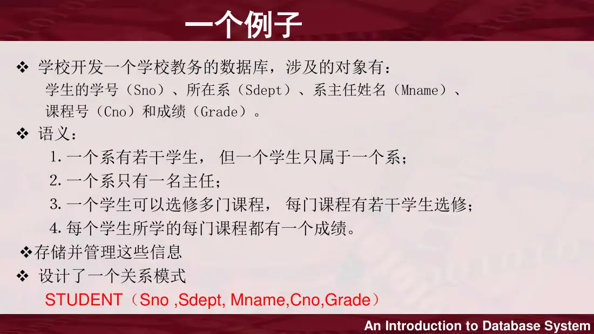

原文：

一个例子

学校开发一个学校教务的数据库，涉及的对象有：

学生的学号（Sno）、所在系（Sdept）、系主任姓名（Mname）、课程号（Cno）和成绩（Grade）。

语义:

1. 一个系有若干学生，但一个学生只属于一个系；

2. 一个系只有一名主任;

3. 一个学生可以选修多门课程，每门课程有若干学生选修；

4. 每个学生所学的每门课程都有一个成绩。

◆存储并管理这些信息

设计了一个关系模式

STUDENT (Sno, Sdept, Mname, Cno, Grade)

An Introduction to Database System

### 一个例子

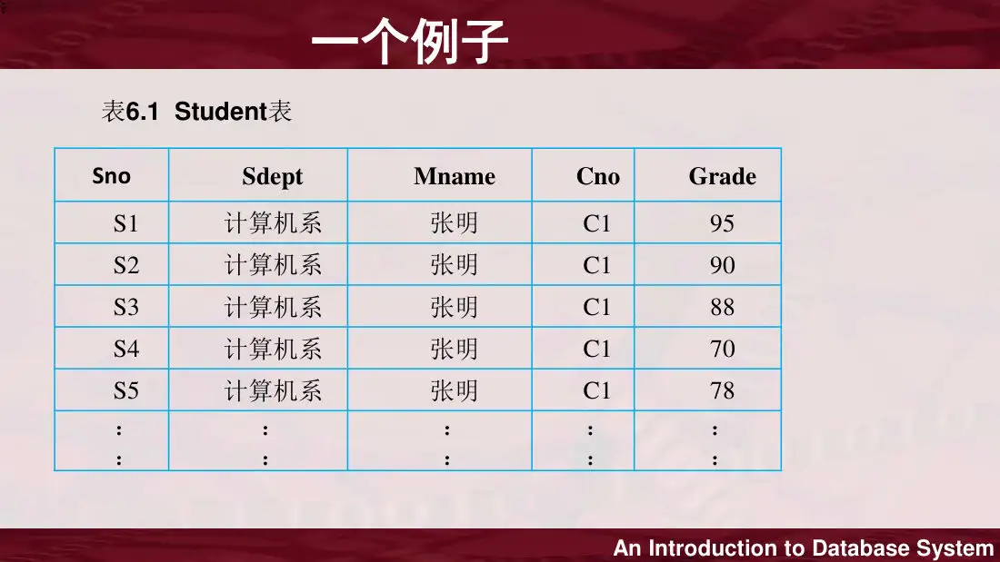

原文：

一个例子

表6.1 Student表
<table><tr><td>Sno</td><td>Sdept</td><td>Mname</td><td>Cno</td><td>Grade</td></tr><tr><td>S1</td><td>计算机系</td><td>张明</td><td>C1</td><td>95</td></tr><tr><td>S2</td><td>计算机系</td><td>张明</td><td>C1</td><td>90</td></tr><tr><td>S3</td><td>计算机系</td><td>张明</td><td>C1</td><td>88</td></tr><tr><td>S4</td><td>计算机系</td><td>张明</td><td>C1</td><td>70</td></tr><tr><td>S5</td><td>计算机系</td><td>张明</td><td>C1</td><td>78</td></tr><tr><td>:</td><td>:</td><td>:</td><td>:</td><td>:</td></tr><tr><td>:</td><td>:</td><td>:</td><td>:</td><td>:</td></tr></table>

An Introduction to Database System

### 关系模式存在的问题

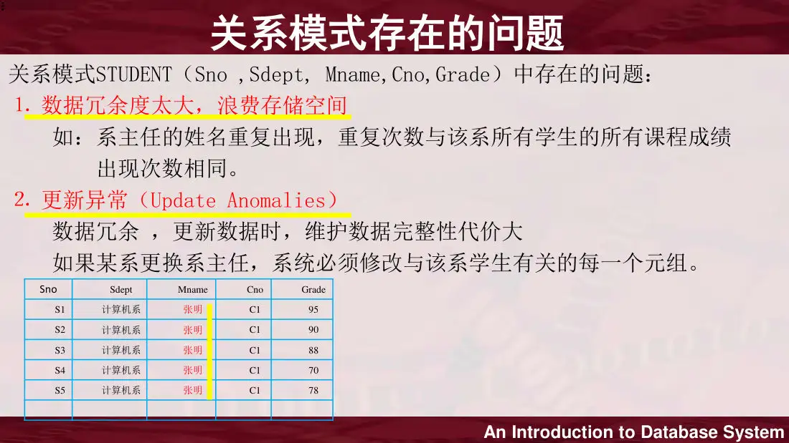

原文：

关系模式存在的问题

关系模式STUDENT（Sno，Sdept，Mname，Cno,Grade）中存在的问题：

1. 数据冗余度太大，浪费存储空间

如：系主任的姓名重复出现，重复次数与该系所有学生的所有课程成绩出现次数相同。

2. 更新异常（Update Anomalies）

数据冗余，更新数据时，维护数据完整性代价大

如果某系更换系主任，系统必须修改与该系学生有关的每一个元组。

<table><tr><td>Sno</td><td>Sdept</td><td>Mname</td><td>Cno</td><td>Grade</td></tr><tr><td>S1</td><td>计算机系</td><td>张明</td><td>C1</td><td>95</td></tr><tr><td>S2</td><td>计算机系</td><td>张明</td><td>C1</td><td>90</td></tr><tr><td>S3</td><td>计算机系</td><td>张明</td><td>C1</td><td>88</td></tr><tr><td>S4</td><td>计算机系</td><td>张明</td><td>C1</td><td>70</td></tr><tr><td>S5</td><td>计算机系</td><td>张明</td><td>C1</td><td>78</td></tr><tr><td></td><td></td><td></td><td></td><td></td></tr></table>

An Introduction to Database System

### 关系模式存在的问题

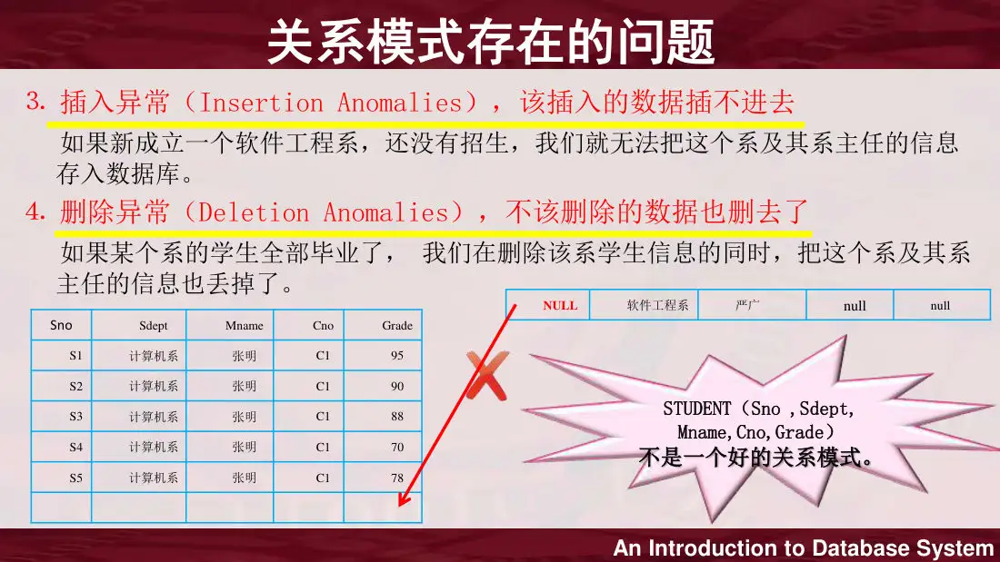

原文：

关系模式存在的问题

3. 插入异常（Insertion Anomalies），该插入的数据插不进去
如果新成立一个软件工程系，还没有招生，我们就无法把这个系及其系主任的信息存入数据库。

4. 删除异常（Deletion Anomalies），不该删除的数据也删去了如果某个系的学生全部毕业了，我们在删除该系学生信息的同时，把这个系及其系主任的信息也丢掉了。

<table><tr><td>Sno</td><td>Sdept</td><td>Mname</td><td>Cno</td><td>Grade</td></tr><tr><td>S1</td><td>计算机系</td><td>张明</td><td>C1</td><td>95</td></tr><tr><td>S2</td><td>计算机系</td><td>张明</td><td>C1</td><td>90</td></tr><tr><td>S3</td><td>计算机系</td><td>张明</td><td>C1</td><td>88</td></tr><tr><td>S4</td><td>计算机系</td><td>张明</td><td>C1</td><td>70</td></tr><tr><td>S5</td><td>计算机系</td><td>张明</td><td>C1</td><td>78</td></tr><tr><td></td><td></td><td></td><td></td><td></td></tr></table>

STUDENT (Sno, Sdept, Mname, Cno, Grade) 不是一个好的关系模式。

An Introduction to Database System

### 关系模式存在的问题

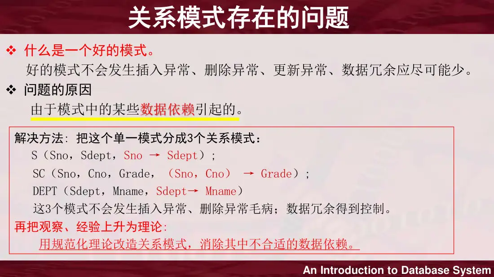

原文：

关系模式存在的问题

什么是一个好的模式。

好的模式不会发生插入异常、删除异常、更新异常、数据冗余应尽可能少。

问题的原因

由于模式中的某些数据依赖引起的。

解决方法：把这个单一模式分成3个关系模式：

再把观察、经验上升为理论：

用规范化理论改造关系模式，消除其中不合适的数据依赖。

An Introduction to Database System

### 6.1 问题的提出

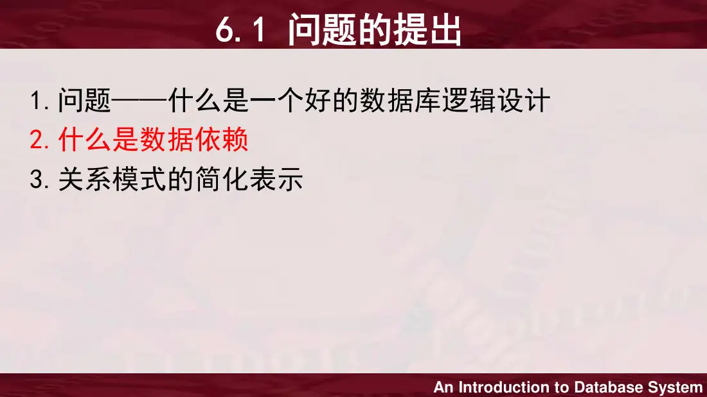

原文：

6.1 问题的提出

1. 问题——什么是一个好的数据库逻辑设计

2. 什么是数据依赖

3. 关系模式的简化表示

An Introduction to Database System

### 什么是数据依赖

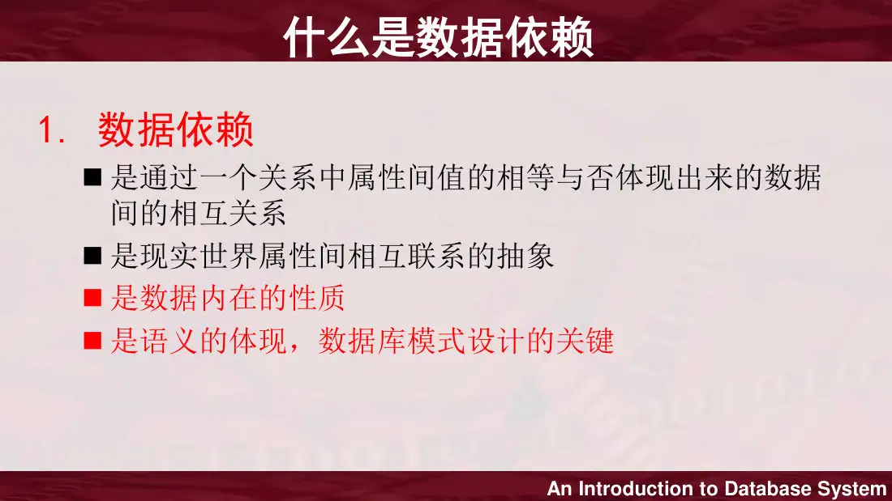

原文：

什么是数据依赖

1. 数据依赖

■ 是通过一个关系中属性间值的相等与否体现出来的数据间的相互关系

■是现实世界属性间相互联系的抽象

■ 是数据内在的性质

■ 是语义的体现，数据库模式设计的关键

An Introduction to Database System

### 什么是数据依赖

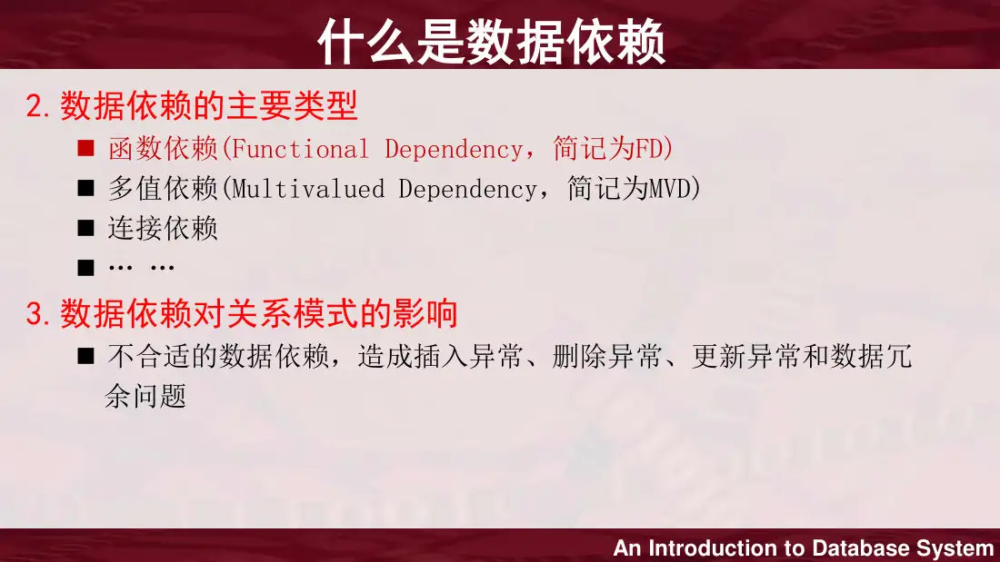

原文：

什么是数据依赖

2. 数据依赖的主要类型

■ 函数依赖(Functional Dependency，简记为FD)

■ 多值依赖(Multivalued Dependency，简记为MVD)

■ 连接依赖

3. 数据依赖对关系模式的影响

■ 不合适的数据依赖，造成插入异常、删除异常、更新异常和数据冗余问题

An Introduction to Database System

### 什么是数据依赖：一个例子

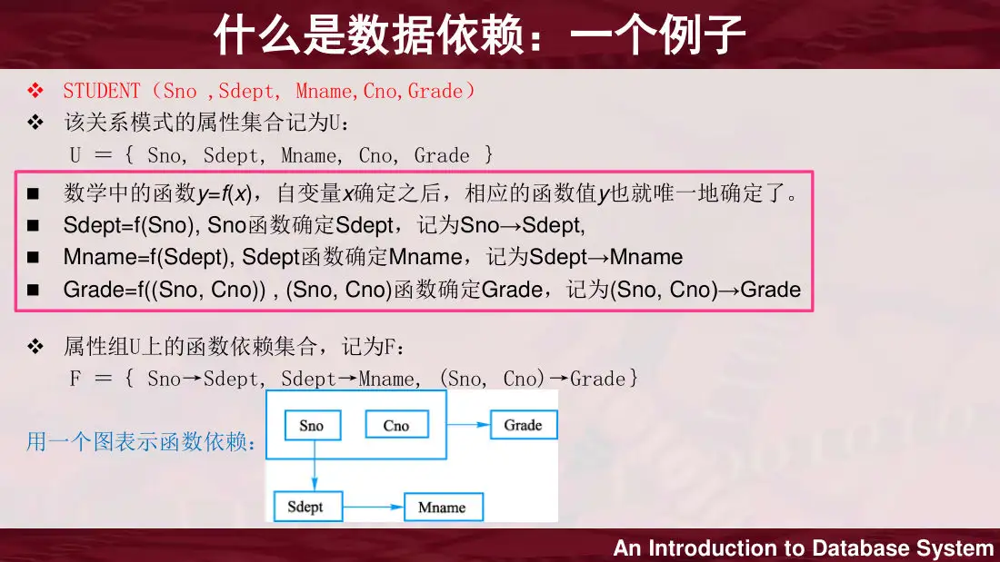

原文：

什么是数据依赖：一个例子

◆ STUDENT (Sno, Sdept, Mname, Cno, Grade)

该关系模式的属性集合记为U:

■ 数学中的函数 $y = f(x)$ ，自变量 $x$ 确定之后，相应的函数值 $y$ 也就唯一地确定了。

■ Sdept=f(Sno), Sno函数确定Sdept，记为Sno→Sdept,

■ Mname=f(Sdept), Sdept函数确定Mname，记为Sdept→Mname

■ Grade=f((Sno, Cno)), (Sno, Cno)函数确定Grade，记为(Sno, Cno)→Grade

属性组U上的函数依赖集合，记为F:

用一个图表示函数依赖:

An Introduction to Database System

### 6.1 问题的提出

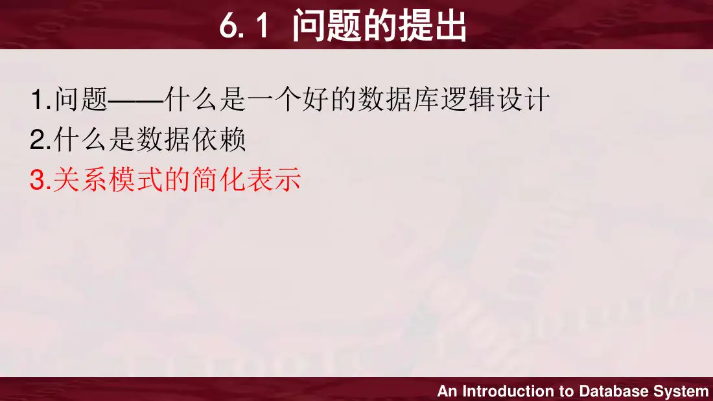

原文：

6.1 问题的提出

1. 问题——什么是一个好的数据库逻辑设计

2.什么是数据依赖

3. 关系模式的简化表示

An Introduction to Database System

### 关系模式的简化表示

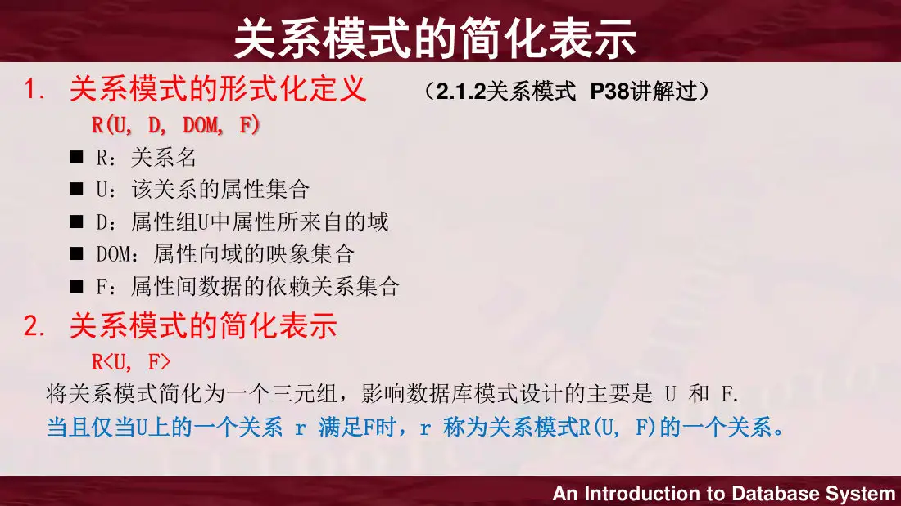

原文：

关系模式的简化表示

1. 关系模式的形式化定义 (2.1.2关系模式 P38讲解过)

R(U, D, DOM, F)

■ R: 关系名

■ U: 该关系的属性集合

■ D: 属性组U中属性所来自的域

■ DOM: 属性向域的映象集合

■ F: 属性间数据的依赖关系集合

2. 关系模式的简化表示

R<U, F>

将关系模式简化为一个三元组，影响数据库模式设计的主要是 U 和 F.

当且仅当U上的一个关系 r 满足F时，r 称为关系模式R(U, F)的一个关系。

An Introduction to Database System

### 再看例子

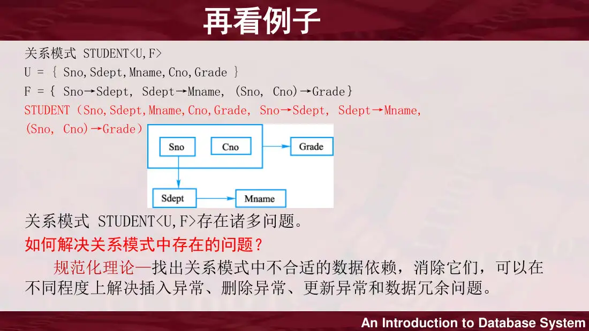

原文：

再看例子

关系模式 STUDENT<U, F>

U = { Sno, Sdept, Mname, Cno, Grade }

F = { Sno→Sdept, Sdept→Mname, (Sno, Cno)→Grade }

STUDENT (Sno, Sdept, Mname, Cno, Grade, Sno→Sdept, Sdept→Mname,

(Sno, Cno)→Grade)

关系模式 STUDENT<U, F>存在诸多问题。

如何解决关系模式中存在的问题？

规范化理论—找出关系模式中不合适的数据依赖，消除它们，可以在不同程度上解决插入异常、删除异常、更新异常和数据冗余问题。

An Introduction to Database System

### 第六章 关系数据理论

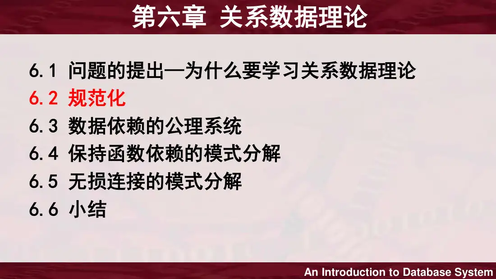

原文：

第六章 关系数据理论

6.1 问题的提出——为什么要学习关系数据理论

6.2 规范化

6.3 数据依赖的公理系统

6.4 保持函数依赖的模式分解

6.5 无损连接的模式分解

6.6 小结

An Introduction to Database System

### 6.2 规范化—关系的规范化理论

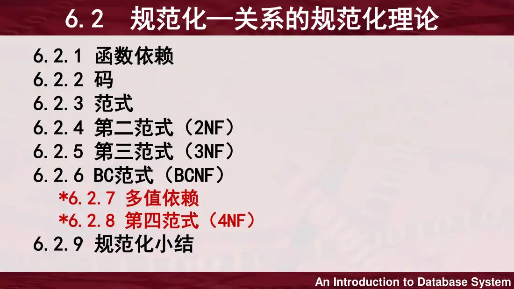

原文：

6.2 规范化—关系的规范化理论

6.2.1 函数依赖
6.2.2 码
6.2.3 范式
6.2.4 第二范式（2NF）
6.2.5 第三范式（3NF）
6.2.6 BC范式（BCNF）
\*6.2.7 多值依赖
\*6.2.8 第四范式（4NF）
6.2.9 规范化小结

An Introduction to Database System

### 6.2 规范化—关系的规范化理论

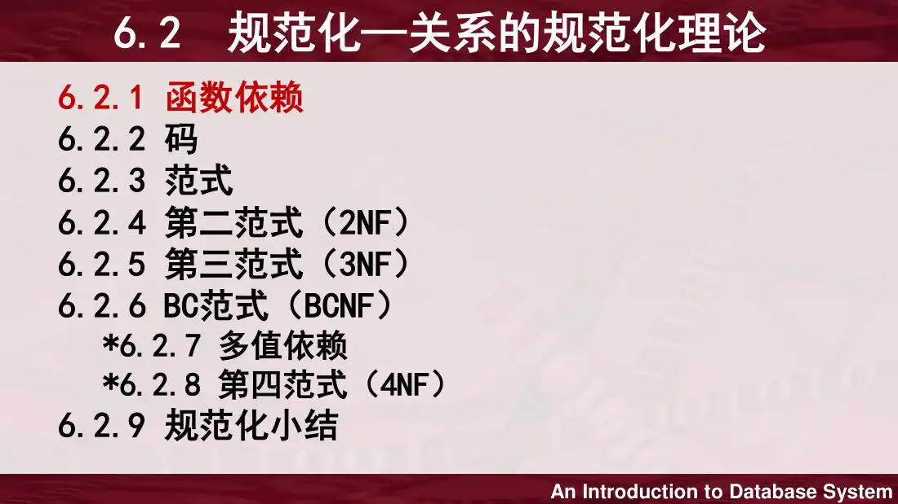

原文：

6.2 规范化—关系的规范化理论

6.2.1 函数依赖
6.2.2 码
6.2.3 范式
6.2.4 第二范式（2NF）
6.2.5 第三范式（3NF）
6.2.6 BC范式（BCNF）
\*6.2.7 多值依赖
\*6.2.8 第四范式（4NF）
6.2.9 规范化小结

An Introduction to Database System

### 6.2.1 函数依赖

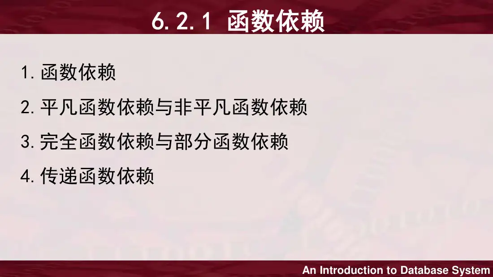

原文：

6.2.1 函数依赖

1. 函数依赖

2. 平凡函数依赖与非平凡函数依赖

3. 完全函数依赖与部分函数依赖

4. 传递函数依赖

An Introduction to Database System

### 1. 函数依赖

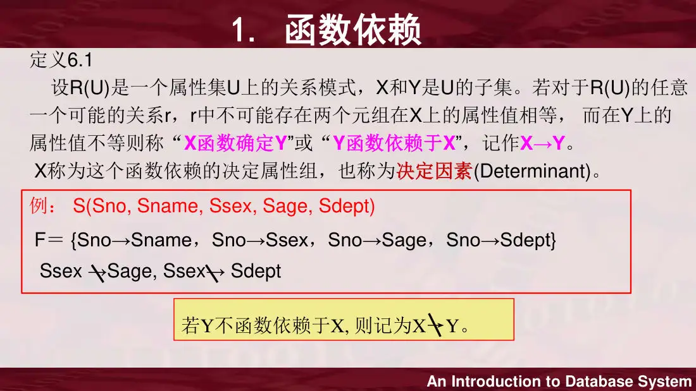

原文：

1. 函数依赖

定义6.1

设R(U)是一个属性集U上的关系模式，X和Y是U的子集。若对于R(U)的任意一个可能的关系r，r中不可能存在两个元组在X上的属性值相等，而在Y上的属性值不等则称“X函数确定Y”或“Y函数依赖于X”，记作X→Y。

X称为这个函数依赖的决定属性组，也称为决定因素(Determinant)。

若Y不函数依赖于X, 则记为 $X \nrightarrow Y$ 。

An Introduction to Database System

### 1. 函数依赖（续）

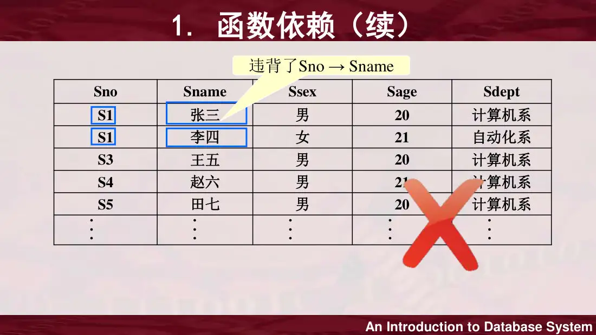

原文：

1. 函数依赖（续）

违背了Sno → Sname

<table><tr><td>Sno</td><td>Sname</td><td>Ssex</td><td>Sage</td><td>Sdept</td></tr><tr><td>S1</td><td>张三</td><td>男</td><td>20</td><td>计算机系</td></tr><tr><td>S1</td><td>李四</td><td>女</td><td>21</td><td>自动化系</td></tr><tr><td>S3</td><td>王五</td><td>男</td><td>20</td><td>计算机系</td></tr><tr><td>S4</td><td>赵六</td><td>男</td><td>21</td><td>计算机系</td></tr><tr><td>S5</td><td>田七</td><td>男</td><td>20</td><td>计算机系</td></tr><tr><td>:</td><td>:</td><td>:</td><td>:</td><td>:</td></tr><tr><td>:</td><td>:</td><td>:</td><td>:</td><td>:</td></tr></table>

An Introduction to Database System

### 如何确定函数依赖（续）

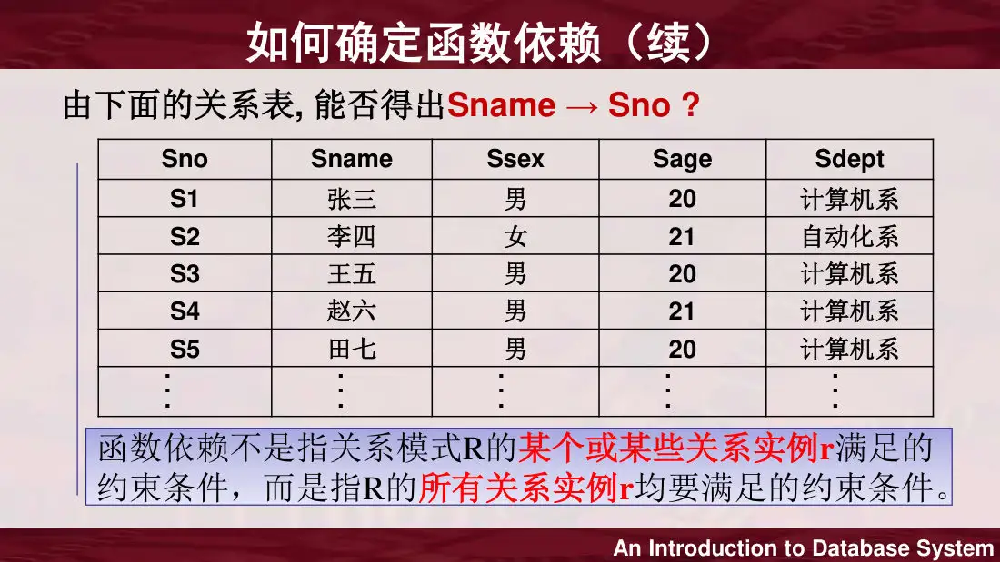

原文：

如何确定函数依赖（续）

由下面的关系表, 能否得出Sname → Sno?

<table><tr><td>Sno</td><td>Sname</td><td>Ssex</td><td>Sage</td><td>Sdept</td></tr><tr><td>S1</td><td>张三</td><td>男</td><td>20</td><td>计算机系</td></tr><tr><td>S2</td><td>李四</td><td>女</td><td>21</td><td>自动化系</td></tr><tr><td>S3</td><td>王五</td><td>男</td><td>20</td><td>计算机系</td></tr><tr><td>S4</td><td>赵六</td><td>男</td><td>21</td><td>计算机系</td></tr><tr><td>S5</td><td>田七</td><td>男</td><td>20</td><td>计算机系</td></tr><tr><td>:</td><td>:</td><td>:</td><td>:</td><td>:</td></tr></table>

函数依赖不是指关系模式R的某个或某些关系实例r满足的约束条件，而是指R的所有关系实例r均要满足的约束条件。

An Introduction to Database System

### 如何确定函数依赖

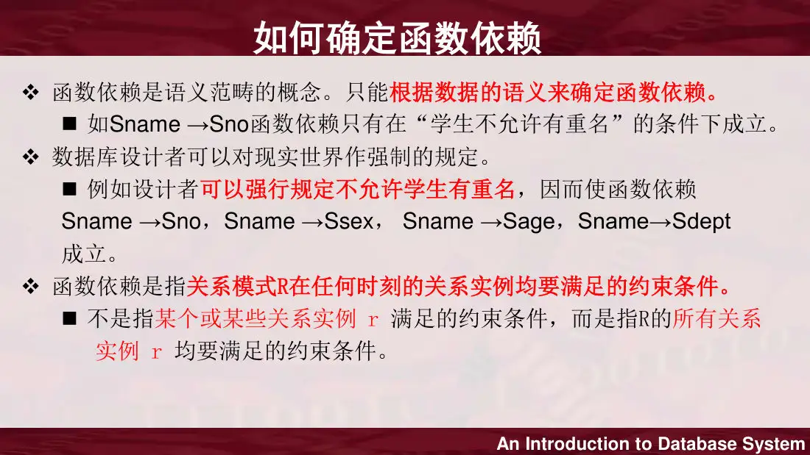

原文：

如何确定函数依赖

◆ 函数依赖是语义范畴的概念。只能根据数据的语义来确定函数依赖。

■ 如Sname → Sno函数依赖只有在“学生不允许有重名”的条件下成立。

数据库设计者可以对现实世界作强制的规定。

■ 例如设计者可以强行规定不允许学生有重名，因而使函数依赖 Sname →Sno, Sname →Ssex, Sname →Sage, Sname→Sdept 成立。

◆ 函数依赖是指关系模式R在任何时刻的关系实例均要满足的约束条件。

■ 不是指某个或某些关系实例 r 满足的约束条件，而是指R的所有关系实例 r 均要满足的约束条件。

An Introduction to Database System

### 2. 平凡函数依赖与非平凡函数依赖

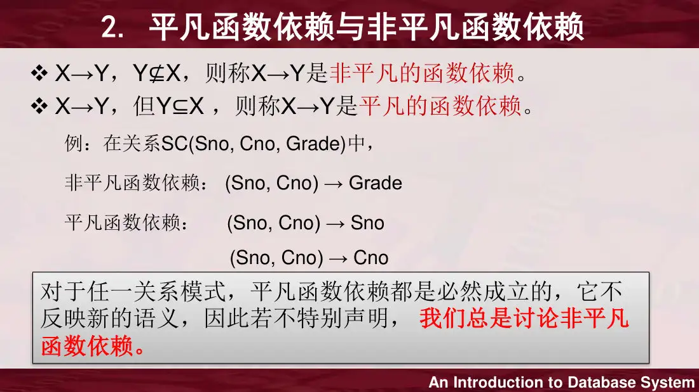

原文：

2. 平凡函数依赖与非平凡函数依赖

✿ X→Y，Y∉X，则称X→Y是非平凡的函数依赖。

✿ X→Y，但Y⊆X，则称X→Y是平凡的函数依赖。

例：在关系SC(Sno, Cno, Grade)中，

非平凡函数依赖: (Sno, Cno) → Grade

平凡函数依赖: (Sno, Cno) → Sno

$$
(\mathrm{Sno}, \mathrm{Cno}) \rightarrow \mathrm{Cno}
$$

对于任一关系模式，平凡函数依赖都是必然成立的，它不反映新的语义，因此若不特别声明，我们总是讨论非平凡函数依赖。

An Introduction to Database System

### 3. 完全函数依赖与部分函数依赖

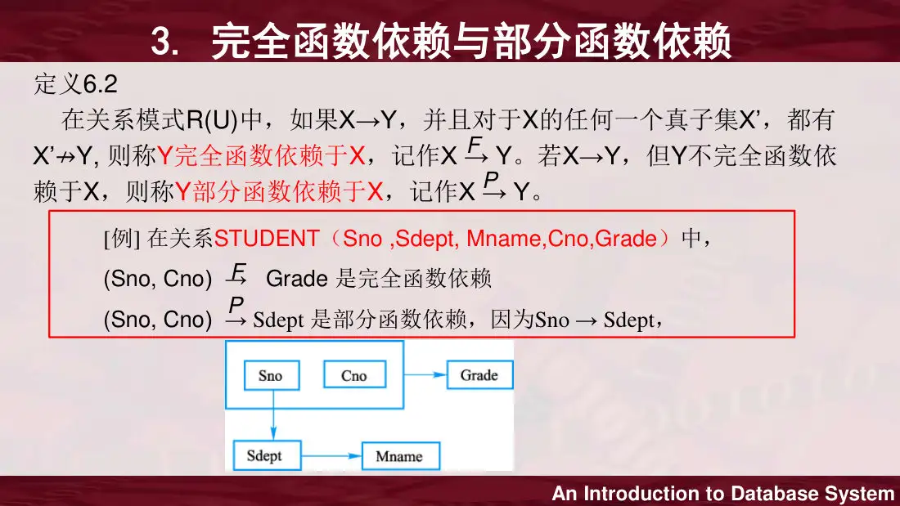

原文：

3. 完全函数依赖与部分函数依赖

定义6.2

在关系模式R(U)中，如果X→Y，并且对于X的任何一个真子集X'，都有X'→Y，则称Y完全函数依赖于X，记作X $\xrightarrow{F}$ Y。若X→Y，但Y不完全函数依赖于X，则称Y部分函数依赖于X，记作X $\xrightarrow{P}$ Y。

[例] 在关系 STUDENT（Sno, Sdept, Mname, Cno, Grade）中，

(Sno, Cno) $\rightarrow$ Grade 是完全函数依赖

(Sno, Cno) $\xrightarrow{P}$ Sdept 是部分函数依赖，因为Sno $\rightarrow$ Sdept,

An Introduction to Database System

### 4. 传递函数依赖

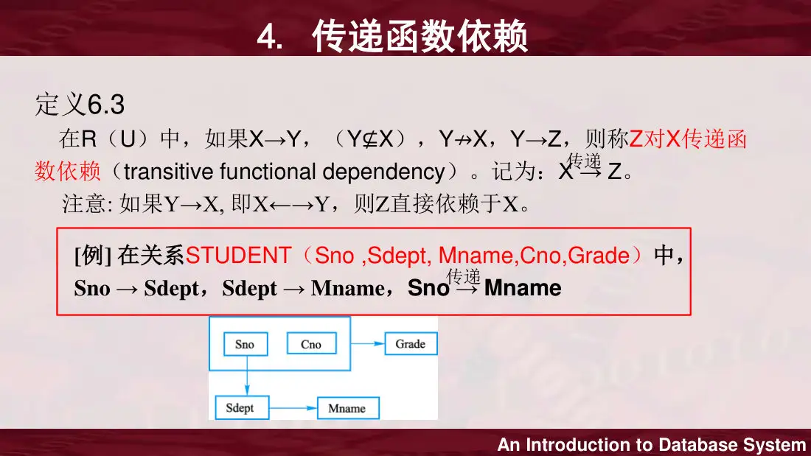

原文：

4. 传递函数依赖

定义6.3

在R（U）中，如果X→Y，（Y∉X），Y≠X，Y→Z，则称Z对X传递函数依赖（transitive functional dependency）。记为：X $\xrightarrow{传递}$ Z。

注意: 如果Y→X, 即X←→Y, 则Z直接依赖于X。

[例] 在关系 STUDENT（Sno, Sdept, Mname, Cno, Grade）中，Sno → Sdept, Sdept → Mname, Sno $^{传递}$ → Mname

An Introduction to Database System

### 6.2.1 函数依赖回顾

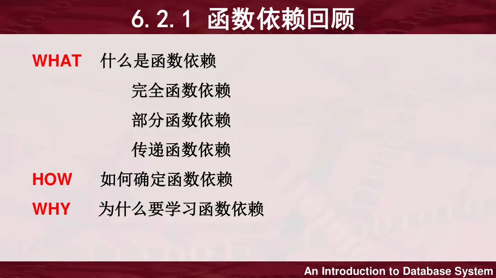

原文：

6.2.1 函数依赖回顾

WHAT 什么是函数依赖

完全函数依赖

部分函数依赖

传递函数依赖

HOW 如何确定函数依赖

WHY 为什么要学习函数依赖

An Introduction to Database System

### 6.2 规范化—关系的规范化理论

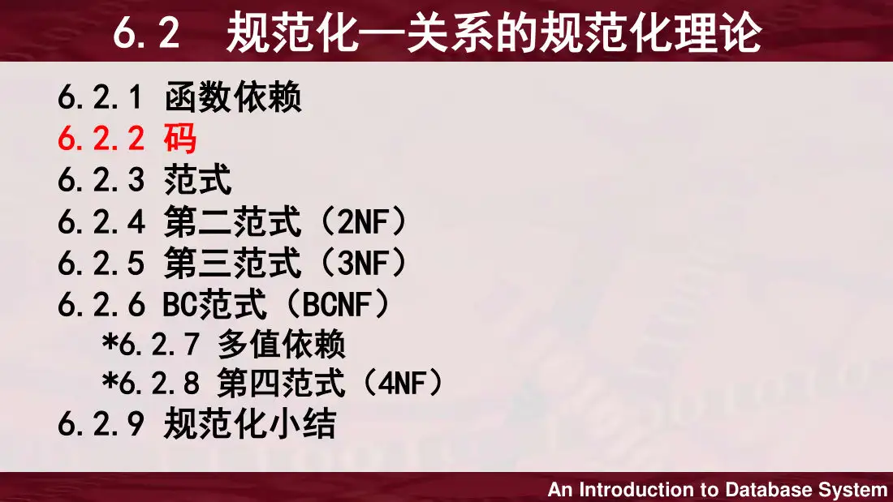

原文：

6.2 规范化—关系的规范化理论

6.2.1 函数依赖
6.2.2 码
6.2.3 范式
6.2.4 第二范式（2NF）
6.2.5 第三范式（3NF）
6.2.6 BC范式（BCNF）
\*6.2.7 多值依赖
\*6.2.8 第四范式（4NF）
6.2.9 规范化小结

An Introduction to Database System

### 6.2.2 码

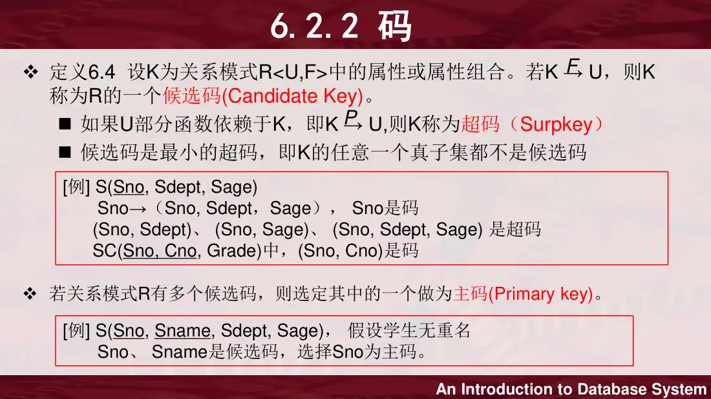

原文：

6.2.2 码

定义6.4 设K为关系模式R<U,F>中的属性或属性组合。若K $\rightarrow$ U，则K称为R的一个候选码(Candidate Key)。

■ 如果U部分函数依赖于K，即 $K \xrightarrow{P} U$ ，则K称为超码（Surpkey）

■ 候选码是最小的超码，即K的任意一个真子集都不是候选码

若关系模式R有多个候选码，则选定其中的一个做为主码(Primary key)。

[例] S(Sno, Sname, Sdept, Sage)，假设学生无重名Sno、Sname是候选码，选择Sno为主码。

An Introduction to Database System

### 6.2.2 码

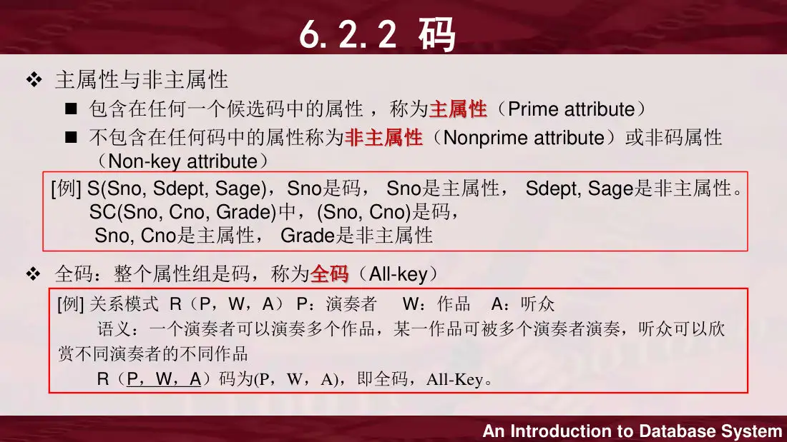

原文：

6.2.2 码

主属性与非主属性

■ 包含在任何一个候选码中的属性，称为主属性（Prime attribute）

■ 不包含在任何码中的属性称为非主属性（Nonprime attribute）或非码属性（Non-key attribute）

[例] S(Sno, Sdept, Sage), Sno是码, Sno是主属性, Sdept, Sage是非主属性。SC(Sno, Cno, Grade)中，(Sno, Cno)是码，Sno, Cno是主属性，Grade是非主属性

全码：整个属性组是码，称为全码（All-key）

[例] 关系模式 R（P，W，A） P：演奏者 W：作品 A：听众

语义：一个演奏者可以演奏多个作品，某一作品可被多个演奏者演奏，听众可以欣赏不同演奏者的不同作品

R（P，W，A）码为(P，W，A)，即全码，All-Key。

An Introduction to Database System

### 6.2.2 码：外部码——外码

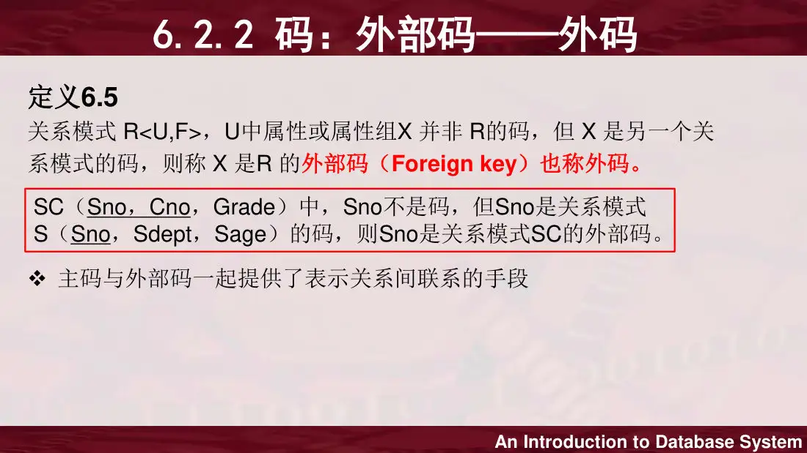

原文：

6.2.2 码：外部码——外码

定义6.5

关系模式 R<U,F>，U中属性或属性组X并非R的码，但X是另一个关系模式的码，则称X是R的外部码（Foreign key）也称外码。

SC（Sno，Cno，Grade）中，Sno不是码，但Sno是关系模式S（Sno，Sdept，Sage）的码，则Sno是关系模式SC的外部码。

主码与外部码一起提供了表示关系间联系的手段

An Introduction to Database System

### 思考与讨论

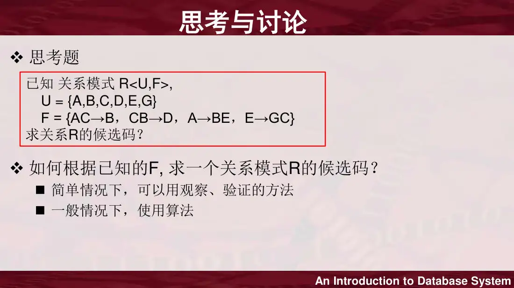

原文：

思考与讨论

思考题

已知关系模式 R<U,F>,

$$
\mathsf {U} = \{\mathsf {A}, \mathsf {B}, \mathsf {C}, \mathsf {D}, \mathsf {E}, \mathsf {G} \}
$$

$$
F = \{A C \rightarrow B, C B \rightarrow D, A \rightarrow B E, E \rightarrow G C \}
$$

求关系R的候选码？

◆ 如何根据已知的F, 求一个关系模式R的候选码?

■ 简单情况下，可以用观察、验证的方法

■ 一般情况下，使用算法

An Introduction to Database System

### 6.2.3 范式

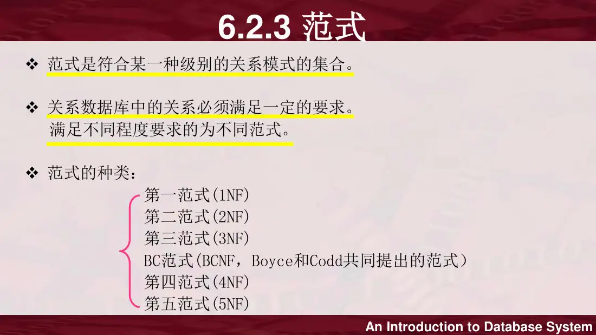

原文：

6.2.3 范式

✿ 范式是符合某一种级别的关系模式的集合。

关系数据库中的关系必须满足一定的要求。满足不同程度要求的为不同范式。

◆ 范式的种类:

第一范式(1NF)

第二范式(2NF)

第三范式(3NF)

BC范式(BCNF, Boyce和Codd共同提出的范式)

第四范式(4NF)

第五范式(5NF)

An Introduction to Database System

### 范式（续）

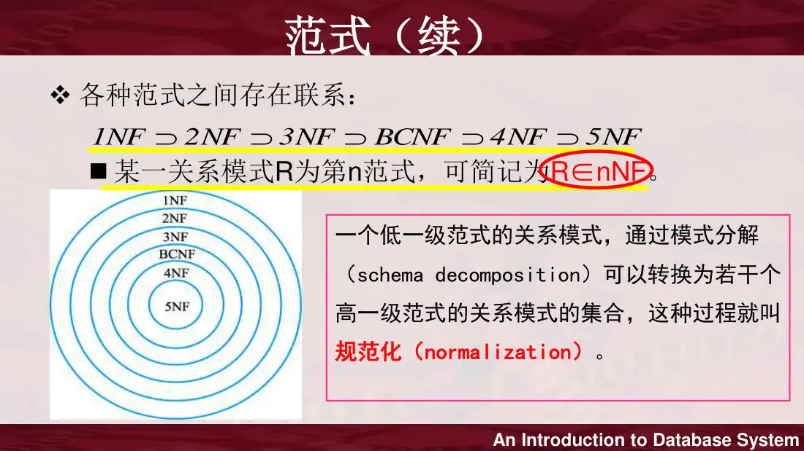

原文：

范式（续）

◆ 各种范式之间存在联系:

$1NF \supset 2NF \supset 3NF \supset BCNF \supset 4NF \supset 5NF$ ■ 某一关系模式R为第n范式，可简记为 $R \in nNF$ 。

一个低一级范式的关系模式，通过模式分解（schema decomposition）可以转换为若干个高一级范式的关系模式的集合，这种过程就叫规范化（normalization）。

An Introduction to Database System

### 第一范式

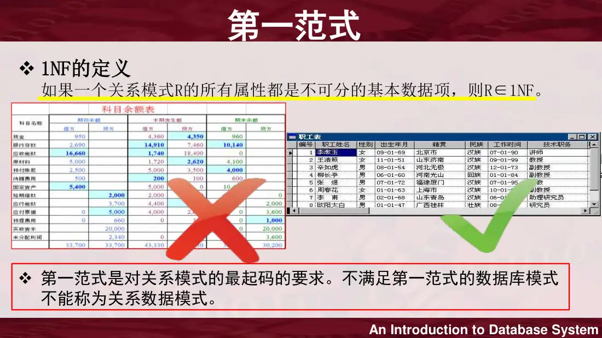

原文：

第一范式

◆ 1NF的定义

如果一个关系模式R的所有属性都是不可分的基本数据项，则 $R \in 1NF$ 。

<table><tr><td></td><td></td><td colspan="2">科目余额表</td><td></td><td></td><td></td></tr><tr><td rowspan="2">科目名称</td><td colspan="2">期初余额</td><td colspan="2">本期发生额</td><td colspan="2">期末余额</td></tr><tr><td>借方</td><td>贷方</td><td>借方</td><td>贷方</td><td>借方</td><td>贷方</td></tr><tr><td>现金</td><td>950</td><td></td><td>4,360</td><td>4,350</td><td>960</td><td></td></tr><tr><td>银行存款</td><td>2,690</td><td></td><td>14,910</td><td>7,460</td><td>10,140</td><td></td></tr><tr><td>应收帐款</td><td>16,660</td><td></td><td>1,740</td><td>18,400</td><td>0</td><td></td></tr><tr><td>原材料</td><td>5,000</td><td></td><td>1,720</td><td>2,620</td><td>4,100</td><td></td></tr><tr><td>预付账款</td><td>2,500</td><td></td><td>5,000</td><td>3,500</td><td>4,000</td><td></td></tr><tr><td>待摊费用</td><td>500</td><td></td><td>200</td><td>100</td><td>600</td><td></td></tr><tr><td>固定资产</td><td>5,400</td><td></td><td>5,000</td><td>0</td><td>10,1</td><td></td></tr><tr><td>短期借款</td><td></td><td>2,000</td><td>2,000</td><td></td><td></td><td>0</td></tr><tr><td>应付帐款</td><td></td><td>3,700</td><td>4,400</td><td></td><td></td><td>2,000</td></tr><tr><td>应付票据</td><td>0</td><td>5,000</td><td>4,000</td><td>2,000</td><td>0</td><td>3,600</td></tr><tr><td>预提费用</td><td>0</td><td>660</td><td>0</td><td>3,000</td><td>0</td><td>1,000</td></tr><tr><td>实收资本</td><td></td><td>20,000</td><td></td><td></td><td></td><td>20,000</td></tr><tr><td>未分配利润</td><td></td><td>2,340</td><td>0</td><td></td><td></td><td>3,600</td></tr><tr><td></td><td>33,700</td><td>33,700</td><td>43,330</td><td>3,000</td><td>30,200</td><td></td></tr></table>

<table><tr><td>编号</td><td>职工姓名</td><td>性别</td><td>出生年月</td><td>籍贯</td><td>民族</td><td>工作时间</td><td>技术职务</td></tr><tr><td>1</td><td>李漱玉</td><td>女</td><td>09-01-69</td><td>北京市</td><td>汉族</td><td>07-01-90</td><td>讲师</td></tr><tr><td>2</td><td>王清照</td><td>女</td><td>11-01-51</td><td>山东济南</td><td>汉族</td><td>09-01-99</td><td>教授</td></tr><tr><td>3</td><td>辛如虎</td><td>男</td><td>08-01-54</td><td>河北无极</td><td>汉族</td><td>12-01-73</td><td>副教授</td></tr><tr><td>4</td><td>柳长亭</td><td>男</td><td>06-01-60</td><td>河南光山</td><td>回族</td><td>01-01-84</td><td>副教授</td></tr><tr><td>5</td><td>张煜</td><td>男</td><td>07-01-72</td><td>福建厦门</td><td>汉族</td><td>07-01-95</td><td>教</td></tr><tr><td>6</td><td>周春花</td><td>女</td><td>01-01-63</td><td>上海市</td><td>汉族</td><td>10-01-59</td><td>副教授</td></tr><tr><td>7</td><td>李甫</td><td>男</td><td>02-01-68</td><td>山东青岛</td><td>汉族</td><td>06-01-68</td><td>助理研究员</td></tr><tr><td>8</td><td>欧阳太白</td><td>男</td><td>01-01-47</td><td>广西桂林</td><td>壮族</td><td>08-01-68</td><td>研究员</td></tr></table>

\- 第一范式是对关系模式的最起码的要求。不满足第一范式的数据库模式不能称为关系数据模式。

An Introduction to Database System

### 6.2.4 第二范式（2NF）

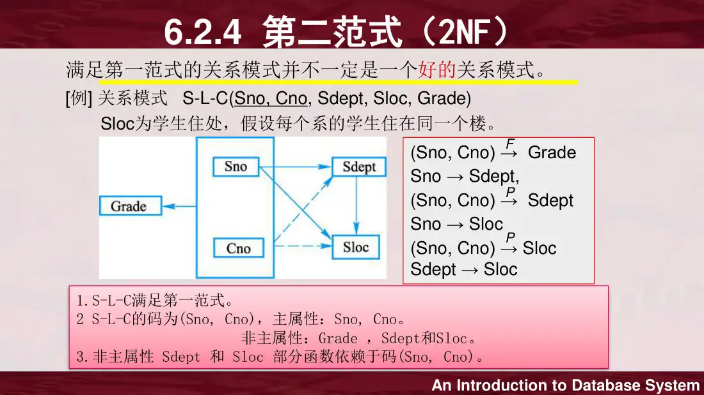

原文：

6.2.4 第二范式（2NF）

满足第一范式的关系模式并不一定是一个好的关系模式。

[例] 关系模式 S-L-C(Sno, Cno, Sdept, Sloc, Grade)

Sloc为学生住处，假设每个系的学生住在同一个楼。

(Sno, Cno) $\xrightarrow{F}$ Grade

$$
\mathsf {S n o} \to \mathsf {S d e p t},
$$

$$
(\mathsf {S n o}, \mathsf {C n o}) \stackrel {P} {\to} \mathsf {S d e p t}
$$

$$
\mathrm{Sno} \to \mathrm{Sloc}
$$

$$
(\text {Sno}, \text {Cno}) \xrightarrow {P} \text {Sloc}
$$

$$
\mathsf {S d e p t} \to \mathsf {S l o c}
$$

1. S-L-C满足第一范式。

2 S-L-C的码为(Sno, Cno)，主属性：Sno, Cno。

非主属性：Grade，Sdept和Sloc。

3. 非主属性 Sdept 和 Sloc 部分函数依赖于码(Sno, Cno)。

An Introduction to Database System

### 6.2.4 第二范式（2NF）

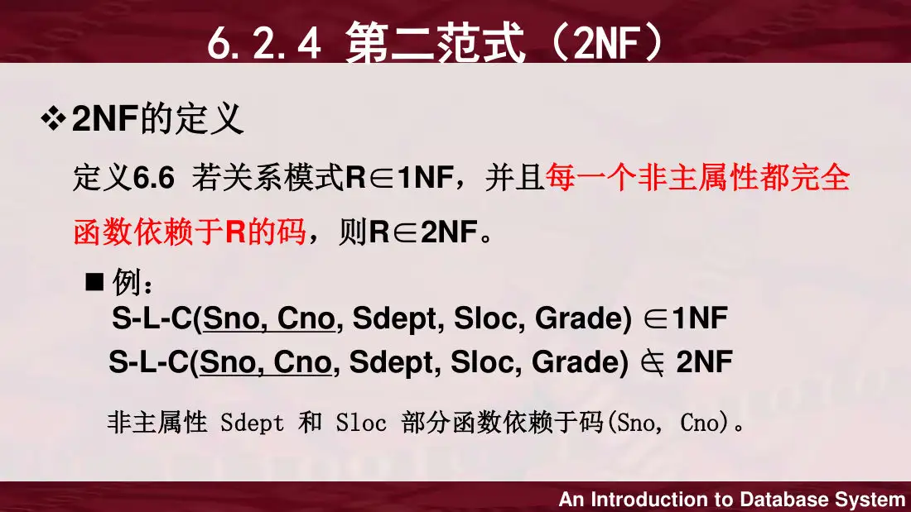

原文：

6.2.4 第二范式（2NF）

◆2NF的定义

定义6.6 若关系模式 $R \in 1NF$ ，并且每一个非主属性都完全函数依赖于R的码，则 $R \in 2NF$ 。

例:

S-L-C(Sno, Cno, Sdept, Sloc, Grade) ∈ 1NF
S-L-C(Sno, Cno, Sdept, Sloc, Grade)∉2NF

非主属性 Sdept 和 Sloc 部分函数依赖于码(Sno, Cno)。

An Introduction to Database System

### 6.2.4 2NF（续）

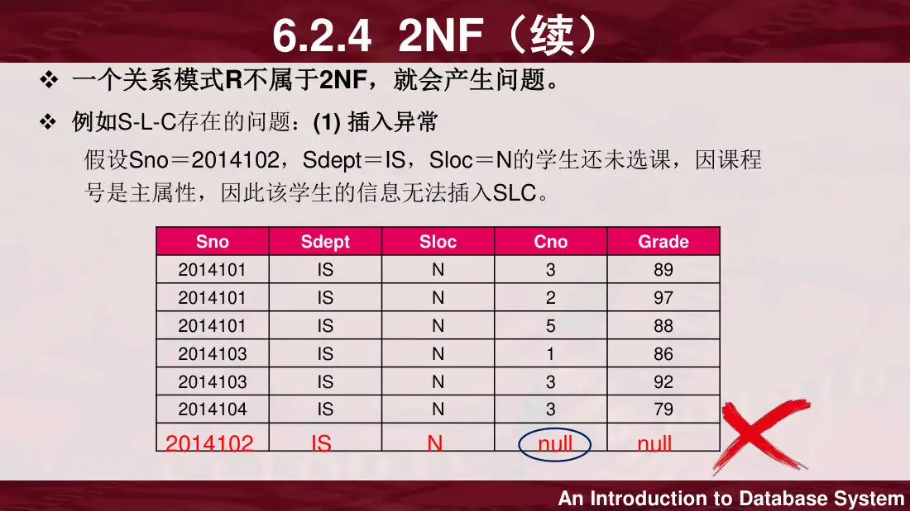

原文：

6.2.4 2NF（续）

✿ 一个关系模式R不属于2NF，就会产生问题。

例如S-L-C存在的问题：(1) 插入异常

假设Sno=2014102，Sdept=IS，Sloc=N的学生还未选课，因课程号是主属性，因此该学生的信息无法插入SLC。

<table><tr><td>Sno</td><td>Sdept</td><td>Sloc</td><td>Cno</td><td>Grade</td></tr><tr><td>2014101</td><td>IS</td><td>N</td><td>3</td><td>89</td></tr><tr><td>2014101</td><td>IS</td><td>N</td><td>2</td><td>97</td></tr><tr><td>2014101</td><td>IS</td><td>N</td><td>5</td><td>88</td></tr><tr><td>2014103</td><td>IS</td><td>N</td><td>1</td><td>86</td></tr><tr><td>2014103</td><td>IS</td><td>N</td><td>3</td><td>92</td></tr><tr><td>2014104</td><td>IS</td><td>N</td><td>3</td><td>79</td></tr><tr><td>2014102</td><td>IS</td><td>N</td><td>null</td><td>null</td></tr></table>

An Introduction to Database System

### 6.2.4 2NF（续）

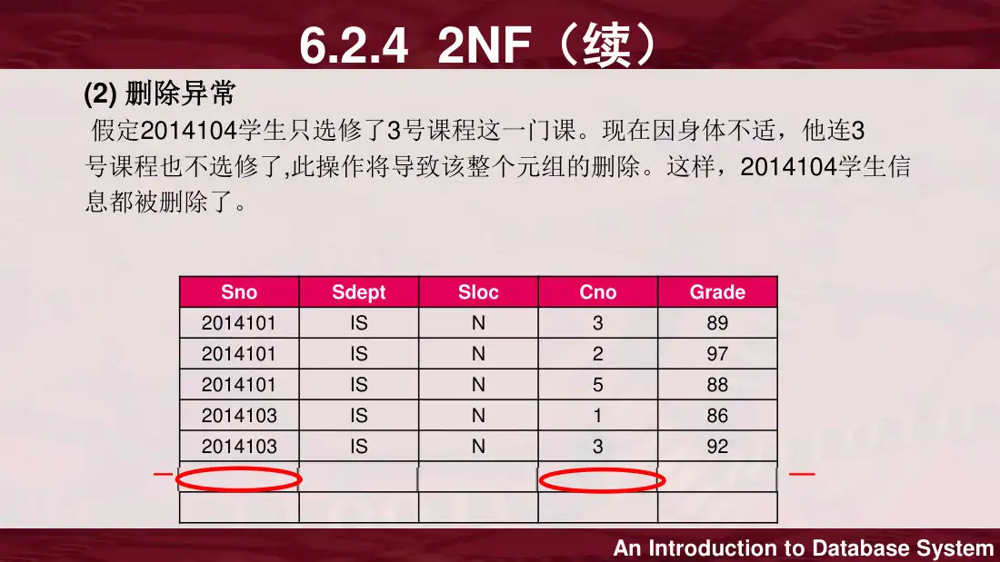

原文：

6.2.4 2NF（续）

(2) 删除异常

假定2014104学生只选修了3号课程这一门课。现在因身体不适，他连3号课程也不选修了,此操作将导致该整个元组的删除。这样，2014104学生信息都被删除了。

<table><tr><td>Sno</td><td>Sdept</td><td>Sloc</td><td>Cno</td><td>Grade</td></tr><tr><td>2014101</td><td>IS</td><td>N</td><td>3</td><td>89</td></tr><tr><td>2014101</td><td>IS</td><td>N</td><td>2</td><td>97</td></tr><tr><td>2014101</td><td>IS</td><td>N</td><td>5</td><td>88</td></tr><tr><td>2014103</td><td>IS</td><td>N</td><td>1</td><td>86</td></tr><tr><td>2014103</td><td>IS</td><td>N</td><td>3</td><td>92</td></tr><tr><td></td><td></td><td></td><td></td><td></td></tr><tr><td></td><td></td><td></td><td></td><td></td></tr></table>

An Introduction to Database System

### 6.2.4 2NF（续）

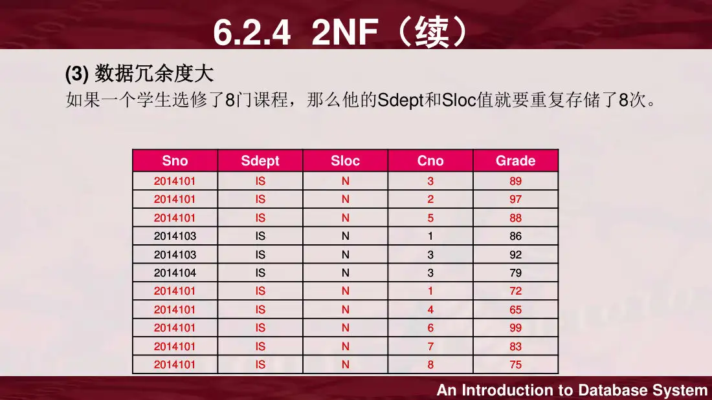

原文：

6.2.4 2NF（续）

(3) 数据冗余度大

如果一个学生选修了8门课程，那么他的Sdept和Sloc值就要重复存储了8次。

<table><tr><td>Sno</td><td>Sdept</td><td>Sloc</td><td>Cno</td><td>Grade</td></tr><tr><td>2014101</td><td>IS</td><td>N</td><td>3</td><td>89</td></tr><tr><td>2014101</td><td>IS</td><td>N</td><td>2</td><td>97</td></tr><tr><td>2014101</td><td>IS</td><td>N</td><td>5</td><td>88</td></tr><tr><td>2014103</td><td>IS</td><td>N</td><td>1</td><td>86</td></tr><tr><td>2014103</td><td>IS</td><td>N</td><td>3</td><td>92</td></tr><tr><td>2014104</td><td>IS</td><td>N</td><td>3</td><td>79</td></tr><tr><td>2014101</td><td>IS</td><td>N</td><td>1</td><td>72</td></tr><tr><td>2014101</td><td>IS</td><td>N</td><td>4</td><td>65</td></tr><tr><td>2014101</td><td>IS</td><td>N</td><td>6</td><td>99</td></tr><tr><td>2014101</td><td>IS</td><td>N</td><td>7</td><td>83</td></tr><tr><td>2014101</td><td>IS</td><td>N</td><td>8</td><td>75</td></tr></table>

An Introduction to Database System

### 6.2.4 2NF（续）

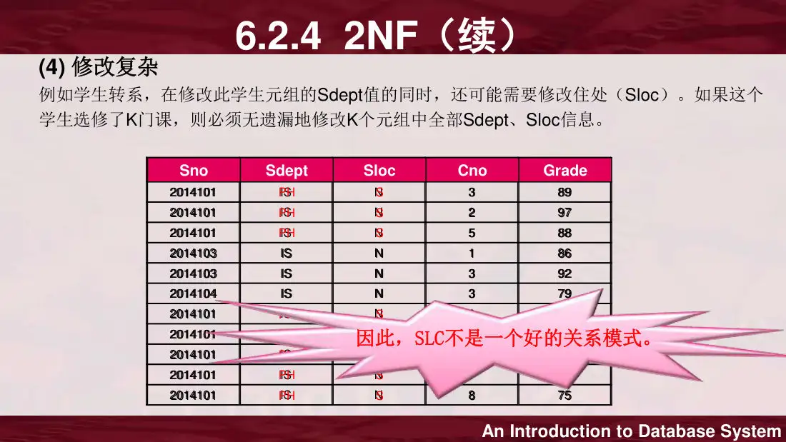

原文：

6.2.4 2NF（续）

(4) 修改复杂

例如学生转系，在修改此学生元组的Sdept值的同时，还可能需要修改住处（Sloc）。如果这个学生选修了K门课，则必须无遗漏地修改K个元组中全部Sdept、Sloc信息。

<table><tr><td>Sno</td><td>Sdept</td><td>Sloc</td><td>Cno</td><td>Grade</td></tr><tr><td>2014101</td><td>PSH</td><td>N</td><td>3</td><td>89</td></tr><tr><td>2014101</td><td>PSH</td><td>N</td><td>2</td><td>97</td></tr><tr><td>2014101</td><td>PSH</td><td>N</td><td>5</td><td>88</td></tr><tr><td>2014103</td><td>IS</td><td>N</td><td>1</td><td>86</td></tr><tr><td>2014103</td><td>IS</td><td>N</td><td>3</td><td>92</td></tr><tr><td>2014104</td><td>IS</td><td>N</td><td>3</td><td>79</td></tr><tr><td>2014101</td><td>PSH</td><td>N</td><td></td><td></td></tr><tr><td>2014101</td><td></td><td></td><td colspan="2">因此,SLC不是一个好的关系模</td></tr><tr><td>2014101</td><td>PSH</td><td></td><td></td><td></td></tr><tr><td>2014101</td><td>PSH</td><td>N</td><td>8</td><td>75</td></tr></table>

An Introduction to Database System

### 6.2.4 2NF（续）

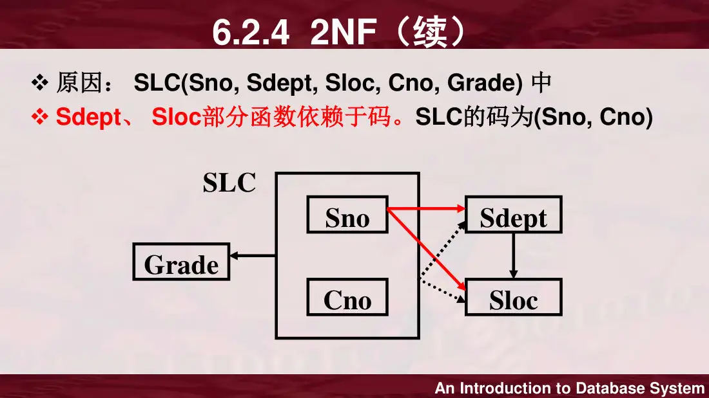

原文：

6.2.4 2NF（续）

❖ 原因：SLC(Sno, Sdept, Sloc, Cno, Grade) 中

✿ Sdept、Sloc部分函数依赖于码。SLC的码为(Sno, Cno)

An Introduction to Database System

### 6.2.4 2NF（续）

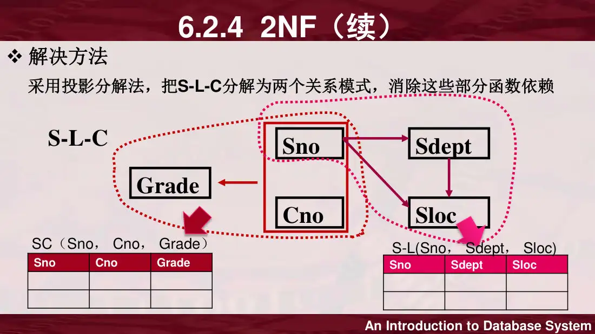

原文：

6.2.4 2NF（续）

◆ 解决方法

采用投影分解法，把S-L-C分解为两个关系模式，消除这些部分函数依赖

Grade

SC (Sno, Cno, Grade)

<table><tr><td>Sno</td><td>Cno</td><td>Grade</td></tr><tr><td></td><td></td><td></td></tr><tr><td></td><td></td><td></td></tr></table>

<table><tr><td>Sno</td><td>Sdept</td><td>Sloc</td></tr><tr><td></td><td></td><td></td></tr><tr><td></td><td></td><td></td></tr></table>

An Introduction to Database System

### 6.2.4 2NF（续）

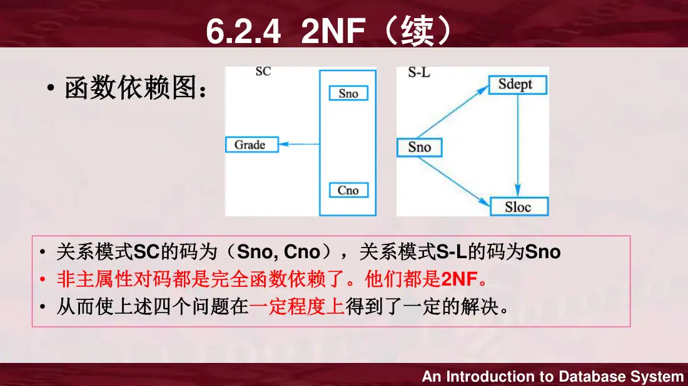

原文：

6.2.4 2NF（续）

- 函数依赖图:

SC

Sno

Grade

Cno

Sdept

\- 关系模式SC的码为（Sno, Cno），关系模式S-L的码为Sno

\- 非主属性对码都是完全函数依赖了。他们都是2NF。

\- 从而使上述四个问题在一定程度上得到了一定的解决。

An Introduction to Database System

### 6.2.4 2NF（续）

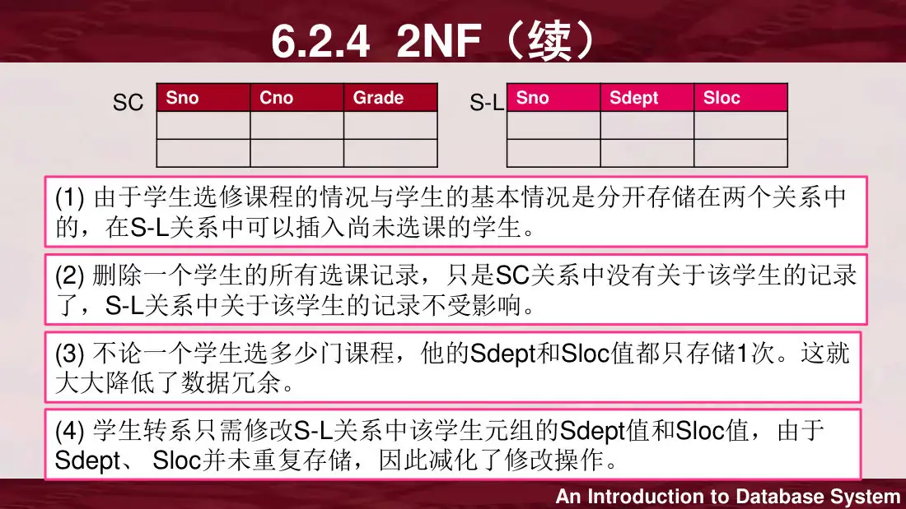

原文：

6.2.4 2NF（续）

<table><tr><td rowspan="3">SC</td><td>Sno</td><td>Cno</td><td>Grade</td></tr><tr><td></td><td></td><td></td></tr><tr><td></td><td></td><td></td></tr></table>

<table><tr><td rowspan="3">S-L</td><td>Sno</td><td>Sdept</td><td>Sloc</td></tr><tr><td></td><td></td><td></td></tr><tr><td></td><td></td><td></td></tr></table>

(1) 由于学生选修课程的情况与学生的基本情况是分开存储在两个关系中的，在S-L关系中可以插入尚未选课的学生。

(2) 删除一个学生的所有选课记录，只是SC关系中没有关于该学生的记录了，S-L关系中关于该学生的记录不受影响。

(3) 不论一个学生选多少门课程，他的Sdept和Sloc值都只存储1次。这就大大降低了数据冗余。

(4) 学生转系只需修改S-L关系中该学生元组的Sdept值和Sloc值，由于Sdept、Sloc并未重复存储，因此减化了修改操作。

An Introduction to Database System

### 6.2.5 第三范式（3NF）

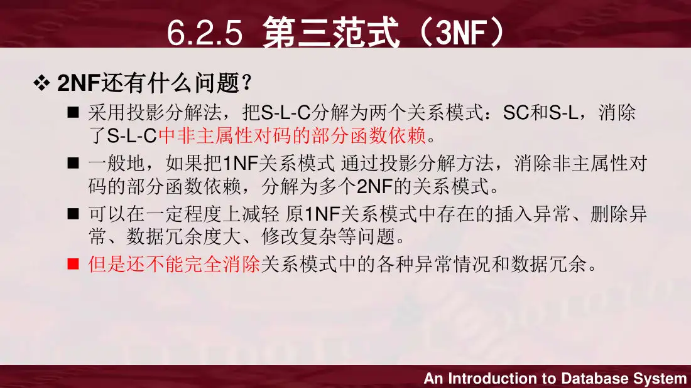

原文：

6.2.5 第三范式（3NF）

◆ 2NF还有什么问题？

■ 采用投影分解法，把S-L-C分解为两个关系模式：SC和S-L，消除了S-L-C中非主属性对码的部分函数依赖。

■ 一般地，如果把1NF关系模式通过投影分解方法，消除非主属性对码的部分函数依赖，分解为多个2NF的关系模式。

■ 可以在一定程度上减轻 原1NF关系模式中存在的插入异常、删除异常、数据冗余度大、修改复杂等问题。

■ 但是还不能完全消除关系模式中的各种异常情况和数据冗余。

An Introduction to Database System

### 6.2.5 第三范式（3NF）

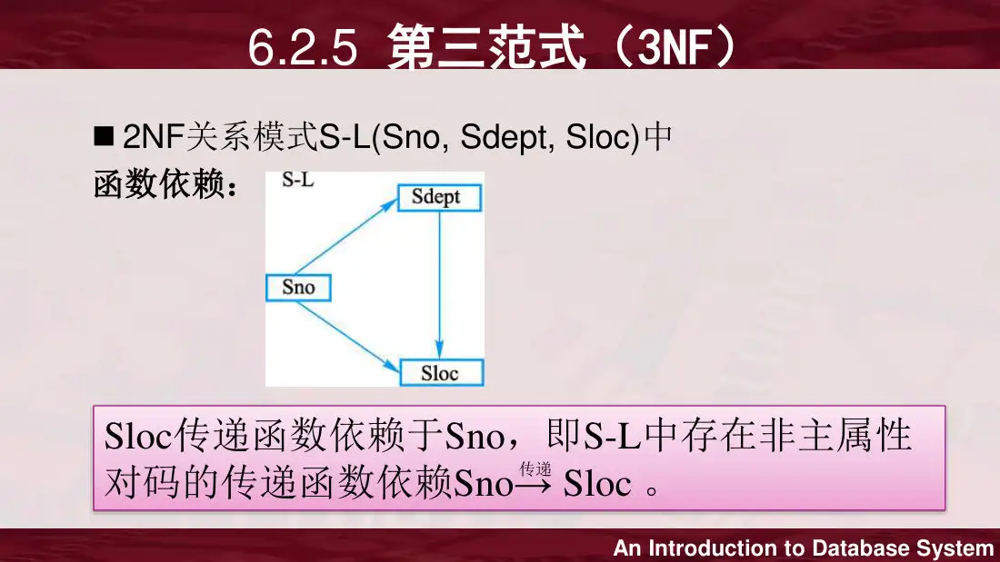

原文：

6.2.5 第三范式（3NF）

■ 2NF关系模式S-L(Sno, Sdept, Sloc)中

函数依赖:

Sloc传递函数依赖于Sno，即S-L中存在非主属性对码的传递函数依赖 $Sno \xrightarrow{传递} Sloc$ 。

An Introduction to Database System

### 6.2.5 第三范式（3NF）

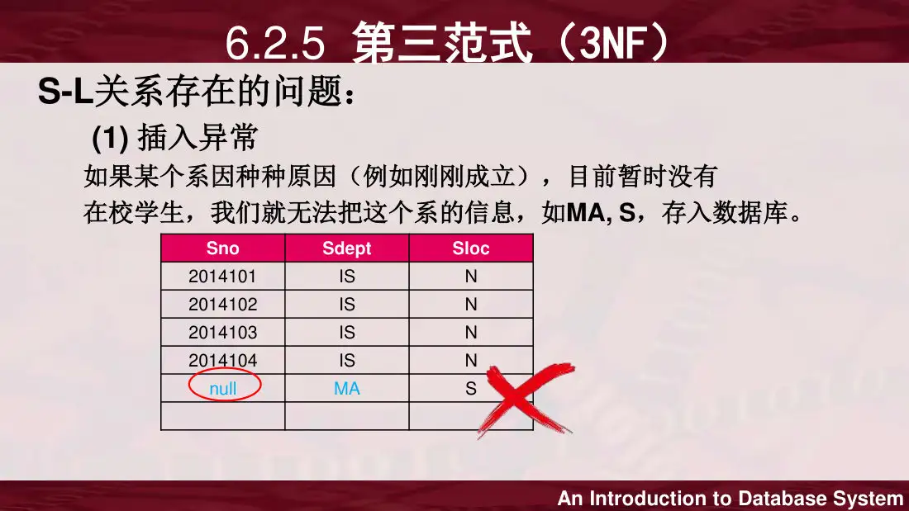

原文：

6.2.5 第三范式（3NF）

S-L关系存在的问题:

(1) 插入异常

如果某个系因种种原因（例如刚刚成立），目前暂时没有在校学生，我们就无法把这个系的信息，如MA, S，存入数据库。

<table><tr><td>Sno</td><td>Sdept</td><td>Sloc</td></tr><tr><td>2014101</td><td>IS</td><td>N</td></tr><tr><td>2014102</td><td>IS</td><td>N</td></tr><tr><td>2014103</td><td>IS</td><td>N</td></tr><tr><td>2014104</td><td>IS</td><td>N</td></tr><tr><td>null</td><td>MA</td><td>S</td></tr><tr><td></td><td></td><td></td></tr></table>

An Introduction to Database System

### 6.2.5 第三范式（3NF）

原文：

6.2.5 第三范式（3NF）

(2) 删除异常

如果某个系（如IS）的学生全部毕业了，我们在删除该系学生信息的同时，把这个系的信息，如IS, N，也丢掉了。

<table><tr><td>Sno</td><td>Sdept</td><td>Sloc</td></tr><tr><td>2014101</td><td>IS</td><td>N</td></tr><tr><td>2014102</td><td>IS</td><td>N</td></tr><tr><td>2014103</td><td>IS</td><td>N</td></tr><tr><td>2014104</td><td>IS</td><td>N</td></tr><tr><td>2014105</td><td>PH</td><td>S</td></tr><tr><td>2014106</td><td>PH</td><td>S</td></tr></table>

An Introduction to Database System

### 6.2.5 第三范式（3NF）

原文：

6.2.5 第三范式（3NF）

(3) 数据冗余度大

每一个系的学生都住在同一个地方，关于系的住处的信息却重复出现，重复次数与该系学生人数相同。

<table><tr><td>Sno</td><td>Sdept</td><td>Sloc</td></tr><tr><td>2014101</td><td>IS</td><td>N</td></tr><tr><td>2014102</td><td>IS</td><td>N</td></tr><tr><td>2014103</td><td>IS</td><td>N</td></tr><tr><td>2014104</td><td>IS</td><td>N</td></tr><tr><td>2014105</td><td>PH</td><td>S</td></tr><tr><td>2014106</td><td>PH</td><td>S</td></tr><tr><td>2014107</td><td>PH</td><td>S</td></tr><tr><td>2014108</td><td>PH</td><td>S</td></tr><tr><td>......</td><td>......</td><td>......</td></tr></table>

An Introduction to Database System

### 6.2.5 第三范式（3NF）

原文：

6.2.5 第三范式（3NF）

(4) 修改复杂

学校调整学生住处时，由于关于每个系的住处信息是重复存储的，修改时必须同时更新该系所有学生的Sloc属性值。

An Introduction to Database System

### 6.2.5 第三范式（3NF）

原文：

6.2.5 第三范式（3NF）

原因:

S-L中Sloc传递函数依赖于Sno，即：非主属性传递函数依赖码

◆ 解决方法

采用投影分解法，把S-L分解为两个关系模式，以消除传递函数依赖：

S-D (Sno, Sdept)

D-L (Sdept, Sloc)

S-D的码为Sno，D-L的码为Sdept

<table><tr><td>Sno</td><td>Sdept</td></tr><tr><td></td><td></td></tr><tr><td></td><td></td></tr><tr><td></td><td></td></tr></table>

<table><tr><td>Sdept</td><td>Sloc</td></tr><tr><td></td><td></td></tr><tr><td></td><td></td></tr><tr><td></td><td></td></tr></table>

An Introduction to Database System

### 6.2.5 第三范式（3NF）

原文：

6.2.5 第三范式（3NF）

异常的情况得到改善:

(1) D-L关系中可以插入系的信息，即使还没有在校学生。

(2) 某个系的学生全部毕业了，只是删除S-D关系中的相应元组，D-L关系中关于该系的信息仍存在。

(3) 关于系的住处的信息只在D-L关系中存储一次。

(4) 当学校调整某个系的学生住处时，只需修改D-L关系中一个元组的Sloc属性值。

An Introduction to Database System

### 6.2.5 第三范式（3NF）

原文：

6.2.5 第三范式（3NF）

■ S-D的码为Sno，D-L的码为Sdept。

S-D

在分解后的关系模式中既没有非主属性对码的部分函数依赖，也没有非主属性对码的传递函数依赖，进一步解决了上述四个问题。

An Introduction to Database System

### 6.2.5 第三范式（3NF）

原文：

6.2.5 第三范式（3NF）

3NF的定义

定义6.7 关系模式R<U, F>∈1NF, 若R中不存在这样的码X、属性组Y及非主属性Z (Y≠Z), 使得X→Y, Y→Z, Y↔X, 成立, 则称R<U, F> ∈ 3NF。

S-L 不存在部分函数依赖, 但是存在传递函数, 所以

$$
\mathrm{S-L(Sno,Sdept,Sloc)} \in 2 \mathrm{NF}
$$

$$
\mathrm{S-L(Sno,Sdept,Sloc)} \in 3 \mathrm{NF}
$$

An Introduction to Database System

### 6.2.5 第三范式（续）

原文：

6.2.5 第三范式（续）

✿ 3NF的一些性质:

■ 若 $R \in 3NF$ ，则R的每一个非主属性既不部分函数依赖于候选码也不传递函数依赖于候选码。

■ 如果 $R \in 3NF$ ，则 $R \in 2NF$ 。

■ 采用投影分解法将一个2NF的关系分解为多个3NF的关系，可以在一定程度上解决原2NF关系中存在的插入异常、删除异常、数据冗余度大、修改复杂等问题。

■ 将一个2NF关系分解为多个3NF的关系后，并不能完全消除关系模式中的各种异常情况和数据冗余。

An Introduction to Database System

### 一个例子

原文：

一个例子

假设每一教师只教一门课 $\mathrm{T} \rightarrow \mathrm{J}$

每门课由若干教师教，但某一学生选定某门课，就确定了一个固定的教师
(S, J) → T

某个学生选修某个教师的课就确定了所选课的名称 (S, T)→J

T→J, (S, J) →T, (S, T)→J

1 候选码: (S, J) 和 (S, T)

2 S T J都是主属性

3 不存在非主属性对码的部分函数依赖和传递依赖

3 STJ∈3NF

An Introduction to Database System

### 一个例子

原文：

一个例子

虽然STJ（S,T,J）∈3NF，但它仍存在增删改等异常，还不是一个理想的关系模式。

(1) 插入异常

如果某个教师开设了某门课程，但尚未有学生选修，则有关信息也无法存入数据库中。

(2) 删除异常

如果选修过某门课程的学生全部毕业了，在删除这些学生元组的同时，相应教师开设该门课程的信息也同时丢掉了。

(3) 数据冗余度大

虽然一个教师只教一门课，但每个选修该教师该门课程的学生元组都要记录这一信息。

(4) 修改复杂

某个教师开设的某门课程改名后，所有选修了该教师该门课程的学生元组都要进行相应修改。

An Introduction to Database System

### 一个例子

原文：

一个例子

原因:

主属性J部分依赖于码(S, T)。因为T→J

解决方法:

采用投影分解法，将STJ分解为二个关系模式：ST(S, T); TJ(T, J)

An Introduction to Database System

### 一个例子

原文：

一个例子

✿ ST的码为（S，T），TJ的码为T。

TJ

在分解后的关系模式中没有任何属性对码的部分函数依赖和传递函数依赖。它解决了上述四个问题：

(1) TJ关系中可以存储所开课程尚未有学生选修的教师信息。

(2) 选修某个老师所开设的课程的学生全部毕业了，只是删除ST关系中的相应元组，不会影响TJ关系中相应教师开设该门课程的信息。

(3) 关于每个教师开设课程的信息只在TJ关系中存储一次。

(4) 某个教师开设的某门课程改名后，只需修改TJ关系中的一个相应元组即可。

An Introduction to Database System

### 6.2.6 BC范式（BCNF）

原文：

6.2.6 BC范式（BCNF）

✿ BCNF（Boyce Codd Normal Form）是由Boyce和Codd提出的，比3NF更进了一步。通常认为BCNF是修正的第三范式，有时也称为扩展的第三范式。

BCNF的定义

定义6.8 设关系模式R<U, F>∈1NF, 如果对于R的每个函数依赖X→Y, 且X≥Y时, X必含有码, 那么R∈BCNF。

即，在关系模式R<U，F>中，如果每一个决定因素都包含码，则R∈BCNF。

例: STJ (S, T, J) $\in$ 3NF $T \rightarrow J$ , (S, J) $\rightarrow T$ , (S, T) $\rightarrow J$

ST（S，T）∈BCNF ST的码为（S，T），all-key

TJ（T，J）∈BCNF TJ的码为T，T→J

An Introduction to Database System

### 6.2.6 BC范式（BCNF）（续）

原文：

6.2.6 BC范式（BCNF）（续）

✿ BCNF的关系模式所具有的性质

1. 所有非主属性对每一个码都是完全函数依赖。

2.所有主属性对每一个不包含它的码也是完全函数依赖。

3.没有任何属性完全函数依赖于非码的任何一组属性。

如果关系模式 $R \in BCNF$ ，必定有 $R \in 3NF$

如果关系模式 $R \in 3NF$ ，不一定有 $R \in BCNF$

如果一个关系数据库中的所有关系模式都属于BCNF，那么在函数依赖范畴内，它已实现了模式的彻底分解，达到了最高的规范化程度，消除了操作异常诸多问题。

An Introduction to Database System

### 6.2.9 规范化小结

原文：

6.2.9 规范化小结

一个关系模式只要其分量都是不可分的数据项，它就是规范化的关系模式，但这只是最基本的规范化。

规范化程度过低的关系模式不一定能够很好地描述现实世界，可能会存在插入异常、删除异常、修改复杂、数据冗余等问题，解决方法就是对其进行规范化，转换成高级范式。

✿ 一个低一级范式的关系模式，通过模式分解可以转换为若干个高一级范式的关系模式集合，这种过程就叫关系模式的规范化。

关系数据库的规范化理论是数据库逻辑设计的工具。

An Introduction to Database System

### 规范化小结（续）

原文：

规范化小结（续）

关系模式规范化的基本步骤

An Introduction to Database System

### 规范化小结（续）

原文：

规范化小结（续）

◆规范化的基本思想:

■ 逐步消除数据依赖中不合适的部分，使模式中的各关系模式达到某种程度的“分离”

■ 采用 “一事一地” 的模式设计原则

\- 让一个关系描述一个概念、一个实体或者实体间的一种联系。

\- 若多于一个概念就把它“分离”出去。

■ 规范化实质上是概念的单一化

An Introduction to Database System

### 举一反三

原文：

举一反三

各级范式定义

1）关系模式满足1NF，但不一定满足2NF

2）关系模式满足2NF，则一定满足1NF

3）关系模式不满足2NF，  
- 则一定存在“非主属性对候选键的局部依赖”

4）满足3NF，一定满足2NF，也一定满足1NF

5）若关系模式R中没有非主属性，则满足3NF

6）若关系模式R的主码是全码，则满足？

An Introduction to Database System

### 第六章 关系数据理论

原文：

第六章 关系数据理论

6.1 问题的提出——为什么要学习关系数据理论

6.2 规范化

6.3 数据依赖的公理系统（简单了解）

6.4 保持函数依赖的模式分解（简单了解）

6.5 无损连接的模式分解

6.6 小结

An Introduction to Database System

### 6.3 数据依赖的公理系统

原文：

6.3 数据依赖的公理系统

数据依赖的公理系统是模式分解算法的理论基础。

◆ 函数依赖的一个有效而完备的公理系统——Armstrong公理系统，

一套推理规则，是模式分解算法的理论基础。

已知：R<U, F>, U={X,C,W,Y,Z,}, F={X→YZ, Z→CW}

用途

问：X→CWYZ是否为F逻辑蕴含

■ 从一组函数依赖求得蕴含的函数依赖。例如问 $X \rightarrow Y$ 是否被 $F$ 所蕴含。

■ 求给定关系模式的码。

逻辑蕴含

定义6.11 对于满足一组函数依赖F的关系模式R<U, F>, 其任何一个关系r, 若函数依赖X→Y都成立（即r中任意两元组t, s, 若t[X]=s[X], 则t[Y]=s[Y]），则称F逻辑蕴含X→Y。

An Introduction to Database System

### 1. Armstrong公理系统

原文：

1. Armstrong公理系统

Armstrong公理系统

设U为属性集总体，F是U上的一组函数依赖，于是有关系模式R<U，F>。

对 $R < U, F>$ 来说有以下的推理规则：

■ AI. 自反律(Reflexivity): 若 $Y \subseteq X \subseteq U$ ，则 $X \rightarrow Y$ 为 F 所蕴含。

A2. 增广律(Augmentation): 若 $X \to Y$ 为 $F$ 所蕴含, 且 $Z \subseteq U$ , 则 $XZ \to YZ$ 为 $F$ 所蕴含。

A3. 传递律(Transitivity): 若 $X \rightarrow Y$ 及 $Y \rightarrow Z$ 为 $F$ 所蕴含, 则 $X \rightarrow Z$ 为 $F$ 所蕴含。

定理6.1 Armstrong推理规则是正确的

(证明参见《数据库系统概论P.185\~P.186》)

An Introduction to Database System

### 2. 导出规则

原文：

2. 导出规则

1. 根据A1，A2，A3这三条推理规则可以得到下面三条推理规则：

■ 合并规则：由 $X\rightarrow Y$ ， $X\rightarrow Z$ ，有 $X\rightarrow YZ$ 。

(A2, A3) $X \rightarrow YX$ , $XY \rightarrow ZY$

■ 伪传递规则：由 $X \to Y$ ， $WY \to Z$ ，有 $XW \to Z$ 。

(A2, A3) XW→YW

■ 分解规则：由 $X \rightarrow Y$ 及 $Z \subseteq Y$ ，有 $X \rightarrow Z$ 。

(A1, A3) $Z \subseteq Y$ , $Y \rightarrow Z$

2.根据合并规则和分解规则，可得引理6.1

引理6.1 $X \rightarrow A_{1} A_{2} \ldots A_{k}$ 成立的充分必要条件是 $X \rightarrow A_{i}$ 成立（ $i = 1, 2, \ldots, k$ ）。

An Introduction to Database System

### 3. 函数依赖闭包

原文：

3. 函数依赖闭包

闭包 $F^{+}$

定义6.12 在关系模式 $R < U, F>$ 中为 $F$ 所逻辑蕴含的函数依赖的全体叫做作 $F$ 的闭包（closure），记为 $F^{+}$ 。

✿ X关于函数依赖集F的闭包 $X_{F^{+}}$

定义6.13 设F为属性集U上的一组函数依赖， $X \subseteq U$ ， $X_{F}^{+} = \{A / X \rightarrow A$ 能由F根据Armstrong公理导出 $\}$ ， $X_{F}^{+}$ 称为属性集X关于函数依赖集F的闭包。

An Introduction to Database System

### 3. 函数依赖闭包

原文：

3. 函数依赖闭包

关于闭包的引理

引理6.2 设 $F$ 为属性集 $U$ 上的一组函数依赖, $X$ , $Y \subseteq U$ , $X \rightarrow Y$ 能由 $F$ 根据Armstrong公理导出的充分必要条件是 $Y \subseteq X_{F^{+}}$ 。

引理6.2的用途

1. 将判定 $X \rightarrow Y$ 是否能由 $F$ 根据Armstrong公理导出的问题, 就转化为求出 $X_{F^{+}}$ , 判定 $Y$ 是否为 $X_{F^{+}}$ 的子集的问题。

2. 如果 $X_{F^{+}}=U$ ，X是R<U，F>的候选码。

✿ $X_{F}^{+}$ 可以用算法来求得!

An Introduction to Database System

### 4. 求属性集X 关于F的闭包 $X_{F}^{+}$

原文：

4. 求属性集X 关于F的闭包 $X_{F}^{+}$

算法6.1

对于R<U, F>, 求属性集X (X⊆U) 关于U上的函数依赖集F的闭包 X $_{F}$ + 。

输入: $X, F$

输出: $X_{F^{+}}$

步骤:

迭代

An Introduction to Database System

### 算法6.1

原文：

算法6.1

求属性集X（X⊆U）关于U上的函数依赖集F的闭包X $_{F}^{+}$ 方法:① 令X $^{(0)}$ =X，i=0;

(2) 对 $F$ 中的每一个函数依赖 $Y \to Z$ , 若 $Y \subseteq X^{(i)}$ , 令 $X^{(i+1)} = X^{(i)} \cup Z$ 。

③ 若 $X^{(i+1)} \neq X^{(i)}$ , 则用 $i + 1$ 代替 $i$ , 转②;

④ 若 $X^{(i+1)}=X^{(i)}$ ，则 $X^{(i)}$ 即为 $X_{F}^{+}$

An Introduction to Database System

### 求 $X_{F}^{+}$ 的例子

原文：

求 $X_{F}^{+}$ 的例子

[例1] 已知关系模式R<U, F>, 其中U={A,B,C,D,E}; F={AB->C,B->D,C->E,EC->B,AC->B}。
求(AB) $_{F}^{+}$ 。

设 $X^{(0)} = AB$

计算 $X^{(1)}$ ; AB->C, B->D $X^{(1)}=AB \cup CD=ABCD$

因为 $X^{(0)}\neq X^{(1)}$ ，计算 $X^{(2)}$ ;

An Introduction to Database System

### 求 $X_{F}^{+}$ 的例子

原文：

求 $X_{F}^{+}$ 的例子

[例1] 已知关系模式R<U, F>, 其中U={A,B,C,D,E}; F={AB->C,B->D,C->E,E-C->B,AC->B}。
求(AB) $_{F}^{+}$ 。

设 $X^{(0)} = AB$

计算 $X^{(1)}$ ;

$$
A B - > C, B - > D
$$

$$
X ^ {(1)} = A B \cup C D = A B C D
$$

还有一种情况：如果 $X^{(i)}=X^{(i-1)}$ ，则 $X^{(i)}$ 即为所求的闭包。

因为 $X^{(0)}\neq X^{(1)}$ ，计算 $X^{(2)}$ ; C->E, AC->B

$$
X ^ {(2)} = X ^ {(1)} \cup B E = A B C D E
$$

这时 $X^{(2)} \neq X^{(1)}$ ，但 $X^{(2)}$ 已等于全部属性集合

$$
(A B) _ {F} ^ {+} = A B C D E
$$

问：AB→E能否从F中推出？YES!

An Introduction to Database System

### 求给定关系模式的码的经验方法

原文：

求给定关系模式的码的经验方法

若属性A仅出现在所有函数依赖的右部，则它一定不包含在任何候选码中；

若属性B仅出现在所有函数依赖的左部或者不在任何函数依赖中出现，则它一定包含在某个候选码中；

✿ 若属性C既出现在函数依赖的右部，又出现在左部，则它可能包含在候选码中；

✿ 在上述基础上求属性闭包，即先求B关于F的闭包，如(B) $_{F}^{+}=U$ ，则B为候选码。

An Introduction to Database System

### 例：设有关系模式CTHRSG（C，T，H，R，S，G），满足下列函数依赖：

原文：

例：设有关系模式CTHRSG（C，T，H，R，S，G），满足下列函数依赖：

C→T 每门课程仅有一位教师讲授

HR→C在任一时间，每个教室只能上一门课程

HT→R在一个时间一位教师只能在一个教室上课

CS→G每个学生的每门课程只有一个成绩

HS→R在一个时间每个学生只能在一个教室听课求其候选码。

An Introduction to Database System

### 解：求所有候选关键字

原文：

解：求所有候选关键字

$F=\{C\rightarrow T, HR\rightarrow C, HT\rightarrow R, CS\rightarrow G, HS\rightarrow R\}$

$(HS)_{F}^{(0)} = HS$

$(HS)_{F}^{(1)} = HSR$

$(HS)_{F}^{(2)} = HSRC$

$(HS)_{F}^{(3)} = HS RCTG$

$(HS)_{F}^{(4)} = HS RCTG$

∴ HS是模式CTHRSG的唯一关键字

An Introduction to Database System

### 5. Armstrong公理系统的有效性与完备性

原文：

5. Armstrong公理系统的有效性与完备性

◆ 有效性与完备性的含义

■ 有效性：由 $F$ 出发根据Armstrong公理推导出来的每一个函数依赖一定在 $F^{+}$ 中

■ 完备性： $F^{+}$ 中的每一个函数依赖，必定可以由 $F$ 出发根据Armstrong公理推导出来

◆ 定理6.2 Armstrong公理系统是有效的、完备的。（证明参见《数据库系统概论P.187》）

An Introduction to Database System

### 6. 函数依赖集等价的概念

原文：

6. 函数依赖集等价的概念

◆函数依赖集等价定义

定义6.14 如果 $G^{+} = F^{+}$ , 就说函数依赖集 $F$ 覆盖 $G$ ( $F$ 是 $G$ 的覆盖, 或 $G$ 是 $F$ 的覆盖), 或 $F$ 与 $G$ 等价。

两个函数依赖集等价是指它们的闭包等价

An Introduction to Database System

### 7. 最小依赖集

原文：

7. 最小依赖集

✿ 也称为极小函数依赖集，最小覆盖

定义6.15 如果函数依赖集F满足下列条件，则称F

(1) F中任一函数依赖的右部仅含有一个属性。

即F中的函数依赖均不能由F中其他函数依赖导出

(2) F中不存在这样的函数依赖X→A，使得F与F-{X→A}等价。

(3) F中不存在这样的函数依赖X→A，X有真子集Z使得F-{X→A}∪{Z→A}与F等价。

F中各函数依赖左部均为最小属性集(不存在冗余属性)

An Introduction to Database System

### 第六章 关系数据理论

原文：

第六章 关系数据理论

6.1 问题的提出——为什么要学习关系数据理论

6.2 规范化

6.3 数据依赖的公理系统

6.4 保持函数依赖的模式分解

6.6 小结

An Introduction to Database System

### 保持函数依赖的模式分解

原文：

保持函数依赖的模式分解

关系模式的规范化过程是通过对关系模式的分解来实现的

■ 把低一级的关系模式分解为若干个高一级的关系模式的方法并不是唯一的

■ 在这些分解方法中，只有能够保证分解后的关系模式与原关系模式等价的方法才有意义

An Introduction to Database System

### 保持函数依赖的模式分解（续）

原文：

保持函数依赖的模式分解（续）

定义6.16 关系模式R(U,F)的一个分解是指

$\rho = \{R_{1}(U_{1}, F_{1}), R_{2}(U_{2}, F_{2}), \ldots, R_{n}(U_{n}, F_{n})\}$ （其中 $U = \bigcup_{i=1}^{n} U_{i}$ ，并且没有 $U_{i} \subseteq U_{j}$ ， $1 \leq i \neq j \leq n$ ， $F_{i}$ 是 $F$ 在 $U_{i}$ 上的投影），即

$$
\mathsf {F} _ {\mathrm{i}} = \{\mathsf {X} \rightarrow \mathsf {Y} | \mathsf {X} \rightarrow \mathsf {Y} \in \mathsf {F} ^ {+} \land \mathsf {X Y} \subseteq \mathsf {U} _ {\mathrm{i}} \}
$$

An Introduction to Database System

### 保持函数依赖的模式分解（续）

原文：

保持函数依赖的模式分解（续）

[例6.14] 已知关系模式R(U,F)，其中U={Sno, School, Mname}, F={Sno→School, School→Mname}。R(U, F)的元组语义是学生 Sno正在一个学院School学习，其院长姓名是Mname;并且一个学生(Sno)只在一个学院学习，一个学院只有一名院长。

表6.7 R的一个关系示例
<table><tr><td>Sno</td><td>School</td><td>Mname</td></tr><tr><td>S1</td><td>D1</td><td>张五</td></tr><tr><td>S2</td><td>D1</td><td>张五</td></tr><tr><td>S3</td><td>D2</td><td>李四</td></tr><tr><td>S4</td><td>D3</td><td>王一</td></tr></table>

An Introduction to Database System

### 保持函数依赖的模式分解（续）

原文：

保持函数依赖的模式分解（续）

存在的问题:

✿ 由于R中存在传递函数依赖 Sno $\stackrel{\mathrm{T}}{\rightarrow}$ Mname，它会发生更新异常。

例如，如果 S4 毕业，删除该条记录，则D3学院的院长王一的信息也就丢掉了。

反过来，如果一个学院 D5 刚刚成立尚无在校学生，那么这个学院院长赵某的信息也无法存人。

An Introduction to Database System

### 保持函数依赖的模式分解（续）

原文：

保持函数依赖的模式分解（续）

现在考虑对R进行如下分解:

$\rho = \{ R_{1}(\{Sno,School\}, \{Sno \to School\}),$

$$
R _ {2} (\{\text { Sno,Mname } \}, \{\text { Sno } \rightarrow \text { Mname } \}) \}
$$

表R被分解为两个新的表 R1和R2

但是，这样的分解仍然存在插入和删除异常，其原因就在于原来在R中存在的函数依赖School→Mname。 $R_{1}$ 和 $R_{2}$ 中都不再存在了，即这个函数依赖被丢掉了。因此一个合理的要求就是，分解应“保持函数依赖”。

✿ 分解后的模式应该保持与原模式的“等价”，在此，我们采用保持函数依赖作为模式等价的一种准则。

An Introduction to Database System

### 保持函数依赖的模式分解（续）

原文：

保持函数依赖的模式分解（续）

定义6.17

$\rho = \{R_{1} < U_{1}, F_{1} >, \ldots, R_{n} < U_{n}, F_{n} >\}$ 是 $R < U, F>$ 的一个分解，若F所逻辑蕴含的函数依赖一定也为分解后所有的关系模式中的函数依赖 $F_{i}$ 所逻辑蕴含，即 $F^{+} = (F_{1} \cup F_{2} \cup \ldots \cup F_{n})^{+}$ ，则称关系模式R的这个分解是保持函数依赖的（Preserve dependency）

引理6.3 给出了判别 $R$ 的分解是否保持函数依赖的方法。P.188

An Introduction to Database System

### 第六章 关系数据理论

原文：

第六章 关系数据理论

6.1 问题的提出——为什么要学习关系数据理论

6.2 规范化

6.3 数据依赖的公理系统

6.4 保持函数依赖的模式分解

6.6 小结

An Introduction to Database System

### 小结

原文：

小结

◆ 函数依赖

■ 平凡函数依赖与非平凡函数依赖

■ 完全函数依赖与部分函数依赖

■ 传递函数依赖

■码

✿ 范式的概念

关系模式规范化的基本步骤

Armstrong公理系统

✿ 模式的分解

An Introduction to Database System

### 小结

原文：

小结

关系模式规范化及基本步骤

1NF

消除决定属性集非码的非平凡函数依赖

消除非主属性对码的部分函数依赖

An Introduction to Database System

### 小结

原文：

小结

关系模式的规范化基本思想

1. 逐步消除不合适的数据依赖中使模式中的各关系模式达到某种程度的“分离”——模式分解

2. 一事一地的模式设计原则

3. 规范化理论为数据库设计提供了理论指南和算法工具。

4. 结合应用环境的具体情况，合理地设计数据库模式。

假设。

An Introduction to Database System
