# 《数据库系统》第7章 数据库设计（课件）

原件的每一页，下面附识别出的文字。

### 第七章 数据库设计

原文：

第七章 数据库设计

An Introduction to Database System

### 7.1 数据库设计概述

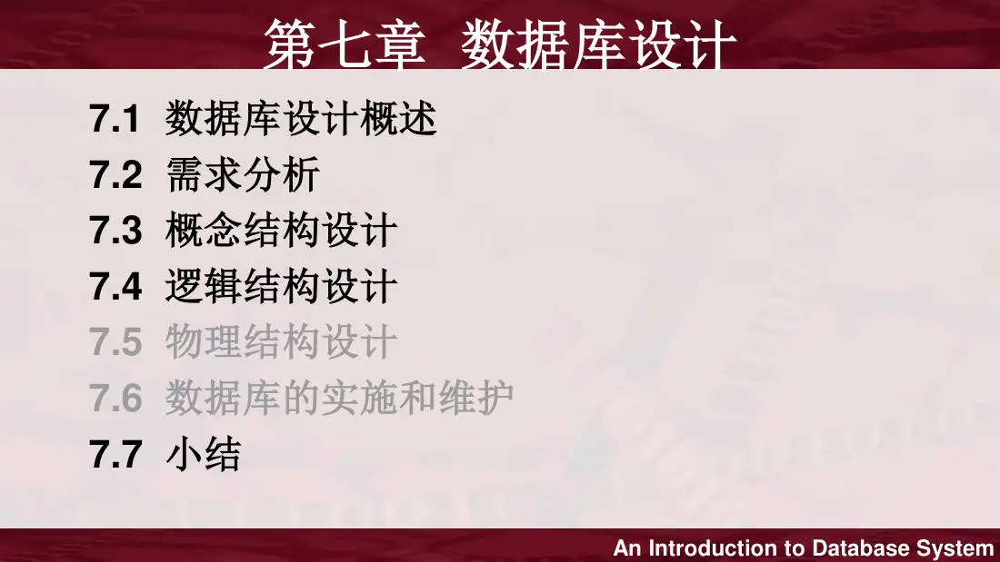

原文：

7.1 数据库设计概述
7.2 需求分析
7.3 概念结构设计
7.4 逻辑结构设计
7.5 物理结构设计
7.6 数据库的实施和维护
7.7 小结

第七章 数据库设计

An Introduction to Database System

### 7.1 数据库设计概述

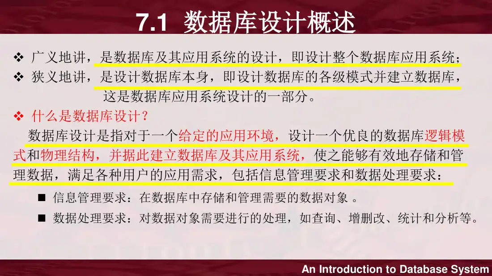

原文：

7.1 数据库设计概述

广义地讲，是数据库及其应用系统的设计，即设计整个数据库应用系统；

狭义地讲，是设计数据库本身，即设计数据库的各级模式并建立数据库，这是数据库应用系统设计的一部分。

什么是数据库设计？

数据库设计是指对于一个给定的应用环境，设计一个优良的数据库逻辑模式和物理结构，并据此建立数据库及其应用系统，使之能够有效地存储和管理数据，满足各种用户的应用需求，包括信息管理要求和数据处理要求：

■ 信息管理要求：在数据库中存储和管理需要的数据对象。

■ 数据处理要求：对数据对象需要进行的处理，如查询、增删改、统计和分析等。

An Introduction to Database System

### 7.1.1 数据库设计的特点

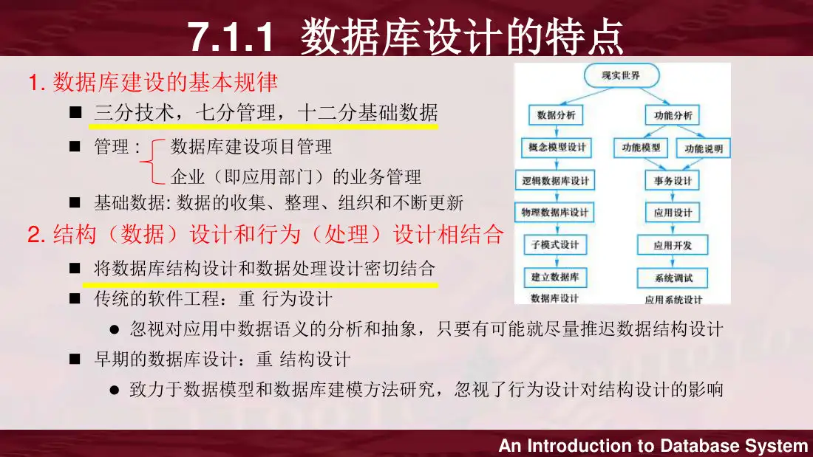

原文：

7.1.1 数据库设计的特点

1. 数据库建设的基本规律

■ 三分技术，七分管理，十二分基础数据

数据库建设项目管理

企业（即应用部门）的业务管理

■ 基础数据: 数据的收集、整理、组织和不断更新

2. 结构（数据）设计和行为（处理）设计相结合

■ 将数据库结构设计和数据处理设计密切结合

■ 传统的软件工程：重行为设计

\- 忽视对应用中数据语义的分析和抽象，只要有可能就尽量推迟数据结构设计

■ 早期的数据库设计：重 结构设计

\- 致力于数据模型和数据库建模方法研究，忽视了行为设计对结构设计的影响

An Introduction to Database System

### 7.1.2 数据库设计方法

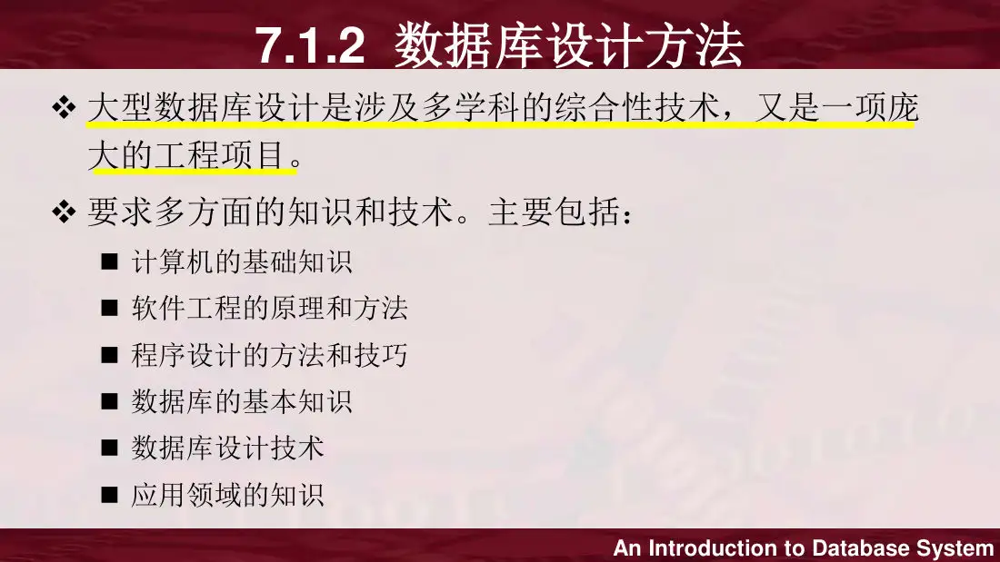

原文：

7.1.2 数据库设计方法

大型数据库设计是涉及多学科的综合性技术，又是一项庞大的工程项目。

◆ 要求多方面的知识和技术。主要包括:

■ 计算机的基础知识

■ 软件工程的原理和方法

■ 程序设计的方法和技巧

■ 数据库的基本知识

■ 数据库设计技术

■ 应用领域的知识

An Introduction to Database System

### 7.1.2 数据库设计方法（续）

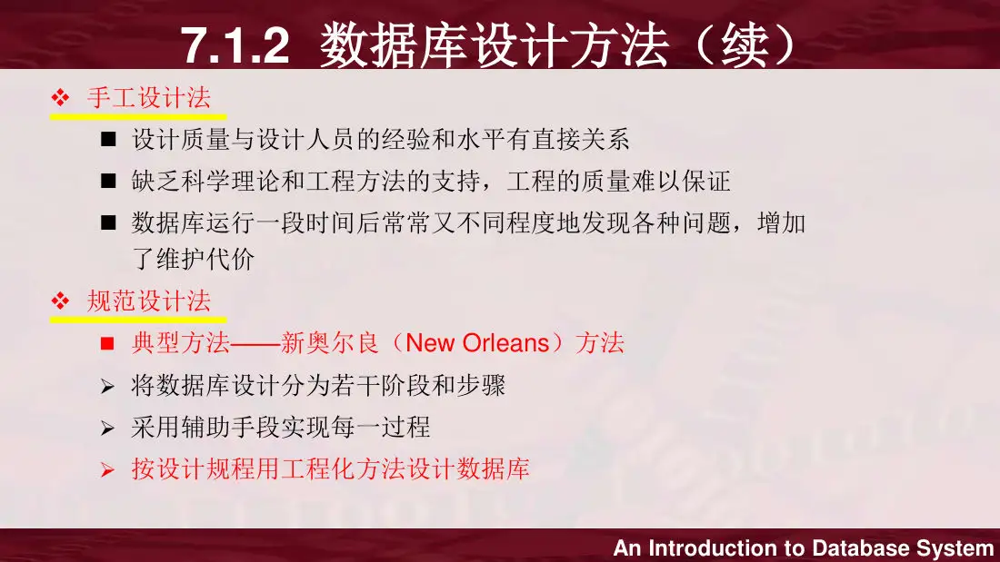

原文：

7.1.2 数据库设计方法（续）

手工设计法

■ 设计质量与设计人员的经验和水平有直接关系

■ 缺乏科学理论和工程方法的支持，工程的质量难以保证

■ 数据库运行一段时间后常常又不同程度地发现各种问题，增加了维护代价

规范设计法

■ 典型方法——新奥尔良（New Orleans）方法

将数据库设计分为若干阶段和步骤

采用辅助手段实现每一过程

按设计规程用工程化方法设计数据库

An Introduction to Database System

### 7.1.2 数据库设计方法（续）

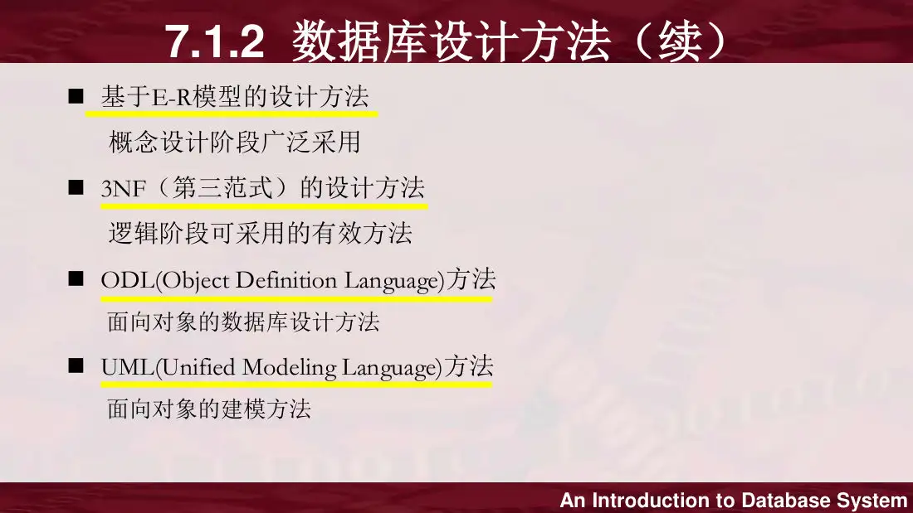

原文：

7.1.2 数据库设计方法（续）

■ 基于E-R模型的设计方法

概念设计阶段广泛采用

■ 3NF（第三范式）的设计方法
逻辑阶段可采用的有效方法

■ ODL(Object Definition Language)方法
面向对象的数据库设计方法

■ UML(Unified Modeling Language)方法
面向对象的建模方法

An Introduction to Database System

### 数据库设计方法（续）

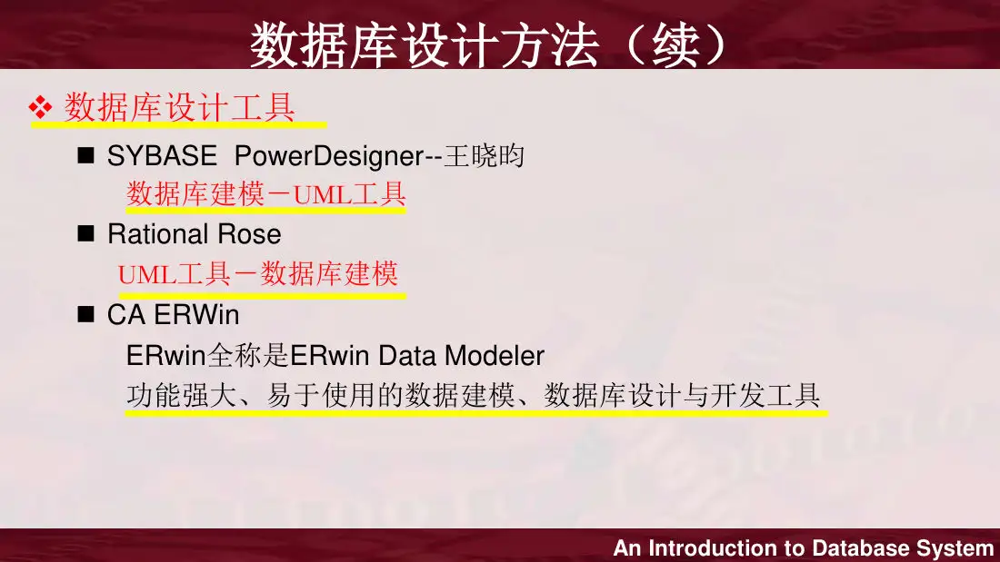

原文：

数据库设计方法（续）

数据库设计工具

■ SYBASE PowerDesigner--王晓昀
数据库建模—UML工具

■ Rational Rose

UML工具—数据库建模

■ CA ERWin

ERwin全称是ERwin Data Modeler

功能强大、易于使用的数据建模、数据库设计与开发工具

An Introduction to Database System

### 7.1.3 数据库设计的基本步骤

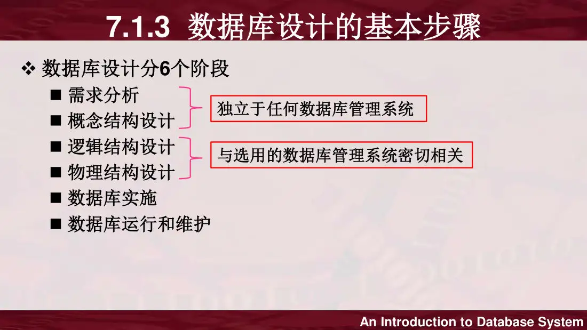

原文：

7.1.3 数据库设计的基本步骤

数据库设计分6个阶段

■需求分析

■ 概念结构设计

■ 逻辑结构设计

■ 物理结构设计

■ 数据库实施

独立于任何数据库管理系统

与选用的数据库管理系统密切相关

■ 数据库运行和维护

An Introduction to Database System

### 第 10 页

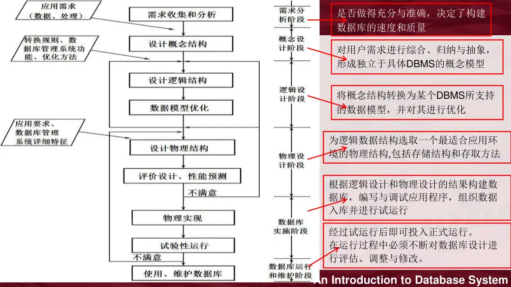

### 数据库设计的基本步骤（续）

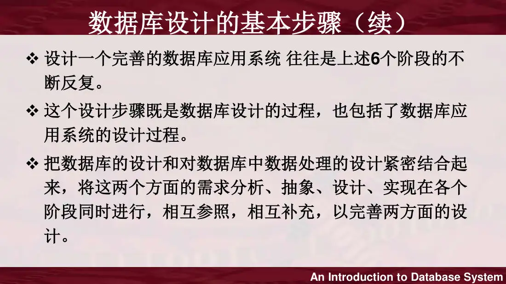

原文：

数据库设计的基本步骤（续）

设计一个完善的数据库应用系统往往是上述6个阶段的不断反复。

这个设计步骤既是数据库设计的过程，也包括了数据库应用系统的设计过程。

✿ 把数据库的设计和对数据库中数据处理的设计紧密结合起来，将这两个方面的需求分析、抽象、设计、实现在各个阶段同时进行，相互参照，相互补充，以完善两方面的设计。

An Introduction to Database System

### 数据库设计的基本步骤（续）

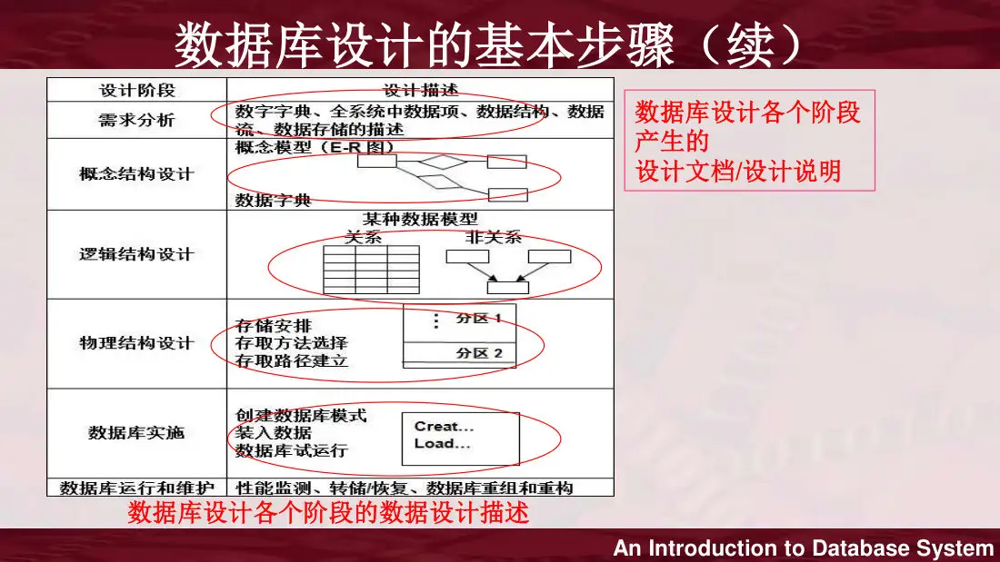

原文：

数据库设计的基本步骤（续）

<table><tr><td>设计阶段</td><td>设计描述</td></tr><tr><td>需求分析</td><td>数字字典、全系统中数据项、数据结构、数据流、数据存储的描述</td></tr><tr><td>概念结构设计</td><td>概念模型(E-R图)数据字典</td></tr><tr><td>逻辑结构设计</td><td>某种数据模型关系非关系</td></tr><tr><td>物理结构设计</td><td>存储安排分区1存取方法选择分区2存取路径建立</td></tr><tr><td>数据库实施</td><td>创建数据库模式装入数据Creat...Load...</td></tr><tr><td>数据库运行和维护</td><td>性能监测、转储/恢复、数据库重组和重构</td></tr></table>

数据库设计各个阶段的数据设计描述数据库设计各个阶段产生的

设计文档/设计说明

An Introduction to Database System

### 数据库设计的基本步骤（续）

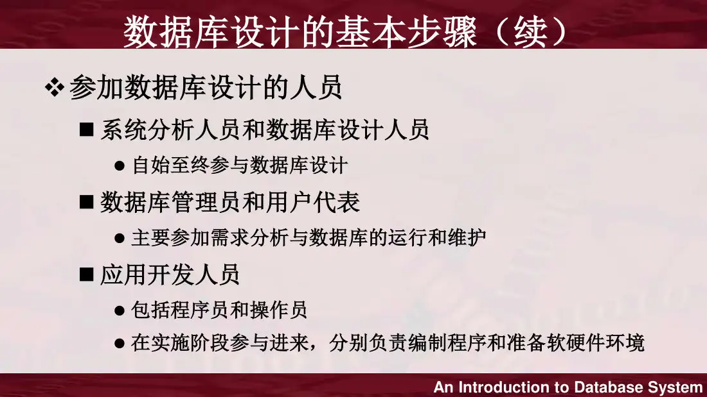

原文：

数据库设计的基本步骤（续）

✿ 参加数据库设计的人员

■ 系统分析人员和数据库设计人员

\- 自始至终参与数据库设计

■ 数据库管理员和用户代表

\- 主要参加需求分析与数据库的运行和维护

■ 应用开发人员

\- 包括程序员和操作员

\- 在实施阶段参与进来，分别负责编制程序和准备软硬件环境

An Introduction to Database System

### 7.1.4 数据库设计过程中的各级模式

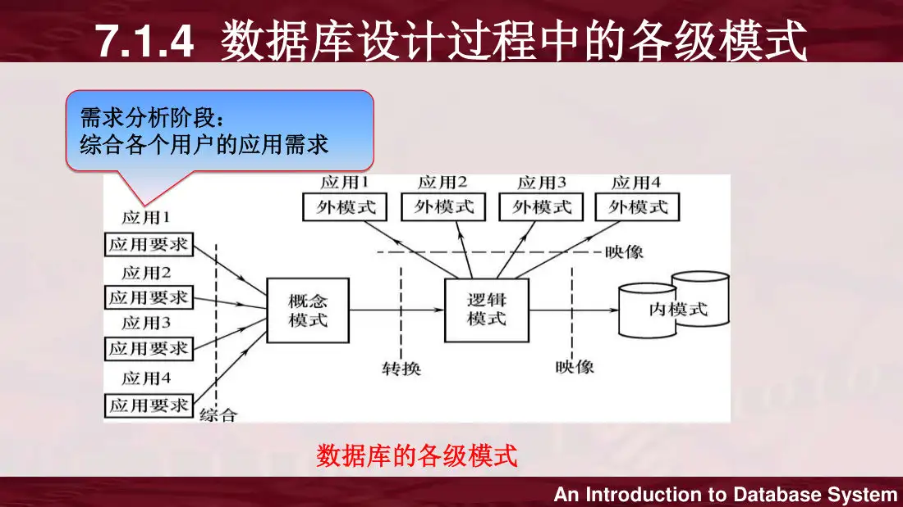

原文：

7.1.4 数据库设计过程中的各级模式

需求分析阶段：综合各个用户的应用需求

An Introduction to Database System

### 数据库设计过程中的各级模式（续）

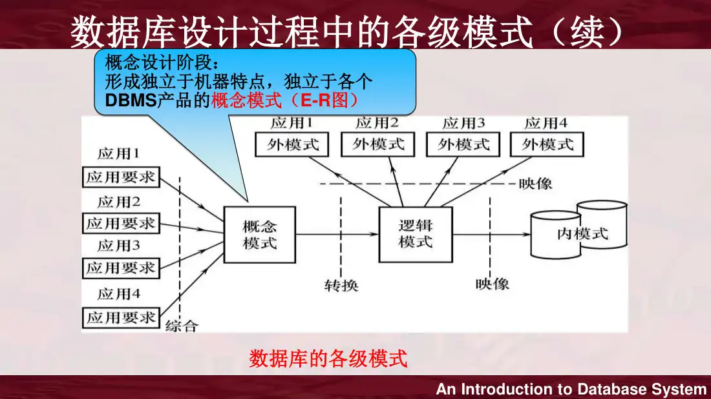

原文：

数据库设计过程中的各级模式（续）

概念设计阶段：
形成独立于机器特点，独立于各个
DBMS产品的概念模式（E-R图）

An Introduction to Database System

### 数据库设计过程中的各级模式（续）

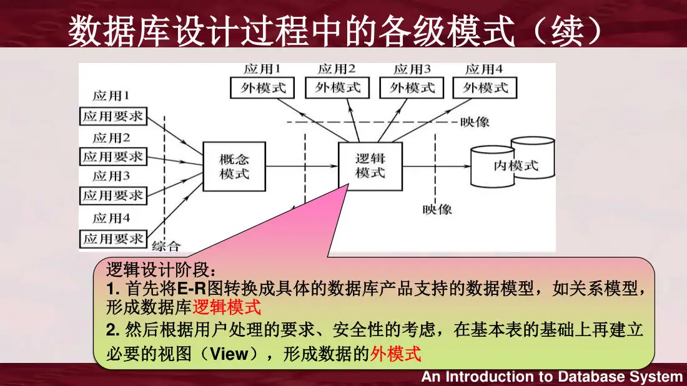

原文：

数据库设计过程中的各级模式（续）

逻辑设计阶段:

1. 首先将E-R图转换成具体的数据库产品支持的数据模型，如关系模型，形成数据库逻辑模式

2. 然后根据用户处理的要求、安全性的考虑，在基本表的基础上再建立必要的视图（View），形成数据的外模式

An Introduction to Database System

### 数据库设计过程中的各级模式（续） 物理设计阶段

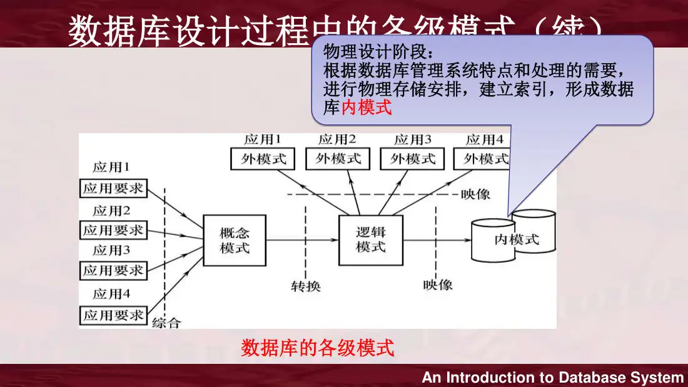

原文：

数据库设计过程中的各级模式（续） 物理设计阶段

物理设计阶段:

根据数据库管理系统特点和处理的需要，进行物理存储安排，建立索引，形成数据库内模式

An Introduction to Database System

### 客观世界中的问题域：学生选修课程

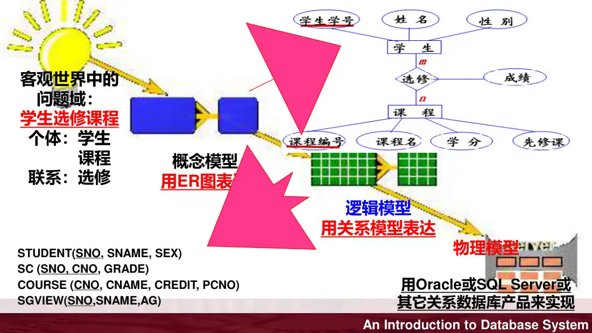

原文：

客观世界中的问题域：学生选修课程

个体：学生课程

联系：选修

STUDENT(SNO, SNAME, SEX)
SC (SNO, CNO, GRADE)
COURSE (CNO, CNAME, CREDIT, PCNO)
SGVIEW(SNO, SNAME, AG)

用Oracle或SQL Server或其它关系数据库产品来实现

An Introduction to Database System

### 7.2 需求分析

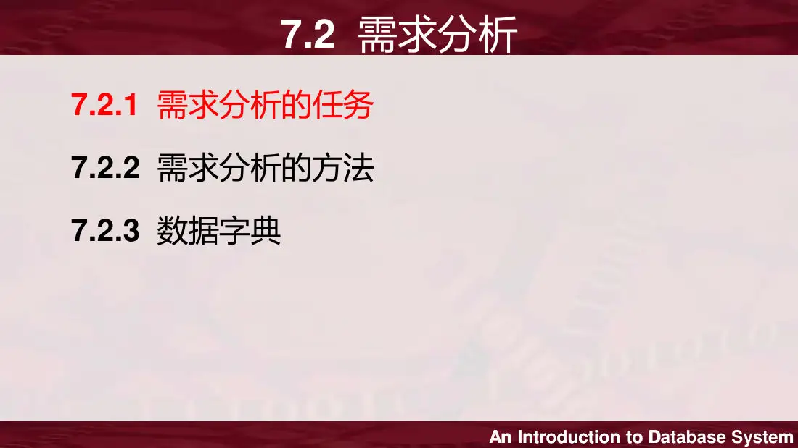

原文：

7.2 需求分析

7.2.1 需求分析的任务

7.2.2 需求分析的方法

7.2.3 数据字典

An Introduction to Database System

### 7.2 需求分析

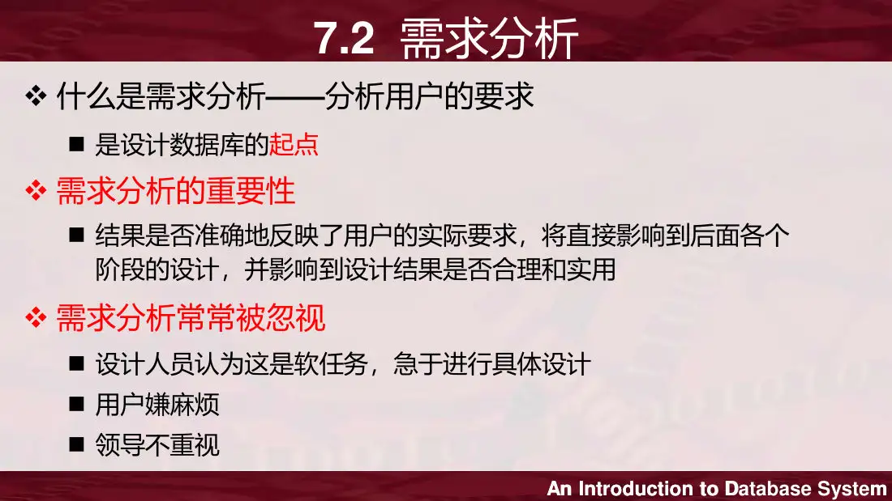

原文：

7.2 需求分析

什么是需求分析——分析用户的要求

■ 是设计数据库的起点

需求分析的重要性

■ 结果是否准确地反映了用户的实际要求，将直接影响到后面各个阶段的设计，并影响到设计结果是否合理和实用

需求分析常常被忽视

■ 设计人员认为这是软任务，急于进行具体设计

■ 用户嫌麻烦

■ 领导不重视

An Introduction to Database System

### 7.2.1 需求分析的任务

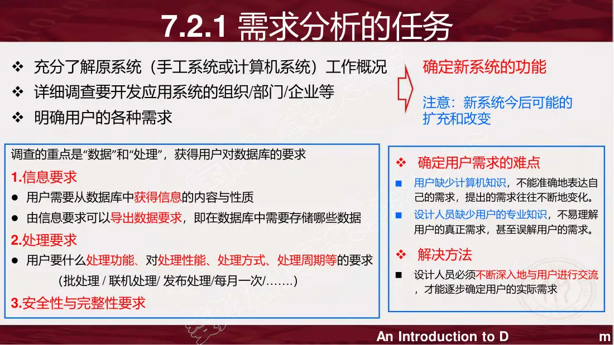

原文：

7.2.1 需求分析的任务

◆ 充分了解原系统（手工系统或计算机系统）工作概况

详细调查要开发应用系统的组织/部门/企业等

明确用户的各种需求

确定新系统的功能

注意：新系统今后可能的扩充和改变

调查的重点是“数据”和“处理”，获得用户对数据库的要求

1. 信息要求

\- 用户需要从数据库中获得信息的内容与性质

\- 由信息要求可以导出数据要求，即在数据库中需要存储哪些数据

2. 处理要求

\- 用户要什么处理功能、对处理性能、处理方式、处理周期等的要求（批处理 / 联机处理 / 发布处理 / 每月一次 / ……）

3. 安全性与完整性要求

确定用户需求的难点

■ 用户缺少计算机知识，不能准确地表达自己的需求，提出的需求往往不断地变化。

设计人员缺少用户的专业知识，不易理解用户的真正需求，甚至误解用户的需求。

解决方法

■ 设计人员必须不断深入地与用户进行交流，才能逐步确定用户的实际需求

An Introduction to D

m

### 7.2.2 需求分析的方法

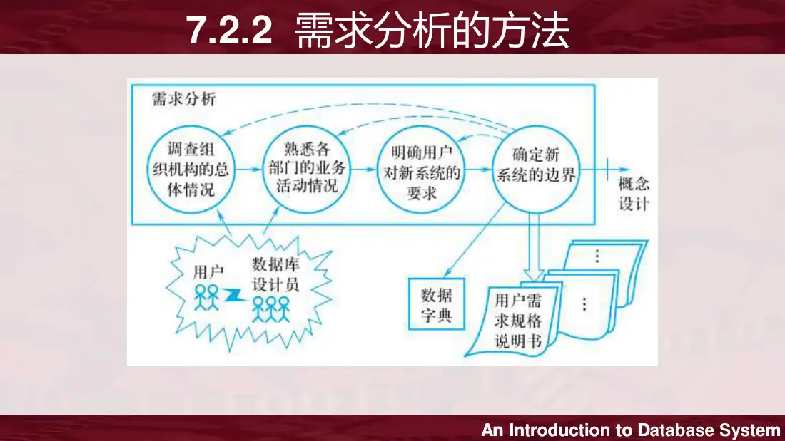

原文：

7.2.2 需求分析的方法

An Introduction to Database System

### 7.2 需求分析

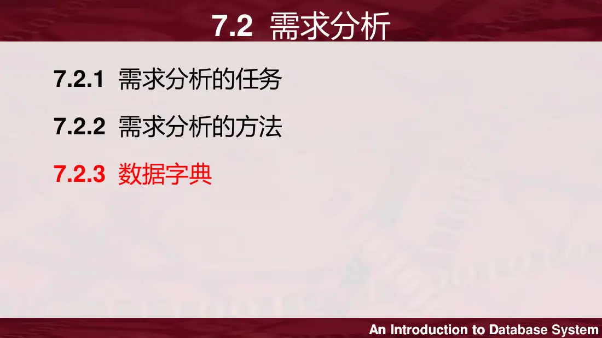

原文：

7.2 需求分析

7.2.1 需求分析的任务

7.2.2 需求分析的方法

7.2.3 数据字典

An Introduction to Database System

### 7.2.3 数据字典

原文：

7.2.3 数据字典

什么是数据字典？

数据字典是关于数据库中数据的描述，称为元数据。

它不是数据本身，而是数据的数据。

✿ 数据字典在需求分析阶段建立，在数据库设计过程中不断修改、充实、完善。

✿ 数据字典是进行详细的数据收集和分析所获得的主要结果。

An Introduction to Database System

### 数据字典（续）

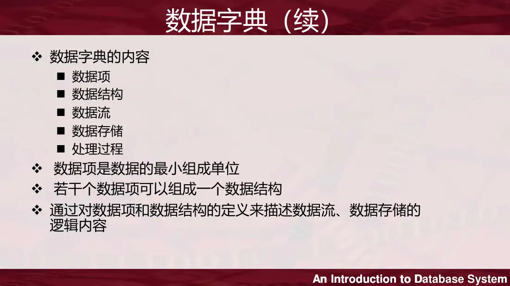

原文：

数据字典（续）

◆ 数据字典的内容

■ 数据项

■ 数据结构

■ 数据流

■ 数据存储

■ 处理过程

◆ 数据项是数据的最小组成单位

若干个数据项可以组成一个数据结构

通过对数据项和数据结构的定义来描述数据流、数据存储的逻辑内容

An Introduction to Database System

### 1. 数据项

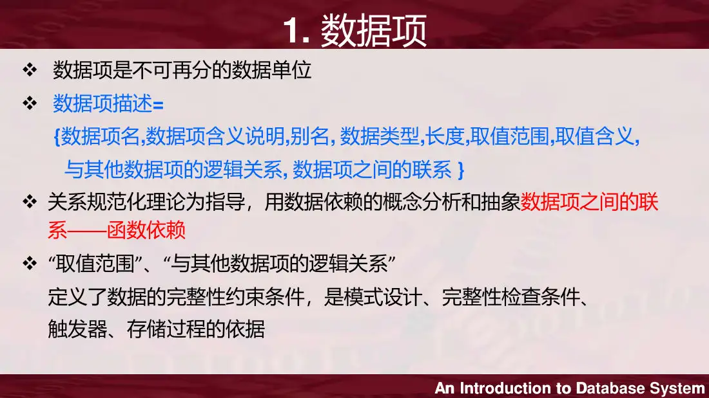

原文：

1. 数据项

◆ 数据项是不可再分的数据单位

数据项描述=

{数据项名,数据项含义说明,别名,数据类型,长度,取值范围,取值含义,与其他数据项的逻辑关系,数据项之间的联系}

关系规范化理论为指导，用数据依赖的概念分析和抽象数据项之间的联系——函数依赖

“取值范围”、“与其他数据项的逻辑关系”

定义了数据的完整性约束条件，是模式设计、完整性检查条件、

触发器、存储过程的依据

An Introduction to Database System

### 实例

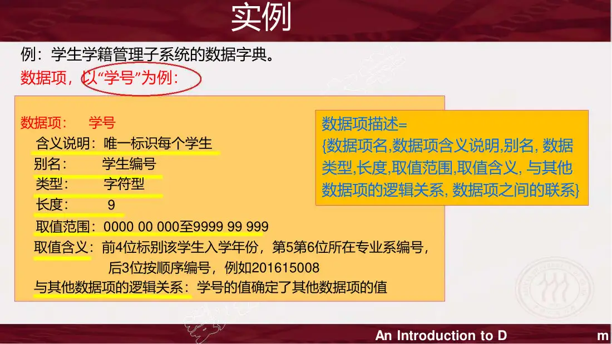

原文：

实例

例：学生学籍管理子系统的数据字典。

数据项，以“学号”为例：

数据项： 学号

含义说明：唯一标识每个学生

别名： 学生编号

类型： 字符型

长度: 9

数据项描述=

{数据项名,数据项含义说明,别名, 数据类型,长度,取值范围,取值含义, 与其他数据项的逻辑关系, 数据项之间的联系}

取值范围：0000 00 000至9999 99 999

取值含义：前4位标别该学生入学年份，第5第6位所在专业系编号，后3位按顺序编号，例如201615008

与其他数据项的逻辑关系：学号的值确定了其他数据项的值

An Introduction to D

m

### 2. 数据结构

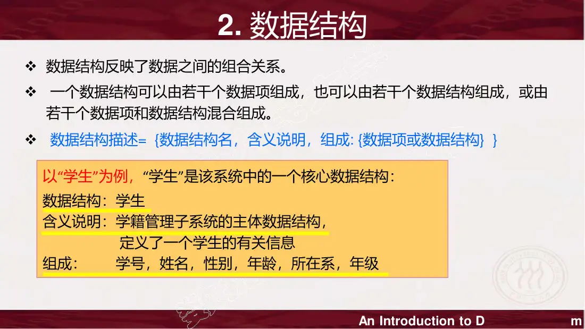

原文：

2. 数据结构

✿ 数据结构反映了数据之间的组合关系。

一个数据结构可以由若干个数据项组成，也可以由若干个数据结构组成，或由若干个数据项和数据结构混合组成。

数据结构描述= {数据结构名，含义说明，组成: {数据项或数据结构} }

以“学生”为例，“学生”是该系统中的一个核心数据结构：

数据结构：学生

含义说明：学籍管理子系统的主体数据结构，定义了一个学生的有关信息

组成：学号，姓名，性别，年龄，所在系，年级

An Introduction to D

m

### 3. 数据流

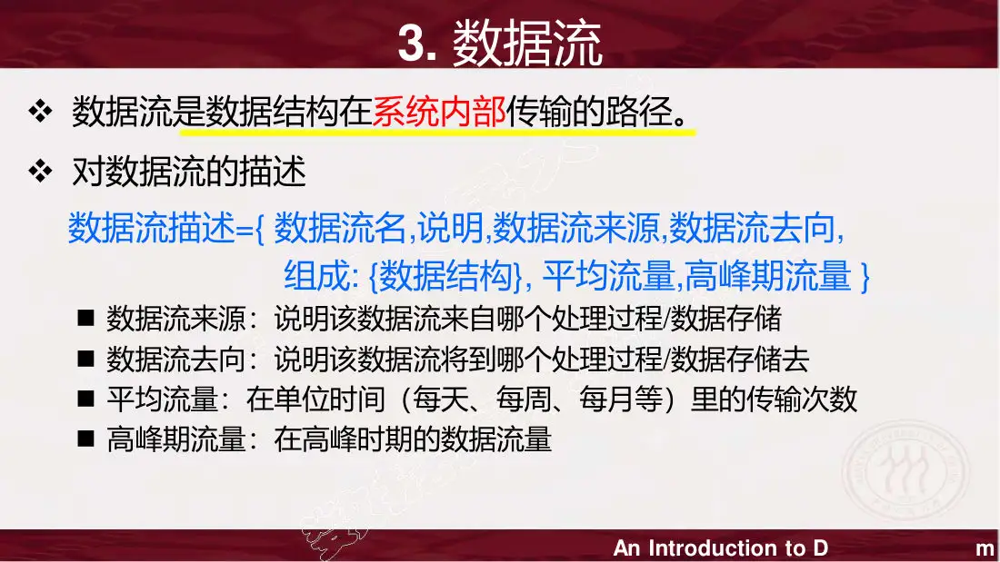

原文：

3. 数据流

◆ 数据流是数据结构在系统内部传输的路径。

对数据流的描述

数据流描述={数据流名,说明,数据流来源,数据流去向,组成: {数据结构}, 平均流量,高峰期流量}

■ 数据流来源：说明该数据流来自哪个处理过程/数据存储

■ 数据流去向：说明该数据流将到哪个处理过程/数据存储去

■ 平均流量：在单位时间（每天、每周、每月等）里的传输次数

■ 高峰期流量：在高峰时期的数据流量

An Introduction to D

m

### 实例

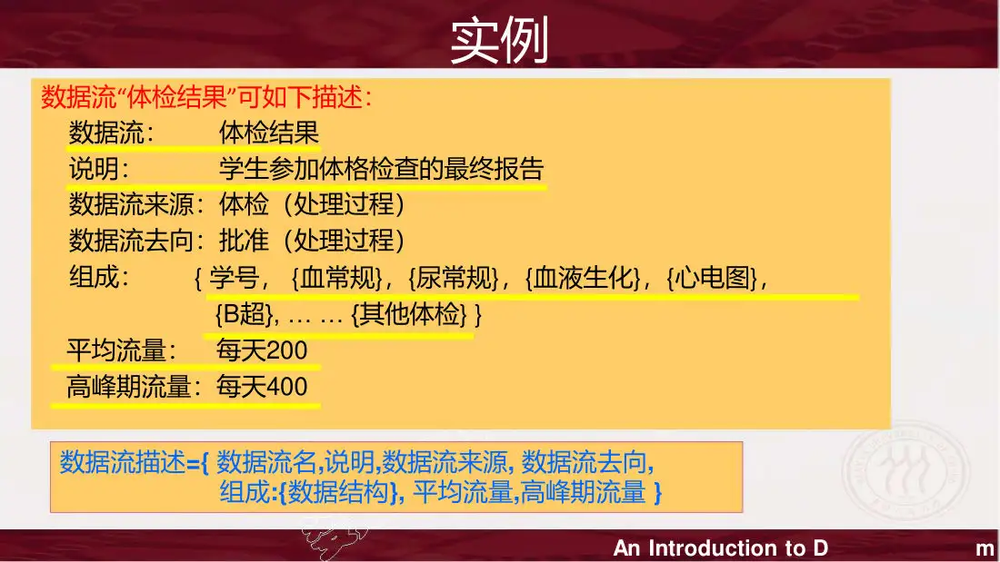

原文：

实例

数据流“体检结果”可如下描述：

数据流：体检结果

说明：学生参加体格检查的最终报告

数据流来源：体检（处理过程）

数据流去向：批准（处理过程）

组成: {学号, {血常规}, {尿常规}, {血液生化}, {心电图}, {B超}, … … {其他体检} }

平均流量: 每天200

高峰期流量：每天400

数据流描述={数据流名,说明,数据流来源,数据流去向,组成:{数据结构},平均流量,高峰期流量}

An Introduction to D

m

### 4. 数据存储

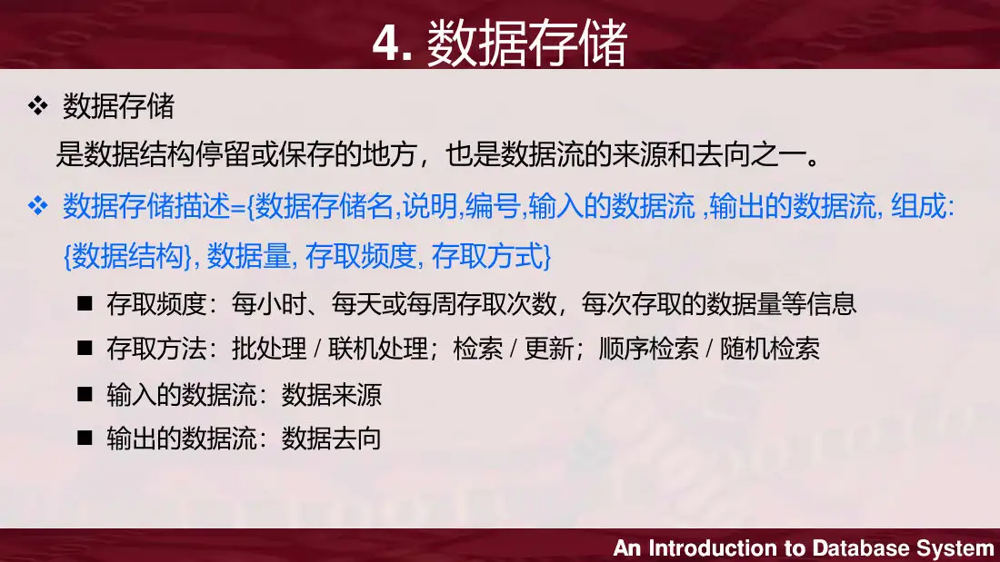

原文：

4. 数据存储

数据存储

是数据结构停留或保存的地方，也是数据流的来源和去向之一。

✿ 数据存储描述={数据存储名,说明,编号,输入的数据流,输出的数据流,组成:{数据结构},数据量,存取频度,存取方式}

■ 存取频度：每小时、每天或每周存取次数，每次存取的数据量等信息

■ 存取方法：批处理 / 联机处理；检索 / 更新；顺序检索 / 随机检索

■ 输入的数据流：数据来源

■ 输出的数据流：数据去向

An Introduction to Database System

### 实例

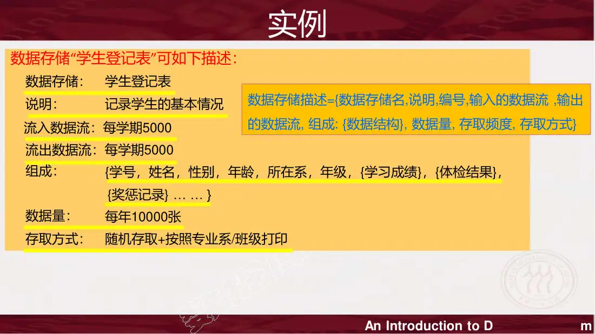

原文：

实例

数据存储“学生登记表”可如下描述：

数据存储： 学生登记表

说明： 记录学生的基本情况

流入数据流：每学期5000

流出数据流：每学期5000

数据存储描述={数据存储名,说明,编号,输入的数据流,输出的数据流,组成: {数据结构}, 数据量, 存取频度, 存取方式}

组成：{学号，姓名，性别，年龄，所在系，年级，{学习成绩}, {体检结果}, {奖惩记录} … … }

数据量: 每年10000张

存取方式：随机存取+按照专业系/班级打印

An Introduction to D

m

### 5. 处理过程

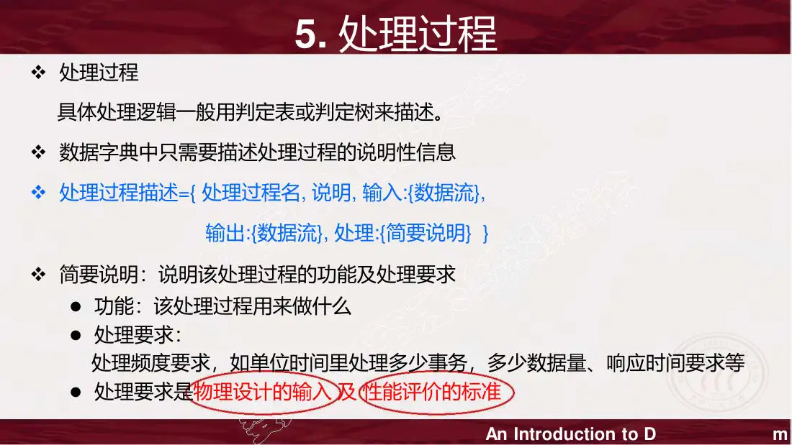

原文：

5. 处理过程

处理过程

具体处理逻辑一般用判定表或判定树来描述。

◆ 数据字典中只需要描述处理过程的说明性信息

处理过程描述={处理过程名, 说明, 输入:{数据流},

输出:{数据流}, 处理:{简要说明} }

简要说明：说明该处理过程的功能及处理要求

\- 功能：该处理过程用来做什么

\- 处理要求:

处理频度要求，如单位时间里处理多少事务，多少数据量、响应时间要求等

\- 处理要求是物理设计的输入及性能评价的标准

An Introduction to D

m

### 实例

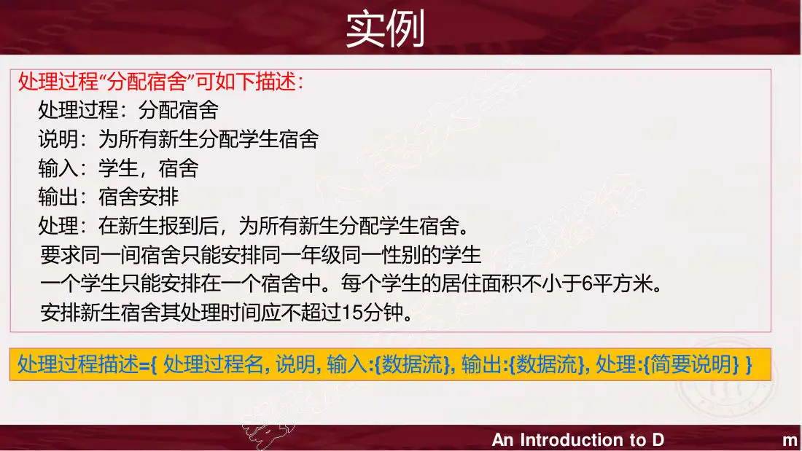

原文：

实例

处理过程“分配宿舍”可如下描述：

处理过程：分配宿舍

说明：为所有新生分配学生宿舍

输入：学生，宿舍

输出：宿舍安排

处理：在新生报到后，为所有新生分配学生宿舍。

要求同一间宿舍只能安排同一年级同一性别的学生

一个学生只能安排在一个宿舍中。每个学生的居住面积不小于6平方米。

安排新生宿舍其处理时间应不超过15分钟。

处理过程描述={处理过程名,说明,输入:{数据流},输出:{数据流},处理:{简要说明}}

An Introduction to D

m

### 需求分析小结

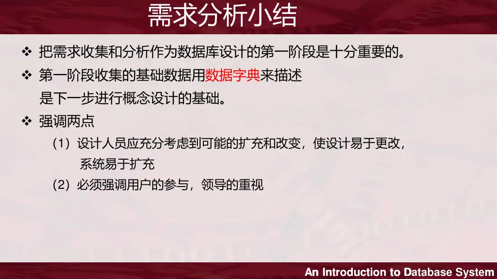

原文：

需求分析小结

✿ 把需求收集和分析作为数据库设计的第一阶段是十分重要的。

第一阶段收集的基础数据用数据字典来描述是下一步进行概念设计的基础。

◆ 强调两点

(1) 设计人员应充分考虑到可能的扩充和改变，使设计易于更改，系统易于扩充

(2) 必须强调用户的参与，领导的重视

An Introduction to Database System

### 7.3.1 概念模型

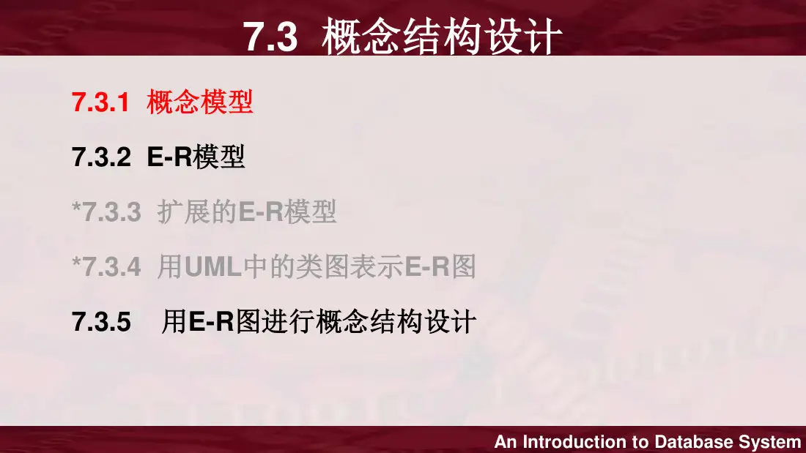

原文：

7.3.1 概念模型
7.3.2 E-R模型
\*7.3.3 扩展的E-R模型
\*7.3.4 用UML中的类图表示E-R图
7.3.5 用E-R图进行概念结构设计

7.3 概念结构设计

An Introduction to Database System

### 7.3.1 概念模型

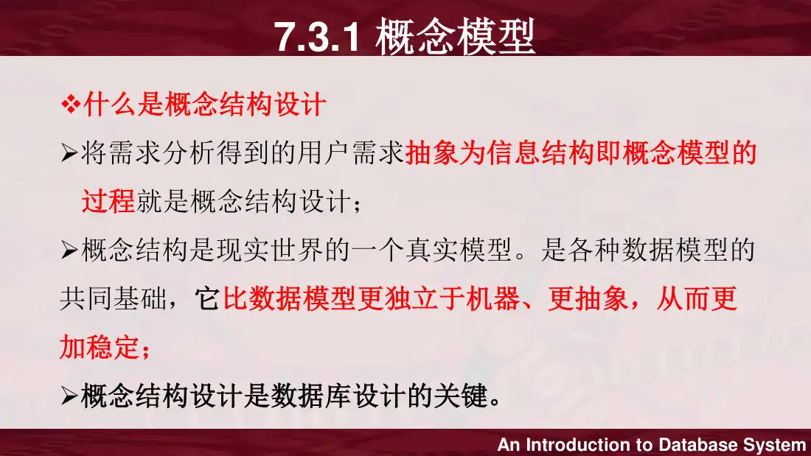

原文：

7.3.1 概念模型

什么是概念结构设计

将需求分析得到的用户需求抽象为信息结构即概念模型的过程就是概念结构设计；

➢概念结构是现实世界的一个真实模型。是各种数据模型的共同基础，它比数据模型更独立于机器、更抽象，从而更加稳定；

概念结构设计是数据库设计的关键。

An Introduction to Database System

### 回顾：两类数据模型

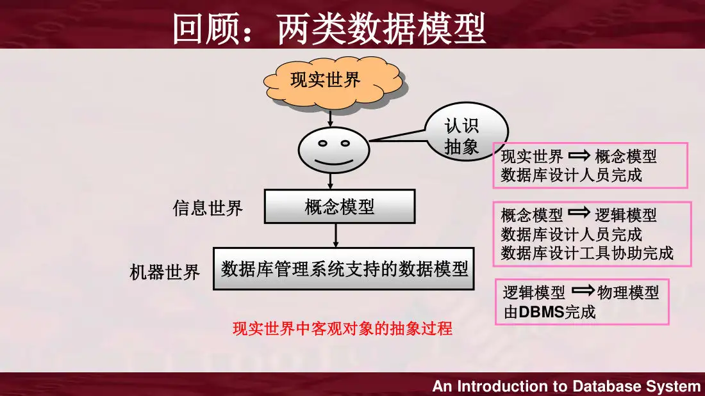

原文：

回顾：两类数据模型

An Introduction to Database System

### 回顾：1.2.2 概念模型

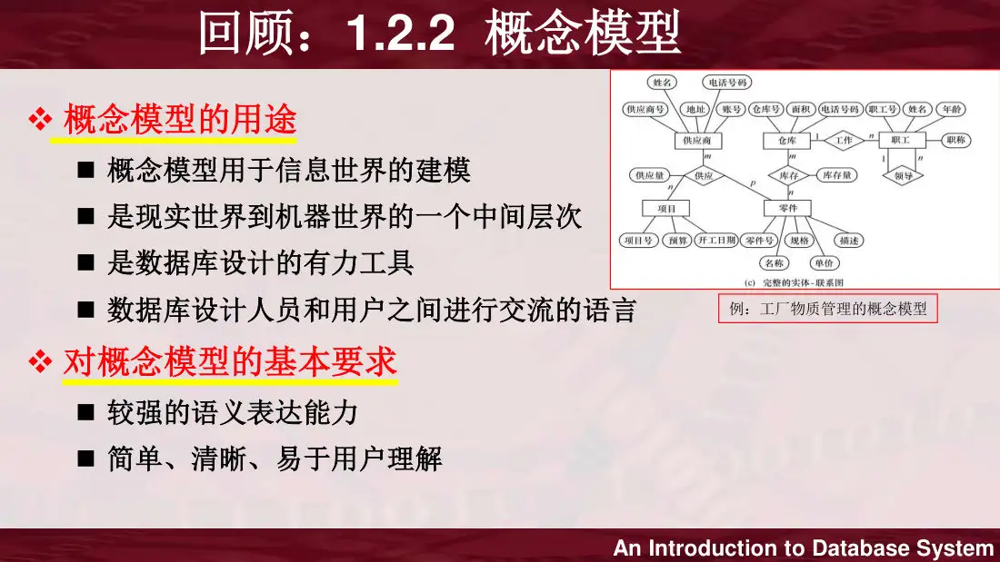

原文：

回顾：1.2.2 概念模型

概念模型的用途

■ 概念模型用于信息世界的建模

■ 是现实世界到机器世界的一个中间层次

■ 是数据库设计的有力工具

■ 数据库设计人员和用户之间进行交流的语言

例：工厂物质管理的概念模型

对概念模型的基本要求

■ 较强的语义表达能力

■ 简单、清晰、易于用户理解

An Introduction to Database System

### 回顾：信息世界中的基本概念

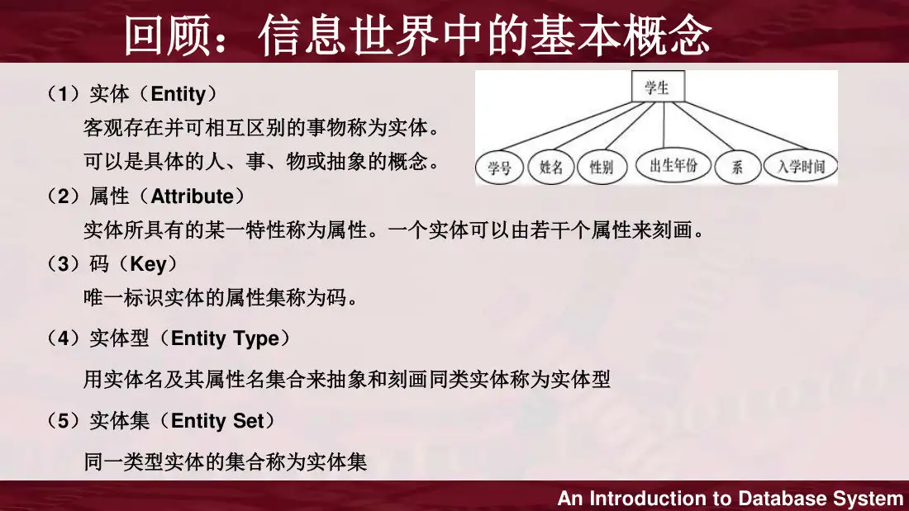

原文：

回顾：信息世界中的基本概念

(1) 实体 (Entity)

客观存在并可相互区别的事物称为实体。可以是具体的人、事、物或抽象的概念。

(2) 属性（Attribute）

实体所具有的某一特性称为属性。一个实体可以由若干个属性来刻画。

(3) 码 (Key)

唯一标识实体的属性集称为码。

(4) 实体型 (Entity Type)

用实体名及其属性名集合来抽象和刻画同类实体称为实体型

(5) 实体集 (Entity Set)

同一类型实体的集合称为实体集

An Introduction to Database System

### (a)1:1联系

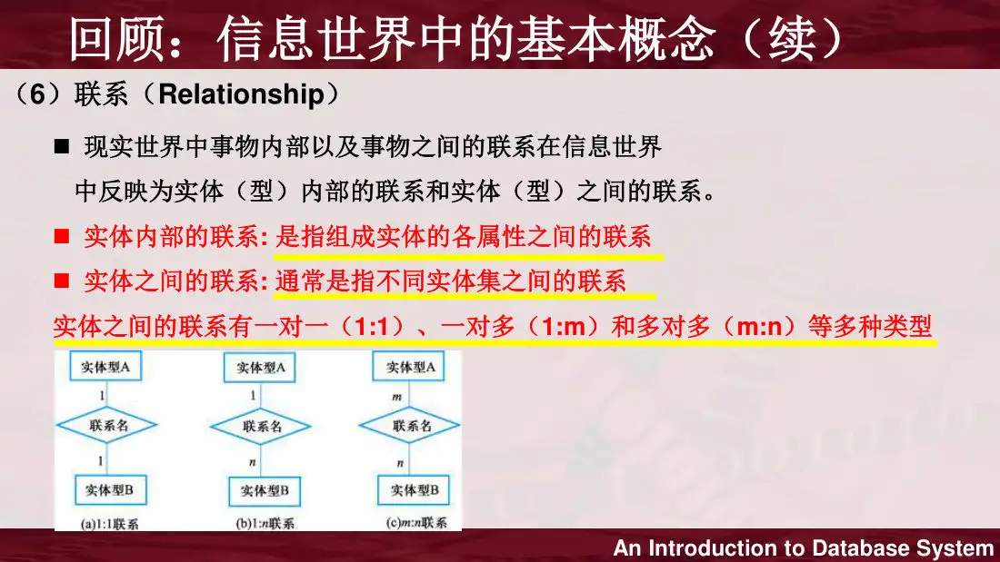

原文：

(a)1:1联系

回顾：信息世界中的基本概念（续）

(6) 联系（Relationship）

■ 现实世界中事物内部以及事物之间的联系在信息世界中反映为实体（型）内部的联系和实体（型）之间的联系。

■ 实体内部的联系: 是指组成实体的各属性之间的联系

■ 实体之间的联系: 通常是指不同实体集之间的联系

实体之间的联系有一对一（1:1）、一对多（1:m）和多对多（m:n）等多种类型

An Introduction to Database System

### 回顾：实体-联系方法

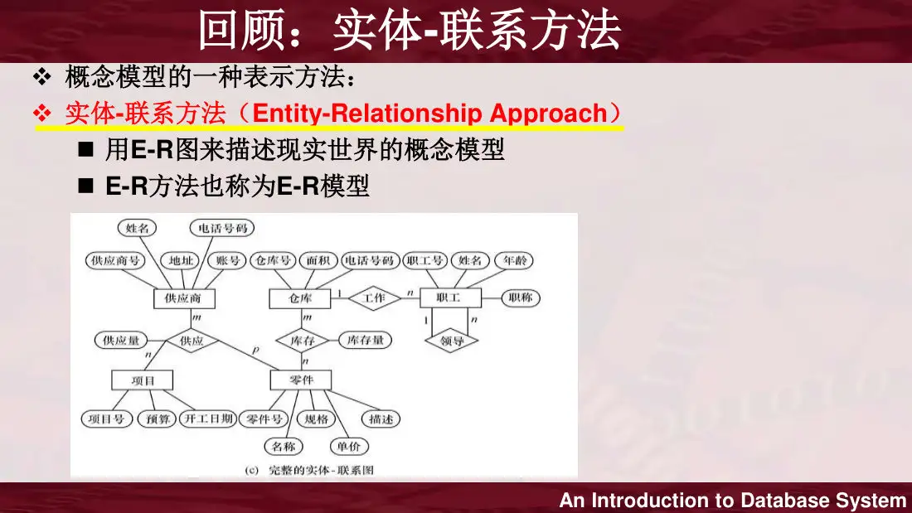

原文：

回顾：实体-联系方法

概念模型的一种表示方法:

实体-联系方法（Entity-Relationship Approach）

■ 用E-R图来描述现实世界的概念模型

■ E-R方法也称为E-R模型

An Introduction to Database System

### 7.3.1 概念模型

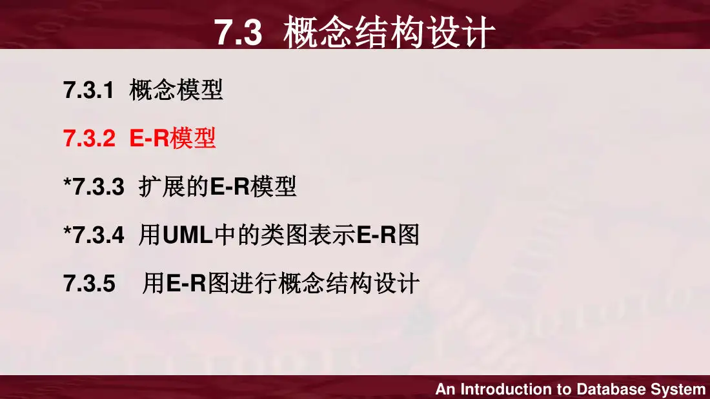

原文：

7.3.1 概念模型
7.3.2 E-R模型
\*7.3.3 扩展的E-R模型
\*7.3.4 用UML中的类图表示E-R图
7.3.5 用E-R图进行概念结构设计

7.3 概念结构设计

An Introduction to Database System

### 7.3.2 E-R模型

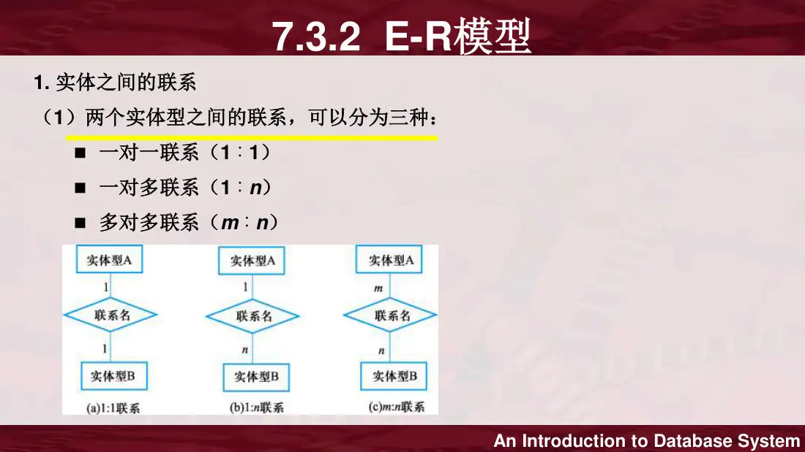

原文：

7.3.2 E-R模型

1. 实体之间的联系

(1) 两个实体型之间的联系, 可以分为三种:

■ 一对一联系（1：1）

■ 一对多联系（1:n）

■ 多对多联系（m:n）

An Introduction to Database System

### E-R模型（续）

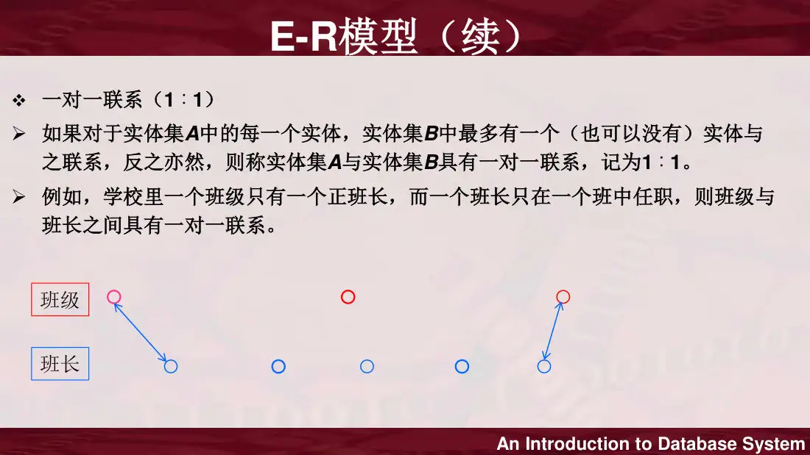

原文：

E-R模型（续）

一对一联系（1：1）

如果对于实体集A中的每一个实体，实体集B中最多有一个（也可以没有）实体与之联系，反之亦然，则称实体集A与实体集B具有一对一联系，记为1：1。

例如，学校里一个班级只有一个正班长，而一个班长只在一个班中任职，则班级与班长之间具有一对一联系。

班级

班长

An Introduction to Database System

### E-R模型（续）

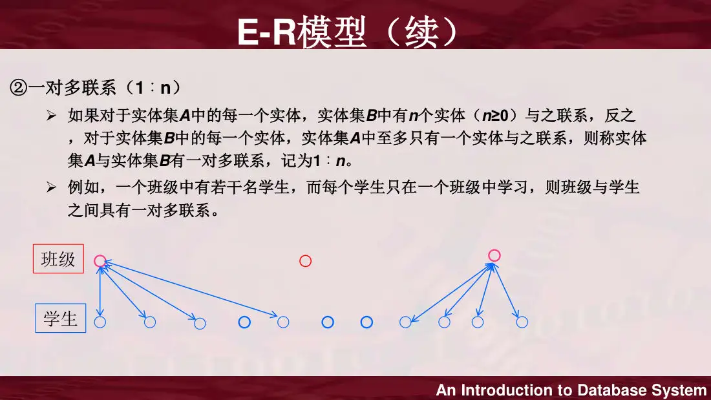

原文：

E-R模型（续）

②一对多联系（1:n）

如果对于实体集A中的每一个实体，实体集B中有n个实体（ $n \geq 0$ ）与之联系，反之，对于实体集B中的每一个实体，实体集A中至多只有一个实体与之联系，则称实体集A与实体集B有一对多联系，记为1：n。

例如，一个班级中有若干名学生，而每个学生只在一个班级中学习，则班级与学生之间具有一对多联系。

班级

学生

An Introduction to Database System

### E-R模型（续）

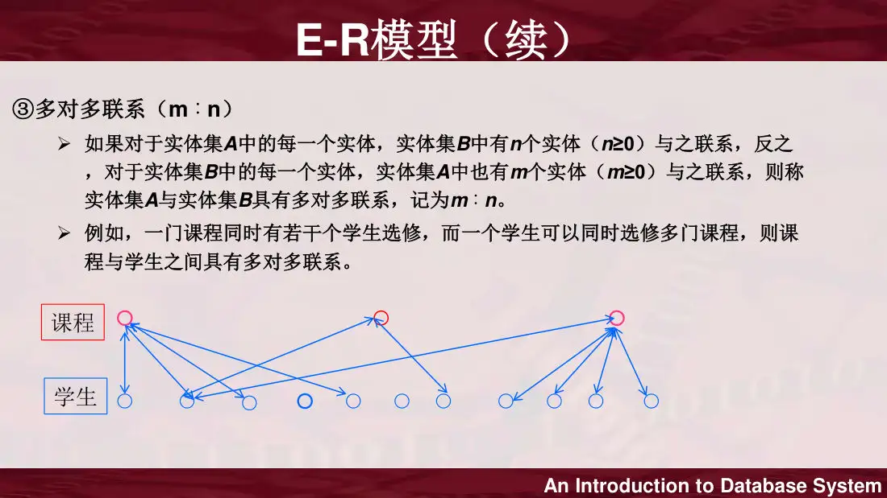

原文：

E-R模型（续）

③多对多联系（m:n）

如果对于实体集A中的每一个实体，实体集B中有n个实体（ $n \geq 0$ ）与之联系，反之，对于实体集B中的每一个实体，实体集A中也有m个实体（ $m \geq 0$ ）与之联系，则称实体集A与实体集B具有多对多联系，记为m：n。

例如，一门课程同时有若干个学生选修，而一个学生可以同时选修多门课程，则课程与学生之间具有多对多联系。

An Introduction to Database System

### E-R模型（续）

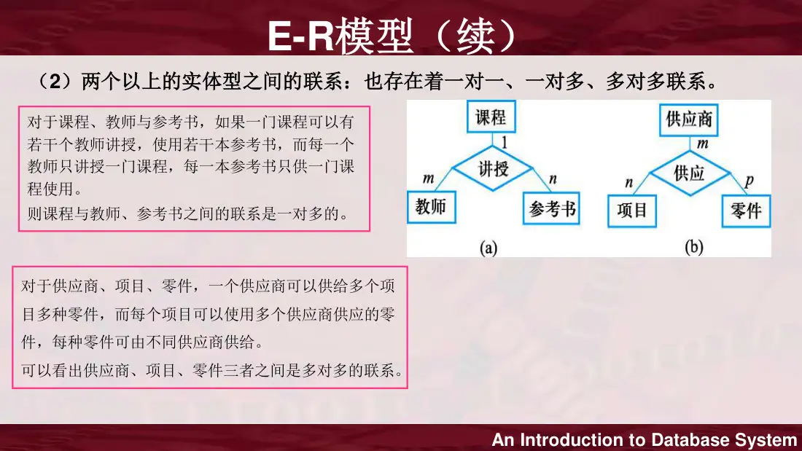

原文：

E-R模型（续）

(2) 两个以上的实体型之间的联系: 也存在着一对一、一对多、多对多联系。

对于课程、教师与参考书，如果一门课程可以有若干个教师讲授，使用若干本参考书，而每一个教师只讲授一门课程，每一本参考书只供一门课程使用。

则课程与教师、参考书之间的联系是一对多的。

对于供应商、项目、零件，一个供应商可以供给多个项目多种零件，而每个项目可以使用多个供应商供应的零件，每种零件可由不同供应商供给。

可以看出供应商、项目、零件三者之间是多对多的联系。

An Introduction to Database System

### E-R模型（续）

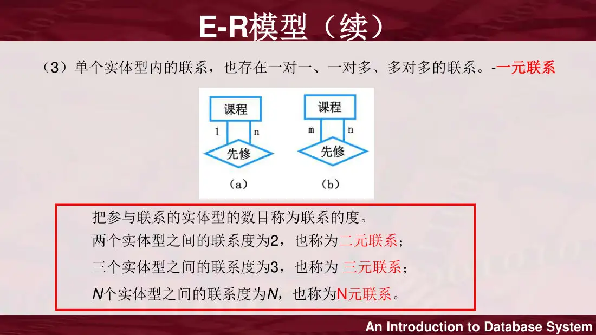

原文：

E-R模型（续）

(3) 单个实体型内的联系, 也存在一对一、一对多、多对多的联系。-一元联系

把参与联系的实体型的数目称为联系的度。

两个实体型之间的联系度为2，也称为二元联系；

三个实体型之间的联系度为3，也称为三元联系；

N个实体型之间的联系度为N，也称为N元联系。

An Introduction to Database System

### E-R模型（续）

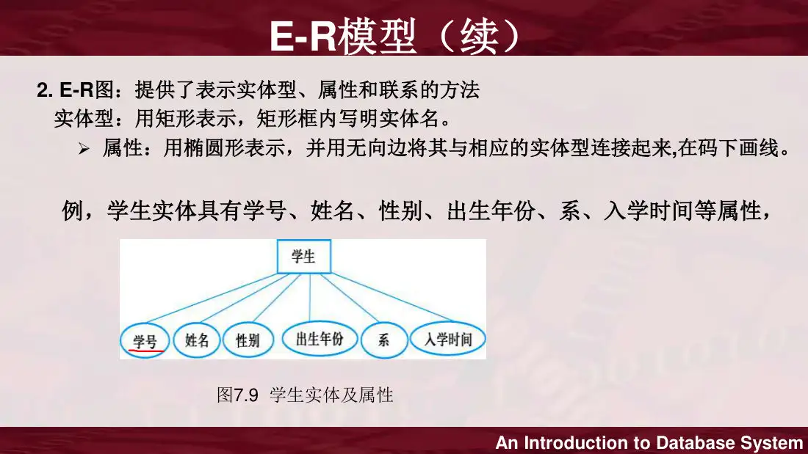

原文：

E-R模型（续）

2. E-R图：提供了表示实体型、属性和联系的方法
实体型：用矩形表示，矩形框内写明实体名。

属性：用椭圆形表示，并用无向边将其与相应的实体型连接起来，在码下画线。

例，学生实体具有学号、姓名、性别、出生年份、系、入学时间等属性，

An Introduction to Database System

### E-R模型（续）

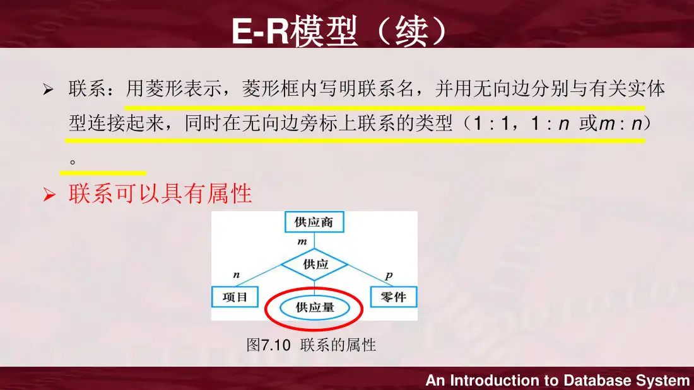

原文：

E-R模型（续）

联系：用菱形表示，菱形框内写明联系名，并用无向边分别与有关实体型连接起来，同时在无向边旁标上联系的类型（1:1，1:n 或 m:n）。

联系可以具有属性

An Introduction to Database System

### 7.3 概念结构设计

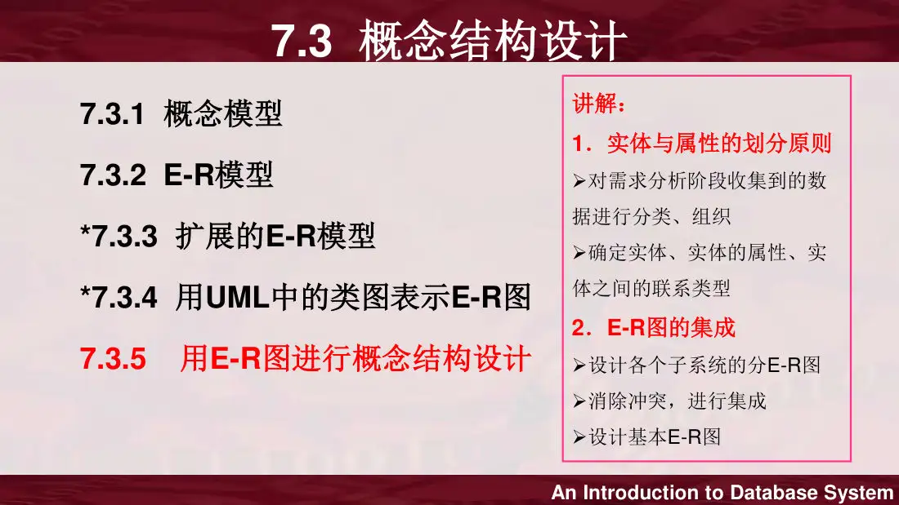

原文：

7.3 概念结构设计

7.3.1 概念模型

7.3.2 E-R模型

\*7.3.3 扩展的E-R模型

\*7.3.4 用UML中的类图表示E-R图

7.3.5 用E-R图进行概念结构设计

讲解:

1. 实体与属性的划分原则

▶对需求分析阶段收集到的数据进行分类、组织

确定实体、实体的属性、实体之间的联系类型

2. E-R图的集成

设计各个子系统的分E-R图

➢消除冲突，进行集成

设计基本E-R图

An Introduction to Database System

### 7.3.5 用E-R图进行概念结构设计

原文：

7.3.5 用E-R图进行概念结构设计

1. 实体与属性的划分原则

■为了简化E-R图的处置，现实世界的事物能作为属性对待的，尽量作为属性对待

■ 两条准则:

(1) 属性不能再具有需要描述的性质。即属性必须是不可分的数据项，不能包含其他属性

(2) 属性不能与其他实体具有联系, 即 E-R 图中所表示的联系是实体之间的联系

An Introduction to Database System

### An Introduction to Database System

原文：

An Introduction to Database System

用E-R图进行概念结构设计（续）

[例] 教师是一个实体型，“职工号”、“姓名”、“出生日期”是“教师”的属性

■ “职称”如果没有与工资、福利挂钩，根据准则（1）可以作为“教师”实体的属性

■ 如果不同的职称有不同的工资、岗位津贴和不同的附加福利，则职称作为一个实体更恰当

### 用E-R图进行概念结构设计（续）

原文：

用E-R图进行概念结构设计（续）

[例]一个学生如果只能选择一个专业，且专业没有跟专业类别、专业年限等挂钩，可以把“主修专业”作为“学生”实体的属性

但如果一个学生可以选择多个专业（例如其中有一个专业为主修专业，其他专业为辅修专业），则需要把“专业”单独作为一类实体，并建立学生与专业的多对多专业选择联系

### 用E-R图进行概念结构设计（续）

原文：

用E-R图进行概念结构设计（续）

[例]一门课程如果只存在一门直接的先修课，则可以把先修课的课程号作为“课程”实体的属性

但如果一门课程存在多门直接的先修课，则需要把“先修课”作为单独的一类实体。由于“先修课”实体型也是课程实体型，因此“先修课”与“课程”之间是单个实体型内的多对多联系

An Introduction to Database System

### 用E-R图进行概念结构设计（续）

原文：

用E-R图进行概念结构设计（续）

✿[例7.1]教师教学管理子系统的分E-R图的设计

■ 该子系统的主要功能是:

\- 为每个教学班安排授课教师

\- 为每个教学班排课，设置教室、上课时间

\- 针对学生对教学班的课堂评价，授课教师需要对学生的意见进行反馈

An Introduction to Database System

### 用E-R图进行概念结构设计（续）

原文：

用E-R图进行概念结构设计（续）

✿ 该子系统涉及的实体及属性如下:

(1) 教师实体的属性包括: 职工号、姓名、出生日期、职称 (为方便讨论, 本子系统将 “职称” 作为 “教师” 的属性)

(2) 教学班: 教学班号、人数上限、开课学期

(3) 学生: 学号、姓名、性别、出生日期

(4) 教室实体包括教室号（教室号的编码中已经包括了楼号，例如教室号 “003101” 表示教3楼101教室），教学楼号、联系人、联系方式等属性

An Introduction to Database System

### 用E-R图进行概念结构设计（续）

原文：

用E-R图进行概念结构设计（续）

(5) 时间片实体包括时间片编码（例如 “10102” 表示星期一第1节课开始，第2节课下课结束）、星期几、开始时间、截止时间

注意：时间片实体也可以作为“教学班”与“教师”的“排课”联系属性。考虑到同一个教学班在一周内可以安排在相同的教室、但在不同的时间段讲授多次，本子系统将时间片单独作为实体类

An Introduction to Database System

### 用E-R图进行概念结构设计（续）

原文：

用E-R图进行概念结构设计（续）

实体间的联系如下

(1) 一个教学班可以安排多个教师来讲授，一个教师也可以讲授多个教学班，因此教师与教学班具有多对多的“讲授”联系，联系的属性包括“是否为主讲教师”（一个教学班设置一个主讲教师）

An Introduction to Database System

### 用E-R图进行概念结构设计（续）

原文：

用E-R图进行概念结构设计（续）

(2) 学生可以针对其选择的教学班中的任一位老师进行课堂评价, 授课教师也需要对其讲授的所有教学班中每一位学生提出的评价进行一一反馈。因此, 教师、学生、教学班三者之间就课堂评价关联存在多对多联系

An Introduction to Database System

### 用E-R图进行概念结构设计（续）

原文：

用E-R图进行概念结构设计（续）

(3) 教室”与“教学班”和“时间片”实体之间的“排课”联系属于一对多联系，确定了某个教学班、某个时间片，则教室可以唯一确定（一个教室在同一时间段只能安排一门课程）

An Introduction to Database System

### 用E-R图进行概念结构设计（续）

原文：

用E-R图进行概念结构设计（续）

✿ 最后得到教师教学管理子系统E-R图如下图所示

An Introduction to Database System

### 用E-R图进行概念结构设计（续）

原文：

用E-R图进行概念结构设计（续）

✿ 教师教学管理子系统中对每个实体定义的属性如下:

■ 教师：Teacher(Tno, Tname, Ttitle, Tbirthdate)

■ 学生：Student(Sno, Sname, Ssex, Sbirthdate)

■ 教学班表：TeachingClass(TCno, TCapacity, Semester)

■ 教室表：Classroom(CRno, CRbuilding, CRcontact, CRtel)

■ 时间片表: TimeSlice(TSno, TSdayoftheweek, TSstarttime, TSendtime)

An Introduction to Database System

### 用E-R图进行概念结构设计（续）

原文：

用E-R图进行概念结构设计（续）

✿ 教师教学管理子系统中对多对多联系定义的属性如下:

■ 排课：Schedule(TCno, Tsno, CRno)

■ 讲授：Lecture(Tno, TCno, isLeading)

■ 课堂评价:ClassAssess(Sno, Tno, TCno, Access, CAtype, Feedback)

An Introduction to Database System

### 用E-R图进行概念结构设计（续）

原文：

用E-R图进行概念结构设计（续）

2. E-R图的集成

■ E-R图的集成一般需要分两步

\- 合并。解决各分E-R图之间的冲突，将分E-R图合并起来生成初步E-R图

\- 修改和重构。消除不必要的冗余，生成基本E-R图

An Introduction to Database System

### 用E-R图进行概念结构设计（续）

原文：

用E-R图进行概念结构设计（续）

(1) 合并E-R图，生成初步E-R图

\- 各个局部应用所面向的问题不同，各个子系统的E-R图之间必定会存在许多不一致的地方，称之为“冲突”。

\- 子系统E-R图之间的冲突主要有三类:

①属性冲突

②命名冲突

③结构冲突

An Introduction to Database System

### 用E-R图进行概念结构设计（续）

原文：

用E-R图进行概念结构设计（续）

①属性冲突

\- 属性域冲突，即属性值的类型、取值范围或取值集合不同。

例如教学班号，有的部门把它定义为整数，有的部门把它定义为字符型，不同部门对教学班号的编码也不同

➢年龄，某些部门以出生日期形式表示职工的年龄，而另一些部门用整数表示职工的年龄

\- 属性取值单位冲突

例如出生日期有的精确到年，有的精确到月，有的精确到日

An Introduction to Database System

### 用E-R图进行概念结构设计（续

原文：

用E-R图进行概念结构设计（续

②命名冲突

\- 同名异义，即不同意义的对象在不同的局部应用中具有相同的名字

\- 异名同义（一义多名），即同一意义的对象在不同的局部应用中具有不同的名字

➢如对科研项目，财务科称为项目，科研处称为课题，生产管理处称为工程

- 命名冲突

可能发生在实体、联系一级上

也可能发生在属性一级上

通过讨论、协商等行政手段加以解决

An Introduction to Database System

### 用E-R图进行概念结构设计（续）

原文：

用E-R图进行概念结构设计（续）

③结构冲突

\- 同一对象在不同应用中具有不同的抽象

例如，职工在某一局部应用中被当作实体，而在另一局部应用中则被当作属性

➢解决方法：把属性变换为实体或把实体变换为属性，使同一对象具有相同的抽象

\- 同一实体在不同子系统的E-R图中所包含的属性个数和属性排列次序不完全相同

> 解决方法：使该实体的属性取各子系统的E-R图中属性的并集，再适当调整属性的次序

An Introduction to Database System

### 用E-R图进行概念结构设计（续）

原文：

用E-R图进行概念结构设计（续）

③结构冲突（续）

\- 实体间的联系在不同的E-R图中为不同的类型

实体E1与E2在一个E-R图中是多对多联系，在另一个E-R图中是一对多联系

➢ 解决方法是根据应用的语义对实体联系的类型进行综合或调整

An Introduction to Database System

### 用E-R图进行概念结构设计（续）

原文：

用E-R图进行概念结构设计（续）

An Introduction to Database System

### 用E-R图进行概念结构设计（续）

原文：

用E-R图进行概念结构设计（续）

(2) 消除不必要的冗余, 设计基本E-R图

\- 所谓冗余的数据是指可由基本数据导出的数据，冗余的联系是指可由其他联系导出的联系

\- 消除冗余主要采用分析方法，即以数据字典和数据流图为依据，根据数据字典中关于数据项之间逻辑关系的说明来消除冗余

An Introduction to Database System

### 用E-R图进行概念结构设计（续）

原文：

用E-R图进行概念结构设计（续）

\- 学生与课程的“已修”关系（记录学生选修合格及以上的选课信息），可以由学生与教学班之间的选课关系、以及教学班与课程的开课关系导出，因此，已修关系为冗余关系，可以消去。

并不是所有的冗余数据与冗余联系都必须加以消除，有时为了提高效率，不得不以冗余信息作为代价。

An Introduction to Database System

### 用E-R图进行概念结构设计（续）

原文：

用E-R图进行概念结构设计（续）

✿ 用规范化理论来消除冗余

①确定分E-R图实体之间的数据依赖。

\- 实体之间一对一、一对多、多对多的联系可以用实体码之间的函数依赖来表示。于是有函数依赖集 $F_{L}$

\- 例如学院和系之间一对多的联系可表示为系编号 $\rightarrow$ 学院编号，系和专业之间一对多的联系可表示为专业编码 $\rightarrow$ 系编号。专业和学生之间多对多的联系可表示为（学号，专业编码） $\rightarrow$ 是否主修等

An Introduction to Database System

### 用E-R图进行概念结构设计（续）

原文：

用E-R图进行概念结构设计（续）

②求 $F_{L}$ 的最小覆盖 $G_{L}$ ，差集为 $D = F_{L} - G_{L}$

\- 逐一考察D中的函数依赖，确定是否是冗余的联系，若是，就把它去掉

An Introduction to Database System

### 用E-R图进行概念结构设计（续）

原文：

用E-R图进行概念结构设计（续）

■ 由于规范化理论受到泛关系假设的限制，应注意下面两个问题：

\- 冗余的联系一定在D中，而D中的联系不一定是冗余的

\- 当实体之间存在多种联系时，要将实体之间的联系在形式上加以区分。例如教师和系之间一对一的联系“系主任”就要表示为

系主任.职工号→系编号，系编号→系主任.职工号

An Introduction to Database System

### 用E-R图进行概念结构设计（续

原文：

用E-R图进行概念结构设计（续

✿ [例7.2] “高校本科教务管理” 信息系统的视图集成

An Introduction to Database System

### 用E-R图进行概念结构设计（续）

原文：

用E-R图进行概念结构设计（续）

✿ [例7.2] “高校本科教务管理”信息系统的视图集成。

An Introduction to Database System

### 设计（续）

原文：

设计（续）

Introduction to Database System

### 7.4 逻辑结构设计

原文：

7.4 逻辑结构设计

逻辑结构设计的任务

■ 把概念结构设计阶段设计好的基本E-R图转换为与选用的DBMS产品所支持的逻辑结构

■ 目前主要使用关系模型，关系模型的逻辑结构是一组关系模式的集合

An Introduction to Database System

### 7.4 逻辑结构设计

原文：

7.4 逻辑结构设计

7.4.1 E-R图向关系模型的转换

■ 转换内容

将E-R图转换为关系模型:

将实体型、实体的属性和实体型之间的联系转化为关系模式。

■ 转换原则

7.4.2 数据模型的优化

7.4.3 设计用户外模式

An Introduction to Database System

### E-R图向关系模型的转换（续）

原文：

E-R图向关系模型的转换（续）

转换内容

■ E-R图由实体型、实体的属性和实体型之间的联系三个要素组成

■关系模型的逻辑结构是一组关系模式的集合

■ 将E-R图转换为关系模型：将实体型、实体的属性和实体型之间的联系转化为关系模式

An Introduction to Database System

### E-R图向关系模型的转换（续）

原文：

E-R图向关系模型的转换（续）

转换原则

1. 一个实体型转换为一个关系模式。

■关系的属性：实体的属性

■关系的码：实体的码

An Introduction to Database System

### E-R图向关系模型的转换原则

原文：

E-R图向关系模型的转换原则

1. 实体型的转换：一个实体型转换为一个关系模式

■ 关系模式的属性：实体的属性

■ 关系模式的码：实体的码

学生（学号，姓名，出生日期，所在系，年级，平均成绩）

An Introduction to Database System

### E-R图向关系模型的转换（续）

原文：

E-R图向关系模型的转换（续）

2. 与某一端实体对应的关系模式合并

合并后关系的属性：加入对应关系的码和联系本身的属性

合并后关系的码：不变

An Introduction to Database System

### E-R图向关系模型的转换示例

原文：

E-R图向关系模型的转换示例

[例]“管理”联系为1:1联系：

(1)转换为一个独立的关系模式:
管理(职工号, 班级号) 或
管理(职工号, 班级号)

(2) “管理”与“班级”关系模式合并:

班级(班级号，学生人数，职工号)
在“班级”中加入“教师”的码，即职工号

(3) “管理”与“教师”关系模式合并

教师(职工号，姓名，性别，职称，班级号)在“教师”中加入“班级”的码，即班级号

学生管埋于系统基本E-R图

An Introduction to Database System

### E-R图向关系模型的转换原则

原文：

E-R图向关系模型的转换原则

3. 实体型间的1:n联系:

■转换为一个独立的关系模式

关系模式的属性：与该联系相连的各实体的码 + 联系本身的属性

关系模式的码：n端的实体的码

■与n端对应的关系模式合并—建议

作为外码

合并后关系模式的属性：在n端关系模式中 + 1端关系的码 + 联系本身的属性

合并后关系模式的码：不变

可以减少系统模式中的关系个数，一般情况下更倾向于采用这种方法

An Introduction to Database System

### E-R图向关系模型的转换原则

原文：

E-R图向关系模型的转换原则

[例]“组成”联系为1:n联系。

将其转换为关系模式的两种方法:

(1)使其成为一个独立的关系模式: 组成（学号，班级号）

(2)将其与“学生”合并:
学生（学号，姓名，出生日期，
所在系，年级，班级号，
平均成绩）

系统基本E-R图

An Introduction to Database System

### E-R图向关系模型的转换（续）

原文：

E-R图向关系模型的转换（续）

(3) 一个多对多联系转换为一个关系模式

\- 关系的属性：与该联系相连的各实体的码以及联系本身的属性

\- 关系的码或关系码的一部分：各实体码的组合

An Introduction to Database System

### E-R图向关系模型的转换（续）

原文：

E-R图向关系模型的转换（续）

An Introduction to Database System

### E-R图向关系模型的转换（续）

原文：

E-R图向关系模型的转换（续）

[例] “选修” 联系是一个m:n联系，将它转换为:

选修（学号，课程号，成绩），其中学号与课程号为关系的组合码

An Introduction to Database System

### E-R图向关系模型的转换（续）

原文：

E-R图向关系模型的转换（续）

(4) 三个或三个以上实体间的一个多元联系转换为一个关系模式。

关系模式的属性：与该多元联系相连的各实体的码（分别作为外码）+ 联系本身的属性

关系模式的码：各实体码的组合

An Introduction to Database System

### E-R图向关系模型的转换（续）

原文：

E-R图向关系模型的转换（续）

[例] “讲授”联系是一个三元联系，可以将它转换为：

讲授（课程号，职工号，书号）

其中课程号、职工号和书号为关系的组合码

An Introduction to Database System

### E-R图向关系模型的转换（续）

原文：

E-R图向关系模型的转换（续）

(5) 具有相同码的关系模式可合并

\- 目的：减少系统中的关系个数

\- 合并方法:

将其中一个关系模式的全部属性加入到另一个关系模式中

➢ 然后去掉其中的同义属性（可能同名也可能不同名）

适当调整属性的次序

An Introduction to Database System

### 7.4 逻辑结构设计

原文：

7.4 逻辑结构设计

7.4.1 E-R图向关系模型的转换

7.4.2 数据模型的优化

7.4.3 设计用户外模式

An Introduction to Database System

### 7.4.2 数据模型的优化

原文：

7.4.2 数据模型的优化

数据库逻辑设计的结果不是唯一的。

得到初步数据据模式后，还应该适当地修改、调整数据库逻辑结构，以进一步提高数据库应用系统的性能，这就是数据模型的优化。

关系数据模型的优化通常以规范化理论为指导。

An Introduction to Database System

### 数据模型的优化（续）

原文：

数据模型的优化（续）

优化数据模型的方法:

(1) 确定数据依赖

■ 按需求分析阶段所得到的语义，分别写出每个关系模式内部各属性之间的数据依赖以及不同关系模式属性之间数据依赖。

(2) 对于各个关系模式之间的数据依赖进行极小化处理, 消除冗余的联系。

(3) 按照数据依赖的理论对关系模式进行分析, 考察是否存在部分函数依赖、传递函数依赖、多值依赖等, 确定各关系模式分别属于第几范式。

(4) 按照需求分析阶段得到的各种应用对数据处理的要求, 分析对于这样的应用环境这些

An Introduction to Database System

### 数据模型的优化（续）

原文：

数据模型的优化（续）

几点注意

对于一个具体应用来说，到底规范化进行到什么程度，需要权衡响应时间和潜在问题两者的利弊来决定。

当查询经常涉及两个或多个关系模式的属性时，系统必须经常地进行连接运算，连接运算的代价是相当高的。这种情况下，需要降低规范化程度。

✿ 非BCNF的关系模式会存在不同程度的更新异常。如果在实际应用中对此关系模式只是查询，并不执行更新操作，就不会产生实际影响。（即结合应用环境的具体情况，合理地设计数据库模式。）

An Introduction to Database System

### 7.4 逻辑结构设计

原文：

7.4 逻辑结构设计

7.4.1 E-R图向关系模型的转换

7.4.2 数据模型的优化

7.4.3 设计用户外模式

An Introduction to Database System

### 7.4.3 设计用户外模式

原文：

7.4.3 设计用户外模式

数据库模式——全局模式。

考虑系统全局应用需求，时间效率、空间效率、易维护等。

◆ 用户子模式——视图机制

考虑局部应用的特殊需求和用户体验。

（1）使用更符合用户习惯的别名

合并各分E-R图曾做了消除命名冲突的工作，以使数据库系统中同一关系和属性具有唯一的名字。这在设计数据库整体结构时是非常必要的。

在设计用户外模式时可以重新定义某些属性名，使其与用户习惯一致，以方便使用。

An Introduction to Database System

### 设计用户外模式（续）

原文：

设计用户外模式（续）

(2) 针对不同级别的用户定义不同的视图, 提高系统的安全性假设有关系模式:

产品（产品号，产品名，规格，单价，生产车间，生产负责人，产品成本，

产品合格率，质量等级）

为一般顾客、为产品销售部门和管理部门建立不同的视图。

(3) 简化用户对系统的使用

某些局部应用中经常要使用一些很复杂的查询，为了方便用户，可以将这些复杂查询定义为视图。

An Introduction to Database System

### 小结（续）

原文：

小结（续）

数据库各级模式的形成

■需求分析阶段：综合各个用户的应用需求（现实世界的需求）。

■ 概念设计阶段：概念模式（信息世界模型），用E-R图来描述。

■逻辑设计阶段：逻辑模式、外模式。

■ 物理设计阶段：内模式。

An Introduction to Database System

### 小结（续）

原文：

小结（续）

概念结构设计

■ E-R模型的基本概念和图示方法

■ E-R模型的设计

■ 把E-R模型转换为关系模型的方法

An Introduction to Database System

### 小结（续）

原文：

小结（续）

■ 在逻辑设计阶段将E-R图转换成具体的数据库产品支持的数据模型如关系模型，形成数据库逻辑模式。

■ 然后根据用户处理的要求，安全性的考虑，在基本表的基础上再建立必要的视图，形成数据的外模式

■ 在物理设计阶段根据DBMS特点和处理的需要，进行物理存储安排，设计索引，形成数据库内模式

An Introduction to Database System
