# 《数据库系统》第8.3节 JDBC编程（课件）

原件的每一页，下面附识别出的文字。

### 数据库系统概论

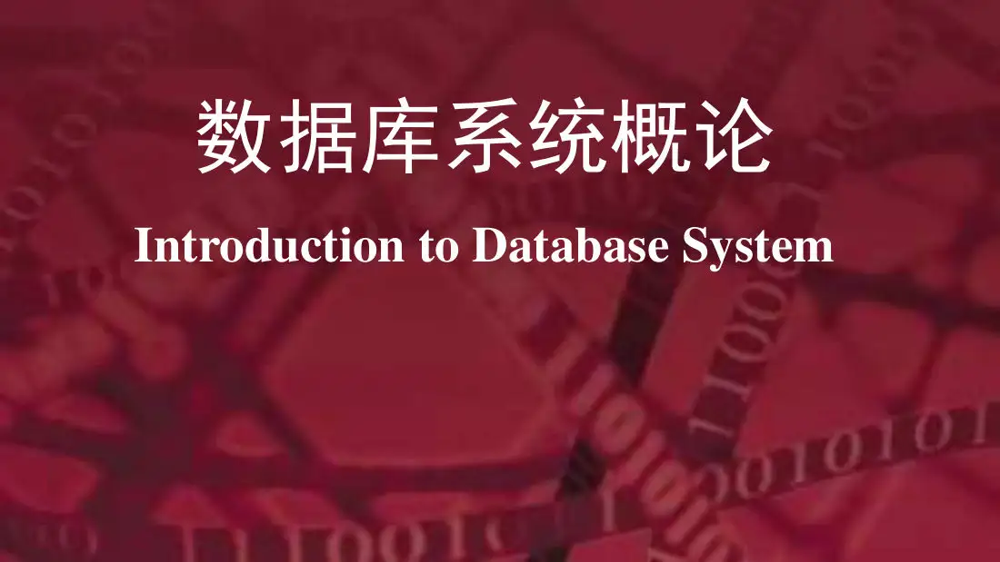

原文：

数据库系统概论

Introduction to Database System

### 8.3 JDBC编程

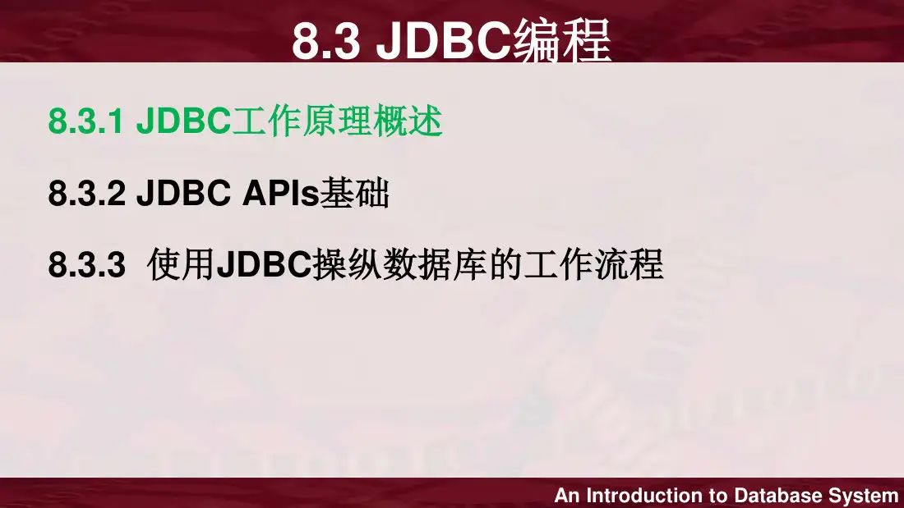

原文：

8.3 JDBC编程

8.3.1 JDBC工作原理概述

8.3.2 JDBC APIs基础

8.3.3 使用JDBC操纵数据库的工作流程

An Introduction to Database System

### 8.3.1 JDBC工作原理概述

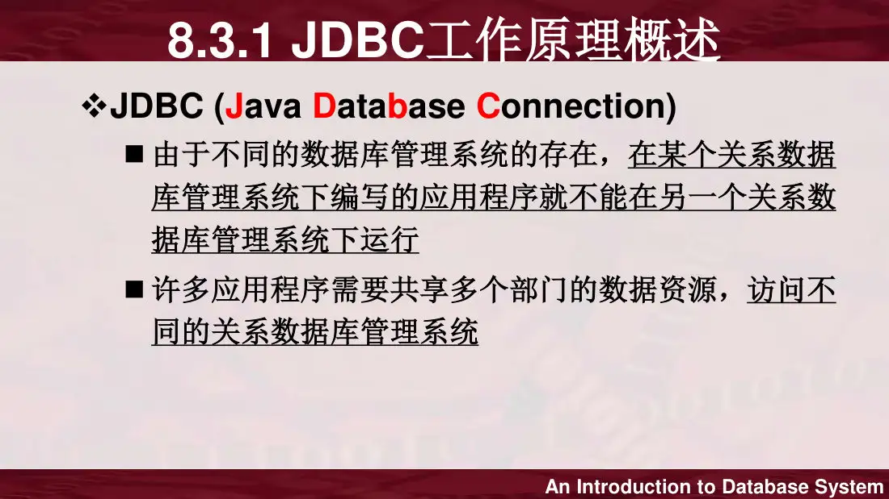

原文：

8.3.1 JDBC工作原理概述

JDBC (Java Database Connection)

■ 由于不同的数据库管理系统的存在，在某个关系数据库管理系统下编写的应用程序就不能在另一个关系数据库管理系统下运行

■ 许多应用程序需要共享多个部门的数据资源，访问不同的关系数据库管理系统

An Introduction to Database System

### JDBC工作原理概述（续）

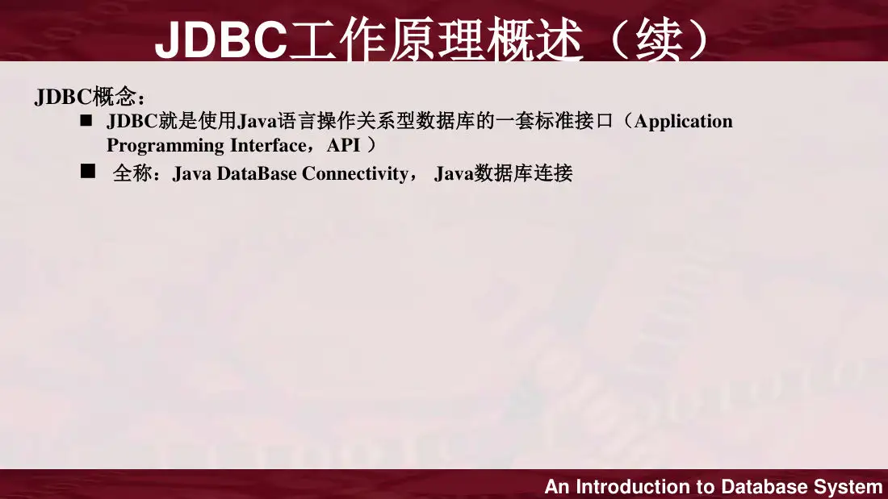

原文：

JDBC工作原理概述（续）

JDBC概念:

■ JDBC就是使用Java语言操作关系型数据库的一套标准接口（Application Programming Interface, API）

■ 全称：Java DataBase Connectivity，Java数据库连接

An Introduction to Database System

### JDBC工作原理概述（续）

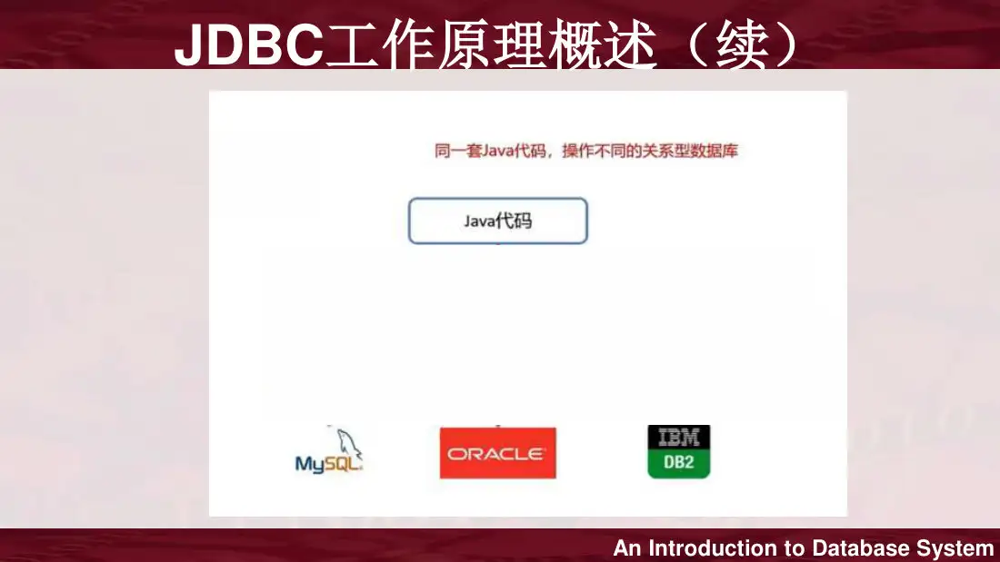

原文：

JDBC工作原理概述（续）

同一套Java代码，操作不同的关系型数据库

Java代码

ORACLE

An Introduction to Database System

### JDBC工作原理概述（续）

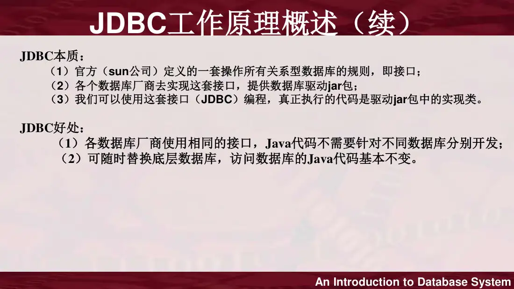

原文：

JDBC工作原理概述（续）

JDBC本质:

（1）官方（sun公司）定义的一套操作所有关系型数据库的规则，即接口；

(2) 各个数据库厂商去实现这套接口, 提供数据库驱动jar包;

（3）我们可以使用这套接口（JDBC）编程，真正执行的代码是驱动jar包中的实现类。

JDBC好处:

（1）各数据库厂商使用相同的接口，Java代码不需要针对不同数据库分别开发；

（2）可随时替换底层数据库，访问数据库的Java代码基本不变。

An Introduction to Database System

### JDBC工作原理概述（续）

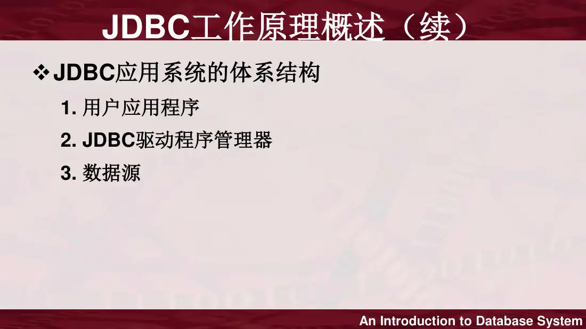

原文：

JDBC工作原理概述（续）

✿ JDBC应用系统的体系结构

1. 用户应用程序

2. JDBC驱动程序管理器

3. 数据源

An Introduction to Database System

### JDBC工作原理概述（续）

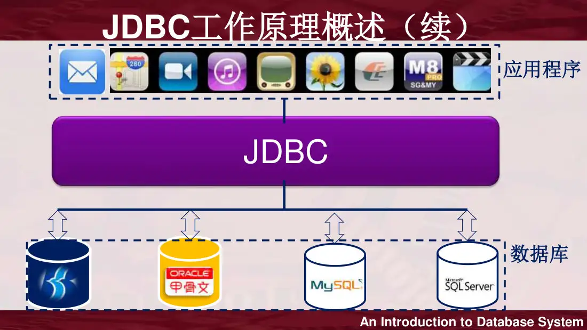

原文：

JDBC工作原理概述（续）

JDBC

应用程序

数据库

An Introduction to Database System

### JDBC工作原理概述（续）

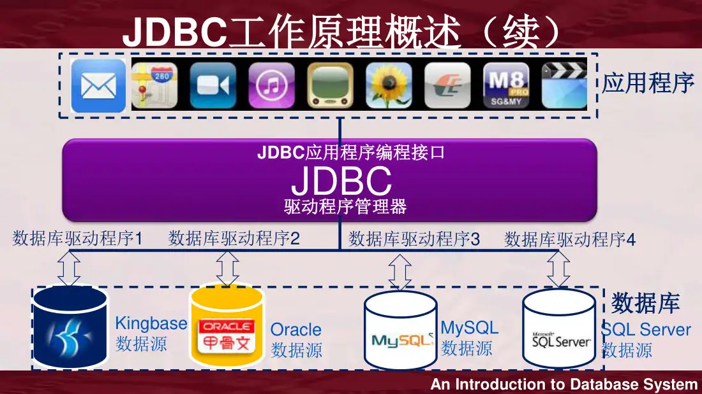

原文：

JDBC工作原理概述（续）

应用程序

JDBC应用程序编程接口

数据库驱动程序1

数据库驱动程序2

JDBC驱动程序管理器

数据库驱动程序3

数据库驱动程序4

Kingbase数据源

ORACLE
甲骨文

Oracle数据源

MySQL

MySQL数据源

Microsoft SQL Server

数据库

SQL Server
数据源

An Introduction to Database System

### JDBC工作原理概述（续）

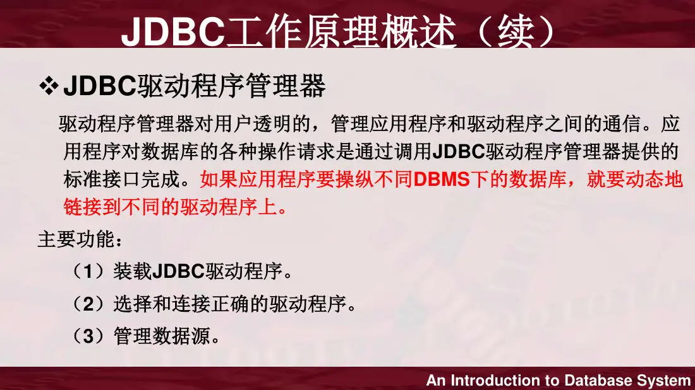

原文：

JDBC工作原理概述（续）

✿ JDBC驱动程序管理器

驱动程序管理器对用户透明的，管理应用程序和驱动程序之间的通信。应用程序对数据库的各种操作请求是通过调用JDBC驱动程序管理器提供的标准接口完成。如果应用程序要操纵不同DBMS下的数据库，就要动态地链接到不同的驱动程序上。

主要功能:

(1) 装载JDBC驱动程序。

(2) 选择和连接正确的驱动程序。

(3) 管理数据源。

An Introduction to Database System

### JDBC工作原理概述（续）

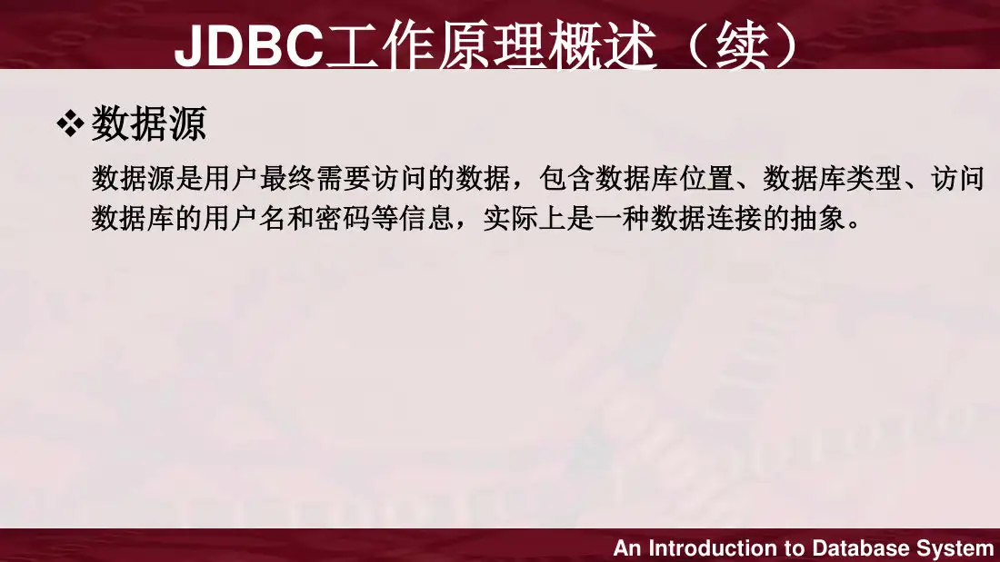

原文：

JDBC工作原理概述（续）

◆ 数据源

数据源是用户最终需要访问的数据，包含数据库位置、数据库类型、访问数据库的用户名和密码等信息，实际上是一种数据连接的抽象。

An Introduction to Database System

### 8.3 JDBC编程

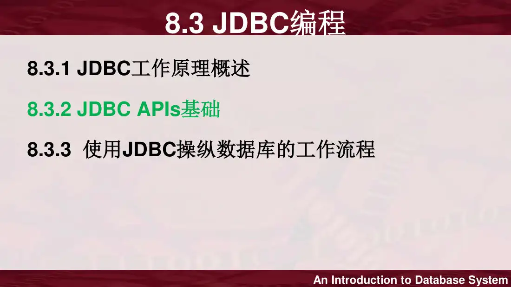

原文：

8.3 JDBC编程

8.3.1 JDBC工作原理概述

8.3.2 JDBC APIs基础

8.3.3 使用JDBC操纵数据库的工作流程

An Introduction to Database System

### 8.3.2 JDBC API基础

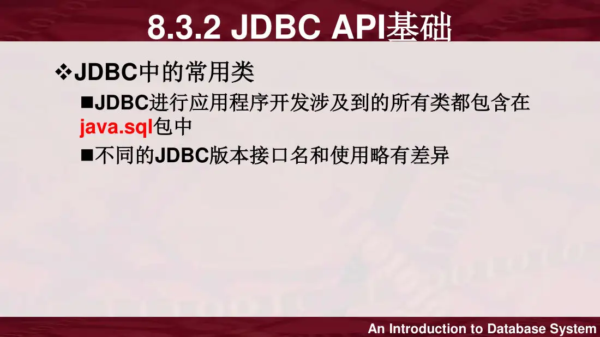

原文：

8.3.2 JDBC API基础

✿JDBC中的常用类

■JDBC进行应用程序开发涉及到的所有类都包含在java.sql包中

■不同的JDBC版本接口名和使用略有差异

An Introduction to Database System

### 8.3.2 JDBC API基础

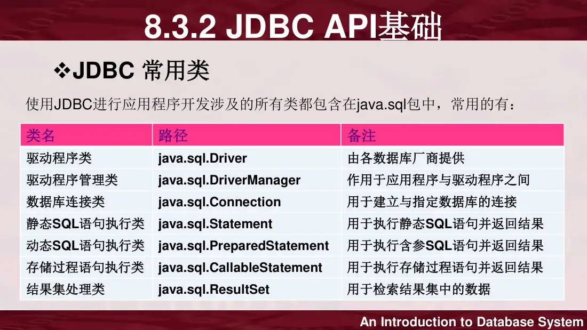

原文：

8.3.2 JDBC API基础

JDBC 常用类

使用JDBC进行应用程序开发涉及的所有类都包含在java.sql包中，常用的有：

<table><tr><td>类名</td><td>路径</td><td>备注</td></tr><tr><td>驱动程序类</td><td>java.sql.Driver</td><td>由各数据库厂商提供</td></tr><tr><td>驱动程序管理类</td><td>java.sql.DriverManager</td><td>作用于应用程序与驱动程序之间</td></tr><tr><td>数据库连接类</td><td>java.sql.Connection</td><td>用于建立与指定数据库的连接</td></tr><tr><td>静态SQL语句执行类</td><td>java.sql.Statement</td><td>用于执行静态SQL语句并返回结果</td></tr><tr><td>动态SQL语句执行类</td><td>java.sqlPreparedStatement</td><td>用于执行含参SQL语句并返回结果</td></tr><tr><td>存储过程语句执行类</td><td>java.sql.CallableStatement</td><td>用于执行存储过程语句并返回结果</td></tr><tr><td>结果集处理类</td><td>java.sql.ResultSet</td><td>用于检索结果集中的数据</td></tr></table>

An Introduction to Database System

### 8.3.2 JDBC API基础

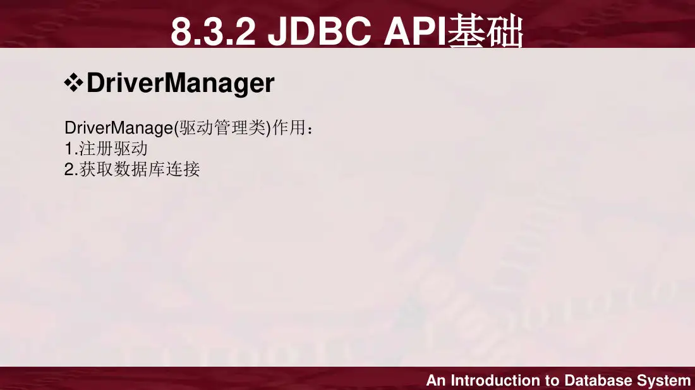

原文：

8.3.2 JDBC API基础

DriverManager

DriverManage(驱动管理类)作用:

1. 注册驱动

2. 获取数据库连接

An Introduction to Database System

### 8.3.2 JDBC API基础

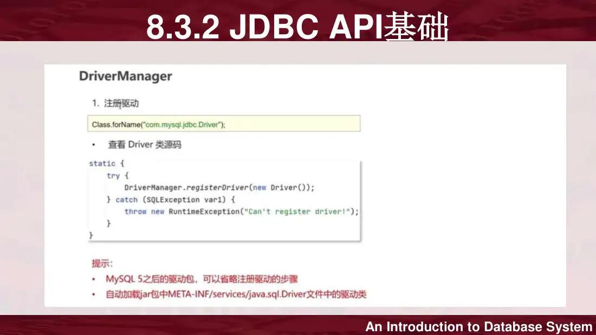

原文：

8.3.2 JDBC API基础

DriverManager

1. 注册驱动

- 查看 Driver 类源码

提示：

\- MySQL 5之后的驱动包，可以省略注册驱动的步骤

\- 自动加载jar包中META-INF/services/java.sql.Driver文件中的驱动类

An Introduction to Database System

### 8.3.2 JDBC API基础

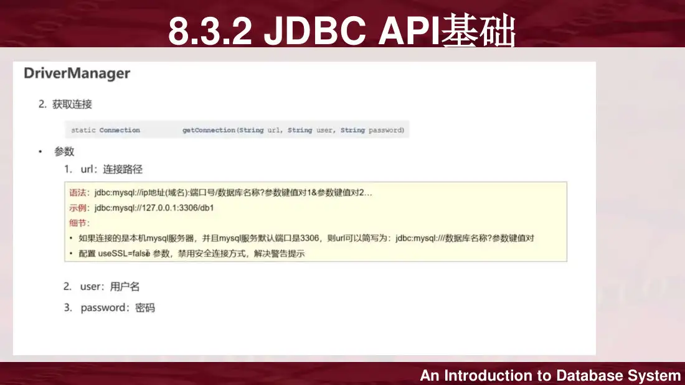

原文：

8.3.2 JDBC API基础

DriverManager

2. 获取连接

\- 参数

1. url: 连接路径

语法：jdbc:mysql://ip地址(域名):端口号/数据库名称?参数键值对1&参数键值对2...

示例：jdbc:mysql://127.0.0.1:3306/db1

细节：

\- 如果连接的是本机mysql服务器，并且mysql服务默认端口是3306，则url可以简写为：jdbc:mysql://数据库名称？参数键值对

\- 配置 useSSL=false 参数，禁用安全连接方式，解决警告提示

2. user: 用户名

3. password: 密码

An Introduction to Database System

### 8.3.2 JDBC API基础

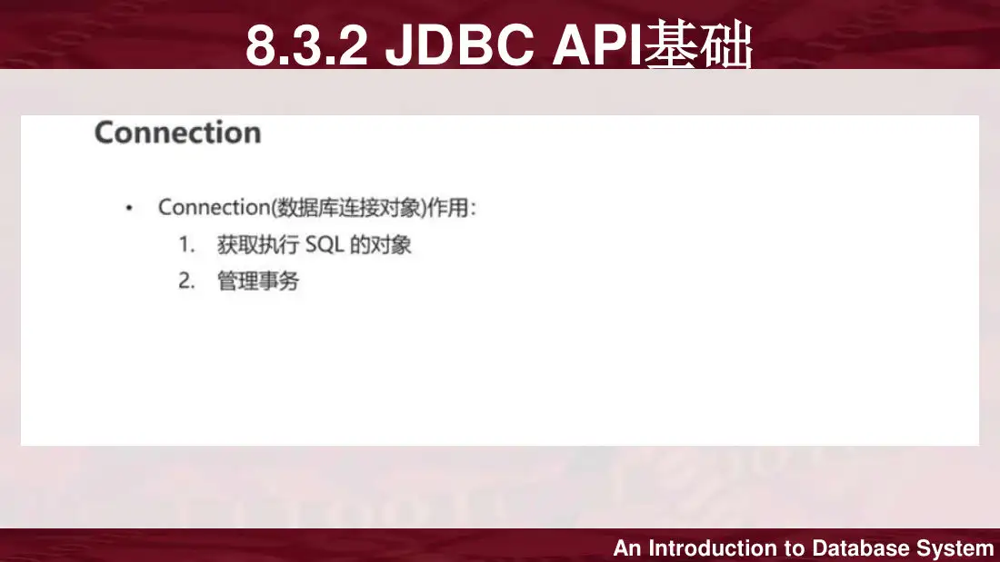

原文：

8.3.2 JDBC API基础

Connection

\- Connection(数据库连接对象)作用:

1. 获取执行 SQL 的对象

2. 管理事务

An Introduction to Database System

### 8.3.2 JDBC API基础

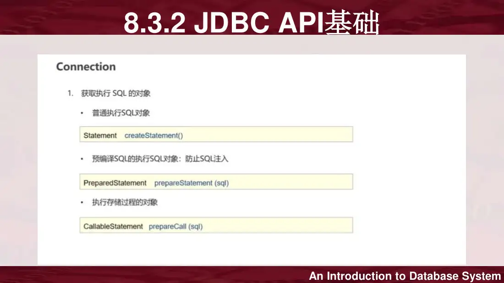

原文：

8.3.2 JDBC API基础

Connection

1. 获取执行 SQL 的对象

\- 普通执行SQL对象

\- 预编译SQL的执行SQL对象：防止SQL注入

PreparedStatement prepareStatement (sql)

\- 执行存储过程的对象

CallableStatement prepareCall (sql)

An Introduction to Database System

### 8.3.2 JDBC API基础

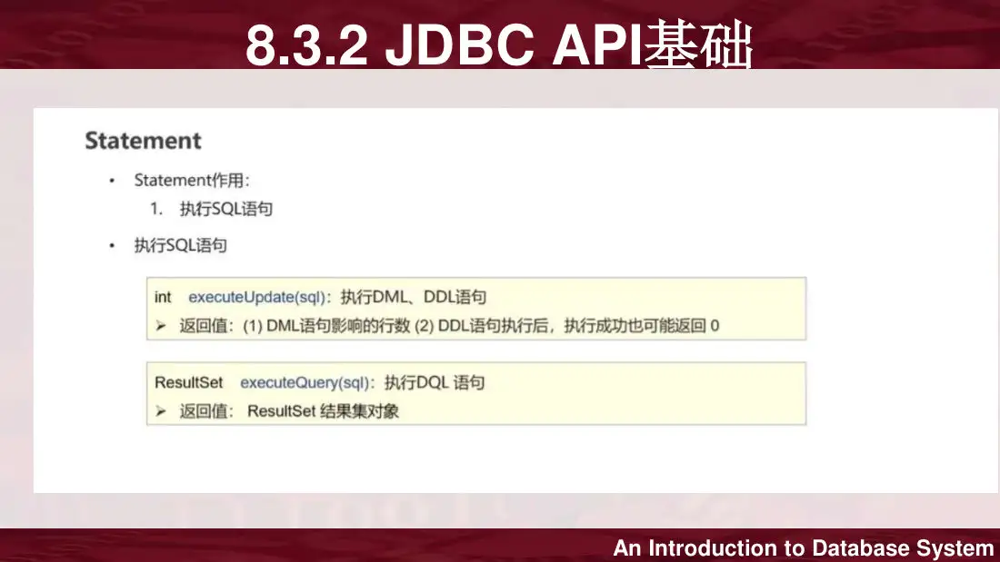

原文：

8.3.2 JDBC API基础

Statement

\- Statement作用:

1. 执行SQL语句

\- 执行SQL语句

int executeUpdate(sql): 执行DML、DDL语句

➢ 返回值：(1) DML语句影响的行数 (2) DDL语句执行后，执行成功也可能返回 0

ResultSet executeQuery(sql): 执行DQL语句

返回值：ResultSet 结果集对象

An Introduction to Database System

### 8.3.2 JDBC API基础

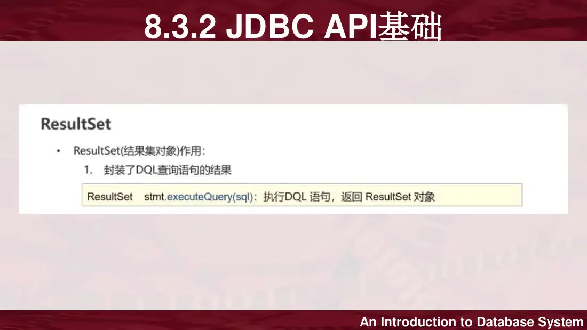

原文：

8.3.2 JDBC API基础

ResultSet

\- ResultSet(结果集对象)作用:

1. 封装了DQL查询语句的结果

ResultSet stmt.executeQuery(sql): 执行DQL 语句，返回 ResultSet 对象

An Introduction to Database System

### 8.3.2 JDBC API基础

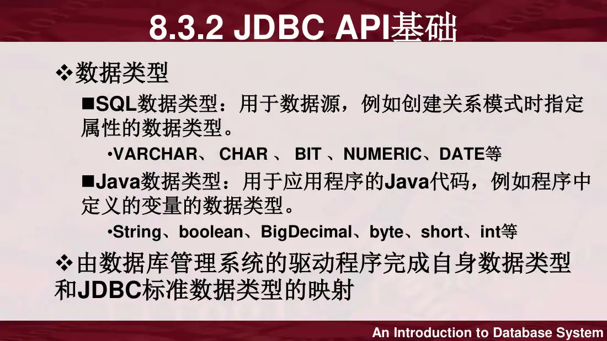

原文：

8.3.2 JDBC API基础

◆ 数据类型

■SQL数据类型：用于数据源，例如创建关系模式时指定属性的数据类型。

•VARCHAR、CHAR、BIT、NUMERIC、DATE等

■Java数据类型：用于应用程序的Java代码，例如程序中定义的变量的数据类型。

\- String、boolean、BigDecimal、byte、short、int等

✿由数据库管理系统的驱动程序完成自身数据类型和JDBC标准数据类型的映射

An Introduction to Database System

### 数据类型（续）

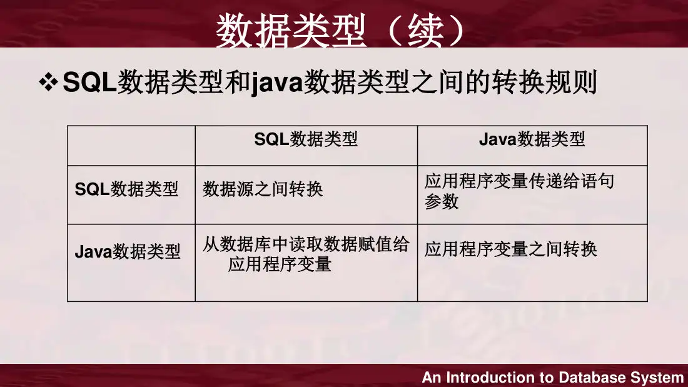

原文：

数据类型（续）

SQL数据类型和java数据类型之间的转换规则

<table><tr><td></td><td>SQL数据类型</td><td>Java数据类型</td></tr><tr><td>SQL数据类型</td><td>数据源之间转换</td><td>应用程序变量传递给语句参数</td></tr><tr><td>Java数据类型</td><td>从数据库中读取数据赋值给应用程序变量</td><td>应用程序变量之间转换</td></tr></table>

An Introduction to Database System

### 8.3 JDBC编程

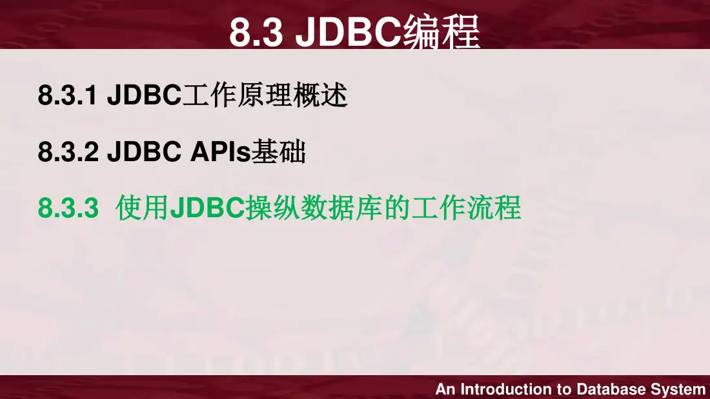

原文：

8.3 JDBC编程

8.3.1 JDBC工作原理概述

8.3.2 JDBC APIs基础

8.3.3 使用JDBC操纵数据库的工作流程

An Introduction to Database System

### 8.3.3 使用JDBC操纵数据库的工作流程

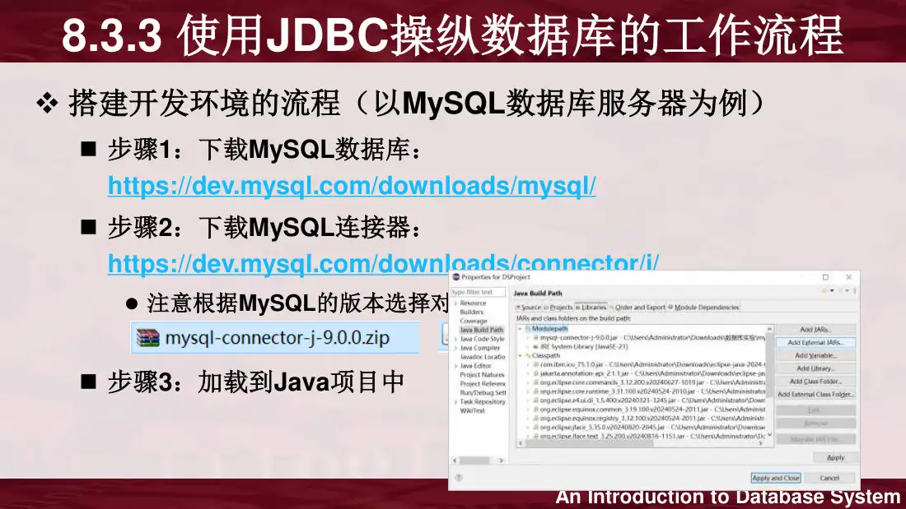

原文：

8.3.3 使用JDBC操纵数据库的工作流程

❖ 搭建开发环境的流程（以MySQL数据库服务器为例）

■ 步骤1：下载MySQL数据库：https://dev.mysql.com/downloads/mysql/

■ 步骤2：下载MySQL连接器：

https://dev.mysql.com/downloads/connector/i/

\- 注意根据MySQL的版本选择对
  mysql-connector-j-9.0.0.zip

■ 步骤3：加载到Java项目中

An Introduction to Database System

### 8.3.3 使用JDBC操纵数据库的工作流程

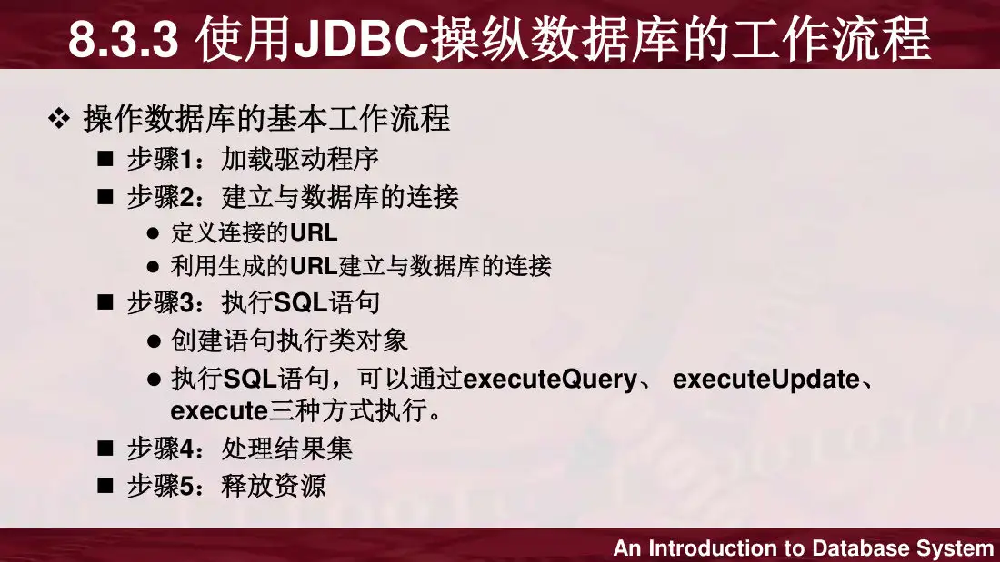

原文：

8.3.3 使用JDBC操纵数据库的工作流程

操作数据库的基本工作流程

■ 步骤1：加载驱动程序

■ 步骤2：建立与数据库的连接

\- 定义连接的URL

\- 利用生成的URL建立与数据库的连接

■ 步骤3：执行SQL语句

\- 创建语句执行类对象

\- 执行SQL语句，可以通过executeQuery、executeUpdate、execute三种方式执行。

■ 步骤4：处理结果集

■ 步骤5：释放资源

An Introduction to Database System

### 8.3.3 使用JDBC操纵数据库的工作流程

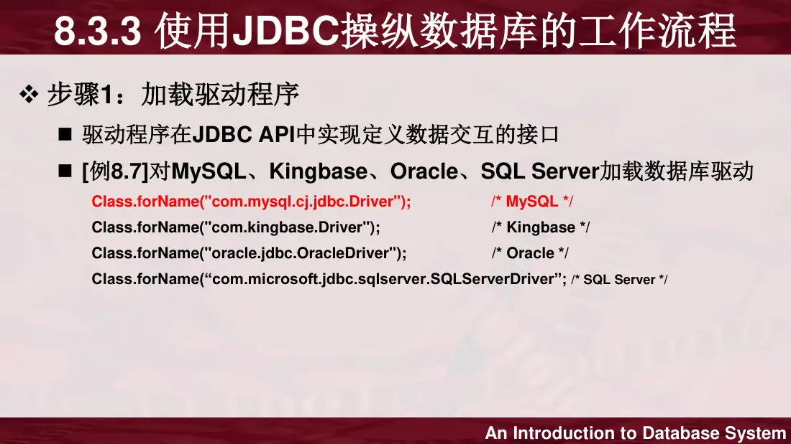

原文：

8.3.3 使用JDBC操纵数据库的工作流程

❖ 步骤1：加载驱动程序

■ 驱动程序在JDBC API中实现定义数据交互的接口

■ [例8.7]对MySQL、Kingbase、Oracle、SQL Server加载数据库驱动

Class.forName("com.mysql.cj.jdbc.Driver"); /\* MySQL \*/

Class.forName("com.kingbase.Driver"); /\* Kingbase \*/

Class.forName("oracle.jdbc.OracleDriver"); /\* Oracle \*/

Class.forName("com.microsoft.jdbc.sqlserver.SQLServerDriver"; /\* SQL Server \*/

An Introduction to Database System

### 8.3.3 使用JDBC操纵数据库的工作流程

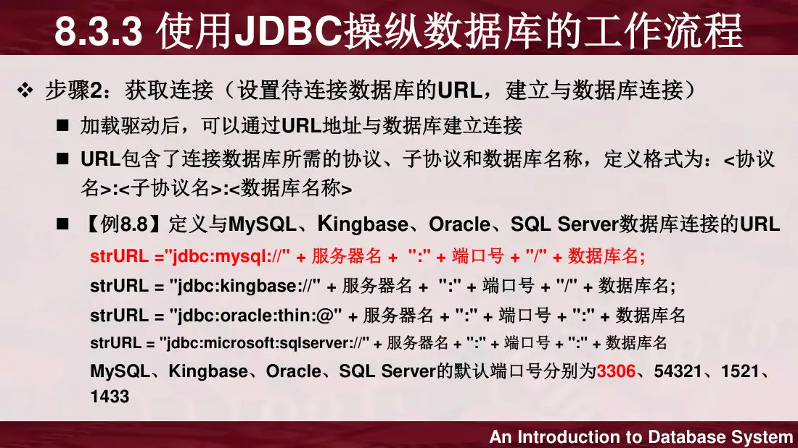

原文：

8.3.3 使用JDBC操纵数据库的工作流程

步骤2：获取连接（设置待连接数据库的URL，建立与数据库连接）

■ 加载驱动后，可以通过URL地址与数据库建立连接

■ URL包含了连接数据库所需的协议、子协议和数据库名称，定义格式为：<协议名>:<子协议名>:<数据库名称>

An Introduction to Database System

### 8.3.3 使用JDBC操纵数据库的工作流程

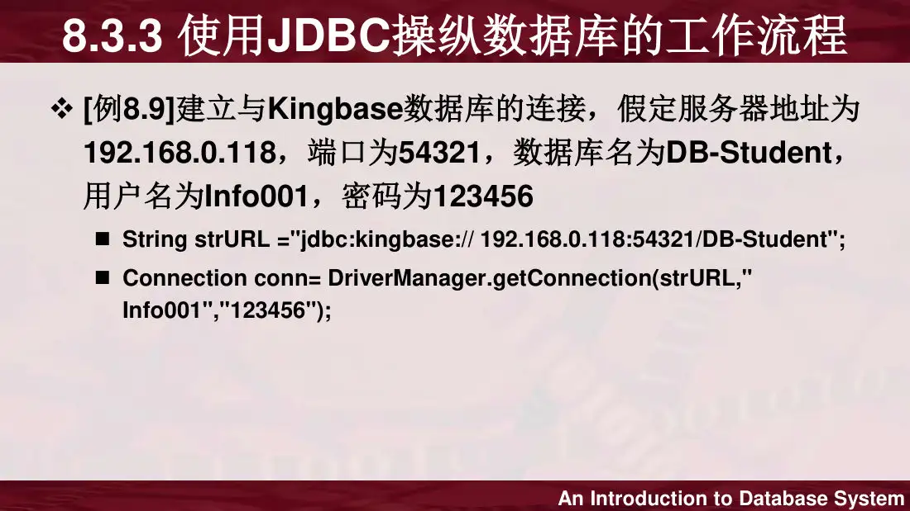

原文：

8.3.3 使用JDBC操纵数据库的工作流程

✿ [例8.9]建立与Kingbase数据库的连接，假定服务器地址为192.168.0.118，端口为54321，数据库名为DB-Student，用户名为Info001，密码为123456

■ String strURL = "jdbc:kingbase://192.168.0.118:54321/DB-Student";

■ Connection conn= DriverManager.getConnection(strURL,"Info001","123456");

An Introduction to Database System

### 8.3.3 使用JDBC操纵数据库的工作流程

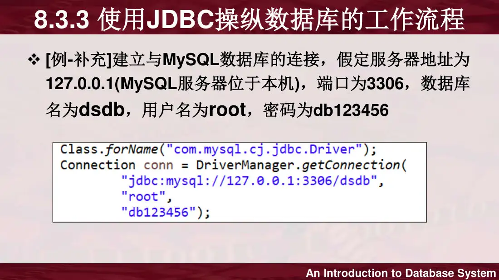

原文：

8.3.3 使用JDBC操纵数据库的工作流程

✿ [例-补充]建立与MySQL数据库的连接，假定服务器地址为127.0.0.1(MySQL服务器位于本机)，端口为3306，数据库名为dsdb，用户名为root，密码为db123456

An Introduction to Database System

### 8.3.3 使用JDBC操纵数据库的工作流程

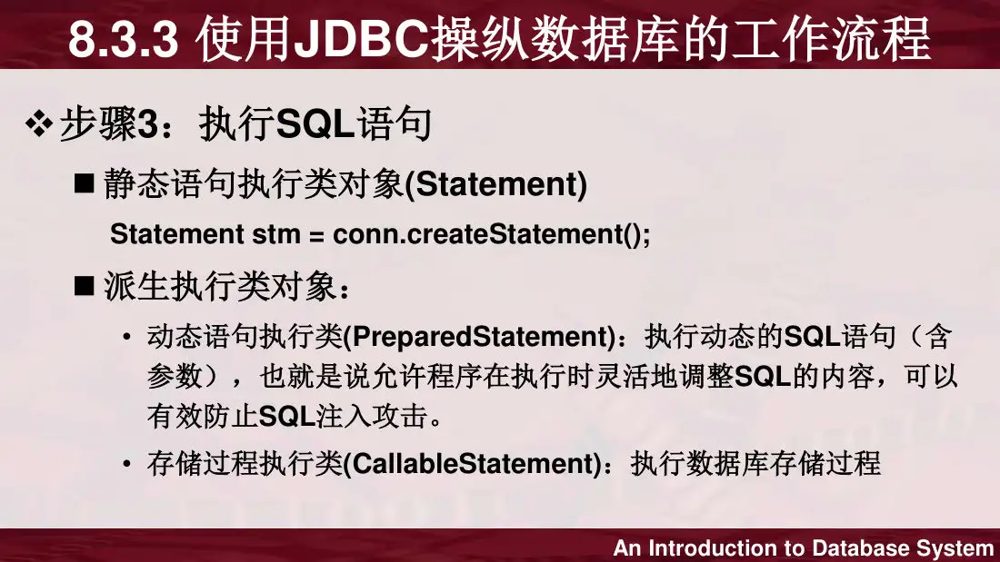

原文：

8.3.3 使用JDBC操纵数据库的工作流程

❖步骤3：执行SQL语句

■ 静态语句执行类对象(Statement)
Statement stm = conn.createStatement();

■ 派生执行类对象:

\- 动态语句执行类(PreparedStatement): 执行动态的SQL语句（含参数），也就是说允许程序在执行时灵活地调整SQL的内容，可以有效防止SQL注入攻击。

\- 存储过程执行类(CallableStatement): 执行数据库存储过程

An Introduction to Database System

### 8.3.3 使用JDBC操纵数据库的工作流程

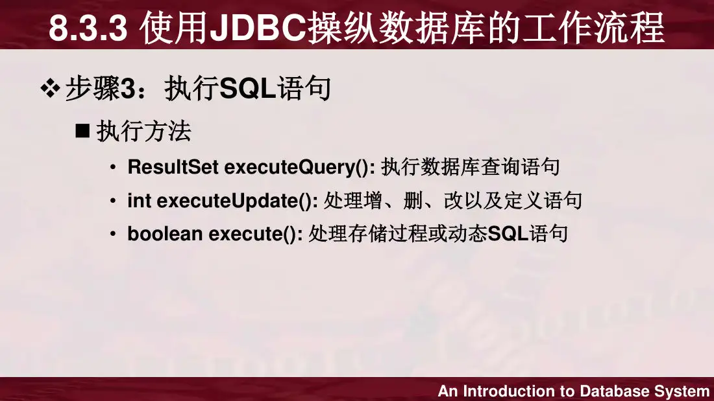

原文：

8.3.3 使用JDBC操纵数据库的工作流程

❖步骤3：执行SQL语句

■执行方法

\- ResultSet executeQuery(): 执行数据库查询语句

\- int executeUpdate(): 处理增、删、改以及定义语句

\- boolean execute(): 处理存储过程或动态SQL语句

An Introduction to Database System

### 8.3.3 使用JDBC操纵数据库的工作流程

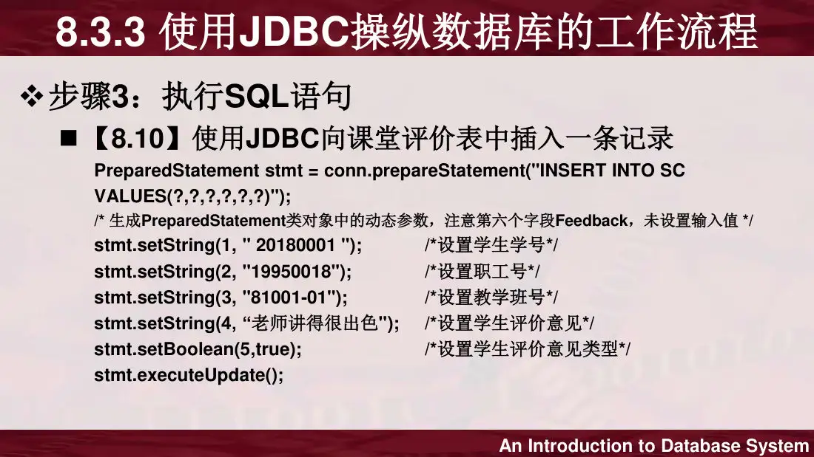

原文：

8.3.3 使用JDBC操纵数据库的工作流程

❖步骤3：执行SQL语句

■【8.10】使用JDBC向课堂评价表中插入一条记录

PreparedStatement stmt = conn.prepareStatement("INSERT INTO SC VALUES(?,?,?,?,?,?)");

/\* 生成PreparedStatement类对象中的动态参数，注意第六个字段Feedback，未设置输入值 \*/

stmt.setString(1, " 20180001");

/\*设置学生学号\*/

stmt.setString(2, "19950018");    /\*设置职工号\*/

stmt.setString(3, "81001-01");    /\*设置教学班号\*/

stmt.setString(4, “老师讲得很出色”); /\*设置学生评价意见\*/

stmt.setBoolean(5,true);    /\*设置学生评价意见类型\*/

stmt.executeUpdate();

An Introduction to Database System

### 8.3.3 使用JDBC操纵数据库的工作流程

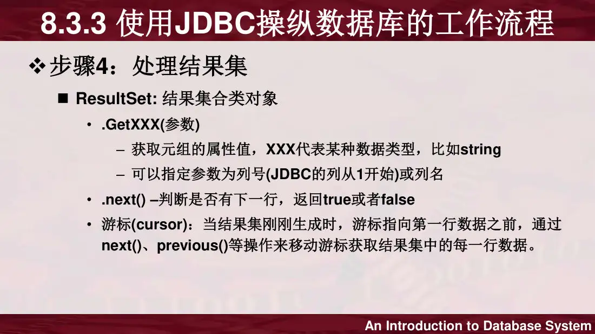

原文：

8.3.3 使用JDBC操纵数据库的工作流程

❖步骤4：处理结果集

■ ResultSet: 结果集合类对象

• .GetXXX(参数)

\- 获取元组的属性值，XXX代表某种数据类型，比如string

\- 可以指定参数为列号(JDBC的列从1开始)或列名

\- .next() - 判断是否有下一行，返回true或者false

\- 游标(cursor): 当结果集刚刚生成时, 游标指向第一行数据之前, 通过 next()、previous()等操作来移动游标获取结果集中的每一行数据。

An Introduction to Database System

### 8.3.3 使用JDBC操纵数据库的工作流程

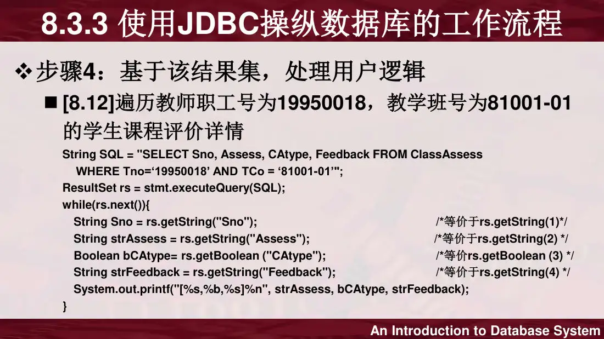

原文：

8.3.3 使用JDBC操纵数据库的工作流程

❖步骤4：基于该结果集，处理用户逻辑

■ [8.12]遍历教师职工号为19950018，教学班号为81001-01的学生课程评价详情

An Introduction to Database System

### 8.3.3 使用JDBC操纵数据库的工作流程

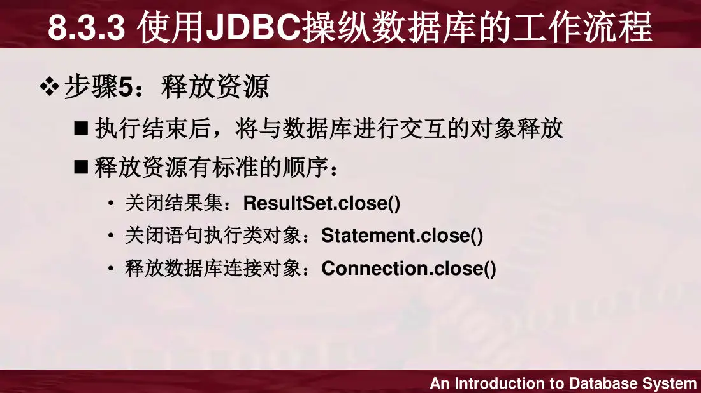

原文：

8.3.3 使用JDBC操纵数据库的工作流程

❖步骤5：释放资源

■执行结束后，将与数据库进行交互的对象释放

■释放资源有标准的顺序:

\- 关闭结果集：ResultSet.close()

\- 关闭语句执行类对象：Statement.close()

\- 释放数据库连接对象：Connection.close()

An Introduction to Database System

### 示例--基于JDBC实现数据库访问

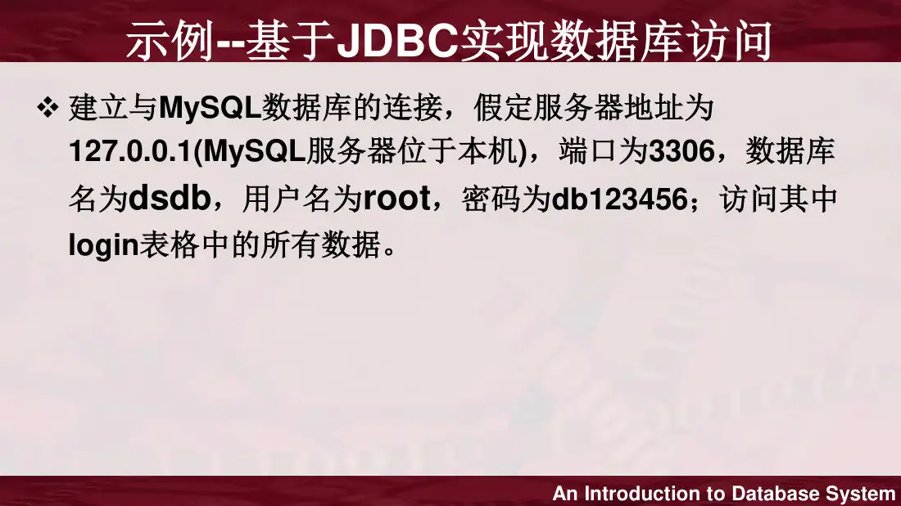

原文：

示例--基于JDBC实现数据库访问

✿ 建立与MySQL数据库的连接，假定服务器地址为127.0.0.1(MySQL服务器位于本机)，端口为3306，数据库名为dsdb，用户名为root，密码为db123456；访问其中login表格中的所有数据。

An Introduction to Database System

### 示例--基于JDBC实现数据库访问

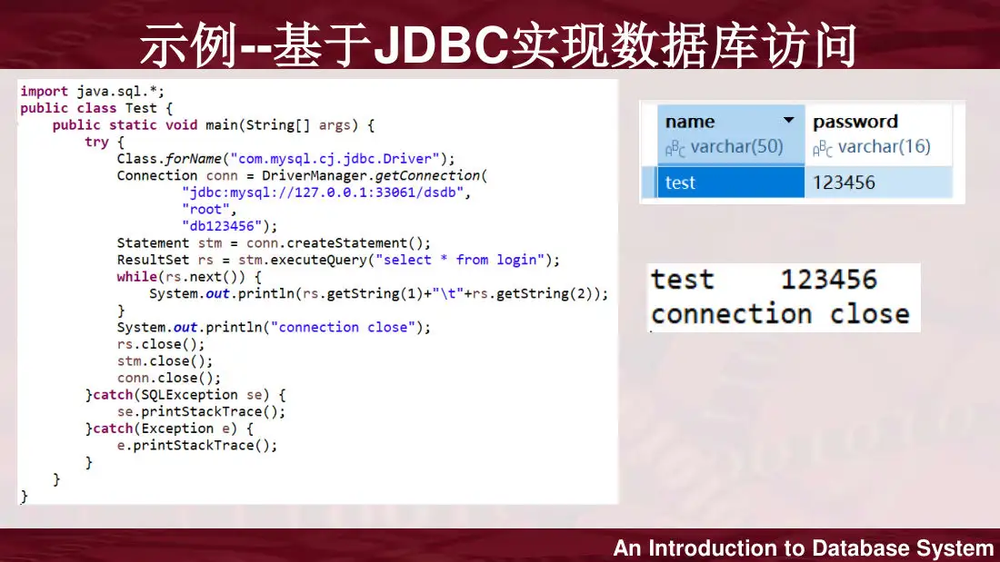

原文：

示例--基于JDBC实现数据库访问

test 123456 connection close

An Introduction to Database System

### 基于JDBC的DBS开发示例—实验三

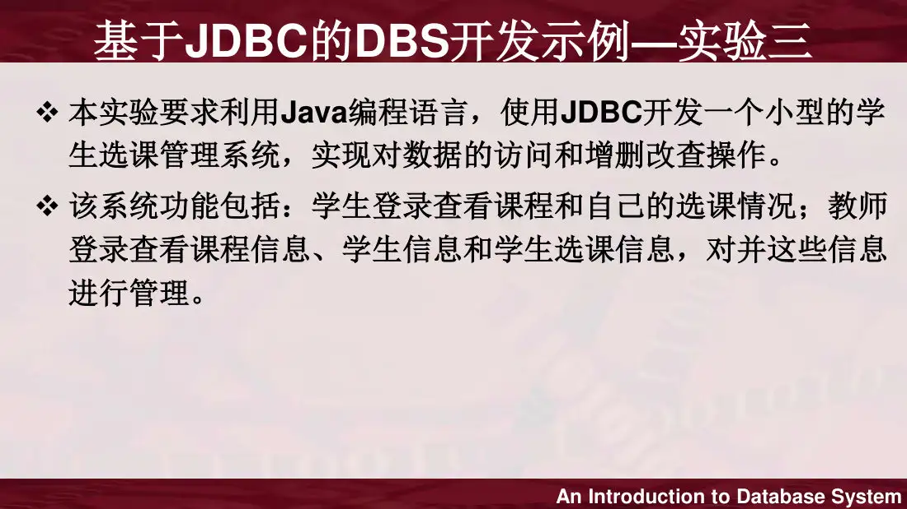

原文：

基于JDBC的DBS开发示例—实验三

✿ 本实验要求利用Java编程语言，使用JDBC开发一个小型的学生选课管理系统，实现对数据的访问和增删改查操作。

该系统功能包括：学生登录查看课程和自己的选课情况；教师登录查看课程信息、学生信息和学生选课信息，对并这些信息进行管理。

An Introduction to Database System

### 基于JDBC的DBS开发示例—实验三

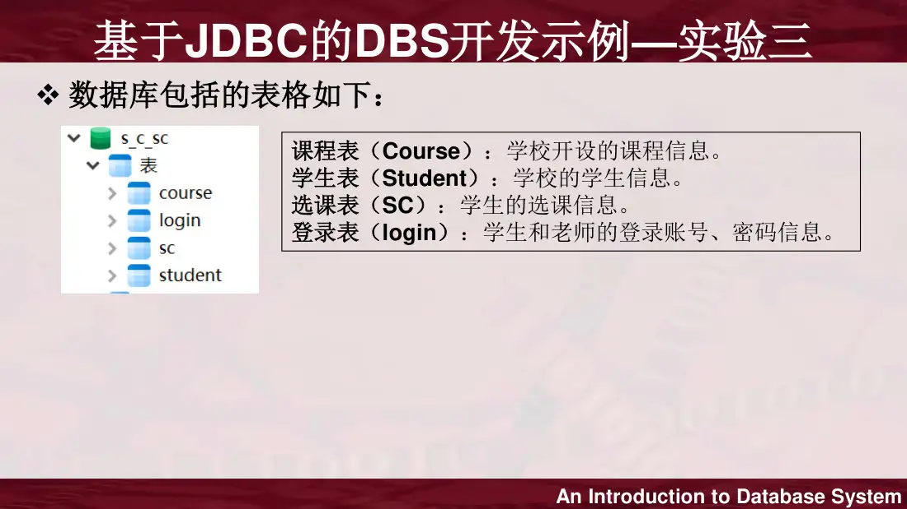

原文：

基于JDBC的DBS开发示例—实验三

数据库包括的表格如下:

课程表（Course）：学校开设的课程信息。

学生表（Student）：学校的学生信息。

选课表（SC）：学生的选课信息。

登录表（login）：学生和老师的登录账号、密码信息。

An Introduction to Database System

### 基于JDBC的DBS开发示例—实验三

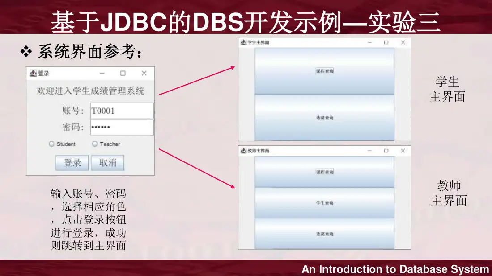

原文：

基于JDBC的DBS开发示例—实验三

系统界面参考:

An Introduction to Database System

### 基于JDBC的DBS开发示例—实验三

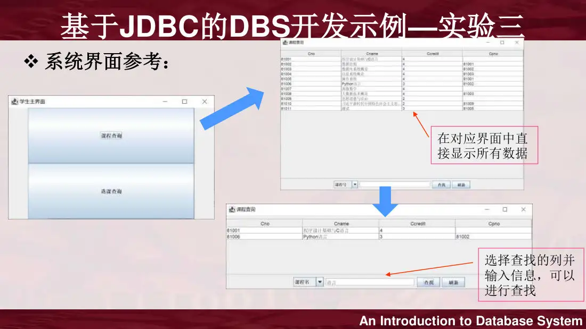

原文：

基于JDBC的DBS开发示例—实验三

课程查询

系统界面参考:

选择查找的列并输入信息，可以进行查找

An Introduction to Database System

### 基于JDBC的DBS开发示例—实验三

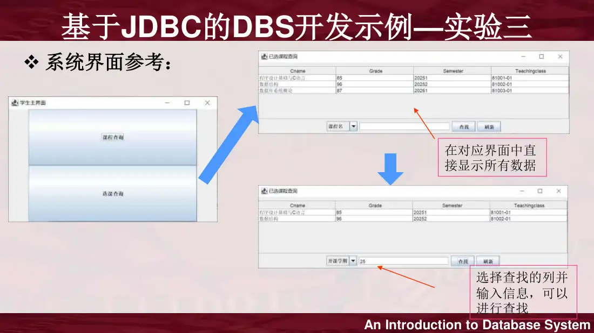

原文：

基于JDBC的DBS开发示例—实验三

系统界面参考:

在对应界面中直接显示所有数据

An Introduction to Database System

### 基于JDBC的DBS开发示例—实验三

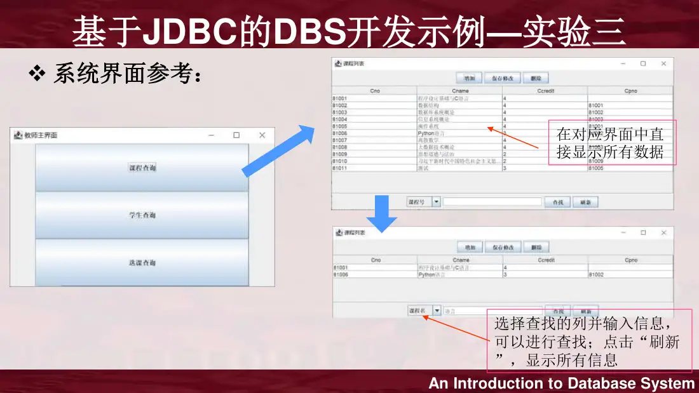

原文：

基于JDBC的DBS开发示例—实验三

系统界面参考:

An Introduction to Database System

### 基于JDBC的DBS开发示例—实验三

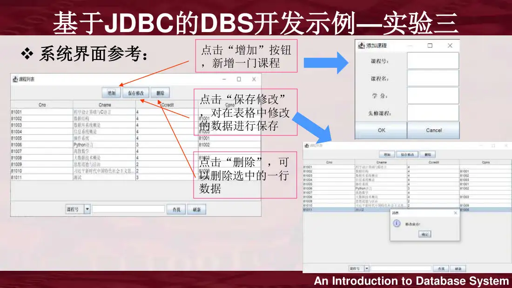

原文：

基于JDBC的DBS开发示例—实验三

系统界面参考:

点击“增加”按钮，新增一门课程

An Introduction to Database System
