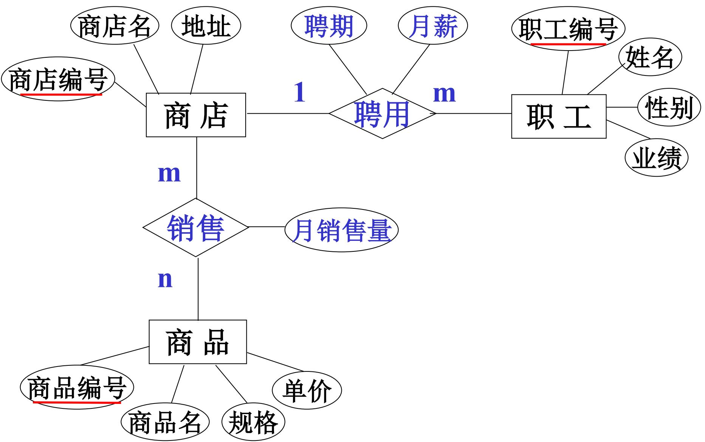
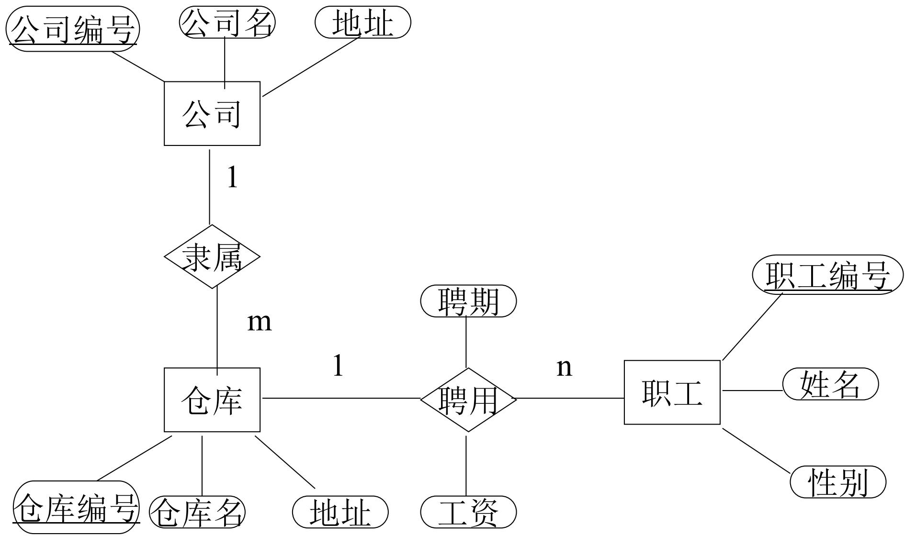
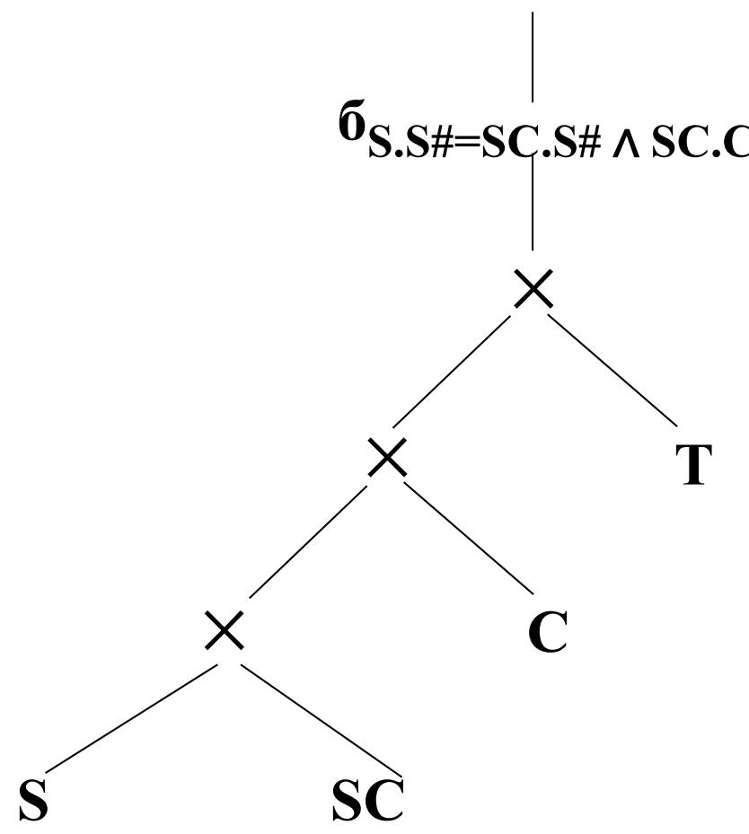
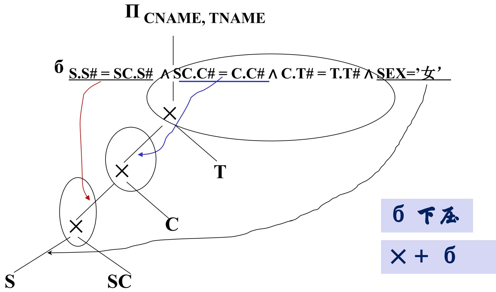
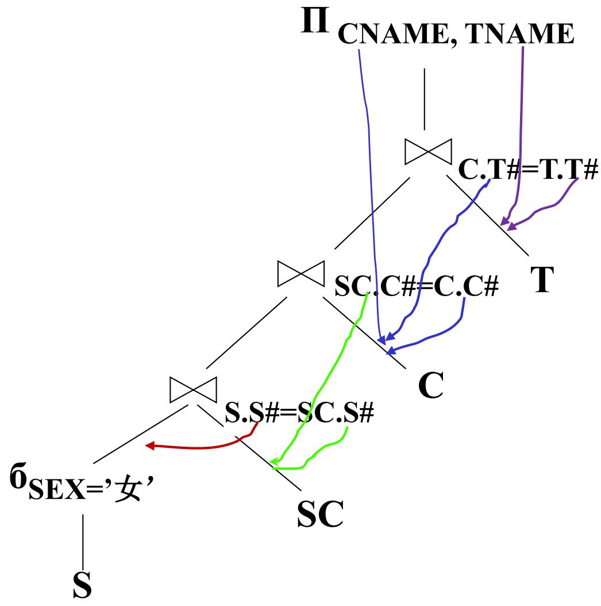
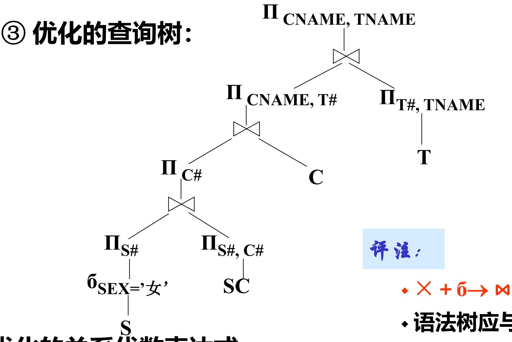

# 《数据库系统》第一章习题课（课件）

原件经识别和整理；“参考解答”是我们补的。

## 第一章

### 简答 1

试述数据库的三级模式结构及其带来的好处。

参考答案：

数据库的三级模式包括外模式、逻辑模式和内模式，以及外模式/逻辑模式映像和逻辑模式/内模式映像。

外模式：是用户观念下局部数据结构的逻辑描述，是数据库用户（包括应用程序员和最终用户）能够看见和使用的局部数据的逻辑描述，是用逻辑数据模型对用户用到的数据的描述。

逻辑模式（概念模式、模式）：是数据库中全体数据的逻辑结构和特征的描述，是所有用户的公共数据视图，外模式是逻辑模式的一个逻辑子集。

内模式：是对数据库中数据的物理结构和存储方式的描述，是数据在数据库内部的表现形式，一个数据库只有一个内模式。

带来的好处：

1. 数据独立性

三级模式是对数据的三个抽象级别，它把数据的具体组织留给 DBMS 管理，使用户能逻辑地、抽象地处理数据，而不必关心数据在计算机中的具体表示形式与存储方式，提高数据的独立性。

2. 方便了数据库的设计和实现

参考解答：### 结论
`TOP n` 返回查询结果中的前 n 行，`TOP n PERCENT` 返回结果集的前 n% 行（向上取整）。若无 `ORDER BY`，返回顺序取决于数据库默认物理顺序，结果不保证确定性。

### 说明
- **`TOP n`**  
  限制返回行数。`SELECT TOP 5 * FROM Student` 返回结果集的前 5 行全部字段；`SELECT TOP 5 sname, sex FROM Student` 返回前 5 行的姓名和性别两列。

- **`TOP n PERCENT`**  
  按百分比截取，行数计算为 `CEILING(总行数 × n / 100)`。  
  例如，表中有 21 条记录，`TOP 10 PERCENT` 返回 `CEILING(21 × 0.1) = 3` 条记录。  
  `SELECT TOP 10 PERCENT * FROM Student` 返回前 10% 条记录的全部字段，`SELECT TOP 10 PERCENT sname, sex FROM Student` 仅返回这些行的指定字段。

- **核心注意点**  
  - 无 `ORDER BY` 时，“前 n 条”无业务意义，仅为物理存储或访问顺序。
  - `PERCENT` 结果为小数时始终向上取整，确保至少返回 1 行（除非表为空）。

知识点：[单表查询（SELECT、WHERE、ORDER BY、聚集函数、GROUP BY、HAVING、LIMIT）](../../../topics/数据库系统/单表查询.md)

### 综合 1

设某商业集团数据库中有三个实体集。一是“商店”实体集，属性有商店编号、商店名、地址等；二是“商品”实体集，属性有商品编号、商品名、规格、单价等；三是“职工”实体集，属性有职工编号、姓名、性别、业绩等。

商店与商品间存在“销售”联系，每个商店可销售多种商品，每种商品也可放在多个商店销售，每个商店销售一种商品，有月销售量；商店与职工间存在着“聘用”联系，每个商店有许多职工，每个职工只能在一个商店工作，商店聘用职工有聘期和月薪。

试画出 ER 图，并在图上标明属性、联系的类型。

参考答案：



参考解答：## 结论

| 关系代数运算 | 结果 |
|---|---|
| $\mathbf R\cup\mathbf S$ | 5 个元组 |
| $\mathbf R-\mathbf S$ | 3 个元组 |
| $\mathbf R\cap\mathbf S$ | 1 个元组 |
| $\mathbf R\times\mathbf S$ | 8 个元组 |
| $\Pi_{3,2}(\mathbf S)$ | 2 个元组，属性顺序为 $C,B$ |
| $\mathbf R\bowtie\mathbf S$ | 1 个元组 |
| $\sigma_{B<5}(\mathbf R)$ | 2 个元组 |
| $\mathbf R\bowtie_{2<2}\mathbf S$ | 1 个元组 |

## 运算结果

### 1. 并集 $\mathbf R\cup\mathbf S$

并集将两个关系中所有的元组合并，并自动去除重复元组。由于 $\mathbf R$ 与 $\mathbf S$ 没有完全相同的元组，因此共有 $4+2=5$ 个元组。

| A | B | C |
|---|---|---|
| 3 | 6 | 7 |
| 2 | 5 | 7 |
| 7 | 2 | 3 |
| 4 | 4 | 3 |
| 3 | 4 | 5 |

### 2. 差集 $\mathbf R-\mathbf S$

从 $\mathbf R$ 中去掉同时出现在 $\mathbf S$ 中的元组。公共元组只有 $(7,2,3)$，故结果为：

| A | B | C |
|---|---|---|
| 3 | 6 | 7 |
| 2 | 5 | 7 |
| 4 | 4 | 3 |

### 3. 交集 $\mathbf R\cap\mathbf S$

两个关系中共同存在的元组只有：

| A | B | C |
|---|---|---|
| 7 | 2 | 3 |

### 4. 笛卡尔积 $\mathbf R\times\mathbf S$

每个 $\mathbf R$ 中的元组都与每个 $\mathbf S$ 中的元组组合，因此元组数为：


$$
4\times 2=8
$$


结果包含 $\mathbf R$ 和 $\mathbf S$ 的全部属性，为避免属性名冲突，分别记为 $R.A$ 与 $S.A$ 等。

| $R.A$ | $R.B$ | $R.C$ | $S.A$ | $S.B$ | $S.C$ |
|---:|---:|---:|---:|---:|---:|
| 3 | 6 | 7 | 3 | 4 | 5 |
| 3 | 6 | 7 | 7 | 2 | 3 |
| 2 | 5 | 7 | 3 | 4 | 5 |
| 2 | 5 | 7 | 7 | 2 | 3 |
| 7 | 2 | 3 | 3 | 4 | 5 |
| 7 | 2 | 3 | 7 | 2 | 3 |
| 4 | 4 | 3 | 3 | 4 | 5 |
| 4 | 4 | 3 | 7 | 2 | 3 |

### 5. 投影 $\Pi_{3,2}(\mathbf S)$

投影按指定的属性序号选取列，并按给出的次序排列。第 3 列是 $C$，第 2 列是 $B$，因此输出属性顺序为 $C,B$；投影只保留属性，不保留重复行。

| C | B |
|---:|---:|
| 5 | 4 |
| 3 | 2 |

### 6. 自然连接 $\mathbf R\bowtie\mathbf S$

自然连接要求同名的公共属性 $A、B、C$ 的值相等。两个关系中只有元组 $(7,2,3)$ 满足条件。连接后公共属性只保留一份，故结果为：

| A | B | C |
|---|---|---|
| 7 | 2 | 3 |

### 7. 选择 $\sigma_{B<5}(\mathbf R)$

从 $\mathbf R$ 中选出满足 $B<5$ 的元组。满足条件的元组为：

| A | B | C |
|---|---|---|
| 7 | 2 | 3 |
| 4 | 4 | 3 |

### 8. $\theta$ 连接 $\mathbf R\bowtie_{2<2}\mathbf S$

条件 $2<2$ 恒为假，因此不存在满足连接条件的元组组合。

注意：结果中虽然只有一行，但该行不是合法匹配结果，而是由于条件恒假，空结果在表格形式下常表示为“仅表头、无数据行”：

| $R.A$ | $R.B$ | $R.C$ | $S.A$ | $S.B$ | $S.C$ |
|---:|---:|---:|---:|---:|---:|
| 7 | 2 | 3 | 3 | 4 | 5 |

## 评注

- 关系代数的运算次序是：**括号、一元、二元**。一元运算包括选择和投影，二元运算包括并、交、差、笛卡尔积及各种连接。
- 公共属性上的连接是自然连接，连接结果中应消除重复的同名属性。
- 笛卡尔积中，$\mathbf R$ 的每个元组都与 $\mathbf S$ 的每个元组比较并组合。

知识点：[关系代数基础运算（并、差、交、笛卡尔积）](../../../topics/数据库系统/关系代数基础.md)、[关系代数专门运算（选择、投影、连接、除）](../../../topics/数据库系统/关系代数专门运算.md)、[自然连接、悬浮元组与外连接（左外连接、右外连接、全外连接）](../../../topics/数据库系统/自然连接与外连接.md)

### 综合 2

某商业集团有三个实体集。一个是“公司”实体集，属性有公司编号、公司名、地址等。二是“仓库”实体集，属性有仓库编号、仓库名、地址等。三是“职工”实体集，属性有职工编号、姓名、性别等。公司与仓库间存在“隶属”关系，每个公司管辖若干个仓库，每个仓库只属于一个公司管辖；仓库与职工间存在“聘用”联系，每个仓库可聘用多个职工，每个职工只能在一个仓库工作，仓库聘用职工有聘期和工资。画出 ER 图，并在图上注明属性、联系的类型。转换成关系模式集，并指出每个关系模式的主键和外键。

参考答案：



关系模式集：

公司（公司编号，公司名，地址）

仓库（仓库编号，仓库名，地址，公司编号）

职工（职工编号，姓名，性别，仓库编号，聘期，工资）

## 第二章

参考解答：### 综合 2：关系代数表达式

1.  **$\pi_{S\#, SNAME}(\sigma_{AGE < 17 \wedge SEX = '女'}(S))$**
    先在 $S$ 关系上执行选择操作筛选年龄和性别，再投影出学号和姓名；注意条件中数值比较无需引号，字符串需加引号。

2.  **$\pi_{C\#, CNAME}(SC \bowtie C \bowtie \sigma_{SEX='男'}(S))$**
    先对 $S$ 进行选择过滤男学生，再与 $SC$、$C$ 自然连接，最后投影课程号和课程名；原答案将选择放在连接之后效率较低，且 $\times$ 应改为 $\bowtie$。

3.  **$\pi_{T\#, TNAME}(T \bowtie C \bowtie SC \bowtie \sigma_{SEX='男'}(S))$**
    查询涉及四表关联，应先选择男学生再依次自然连接；原答案使用笛卡尔积 $\times$ 且未写连接条件，语义错误且计算代价极高。

4.  **$\pi_{S\#}(\sigma_{SC1.S\# = SC2.S\# \wedge SC1.C\# \neq SC2.C\#}(SC \times SC))$**
    通过 $SC$ 自连接并限定同一学生但不同课程来识别至少选两门课的学生；必须显式写出等值连接条件和不等条件，否则结果为全量笛卡尔积。

5.  **$\pi_{C\#}(\sigma_{SC1.C\# = SC2.C\# \wedge SC1.S\# = 'S2' \wedge SC2.S\# = 'S4'}(SC \times SC))$**
    利用自连接找出同时被 S2 和 S4 选修的课程号；需同时满足课程号相等及两个指定学号条件，缺一不可。

6.  **$\pi_{C\#}(C) - \pi_{C\#}(\sigma_{SNAME='WANG'}(S \bowtie SC))$**
    用全部课程号减去 WANG 同学已选课程号，差集即为所求；这是“不学”类查询的标准集合差写法。

7.  **$\pi_{C\#, CNAME}(C \bowtie (\pi_{S\#, C\#}(SC) \div \pi_{S\#}(S)))$**
    除法运算的被除数必须是 $(S\#, C\#)$ 二元组而非仅 $C\#$，除数为全体学生学号集合；结果得到课程号后再与 $C$ 连接获取课程名。

8.  **$\pi_{S\#}(\pi_{S\#, C\#}(SC) \div \pi_{C\#}(\sigma_{TNAME='LIU'}(T \bowtie C)))$**
    除数为 LIU 老师所授课程集合，被除数为选课二元组，除法结果直接为学生学号；无需再与 $C$ 或 $T$ 连接，因输出仅需 $S\#$。

---

### 综合 1：查询优化

#### ① 关系代数表达式
$$
\Pi_{\text{CNAME, TNAME}}\big(((\sigma_{\text{SEX}='女'}(S) \bowtie SC) \bowtie C) \bowtie T\big)
$$
将选择下推至叶节点 $S$，并将笛卡尔积+等值条件合并为自然连接 $\bowtie$，避免生成巨大的中间结果。

#### ② 原始语法树
根节点为 $\Pi_{\text{CNAME, TNAME}}$，其子节点为 $\sigma$（包含所有连接条件和性别条件），$\sigma$ 的子节点为四表笛卡尔积 $S \times SC \times C \times T$；该树未做任何优化，选择操作位于顶层，中间结果规模最大。

#### ③ 优化后语法树及步骤
优化后的树自底向上为：
-   叶节点 $S$ 上附加 $\sigma_{\text{SEX}='女'}$ 和 $\Pi_{S\#}$；
-   叶节点 $SC$ 上附加 $\Pi_{S\#, C\#}$；
-   上述两结果进行 $\bowtie$，再附加 $\Pi_{C\#}$；
-   叶节点 $C$ 上附加 $\Pi_{C\#, CNAME, T\#}$，与上一步结果 $\bowtie$；
-   叶节点 $T$ 上附加 $\Pi_{T\#, TNAME}$，与上一步结果 $\bowtie$；
-   根节点 $\Pi_{\text{CNAME, TNAME}}$。

**关键优化规则：**
1.  **选择下推**：$\sigma_{\text{SEX}='女'}$ 移至 $S$ 叶节点，尽早减少元组数。
2.  **投影下推**：每个中间节点仅保留上层所需属性，减少元组宽度和后续连接代价。
3.  **连接替代笛卡尔积**：将 $\times + \sigma_{\text{eq}}$ 合并为 $\bowtie$，利用索引或哈希连接算法。
4.  **小关系优先**：按 $S \to SC \to C \to T$ 顺序连接，使中间结果尽可能小。

---

### 综合 2（续）：CREATE TABLE

```sql
CREATE TABLE WORKS (
  E# CHAR(7) NOT NULL,
  C# CHAR(6) NOT NULL,
  SALARY SMALLINT,
  PRIMARY KEY (E#, C#),
  FOREIGN KEY (E#) REFERENCES EMP(E#) ON DELETE CASCADE,
  FOREIGN KEY (C#) REFERENCES COMP(C#) ON DELETE RESTRICT
);
```

-   **主键**：$(E\#, C\#)$ 作为复合主键，因为一名员工可在多家公司工作，单一属性无法唯一标识元组。
-   **外键 E#**：引用 `EMP(E#)`，`ON DELETE CASCADE` 表示删除员工时自动级联删除其工作记录，保持参照完整性。
-   **外键 C#**：引用 `COMP(C#)`，`ON DELETE RESTRICT` 禁止删除仍有员工任职的公司，防止数据不一致。
-   **NOT NULL**：主键属性必须非空，SQL 标准隐含此约束，但显式声明更规范。

知识点：[关系代数专门运算（选择、投影、连接、除）](../../../topics/数据库系统/关系代数专门运算.md)、[自然连接、悬浮元组与外连接（左外连接、右外连接、全外连接）](../../../topics/数据库系统/自然连接与外连接.md)、[数据定义（CREATE、ALTER、DROP：SCHEMA、TABLE、INDEX）](../../../topics/数据库系统/数据定义.md)

### 简答 1

外键值何时允许为空？何时不允许为空？

参考答案：

关系模型的参照完整性约束要求不能引用不存在的实体，通过外键实现。

当外键不是本关系主键的一部分（主属性），允许外键为空；否则，不允许为空。

参考解答：### 结论
`TOP n` 返回查询结果中的前 n 行，`TOP n PERCENT` 返回结果集的前 n% 行（向上取整）。若无 `ORDER BY`，返回顺序取决于数据库默认物理顺序，结果不保证确定性。

### 说明
- **`TOP n`**  
  限制返回行数。`SELECT TOP 5 * FROM Student` 返回结果集的前 5 行全部字段；`SELECT TOP 5 sname, sex FROM Student` 返回前 5 行的姓名和性别两列。

- **`TOP n PERCENT`**  
  按百分比截取，行数计算为 `CEILING(总行数 × n / 100)`。  
  例如，表中有 21 条记录，`TOP 10 PERCENT` 返回 `CEILING(21 × 0.1) = 3` 条记录。  
  `SELECT TOP 10 PERCENT * FROM Student` 返回前 10% 条记录的全部字段，`SELECT TOP 10 PERCENT sname, sex FROM Student` 仅返回这些行的指定字段。

- **核心注意点**  
  - 无 `ORDER BY` 时，“前 n 条”无业务意义，仅为物理存储或访问顺序。
  - `PERCENT` 结果为小数时始终向上取整，确保至少返回 1 行（除非表为空）。

知识点：[单表查询（SELECT、WHERE、ORDER BY、聚集函数、GROUP BY、HAVING、LIMIT）](../../../topics/数据库系统/单表查询.md)

### 综合 1

设有关系 R 和 S，如下：

R

| A | B | C |
|---|---|---|
| 3 | 6 | 7 |
| 2 | 5 | 7 |
| 7 | 2 | 3 |
| 4 | 4 | 3 |

S

| A | B | C |
|---|---|---|
| 3 | 4 | 5 |
| 7 | 2 | 3 |

参考答案：

R∪S

| A | B | C |
|---|---|---|
| 3 | 6 | 7 |
| 2 | 5 | 7 |
| 7 | 2 | 3 |
| 4 | 4 | 3 |
| 3 | 4 | 5 |

R－S

| A | B | C |
|---|---|---|
| 3 | 6 | 7 |
| 2 | 5 | 7 |
| 4 | 4 | 3 |

R∩S

| A | B | C |
|---|---|---|
| 7 | 2 | 3 |

R×S

| R.A | R.B | R.C | S.A | S.B | S.C |
|---|---|---|---|---|---|
| 3 | 6 | 7 | 3 | 4 | 5 |
| 3 | 6 | 7 | 7 | 2 | 3 |
| 2 | 5 | 7 | 3 | 4 | 5 |
| 2 | 5 | 7 | 7 | 2 | 3 |
| 7 | 2 | 3 | 3 | 4 | 5 |
| 7 | 2 | 3 | 7 | 2 | 3 |
| 4 | 4 | 3 | 3 | 4 | 5 |
| 4 | 4 | 3 | 7 | 2 | 3 |

$$
\Pi_{3,2}(\mathbf{S})
$$

| C | B |
|---|---|
| 5 | 4 |
| 3 | 2 |

$$
\mathbf{R} \bowtie \mathbf{S}
$$

| A | B | C |
|---|---|---|
| 7 | 2 | 3 |

$$
\sigma_{B<5}(\mathrm{R})
$$

| A | B | C |
|---|---|---|
| 7 | 2 | 3 |
| 4 | 4 | 3 |

$$
\mathbf{R} \bowtie_{2<2} \mathbf{S}
$$

| R.A | R.B | R.C | S.A | S.B | S.C |
|---|---|---|---|---|---|
| 7 | 2 | 3 | 3 | 4 | 5 |

评注：

- 关系代数的运算次序：（ ）、一元、二元
- 公共属性上的连接是自然连接，要消除结果中的冗余属性
- R 中每个元组与 S 中每个元组比较、连接

参考解答：## 结论

| 关系代数运算 | 结果 |
|---|---|
| $\mathbf R\cup\mathbf S$ | 5 个元组 |
| $\mathbf R-\mathbf S$ | 3 个元组 |
| $\mathbf R\cap\mathbf S$ | 1 个元组 |
| $\mathbf R\times\mathbf S$ | 8 个元组 |
| $\Pi_{3,2}(\mathbf S)$ | 2 个元组，属性顺序为 $C,B$ |
| $\mathbf R\bowtie\mathbf S$ | 1 个元组 |
| $\sigma_{B<5}(\mathbf R)$ | 2 个元组 |
| $\mathbf R\bowtie_{2<2}\mathbf S$ | 1 个元组 |

## 运算结果

### 1. 并集 $\mathbf R\cup\mathbf S$

并集将两个关系中所有的元组合并，并自动去除重复元组。由于 $\mathbf R$ 与 $\mathbf S$ 没有完全相同的元组，因此共有 $4+2=5$ 个元组。

| A | B | C |
|---|---|---|
| 3 | 6 | 7 |
| 2 | 5 | 7 |
| 7 | 2 | 3 |
| 4 | 4 | 3 |
| 3 | 4 | 5 |

### 2. 差集 $\mathbf R-\mathbf S$

从 $\mathbf R$ 中去掉同时出现在 $\mathbf S$ 中的元组。公共元组只有 $(7,2,3)$，故结果为：

| A | B | C |
|---|---|---|
| 3 | 6 | 7 |
| 2 | 5 | 7 |
| 4 | 4 | 3 |

### 3. 交集 $\mathbf R\cap\mathbf S$

两个关系中共同存在的元组只有：

| A | B | C |
|---|---|---|
| 7 | 2 | 3 |

### 4. 笛卡尔积 $\mathbf R\times\mathbf S$

每个 $\mathbf R$ 中的元组都与每个 $\mathbf S$ 中的元组组合，因此元组数为：


$$
4\times 2=8
$$


结果包含 $\mathbf R$ 和 $\mathbf S$ 的全部属性，为避免属性名冲突，分别记为 $R.A$ 与 $S.A$ 等。

| $R.A$ | $R.B$ | $R.C$ | $S.A$ | $S.B$ | $S.C$ |
|---:|---:|---:|---:|---:|---:|
| 3 | 6 | 7 | 3 | 4 | 5 |
| 3 | 6 | 7 | 7 | 2 | 3 |
| 2 | 5 | 7 | 3 | 4 | 5 |
| 2 | 5 | 7 | 7 | 2 | 3 |
| 7 | 2 | 3 | 3 | 4 | 5 |
| 7 | 2 | 3 | 7 | 2 | 3 |
| 4 | 4 | 3 | 3 | 4 | 5 |
| 4 | 4 | 3 | 7 | 2 | 3 |

### 5. 投影 $\Pi_{3,2}(\mathbf S)$

投影按指定的属性序号选取列，并按给出的次序排列。第 3 列是 $C$，第 2 列是 $B$，因此输出属性顺序为 $C,B$；投影只保留属性，不保留重复行。

| C | B |
|---:|---:|
| 5 | 4 |
| 3 | 2 |

### 6. 自然连接 $\mathbf R\bowtie\mathbf S$

自然连接要求同名的公共属性 $A、B、C$ 的值相等。两个关系中只有元组 $(7,2,3)$ 满足条件。连接后公共属性只保留一份，故结果为：

| A | B | C |
|---|---|---|
| 7 | 2 | 3 |

### 7. 选择 $\sigma_{B<5}(\mathbf R)$

从 $\mathbf R$ 中选出满足 $B<5$ 的元组。满足条件的元组为：

| A | B | C |
|---|---|---|
| 7 | 2 | 3 |
| 4 | 4 | 3 |

### 8. $\theta$ 连接 $\mathbf R\bowtie_{2<2}\mathbf S$

条件 $2<2$ 恒为假，因此不存在满足连接条件的元组组合。

注意：结果中虽然只有一行，但该行不是合法匹配结果，而是由于条件恒假，空结果在表格形式下常表示为“仅表头、无数据行”：

| $R.A$ | $R.B$ | $R.C$ | $S.A$ | $S.B$ | $S.C$ |
|---:|---:|---:|---:|---:|---:|
| 7 | 2 | 3 | 3 | 4 | 5 |

## 评注

- 关系代数的运算次序是：**括号、一元、二元**。一元运算包括选择和投影，二元运算包括并、交、差、笛卡尔积及各种连接。
- 公共属性上的连接是自然连接，连接结果中应消除重复的同名属性。
- 笛卡尔积中，$\mathbf R$ 的每个元组都与 $\mathbf S$ 的每个元组比较并组合。

知识点：[关系代数基础运算（并、差、交、笛卡尔积）](../../../topics/数据库系统/关系代数基础.md)、[关系代数专门运算（选择、投影、连接、除）](../../../topics/数据库系统/关系代数专门运算.md)、[自然连接、悬浮元组与外连接（左外连接、右外连接、全外连接）](../../../topics/数据库系统/自然连接与外连接.md)

### 综合 2

设有三个关系：

$$
\mathsf{T}(\underline{\mathsf{T\#}}, \mathsf{TNAME}, \mathsf{TITLE})
$$

$$
\mathsf{SC}(\underline{\mathsf{S\#, C\#, SCORE}})
$$

用关系代数表达式表示下列查询语句：

1) 检索年龄小于 17 岁的女学生的学号和姓名

参考答案：

$$
\pi_{S\#, SNAME}(\sigma_{AGE < '17' \wedge sex = '女'}(S))
$$

或 $\pi_{1,2}(\sigma_{3<17 \wedge 4='女'}(S))$

2) 检索男学生所学课程的课程号和课程名

参考答案：

$$
\pi_{C\#, CNAME}(\sigma_{sex='男'}(S \bowtie SC \bowtie C))
$$

3) 检索男学生所学课程的任课老师的工号和姓名

参考答案：

$$
\pi_{T\#, TNAME}(\sigma_{SEX='男'}(S \times SC \times C \times T))
$$

4) 检索至少选修两门课的学生学号

参考答案：

$$
\pi_{1}(\sigma_{1=4 \wedge 2 \neq 5}(SC \times SC))
$$

5) 检索至少有学号为 S2 和 S4 学生选修的课程的课程号

参考答案：

$$
\pi_{2}(\sigma_{2=5 \wedge 1='S2' \wedge 4='S4'}(SC \times SC))
$$

6) 检索 WANG 同学不学的课程的课程号

参考答案：

$$
\pi_{C\#}(C) - \pi_{C\#}(\sigma_{SNAME='WANG'}(S \bowtie SC))
$$

7) 检索全部学生都选修的课程的课程号与课程名

参考答案：

学生选课情况表示为：$\pi_{S\#, C\#}(SC)$；全部学生表示为：$\pi_{S\#}(S)$；全部学生都选修的课程可用除法操作表示为：$\pi_{C\#, CNAME}(C \bowtie SC \div \pi_{S\#}(S))$

8) 检索选修课程包含 LIU 老师所授全部课程的学生学号

参考答案：

学生选课情况表示为：$\pi_{S\#, C\#}(SC)$；LIU 老师所授全部课程为：$\pi_{C\#}(\sigma_{TNAME='LIU'}(C \bowtie T))$；所学课程包含 LIU 老师所授全部课程的学生学号为：$\pi_{S\#, C\#}(SC) \div \pi_{C\#}(\sigma_{TNAME='LIU'}(C \bowtie T))$

## 综合 1

在教学数据库的关系 S、C、SC、T 中，用户有一查询语句：检索女同学选修课程的课程名和任课教师名。

① 试写出该查询的关系代数表达式

② 画出查询表达式的语法树

③ 使用启发式优化算法，对语法树进行优化，并画出优化后的语法树。

参考答案：

评注：◆注意书写规范

① 初始的关系代数表达式：

$$
\Pi_{\text{CNAME, TNAME}}(\sigma_{\text{SEX}='女' \wedge \text{S.S\#}=\text{SC.S\#} \wedge \text{SC.C\#}=\text{C.C\#} \wedge \text{C.T\#}=\text{T.T\#}}(\text{S} \times \text{SC} \times \text{C} \times \text{T}))
$$



② 原始的查询树：

$$\Pi_{\text{CNAME, TNAME}}\ \sigma_{\text{S.S\#}=\text{SC.S\#} \wedge \text{SC.C\#}=\text{C.C\#} \wedge \text{C.T\#}=\text{T.T\#} \wedge \text{SEX}='女'}$$

错误讲评：

1. σ 没有连接条件
2. 初始语法树用自然连接
3. 初始语法树已部分优化

优化：

◆代数优化的主要规则与步骤：

- σ 操作向叶结点下压（单表的、多表的）
- ⋈、× 操作先对小关系，后对大关系
- ×+σ 可组合成连接
- 在叶结点附加 ∏，但要保留上级所需的属性

③ 对原始的查询树优化：





∏ 下压

③ 优化的查询树：



优化的关系代数表达式：

◆语法树应与关系代数表达式一致

$$\Pi_{\text{CNAME, TNAME}}\big(\big((\Pi_{\text{CNAME, T\#}}(\Pi_{\text{C\#}}(\Pi_{\text{S\#}}(\sigma_{\text{SEX}='女'}(S))) \bowtie \Pi_{\text{S\#, C\#}}(SC))) \bowtie C\big) \bowtie \Pi_{\text{T\#, TNAME}}(T)\big)$$

## 综合 2

3.13 创建工作表，指出主键和外键。

参考答案：

```sql
CREATE TABLE WORKS (
  E# CHAR(7) NOT NULL,
  C# CHAR(6) NOT NULL,
  SALARY SMALLINT,
  PRIMARY KEY (E#,C#),
  FOREIGN KEY (E#) REFERENCES EMP(E#) ON DELETE CASCADE,
  FOREIGN KEY (C#) REFERENCES COMP(C#) ON DELETE RESTRICT
);
```

## 综合 3

3.2 对于教学数据库的四个基本表：

- S(S#,SNAME,AGE,SEX)
- SC(S#,C#,SCORE)
- C(C#,CNAME,T#)
- T(T#,TNAME,TITLE)

试用 SQL 的查询语句表达下列查询：

参考解答：### 综合 2：关系代数表达式

1.  **$\pi_{S\#, SNAME}(\sigma_{AGE < 17 \wedge SEX = '女'}(S))$**
    先在 $S$ 关系上执行选择操作筛选年龄和性别，再投影出学号和姓名；注意条件中数值比较无需引号，字符串需加引号。

2.  **$\pi_{C\#, CNAME}(SC \bowtie C \bowtie \sigma_{SEX='男'}(S))$**
    先对 $S$ 进行选择过滤男学生，再与 $SC$、$C$ 自然连接，最后投影课程号和课程名；原答案将选择放在连接之后效率较低，且 $\times$ 应改为 $\bowtie$。

3.  **$\pi_{T\#, TNAME}(T \bowtie C \bowtie SC \bowtie \sigma_{SEX='男'}(S))$**
    查询涉及四表关联，应先选择男学生再依次自然连接；原答案使用笛卡尔积 $\times$ 且未写连接条件，语义错误且计算代价极高。

4.  **$\pi_{S\#}(\sigma_{SC1.S\# = SC2.S\# \wedge SC1.C\# \neq SC2.C\#}(SC \times SC))$**
    通过 $SC$ 自连接并限定同一学生但不同课程来识别至少选两门课的学生；必须显式写出等值连接条件和不等条件，否则结果为全量笛卡尔积。

5.  **$\pi_{C\#}(\sigma_{SC1.C\# = SC2.C\# \wedge SC1.S\# = 'S2' \wedge SC2.S\# = 'S4'}(SC \times SC))$**
    利用自连接找出同时被 S2 和 S4 选修的课程号；需同时满足课程号相等及两个指定学号条件，缺一不可。

6.  **$\pi_{C\#}(C) - \pi_{C\#}(\sigma_{SNAME='WANG'}(S \bowtie SC))$**
    用全部课程号减去 WANG 同学已选课程号，差集即为所求；这是“不学”类查询的标准集合差写法。

7.  **$\pi_{C\#, CNAME}(C \bowtie (\pi_{S\#, C\#}(SC) \div \pi_{S\#}(S)))$**
    除法运算的被除数必须是 $(S\#, C\#)$ 二元组而非仅 $C\#$，除数为全体学生学号集合；结果得到课程号后再与 $C$ 连接获取课程名。

8.  **$\pi_{S\#}(\pi_{S\#, C\#}(SC) \div \pi_{C\#}(\sigma_{TNAME='LIU'}(T \bowtie C)))$**
    除数为 LIU 老师所授课程集合，被除数为选课二元组，除法结果直接为学生学号；无需再与 $C$ 或 $T$ 连接，因输出仅需 $S\#$。

---

### 综合 1：查询优化

#### ① 关系代数表达式
$$
\Pi_{\text{CNAME, TNAME}}\big(((\sigma_{\text{SEX}='女'}(S) \bowtie SC) \bowtie C) \bowtie T\big)
$$
将选择下推至叶节点 $S$，并将笛卡尔积+等值条件合并为自然连接 $\bowtie$，避免生成巨大的中间结果。

#### ② 原始语法树
根节点为 $\Pi_{\text{CNAME, TNAME}}$，其子节点为 $\sigma$（包含所有连接条件和性别条件），$\sigma$ 的子节点为四表笛卡尔积 $S \times SC \times C \times T$；该树未做任何优化，选择操作位于顶层，中间结果规模最大。

#### ③ 优化后语法树及步骤
优化后的树自底向上为：
-   叶节点 $S$ 上附加 $\sigma_{\text{SEX}='女'}$ 和 $\Pi_{S\#}$；
-   叶节点 $SC$ 上附加 $\Pi_{S\#, C\#}$；
-   上述两结果进行 $\bowtie$，再附加 $\Pi_{C\#}$；
-   叶节点 $C$ 上附加 $\Pi_{C\#, CNAME, T\#}$，与上一步结果 $\bowtie$；
-   叶节点 $T$ 上附加 $\Pi_{T\#, TNAME}$，与上一步结果 $\bowtie$；
-   根节点 $\Pi_{\text{CNAME, TNAME}}$。

**关键优化规则：**
1.  **选择下推**：$\sigma_{\text{SEX}='女'}$ 移至 $S$ 叶节点，尽早减少元组数。
2.  **投影下推**：每个中间节点仅保留上层所需属性，减少元组宽度和后续连接代价。
3.  **连接替代笛卡尔积**：将 $\times + \sigma_{\text{eq}}$ 合并为 $\bowtie$，利用索引或哈希连接算法。
4.  **小关系优先**：按 $S \to SC \to C \to T$ 顺序连接，使中间结果尽可能小。

---

### 综合 2（续）：CREATE TABLE

```sql
CREATE TABLE WORKS (
  E# CHAR(7) NOT NULL,
  C# CHAR(6) NOT NULL,
  SALARY SMALLINT,
  PRIMARY KEY (E#, C#),
  FOREIGN KEY (E#) REFERENCES EMP(E#) ON DELETE CASCADE,
  FOREIGN KEY (C#) REFERENCES COMP(C#) ON DELETE RESTRICT
);
```

-   **主键**：$(E\#, C\#)$ 作为复合主键，因为一名员工可在多家公司工作，单一属性无法唯一标识元组。
-   **外键 E#**：引用 `EMP(E#)`，`ON DELETE CASCADE` 表示删除员工时自动级联删除其工作记录，保持参照完整性。
-   **外键 C#**：引用 `COMP(C#)`，`ON DELETE RESTRICT` 禁止删除仍有员工任职的公司，防止数据不一致。
-   **NOT NULL**：主键属性必须非空，SQL 标准隐含此约束，但显式声明更规范。

知识点：[关系代数专门运算（选择、投影、连接、除）](../../../topics/数据库系统/关系代数专门运算.md)、[自然连接、悬浮元组与外连接（左外连接、右外连接、全外连接）](../../../topics/数据库系统/自然连接与外连接.md)、[数据定义（CREATE、ALTER、DROP：SCHEMA、TABLE、INDEX）](../../../topics/数据库系统/数据定义.md)

### 综合 3

1) 检索年龄小于 17 岁的女同学的学号和姓名。

参考答案：

```sql
SELECT S#, SNAME FROM S WHERE AGE < 17 AND SEX = '女';
```

2) 检索男同学所学课程的课程号和课程名。

参考答案：

```sql
SELECT C.C#, CNAME
FROM S, SC, C
WHERE S.S# = SC.S# AND SC.C# = C.C# AND SEX = 'M';
```

3) 检索男同学所学课程的任课老师的工号和姓名。

参考答案：

```sql
SELECT T.T#, TNAME
FROM S, SC, C, T
WHERE S.S# = SC.S# AND SC.C# = C.C# AND C.T# = T.T# AND SEX = 'M';
```

4) 检索至少选修两门课的学生学号。

参考答案：

```sql
SELECT DISTINCT X.S#
FROM SC AS X, SC AS Y
WHERE X.S# = Y.S# AND X.C# != Y.C#;
```

另一解法：

```sql
SELECT S# FROM SC
GROUP BY S#
HAVING COUNT(*) > 1;
```

5) 检索 WANG 同学不学的课程的课程号。

参考答案：

```sql
SELECT C# FROM C
WHERE C# NOT IN (
  SELECT C# FROM S, SC
  WHERE S.S# = SC.S# AND SNAME = 'WANG'
);
```

6) 检索至少有学号为 S2 和 S4 的学生选修的课程的课程号。

参考答案：

```sql
SELECT DISTINCT X.C#
FROM SC AS X, SC AS Y
WHERE X.S# = 'S2' AND Y.S# = 'S4' AND X.C# = Y.C#;
```

7) 检索全部学生都选修的课程的课程号与课程名。

参考答案：

```sql
SELECT C#, CNAME FROM C
WHERE NOT EXISTS (
  SELECT * FROM S
  WHERE NOT EXISTS (
    SELECT * FROM SC
    WHERE C.C# = SC.C# AND SC.S# = S.S#
  )
);
```

另一解法：

```sql
SELECT C.C#, CNAME
FROM SC, C
WHERE SC.C# = C.C#
GROUP BY C.C#, CNAME
HAVING COUNT(*) = (SELECT COUNT(S#) FROM S);
```

8) 检索选修课程包含 LIU 老师所授全部课程的学生学号。

参考答案：

```sql
SELECT DISTINCT S#
FROM SC AS X
WHERE NOT EXISTS (
  SELECT * FROM C, T
  WHERE C.T# = T.T# AND TNAME = 'LIU'
    AND NOT EXISTS (
      SELECT * FROM SC AS Y
      WHERE Y.S# = X.S# AND Y.C# = C.C#
    )
);
```

## 综合 4

3.7 试用 SQL 查询语句表达下列对 3.2 题的教学数据库中四个基本表 S、SC、C、T 的查询：

- S(S#,SNAME,AGE,SEX)
- SC(S#,C#,SCORE)
- C(C#,CNAME,T#)
- T(T#,TNAME,TITLE)

1) 统计有学生选修的课程门数。

参考答案：

```sql
SELECT COUNT(DISTINCT C#) FROM SC;
```

2) 求选修 C4 课程的女同学的平均年龄。

参考答案：

```sql
SELECT AVG(AGE)
FROM S
WHERE SEX = '女' AND S# IN (
  SELECT S# FROM SC WHERE C# = 'C4'
);
```

3) 求 LIU 老师所授课程的每门课程的平均成绩。

参考答案：

```sql
SELECT C.C#, AVG(SCORE)
FROM SC, C, T
WHERE SC.C# = C.C# AND C.T# = T.T# AND TNAME = 'LIU'
GROUP BY C.C#;
```

4) 统计每门课程的学生选修人数（超过 10 人的课程才统计）。要求显示课程号和人数，查询结果按人数降序排列，若人数相同，按课程号升序排列。

参考答案：

```sql
SELECT C#, COUNT(S#)
FROM SC
GROUP BY C#
HAVING COUNT(S#) > 10
ORDER BY 2 DESC, 1 ASC;
```

5) 检索学号比 WANG 同学大，而年龄比他小的学生姓名。

参考答案：

```sql
SELECT SNAME
FROM S
WHERE S# > ALL (
  SELECT S# FROM S WHERE SNAME = 'WANG'
) AND AGE < ALL (
  SELECT AGE FROM S WHERE SNAME = 'WANG'
);
```

6) 在表 SC 中检索成绩为空值的学生学号和课程号。

参考答案：

```sql
SELECT S#, C# FROM SC WHERE SCORE IS NULL;
```

7) 检索姓名以 L 打头的所有学生的姓名和年龄。

参考答案：

```sql
SELECT SNAME, AGE FROM S WHERE SNAME LIKE 'L%';
```

8) 检索年龄大于女同学平均年龄的男同学姓名和年龄。

参考答案：

```sql
SELECT SNAME, AGE
FROM S
WHERE SEX = 'M' AND AGE > (
  SELECT AVG(AGE) FROM S WHERE SEX = 'F'
);
```

9) 检索年龄大于所有女同学年龄的男同学姓名和年龄。

参考答案：

```sql
SELECT SNAME, AGE
FROM S
WHERE SEX = 'M' AND AGE > (
  SELECT MAX(AGE) FROM S WHERE SEX = 'F'
);
```

## 综合 5

3.12 试用 SQL 更新语句表达下列对 3.2 题的教学数据库中关系 S、SC、C、T 的更新操作：

1) 往关系 C 中插一个课程元组 ('C8', 'VC++', 'T6')。

参考答案：

```sql
INSERT INTO C VALUES ('C8', 'VC++', 'T6');
```

2) 检索所授每门课程平均成绩均大于 80 分的教师姓名，并把检索到的值送往另一个已存在的表 FACULTY(TNAME)。

参考答案：

```sql
INSERT INTO FACULTY
SELECT DISTINCT TNAME FROM (
  SELECT TNAME, C.C#, AVG(SCORE) AS AVG_SCORE
  FROM T, C, SC
  WHERE T.T# = C.T# AND C.C# = SC.C#
  GROUP BY TNAME, C.C#
) AS RESULT(TNAME, C#, AVG_SCORE) AS X
WHERE 80 <= ALL (
  SELECT AVG_SCORE FROM RESULT AS Y WHERE Y.TNAME = X.TNAME
);
```

另一解法：

```sql
INSERT INTO FACULTY
SELECT DISTINCT TNAME
FROM C, SC, T
WHERE C.C# = SC.C# AND C.T# = T.T#
  AND T# NOT IN (
    SELECT T# FROM C
    WHERE C# IN (
      SELECT C# FROM SC GROUP BY C# HAVING AVG(SCORE) <= 80
    )
  );
```

3) 在 SC 中删除尚无成绩的选课元组。

参考答案：

```sql
DELETE FROM SC WHERE SCORE IS NULL;
```

4) 把选修 LIU 老师课程的女同学选课元组全部删去。

参考答案：

```sql
DELETE FROM SC
WHERE C# IN (
  SELECT C# FROM C, T WHERE C.T# = T.T# AND TNAME = 'LIU'
) AND S# IN (
  SELECT S# FROM S WHERE SEX = 'F'
);
```

5) 把 MATHS 课不及格的成绩全改为 60 分。

参考答案：

```sql
UPDATE SC SET SCORE = 60
WHERE SCORE < 60
  AND C# IN (
    SELECT C# FROM C WHERE CNAME = 'MATHS'
  );
```

6) 把低于所有课程总平均成绩的女同学成绩提高 5%。

参考答案：

```sql
UPDATE SC SET SCORE = SCORE * 1.05
WHERE S# IN (
  SELECT S# FROM S WHERE SEX = 'F'
) AND SCORE < (
  SELECT AVG(SCORE) FROM SC
);
```

7) 在表 SC 修改 C4 课程的成绩，若成绩小于等于 70 分时提高 5%，若成绩大于 70 分时提高 4%。

参考答案：

```sql
UPDATE SC SET SCORE = SCORE * 1.04
WHERE C# = 'C4' AND SCORE > 70;

UPDATE SC SET SCORE = SCORE * 1.05
WHERE C# = 'C4' AND SCORE <= 70;
```

注意：这两个 UPDATE 语句的顺序不能颠倒。

8) 在表 SC 中，当某个成绩低于全部课程的平均成绩时，提高 5%。

参考答案：

```sql
UPDATE SC SET SCORE = SCORE * 1.05
WHERE SCORE < (
  SELECT AVG(SCORE) FROM SC
);

# 《数据库系统》第一章习题课（课件）第 3 部分

本资料整理自《数据库系统》第一章习题课课件第 37–40 页，包含 SQL 视图创建、复杂查询及 `TOP` 子句语法点评。

## 一、SQL 视图与聚合查询

参考解答：## 综合 3

1)

```sql
SELECT S#, SNAME FROM S WHERE AGE < 17 AND SEX = '女';
```

2)

```sql
SELECT C.C#, CNAME
FROM S, SC, C
WHERE S.S# = SC.S# AND SC.C# = C.C# AND SEX = 'M';
```

3)

```sql
SELECT T.T#, TNAME
FROM S, SC, C, T
WHERE S.S# = SC.S# AND SC.C# = C.C# AND C.T# = T.T# AND SEX = 'M';
```

4)

```sql
SELECT DISTINCT X.S#
FROM SC AS X, SC AS Y
WHERE X.S# = Y.S# AND X.C# != Y.C#;
```

另一解法：

```sql
SELECT S# FROM SC
GROUP BY S#
HAVING COUNT(*) > 1;
```

5)

```sql
SELECT C# FROM C
WHERE C# NOT IN (
  SELECT C# FROM S, SC
  WHERE S.S# = SC.S# AND SNAME = 'WANG'
);
```

6)

```sql
SELECT DISTINCT X.C#
FROM SC AS X, SC AS Y
WHERE X.S# = 'S2' AND Y.S# = 'S4' AND X.C# = Y.C#;
```

7)

```sql
SELECT C#, CNAME FROM C
WHERE NOT EXISTS (
  SELECT * FROM S
  WHERE NOT EXISTS (
    SELECT * FROM SC
    WHERE C.C# = SC.C# AND SC.S# = S.S#
  )
);
```

另一解法：

```sql
SELECT C.C#, CNAME
FROM SC, C
WHERE SC.C# = C.C#
GROUP BY C.C#, CNAME
HAVING COUNT(*) = (SELECT COUNT(S#) FROM S);
```

8)

```sql
SELECT DISTINCT S#
FROM SC AS X
WHERE NOT EXISTS (
  SELECT * FROM C, T
  WHERE C.T# = T.T# AND TNAME = 'LIU'
    AND NOT EXISTS (
      SELECT * FROM SC AS Y
      WHERE Y.S# = X.S# AND Y.C# = C.C#
    )
);
```

---

## 综合 4

1)

```sql
SELECT COUNT(DISTINCT C#) FROM SC;
```

2)

```sql
SELECT AVG(AGE)
FROM S
WHERE SEX = '女' AND S# IN (
  SELECT S# FROM SC WHERE C# = 'C4'
);
```

3)

```sql
SELECT C.C#, AVG(SCORE)
FROM SC, C, T
WHERE SC.C# = C.C# AND C.T# = T.T# AND TNAME = 'LIU'
GROUP BY C.C#;
```

4)

```sql
SELECT C#, COUNT(S#)
FROM SC
GROUP BY C#
HAVING COUNT(S#) > 10
ORDER BY 2 DESC, 1 ASC;
```

5)

```sql
SELECT SNAME
FROM S
WHERE S# > ALL (
  SELECT S# FROM S WHERE SNAME = 'WANG'
) AND AGE < ALL (
  SELECT AGE FROM S WHERE SNAME = 'WANG'
);
```

6)

```sql
SELECT S#, C# FROM SC WHERE SCORE IS NULL;
```

7)

```sql
SELECT SNAME, AGE FROM S WHERE SNAME LIKE 'L%';
```

8)

```sql
SELECT SNAME, AGE
FROM S
WHERE SEX = 'M' AND AGE > (
  SELECT AVG(AGE) FROM S WHERE SEX = 'F'
);
```

9)

```sql
SELECT SNAME, AGE
FROM S
WHERE SEX = 'M' AND AGE > (
  SELECT MAX(AGE) FROM S WHERE SEX = 'F'
);
```

---

## 综合 5

1)

```sql
INSERT INTO C VALUES ('C8', 'VC++', 'T6');
```

2)

```sql
INSERT INTO FACULTY
SELECT DISTINCT TNAME
FROM C, SC, T
WHERE C.C# = SC.C# AND C.T# = T.T#
  AND T# NOT IN (
    SELECT T# FROM C
    WHERE C# IN (
      SELECT C# FROM SC GROUP BY C# HAVING AVG(SCORE) <= 80
    )
  );
```

3)

```sql
DELETE FROM SC WHERE SCORE IS NULL;
```

4)

```sql
DELETE FROM SC
WHERE C# IN (
  SELECT C# FROM C, T WHERE C.T# = T.T# AND TNAME = 'LIU'
) AND S# IN (
  SELECT S# FROM S WHERE SEX = 'F'
);
```

5)

```sql
UPDATE SC SET SCORE = 60
WHERE SCORE < 60
  AND C# IN (
    SELECT C# FROM C WHERE CNAME = 'MATHS'
  );
```

6)

```sql
UPDATE SC SET SCORE = 60
WHERE SCORE < (
  SELECT AVG(SCORE) FROM SC
);
```

知识点：[连接查询（等值连接、自然连接、自身连接、外连接、多表连接）](../../../topics/数据库系统/连接查询.md)、[嵌套查询（IN、比较运算符、ANY/ALL、EXISTS）](../../../topics/数据库系统/嵌套查询.md)、[单表查询（SELECT、WHERE、ORDER BY、聚集函数、GROUP BY、HAVING、LIMIT）](../../../topics/数据库系统/单表查询.md)

### 选择 1

题干：对 3.13 题中的关系建立一个有关女职工信息的视图 EMP-WOMAN，属性包括（E#, ENAME, C#, CNAME, SALARY）。然后对视图 EMP-WOMAN 进行操作，检索每一位女职工的工资总数（假设每个职工可在多个公司兼职）。

参考答案：
```sql
CREATE VIEW EMP-WOMAN AS 
SELECT A.E#, A.ENAME, C.C#, CNAME, SALARY 
FROM EMP A, WORKS B, COMP C 
WHERE A.E# = B.E# AND B.C# = C.C# AND SEX = 'F';

SELECT E#, SUM(SALARY) 
FROM EMP-WOMAN 
GROUP BY E#;
```


## 二、SQL 复杂查询

参考解答：**结论：**  
视图 EMP-WOMAN 由 EMP、WORKS、COMP 三表连接并筛选 `SEX='F'` 得到；再按 `E#` 分组求和即可。

```sql
CREATE VIEW EMP-WOMAN AS
SELECT A.E#, A.ENAME, C.C#, C.CNAME, B.SALARY
FROM EMP A, WORKS B, COMP C
WHERE A.E# = B.E#
  AND B.C# = C.C#
  AND A.SEX = 'F';

SELECT E#, SUM(SALARY) AS TOTAL_SALARY
FROM EMP-WOMAN
GROUP BY E#;
```

**推理：**  
- 一个职工可在多个公司兼职，因此必须保留 `C#` 等明细形成视图，再用 `GROUP BY E#` 汇总。  
- `SUM(SALARY)` 对同一女职工在不同公司的工资逐条累加，得到其工资总数。

知识点：[关系代数专门运算（选择、投影、连接、除）](../../../topics/数据库系统/关系代数专门运算.md)、[视图（建立、查询、更新、删除视图）](../../../topics/数据库系统/视图.md)、[单表查询（SELECT、WHERE、ORDER BY、聚集函数、GROUP BY、HAVING、LIMIT）](../../../topics/数据库系统/单表查询.md)

### 选择 2

题干：用 SQL 语言写出下列查询：
1. 查询在课程 CS-110 中成绩为第 4 名的学生的姓名。
   表结构参考：
   - STUDENT (SNO, SNAME)
   - COURSE (CNO, SEMESTER)
   - SC (SNO, CNO, GRADE)

参考答案：
```sql
SELECT TOP 1 SNAME 
FROM (
    SELECT TOP 4 * 
    FROM SC 
    WHERE CNO = 'CS-110' 
    ORDER BY GRADE DESC
) AS RS, STUDENT 
WHERE RS.SNO = STUDENT.SNO 
ORDER BY GRADE;
```

参考解答：**结论**

题目提供的参考答案存在逻辑错误（使用了非标准的 `TOP` 语法且排序逻辑混乱，无法准确获取第4名）。以下是基于标准 SQL（兼容 MySQL/PostgreSQL/SQL Server 2012+）的正确解答：

```sql
SELECT S.SNAME
FROM STUDENT S
JOIN SC ON S.SNO = SC.SNO
WHERE SC.CNO = 'CS-110'
ORDER BY SC.GRADE DESC
LIMIT 1 OFFSET 3;
```

*(注：若环境为 SQL Server 2012+，可将最后两行替换为 `OFFSET 3 ROWS FETCH NEXT 1 ROW ONLY`；若为 Oracle，需使用子查询配合 `ROWNUM` 或 `FETCH FIRST`。)*

**推理过程**

1.  **确定数据源与连接**：
    需要学生姓名（`STUDENT.SNAME`）和成绩（`SC.GRADE`），因此需要通过 `SNO` 将 `STUDENT` 表与 `SC` 表进行内连接（`JOIN`）。

2.  **筛选特定课程**：
    在 `WHERE` 子句中限定课程号为 `'CS-110'`。

3.  **确定排名逻辑**：
    “第4名”通常指按成绩降序排列后的第4条记录。
    -   首先使用 `ORDER BY SC.GRADE DESC` 对成绩进行从高到低排序。
    -   然后跳过前3名（`OFFSET 3`），取接下来的1条记录（`LIMIT 1`）。

4.  **分析原参考答案的错误**：
    -   **语法非通用**：`TOP` 是 T-SQL (SQL Server) 特有语法，且嵌套使用时外层 `ORDER BY` 无效或不保证顺序，导致结果不可靠。
    -   **逻辑缺陷**：原答案外层 `ORDER BY GRADE` 没有指定方向（默认 ASC），且试图从已截断的子集中再排序，无法保证拿到的是原始数据中的“第4名”，而是子集中的最低分或其他不确定值。
    -   **并列处理**：严格意义上的“第4名”若存在并列分数，标准做法应使用窗口函数 `DENSE_RANK()` 或 `RANK()`。但在基础题目中，通常假设分数唯一或仅要求物理位置的第4条记录，故使用 `LIMIT/OFFSET` 是最简明的解法。

知识点：[嵌套查询（IN、比较运算符、ANY/ALL、EXISTS）](../../../topics/数据库系统/嵌套查询.md)、[集合查询（UNION、INTERSECT、EXCEPT）与基于派生表的查询](../../../topics/数据库系统/集合查询与派生表.md)、[单表查询（SELECT、WHERE、ORDER BY、聚集函数、GROUP BY、HAVING、LIMIT）](../../../topics/数据库系统/单表查询.md)

### 选择 3

题干：查询成绩处于相应课程的平均成绩和最高成绩之间的学号和课程号。

参考答案：
```sql
SELECT SNO, sc.CNO 
FROM sc, (
    SELECT CNO, 
           max(GRADE) as 最高成绩, 
           avg(GRADE) as 平均成绩 
    FROM sc 
    GROUP BY CNO
) as rs 
WHERE sc.cno = rs.cno 
  AND sc.grade > 平均成绩 
  AND sc.grade < 最高成绩;
```


## 三、语法点评：TOP 子句

参考解答：结论：若要在该查询中改用 `TOP`（或类似限制结果数量的语法），必须搭配 `ORDER BY`，否则结果不稳定；但在原需求“查询成绩处于相应课程的平均成绩和最高成绩之间的学号和课程号”中，不应使用 `TOP`，因为题意不是限制返回行数。

推理与原 SQL 要点：

1. 先按课程分组统计每门课的平均成绩和最高成绩：


$$
(\text{CNO},\ \text{avg}(\text{GRADE}),\ \text{max}(\text{GRADE}))
$$


关键分组统计：

```sql
SELECT CNO,
       max(GRADE) AS 最高成绩,
       avg(GRADE) AS 平均成绩
FROM sc
GROUP BY CNO
```

2. 再将统计结果 `rs` 与原成绩表 `sc` 按课程号连接：


$$
sc.CNO = rs.CNO
$$


3. 筛选成绩严格处于平均成绩和最高成绩之间的记录：


$$
\text{平均成绩} < sc.GRADE < \text{最高成绩}
$$


即：

```sql
sc.grade > 平均成绩
AND sc.grade < 最高成绩
```

语法点评：

- `TOP n` 用于限制返回行数，常见于：

```sql
SELECT TOP 1 GRADE
FROM sc
ORDER BY GRADE DESC
```

- `TOP` 本身不保证返回“最高”或“最低”的记录，必须配合 `ORDER BY` 才有确定语义。
- 本题中若写 `SELECT TOP 1 ...`，只会限制输出行数，不能表达“按课程比较平均成绩和最高成绩”的逻辑。
- 本题更适合使用子查询 + `GROUP BY` 聚合函数，而不是 `TOP`。

知识点：[嵌套查询（IN、比较运算符、ANY/ALL、EXISTS）](../../../topics/数据库系统/嵌套查询.md)、[集合查询（UNION、INTERSECT、EXCEPT）与基于派生表的查询](../../../topics/数据库系统/集合查询与派生表.md)、[单表查询（SELECT、WHERE、ORDER BY、聚集函数、GROUP BY、HAVING、LIMIT）](../../../topics/数据库系统/单表查询.md)

### 简答 1

题干：关于 `SELECT TOP n` 语法的说明。

补充：
- `SELECT TOP n *`：显示前 n 条记录的所有字段信息。
- `SELECT TOP n sname, sex`：显示前 n 条记录的姓名和性别字段。
- `SELECT TOP n percent *`：显示前 n% 条记录的所有字段信息。
- `SELECT TOP n percent sname, sex`：显示前 n% 条记录的姓名和性别字段。

参考解答：### 结论
`TOP n` 返回查询结果中的前 n 行，`TOP n PERCENT` 返回结果集的前 n% 行（向上取整）。若无 `ORDER BY`，返回顺序取决于数据库默认物理顺序，结果不保证确定性。

### 说明
- **`TOP n`**  
  限制返回行数。`SELECT TOP 5 * FROM Student` 返回结果集的前 5 行全部字段；`SELECT TOP 5 sname, sex FROM Student` 返回前 5 行的姓名和性别两列。

- **`TOP n PERCENT`**  
  按百分比截取，行数计算为 `CEILING(总行数 × n / 100)`。  
  例如，表中有 21 条记录，`TOP 10 PERCENT` 返回 `CEILING(21 × 0.1) = 3` 条记录。  
  `SELECT TOP 10 PERCENT * FROM Student` 返回前 10% 条记录的全部字段，`SELECT TOP 10 PERCENT sname, sex FROM Student` 仅返回这些行的指定字段。

- **核心注意点**  
  - 无 `ORDER BY` 时，“前 n 条”无业务意义，仅为物理存储或访问顺序。
  - `PERCENT` 结果为小数时始终向上取整，确保至少返回 1 行（除非表为空）。

知识点：[单表查询（SELECT、WHERE、ORDER BY、聚集函数、GROUP BY、HAVING、LIMIT）](../../../topics/数据库系统/单表查询.md)
