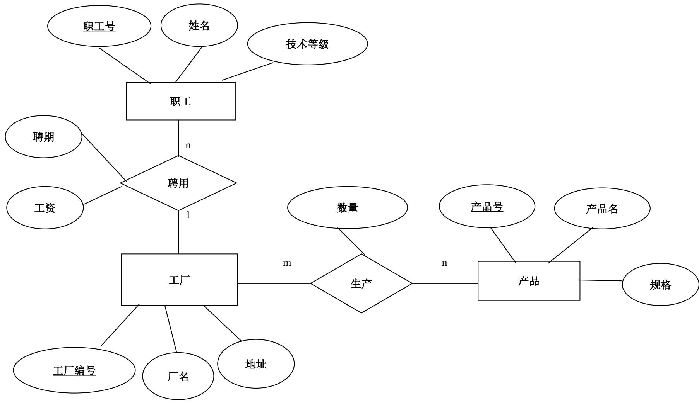

# 《数据库系统》第四章 习题课（习题2）

原件经识别和整理；“参考解答”是我们补的。

---
title: 《数据库系统》第四章 习题课（习题2）
kind: 习题
course: 数据库系统
term: 
source: 《数据库系统》第四章 习题课（习题2）第 1–22 页识别内容
---

# 《数据库系统》第四章 习题课（习题2）

本资料整理自《数据库系统》第四章习题课的参考答案及解析，涵盖关系模式分解、范式判断、ER图转换及事务ACID特性等核心知识点。

## 一、关系模式与函数依赖（P144-145）

### 选择 24

题干：设有关系模式 $R(ABCD)$，其上的FD集 $F = \{ A \rightarrow B, B \rightarrow C, D \rightarrow B \}$。

**问题①**：R分解成 $\rho = \{ ACD, BD \}$，试求F在ACD和BD上的投影。

答案：
解：实际是求 $F^+$ 在ACD和BD上的投影。
设：$R_1(ACD), R_2(BD)$。
由推理规则：
$F_1 = \{ A \rightarrow C, D \rightarrow C \}$ （利用传递性，因为 $A \rightarrow B, B \rightarrow C$，故 $A \rightarrow C$；同理 $D \rightarrow B, B \rightarrow C$，故 $D \rightarrow C$）
$F_2 = \{ D \rightarrow B \}$

**问题②**：ACD和BD是BCNF吗？如不是，试分解成BCNF。

答案：
解：分析出键 $\rightarrow$ 分析函数依赖类型或按定义 $\rightarrow$ 判断范式。

(a) 用推理规则或求属性闭包法找出键：
Key1 (for $R_1$): AD （不在任何函数依赖右部的属性应列入键中，验证 $(AD)^+ = ACD$）
Key2 (for $R_2$): D （验证 $(D)^+ = DB$）

(b) 对 $R_1 (ACD, F_1)$：
存在部分依赖吗？这里主要看是否满足BCNF。
对于 $R_1$，候选码为 AD。
函数依赖有 $A \rightarrow C$ 和 $D \rightarrow C$。
由于 $A$ 是码的真子集且 $A \rightarrow C$，这违反了BCNF定义（非平凡FD的左部必须包含码）。
或者从2NF角度分析：$AD$ 是码，$A \rightarrow C$ 是部分依赖（C仅依赖于A而非整个码AD），所以不满足2NF/3NF/BCNF。
1NF分解方法（算法4.6）：
$\rho_1 = \{ AC, AD \}$ 或 $\{ AD, DC \}$。
*注：原题解答给出 $\{ AC, AD \}$ 或 $\{ AD, DC \}$，通常分解为消除部分依赖的模式。若目标为BCNF，需继续检查。*

对 $R_2 (BD, F_2)$：
$F_2 = \{ D \rightarrow B \}$。
候选码为 D。
唯一非平凡FD为 $D \rightarrow B$，左部D是码。
故 $R_2$ 已达BCNF。

知识点：[函数依赖（平凡/非平凡、完全/部分、传递函数依赖）](../../../topics/数据库系统/函数依赖.md)、[范式（1NF、2NF、3NF、BCNF）](../../../topics/数据库系统/范式.md)、[关系模式的规范化（分解与优化）](../../../topics/数据库系统/规范化.md)

### 计算 28

题干：设有 $R(\text{职工编号}, \text{日期}, \text{日营业额}, \text{部门名}, \text{部门经理})$。
已知语义：
1. 每职工每天一营业额：$(\text{职工编号}, \text{日期}) \rightarrow \text{日营业额}$
2. 每职工只在一部门工作：$\text{职工编号} \rightarrow \text{部门名}$
3. 每部门名只有一位部门经理：$\text{部门名} \rightarrow \text{部门经理}$

参考答案：

**(1) 求基本函数依赖集F和键**

$F = \{ (\text{职工编号}, \text{日期}) \rightarrow \text{日营业额}, \text{职工编号} \rightarrow \text{部门名}, \text{部门名} \rightarrow \text{部门经理} \}$
Key: $(\text{职工编号}, \text{日期})$

**(2) 判断范式并分解至2NF**

$\because (\text{职工编号}, \text{日期}) \rightarrow \text{部门名}$ （通过 $\text{职工编号} \rightarrow \text{部门名}$ 推导）
$\therefore$ 存在部分依赖：$(\text{职工编号}, \text{日期}) \rightarrow \text{部门名}$ 和 $(\text{职工编号}, \text{日期}) \rightarrow \text{部门经理}$ （通过传递性）
消除部分依赖：
将依赖于 $\text{职工编号}$ 的属性分离。
$\rho = \{ R_1, R_2 \} = \{ (\text{职工编号}, \text{日期}, \text{日营业额}), (\text{职工编号}, \text{部门名}, \text{部门经理}) \}$

对于 $R_1$：
$F_1 = \{ (\text{职工编号}, \text{日期}) \rightarrow \text{日营业额} \}$
Key1: $(\text{职工编号}, \text{日期})$
$R_1$ 无部分依赖，达2NF。

对于 $R_2$：
$F_2 = \{ \text{职工编号} \rightarrow \text{部门名}, \text{部门名} \rightarrow \text{部门经理} \}$
Key2: $\text{职工编号}$
$R_2$ 无部分依赖（所有非主属性完全依赖于码），达2NF。

**(3) 分解成3NF**

$R_1$ 无传递依赖，达3NF。

$R_2$ 中：$\text{职工编号} \rightarrow \text{部门经理}$ 是传递依赖关系（$\text{职工编号} \rightarrow \text{部门名} \rightarrow \text{部门经理}$）。
将 $R_2$ 分解为3NF模式集：
$R_{21}(\text{职工编号}, \text{部门名})$
$R_{22}(\text{部门名}, \text{部门经理})$

最终 $\rho = \{ (\text{职工编号}, \text{日期}, \text{日营业额}), (\text{职工编号}, \text{部门名}), (\text{部门名}, \text{部门经理}) \}$

参考解答：**结论**
关系模式 $R$ 属于 1NF，主键为 $(\text{职工编号}, \text{日期})$。消除部分依赖后得到 2NF 分解；再消除传递依赖后得到 3NF 分解：
- 2NF 分解结果：$R_1(\text{职工编号}, \text{日期}, \text{日营业额})$，$R_2(\text{职工编号}, \text{部门名}, \text{部门经理})$
- 3NF 分解结果：$R_{11}(\text{职工编号}, \text{日期}, \text{日营业额})$，$R_{21}(\text{职工编号}, \text{部门名})$，$R_{22}(\text{部门名}, \text{部门经理})$

**推理与计算过程**

**(1) 基本函数依赖集 $F$ 与键**
由语义直接得到 $F$：
$$F = \{ (\text{职工编号}, \text{日期}) \to \text{日营业额},\ \text{职工编号} \to \text{部门名},\ \text{部门名} \to \text{部门经理} \}$$
求候选键：在 $F$ 中，$(\text{职工编号}, \text{日期})$ 的闭包可推导出所有属性，且其任意真子集无法推出全属性，故候选键为 $(\text{职工编号}, \text{日期})$。

**(2) 判断与分解至 2NF**
存在部分函数依赖：主键为 $(\text{职工编号}, \text{日期})$，而 $\text{职工编号} \to \text{部门名}$ 成立，因此非主属性 $\text{部门名}$ 部分依赖于主键。由此传递又可得到 $\text{部门经理}$ 部分依赖于主键。这使得 $R$ 最高为 1NF。
为达到 2NF，将部分依赖相关属性分离出去：
- 将 $(\text{职工编号}, \text{日期}) \to \text{日营业额}$ 保留为 $R_1(\text{职工编号}, \text{日期}, \text{日营业额})$，主键 $(\text{职工编号}, \text{日期})$。
- 将 $\text{职工编号} \to \text{部门名}$ 及 $\text{部门名} \to \text{部门经理}$ 分离到 $R_2(\text{职工编号}, \text{部门名}, \text{部门经理})$，主键 $\text{职工编号}$。
此时 $R_1$ 与 $R_2$ 均消去了非主属性对主键的部分依赖，都属于 2NF。

**(3) 分解至 3NF**
$R_1$ 的直接依赖为 $(\text{职工编号}, \text{日期}) \to \text{日营业额}$，无非主属性对主键的传递依赖，已达到 3NF。
$R_2$ 中存在 $\text{职工编号} \to \text{部门名}$ 且 $\text{部门名} \to \text{部门经理}$，故 $\text{职工编号} \to \text{部门经理}$ 为传递函数依赖，不满足 3NF。分解$R_2$ 消除传递依赖：
- $R_{21}(\text{职工编号}, \text{部门名})$
- $R_{22}(\text{部门名}, \text{部门经理})$
此时两个子关系都无传递依赖，全部达到 3NF。
最终 3NF 分解为 $\{ R_1, R_{21}, R_{22} \}$。

知识点：[函数依赖（平凡/非平凡、完全/部分、传递函数依赖）](../../../topics/数据库系统/函数依赖.md)、[范式（1NF、2NF、3NF、BCNF）](../../../topics/数据库系统/范式.md)、[关系模式的规范化（分解与优化）](../../../topics/数据库系统/规范化.md)

### 综合 30

题干：设有关系模式 $R(ABCD)$，其上的FD集为 $F = \{ AB \rightarrow C, C \rightarrow A, C \rightarrow D \}$。
分解 $\rho = \{ ACD, BC \}$。

**问题①**：判断 $\rho$ 是否无损连接。

答案：
解②：
(1) R的关键码：
由 $F$ 可知，$B$ 只在左边出现，必在码中。
$(AB)^+ = ABCD$，故 $AB$ 是超码。
$(BC)^+ = BCA D$（因 $C \rightarrow A, C \rightarrow D$），故 $BC$ 也是超码。
关键码为 $AB$ 和 $BC$。

(2) 检验无损连接：
$\rho$ 中有 $R_1(ACD), R_2(BC)$。
$R_1 \cap R_2 = C$。
$R_1 - R_2 = AD$。
由 $F$ 经合并性推理得：$C \rightarrow AD$ （因为 $C \rightarrow A$ 且 $C \rightarrow D$）。
因为交集 $C$ 能决定差集 $AD$，所以 $\rho$ 是无损分解。

**问题②**：判断 $\rho$ 是否保持函数依赖。

答案：
(3) 求投影后的FD集：
$F_1$ (in $R_1(ACD)$) = $\{ C \rightarrow A, C \rightarrow D \}$
$F_2$ (in $R_2(BC)$) = $\emptyset$ （$R_2$ 中没有非平凡的FD，因为 $BC$ 是码，且 $F$ 中无其他涉及 $B,C$ 的依赖）
$(F_1 \cup F_2)^+ \neq F^+$ （原 $F$ 中有 $AB \rightarrow C$，而在分解后无法推导出 $AB \rightarrow C$，因为 $A$ 和 $B$ 被分开了，且没有FD能从 $A,B$ 推出 $C$）。
故分解 $\rho$ 不保持函数依赖。

**问题③**：判断各子模式的范式级别。

答案：
(4) $R_1$ 的 $F_1 = \{ C \rightarrow A, C \rightarrow D \}$。
Key1: $C$。
按定义4.19，$R_1$ 达BCNF（所有非平凡FD的左部都包含码）。

$R_2$ 的 Key2: $BC$。
$R_2$ 达BCNF（无非平凡FD）。

**扩展问题**：②和⑤的关系模式 $\rho$ 各达到第几范式？应该为数据库模式中的每个模式达到的范式。

*(注：此处原文提及“⑤”，但题目描述中未明确给出⑤的具体题干，仅在后文给出了⑤的解题过程，见下文)*

知识点：[函数依赖（平凡/非平凡、完全/部分、传递函数依赖）](../../../topics/数据库系统/函数依赖.md)、[码（候选码、主码、外码）](../../../topics/数据库系统/码.md)、[范式（1NF、2NF、3NF、BCNF）](../../../topics/数据库系统/范式.md)

### 综合 5 (对应原文扩展部分的⑤)

题干：$F = \{ A \rightarrow B, B \rightarrow C, C \rightarrow D \}$，$\rho = \{ AB, AD, CD \}$。

答案：
解⑤：
(1) R的关键码：
$A$ 只在左边出现，必在码中。
$(A)^+ = ABCD$。
故关键码为 $A$。

(2) 检验无损连接：
$\rho$ 中有 $R_1(AB), R_2(AD), R_3(CD)$。
使用表格法（Chase算法）：

| | A | B | C | D |
| :--- | :---: | :---: | :---: | :---: |
| $R_1: AB$ | $a_1$ | $a_2$ | $b_{13}$ | $b_{14}$ |
| $R_2: AD$ | $a_1$ | $b_{22}$ | $b_{23}$ | $a_4$ |
| $R_3: CD$ | $b_{31}$ | $b_{32}$ | $a_3$ | $a_4$ |

推导过程：
1. 初始状态如上。
2. 根据 $A \rightarrow B$：$R_1$ 和 $R_2$ 的 A 都是 $a_1$，故 B 应相同。$R_1$ 的 B 是 $a_2$，$R_2$ 的 B 是 $b_{22}$。将 $b_{22}$ 改为 $a_2$。
   此时行变为：
   $R_1: a_1, a_2, b_{13}, b_{14}$
   $R_2: a_1, a_2, b_{23}, a_4$
   $R_3: b_{31}, b_{32}, a_3, a_4$
3. 根据 $B \rightarrow C$：$R_1$ 和 $R_2$ 的 B 都是 $a_2$，故 C 应相同。$R_1$ 的 C 是 $b_{13}$，$R_2$ 的 C 是 $b_{23}$。将其中一个改为另一个（通常改下标大的或任意一个，这里假设改 $b_{23}$ 为 $b_{13}$，或者反之，不影响结果判断是否有全 $a$ 行）。
   *注意：原题表格中似乎直接展示了最终或有误的中间态，我们重新严谨推导*。
   
   让我们看原题给出的表格结论：“按算法4.3 有损”。
   如果按照标准算法：
   - $A \rightarrow B$: $R_1(A,B)$ 和 $R_2(A,D)$ 在 A 上匹配 ($a_1$)。$R_1$ 有 $a_2$ (B)，$R_2$ 有 $b_{22}$。统一为 $a_2$。
   - $B \rightarrow C$: 现在 $R_1$ 和 $R_2$ 都有 $a_2$ (B)。$R_1$ 有 $b_{13}$ (C)，$R_2$ 有 $b_{23}$。统一为 $b_{13}$ (或 $b_{23}$)。
   - $C \rightarrow D$: 现在 $R_1$ 和 $R_2$ 都有相同的 C。$R_1$ 有 $b_{14}$ (D)，$R_2$ 有 $a_4$ (D)。统一为 $a_4$。
   此时 $R_2$ 行变为：$a_1, a_2, b_{13}, a_4$。仍未出现全 $a$ 行（C列仍是 $b$）。
   再看 $R_3(C,D)$：$C=a_3, D=a_4$。
   结合 $C \rightarrow D$，$R_3$ 已经满足。
   但是否有一行全为 $a$？
   $R_1$: $a_1, a_2, b_{13}, b_{14}$ -> 修改后 $C$ 变 $b_{13}$, $D$ 变 $a_4$? 不，$C \rightarrow D$ 作用于 $R_1$ 和 $R_2$。
   实际上，原题指出“有损”。这意味着经过推导后，没有任何一行变成了 $(a_1, a_2, a_3, a_4)$。
   例如，若 $C$ 始终无法变成 $a_3$，则不能生成全 $a$ 行。
   在此分解中，$R_1(AB), R_2(AD), R_3(CD)$。
   $A \rightarrow B$: $R_1, R_2$ 合并 B。
   $B \rightarrow C$: $R_1, R_2$ 合并 C。
   $C \rightarrow D$: $R_1, R_2$ 合并 D。此时 $R_2$ 变为 $a_1, a_2, b_{13}, a_4$。
   $R_3$ 是 $b_{31}, b_{32}, a_3, a_4$。
   没有行是全 $a$。故为有损分解。

(3) 判断保持函数依赖：
$F_1 (in AB) = \{ A \rightarrow B \}$
$F_2 (in AD) = \{ A \rightarrow D \}$ (由 $A \rightarrow B \rightarrow C \rightarrow D$ 推导出的在AD上的投影? 不，投影只保留在该子模式属性上的FD。$A \rightarrow D$ 在 $AD$ 上成立吗？原 $F$ 中无直接 $A \rightarrow D$，但有传递。在 $AD$ 上，$A$ 是码，$D$ 是非主属性。根据 Armstrong 公理，$A \rightarrow D$ 是隐含的。但在计算投影 $F_i$ 时，通常指 $F^+$ 中所有只含 $R_i$ 属性的 FD。
$F_3 (in CD) = \{ C \rightarrow D \}$
$(F_1 \cup F_2 \cup F_3)^+ = \{ A \rightarrow B, A \rightarrow D, C \rightarrow D \}$。
原 $F = \{ A \rightarrow B, B \rightarrow C, C \rightarrow D \}$。
显然丢失了 $B \rightarrow C$。
故分解 $\rho$ 不保持函数依赖。

(4) 范式判断：
$R_1$ 的 Key1: $A$。$F_1=\{A \rightarrow B\}$。达BCNF。
$R_2$ 的 Key2: $A$。$F_2=\{A \rightarrow D\}$。达BCNF。
$R_3$ 的 Key3: $C$。$F_3=\{C \rightarrow D\}$。达BCNF。


## 二、关系模式分解判定

知识点：[函数依赖（平凡/非平凡、完全/部分、传递函数依赖）](../../../topics/数据库系统/函数依赖.md)、[范式（1NF、2NF、3NF、BCNF）](../../../topics/数据库系统/范式.md)、[关系模式与关系数据库](../../../topics/数据库系统/关系模式.md)

### 简答 21

题干：设有关系模式 $R(ABC)$，其上的FD集为 $F = \{ B \rightarrow C, C \rightarrow A \}$。
那么分解 $\rho = \{ AB, AC \}$ 相对于F是否是无损分解和保持FD？说明理由。

答案：
解：
(1) 判断无损连接：
$\rho$ 中有 $R_1(AB), R_2(AC)$。
$R_1 \cap R_2 = A$。
$R_1 - R_2 = B$。
$R_2 - R_1 = C$。
在 $F$ 中推导不出 $A \rightarrow B$ 或 $A \rightarrow C$。
($A$ 的闭包 $(A)^+ = A$，不包含 $B$ 或 $C$)。
故 $\rho$ 是有损分解。

(2) 判断保持函数依赖：
$F_1 (in AB) = \{ \} $ （$B \rightarrow C$ 涉及 $C$，不在 $AB$ 中；$C \rightarrow A$ 涉及 $C$，不在 $AB$ 中。注意：$B \rightarrow ?$ 在 $AB$ 中只有 $B \rightarrow A$? 原 $F$ 中无 $B \rightarrow A$。$F_1$ 为空或仅含平凡依赖）。
*更正*：在 $R_1(AB)$ 上，$F$ 中涉及的属性只有 $A, B$。$B \rightarrow C$ 不含于 $AB$，$C \rightarrow A$ 不含于 $AB$。故 $F_1$ 中无非平凡FD。
$F_2 (in AC) = \{ C \rightarrow A \}$。
$(F_1 \cup F_2)^+ = \{ C \rightarrow A \}$。
原 $F = \{ B \rightarrow C, C \rightarrow A \}$。
显然丢失了 $B \rightarrow C$。
故分解 $\rho$ 不保持函数依赖。


## 三、ER图与关系模式转换（第五章参考）

知识点：[关系模式的规范化（分解与优化）](../../../topics/数据库系统/规范化.md)、[求属性集X关于F的闭包X_F^+](../../../topics/数据库系统/属性集闭包.md)

### 综合 14

题干：某商业集团有三个实体集。一个是“公司”实体集，属性有公司编号、公司名、地址等。二是“仓库”实体集，属性有仓库编号、仓库名、地址等。三是“职工”实体集，属性有职工编号、姓名、性别等。
公司与仓库间存在“隶属”关系，每个公司管辖若干个仓库，每个仓库只属于一个公司管辖；仓库与职工间存在“聘用”联系，每个仓库可聘用多个职工，每个职工只能在一个仓库工作，仓库聘用职工有聘期和工资。
画出ER图，并在图上注明属性、联系的类型。转换成关系模式集，并指出每个关系模式的主键和外键。

答案：
**ER图描述**：
1. 实体：**公司** (Company), **仓库** (Warehouse), **职工** (Employee)。
2. 属性：
   - 公司：公司编号 (PK), 公司名, 地址
   - 仓库：仓库编号 (PK), 仓库名, 地址
   - 职工：职工编号 (PK), 姓名, 性别
3. 联系：
   - **隶属**：公司与仓库之间。1:N 关系（一个公司管辖多个仓库，一个仓库属于一个公司）。
   - **聘用**：仓库与职工之间。1:N 关系（一个仓库聘用多个职工，一个职工只在一个仓库工作）。联系属性：聘期, 工资。

**关系模式集**：

1. **公司**（公司编号，公司名，地址）
   - 主键：公司编号
   - 外键：无

2. **仓库**（仓库编号，仓库名，地址，公司编号）
   - 主键：仓库编号
   - 外键：公司编号 （引用 公司(公司编号)）

3. **职工**（职工编号，姓名，性别，仓库编号，聘期，工资）
   - 主键：职工编号
   - 外键：仓库编号 （引用 仓库(仓库编号)）
   - *注：若“聘用”是多对多，则需单独建表。但题意明确“每个职工只能在一个仓库工作”，故为1:N，将外键放在N端（职工）表中。聘期和工资作为职工实体的属性或弱实体属性依附于职工。*


## 四、事务处理与并发控制（第七章参考）

知识点：[实体-联系模型（E-R模型）的基本概念](../../../topics/数据库系统/ER模型基础.md)、[概念结构设计（E-R图设计、实体与联系、设计方法）](../../../topics/数据库系统/概念结构设计.md)、[逻辑结构设计（E-R图向关系模型的转换）](../../../topics/数据库系统/逻辑结构设计.md)

### 简答 3

题干：简述事务的ACID特性及其实现机制。

答案：
**(1) 原子性 (Atomicity)**：
- 事务的所有操作“要么全做，要么全不做”。
- 是数据库系统本身的职责；由DBMS事务管理子系统实现（通过日志恢复机制）。
- 保证了事务的一致性，保证数据库的完整性。

**(2) 一致性 (Consistency)**：
- 事务独立执行的结果应保持DB的一致性。
- 是编写事务的应用程序员的职责（业务逻辑正确性）；由DBMS完整性子系统测试（约束检查）。
- 保证数据库的完整性。

**(3) 隔离性 (Isolation)**：
- 多个事务并发执行时，系统应保证与这些事务先后单独执行时的结果一样。
- 由DBMS的并发控制子系统实现（如锁机制、MVCC）。
- 提高事务的并发度，又不让错误发生。

**(4) 持久性 (Durability)**：
- 一个已成功执行的事务对数据库的影响应该是持久的，故障后可恢复。
- 由DBMS的恢复子系统实现（通过WAL日志技术）。
- 保证已写入磁盘的数据不丢失或可恢复。

*注：ACID准则共同保证了数据库中的数据总是正确的。*

知识点：[事务的基本概念与ACID特性（原子性、一致性、隔离性、持续性）](../../../topics/数据库系统/事务.md)、[恢复策略（事务故障恢复、系统故障恢复、介质故障恢复）](../../../topics/数据库系统/恢复策略.md)、[并发控制概述（丢失修改、脏读、不可重复读、幻读）](../../../topics/数据库系统/并发控制概述.md)

### 简答 10

题干：简述检查点机制的主要思想及COMMIT与检查点时刻操作的协调。

答案：
**(1) 检查点机制的主要思想**：
- 运行过程中由DBMS每隔一定时间在日志中设置一个检查点。
- 在检查点时刻：
  - 把将上一个检查点后已commit的事务对DB的更新写入磁盘。
  - 在日志文件中登入 `<checkpoint>` 记录。
- 故障恢复时，只有最近一个检查点之后到发生故障时的事务需要恢复。

**(2) COMMIT与检查点时刻操作的协调**：
- 在检查点时刻，写入磁盘的是上一个检查点后已commit的事务对DB的更新。
- 故障恢复时，重做的是从最近一个检查点之后到发生故障时已commit的事务，这些事务被正向扫描写入重做队列，并重新实施更新操作。

知识点：[具有检查点的恢复技术](../../../topics/数据库系统/检查点恢复.md)、[日志文件（格式、内容、作用、登记规则）](../../../topics/数据库系统/日志文件.md)、[恢复策略（事务故障恢复、系统故障恢复、介质故障恢复）](../../../topics/数据库系统/恢复策略.md)

### 简答 20

题干：可串行化调度与串行化调度的区别。

答案：
- **可串行化调度**：交叉执行各事务的操作，效果上相当于它们的某一串行执行。这是并发控制的目标，允许并发以提高效率。
- **串行化调度**：串行执行各事务，无并发意义，系统资源利用率低。

知识点：[并发调度的可串行性（可串行化调度、冲突可串行化）](../../../topics/数据库系统/可串行化调度.md)、[并发控制概述（丢失修改、脏读、不可重复读、幻读）](../../../topics/数据库系统/并发控制概述.md)

### 简答 24

题干：完整性规则的组成及SQL中的完整性约束。

答案：
**完整性规则的组成**：
- 何时检查：`WHENEVER <事件>`
- 检查什么错误：`IF <条件>`
- 检出错误怎么办：`THEN <动作>`

**SQL中的完整性约束**：
- 域约束
- 基表约束
- 检查约束 或断言

知识点：[数据库完整性概述](../../../topics/数据库系统/完整性概述.md)、[用户定义的完整性（属性约束、元组约束、CHECK）](../../../topics/数据库系统/用户定义完整性.md)

### 综合 28

题干：如何在SQL中实现以下完整性约束？
1. 年龄AGE在16到25之间。
2. SC表中S#和C#不为空。
3. SC表中S#参照S表，C#参照C表。
4. SC表中S#参照S表，删除S记录时限制（RESTRICT）。
5. SC表中S#参照S表，更新S记录时级联（CASCADE）。

答案：
**(1) 在基表S的定义中，用检查子句**：
```sql
CHECK (AGE BETWEEN 16 AND 25)
```

**(2) 在基表SC的定义中，做以下说明**：
```sql
S# ... NOT NULL,
C# ... NOT NULL,
```
也可用断言。

**(3) 在基表SC的定义中，用参照完整性约束**：
```sql
FOREIGN KEY (S#) REFERENCES S, 
FOREIGN KEY (C#) REFERENCES C
```

**(4) 在基表SC的定义中，用参照完整性约束 ON DELETE RESTRICT**：
```sql
FOREIGN KEY (S#) REFERENCES S ON DELETE RESTRICT
```
也可用触发器实现更复杂的逻辑。

**(5) 在基表SC的定义中，用参照完整性约束 ON UPDATE CASCADE**：
```sql
FOREIGN KEY (S#) REFERENCES S ON UPDATE CASCADE
```


## 课堂练习

某企业集团有若干工厂，每个工厂生产多种产品，且每一种产品可以在多个工厂生产，每个工厂按照固定的计划数量生产产品；每个工厂聘用多名职工，且每名职工只能在一个工厂工作，工厂聘用职工有聘期和工资。工厂的属性有工厂编号、厂名、地址，产品的属性有产品编号、产品名、规格，职工的属性有职工号、姓名、技术等级。请：

1. 为该集团进行概念设计，画出 E-R 图。
2. 将 E-R 图转换成关系模式，并指出每个关系模式的主键和外键及范式级别。



关系模式：

职工（职工号，姓名，技术等级，工厂编号，聘期，工资）外键：工厂编号

工厂（工厂编号，厂名，地址）

产品（产品号，产品名，规格）

生产（工厂编号，产品号，数量） 两个外键分别为：工厂编号，产品号

3.

```sql
CREATE TABLE 生产
（工厂编号 CHAR（10），
 产品号 CHAR（8），
 数量 INT，
 PRIMARY KEY（工厂编号，产品号），
 FOREIGN KEY 工厂编号 REFERENCES 工厂,
 FOREIGN KEY 产品号 REFERENCES 产品,
 CHECK（数量 >= 300））；
```

## 补充习题

设有关系模式 R(SNO, CNO, GRADE, TNAME, TADDR)，其属性分别表示学生学号、课程号、成绩、任课教师名、教师地址。规定：每个学生一门课只有一个成绩；每门课只有一个教师任教；每个教师只有一个地址，所有教师不同名。

1. 试写出关系模式 R 基本的函数依赖和候选键。
2. 试把 R 分解成 2NF 模式集，并说明理由。
3. 试把 R 分解成 3NF 模式集，并说明理由。

R(SNO, CNO, GRADE, TNAME, TADDR)

每个学生一门课只有一个成绩；

每门课只有一个教师任教；

每个教师只有一个地址，所有教师不同名。

1. 试写出关系模式 R 基本的函数依赖和候选键

$F=\{(SNO,CNO)\rightarrow GRADE,\ CNO\rightarrow TNAME,\ TNAME\rightarrow TADDR\}$，KEY = {SNO, CNO}

有关系模式 R（ABCD），根据语义 R 的函数依赖集 $F=\{A\rightarrow B,\ B\rightarrow C,\ C\rightarrow D\}$。对 R 有分解 $\rho=\{R_1(AB),\ R_2(ACD)\}$。

知识点：[函数依赖（平凡/非平凡、完全/部分、传递函数依赖）](../../../topics/数据库系统/函数依赖.md)、[码（候选码、主码、外码）](../../../topics/数据库系统/码.md)、[关系模式与关系数据库](../../../topics/数据库系统/关系模式.md)、[数据更新（INSERT、UPDATE、DELETE）](../../../topics/数据库系统/数据更新.md)、[完整性约束命名子句与修改完整性限制](../../../topics/数据库系统/完整性约束命名.md)、[用户定义的完整性（属性约束、元组约束、CHECK）](../../../topics/数据库系统/用户定义完整性.md)、[实体完整性的定义与违约处理](../../../topics/数据库系统/实体完整性定义.md)、[参照完整性的定义与违约处理（级联操作）](../../../topics/数据库系统/参照完整性定义.md)、[范式（1NF、2NF、3NF、BCNF）](../../../topics/数据库系统/范式.md)

### 解

1. R 的关键码：A

2. R 最高达到第几范式，说明原因

2NF。理由：R 的非主属性为 B、C、D，不存在 B、C、D 对候选键 A 的局部依赖，R 达到 2NF。但存在非主属性 C、D 对候选键 A 的传递依赖，R 不能达到 3NF。

3. 判断 $\rho$ 是否无损，并说明原因

$$
R_1\cap R_2=A,\quad R_1-R_2=B,\quad \because F=\{A\rightarrow B,\ B\rightarrow C,\ C\rightarrow D\}
$$

即 $R_1\cap R_2\rightarrow R_1-R_2$ 成立。$\therefore \rho$ 无损。

4. 判断 $\rho$ 是否保持了函数依赖，并说明理由。

$F_1=\{A\rightarrow B\}$，$F_2=\{A\rightarrow C,\ C\rightarrow D\}$，$\because (F_1\cup F_2)^+=F^+$，丢失了 $B\rightarrow C$，$\therefore \rho$ 不保持函数依赖。

## 课堂练习

设有关系模式 R（职工名，项目名，项目费，部门名，部门经理），如果规定每个职工可以参加多个项目，每参加一个项目，就有一份项目费；每个项目只属于一个部门管理；每个部门只有一个经理。

1. 试写出关系模式 R 的基本函数依赖 FD 和候选键。
2. 说明 R 不是 2NF 模式的理由，并把 R 分解成 2NF 模式集。
3. 进而把 R 分解成 3NF 模式集，并说明理由。

1. 试写出关系模式 R 的基本函数依赖 FD 和候选键。

R 的基本 FD 有 3 个：

- （职工名，项目名）→ 项目费
- 项目名 → 部门名
- 部门名 → 部门经理

关系模式 R 的候选键为：（职工名，项目名）

2. 说明 R 不是 2NF 模式的理由，并把 R 分解成 2NF 模式集。

R 中有下面两个 FD：

- （职工名，项目名）→（部门名，部门经理）
- 项目名 →（部门名，部门经理）

因为存在非主属性组（部门名，部门经理）对候选键（职工名，项目名）的局部函数依赖，所以 R 不是 2NF。R 应分解成下列两个模式：

- R1（职工名，项目名，项目费）
- R2（项目名，部门名，部门经理）

R1 与 R2 均为 2NF。

3. 进而把 R 分解成 3NF 模式集，并说明理由。

R1 已经是 3NF。

在 R2 中存在非主属性“部门经理”对候选键“项目名”的传递函数依赖，所以 R2 不是 3NF。R2 应进一步分解成下列两个模式：

- R21（项目名，部门名）
- R22（部门名，部门经理）

R21 与 R22 均为 3NF。最终，R 分解成 {R1, R21, R22}。

参考解答：### 1. 关系模式 R 的基本函数依赖 FD 和候选键

**结论**：
基本函数依赖集 $F = \{ (\text{职工名}, \text{项目名}) \rightarrow \text{项目费},\ \text{项目名} \rightarrow \text{部门名},\ \text{部门名} \rightarrow \text{部门经理} \}$。
候选键为：$(\text{职工名}, \text{项目名})$。

**推理过程**：
根据语义分析：
1. “每个职工参加一个项目有一份项目费” $\Rightarrow$ $(\text{职工名}, \text{项目名})$ 唯一确定 $\text{项目费}$。
2. “每个项目只属于一个部门” $\Rightarrow$ $\text{项目名}$ 唯一确定 $\text{部门名}$。
3. “每个部门只有一个经理” $\Rightarrow$ $\text{部门名}$ 唯一确定 $\text{部门经理}$。
由传递性可知，$(\text{职工名}, \text{项目名})$ 可以确定所有其他属性，且其真子集无法确定所有属性，故为候选键。

---

### 2. 说明 R 不是 2NF 的理由及分解为 2NF

**结论**：
R 不是 2NF，因为存在非主属性对候选键的部分函数依赖。
分解后的 2NF 模式集为：
- $R_1(\text{职工名}, \text{项目名}, \text{项目费})$
- $R_2(\text{项目名}, \text{部门名}, \text{部门经理})$

**推理过程**：
- **理由**：候选键是 $(\text{职工名}, \text{项目名})$。存在函数依赖 $\text{项目名} \rightarrow \text{部门名}$ 和 $\text{项目名} \rightarrow \text{部门经理}$（通过传递依赖或直接推导）。这意味着非主属性 $\text{部门名}$ 和 $\text{部门经理}$ 依赖于候选键的一部分（即 $\text{项目名}$），构成了部分函数依赖，违反 2NF 定义。
- **分解步骤**：将导致部分依赖的属性分离。
  - $R_1$ 保留完全依赖：$(\text{职工名}, \text{项目名}) \rightarrow \text{项目费}$。
  - $R_2$ 保留部分依赖涉及的属性：$\text{项目名} \rightarrow (\text{部门名}, \text{部门经理})$。
  - 此时 $R_1$ 和 $R_2$ 中非主属性均完全依赖于各自的候选键，满足 2NF。

---

### 3. 进而把 R 分解成 3NF 模式集及理由

**结论**：
最终分解的 3NF 模式集为：
- $R_1(\text{职工名}, \text{项目名}, \text{项目费})$
- $R_{21}(\text{项目名}, \text{部门名})$
- $R_{22}(\text{部门名}, \text{部门经理})$

**理由**：
- $R_1$ 的候选键为 $(\text{职工名}, \text{项目名})$，无非主属性传递依赖，已是 3NF。
- $R_2(\text{项目名}, \text{部门名}, \text{部门经理})$ 的候选键为 $\text{项目名}$。存在依赖链 $\text{项目名} \rightarrow \text{部门名} \rightarrow \text{部门经理}$。
- 非主属性 $\text{部门经理}$ 对候选键 $\text{项目名}$ 存在**传递函数依赖**（因为 $\text{部门名} \nrightarrow \text{项目名}$），违反 3NF 定义。
- 因此需将 $R_2$ 进一步分解为 $R_{21}$ 和 $R_{22}$，消除传递依赖。分解后各模式中非主属性均直接依赖于候选键，满足 3NF。

知识点：[函数依赖（平凡/非平凡、完全/部分、传递函数依赖）](../../../topics/数据库系统/函数依赖.md)、[码（候选码、主码、外码）](../../../topics/数据库系统/码.md)、[范式（1NF、2NF、3NF、BCNF）](../../../topics/数据库系统/范式.md)、[关系模式的规范化（分解与优化）](../../../topics/数据库系统/规范化.md)
