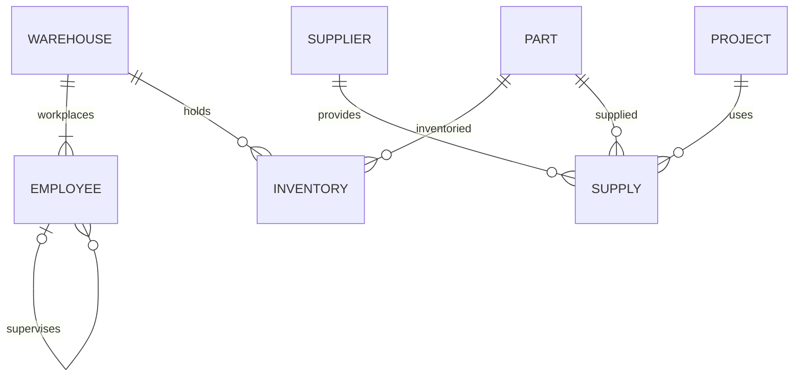

# 《数据库系统》课堂练习：库存管理系统设计（含参考答案）

原件两页：第 1 页给出题目，第 2 页附原参考答案。下面据第 2 页的图和属性表重绘、重排；量化约束和算例是补充，不是原题新增要求。

## 题设（20 分）

某企业有多个仓库。每个仓库有多名职工，一个职工只能在一个仓库工作；题面称职工中有一人与其他职工形成领导关系，原答将其画成职工间的一对多关系。零件可在多个仓库存放，每个仓库可有多种零件，并按“仓库—零件”记录库存量。供应商可供应多种零件，一个项目可使用不同供应商提供的多种零件，按“供应商—项目—零件”记录供应量。各实体属性随下面的关系模式一起列出。

1. 画库存管理系统的 E-R 概念模型。（10 分）
2. 转为关系模式并区分主键与外键。（10 分）

## 原参考答案的概念模型

原图有五类实体：仓库、职工、零件、供应商、项目。有四种联系：仓库与职工的“工作”、职工到职工的“领导”、仓库与零件的“存放”，以及供应商、项目、零件三方的“供应”。重绘时把两种带数量的联系画成关联记录：

图例：WAREHOUSE 为仓库，EMPLOYEE 为职工，PART 为零件，SUPPLIER 为供应商，PROJECT 为项目；INVENTORY 为存放记录，SUPPLY 为供应记录。每条供应记录必须同时连到一个供应商、一个项目和一种零件。图中的“领导”按原答案理解为职工自关联，“一”是对被领导者的单一直接领导限制；普通自外键并不会自动证明全公司恰好一位顶层领导，也不会自动证明领导链无环。

## 原参考答案的关系模式

下划线标主键；外键在最后一列列明引用位置。两类联系表的主键都是组合键。仓库电话是普通属性，不是主键或外键。

| 关系 | 属性 | 外键 |
| --- | --- | --- |
| 仓库 | <u>仓库编号</u>，面积，仓库电话 | 无 |
| 职工 | <u>职工编号</u>，姓名，年龄，职称，工作的仓库号，领导编号 | 工作的仓库号→仓库（仓库编号）；领导编号→职工（职工编号） |
| 零件 | <u>零件号</u>，名称，规格，单价，描述 | 无 |
| 供应商 | <u>供应商号</u>，姓名，地址，联系电话，账号 | 无 |
| 项目 | <u>项目号</u>，预算，开工日期 | 无 |
| 存放 | <u>仓库编号，零件号</u>，库存量 | 仓库编号→仓库；零件号→零件 |
| 供应 | <u>供应商号，项目号，零件号</u>，供应量 | 供应商号→供应商；项目号→项目；零件号→零件 |

**补充：**职工的仓库号应为非空外键；允许顶层领导没有上级时，领导编号可为空。若业务明确要求组织全局只有一个根、没有环，需在自外键之外另验证结构。存放表区别同一种零件在不同仓库的库存，供应表在题设范围内记录每个三元组的合计供应量；若要记录多次交付的流水，应加交付标识，不应简单把原来整组主键复制几遍。

> [!TIP]
> 问“数量属于谁”时，试着只换关系的一端。==换一个仓库就可能得到不同库存==，库存量不属于零件表；==换项目也会改变同一供应商供应同种零件的数量==，供应量不能只挂在供应商—零件上。

**独立验算（补充）：**令真实供应记录为 $(S_1,J_1,P_1)$、$(S_1,J_2,P_2)$、$(S_2,J_1,P_2)$。若拆为“供应商—项目”“供应商—零件”“项目—零件”三个二元表，再把它们相连接，就会多出 $(S_1,J_1,P_2)$：其三对信息各自确实存在，却来自不同的原记录。这个伪元组没有可用供应量。这就是保留三方联系而不只保存三张配对表的理由。

参见 [E-R 模型](../../../topics/数据库系统/ER模型基础.md)、[概念结构设计](../../../topics/数据库系统/概念结构设计.md)、[关系模式转换](../../../topics/数据库系统/逻辑结构设计.md)、[外键与参照约束](../../../topics/数据库系统/参照完整性定义.md)。
