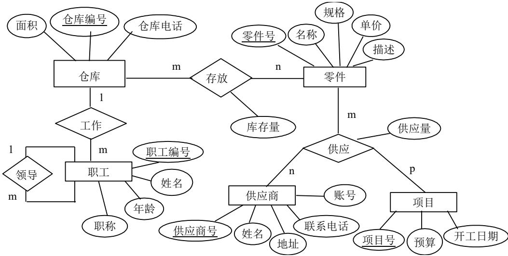

# 《数据库系统》课堂练习：库存管理系统设计（含参考答案）

原件经识别和整理；“参考解答”是我们补的。

# 数据库系统：库存管理系统设计（含参考答案）

本资料为《数据库系统》课堂练习中关于库存管理系统设计的题目及参考答案，已整理去除无关页眉页脚与水印。

## 一、数据库设计题（每小题10分，共20分）

### 选择 1

**题干：**
某企业的库存管理系统设计，涵盖了如下的用户需求：

1. 企业有若干仓库，一个仓库有多名职工工作，一个职工只能在一个仓库工作；仓库有仓库编号、面积、电话号码等信息描述，职工有职工编号、姓名、年龄、职称等信息描述。
2. 职工中有 1 人与其他职工之间是领导关系。
3. 每个仓库可以存放多种零件，某种零件也存于不同的仓库中，零件保存在某仓库时，记录零件的库存量；零件有零件号、名称、规格、单价、描述等特征。
4. 每种零件有不同的供应商供货，每个项目会使用不同供应商提供的各种不同的零件，某供应商为某项目提供不同的零件时，记录零件的供应量；供应商有供应商号、姓名、地址、联系电话、账号等信息描述，项目有项目号、预算、开工日期等信息描述。

**要求完成如下设计：**
1. 根据上述需求画出库存管理系统的概念模型图 (10 分)
2. 将（1）得到的概念模型转换成关系模型，并标记每个关系模式的主键（用单下划线标出）和外键（用波浪线标出）。 （10 分）

（注：直接给出你的设计结果，不需要书写分析过程）

**答案：**
见下方“参考解答”。

**参考解答：**

#### 1. ER 图（10 分）



*(注：原图为 ER 图设计结果)*

#### 2. 关系模式（10 分）

以下关系模式中，主键使用单下划线标记，外键使用波浪线标记。

| 关系模式 | 属性说明 |
| :--- | :--- |
| **仓库** | (<u>仓库编号</u>, 面积, <span style="text-decoration: underline;">仓库电话</span>) |
| **职工** | (<u>职工编号</u>, 姓名, 年龄, 职称, <span style="text-decoration: overline;">工作的仓库号</span>, <span style="text-decoration: overline;">领导编号</span>) |
| **零件** | (<u>零件号</u>, 名称, 规格, 单价, 描述) |
| **供应商** | (<u>供应商号</u>, 姓名, 地址, 联系电话, 账号) |
| **项目** | (<u>项目号</u>, 预算, 开工日期) |
| **存放** | (<span style="text-decoration: overline;">仓库编号</span>, <span style="text-decoration: overline;">零件号</span>, 库存量) |
| **供应** | (<span style="text-decoration: overline;">供应商号</span>, <span style="text-decoration: overline;">项目号</span>, <span style="text-decoration: overline;">零件号</span>, 供应量) |

*注：根据题目描述逻辑推导出的主外键标记如下：*
*   *仓库：主键为仓库编号。*
*   *职工：主键为职工编号；“工作的仓库号”引用仓库(仓库编号)，“领导编号”引用职工(职工编号)。*
*   *零件：主键为零件号。*
*   *供应商：主键为供应商号。*
*   *项目：主键为项目号。*
*   *存放：主键为(仓库编号，零件号)；外键分别为仓库编号和零件号。*
*   *供应：主键为(供应商号，项目号，零件号)；外键分别为供应商号、项目号和零件号。*

**知识点：** 数据库设计, E-R 模型, 关系模式转换

参考解答：#### 1. 概念模型图（E-R 图）

```
                    ┌─────────────┐
                    │    仓库      │
                    │─────────────│
                    │ 仓库编号(PK) │
                    │ 面积         │
                    │ 电话         │
                    └──────┬──────┘
                           │ 1
                           │ 工作
                           │ N
                    ┌──────┴──────┐
                    │    职工      │◄─────┐
                    │─────────────│      │
                    │ 职工编号(PK) │      │ 1
                    │ 姓名         │      │ 领导
                    │ 年龄         │      │ N
                    │ 职称         │──────┘
                    │ 仓库编号(FK) │
                    │ 领导编号(FK) │
                    └──────┬──────┘
                           │
                           │ M
                           │ 存放
                           │ N
                    ┌──────┴──────┐
                    │    零件      │
                    │─────────────│
                    │ 零件号(PK)   │
                    │ 名称         │
                    │ 规格         │
                    │ 单价         │
                    │ 描述         │
                    └──────┬──────┘
                           │
                           │ M
                           │ 供应(经供应商→项目)
                           │ 
              ┌────────────┴───────────┐
              │                        │
              │ M                      │ M
              │ 供货                   │ 使用
              │                        │
     ┌────────┴───────┐      ┌────────┴───────┐
     │     供应商      │      │      项目       │
     │────────────────│      │────────────────│
     │ 供应商号(PK)    │      │ 项目号(PK)      │
     │ 姓名           │      │ 预算            │
     │ 地址           │      │ 开工日期         │
     │ 联系电话        │      └────────────────┘
     │ 账号           │
     └────────────────┘

     联系"供应"：供应商 — 项目 — 零件（三元联系，属性：供应量）
     联系"存放"：仓库 — 零件（二元联系，属性：库存量）
```

#### 2. 关系模型

> 下划线 `<u>...</u>` 表示**主键**，波浪线 `~~...~~` 表示**外键**。

**仓库**（<u>仓库编号</u>，面积，电话）

**职工**（<u>职工编号</u>，姓名，年龄，职称，~~仓库编号~~，~~领导编号~~）

**零件**（<u>零件号</u>，名称，规格，单价，描述）

**供应商**（<u>供应商号</u>，姓名，地址，联系电话，账号）

**项目**（<u>项目号</u>，预算，开工日期）

**存放**（<u>仓库编号</u>，<u>零件号</u>，库存量）

**供应**（<u>供应商号</u>，<u>项目号</u>，<u>零件号</u>，供应量）

---

**主外键说明：**

| 关系模式 | 主键 | 外键 |
|:---|:---|:---|
| 仓库 | 仓库编号 | — |
| 职工 | 职工编号 | 仓库编号 → 仓库(仓库编号)；领导编号 → 职工(职工编号) |
| 零件 | 零件号 | — |
| 供应商 | 供应商号 | — |
| 项目 | 项目号 | — |
| 存放 | (仓库编号, 零件号) | 仓库编号 → 仓库(仓库编号)；零件号 → 零件(零件号) |
| 供应 | (供应商号, 项目号, 零件号) | 供应商号 → 供应商(供应商号)；项目号 → 项目(项目号)；零件号 → 零件(零件号) |

知识点：[实体-联系模型（E-R模型）的基本概念](../../../topics/数据库系统/ER模型基础.md)、[关系模式与关系数据库](../../../topics/数据库系统/关系模式.md)、[数据库设计的特点、方法与基本步骤](../../../topics/数据库系统/数据库设计概述.md)
