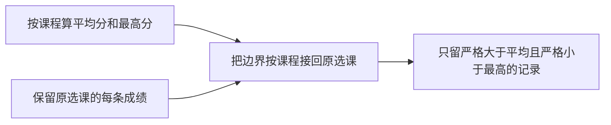

# 《数据库系统》课堂练习：数据库技能训练2（答案）

原件六页，含三道例题及原附 SQL。这里保留三个练习的目标、可复算数据和原解有用的做法，独立重写查询。原件示例用过 SQL Server 的 TOP；下文用常见的窗口函数，不把它冒充原 SQL。原转写停在“例题三”标题，现补齐第 6 页的两小问。

## 例题一：进货与出库

**题意：**建三表、录入教材数据。第一问求每种商品的进货总量、出库总量及差量；第二问求销量第 2、3 名的商品名称。题面进货数量字段写作 SL，原解用 JSL；以下统一沿用题面的 SL。这道题没有单独的单据号，例子假定同商品、同一天、同方向的流水至多一笔。若业务允许一天多次收发，应增加独立流水键。

```sql
CREATE TABLE Table3 (
  DH CHAR(1) PRIMARY KEY,
  Name VARCHAR(20) NOT NULL
);
CREATE TABLE Table1 (
  DH CHAR(1) REFERENCES Table3(DH),
  SL INTEGER NOT NULL CHECK (SL >= 0),
  进货日期 DATE NOT NULL,
  PRIMARY KEY (DH, 进货日期)
);
CREATE TABLE Table2 (
  DH CHAR(1) REFERENCES Table3(DH),
  SL INTEGER NOT NULL CHECK (SL >= 0),
  出货日期 DATE NOT NULL,
  PRIMARY KEY (DH, 出货日期)
);
INSERT INTO Table3 VALUES
  ('A','香皂'),('B','牙膏'),('C','手套'),('D','帽子'),('E','牙刷');
INSERT INTO Table1 VALUES
  ('A',100,'2008-01-01'),('B',120,'2008-01-02'),('C',200,'2008-01-04'),
  ('D',180,'2008-01-06'),('E',80,'2008-01-08');
INSERT INTO Table2 VALUES
  ('A',10,'2008-01-02'),('A',20,'2008-01-03'),('B',10,'2008-01-03'),
  ('B',15,'2008-01-04'),('C',5,'2008-01-05'),('E',2,'2008-01-09');
```

### 1. 求进货总量、出库总量和差量

**原答与订正：**原答先汇总再连接，这一步正确；它把显式等值条件的内连接称为“自然连接”，但 SQL 并没有使用 NATURAL JOIN。内连接结果漏掉没有出库记录的 D；原答的左连接保留了 D，却让 D 的出库量与差量都是 NULL。如果题意是“每样商品”，应从商品表出发；在流水记录完整、无记录代表没有发生业务时，可把缺失总量当作 0。若无记录可能表示采集缺失，不能用 0 掩盖未知。

**参考解答：**

```sql
WITH incoming AS (
  SELECT DH, SUM(SL) AS qty FROM Table1 GROUP BY DH
), outgoing AS (
  SELECT DH, SUM(SL) AS qty FROM Table2 GROUP BY DH
)
SELECT g.DH, COALESCE(i.qty,0) AS 进货量, COALESCE(o.qty,0) AS 出库量,
       COALESCE(i.qty,0) - COALESCE(o.qty,0) AS 进出差量
FROM Table3 AS g
LEFT JOIN incoming AS i ON i.DH = g.DH
LEFT JOIN outgoing AS o ON o.DH = g.DH
ORDER BY g.DH;
```

| 商品 | 进货 | 出库 | 进出差量 |
| --- | ---: | ---: | ---: |
| A | 100 | 30 | 70 |
| B | 120 | 25 | 95 |
| C | 200 | 5 | 195 |
| D | 180 | 0 | 180 |
| E | 80 | 2 | 78 |

> [!TIP]
> 同一商品若有两笔进货、三笔出库，先连接明细会配出六行，进货被计三遍，出库被计两遍。看到==两侧都有多条流水==，先各自按同一粒度汇总，再连接每种商品的总量。

### 2. 找销量第 2、3 名

**参考解答：**销量定义为出库数量之和，仅对有出库记录的商品排名。按销量降序，牙膏 25 和手套 5 分别第 2、第 3；原答案把这两行按销量升序展示，选中的商品相同。这里采用并列密集名次：同销量同名次，下一个不同销量接连续名次；若题意要严格取两条记录，应明确打破并列的规则并改用 ROW_NUMBER。

```sql
WITH totals AS (
  SELECT DH, SUM(SL) AS 销量 FROM Table2 GROUP BY DH
), ranked AS (
  SELECT DH, 销量, DENSE_RANK() OVER (ORDER BY 销量 DESC) AS 名次 FROM totals
)
SELECT g.Name, r.销量, r.名次
FROM ranked AS r JOIN Table3 AS g ON g.DH = r.DH
WHERE r.名次 IN (2,3)
ORDER BY r.名次,g.DH;
```

## 例题二：产品颜色差额与门市部业绩

**题意：**建产品、产品销售、门市部三表并录入。判断哪些产品红色销量多于蓝色；找销售额从低到高的第 3 名门市部。

```sql
CREATE TABLE 产品 (
  产品号 CHAR(4) PRIMARY KEY, 产品名 VARCHAR(20) NOT NULL,
  颜色 VARCHAR(8) NOT NULL, 价格 DECIMAL(10,2) NOT NULL CHECK (价格 >= 0)
);
CREATE TABLE 门市部 (
  门市部号 CHAR(2) PRIMARY KEY, 门市部名 VARCHAR(20) NOT NULL, 所在地区 CHAR(2)
);
CREATE TABLE 产品销售 (
  产品号 CHAR(4) REFERENCES 产品(产品号),
  门市部号 CHAR(2) REFERENCES 门市部(门市部号),
  销售数量 INTEGER NOT NULL CHECK (销售数量 >= 0),
  PRIMARY KEY (产品号, 门市部号)
);
INSERT INTO 产品 VALUES
  ('0011','产品1','红色',10),('0012','产品1','蓝色',10),
  ('0021','产品2','红色',20),('0022','产品2','蓝色',20),
  ('0031','产品3','红色',30),('0032','产品3','蓝色',30);
INSERT INTO 门市部 VALUES
  ('m1','N1','A1'),('m2','N2','A2'),('m3','N3','A1'),('m4','N4','A4');
INSERT INTO 产品销售 VALUES
  ('0011','m1',123),('0012','m2',126),('0022','m1',103),
  ('0021','m3',89),('0011','m3',203),('0021','m4',20),
  ('0032','m4',30),('0031','m1',40);
```

产品号区分不同颜色的销售单元，按产品名汇总才能比较同类两种颜色；样表中产品名能标识类别，实际若重名，应改用独立类别键。销售表的组合键适用于每种产品在每家门市部一条汇总记录，而非逐笔零售小票。

### 1. 求红色比蓝色多卖多少

**参考解答：**两种颜色分开累加，再做减法。没有某色的销售记录时，这种颜色销量贡献 0，而不是整种产品被内连接排除。

```sql
WITH totals AS (
  SELECT p.产品名,
    SUM(CASE WHEN p.颜色 = '红色' THEN COALESCE(s.销售数量,0) ELSE 0 END) AS 红,
    SUM(CASE WHEN p.颜色 = '蓝色' THEN COALESCE(s.销售数量,0) ELSE 0 END) AS 蓝
  FROM 产品 AS p LEFT JOIN 产品销售 AS s ON s.产品号 = p.产品号
  GROUP BY p.产品名
)
SELECT 产品名, 红 - 蓝 AS 差额 FROM totals WHERE 红 > 蓝 ORDER BY 产品名;
```

逐项验算：产品 1 为 $(123+203)-126=200$，产品 2 为 $(89+20)-103=6$，产品 3 为 $40-30=10$。这与原答公布的三个差额一致。

### 2. 找销售额倒数第 3 的门市部

**订正：**原 SQL 只做销售数量求和，得到的是**销量**，按该口径倒数第 3 是 N1（266 件）。题目写的是**销售额**，应先把每条销售数量乘以对应产品单价，再分门市部求和。倒数从最低额开始；下面用密集名次处理并列。查询从门市部保留各门店；若题意只排有销售的门店，改为对有记录的门店做内连接。

```sql
WITH totals AS (
  SELECT m.门市部号,m.门市部名,COALESCE(SUM(s.销售数量 * p.价格),0) AS 销售额
  FROM 门市部 AS m
  LEFT JOIN 产品销售 AS s ON s.门市部号 = m.门市部号
  LEFT JOIN 产品 AS p ON p.产品号 = s.产品号
  GROUP BY m.门市部号,m.门市部名
), ranked AS (
  SELECT totals.*, DENSE_RANK() OVER (ORDER BY 销售额) AS 倒序名次 FROM totals
)
SELECT 门市部名,销售额 FROM ranked WHERE 倒序名次 = 3 ORDER BY 门市部号;
```

| 门市部 | 销量（件） | 销售额（元） |
| --- | ---: | ---: |
| N1 | 266 | 4,490 |
| N2 | 126 | 1,260 |
| N3 | 292 | 3,810 |
| N4 | 50 | 1,300 |

按销售额由低到高为 N2、N4、**N3**、N1，答案为 N3。价格是题中产品的固定单价；若真实销售价格随时间变化，应使用交易时记录的成交单价。

## 例题三：课程成绩排序与组内比较

原件第 6 页只给 STUDENT(SNO,SNAME)、COURSE(CNO,SEMESTER)、SC(SNO,CNO,GRADE) 三种结构，没有给成绩样表。以下按题设把一个 CNO 当作计算分组；若同一课程号的不同学期真要分别统计，需要选课表也能标识开课学期，不能仅靠 CNO 连接后凭空拆出学期成绩。

### 1. 找 CS-110 第 4 名学生的姓名

**参考解答：**先限制课程，再只在该课程内排名。这里将“第 4 名”理解为竞赛名次（同分并列，后续名次跳号），第 4 名可有多人或不存在；题目没有定义并列策略。若要第 4 条记录，改用按成绩和学号固定排序的 ROW_NUMBER。

```sql
WITH ranked AS (
  SELECT SNO,RANK() OVER (ORDER BY GRADE DESC) AS 名次
  FROM SC WHERE CNO = 'CS-110' AND GRADE IS NOT NULL
)
SELECT s.SNAME FROM ranked AS r
JOIN STUDENT AS s ON s.SNO = r.SNO
WHERE r.名次 = 4 ORDER BY s.SNO;
```

原件的嵌套 TOP 解法可在前四名确有四条有效记录且排序能唯一确定时返回第四条；仅有一至三条时却会返回已存在的最后一条，把它当第四名是不对的。

### 2. 找严格介于本课程平均分与最高分之间的记录

**参考解答：**每门课有自己的平均和最高分，只和相同课程的统计值比较；等于边界的成绩不选。若成绩全为空，聚集结果为空，这个组没有符合严格不等式的记录。

```sql
WITH bounds AS (
  SELECT CNO,AVG(GRADE) AS avg_grade,MAX(GRADE) AS max_grade
  FROM SC GROUP BY CNO
)
SELECT s.SNO,s.CNO
FROM SC AS s JOIN bounds AS b ON b.CNO = s.CNO
WHERE s.GRADE > b.avg_grade AND s.GRADE < b.max_grade
ORDER BY s.CNO,s.SNO;
```



参见 [完整性约束](../../../topics/数据库系统/关系完整性.md)、[连接](../../../topics/数据库系统/连接查询.md)、[外连接](../../../topics/数据库系统/自然连接与外连接.md)、[分组和排序](../../../topics/数据库系统/单表查询.md)、[派生表](../../../topics/数据库系统/集合查询与派生表.md)。
