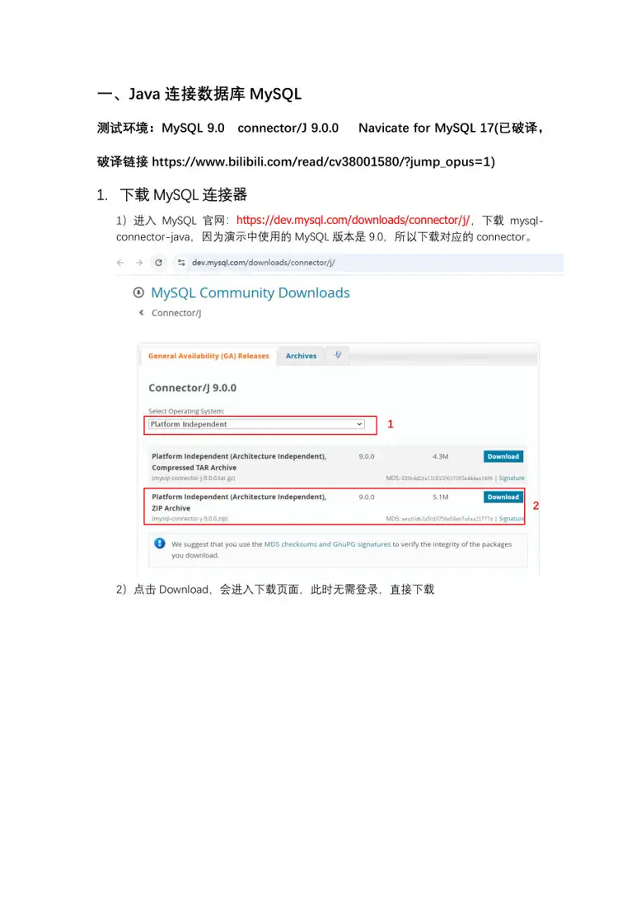
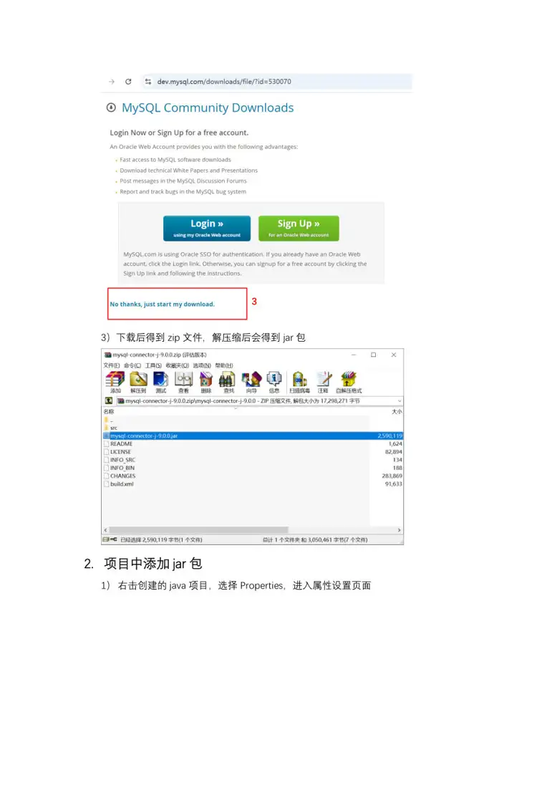
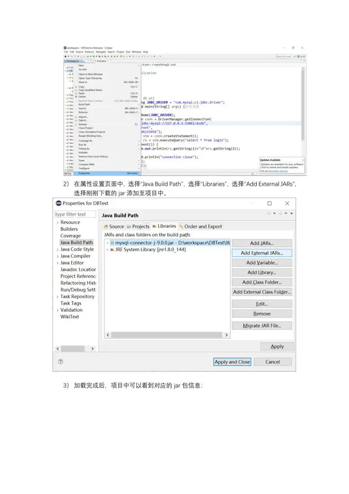
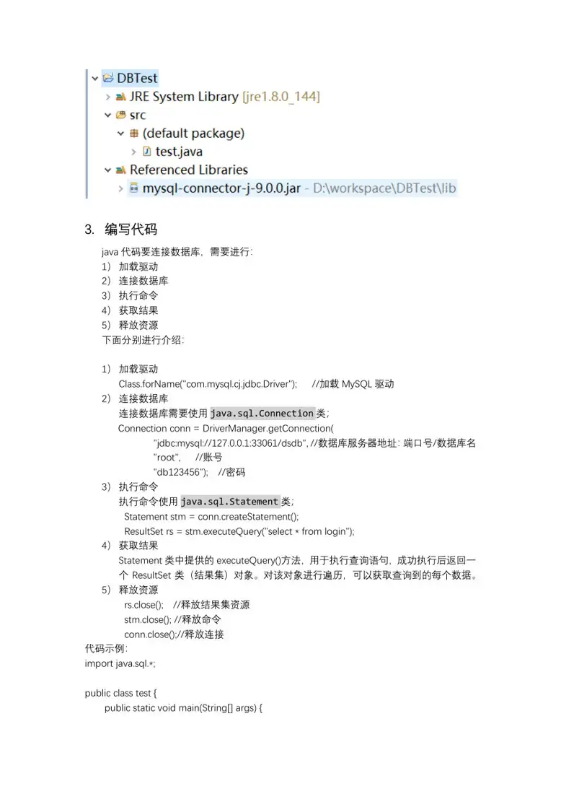
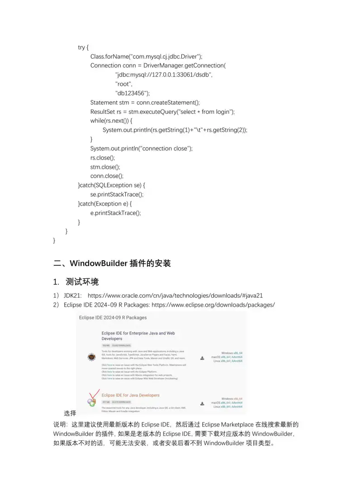
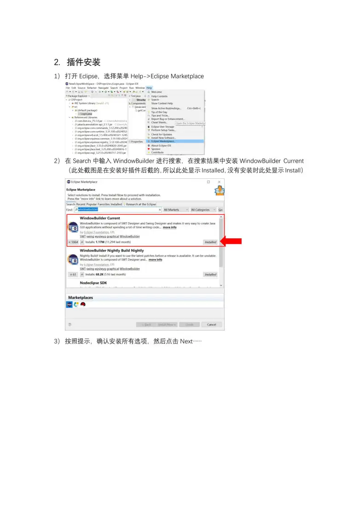
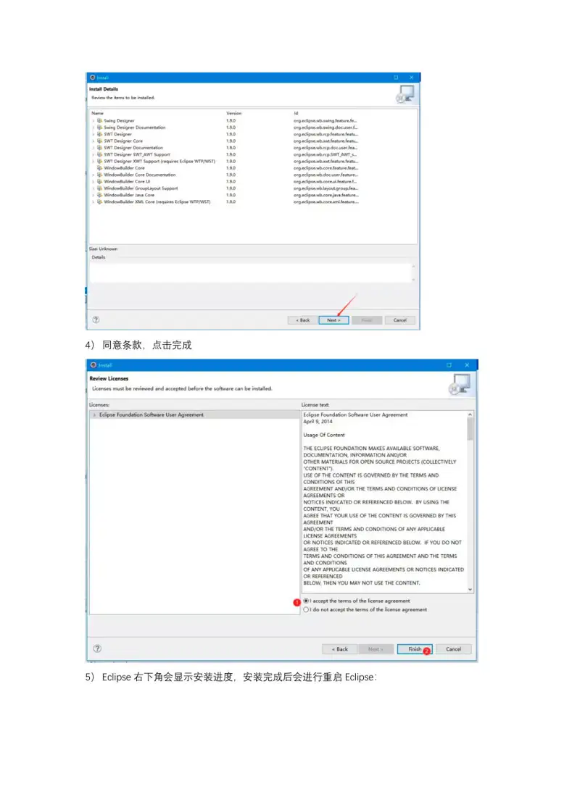
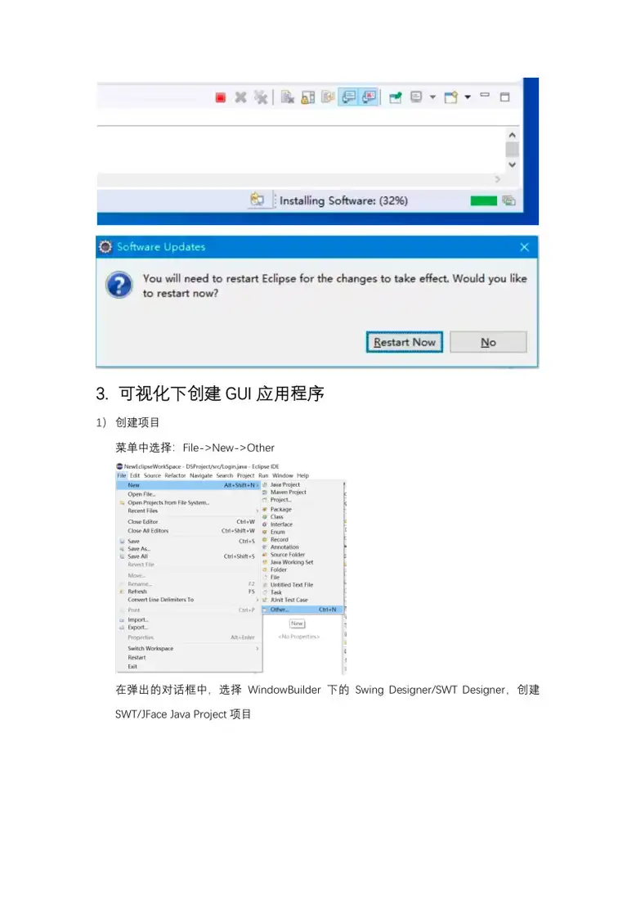
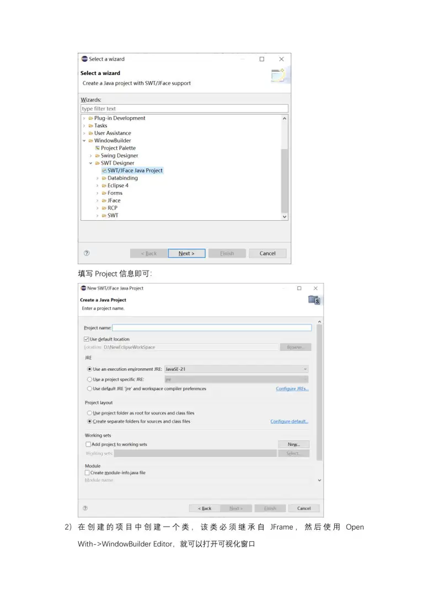
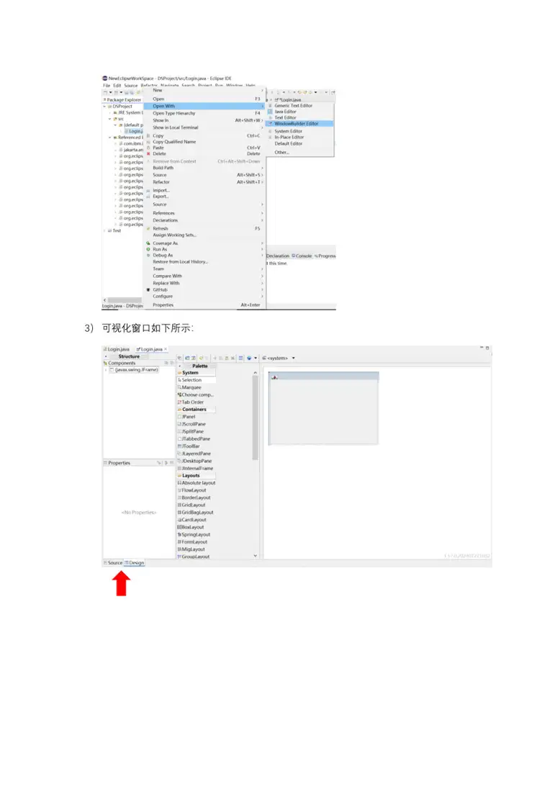

# 《数据库系统》附-Java连接数据库MySQL（课件）

原件的每一页，下面附识别出的文字。

### 1. 下载 MySQL 连接器

原文：

一、Java 连接数据库 MySQL测试环境：MySQL 9.0 connector/J 9.0.0 Navicate for MySQL 17(已破译，破译链接 https://www.bilibili.com/read/cv38001580/?jump\_opus=1)

1. 下载 MySQL 连接器

1）进入 MySQL 官网：https://dev.mysql.com/downloads/connector/j/，下载 mysql-connector-java，因为演示中使用的 MySQL 版本是 9.0，所以下载对应的 connector。

2）点击Download，会进入下载页面，此时无需登录，直接下载

### © MySQL Community Downloads

原文：

© MySQL Community Downloads

Login Now or Sign Up for a free account.

An Oracle Web Account provides you with the following advantages

• Fast access to MySQL software downloads

Download technical White Papers and Presentations

• Post messages in the MySOL Discussion Forums

• Report and track bugs in the MySQL bug system

account, click the Login link. Otherwise, you can signup for a free account by clicking the Sign Up link and following the instructions.

No thanks, just start my download.

3）下载后得到 zip 文件，解压缩后会得到 jar 包

2. 项目中添加 jar 包

1）右击创建的java 项目，选择Properties，进入属性设置页面

C dev.mysql.com/downloads/file/?id=530070

### 3）加载完成后，项目中可以看到对应的jar 包信息：

原文：

2） 在属性设置页面中，选择“Java Build Path”，选择“Libraries”，选择“Add External JARs”,选择刚刚下载的jar 添加至项目中。

3）加载完成后，项目中可以看到对应的jar 包信息：

### 3. 编写代码

原文：

3. 编写代码

2）连接数据库

3） 执行命令

4） 获取结果

5）释放资源

3） 执行命令

4） 获取结果

### 二、WindowBuilder 插件的安装

原文：

二、WindowBuilder 插件的安装

1. 测试环境

1） JDK21: https://www.oracle.com/cn/java/technologies/downloads/#java21 2） Eclipse IDE 2024-09 R Packages: https://www.eclipse.org/downloads/packages/

说明：这里建议使用最新版本的 EclipseIDE，然后通过 Eclipse Marketplace 在线搜索最新的WindowBuilder 的插件，如果是老版本的 Eclipse IDE，需要下载对应版本的 WindowBuilder，如果版本不对的话，可能无法安装，或者安装后看不到WindowBuilder 项目类型。

### 2. 插件安装

原文：

2. 插件安装

1） 打开 Eclipse，选择菜单 Help->Eclipse Marketplace

2） 在 Search 中输入 WindowBuilder 进行搜索，在搜索结果中安装 WindowBuilder Current（此处截图是在安装好插件后截的，所以此处显示Installed，没有安装时此处显示Install）

3）按照提示，确认安装所有选项，然后点击Next……

### 4） 同意条款，点击完成

原文：

4） 同意条款，点击完成

### Software Updates

原文：

Software Updates

You will need to restart Eclipse for the changes to take effect. Would you like to restart now?

Restart Now

No

3. 可视化下创建 GUI 应用程序

1）创建项目

菜单中选择：File->New->Other

在弹出的对话框中，选择 WindowBuilder 下的 Swing Designer/SWT Designer，创建SWT/JFace Java Project 项目

### 填写 Project 信息即可：

原文：

填写 Project 信息即可：

2）在创建的项目中创建一个类，该类必须继承自 JFrame，然后使用 OpenWith->WindowBuilder Editor，就可以打开可视化窗口

### 3）可视化窗口如下所示：

原文：

NewEclipseWorkSpace - DSProject/src/Login.java - Eclipse IDE
<table><tr><td colspan="3">File Edit Source RARS/VR RSIS/ASIA CAS/AR DBX/AF BHK BIM/BAI/BAI/BAI/BAI</td></tr><tr><td rowspan="2">Package Explorer</td><td>New</td><td></td></tr><tr><td>Open</td><td>F3</td></tr><tr><td>DSProject</td><td>Open With</td><td></td></tr><tr><td>JRE System L</td><td>Open Type Hierarchy</td><td>F4</td></tr><tr><td>src</td><td>Show In</td><td>Alt+Shift+W &gt;</td></tr><tr><td>(default p</td><td>Show in Local Terminal</td><td></td></tr><tr><td>Login.j</td><td>Copy</td><td>Ctrl+C</td></tr><tr><td>Referenced l</td><td>Copy Qualified Name</td><td></td></tr><tr><td>com.lbm.i</td><td>Paste</td><td>Ctrl+V</td></tr><tr><td>jakarta.an</td><td>Delete</td><td>Delete</td></tr><tr><td>org.eclips</td><td>Remove from Context</td><td>Ctrl+Alt+Shift+Down</td></tr><tr><td>org.eclips</td><td>Build Path</td><td></td></tr><tr><td>org.eclips</td><td>Source</td><td>Alt+Shift+S &gt;</td></tr><tr><td>org.eclips</td><td>Refactor</td><td>Alt+Shift+T &gt;</td></tr><tr><td>org.eclips</td><td>Import...</td><td></td></tr><tr><td>org.eclips</td><td>Export...</td><td></td></tr><tr><td>org.eclips</td><td>Source</td><td></td></tr><tr><td>org.eclips</td><td>References</td><td></td></tr><tr><td>org.eclips</td><td>Declarations</td><td></td></tr><tr><td>org.eclips</td><td>Refresh</td><td>F5</td></tr><tr><td>Test</td><td>Assign Working Sets...</td><td></td></tr><tr><td rowspan="10"></td><td>Coverage As</td><td></td></tr><tr><td>Run As</td><td></td></tr><tr><td>Debug As</td><td></td></tr><tr><td>Restore from Local History...</td><td></td></tr><tr><td>Team</td><td></td></tr><tr><td>Compare With</td><td></td></tr><tr><td>Replace With</td><td></td></tr><tr><td>GitHub</td><td></td></tr><tr><td>Configure</td><td></td></tr><tr><td>Properties</td><td>Alt+Enter</td></tr></table>

3）可视化窗口如下所示：
