# 2020—2021 学年第二学期《编译原理》第二章（课件）

原件的每一页，下面附识别出的文字。

### 编译原理

原文：

编译原理

第二章

南京郵電大學 Nanjing ins 南京郵電大学 Nanjing University of Posts and Telecommunications

### （1）第一个公认的高级程序设计语言是什么？

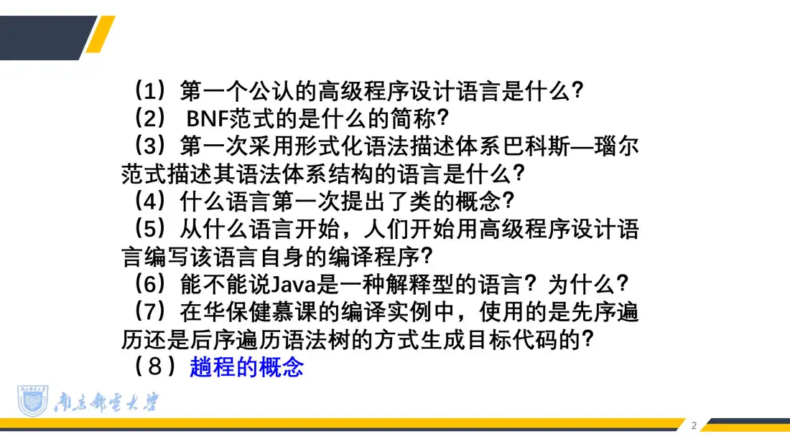

原文：

（1）第一个公认的高级程序设计语言是什么？

（2） BNF范式的是什么的简称？

（3）第一次采用形式化语法描述体系巴科斯—瑙尔范式描述其语法体系结构的语言是什么？

（4）什么语言第一次提出了类的概念？

（5）从什么语言开始，人们开始用高级程序设计语言编写该语言自身的编译程序？

（6）能不能说Java是一种解释型的语言？为什么？

（7）在华保健慕课的编译实例中，使用的是先序遍历还是后序遍历语法树的方式生成目标代码的？

（8）趟程的概念

2

### 作业：

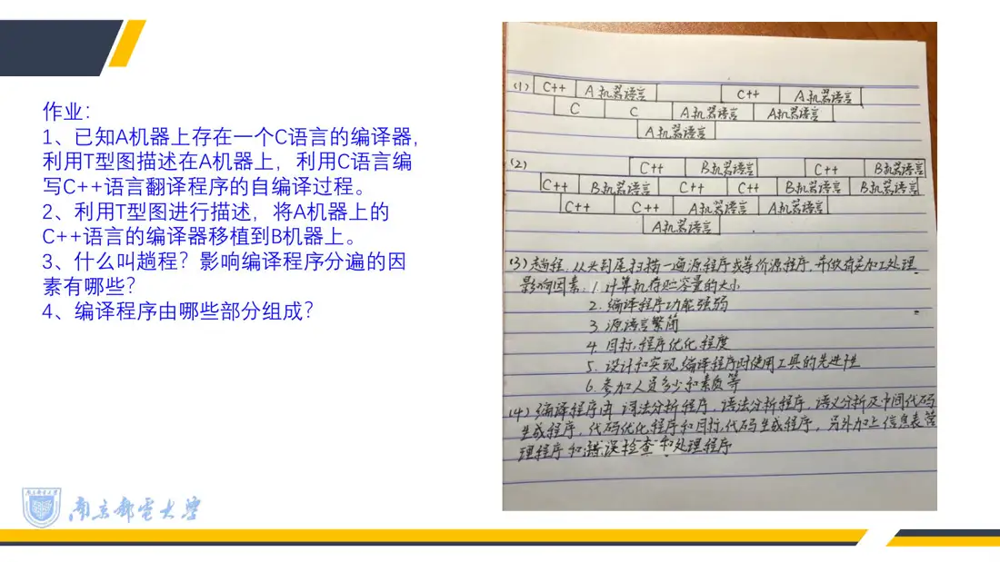

原文：

作业：

1、已知A机器上存在一个C语言的编译器，利用T型图描述在A机器上，利用C语言编写C++语言翻译程序的自编译过程。

2、利用T型图进行描述，将A机器上的C++语言的编译器移植到B机器上。

3、什么叫趟程？影响编译程序分遍的因素有哪些？

4、编译程序由哪些部分组成？

(2) C+t B机器语言 C++ B机器语言 C++B机器语言 C++ C++ B机器语言 B机器语言 C++ C++ A机器语言A机器语言 A机器语言

（3)趟程：从头到尾扫描一遍源程序或等价源程序，并做有关加工处理影响因素：1.计算机存贮容量的大小

2. 编译程序功能强弱

3. 源语言繁简

4.目标，程序优化程度

5. 设计和实现编译程序时使用工具的先进性

6.参加人员多少和素质等

(4) 编译程序由词法分析程序，语法分析程序，语义分析及中间代码生成程序，代码优化程序和目标，代码生成程序，另外加上信息表营理程序和错误检查和处理程序

### 二章 形式语言基本知识

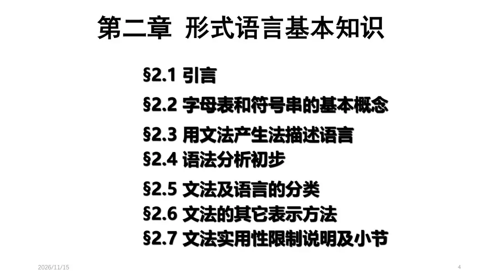

原文：

二章 形式语言基本知识
§2.1 引言
§2.2 字母表和符号串的基本概念
§2.3 用文法产生法描述语言
§2.4 语法分析初步
§2.5 文法及语言的分类
§2.6 文法的其它表示方法
§2.7 文法实用性限制说明及小节

2026/11/15

4

### 2.1 引言

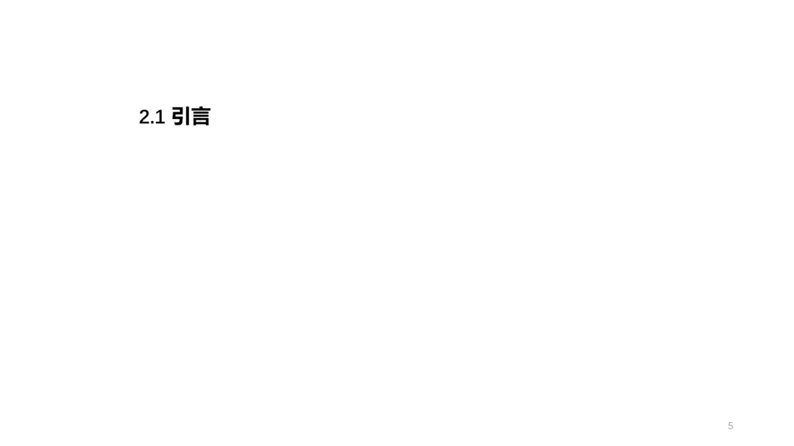

原文：

2.1 引言

5

### 源程序

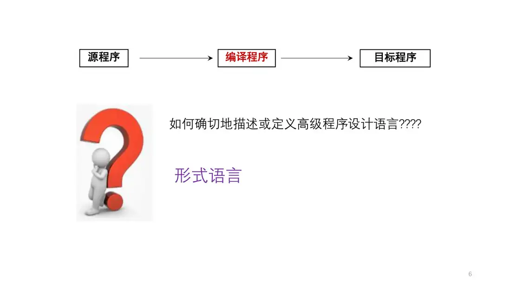

原文：

源程序

编译程序

目标程序

如何确切地描述或定义高级程序设计语言????

形式语言

6

### 一、形式语言的提出

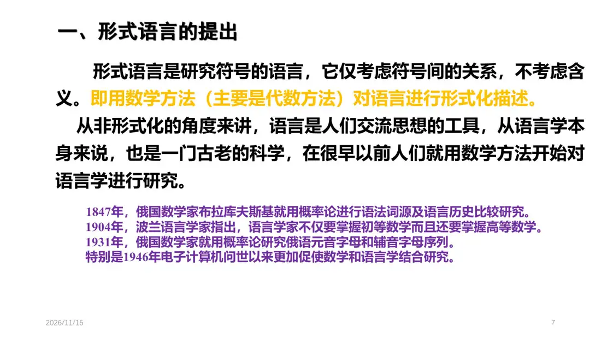

原文：

一、形式语言的提出

形式语言是研究符号的语言，它仅考虑符号间的关系，不考虑含义。即用数学方法（主要是代数方法）对语言进行形式化描述。

从非形式化的角度来讲，语言是人们交流思想的工具，从语言学本身来说，也是一门古老的科学，在很早以前人们就用数学方法开始对语言学进行研究。

1847年，俄国数学家布拉库夫斯基就用概率论进行语法词源及语言历史比较研究。

1904年，波兰语言学家指出，语言学家不仅要掌握初等数学而且还要掌握高等数学。

1931年，俄国数学家就用概率论研究俄语元音字母和辅音字母序列。

特别是1946年电子计算机问世以来更加促使数学和语言学结合研究。

2026/11/15

7

### 2026/11/15

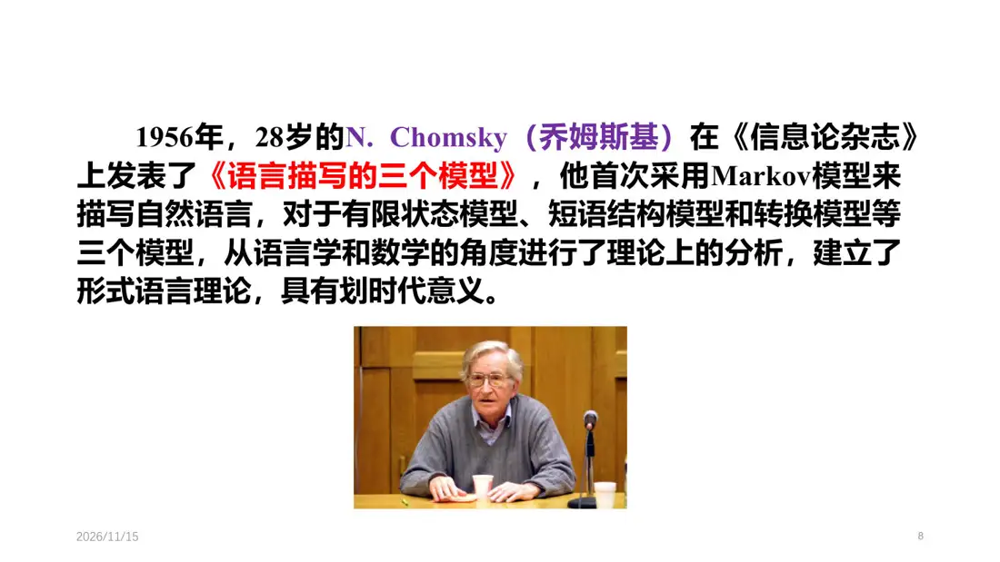

原文：

1956年，28岁的N. Chomsky（乔姆斯基）在《信息论杂志》上发表了《语言描写的三个模型》，他首次采用Markov模型来描写自然语言，对于有限状态模型、短语结构模型和转换模型等三个模型，从语言学和数学的角度进行了理论上的分析，建立了形式语言理论，具有划时代意义。

2026/11/15

8

### 例如：“我爱你”这条句子如何产生呢？

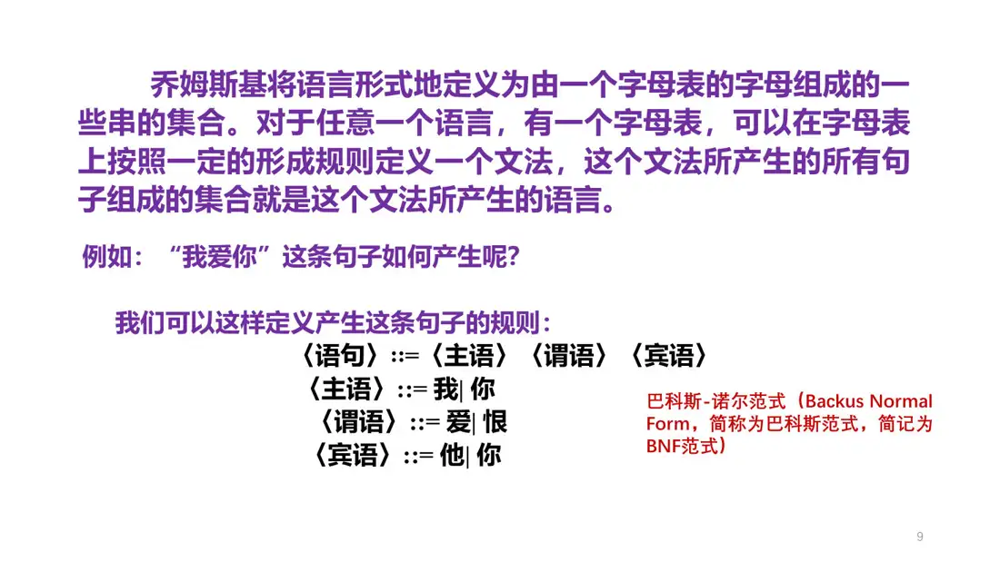

原文：

乔姆斯基将语言形式地定义为由一个字母表的字母组成的一些串的集合。对于任意一个语言，有一个字母表，可以在字母表上按照一定的形成规则定义一个文法，这个文法所产生的所有句子组成的集合就是这个文法所产生的语言。

例如：“我爱你”这条句子如何产生呢？

我们可以这样定义产生这条句子的规则：

语句〉∷=〈主语〉〈谓语〉〈宾语

〈主语〉::= 我| 你

〈谓语〉::= 爱| 恨

〈宾语〉::= 他| 你巴科斯-诺尔范式（Backus NormalForm，简称为巴科斯范式，简记为BNF范式）

9

### 2026/11/15

原文：

约翰·巴克斯（John.WarnerBackus）1 9 7 7 年 图 灵 奖 获 得 者〈语句〉∷=〈主语〉〈谓语〉〈宾语

2026/11/15

10

### 〈主语〉::= 我| 你

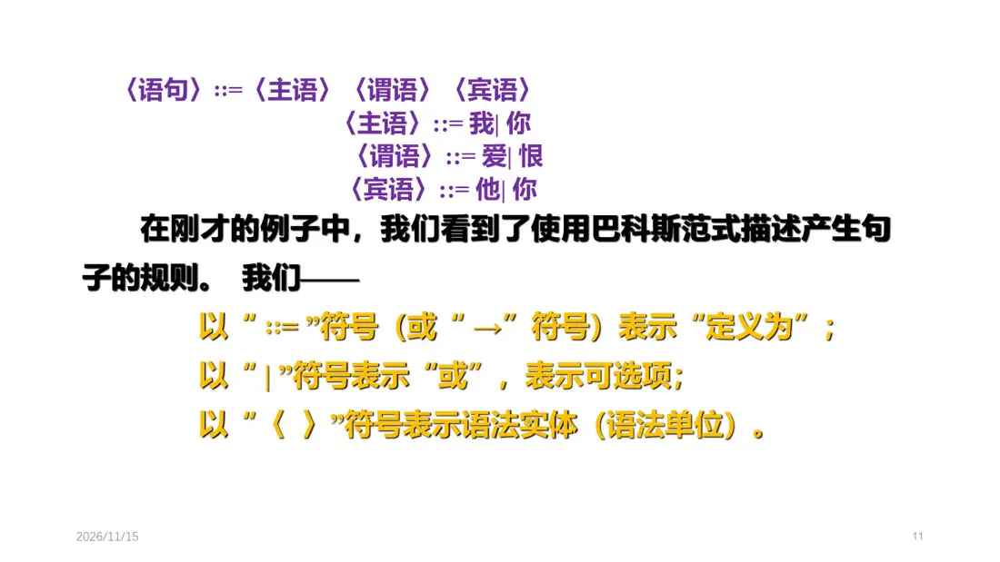

原文：

〈主语〉::= 我| 你

〈谓语〉::= 爱| 恨

$$
\langle \text {宾语} \rangle : := \text {他} | \text {你}
$$

在刚才的例子中，我们看到了使用巴科斯范式描述产生句子的规则。 我们——

以“ ∷= ”符号（或“ →”符号）表示“定义为”；

以“ | ”符号表示“或”，表示可选项；

以“〈 〉”符号表示语法实体（语法单位）。

2026/11/15

11

### 那么：“我爱你”这条句子如何产生呢？

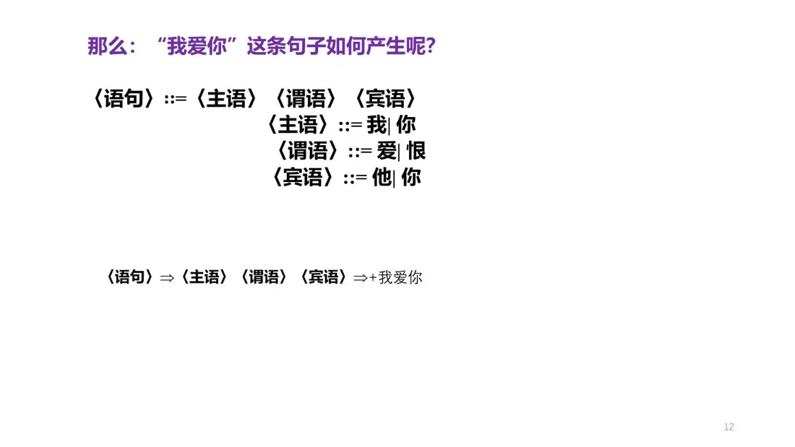

原文：

那么：“我爱你”这条句子如何产生呢？

语句〉∷=〈主语〉〈谓语〉〈宾语

〈主语〉::= 我| 你

〈谓语〉::= 爱| 恨

〈宾语〉::= 他| 你

《语句〉⇒〈主语〉《谓语〉〈宾语〉⇒+我爱你

12

### $$

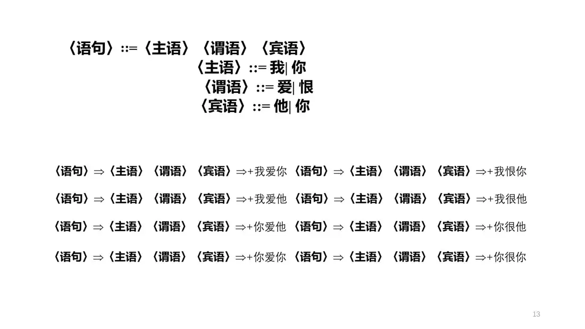

原文：

$$
\langle \text {语句} \rangle : := \langle \text {主语} \rangle \langle \text {谓语} \rangle \langle \text {宾语} \rangle
$$

$$
\langle \text {主语} \rangle : := \text {我} | \text {你}
$$

$$
\langle \mathrm{谓语} \rangle : := \mathrm{爱} | \mathrm{恨}
$$

$$
\langle \mathrm{宾语} \rangle : := \mathrm{他} | \mathrm{你}
$$

$$
\langle \mathrm{语句} \rangle \Rightarrow \langle \mathrm{主语} \rangle \langle \mathrm{谓语} \rangle \langle \mathrm{宾语} \rangle \Rightarrow + \mathrm{我爱你} \langle \mathrm{语句} \rangle \Rightarrow \langle \mathrm{主语} \rangle \langle \mathrm{谓语} \rangle \langle \mathrm{宾语} \rangle \Rightarrow + \mathrm{我恨你}
$$

$$
\langle \mathrm{语句} \rangle \Rightarrow \langle \mathrm{主语} \rangle \langle \mathrm{谓语} \rangle \langle \mathrm{宾语} \rangle \Rightarrow + \mathrm{我爱他} \langle \mathrm{语句} \rangle \Rightarrow \langle \mathrm{主语} \rangle \langle \mathrm{谓语} \rangle \langle \mathrm{宾语} \rangle \Rightarrow + \mathrm{我很他}
$$

$$
\langle \mathrm{语句} \rangle \Rightarrow \langle \mathrm{主语} \rangle \langle \mathrm{谓语} \rangle \langle \mathrm{宾语} \rangle \Rightarrow + \mathrm{你爱他} \langle \mathrm{语句} \rangle \Rightarrow \langle \mathrm{主语} \rangle \langle \mathrm{谓语} \rangle \langle \mathrm{宾语} \rangle \Rightarrow + \mathrm{你很他}
$$

$$
\langle \mathrm{语句} \rangle \Rightarrow \langle \mathrm{主语} \rangle \langle \mathrm{谓语} \rangle \langle \mathrm{宾语} \rangle \Rightarrow + \mathrm{你爱你} \langle \mathrm{语句} \rangle \Rightarrow \langle \mathrm{主语} \rangle \langle \mathrm{谓语} \rangle \langle \mathrm{宾语} \rangle \Rightarrow + \mathrm{你很你}
$$

13

### 2026/11/15

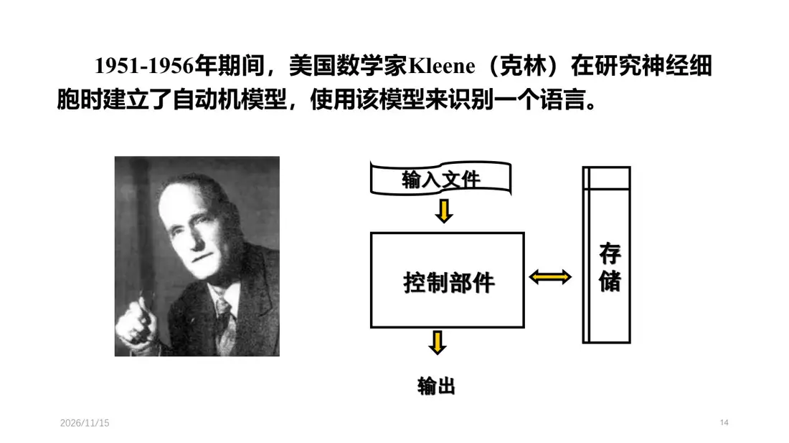

原文：

1951-1956年期间，美国数学家Kleene（克林）在研究神经细胞时建立了自动机模型，使用该模型来识别一个语言。

2026/11/15

14

### 乔姆斯基1959将形式语言的研究成果和自动机的研究成果结合。

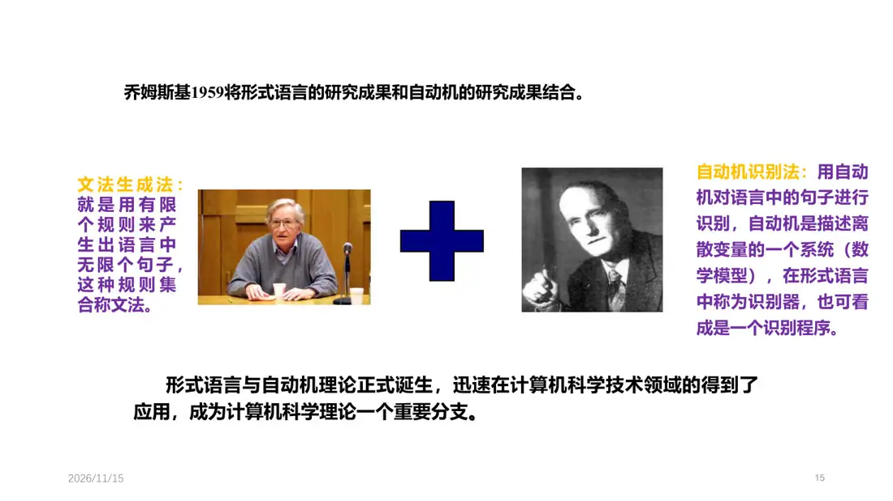

原文：

乔姆斯基1959将形式语言的研究成果和自动机的研究成果结合。

文法生成法：就是用有限个规则来产生出语言 中无限个句子 ，这种规则集合称文法。

自动机识别法：用自动机对语言中的句子进行识别，自动机是描述离散变量的一个系统（数学模型），在形式语言中称为识别器，也可看成是一个识别程序。

形式语言与自动机理论正式诞生，迅速在计算机科学技术领域的得到了应用，成为计算机科学理论一个重要分支。

2026/11/15

15

### 乔姆斯基的形式语言理论得到过计算机科学的三重验证：

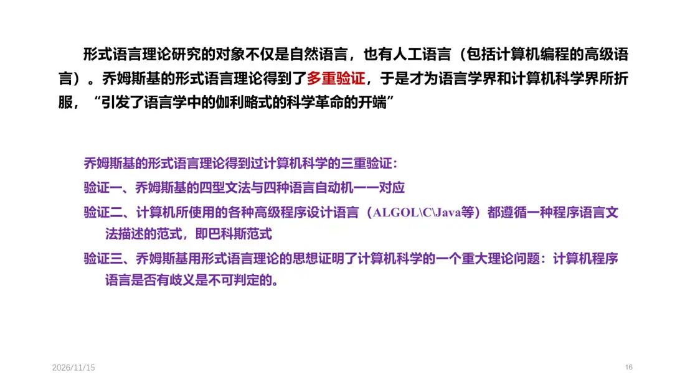

原文：

形式语言理论研究的对象不仅是自然语言，也有人工语言（包括计算机编程的高级语言）。乔姆斯基的形式语言理论得到了多重验证，于是才为语言学界和计算机科学界所折服，“引发了语言学中的伽利略式的科学革命的开端”

乔姆斯基的形式语言理论得到过计算机科学的三重验证：

验证一、乔姆斯基的四型文法与四种语言自动机一一对应

验证二、计算机所使用的各种高级程序设计语言（ALGOL\C\Java等）都遵循一种程序语言文法描述的范式，即巴科斯范式

验证三、乔姆斯基用形式语言理论的思想证明了计算机科学的一个重大理论问题：计算机程序语言是否有歧义是不可判定的。

2026/11/15

16

### 2.2 字母表和符号串的基本概念

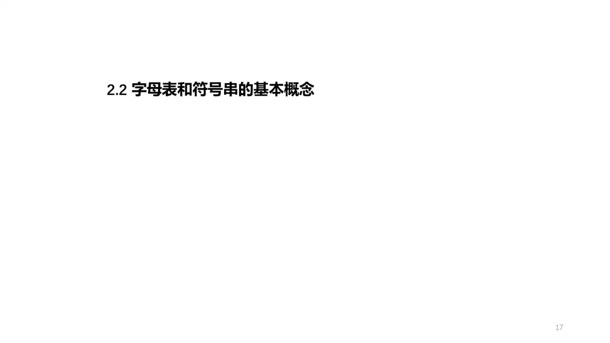

原文：

2.2 字母表和符号串的基本概念

17

### 18

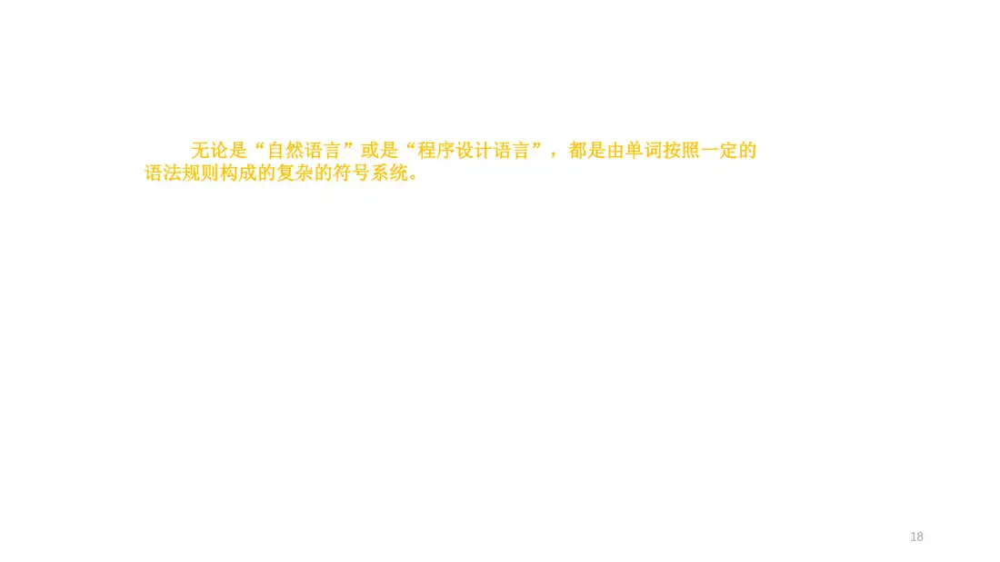

原文：

无论是“自然语言”或是“程序设计语言”，都是由单词按照一定的语法规则构成的复杂的符号系统。

18

### §2.2字母表和符号串的基本概念

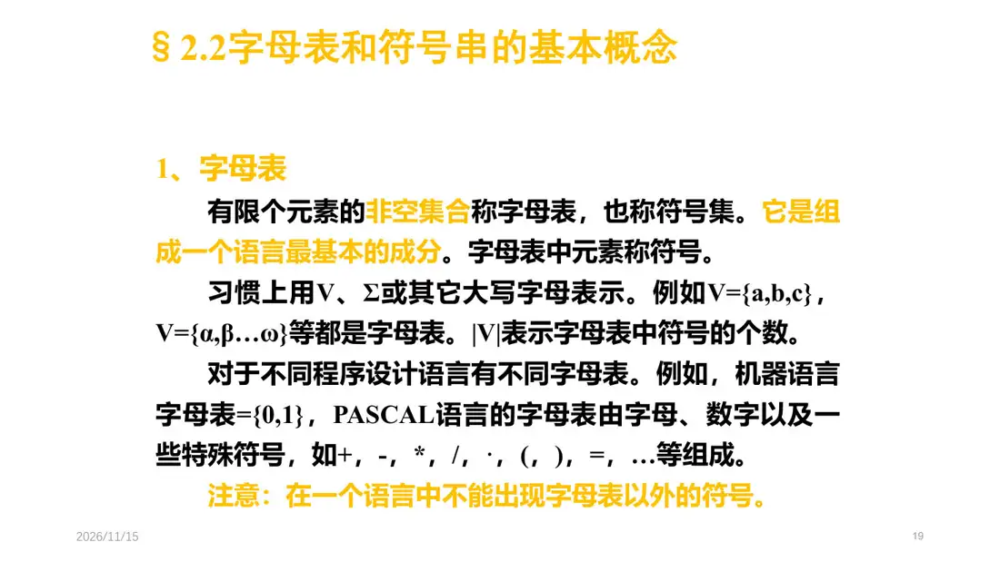

原文：

§2.2字母表和符号串的基本概念

1、字母表

有限个元素的非空集合称字母表，也称符号集。它是组成一个语言最基本的成分。字母表中元素称符号。

习惯上用V、Σ或其它大写字母表示。例如 $\mathbf { V = \{ a , b , c \} }$ $\mathbf { V = \{ a , \beta \dots \omega _ { \mathrm { j } } } $ 等都是字母表。|V|表示字母表中符号的个数。

对于不同程序设计语言有不同字母表。例如，机器语言字母表={0,1}，PASCAL语言的字母表由字母、数字以及一些特殊符号，如 $+ , - , \ast , / , \cdot , ( \cdot , ) , = ,$ …等组成。

注意：在一个语言中不能出现字母表以外的符号。

2026/11/15

19

### （1）C语言字母表是什么？ASCII 编辑

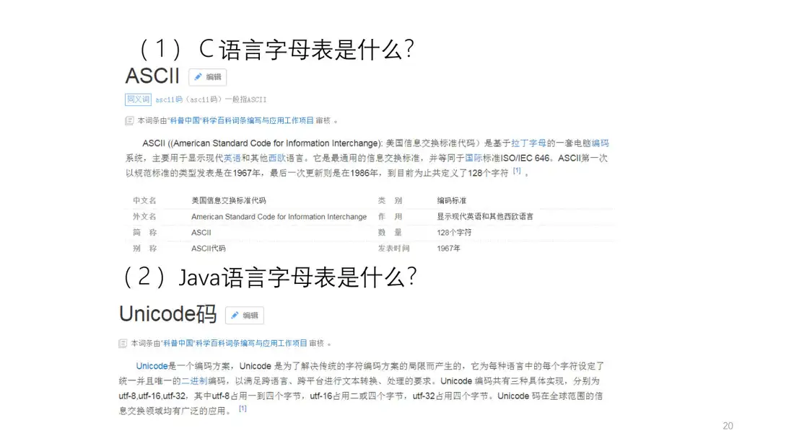

原文：

（1）C语言字母表是什么？ASCII 编辑

本词条由“科普中国”科学百科词条编写与应用工作项目审核。

ASCIl ((American Standard Code for Information Interchange): 美国信息交换标准代码)是基于拉丁字母的一套电脑编码系统，主要用于显示现代英语和其他西欧语言。它是最通用的信息交换标准，并等同于国际标准ISO/IEC646。ASCII第一次以规范标准的类型发表是在1967年，最后一次更新则是在1986年，到目前为止共定义了128个字符[1]。

<table><tr><td>中文名</td><td>美国信息交换标准代码</td><td>类别</td><td>编码标准</td></tr><tr><td>外文名</td><td>American Standard Code for Information Interchange</td><td>作用</td><td>显示现代英语和其他西欧语言</td></tr><tr><td>简称</td><td>ASCII</td><td>数量</td><td>128个字符</td></tr><tr><td>别称</td><td>ASCII代码</td><td>发表时间</td><td>1967年</td></tr></table>

（2）Java语言字母表是什么？

Unicode码 编辑

本词条由“科普中国”科学百科词条编写与应用工作项目审核。

Unicode是一个编码方案，Unicode是为了解决传统的字符编码方案的局限而产生的，它为每种语言中的每个字符设定了统一并且唯一的二进制编码，以满足跨语言、跨平台进行文本转换、处理的要求。Unicode编码共有三种具体实现，分别为utf-8.utf-16.utf-32，其中utf-8占用一到四个字节，utf-16占用二或四个字节，utf-32占用四个字节。Unicode码在全球范围的信息交换领域均有广泛的应用。[1]

20

### §2.2字母表和符号串的基本概念

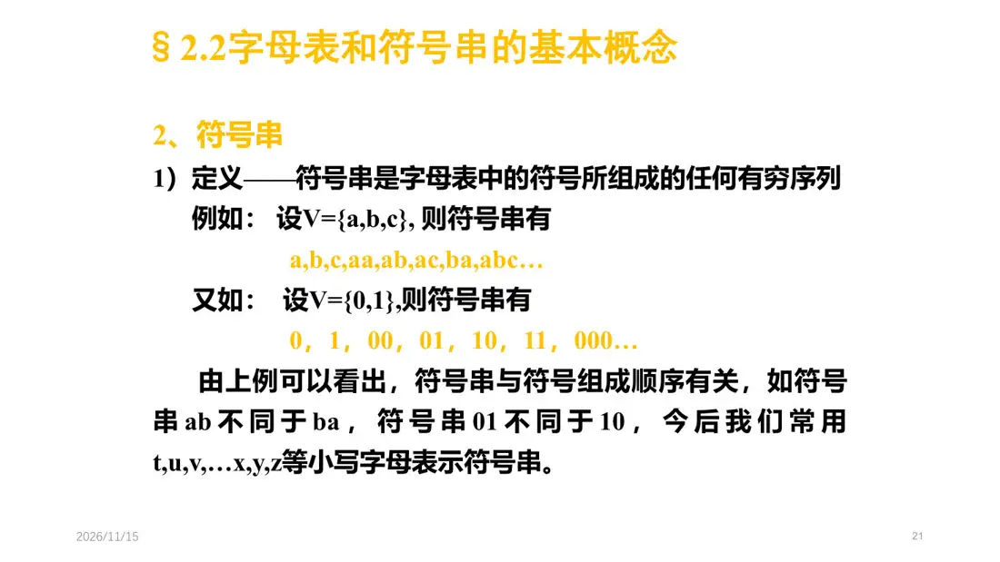

原文：

§2.2字母表和符号串的基本概念

2、符号串

1）定义——符号串是字母表中的符号所组成的任何有穷序列

例如： 设 ${ \bf V = } \{ { \bf a } , { \bf b } , { \bf c } \}$ , 则符号串有

$$
a, b, c, a a, a b, a c, b a, a b c \dots
$$

又如： 设 ${ \bf V } = \{ { \bf 0 } , { \bf 1 } \}$ ,则符号串有

$$
\begin{array}{l} 0, \quad 1, \quad 0 0, \quad 0 1, \quad 1 0, \quad 1 1, \quad 0 0 0 \dots \end{array}
$$

由上例可以看出，符号串与符号组成顺序有关，如符号串 ab 不 同 于 ba ， 符 号 串 01 不 同 于 10 ， 今 后 我 们 常 用$\mathbf { i , u , v , \ldots X , y , z }$ 等小写字母表示符号串。

2026/11/15

21

### §2.2字母表和符号串的基本概念

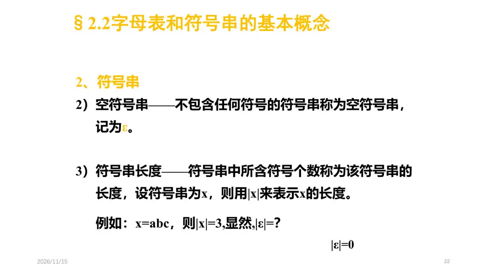

原文：

§2.2字母表和符号串的基本概念

2、符号串

2）空符号串——不包含任何符号的符号串称为空符号串，记为ε。

3）符号串长度——符号串中所含符号个数称为该符号串的长度，设符号串为x，则用|x|来表示x的长度。

例如： $\mathbf { \delta X = a b c }$ ，则 $\mathbf { \delta X } | = 3$ ,显然, $| \mathbf { \boldsymbol { \varepsilon } } | = ?$

$$
| \boldsymbol {\varepsilon} | = 0
$$

2026/11/15

22

### §2.2字母表和符号串的基本概念

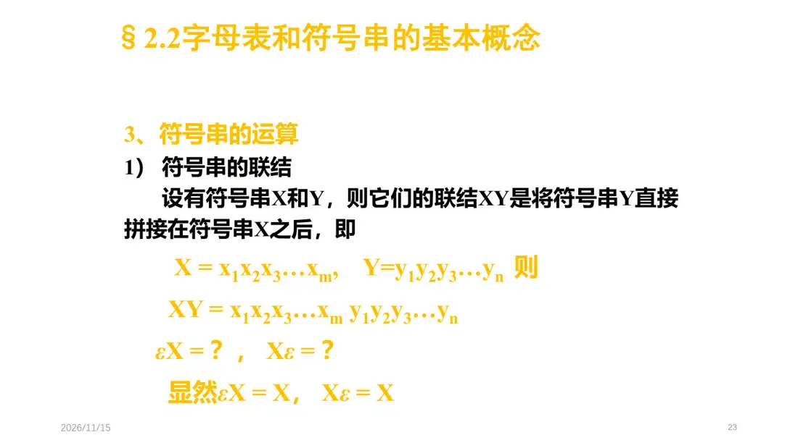

原文：

§2.2字母表和符号串的基本概念

3、符号串的运算

1） 符号串的联结

设有符号串X和Y，则它们的联结XY是将符号串Y直接拼接在符号串X之后，即

$$
\mathrm{X} = \mathrm{x} _ {1} \mathrm{x} _ {2} \mathrm{x} _ {3} \dots \mathrm{x} _ {\mathrm{m}}, \quad \mathrm{Y} = \mathrm{y} _ {1} \mathrm{y} _ {2} \mathrm{y} _ {3} \dots \mathrm{y} _ {\mathrm{n}}
$$

则

$$
\mathbf {X Y} = \mathbf {x} _ {1} \mathbf {x} _ {2} \mathbf {x} _ {3} \dots \mathbf {x} _ {\mathrm{m}} \mathbf {y} _ {1} \mathbf {y} _ {2} \mathbf {y} _ {3} \dots \mathbf {y} _ {\mathrm{n}}
$$

$$
\varepsilon X = ?, X \varepsilon = ?
$$

$$
\mathrm{显然} \varepsilon X = X, \quad X \varepsilon = X
$$

2026/11/15

23

### §2.2字母表和符号串的基本概念

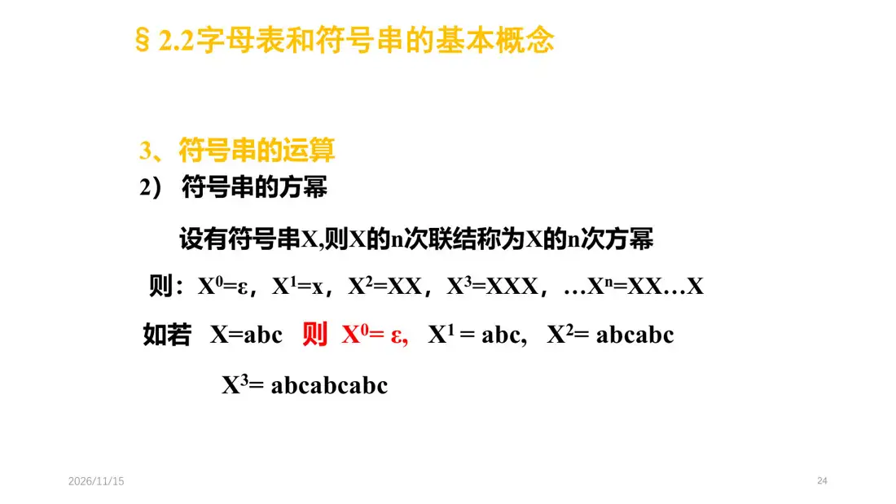

原文：

§2.2字母表和符号串的基本概念

3、符号串的运算

2） 符号串的方幂

设有符号串X,则X的n次联结称为X的n次方幂

则： $\mathrm { X ^ { 0 } = z , X ^ { 1 } = x , X ^ { 2 } = X X , X ^ { 3 } = X X X , \ldots X ^ { n } = X X \ldots X }$

如若 $\mathbf { X } { = } \mathbf { a } \mathbf { b } \mathbf { c }$ 则 $\mathbf { X ^ { 0 } } \mathbf { = } \mathbf { \mathfrak { E } }$ $\mathbf { X ^ { 1 } } = \mathbf { a b c }$ $\mathbf { X } ^ { 2 } { = } \mathbf { a b c a b c }$ 2 2

$\mathbf { X } ^ { 3 } \mathbf { = }$ abcabcabc

2026/11/15

24

### §2.2字母表和符号串的基本概念

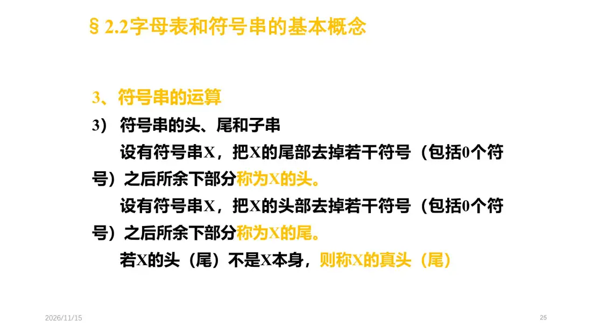

原文：

§2.2字母表和符号串的基本概念

3、符号串的运算

3） 符号串的头、尾和子串

设有符号串X，把X的尾部去掉若干符号（包括0个符

号）之后所余下部分称为X的头。

设有符号串X，把X的头部去掉若干符号（包括0个符

号）之后所余下部分称为X的尾。

若X的头（尾）不是X本身，则称X的真头（尾）

2026/11/15

25

### §2.2字母表和符号串的基本概念

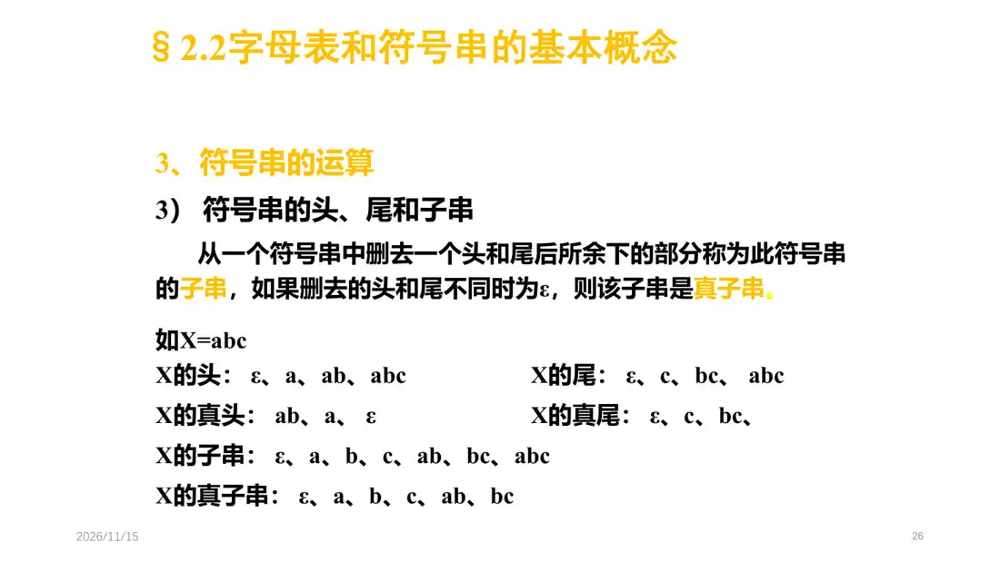

原文：

§2.2字母表和符号串的基本概念

3、符号串的运算

3） 符号串的头、尾和子串

从一个符号串中删去一个头和尾后所余下的部分称为此符号串的子串，如果删去的头和尾不同时为ε，则该子串是真子串。

如X=abc

X的头： ε、a、ab、abc

X的尾： ε、c、bc、 abc

X的真头： ab、a、 ε

X的真尾： ε、c、bc、

X的子串： ε、a、b、c、ab、bc、abc

X的真子串： ε、a、b、c、ab、bc

2026/11/15

26

### §2.2字母表和符号串的基本概念

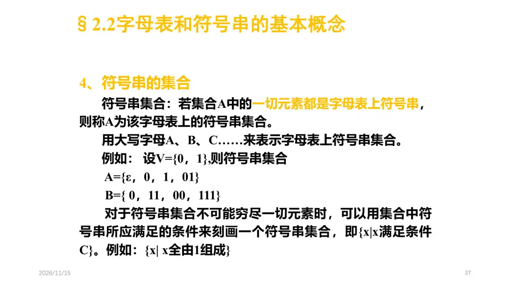

原文：

§2.2字母表和符号串的基本概念

4、符号串的集合

符号串集合：若集合A中的一切元素都是字母表上符号串，则称A为该字母表上的符号串集合。

用大写字母A、 $\mathbf { B } , \mathbf { C } \ldots$ 来表示字母表上符号串集合。

例如： 设 $\mathbf { V } { = } \{ 0 , \ 1 \}$ ,则符号串集合

$$
\mathbf {A} = \{\varepsilon , 0, 1, 0 1 \}
$$

$$
\mathbf {B} = \{\textbf {0 , 1 1 , 0 0 , 1 1 1} \}
$$

对于符号串集合不可能穷尽一切元素时，可以用集合中符号串所应满足的条件来刻画一个符号串集合，即 $\{ \mathbf { x } | \mathbf { x } \}$ 满足条件$\mathbf { C } \mathbf  \}$ 。例如： $\{ \mathbf { x } | \mathbf { x } $ 全由1组成}

2026/11/15

27

### 28

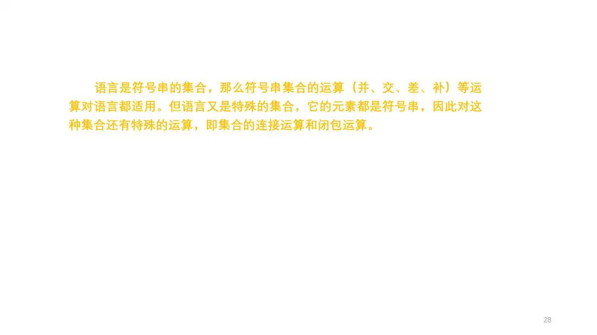

原文：

语言是符号串的集合，那么符号串集合的运算（并、交、差、补）等运算对语言都适用。但语言又是特殊的集合，它的元素都是符号串，因此对这种集合还有特殊的运算，即集合的连接运算和闭包运算。

28

### §2.2字母表和符号串的基本概念

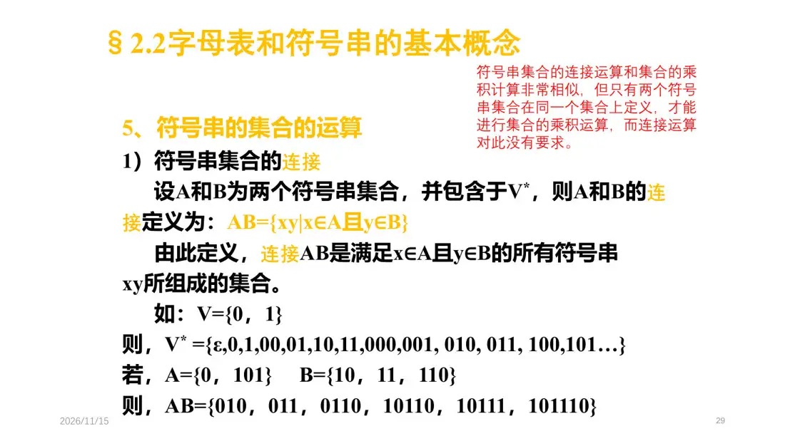

原文：

§2.2字母表和符号串的基本概念

5、符号串的集合的运算

符号串集合的连接运算和集合的乘积计算非常相似，但只有两个符号串集合在同一个集合上定义，才能进行集合的乘积运算，而连接运算对此没有要求。

1）符号串集合的连接

设A和B为两个符号串集合，并包含于 $\mathbf { V } ^ { \ast }$ ，则A和B的连接定义为： $\scriptstyle \mathrm { A B } = \{ { \mathrm { x y } } | { \mathrm { x } } \in \mathrm { A } \land \equiv \{ \mathrm { y } \in \mathrm { B } \} $

由此定义，连接AB是满足 $\mathbf { \delta X } { \in } \mathbf { A }$ 且 $\mathbf { y } \in \mathbf { B }$ 的所有符号串 xy所组成的集合。

如： $\mathbf { V } { = } \{ 0 , \ 1 \}$

则， $V ^ { \star } = \{ \mathfrak { E } , 0 , 1 , 0 0 , 0 1 , 1 0 , 1 1 , 0 0 0 , 0 0 1 , 0 1 0 , 0 1 1 , 1 0 0 , 1 0 1 . . . \}$

若， $\mathrm { A = \{ 0 , 1 0 1 \} } \mathrm { B = \{ 1 0 , 1 1 , 1 1 0 \} }$

则， $\mathrm { A B = \{ 0 1 0 , ~ 0 1 1 , ~ 0 1 1 0 , ~ 1 0 1 1 0 , ~ 1 0 1 1 1 , ~ 1 0 1 1 1 0 \} }$

2026/11/15

29

### §2.2字母表和符号串的基本概念

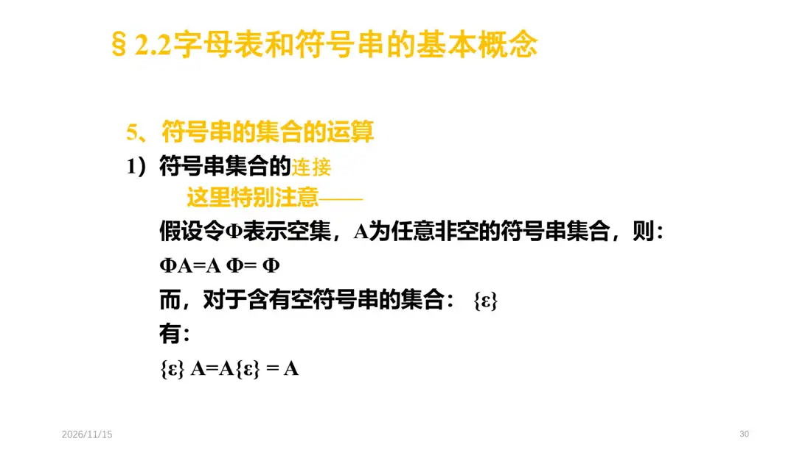

原文：

§2.2字母表和符号串的基本概念

5、符号串的集合的运算

1）符号串集合的连接这里特别注意—

假设令Φ表示空集，A为任意非空的符号串集合，则：

$$
\Phi \mathrm{A} = \mathrm{A} \Phi = \Phi
$$

而，对于含有空符号串的集合： {ε}

有：

{ε} $\mathbf { A } { = } \mathbf { A } \{ \varepsilon \} = \mathbf { A }$

2026/11/15

30

### §2.2字母表和符号串的基本概念

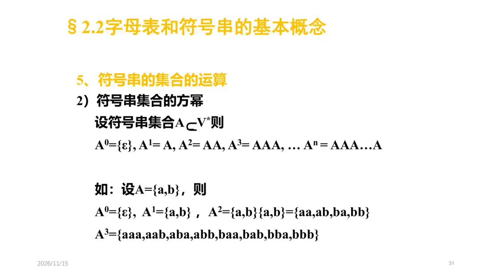

原文：

§2.2字母表和符号串的基本概念

5、符号串的集合的运算

2）符号串集合的方幂

设符号串集合 $\mathbf { A } { \mathbf { \mathop { C } } } ^ { \mathbf { V } ^ { * } }$ 则

$$
\mathbf {A} ^ {0} = \{\varepsilon \}, \mathbf {A} ^ {1} = \mathbf {A}, \mathbf {A} ^ {2} = \mathbf {A A}, \mathbf {A} ^ {3} = \mathbf {A A A}, \dots \mathbf {A} ^ {n} = \mathbf {A A A} \dots \mathbf {A}
$$

如：设 ${ \bf A } { = } \{ { \bf a } , { \bf b } \}$ ，则

$$
\mathrm{A} ^ {0} = \{\varepsilon \}, \mathrm{A} ^ {1} = \{\mathrm{a}, \mathrm{b} \}, \mathrm{A} ^ {2} = \{\mathrm{a}, \mathrm{b} \} \{\mathrm{a}, \mathrm{b} \} = \{\mathrm{aa}, \mathrm{ab}, \mathrm{ba}, \mathrm{bb} \}
$$

$$
\mathbf {A} ^ {3} = \{\text {aaa}, \text {aab}, \text {aba}, \text {abb}, \text {baa}, \text {bab}, \text {bba}, \text {bbb} \}
$$

2026/11/15

31

### §2.2字母表和符号串的基本概念

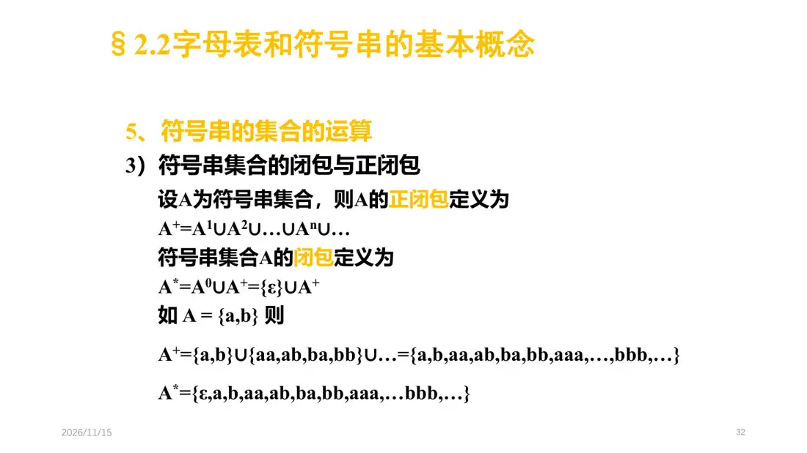

原文：

§2.2字母表和符号串的基本概念

5、符号串的集合的运算

3）符号串集合的闭包与正闭包

设A为符号串集合，则A的正闭包定义为

$$
\mathrm{A} ^ {+} = \mathrm{A} ^ {1} \cup \mathrm{A} ^ {2} \cup \dots \cup \mathrm{A} ^ {\mathrm{n}} \cup \dots
$$

符号串集合A的闭包定义为

$$
\mathbf {A} ^ {*} = \mathbf {A} ^ {0} \cup \mathbf {A} ^ {+} = \{\varepsilon \} \cup \mathbf {A} ^ {+}
$$

如 $\mathbf { A } = \{ \mathbf { a } , \mathbf { b } \}$ 则

$$
\mathrm{A} ^ {+} = \{\mathrm{a}, \mathrm{b} \} \cup \{\mathrm{aa}, \mathrm{ab}, \mathrm{ba}, \mathrm{bb} \} \cup \dots = \{\mathrm{a}, \mathrm{b}, \mathrm{aa}, \mathrm{ab}, \mathrm{ba}, \mathrm{bb}, \mathrm{aaa}, \dots , \mathrm{bbb}, \dots \}
$$

$$
\mathbf {A} ^ {*} = \{\varepsilon , \mathrm{a}, \mathrm{b}, \mathrm{aa}, \mathrm{ab}, \mathrm{ba}, \mathrm{bb}, \mathrm{aaa}, \dots \mathrm{bbb}, \dots \}
$$

2026/11/15

32

### §2.2字母表和符号串的基本概念

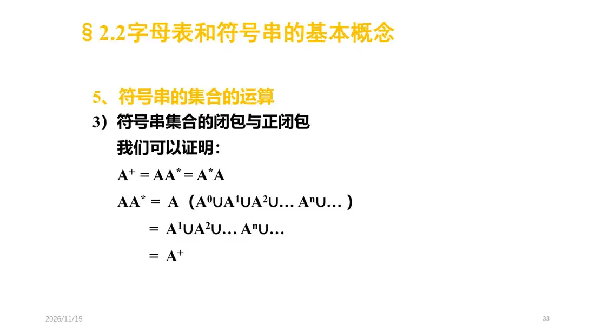

原文：

§2.2字母表和符号串的基本概念

5、符号串的集合的运算

3）符号串集合的闭包与正闭包

我们可以证明：

$$
\begin{array}{r l} & {\mathbf {A} ^ {+} = \mathbf {A A} ^ {*} = \mathbf {A} ^ {*} \mathbf {A}} \\ & {\mathbf {A A} ^ {*} = \mathbf {A} (\mathbf {A} ^ {0} \cup \mathbf {A} ^ {1} \cup \mathbf {A} ^ {2} \cup \dots \mathbf {A} ^ {n} \cup \dots)} \\ & {\qquad = \mathbf {A} ^ {1} \cup \mathbf {A} ^ {2} \cup \dots \mathbf {A} ^ {n} \cup \dots} \\ & {\qquad = \mathbf {A} ^ {+}} \end{array}
$$

2026/11/15

33

### §2.2字母表和符号串的基本概念

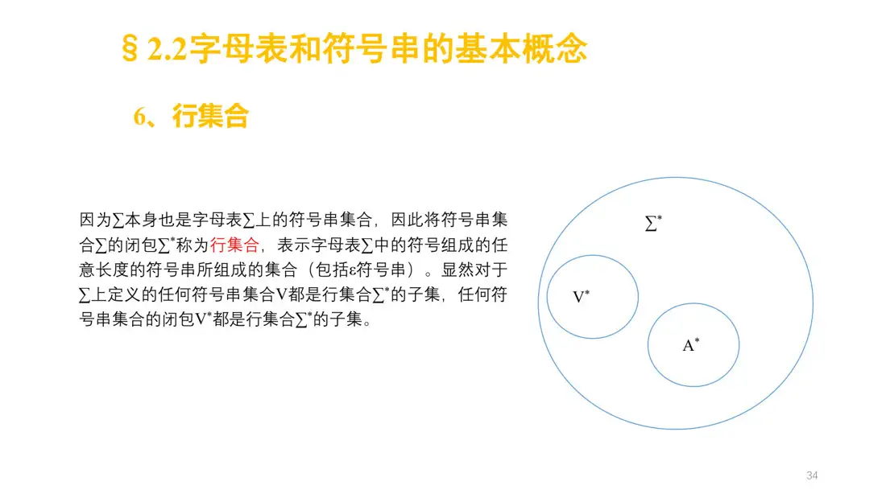

原文：

§2.2字母表和符号串的基本概念

6、行集合

因为∑本身也是字母表∑上的符号串集合，因此将符号串集合∑的闭包∑\*称为行集合，表示字母表∑中的符号组成的任意长度的符号串所组成的集合（包括ε符号串）。显然对于∑上定义的任何符号串集合V都是行集合∑\*的子集，任何符号串集合的闭包V\*都是行集合∑\*的子集。

34

### §2.3用文法产生法描述语言

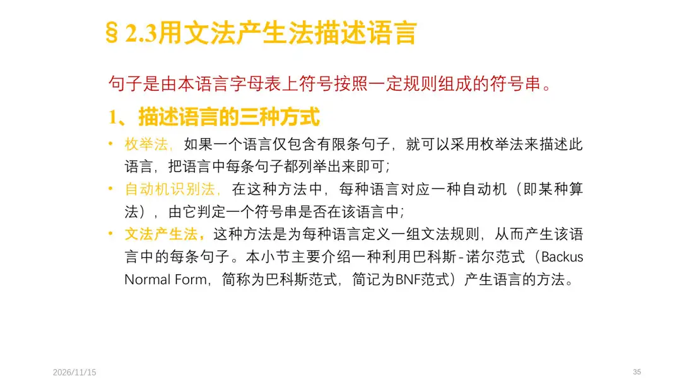

原文：

§2.3用文法产生法描述语言

句子是由本语言字母表上符号按照一定规则组成的符号串。

1、描述语言的三种方式

• 枚举法，如果一个语言仅包含有限条句子，就可以采用枚举法来描述此语言，把语言中每条句子都列举出来即可；

• 自动机识别法，在这种方法中，每种语言对应一种自动机（即某种算法），由它判定一个符号串是否在该语言中；

• 文法产生法，这种方法是为每种语言定义一组文法规则，从而产生该语言中的每条句子。本小节主要介绍一种利用巴科斯-诺尔范式（BackusNormal Form，简称为巴科斯范式，简记为BNF范式）产生语言的方法。

2026/11/15

35

### §2.3用文法产生法描述语言

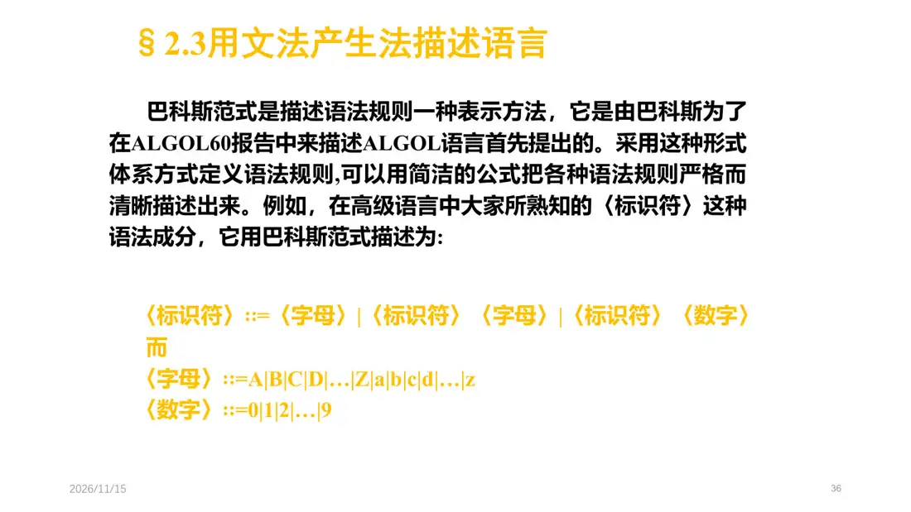

原文：

§2.3用文法产生法描述语言

巴科斯范式是描述语法规则一种表示方法，它是由巴科斯为了在ALGOL60报告中来描述ALGOL语言首先提出的。采用这种形式体系方式定义语法规则,可以用简洁的公式把各种语法规则严格而清晰描述出来。例如，在高级语言中大家所熟知的〈标识符〉这种语法成分，它用巴科斯范式描述为:

〈标识符〉∷=〈字母〉|〈标识符〉〈字母〉|〈标识符〉〈数字而

〈字母〉 $\therefore \langle \boldsymbol { : } | | \mathrm { B } | | \mathrm { C } | | \mathrm { D } | . . . | \mathrm { Z } | | \boldsymbol { : } | | \boldsymbol { : } | | \mathrm { d } | | _ { \mathrm { ~ o ~ e ~ } } | | _ { \mathrm { ~ Z ~ } }$

〈数字〉 $\cdot \cdot = 0 | 1 | 2 | \cdot \ldots | 9$

2026/11/15

36

### §2.3用文法产生法描述语言

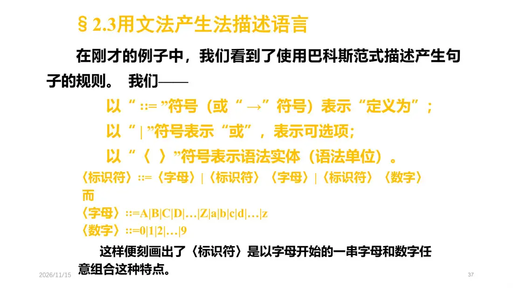

原文：

§2.3用文法产生法描述语言

在刚才的例子中，我们看到了使用巴科斯范式描述产生句在ALGOL60报告子的规则。 我们—

,以“ ∷= ”符号（或“ →”符号）表示“定义为”；

分，它用巴科斯范式描述为:以“ | ”符号表示“或”，表示可选项；

以“〈 〉”符号表示语法实体（语法单位）。

标识符〉∷=〈字母〉|〈标识符〉〈字母〉|〈标识符〉〈数字而

〈字母〉 $\therefore \langle \boldsymbol { : } | | \mathrm { B } | | \mathrm { C } | | \mathrm { D } | . . . | \mathrm { Z } | | \boldsymbol { : } | | \boldsymbol { : } | | \mathrm { d } | | _ { \mathrm { ~ o ~ e ~ } } | | _ { \mathrm { ~ Z ~ } }$

〈数字〉 $\cdot \cdot = 0 | 1 | 2 | \cdot \ldots | 9$

这样便刻画出了〈标识符〉是以字母开始的一串字母和数字任意组合这种特点。

2026/11/15

37

### §2.3用文法产生法描述语言

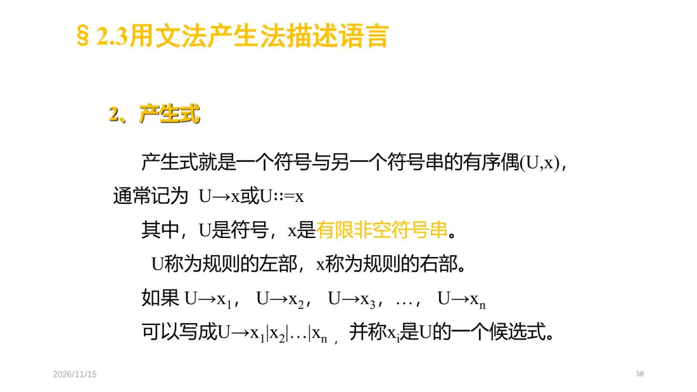

原文：

§2.3用文法产生法描述语言

2、产生式

产生式就是一个符号与另一个符号串的有序偶 $^ { ( \mathrm { U } , \mathrm { x } ) }$ 通常记为 $\mathrm { U } { \longrightarrow } \mathrm { { x } } \not \equiv \not \backslash \dot { \zeta } \mathrm { U } { : : = } \mathrm { { x } }$

其中，U是符号，x是有限非空符号串。

U称为规则的左部，x称为规则的右部。

如果 $\mathrm { U } {  } \mathrm { x } _ { 1 } , \quad \mathrm { U } {  } \mathrm { x } _ { 2 } , \quad \mathrm { U } {  } \mathrm { x } _ { 3 } , \quad \mathrm { . . . } , \quad \mathrm { U } {  } \mathrm { x } _ { \mathrm { n } }$

可以写成U $\lceil \longrightarrow \mathbf { X } _ { 1 } | \mathbf { X } _ { 2 } | \ldots | \mathbf { X } _ { \mathbf { n } }$ ，并称 $\mathrm { \langle x _ { i } }$ 是U的一个候选式。

2026/11/15

38

### §2.3用文法产生法描述语言

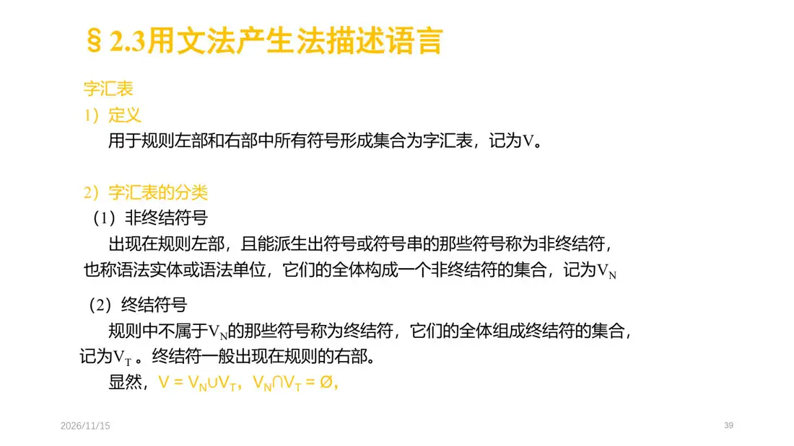

原文：

§2.3用文法产生法描述语言

字汇表

1）定义

用于规则左部和右部中所有符号形成集合为字汇表，记为V。

2）字汇表的分类

（1）非终结符号

出现在规则左部，且能派生出符号或符号串的那些符号称为非终结符，也称语法实体或语法单位，它们的全体构成一个非终结符的集合，记为 $\mathrm { V _ { N } }$

（2）终结符号

规则中不属于 $\mathrm { V _ { N } }$ 的那些符号称为终结符，它们的全体组成终结符的集合，记为 $\mathrm { V _ { T } }$ 。终结符一般出现在规则的右部。

显然， $V = V _ { \mathrm { N } } \cup V _ { \top \mathrm { : } } \quad V _ { \mathrm { N } } \cap V _ { \top } = \emptyset$

2026/11/15

39

### §2.3用文法产生法描述语言

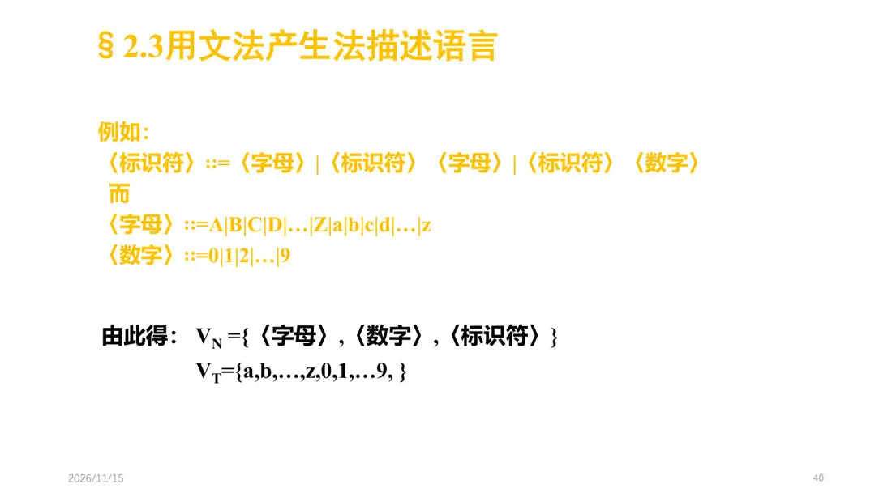

原文：

§2.3用文法产生法描述语言

例如：

标识符〉∷=〈字母〉|〈标识符〉〈字母〉|〈标识符〉〈数字而

〈字母〉 $\therefore \langle \boldsymbol { : } \cdot \mathrm { ~  ~ \mathscr ~ { ~ a ~ } ~ } | \mathrm { B } | \mathrm { C } | \mathrm { D } | . . . | \mathrm { Z } | \mathrm { a } | | \mathrm { b } | \mathrm { c } | | \mathrm { d } | | _ { \mathrm { ~ o ~ o ~ e ~ } } | \mathrm { Z }$

〈数字〉 $\mathrel { \mathop : } \mathrel { = } 0 | 1 | 2 | \ldots | 9$

由此得： $\mathbf { V _ { N } } = \mathbf { \left\{ \begin{array} { r l r } \end{array} \right. }$ 〈字母〉,〈数字〉,〈标识符〉}

$$
\mathbf {V} _ {\mathrm{T}} = \{\mathbf {a}, \mathbf {b}, \dots , \mathbf {z}, \mathbf {0}, \mathbf {1}, \dots 9, \}
$$

2026/11/15

40

### 判断题：

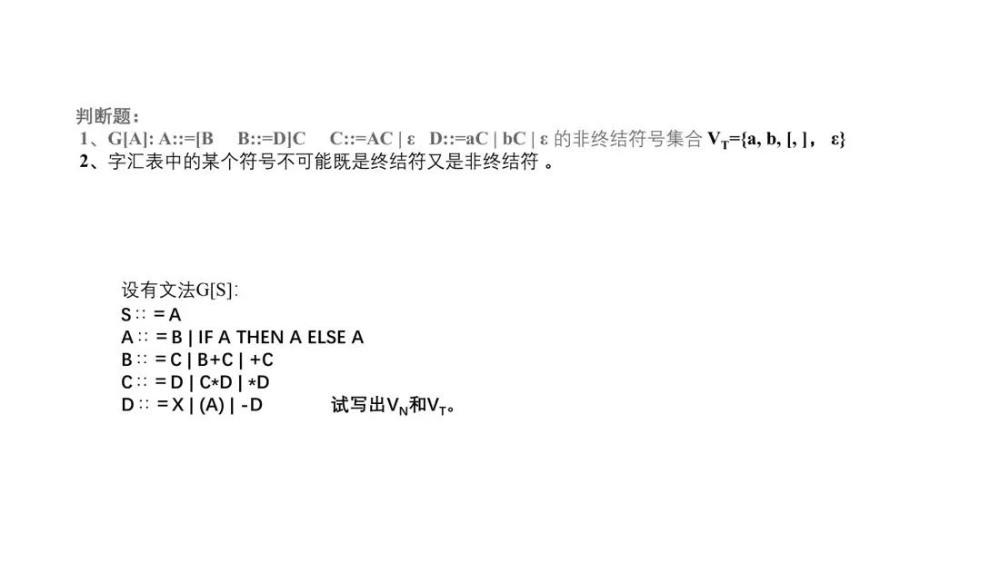

原文：

判断题：

1、 $\mathrm { G [ A ] \colon A \div = = [ B \therefore B \ast = D ] C \quad et { } { ^ { . } \ast = } \Delta = \Delta C \mid \varepsilon \quad D \colon = = a C \mid b C \mid \varepsilon }$ 的非终结符号集合 $\mathbf { V } _ { \mathbf { T } } { = } \{ \mathbf { a } , \mathbf { b } , [ \mathbf { \mu } , ]$ ， ε}

2、字汇表中的某个符号不可能既是终结符又是非终结符 。

### §2.3用文法产生法描述语言

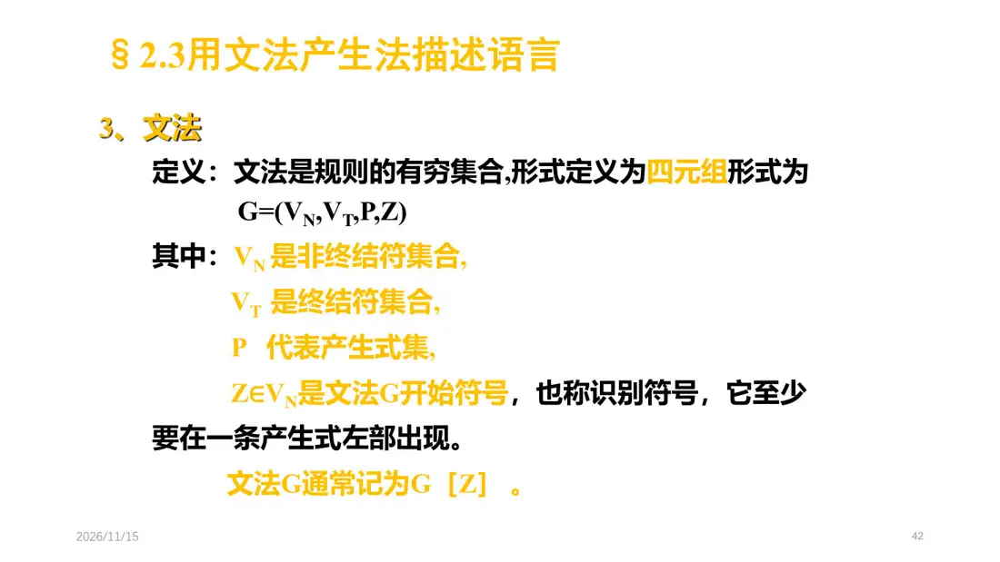

原文：

§2.3用文法产生法描述语言

3、文法

定义：文法是规则的有穷集合,形式定义为四元组形式为G=(VN,VT,P,Z)

其中： $\mathbf { V _ { N } }$ 是非终结符集合,

$\mathbf { V } _ { \mathrm { T } }$ 是终结符集合,

P 代表产生式集,

$\mathrm { Z } \in \mathrm { V } _ { \mathrm { N } }$ 是文法G开始符号，也称识别符号，它至少要在一条产生式左部出现。

文法G通常记为G［Z

2026/11/15

42

### §2.3用文法产生法描述语言

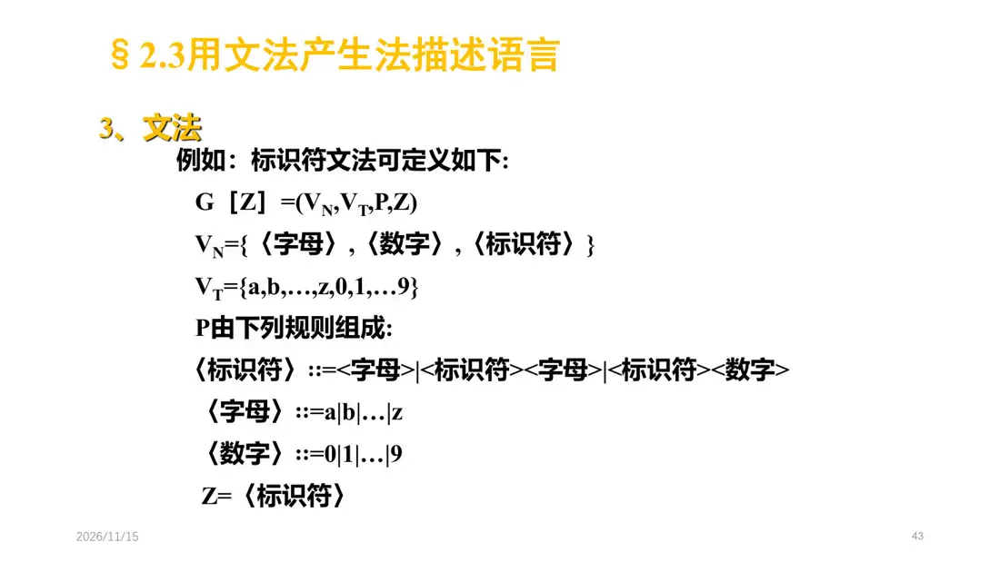

原文：

§2.3用文法产生法描述语言

3、文法

例如：标识符文法可定义如下:

$$
\mathbf {G} [ \mathbf {Z} ] = (\mathbf {V} _ {\mathrm{N}}, \mathbf {V} _ {\mathrm{T}}, \mathbf {P}, \mathbf {Z})
$$

$\mathbf { V _ { N } = } \{$ 字母〉,〈数字〉,〈标识符〉}

$$
\mathbf {V} _ {\mathrm{T}} = \{\mathbf {a}, \mathbf {b}, \dots , \mathbf {z}, \mathbf {0}, \mathbf {1}, \dots 9 \}
$$

P由下列规则组成:

〈标识符〉∷=<字母>|<标识符><字母>|<标识符><数字>

〈字母〉 $\mathbf { \left. \langle \mathbf { \sigma } : \mathbf { | \sigma | \sigma | \sigma | \sigma \cdot } \mathbf { | z } \right| }$

〈数字〉 $\scriptstyle : : = 0 | 1 | \ldots | 9$

$\mathbf { Z } =$ 〈标识符〉

2026/11/15

43

### §2.3用文法产生法描述语言

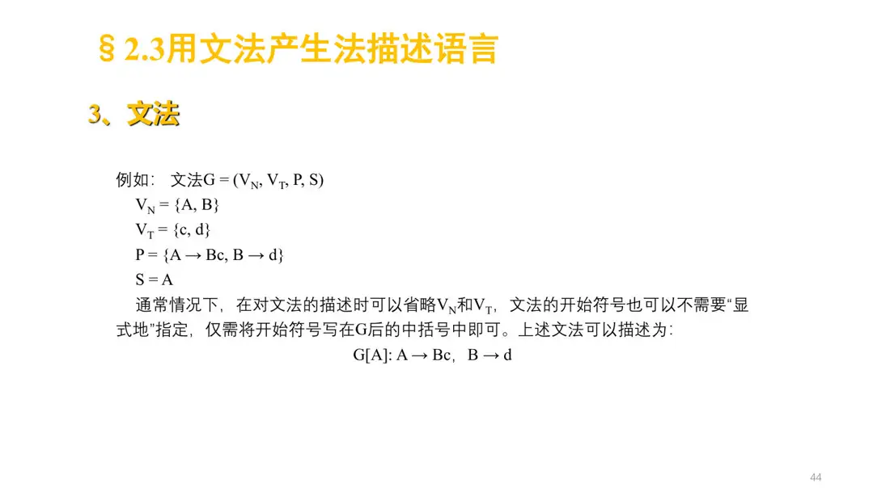

原文：

§2.3用文法产生法描述语言

3、文法

例如： 文法 $\mathrm { G } = ( \mathrm { V } _ { \mathrm { N } } , \mathrm { V } _ { \mathrm { T } } , \mathrm { P } , \mathrm { S } )$

$$
\mathrm{V} _ {\mathrm{N}} = \{\mathrm{A}, \mathrm{B} \}
$$

$$
\mathrm{V} _ {\mathrm{T}} = \{\mathrm{c}, \mathrm{d} \}
$$

$$
\mathrm{P} = \{\mathrm{A} \rightarrow \mathrm{Bc}, \mathrm{B} \rightarrow \mathrm{d} \}
$$

$$
\mathbf {S} = \mathbf {A}
$$

通常情况下，在对文法的描述时可以省略 $\mathrm { V _ { N } }$ 和 $\mathrm { V _ { T } }$ ，文法的开始符号也可以不需要“显式地”指定，仅需将开始符号写在G后的中括号中即可。上述文法可以描述为：

$$
\mathrm{G} [ \mathrm{A} ]: \mathrm{A} \rightarrow \mathrm{Bc}, \quad \mathrm{B} \rightarrow \mathrm{d}
$$

44

### §2.3用文法产生法描述语言

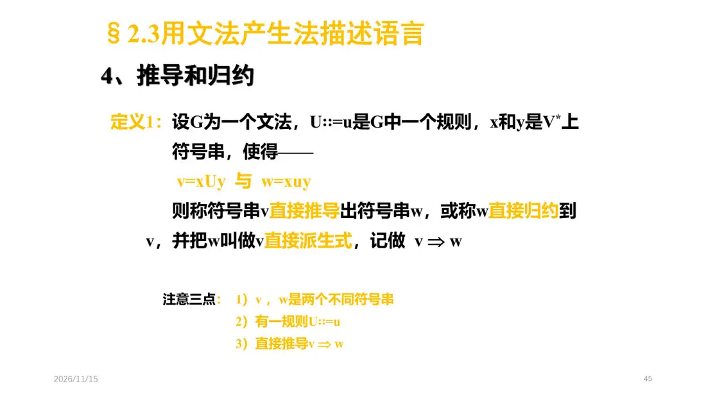

原文：

§2.3用文法产生法描述语言

4、推导和归约

定义1：设G为一个文法，U∷=u是G中一个规则，x和y是V\*上符号串，使得——v=xUy 与 w=xuy则称符号串v直接推导出符号串w，或称w直接归约到v，并把w叫做v直接派生式，记做 v w

注意三点： 1）v ，w是两个不同符号串

2）有一规则U∷=u

3）直接推导v  w

2026/11/15

45

### §2.3用文法产生法描述语言

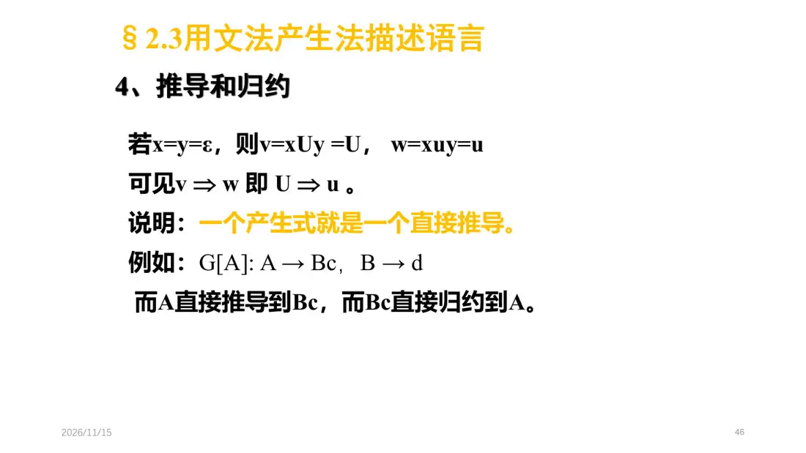

原文：

§2.3用文法产生法描述语言

4、推导和归约

若 $\scriptstyle \mathbf { \dot { \mathbf { \phi } } } \mathbf { \mathbf { X } } = \mathbf { y } = \mathbf { \pmb { \mathbf { \varepsilon } } }$ ，则 $\mathbf { v } { = } \mathbf { x } \mathbf { U } \mathbf { y } = \mathbf { U }$ $\scriptstyle \mathbf { W } = \mathbf { X } \mathbf { u } \mathbf { y } = \mathbf { u }$

可见 $\mathbf { \Delta } _ { \mathbf { { V } } } \implies \mathbf { \mathbf { W } }$ 即 $\mathbf { U } \Rightarrow \mathbf { u }$ 0

说明：一个产生式就是一个直接推导。

例如： $\mathrm { G } [ \mathrm { A } ] \colon \mathrm { A } \longrightarrow \mathrm { B c } , \mathtt { B } \longrightarrow \mathrm { d }$

而A直接推导到Bc，而Bc直接归约到A。

2026/11/15

46

### §2.3用文法产生法描述语言

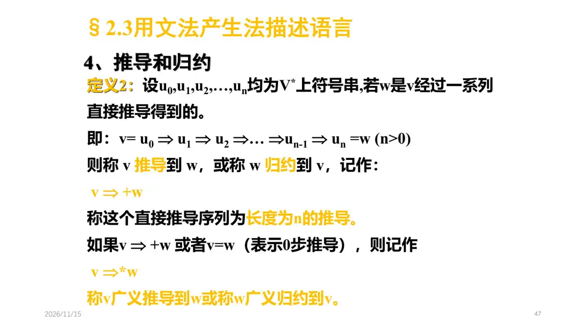

原文：

§2.3用文法产生法描述语言

4、推导和归约

定义2：设 $\mathbf { u _ { 0 } } , \mathbf { u _ { 1 } } , \mathbf { u _ { 2 } } , . . . , \mathbf { u _ { n } }$ 均为 $\mathbf { V } ^ { \ast }$ 上符号串,若w是v经过一系列直接推导得到的。

即： $\mathbf { v } { = } \mathbf { u _ { 0 } } \Rightarrow \mathbf { u _ { 1 } } \Rightarrow \mathbf { u _ { 2 } } \Rightarrow \ldots \Rightarrow \mathbf { u _ { n - 1 } } \Rightarrow \mathbf { u _ { n } } { = } \mathbf { w _ { \eta } } ( \mathbf { n } { > } \mathbf { 0 } )$

则称v 推导到w，或称w归约到v，记作：

$$
\mathbf {v} \Rightarrow + \mathbf {w}
$$

称这个直接推导序列为长度为n的推导。

如果 $\mathbf { v } \implies + \mathbf { w }$ 或者 $\mathbf { \Delta V } { = } \mathbf { W }$ （表示0步推导），则记作v \*w

称v广义推导到w或称w广义归约到v。

2026/11/15

47

### §2.3用文法产生法描述语言

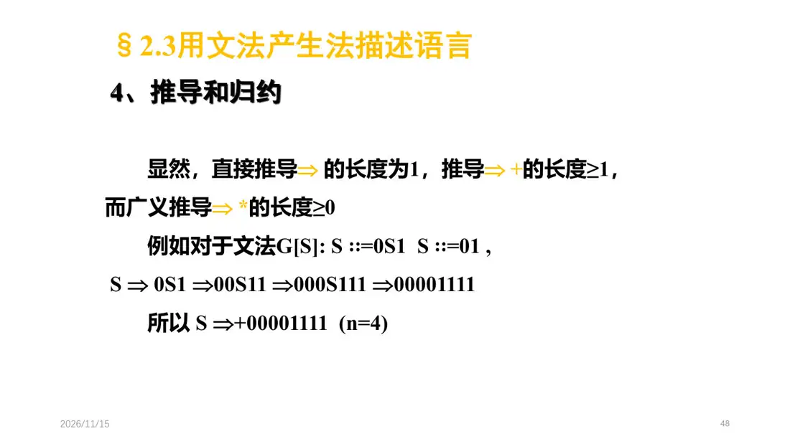

原文：

§2.3用文法产生法描述语言

4、推导和归约

显然，直接推导→的长度为1，推导→+的长度≥1，

而广义推导 \*的长度≥0

例如对于文法G[S]: $\mathrm { S : : = 0 S 1 ~ S : : = 0 1 }$

$$
\mathrm{S} \Rightarrow 0 \mathrm{S} 1 \Rightarrow 0 0 \mathrm{S} 1 1 \Rightarrow 0 0 0 \mathrm{S} 1 1 1 \Rightarrow 0 0 0 0 1 1 1 1
$$

所以 $\mathbf { S } \Rightarrow \mathbf { + 0 0 0 0 1 1 1 } ( \mathbf { n } { = } 4 )$

2026/11/15

48

### §2.3用文法产生法描述语言

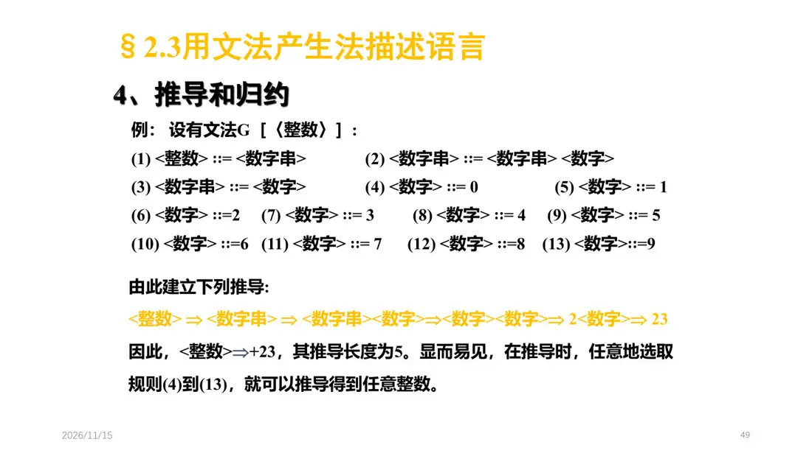

原文：

§2.3用文法产生法描述语言

4、推导和归约

例：设有文法G［〈整数〉］:(1) <整数> ∷= <数字串> (2) <数字串> ∷= <数字串> <数字>(3) <数字串> ∷= <数字> (4) <数字> ∷= 0 (5) <数字> ∷= 1(6) <数字> ∷=2 (7) <数字> $\mathfrak { s } \mathbf { = } 3$ (8) <数字> ∷= 4 (9) <数字> ∷= 5(10) <数字> ∷=6 (11) <数字> ∷= 7 (12) <数字> ∷=8(13) <数字>∷=9

由此建立下列推导:

<整数><数字串><数字串><数字><数字><数字>2<数字>23因此，<整数>+23，其推导长度为5。显而易见，在推导时，任意地选取规则(4)到(13)，就可以推导得到任意整数。

2026/11/15

49

### §2.3用文法产生法描述语言

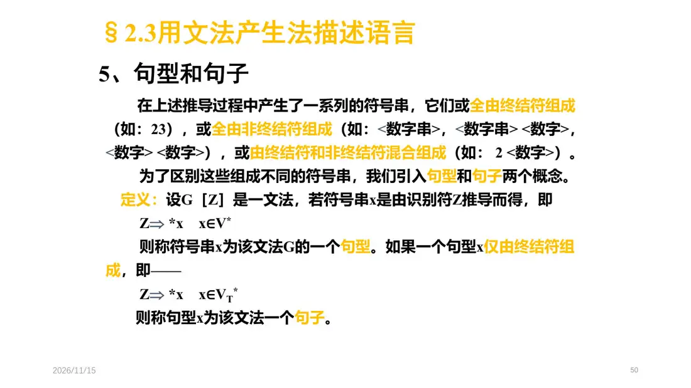

原文：

§2.3用文法产生法描述语言

5、句型和句子

在上述推导过程中产生了一系列的符号串，它们或全由终结符组成（如：23），或全由非终结符组成（如：<数字串>，<数字串><数字>，<数字> <数字>），或由终结符和非终结符混合组成（如：2<数字>）。

为了区别这些组成不同的符号串，我们引入句型和句子两个概念。

定义：设G［Z］是一文法，若符号串x是由识别符Z推导而得，即$\mathbf { Z } { \Rightarrow } ~ \mathbf { ^ { * } x } ~ \mathbf { \Delta x } { \in } \mathbf { V } ^ { * }$

则称符号串x为该文法G的一个句型。如果一个句型x仅由终结符组成，即—

$$
\mathbf {Z} \Rightarrow {} ^ {*} \mathbf {x} \quad \mathbf {x} \in \mathbf {V} _ {\mathrm{T}} ^ {*}
$$

则称句型x为该文法一个句子。

2026/11/15

50

### 例：设有文法G〈整数〉]：

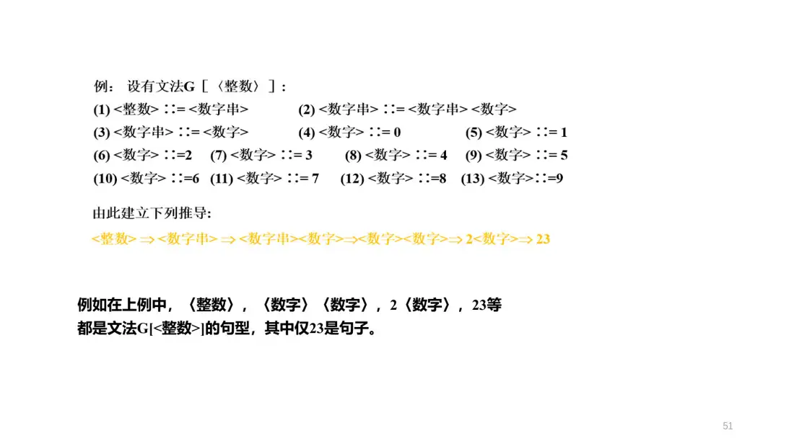

原文：

例：设有文法G〈整数〉]：

(1) <整数>：= <数字串>

(2)<数字串>：=<数字串><数字>

(3) <数字串> ：= <数字>

(4) <数字>：= 0

(5) <数字>：=1

(6) <数字> ：=2 (7)<数字>：=3 (8) <数字> ：=4 (9)<数字>：=5

(10) <数字>：=6 (11)<数字> ：= 7 (12)<数字> ：=8 (13)<数字>：=9

由此建立下列推导：

例如在上例中，〈整数〉，〈数字〉〈数字〉，2〈数字〉，23等都是文法G[<整数>]的句型，其中仅23是句子。

51

### §2.3用文法产生法描述语言

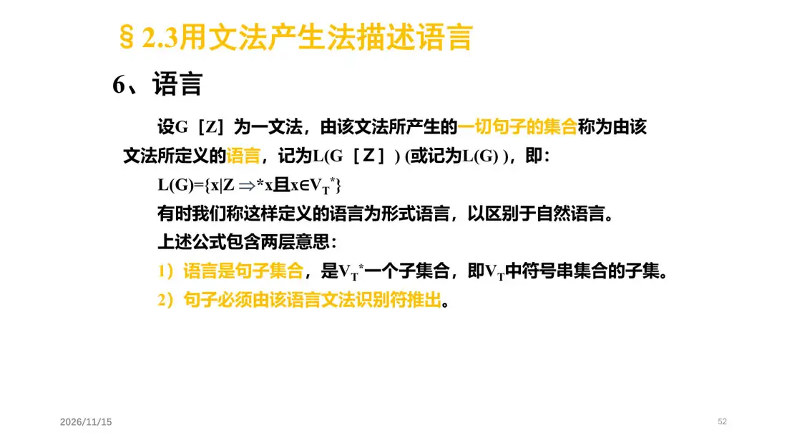

原文：

§2.3用文法产生法描述语言

6、语言

设G［Z］为一文法，由该文法所产生的一切句子的集合称为由该文法所定义的语言，记为L(G［Z］) (或记为L(G) )，即：

$$
\mathrm{L} (\mathrm{G}) = \{\mathrm{x} | \mathrm{Z} \Rightarrow {} ^ {*} \mathrm{x} \text {且} \mathrm{x} \in \mathrm{V} _ {\mathrm{T}} ^ {*} \}
$$

有时我们称这样定义的语言为形式语言，以区别于自然语言。

上述公式包含两层意思：

1）语言是句子集合，是 $\mathbf { V _ { T } } ^ { \ast }$ 一个子集合，即 $\mathbf { V } _ { \mathbf { T } }$ 中符号串集合的子集。

2）句子必须由该语言文法识别符推出。

2026/11/15

52

### $$

原文：

例如： $\mathbf { G } [ \mathbf { Z } ] { = } ( \mathbf { V } _ { \mathbf { N } } , \mathbf { V } _ { \mathbf { T } } , \mathbf { P } , \mathbf { S } )$

$$
\begin{array}{c} \mathbf {V} _ {\mathrm{N}} = \{\mathbf {S} \} \\ \mathbf {P}: \{\mathbf {S}: := \mathbf {0 1}, \mathbf {S}: := \mathbf {0 S 1} \} \end{array} \quad \begin{array}{c} \mathbf {V} _ {\mathrm{T}} = \{\mathbf {0}, \mathbf {1} \} \\ \mathbf {P}: \{\mathbf {S}: := \mathbf {0 1}, \mathbf {S}: := \mathbf {0 S 1} \} \end{array}
$$

S:识别符

很容易推出：L $\mathbf { \mathbf { \mathbf { ( G ) } } } = \lbrace \mathbf { \mathbf { 0 ^ { n } } } \mathbf { 1 ^ { n } } | \mathbf { n } { \ge } 1 \rbrace$

53

### $$

原文：

例如： $\mathbf { G } [ \mathbf { Z } ] { = } ( \mathbf { V } _ { \mathbf { N } } , \mathbf { V } _ { \mathbf { T } } , \mathbf { P } , \mathbf { S } )$

$$
\begin{array}{c} \mathbf {V} _ {\mathrm{N}} = \{\mathbf {S} \} \\ \mathbf {P}: \{\mathbf {S}: := \mathbf {0 1}, \mathbf {S}: := \mathbf {0 S 1} \} \end{array} \quad \begin{array}{c} \mathbf {V} _ {\mathrm{T}} = \{\mathbf {0}, \mathbf {1} \} \\ \mathbf {P}: \{\mathbf {S}: := \mathbf {0 1}, \mathbf {S}: := \mathbf {0 S 1} \} \end{array}
$$

S:识别符

很容易推出：L $\mathbf { \mathbf { \mathbf { ( G ) } } } = \lbrace \mathbf { \mathbf { 0 ^ { n } } } \mathbf { 1 ^ { n } } | \mathbf { n } { \ge } 1 \rbrace$

$$
\mathrm{S} \Rightarrow 0 1
$$

$$
\mathrm{S} \Rightarrow 0 \mathrm{S} 1 \Rightarrow 0 0 1 1
$$

$$
\mathrm{S} \Rightarrow 0 \mathrm{S} 1 \Rightarrow 0 0 \mathrm{S} 1 1 \Rightarrow 0 0 0 1 1 1
$$

$$
\mathrm{S} \Rightarrow^ {*} \mathbf {0 ^ {n} 1 ^ {n}} \quad \mathrm{n} \geq 1
$$

54

### 试分别描述下列文法所产生的语言（文法开始符号为S）：

原文：

试分别描述下列文法所产生的语言（文法开始符号为S）：

（1） $\mathsf { S } : : = 0 \mathsf { S } | 0 1$

（2） $\mathsf { S } : : = \mathsf { a a s } | \mathsf { b c }$

$$
\mathrm{S} \Rightarrow 0 1
$$

$$
\mathrm{S} \Rightarrow 0 \mathrm{S} 1 \Rightarrow 0 0 1 1
$$

$$
\mathrm{S} \Rightarrow 0 \mathrm{S} 1 \Rightarrow 0 0 \mathrm{S} 1 1 \Rightarrow 0 0 0 1 1 1
$$

$$
\mathrm{S} \Rightarrow^ {*} \mathbf {0 ^ {n} 1 ^ {n}} \quad \mathrm{n} \geq \mathbf {1}
$$

例如： $\mathbf { G } [ \mathbf { Z } ] { = } ( \mathbf { V } _ { \mathbf { N } } , \mathbf { V } _ { \mathbf { T } } , \mathbf { P } , \mathbf { S } )$

$$
\mathbf {V} _ {\mathbf {N}} = \{\mathbf {S} \}
$$

$$
\mathrm{V} _ {\mathrm{T}} = \{\mathbf {0}, \mathbf {1} \}
$$

$$
\mathbf {P}: \{\mathbf {S}: := 0 \mathbf {1}, \mathbf {S}: := 0 \mathbf {S} \mathbf {1} \}
$$

S:识别符

很容易推出：L（G）={0ⁿ1n≥1}

$$
\mathrm{S} \Rightarrow 0 1
$$

$$
\mathrm{S} \Rightarrow 0 \mathrm{S} 1 \Rightarrow 0 0 1 1
$$

$$
\mathrm{S} \Rightarrow 0 \mathrm{S} 1 \Rightarrow 0 0 \mathrm{S} 1 1 \Rightarrow 0 0 0 1 1 1
$$

$$
\mathrm{S} \Rightarrow^ {*} 0 ^ {\mathbf {n}} \mathbf {1} ^ {\mathbf {n}} \quad \mathbf {n} \geq \mathbf {1}
$$

55

### §2.3用文法产生法描述语言

原文：

§2.3用文法产生法描述语言

已知语言求文法

构造如下语言的相应文法L $\mathrm { ( G ) \ = \{ 0 ^ { n } 1 ^ { n } | n \geq 0 \} }$

$$
\mathrm{S} \Rightarrow 0 1 \quad \mathrm{S} \Rightarrow 0 \mathrm{S} 1 \Rightarrow \mathbf {0} \varepsilon \mathbf {1} = \mathbf {0} \mathbf {1}
$$

P:{S∷=01,S∷=0S1} S:识别符 很容易推出：L（G）={0n1n|n≥1}

2026/11/15

56

### §2.3用文法产生法描述语言

原文：

§2.3用文法产生法描述语言

已知语言求文法

构造如下语言的相应文法 L（G）={0m1p|m,p≥1}

G[S]: S→AB A→0A|0 B→1B|1

方法二：G[S]: S→0S S→S1 S→01

P:{S∷=01,S∷=0S1} S:识别符 很容易推出：L（G）={0n1n|n≥1}

2026/11/15

57

### 判断题一个语言可以有多个文法来描述。

原文：

如果有两个文法G1和G2，如果它们的规则不完全相同，但所描述的语言完全相同，即L(G1) = L(G2)，则称这两个文法是等价的。

判断题一个语言可以有多个文法来描述。

58

### 试分别构造产生下列语言的文法：

原文：

试分别构造产生下列语言的文法：

（1） $\{ \mathsf { a b } ^ { \mathsf { n } } \mathsf { a } \ | \ \mathsf { n } { = } 0 , \ 1 , \ 2 , \ 3 { \ldots } \ \mathsf { a } \_$

（2） $\{ \mathbf { a b a } ^ { \mathsf { n } } \mid \mathbf { n } \geq 1 \}$

（3） $\{ \mathsf { a } ^ { \mathsf { n } } \mathsf { b } ^ { \mathsf { m } } \mathsf { c } ^ { \mathsf { p } } \mid \mathsf { n } , \mathsf { m } , \mathsf { p } \geq 0 \}$

（4）写一个文法使其语言为 $\mathsf { L } ( \mathsf { G } ) { = } \{ \mathsf { a } ^ { \mathsf { m } } \mathsf { b } ^ { \mathsf { n } } \mathsf { c } ^ { \mathsf { n } } | \mathsf { m }$ 为奇数，n为偶数且n>0}

• 要使一个文法G能正确描述相应语言L(G)必须保证:

• 由文法G产生的每个句子都在L(G)中，

• 在语言L(G)中的每个符号串都能由G产生

59

### 60

原文：

构成一个语言的句子集合可以是有穷的，也可以是无穷的，如果要描述的这个语言的集合包含无穷多个句子，那么产生这个语言的文法一定是递归的。

60

### 例如文法G［〈语句〉］所描述的语言L(G［〈语句〉］)是有穷的

原文：

例如文法G［〈语句〉］所描述的语言L(G［〈语句〉］)是有穷的

但文法G［〈整数〉］所描述的语言L(G［〈整数〉］)是无穷的，它包含无穷多个句子，

两个文法其根本差别在于文法

G［〈整数〉］有形如

数字串〉∷=〈数字串〉〈数字〉的产生式。

这种借助于自己来定义自己的产生式，即在产生式左部和右部具有相同的非终结符产生式称为递归规则。

〈语句〉∷=〈主语〉 〈谓语〉 〈宾语〉

〈主语〉::= 我| 你

〈谓语〉::= 爱| 恨

〈宾语〉::= 他| 你

(1)<整数>∷=<数字串>

(2)<数字串>∷=<数字串><数字>

(3)<数字串>∷=<数字>

(4)<数字>∷=0

(5)<数字>∷=1

(6)<数字>∷=2

(7)<数字>∷=3

(8)<数字>∷=4

(9)<数字>∷=5

(10)<数字>∷=6

(11)<数字>∷=7

(12)<数字>∷=8

(13)<数字>∷=9

2026/11/15

61

### §2.3用文法产生法描述语言

原文：

§2.3用文法产生法描述语言

7、递归文法

对于一个文法,若有一个规则U∷=…U…,则称直接递归,

若有规则U∷=U…,则称直接左递归,

若有规则U∷=…U,则称直接右递归。

若有推导式U+…U…,则称间接递归,

若有推导式U+U…,则称间接左递归,

若有推导式U+…U,则称间接右递归。

非终结符U称递归非终结符。

如果一个文法中至少含有一个递归非终结符,则将此文法称为递归文法。

例如：规则 $\pmb { \mathsf { S } } : : = \pmb { 0 } \pmb { \mathsf { S } } \pmb { 1 }$

规则 $\pmb { \Delta } { : } \mathbf { : = } \pmb { \Delta } \mathbf { a }$

规则 $\mathbf { B } { : : } = \mathbf { a } \mathbf { B } \mathbf { B }$

2026/11/15

62

### §2.3用文法产生法描述语言

原文：

§2.3用文法产生法描述语言

7、递归文法

又如：设有文法G的规则P为

在这6条产生式中，无直接递归规则，但有如下推导：

所以 $\mathbf { Q } \Rightarrow + \mathbf { Q } \mathbf { c } \mathbf { a } \mathbf { b }$

因此是间接左递归。

显然，直接递归是间接递归一种特殊情况。

2026/11/15

63

### §2.3用文法产生法描述语言

原文：

§2.3用文法产生法描述语言

7、递归文法

如果一个语言是无穷的，则描述该语言的文法必定是递归的。一般说，程序设计语言是无穷的，因此描述它们的文法必定是递归的。应当指出，从语法定义上角度来看，递归定义使文法的形式比较简练，给无限的语言有限的表示提供了一种可用的方法。然而在后面我们将会看到，文法的左递归性将会给某些语法分析方法的实现带来很大的麻烦。

2026/11/15

64

### 又如：写一个文法，使其语言为偶整数集合。

原文：

又如：写一个文法，使其语言为偶整数集合。

首先分析以下偶整数

（1）偶整数最后一个数字应该是偶数字0，2，4，6等

（2）偶整数前面符号可以是+，-或不带符号

由此得其文法应由下列规则组成：

<偶整数>∷= <符号> <偶数字> | <偶数字> |<符号> <数字串> <偶数字> | <数字串> <偶数字>

<偶数字>∷=0|2|4|6|8

<数字> ∷=1|3|5|7|9|<偶数字>

<数字串>∷=<数字>|<数字串><数字>

<符号> ∷= + | -

所以文法可表示为： $\mathrm { \bf G { = } } ( \mathrm { \bf V } _ { \mathrm { N } } , \mathrm { \bf V } _ { \mathrm { T } } , \mathrm { \bf P } ,$ <偶整数>)

其中： $\mathbf { V _ { N } = \{ < } $ <偶整数>，<偶数字>， <数字>， <数字串>， <符号>}

VT ={0，1，2，3，4，5，6，7，8，9，+，-}
