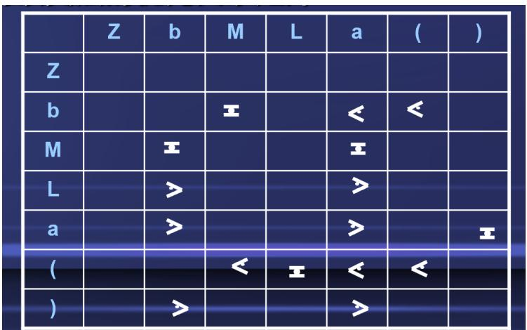

# 2020—2021学年《编译原理》全部作业

按原件页序整理。原文中的“解”“答”等保留原件答案；“参考解答”为补充。

## 原件第1页

1.画出编译程序的总体逻辑结构图，简述各部分的主要功能。

2.什么叫系统程序设计语言?

3.为什么要对单词进行内部编码？其原则是什么？对标识符是如何进行内部编码？

4.赋值语句 $\mathrm { A } { : = } 5 { ^ { * } } \mathrm { C }$ 的语法和语义指的是什么？

### 思考题

1. 先有操作系统还是先有编译系统，谈谈你的看法？

1.设 $\mathrm { T } _ { 1 } = \{ 1 1 , 0 1 0 \}$ $\mathrm { T } _ { 2 } = \{ 0 , 0 1 , 1 0 0 1 \}$ ，计算： $\mathrm { T } _ { 2 } \mathrm { T } _ { 1 } , ~ \mathrm { T _ { 1 } } ^ { * } , ~ \mathrm { T } _ { 2 } ^ { + }$ C

2.令 $A = \{ 0 , 1 , 2 \}$ ，写出集合A+和A\*的七个最短符号串。

3.试证明： $\mathbf { A } ^ { + } = \mathbf { A } \mathbf { A } ^ { * } = \mathbf { A } ^ { * } \mathbf { A }$

1、设有文法 G[S]：

$$
\begin{array}{l} \mathbf {S}: := \mathbf {A} \\ \mathbf {A}: := \mathbf {B} | \text {IF A T H E N A E L S E A} \\ \mathbf {B}: := \mathbf {C} | \mathbf {B + C} | + \mathbf {C} \\ \mathbf {C}: := \mathbf {D} | \mathbf {C ^ {*} D} | ^ {*} \mathbf {D} \\ \mathbf {D}: := \mathbf {X} | (\mathbf {A}) | - \mathbf {D} \end{array}
$$

2、设有文法 G[S]：

$$
\begin{array}{l} \mathrm{S}: := \mathrm{aAb} \\ \mathrm{A}: := \mathrm{BcA} | \mathrm{B} \\ \mathrm{B}: := \mathrm{idt} | \varepsilon \end{array}
$$

试问下列符号串（1）aidtcBcAb （3）ab （5）aidtcidtcidtb 是否为该文法的句型或句子。

3、给定文法：

$$
\begin{array}{l} \mathrm{S}: := \mathrm{aB} | \mathrm{bA} \\ \mathrm{A}: := \mathrm{aS} | \mathrm{bAA} | \mathrm{a} \\ \mathrm{B}: := \mathrm{bS} | \mathrm{aBB} | \mathrm{b} \end{array}
$$

4、试分别描述下列文法所产生的语言（文法开始符号为 S）：

$$
\begin{array}{l l} \text {(1)} & \mathrm{S}: := 0 \mathrm{S} | 0 1 \\ \text {(2)} & \mathrm{S}: := \mathrm{aaS} | \mathrm{bc} \\ \text {(3)} & \mathrm{S}: := \mathrm{AB} \end{array}
$$

## 原件第2页

$$
\mathbf {A} \mathrel {\mathop {:}: = a A b} \mid \mathbf {a b}
$$

$$
\mathbf {B} \mathrel {\mathop {:}: = c B d} \mid \varepsilon
$$

5、试分别构造产生下列语言的文法：

（1） $\{ \mathbf { \lambda } \mathbf { a b } ^ { \mathbf { n } } \mathbf { a } \mid \mathbf { n } { = } \mathbf { 0 } , \ 1 , \ 2 , \ 3 ^ { \cdots \cdots } \}$

（2） $\{ \mathbf { a } ^ { \mathbf { n } } \mathbf { b } ^ { \mathbf { n } } | \mathbf { n } { = } 1 , 2 , 3 , 4 ^ { \mathbf { \ldots } \mathbf { \ldots } } \}$

（3） $\{ \mathbf { a b a } ^ { \mathbf { n } } \mid \mathbf { n } \geqslant \mathbf { 1 } \}$

（4） $\{ \mathbf { a } ^ { \mathbf { n } } \mathbf { b } \mathbf { a } ^ { \mathbf { m } } \mid \mathbf { n } , \mathbf { m } { \geq } 1 \}$

（5） $\{ \mathbf { a } ^ { \mathbf { n } } \mathbf { b } ^ { \mathbf { m } } \mathbf { c } ^ { \mathbf { p } } \mid \mathbf { n } , \mathbf { m } , \mathbf { p } { \geq } \mathbf { 0 } \}$

（6） $\{ \mathbf { a } ^ { \mathbf { m } } \mathbf { b } ^ { \mathbf { m } } \mathbf { c } ^ { \mathbf { p } } \mid \mathbf { m } , \mathbf { p } { \geq } \mathbf { 0 } \}$

1. 设文法 G 规则为：S：：=ABB：：=a|SbA：：=Aa|bB

对下列句型给出推导语法树，并求出其句型短语，简单短语和句柄。

（2）baabaab (3)bBABb

2. 分别对 i+i\*i 和 i+i+i 中每一个句子构造两棵语法树，从而证明下述文法 $\mathbf { G } [ <$ 表达式>]是二义的。<表达式>：：=i|(<表达式>)|<表达式><运算符><表达式><运算符>：：=+|-|\*|/

3. 证明下述两个文法是二义的

1) $\mathbf { S } { \mathbf { : : } } = \mathbf { i S e S | i S | i }$

2) $\mathbf { S } { \boldsymbol { : } } { \mathbf { : } } = \mathbf { A } | \mathbf { B }$ $\mathbf { A { : : = } a C b A | a }$ B::=BCC|a C::=ba

4. 令文法 $\mathbf { N } \colon : \mathbf { \tau } = \mathbf { D } | \mathbf { N D }$

$$
\mathbf {D}: := \mathbf {0} | \mathbf {1} | \mathbf {2} | \mathbf {3} | \mathbf {4} | \mathbf {5} | \mathbf {6} | \mathbf {7} | \mathbf {8} | \mathbf {9}
$$

给出句子 0127，34，568 最左推导和最右推导。

1. 下面文法那些是短语结构文法，上下文有关文法，上下文无关文法，及正规文法？

## 原件第3页

$$
\begin{array}{l l l l l} 1. S: := a B & B: := c B & B: := b & C: := c \\ 2. S: := a B & B: := b C & C: := c & C: := \varepsilon \\ 3. S: := a A b & a A: := a B & a A: := a a A & B: := b & A: := a \\ 4. S: := a C d & a C: := B & a C: := a a A & B: := b \\ 5. S: := A B & A: := a & B: := b C & B: := b & C: := c \\ 6. S: := A B & A: := a & B: := b C & C: := c & C: := \varepsilon \\ 7. S: := a A & S: := \varepsilon & A: := a A & A: := a B & A: := a & B: := b \\ 8. S: := a A & S: := \varepsilon & A: := b A b & A: := a \end{array}
$$

2. 给出一个产生下列语言 $\mathbf { L _ { \lambda } } ( \mathbf { G } ) = \{ \mathbf { W } | \mathbf { W } { \in } \{ \mathbf { a } , \mathbf { b } \} ^ { * }$ \*且 W 中含 a 的个数是 b 个数两倍的前后文无关文法。

3. 用扩充的 BNF 表示以下文法规则：

$$
\begin{array}{l l} 1. & \mathbf {Z}: := \mathbf {A B} | \mathbf {A C} | \mathbf {A} \\ 2. & \mathbf {S}: := \mathbf {a A B b} | \mathbf {a b} \\ 3. & \mathbf {A}: := \mathbf {A a b} | \varepsilon \end{array}
$$

1. 什么叫超前搜索？扫描缓冲区的作用是什么？

2. 画出下列文法的状态图：

$$
\begin{array}{r l} & {\mathbf {Z}: := \mathbf {B e}} \\ & {\mathbf {B}: := \mathbf {A f}} \\ & {\mathbf {A}: := \mathbf {e} | \mathbf {A e} \qquad \text {并使用该状态图检查下列句子是否该文法的合法句子：} \mathbf {f},} \\ & {\mathrm{eeff,eefe。}} \end{array}
$$

3. 设右线性文法 $\mathrm { \bf G } { = } ( \{ \mathrm { S } , \mathrm { \bf A } , \mathrm { \bf B } \} , \{ \mathrm { \bf a } , \mathrm { \bf b } \} , \mathrm { \bf S } , \mathrm { \bf P } )$ ，其中 P 组成如下：

$$
\mathbf {S}: := \mathbf {b A} \quad \mathbf {A}: := \mathbf {b B} \quad \mathbf {A}: := \mathbf {a A} \quad \mathbf {A}: := \mathbf {b} \quad \mathbf {B}: := \mathbf {a}
$$

画出该文法的状态转换图。

P41 26. 给出产生下列语言 L $\mathbf { ( G ) _ { \alpha } = } \mathbf  \{ W \vert W \in \{ 0 $ ，1}+且 W 不含相邻 1}的正规文法。

P74 6. 构造下述文法 G[Z]的自动机，该自动机是确定的吗？它相应的语言是什么？

$$
\mathbf {Z}: := \mathbf {A 0} \quad \mathbf {A}: := \mathbf {A 0} | \mathbf {Z 1} | \mathbf {0}
$$

P74 7. 构造一个 DFA，它接受{0，1}上所有满足下述条件的字符串，其条件是：

## 原件第4页

字符串中每个 1 都有 0 直接跟在右边，然后，再构造该语言的正规文法。

P74 8. 设 $\left( \mathrm { N F A } \right) \mathbf { M } = \left( \ \{ \mathbf { A } , \mathbf { B } \} , \{ \mathbf { a } , \mathbf { b } \} , \mathbf { M } , \{ \mathbf { A } \} , \{ \mathbf { B } \} \right)$ ，其中 M 定义如下：

$$
\mathbf {M} (\mathbf {A}, \mathbf {a}) = \{\mathbf {A}, \mathbf {B} \} \quad \mathbf {M} (\mathbf {A}, \mathbf {b}) = \{\mathbf {B} \} \quad \mathbf {M} (\mathbf {B}, \mathbf {a}) = \varnothing \quad \mathbf {M} (\mathbf {B}, \mathbf {b}) = \{\mathbf {A}, \mathbf {B} \}
$$

请构造相应确定有穷自动机

(DFA) M’。

P74 9. 设有穷自动机 $\mathbf { M } = ( \{ \mathbf { S } , \mathbf { A } , \mathbf { E } \} , \{ \mathbf { a } , \mathbf { b } , \mathbf { c } \} , \mathbf { M } , \mathbf { S } , \{ \mathbf { E } \} )$ ，其中 M 定义为M (S, c) = A M (A, b) = A M (A, a) = E 请构造一个左线性文法。

P74 10. 已知正规文法 $\mathbf { G } = ( \{ \mathrm { S } , \mathbf { B } , \mathbf { C } \} , \{ \mathbf { a } , \mathbf { b } , \mathbf { c } \} , \mathbf { P } , \mathbf { S } )$ ，其中 P 内包含如下产生式：

$$
\begin{array}{l l} \mathrm{S}: := \mathrm{aS} \mid \mathrm{aB} & \dots \dots ① \\ \mathrm{B}: := \mathrm{bB} \mid \mathrm{bC} & \dots \dots ② \\ \mathrm{C}: := \mathrm{cC} \mid \mathrm{c} & \dots \dots ③ \end{array}
$$

请构造一个等价的有穷自动机。

P74 11. 构造下列正规式相应的 DFA：

(0 | 11\*0)\*

P74 15. 用两种方法将 $\mathbf { \left( N F A \right) M } = \left( \{ \mathrm { X } , \mathrm { Y } , \mathrm { Z } \} , \{ \mathbf { 0 } , \mathbf { 1 } \} , \mathbf { M } , \{ \mathrm { X } \} , \{ \mathrm { Z } \} \right)$ ，构造相应的 DFA，其中：

$$
\begin{array}{l l} \mathbf {M} (\mathbf {X}, \mathbf {0}) = \{\mathbf {Z} \} & \quad \mathbf {M} (\mathbf {X}, \mathbf {1}) = \{\mathbf {X} \} \\ \mathbf {M} (\mathbf {Y}, \mathbf {1}) = \Phi & \quad \mathbf {M} (\mathbf {Z}, \mathbf {0}) = \{\mathbf {X}, \mathbf {Z} \} \end{array} \quad \begin{array}{l l} \mathbf {M} (\mathbf {Y}, \mathbf {0}) = \{\mathbf {X}, \mathbf {Y} \} \\ \mathbf {M} (\mathbf {Z}, \mathbf {1}) = \{\mathbf {Y} \} \end{array}
$$

提示：

方法1: 先画出其状态转换图，利用非子集法

方法2: 先画出其状态转换图，再构造其对应的转换系统，利用非子集法

P74 16. 已知 ${ \bf e } _ { 1 } { = } ( { \bf a } | { \bf b } ) ^ { * } , ~ { \bf e } _ { 2 } { = } ( { \bf a } ^ { * } { \bf b } ^ { * } ) ^ { * }$ ，试证明 $\mathbf { e } _ { 1 } { = } \mathbf { e } _ { 2 }$ 。

P74 18. 根据下面正规文法构造等价的正规表达式：

$$
\mathbf {S}: := \mathbf {c C} \mid \mathbf {a} \quad \dots \dots ①
$$

$$
\mathbf {A}: := \mathbf {c A} \mid \mathbf {a B} \quad \dots \dots ②
$$

$$
\mathbf {B}: := \mathbf {a B} \mid \mathbf {c} \quad \dots \dots ③
$$

$$
\mathbf {C}: := \mathbf {a} \mathbf {S} \mid \mathbf {a} \mathbf {A} \mid \mathbf {b} \mathbf {B} \mid \mathbf {c} \mathbf {C} \mid \mathbf {a} \quad \dots\dots④
$$

P74 19. $\Sigma = \{ \mathbf { a } , \mathbf { b } \}$ ，写出下列正规集：

（1） $( \mathbf { a } \mid \mathbf { b } ) ^ { * } ( \mathbf { a } \mathbf { a } \mid \mathbf { b } \mathbf { b } ) ( \mathbf { a } \mid \mathbf { b } ) ^ { * }$

## 原件第5页

P75 20. 证明下列关系式成立，其中 A、B 是任意正规表达式。

$$
\mathbf {A} ^ {*} = \varepsilon | \mathbf {A A} ^ {*}
$$

$$
(\mathbf {A B}) ^ {*} \mathbf {A} = \mathbf {A} (\mathbf {B A}) ^ {*}
$$

P142 1. 试分别消除下列文法的直接左递归（采用两种方法——重复法和改写法）

（1）G[E]:

$$
\begin{array}{l l} \mathbf {E}: := \mathbf {T} \mid \mathbf {E A T} & \dots \dots ① \\ \mathbf {T}: := \mathbf {F} \mid \mathbf {T M F} & \dots \dots ② \\ \mathbf {F}: := (\mathbf {E}) \mid \mathbf {i} & \dots \dots ③ \\ \mathbf {A}: := + \mid - & \dots \dots ④ \\ \mathbf {M}: := * \mid / & \dots \dots ⑤ \end{array}
$$

（2）G[Z]:

$$
\begin{array}{l} \mathbf {Z}: := \mathbf {V} _ {1} \quad \dots \dots ① \\ \mathbf {V} _ {1}: := \mathbf {V} _ {2} \mid \mathbf {V} _ {1} \mathbf {i} \mathbf {V} _ {2} \quad \dots \dots ② \\ \mathbf {V} _ {2}: := \mathbf {V} _ {3} \mid \mathbf {V} _ {2} + \mathbf {V} _ {3} \quad \dots \dots ③ \\ \mathbf {V} _ {3}: :=) \mathbf {V} _ {1} ^ {*} \mid (\quad \dots \dots ④ \end{array}
$$

P142 2. 试分别消除下列文法的间接左递归

G[Z]:

$$
\begin{array}{l l} \mathbf {Z}: := \mathbf {A Z} | \mathbf {b} & \dots \dots ① \\ \mathbf {A}: := \mathbf {Z A} | \mathbf {a} & \dots \dots ② \end{array}
$$

P142 4. 试分别用两种方法（框图法和类 Pascal 语言或类 C 语言）写一个识别下面文法句子的递归子程序

文法 G[A]:

$$
\begin{array}{l} \mathrm{A}: := [ \mathrm{B} \quad \dots \dots ① \\ \mathrm{B}: := \mathrm{X} ] | \mathrm{BA} \quad \dots \dots ② \\ \mathrm{X}: := \mathrm{Xa} | \mathrm{Xb} | \mathrm{a} | \mathrm{b} \quad \dots \dots ③ \end{array}
$$

P143 5. 对下面的文法 G[E]:

$$
\begin{array}{l} \mathbf {E}: := \mathbf {T E ^ {\prime}} \\ \mathbf {E ^ {\prime}}: := = + \mathbf {E} | \varepsilon \\ \mathbf {T}: := \mathbf {F T ^ {\prime}} \\ \mathbf {T ^ {\prime}}: := = \mathbf {T} | \varepsilon \end{array}
$$

## 原件第6页

（1）计算这个文法的每个非终结符号的 FIRST 和 FOLLOW；

（2）证明这个文法是 LL（1）文法；

（3）构造它的 LL（1）分析表并分析符号串 a\*b+b;

P144 6. 对下列文法，构造相应的 FIRST 和 FOLLOW：

P144 9. 设已给文法 G[S]:

（2）此文法是否为 LL（1）文法？

P144 10. 证明下述文法不是简单优先文法：

P145 11. 构造下述文法的优先关系矩阵，它是简单优先文法吗？

P145 12. 根据语法树，确定全部优先关系：

## 原件第7页

![P145 13. 利用文法 G[Z]的优先关系矩阵，来分析符号串 $\# ( ( \mathbf { a a } ) \mathbf { a } ) \#$](2020—2021学年编译原理全部作业.assets/原图1.jpg)

P146 17. 设已给文法 G[S]:

$$
\begin{array}{l} \mathbf {E}: := \mathbf {E} + \mathbf {T} | \mathbf {T} \\ \mathbf {T}: := \mathbf {T} ^ {*} \mathbf {F} | \mathbf {F} \\ \mathbf {F}: := \mathbf {P} \uparrow \mathbf {F} | \mathbf {P} \\ \mathbf {P}: := (\mathbf {E}) | \mathbf {i} \end{array}
$$

（1） 构造此文法的算符优先矩阵；

（2） 用迭代法构造优先函数；

（3） 用优先函数表分析符号串 i+i\*i↑i

P146 19. 证明下面文法不是算符优先文法:

$$
\begin{array}{l} \mathrm{S}: := \mathrm{A} [ ] | [ \\ \mathrm{A}: := \mathrm{aA} | \mathrm{B} ] \\ \mathrm{B}: := \mathrm{a} \end{array}
$$

## 原件第8页

P146 21. 利用表 4.8 文法 G[E]优先关系矩阵分析下列句子: i\*(i\*i)

$$
\mathrm{E}: := \mathrm{E} + \mathrm{T} \mid \mathrm{T}
$$

$$
\mathrm{T}: := \mathrm{T} ^ {*} \mathrm{F} \mid \mathrm{F}
$$

$$
\mathrm{F}: := (\mathrm{E}) \mid \mathrm{i}
$$

$$
\begin{array}{c c c c c c} & + & * & ( & ) & i \\ \hline + & >. & <   & <   & >. & <   \\ * & >. & >. & <   & >. & <   \\ \hline ( & <   & <   & <   & = & <   \\ \hline) & >. & >. & & >. \\ \hline i & >. & >. & & >. \end{array}
$$

P146 22. 设有文法 G[Z]:

$$
\begin{array}{l} \mathbf {Z}: := \mathbf {A} | \mathbf {B} \\ \mathbf {A}: := \mathbf {a A b} | \mathbf {c} \\ \mathbf {B}: := \mathbf {a B b} | \mathbf {d} \end{array}
$$

（1） 试构造能识别此文法的全部活前缀 DFA；

（2） 试构造 LR(0)分析表；

（3） 试分析符号串 aacbb 是否为此文法的句子。

P147 24. 给定文法：

$$
\mathbf {E} \mathrel {\mathop :} = \mathbf {E E} + | \mathbf {E E} ^ {*} | \mathbf {a}
$$

（1） 构造它的 LR(0)项目集规范族；

（2） 它是 SLR(1)文法吗？若是，构造它的 SLR(1)分析表；

P147 26. 对如下文法 G：

$$
\mathrm{S} \mathrel {\mathop :} = \mathrm{S} (\mathrm{S}) \quad \mathrm{S} \mathrel {\mathop :} = \varepsilon
$$

构造 LR(1)项目规范集以及 LR(1)分析表，并用分析器给出(())的分析过程。

P148 30. 给出如下文法：

$$
\begin{array}{l} \mathrm{G} _ {1} [ \mathrm{S} ]: \mathrm{S}: := \mathrm{aSbS} | \mathrm{aS} | \mathrm{c} \\ \mathrm{G} _ {2} [ \mathrm{S} ]: \mathrm{S}: := \mathrm{aAa} | \mathrm{aBb} \quad \mathrm{A}: := \mathrm{x} \quad \mathrm{B}: := \mathrm{x} \\ \mathrm{G} _ {3} [ \mathrm{S} ]: \mathrm{S}: := \mathrm{aAa} | \mathrm{aBb} | \mathrm{bAb} \quad \mathrm{A}: := \mathrm{x} \quad \mathrm{B}: := \mathrm{x} \\ \mathrm{G} _ {4} [ \mathrm{S} ]: \mathrm{S}: := \mathrm{aAa} | \mathrm{aBb} | \mathrm{bAb} | \mathrm{bBa} \quad \mathrm{A}: := \mathrm{x} \quad \mathrm{B}: := \mathrm{x} \end{array}
$$

（1） 证明二义性文法 G1[S]不是 LR(0)文法；

（2） 证明 ${ \bf G } _ { 2 } [ { \bf S } ]$ 是 SLR(1)文法但不是 LR(0)文法；

（3） 证明 G3[S]是 LR(1)文法但不是 SLR(1)文法；

（4） 证明 $\mathbf { G } _ { 4 } [ \mathbf { S } ]$ 是 LR(1)文法但不是 LALR 文法。

## 原件第9页

P194 1. 按照语法制导翻译的一般原理，给出表达式 $( 5 ^ { * } 4 + 8 ) ^ { * } 2$ 的语法树各结点并注明语义值 VAL。

## 补充讲解

### 核对后的解答 1

参考解答：按子集构造，从初态 $A=\{X\}$ 出发，可达的状态及转换如下。包含 $Z$ 的集合是终态。

| 状态 | NFA 状态集合 | 0 | 1 | 终态 |
| --- | --- | --- | --- | --- |
| A | $\{X\}$ | B | A | 否 |
| B | $\{Z\}$ | C | D | 是 |
| C | $\{X,Z\}$ | C | E | 是 |
| D | $\{Y\}$ | E | F | 否 |
| E | $\{X,Y\}$ | G | A | 否 |
| F | $\varnothing$ | F | F | 否 |
| G | $\{X,Y,Z\}$ | G | E | 是 |

例如 $\delta(C,1)=M(X,1)\cup M(Z,1)=\{X,Y\}$。$\{Y,Z\}$ 不可达，不必列入可达 DFA；若采用不完全 DFA，可省略死状态 F 及指向它的转换。

