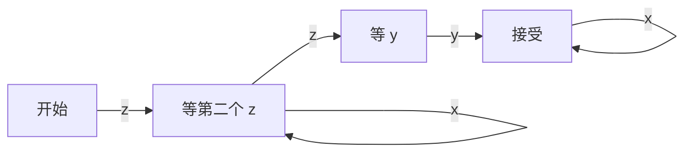

# 作业讲解 2：自动机、正规文法与预测分析

这是历史作业讲解的独立伴读。下面按原件题次定位，重新计算转换、最小划分和预测表；不复刻讲义图版，也不把题目当成现行考核范围。

## 第 1 题：为什么多个可达状态只占 DFA 的一格？

**参考解答。** NFA 一次读入只有一个字符，但可沿多条边并行前进。确定化时，必须把所有可能的当前状态作为一个整体保存；只挑其中一个，可能漏掉唯一能接受的后续路径。因为原题没有空边，从一个集合读入字符，直接并起各成员的同标号目标即可。例如 {X,Y} 读入 0，X 给出 {Z}、Y 给出 {X,Y}，并成 {X,Y,Z}。从 {X} 开始依次访问，不把不可达集合算进去。[子集构造](../../../topics/编译原理/DFA与NFA等价转换.md)在有空边时还要取闭包。

| 读完前缀后的状态集合 | 再读 0 | 再读 1 | 接受 |
|---|---|---|---|
| {X}（起点） | {Z} | {X} | 否 |
| {Y} | {X,Y} | ∅ | 否 |
| {Z} | {X,Z} | {Y} | 是 |
| {X,Y} | {X,Y,Z} | {X} | 否 |
| {X,Z} | {X,Z} | {X,Y} | 是 |
| {X,Y,Z} | {X,Y,Z} | {X,Y} | 是 |
| ∅ | ∅ | ∅ | 否 |

接受条件是==集合含 Z==，不是「集合等于 {Z}」。例如 00 读到 {X,Z}，仍应接受；011 落到 ∅，后面接什么都回不来。

两状态可合并，意即任意后缀都无法让两者给出不同的接受判断；仅仅「都是终态」不够。上表中 {X,Z} 与 {X,Y,Z} 对 0 始终留在这两者中，对 1 同去 {X,Y}，可以合并。{Z} 与这类状态都接受空后缀，但追加 10，{Z} 落到 {X,Y} 拒绝，而合并类落到 {X,Y,Z} 接受。非终态的 {X} 与 {Y} 用 0 区分，{Y} 与 {X,Y} 也用 0，{X} 与 {X,Y} 用 010；三个非空拒绝态各能找到接受后缀，故不同于 ∅。完整 DFA 的最小划分因此为六类；若用「没有画出的边直接拒绝」的简图约定，可以不画陷阱态，但那张图不是一个完整转移表。

## 第 2 题和补充题 1：求表达式之前，先找退出分支

**参考解答（第 2 题）。** 从 B 出发只能写若干个 0，最后写 1 退出，所以其语言是`0*1`。S 经 A 回到 S 一次，必写 01；真正退出 S 则先写 1，再进入 B。把两个行为按访问次序拼起来，得到`(01)*10*1`。例如 11 和 011001 分别对应零次、一次回路并退出；01 只回到 S，不是完整的句子。相关方法见[正规文法与自动机转换](../../../topics/编译原理/正规文法与自动机转换.md)。

**参考解答（补充题 1）。** A 开始可用 0 自循环；也能写 0 进入 B，再写 1 返回 A，也就是循环 01；还可写 0 到 B 后立即结束。起始 Z 必须先写一个 0，因此整个表达式是`0(0|01)*0`。00 和 0010 属于语言，01 不属于。把两种循环单独取星号后串接，不能覆盖任意交错的 0 和 01 回路；这里星号要作用于两种回路的并。

这项补充还可独立用自动机核算：直接由右线性文法建 NFA 时，A 遇 0 可能留 A 或到 B，B 可空结束故是终态。子集构造得到 {Z}、{A}、{A,B} 和 ∅ 四个可达态。{Z} 与 {A} 都不接受空串，但后缀 0 只会从 {A} 到达含 B 的集合；因此这四个状态都不能再并。原件还画了从同一表达式出发的空边构造，其中两个非终态可并；替换构造的内部命名并不改变最小完整 DFA 的状态数。

## 第 3 题：左线性文法为什么顺着「被引用者」画边？

**参考解答。** 在左线性产生式 P → Q a 中，Q 先产生左半段，a 才补在右侧。为让自动机从左向右读输入，边应从 Q 指向 P。由末端符号开始的新状态读 z 进入 B；B 可反复读 x，随后读 z 到 A；A 读 y 进入终态 E，E 可继续读 x。这个从新起点到 E 的解释同时给出`zx*zyx*`；zzy 中两个星号都取零次，是最短的接受串。把 E 当起点并沿文法依赖画同方向的边，会读成错误的顺序。[正规表达式与自动机转换](../../../topics/编译原理/正规式与自动机转换.md)中的语言等价不要求自动机拥有同一张状态图。

为看清原题后续要求的空边确定化，可按「读首个 z → 左侧的 x 循环 → 读第二个 z、y → 右侧的 x 循环」布置路径，每个循环都要允许空走。沿用原件中间状态的编号，表内目标是先移动一次，再把空边可达点全部加进来。

| 闭包 | x | y | z | 接受 |
|---|---|---|---|---|
| {S}（起点） | ∅ | ∅ | {1,2,3} | 否 |
| {1,2,3} | {2,3} | ∅ | {4} | 否 |
| {2,3} | {2,3} | ∅ | {4} | 否 |
| {4} | ∅ | {5,6,T} | ∅ | 否 |
| {5,6,T} | {6,T} | ∅ | ∅ | 是 |
| {6,T} | {6,T} | ∅ | ∅ | 是 |
| ∅ | ∅ | ∅ | ∅ | 否 |

第 2、3 行的转移相同，合成「等第二个 z」；第 5、6 行同理，合成「可接受」。其余几个类可用最短接受后缀区分：起点最短需要 zzy，见过首个 z 后只需 zy，见过第二个 z 后只需 y，终态不需后缀，陷阱态则没有可接受后缀。所以下图画出四个活状态；所有没画出的边都通向陷阱态，完整机有五个状态。

**补充。** 一个方便的手算反例是 zxy：第一个 z 后虽可读许多 x，却仍必须再读到一个 z；y 到得太早，因此拒绝。不要把两个星号之一当成可以绕过中间的 z 或 y。

## 补充题 2：找一个最短后缀，把不能合并的状态分开

**参考解答。** 按原图，只有 E 接受；A、C 对 a 都到 B，对 b 都到 C，因此先考虑这一对。D 与 A、B、C 用后缀 b 区分：只有 D 能一步到 E；B 与 A、C 则用 bb 区分，B 连走 B → D → E，另两者留在 C。E 和其他状态用空后缀已能分开。仅合并 A、C，得到下表。初态来自原图的 A，故合并后的初态是 {A,C}，不是新加一个状态。

| 最小类 | a | b |
|---|---|---|
| {A,C}（初态） | B | {A,C} |
| B | B | D |
| D | B | E |
| E（终态） | B | {A,C} |

从初态读 abb 会接受，再追加一个 b 就回到 {A,C} 拒绝。如果把「曾经到过终态」误当成接受条件，会错判后一个串；接受必须在读完整个串之后判断。参见[有穷自动机](../../../topics/编译原理/有穷自动机.md)。

## 第 4 题：可空时必须问「下一字符属于谁？」

**参考解答。** 用 # 表示输入结束，ε 表示空串。预测表的每个格只允许填一条产生式：右部能以该终端开头时填入；右部还可能为空时，再按左部的 FOLLOW 填入。若只求各非终端的 FIRST 而不检查右部能否整段为空，最容易漏掉结束符列。

本题 K、M、H 都可空，所以从 S → MH 出发也可产生空串；反过来不能因为 S 的可空分支是 MH，就让其任意出现在每一个终端列。S 在 H → LSo 中恰好位于 o 前，又是开始符号，FOLLOW(S) 正好是 {o,#}。H 在 S → MH 末尾承接这两项，在 L → eHf 中另得 f。M 后可以接 H 的首字符 e，或者 H 消失后接 S 的跟随字符；K 在 M → K 末尾再承接 M 的 FOLLOW。

| 非终端 | FIRST | FOLLOW |
|---|---|---|
| S | {a,b,d,e,ε} | {o,#} |
| H | {e,ε} | {o,f,#} |
| K | {d,ε} | {e,o,#} |
| L | {e} | {a,b,d,e,o,#} |
| M | {b,d,ε} | {e,o,#} |

把每条预测产生式和它负责的列直接列成组：没有列出的格都是出错格。同一行的列组互不交叠，所以整张表没有冲突。

| 栈顶 | 候选产生式右部与负责的前瞻列 |
|---|---|
| S | a：a；MH：o、d、e、b、# |
| H | LSo：e；ε：o、f、# |
| K | dML：d；ε：o、e、# |
| L | eHf：e |
| M | K：o、d、e、#；bLM：b |

> [!TIP]
> 看见前瞻 e，S 选 MH 之后，M 选 K、K 选 ε，e 留给 H → LSo 消费。==先选择产生式，不代表已消费当前字符==；只有预测分析栈顶是与前瞻相同的终端时才移过它。# 也不等同于 ε：它是区分结束与尚有输入的记号。

## 表尾补充：逗号前面还是后面决定递归方向？

**参考解答。** T 的两条旧分支 T → T,S 和 T → S 都可能由 S 开头，预测分析只看一个前瞻时无法选择，第一条还会在不消费输入的情况下立即递归。语言上，T 至少包含一个 S，之后才可能出现若干「逗号加一个 S」。因此可把列表尾部提取成新的非终端 R：

- S → a ｜ Λ ｜ (T)
- T → SR
- R → ,SR ｜ ε

原页把 Λ 画在单独的前瞻列，并且 S → Λ 的表项对应实际读入它。以下按这份讲义的约定把 Λ 当终端；若另一份教材用 Λ 表示空串，不能照搬这张表。此处 S、T 只在 a、Λ、( 三列预测，S 选相应分支，T 统一选 SR；R 在逗号列选 ,SR，在 ) 列选 ε，别的格出错。消除左递归后，还要像这样重新检查预测列，而不是仅凭文法「看上去变了」就判定为 LL(1)。参见[自顶向下分析的问题与解决](../../../topics/编译原理/自顶向下问题与解决.md)和 [LL(1) 分析法](../../../topics/编译原理/LL1分析法.md)。

以`(a,a)`为例：读左括号后按 T → SR 展开，首先匹配 a；遇逗号时 R 选择继续，匹配逗号和第二个 a；下一次 R 看到右括号选择 ε，最后匹配右括号并遇 #。因此接受。`(a,)`在逗号后应再预测一个 S，右括号却不在 S 的预测列中，不能接受；`()`同理。这个对照能检查分析器是否把「可空的列表尾」误装成了「整个列表可空」。
