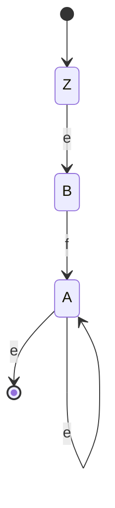
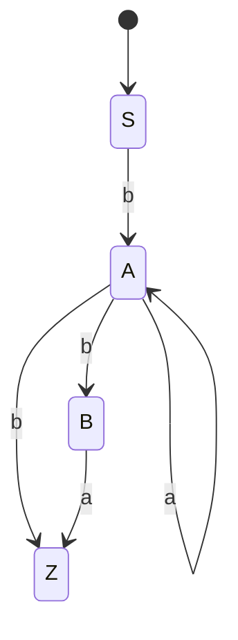

# 南京邮电大学《编译原理》2020-2021学年第二学期重点习题

原件经识别和整理；“参考解答”是我们补的。

# 南京邮电大学《编译原理》2020-2021学年第二学期重点习题

## 一、简答题（共 6 题）

### 简答 1

题干：试分别描述下列文法所产生的语言（文法开始符号为 S）：

（1） $S :: = 0S \mid 01$

（2） $S :: = aaS \mid bc$

（3） $S :: = aSd \mid aAd$
$$
A :: = aAc \mid bc
$$

（4） $S :: = AB$
$$
A :: = aAb \mid ab
$$
$$
B :: = cBd \mid \varepsilon
$$

答案：
（1） $L(G) = \{ 0^n 1 \mid n \geqslant 1 \}$ （解题思路：将文法转换为正规表达式）

（2） $L(G) = \{ a^{2n} bc \mid n \geqslant 0 \}$；

（3） $L(G) = \{ a^i b c^j d^k \mid i, j, k \geqslant 1, i = j + k - 1 \}$；或者 $L(G) = \{ a^{j+k-1} b c^j d^k \mid j, k \geqslant 1 \}$；

（4） $L(G) = \{ a^n b^n c^m d^m \mid m \geqslant 0, n \geqslant 1 \}$

知识点：[文法产生式、推导与规约](../../../topics/编译原理/文法产生式与推导.md)、[短语、简单短语与句柄](../../../topics/编译原理/短语与句柄.md)、[语法树、最左/最右推导与文法的二义性](../../../topics/编译原理/语法树与二义性.md)

### 简答 2

题干：用扩充的BNF表示以下文法规则：

1. $Z :: = AB \mid AC \mid A$
2. $A :: = BC \mid BCD \mid AXZ \mid AXY$
3. $S :: = aABb \mid ab$
4. $A :: = Aab \mid \varepsilon$

解：

1. $Z :: = A (B \mid C \mid \varepsilon) :: = A [B \mid C]$
2. $A :: = BC ( \varepsilon \mid D ) \mid \{ X (Z \mid Y) \} :: = BC [D] \mid \{ X (Z \mid Y) \}$
3. $A :: = a ((AB \mid \varepsilon)b) :: = a [AB] b$
   *(注：原题此处标号有误，题干第3小题对应解答中的A应为S，或题目本身意在转换规则，此处按原文保留解答逻辑)*
4. $A :: = \{ ab \mid \varepsilon \} :: = \{ ab \}$

参考解答：## 1. $Z::=AB \mid AC \mid A$

结论：

$$Z ::= A\,[\,B \mid C\,]$$

推理：右部公共前缀为 $A$，剩余可选部分 $B$、$C$、$\varepsilon$，$\varepsilon$ 用可选符号 $[\;]$ 表示。

## 2. $A ::= BC \mid BCD \mid AXZ \mid AXY$

结论：

$$A ::= BC\,[\,D\,] \mid A\,X\,[\,Z \mid Y\,]$$

推理：

- $BC$ 与 $BCD$：公共前缀 $BC$，$D$ 可选，得 $BC[D]$；
- $AXZ$ 与 $AXY$：公共前缀 $AX$，末尾 $Z$ 或 $Y$ 可选，得 $AX[Z \mid Y]$；
- 也可把左递归提成重复形式 $A ::= BC[D]\ \{X[Z|Y]\}$（或 $A ::= \{X(Z|Y)\}\,BC[D]$ 的右递归改写），但保留原结构即上式。

## 3. $S ::= aABb \mid ab$

结论：

$$S ::= a\,[\,AB\,]\,b$$

推理：两产生式公共前后缀为 $a\ldots b$，中间 $AB$ 可出现或不出现，用 $[\;]$ 表示可选。

## 4. $A ::= Aab \mid \varepsilon$

结论：

$$A ::= \{\,ab\,\}$$

推理：$A$ 可零次或多次产生 $ab$（每次由 $A \to Aab$ 产生一对 $ab$，最后以 $A\to\varepsilon$ 结束），重复用 $\{\,\}$ 表示；也可写成 $A ::= [ab\,A]$（右递归）或 $A ::= [\,A\,ab]$，本质等价，标准答案取重复形式。

知识点：[文法的其他表示法（扩充BNF、语法图）](../../../topics/编译原理/文法其他表示法.md)

### 简答 3

题干：画出下列文法的状态图：
$$
Z :: = Be
$$
$$
B :: = Af
$$
$$
A :: = e \mid Ae
$$
并使用该状态图检查下列句子是否该文法的合法句子： $\mathbf{f}, \mathbf{eeff}, \mathbf{eefe}.$

由状态图可知只有 `eefe` 是该文法的合法句子。

参考解答：# 解答

## 结论

只有 **`eefe`** 是该文法的合法句子。

## 状态图

该文法是右线性文法，可构造如下有限自动机：

各状态对应的转移规则：
- $Z \xrightarrow{e} B$（由 $Z ::= Be$ 中 $B$ 先产生，最终 $B$ 后接 $e$）
- $B \xrightarrow{f} A$（由 $B ::= Af$）
- $A \xrightarrow{e} A$（由 $A ::= Ae$）
- $A \xrightarrow{e}$ 终态（由 $A ::= e$）

## 句子合法性检查

该文法描述的语言为：$L = \{e^n f e \mid n \geq 1\}$，即若干个 $e$ 后接 $f$，再接一个 $e$。

| 句子 | 路径检查 | 是否合法 |
|------|----------|----------|
| $\mathbf{f}$ | $Z$ 遇 $f$ 无转移，拒绝 | ❌ |
| $\mathbf{eeff}$ | $Z \xrightarrow{e} B \xrightarrow{e}$ 无转移，拒绝（$B$ 后只能跟 $f$） | ❌ |
| $\mathbf{eefe}$ | $Z \xrightarrow{e} B \xrightarrow{f} A \xrightarrow{e} A \xrightarrow{e}$ 终态，接受 | ✅ |

**推导验证**：$Z \Rightarrow Be \Rightarrow Afe \Rightarrow Aefe \Rightarrow eefe$

## 排除说明

- $\mathbf{f}$：缺少开头的 $e$（$B$ 必须由 $A$ 产生，$A$ 至少含一个 $e$）
- $\mathbf{eeff}$：$f$ 出现两次，但文法中 $f$ 只出现一次（由 $B ::= Af$ 唯一产生）

知识点：[正规文法与状态转换图](../../../topics/编译原理/正规文法与状态图.md)、[有穷自动机（DFA与NFA）](../../../topics/编译原理/有穷自动机.md)

### 简答 4

题干：设右线性文法 $G = (\{S, A, B\}, \{a, b\}, S, P)$ ，其中P组成如下：
$S :: = bA$
$A :: = bB$
$A :: = aA$
$A :: = b$
$B :: = a$
画出该文法的状态转换图。

参考解答：**结论**

该文法对应的状态转换图包含一个开始状态 $S$、两个中间状态 $A, B$ 和一个终止状态 $Z$（接受状态），转换关系如下：

> 注：图中 $Z$ 为新增的终止状态，用于接收右线性文法中直接推导出终结符的产生式。

---

**推理过程**

右线性文法构造状态转换图的规则：

1. **非终结符**作为状态结点，开始符号 $S$ 为初态。
2. 增加一个**新的终止状态** $Z$（或记作 $F$）。
3. 对产生式分类处理：
   - 形如 $X ::= aY$（$a \in V_T,\; Y \in V_N$）：画一条从状态 $X$ 到状态 $Y$ 的弧，标记为 $a$。
   - 形如 $X ::= a$（$a \in V_T$）：画一条从状态 $X$ 到终止状态 $Z$ 的弧，标记为 $a$。

逐条应用：

| 产生式 | 类型 | 对应边 |
|--------|------|--------|
| $S ::= bA$ | $X ::= aY$ | $S \xrightarrow{b} A$ |
| $A ::= bB$ | $X ::= aY$ | $A \xrightarrow{b} B$ |
| $A ::= aA$ | $X ::= aY$ | $A \xrightarrow{a} A$（自环） |
| $A ::= b$ | $X ::= a$ | $A \xrightarrow{b} Z$ |
| $B ::= a$ | $X ::= a$ | $B \xrightarrow{a} Z$ |

由此即可画出上述状态转换图。

知识点：[正规文法与状态转换图](../../../topics/编译原理/正规文法与状态图.md)、[正规文法与有穷自动机的相互转换](../../../topics/编译原理/正规文法与自动机转换.md)

### 简答 5

题干：下面文法哪些是短语结构文法，上下文有关文法，上下文无关文法，及正规文法？

1. $S :: = aB$
   $B :: = cB$
   $B :: = b$
   $C :: = c$

2. $S :: = aB$
   $B :: = bC$
   $C :: = c$
   $C :: = \varepsilon$

3. $S :: = aAb$
   $aA :: = aB$
   $aA :: = aaA$
   $B :: = b$
   $A :: = a$

4. $S :: = aCd$
   $aC :: = B$
   $aC :: = aaA$
   $B :: = b$

5. $S :: = AB$
   $A :: = a$
   $B :: = bC$
   $B :: = b$
   $C :: = c$

6. $S :: = AB$
   $A :: = a$
   $B :: = bC$
   $C :: = c$
   $C :: = \varepsilon$

7. $S :: = aA$
   $S :: = \varepsilon$
   $A :: = aA$
   $A :: = aB$
   $A :: = a$
   $B :: = b$

8. $S :: = aA$
   $S :: = \varepsilon$
   $A :: = bAb$
   $A :: = a$

答案：
正规文法：1
上下文无关文法：2, 5, 6, 7, 8
上下文有关文法：3
短语结构文法：4

知识点：[乔姆斯基文法分类（0型、1型、2型、3型）](../../../topics/编译原理/文法分类.md)

### 简答 6

题干：证明下列关系式成立，其中A、B是任意正规表达式。

（1） $A \mid A = A$
（3） $A^* = \varepsilon \mid AA^*$
（4） $(AB)^* A = A(BA)^*$

（1）解： $L(A \mid A) = L(A) \cup L(A) = L(A)$ ，所以 $A \mid A = A$；

（3）解： $L(A^*) = (L(A))^*$ , $L(\varepsilon \mid AA^*) = \{\varepsilon\} \cup L(A)L(A^*) = (L(A))^*$ ，所以 $A^* = \varepsilon \mid AA^*$

（4）解： $(AB)^* A = ((AB)^0 \cup (AB)^1 \cup (AB)^2 \cup \dots \dots) A = A \cup ABA \cup ABABA \cup \dots \dots A =$
$$
A ((BA)^0 \cup (BA)^1 \cup (BA)^2 \cup \dots \dots) = A (BA)^* 。
$$

参考解答：结论：
（1）成立。  
（3）成立。  
（4）成立。

---

（1）  
由正规表达式“|”的语义，  

$$
L(A\mid A)=L(A)\cup L(A)=L(A)
$$
  
所以  

$$
A\mid A=A
$$

---

（3）  
由 Kleene 星号定义，  

$$
L(A^*)=(L(A))^*
$$
  
而  

$$
L(\varepsilon\mid AA^*)=\{\varepsilon\}\cup L(A)L(A^*)
$$
  
因为  

$$
L(A)L(A^*)=L(A)(L(A))^*=(L(A))^+
$$
  
所以  

$$
\{\varepsilon\}\cup (L(A))^+=(L(A))^*
$$
  
因此  

$$
A^*=\varepsilon\mid AA^*
$$

---

（4）  
展开左边：  

$$
(AB)^*A=(\varepsilon\mid AB\mid ABAB\mid ABABAB\mid\cdots)A
$$
  

$$
=A\mid ABA\mid ABABA\mid ABABABA\mid\cdots
$$
  
每一项都形如  

$$
A(BA)^n
$$
  
所以  

$$
(AB)^*A=A(\varepsilon\mid BA\mid BABA\mid BABABA\mid\cdots)
$$
  
即  

$$
(AB)^*A=A(BA)^*
$$

知识点：[正规表达式与正规集](../../../topics/编译原理/正规表达式.md)
