# 南京邮电大学《编译原理》第11次作业答案（递归下降分析法）

按原件页序整理。原文中的“解”“答”等保留原件答案；“参考解答”为补充。

## 原件第1页

• 作业：

• 1、用框图法描述识别下面文法句子的递归子程序

• 文法G[A]:

$A _ { \cdot \cdot } ^ { \cdot \cdot } = [ \mathsf { B }$

$\mathsf { B } { \boldsymbol { : } } = \mathsf { X } ] \mid \mathsf { B } \mathsf { A }$

• X::=Xa | Xb | a | b

## 原件第2页

解：消除该文法的左递归和回溯，得到文法如下：

此文法共有五个非终结符，并且在规则中都是递归出现，故应该编写四个相应的递归子程序：P（A）、P（B）、P（B’）、P（X）、P（X’） 。在第一次执行前，ch中已存有输入串中首字符。

## 原件第3页

### §4.2.2递归下降分析法

### 二、递归子程序构造方法

1)对文法中每个非终结符号U（它们都分别代表一种语法成分）都编出一个子程序 P（U）

2)对于递归出现的非终结符，其相应的子程序中应有递归入口部分（递归入口子程序，取名SCIN），以便将返回地址压入栈中。此外，还应有递归出口部分，设此子程序取名SCOUT。以便从地址压入栈中取返回地址

3)对于规则 $\mathrm { U } { : } { : = } \mathrm { x } _ { 1 } \ \vert \ \mathrm { x } _ { 2 } \ \vert \ \ldots \ \vert \ \mathrm { x } _ { \mathrm { n } } ,$ ，可用下列方法构造P（U）：

其中全程变量ch中存放了当前输入字符；ERROR为出错信息，表示源程序中语法有错。当输入符号遇选择项为ε时，就自动认为获得了匹配。

4)对于符号串 $\mathbf { x } = \mathbf { y } _ { 1 } \mathbf { y } _ { 2 } \ldots \mathbf { y } _ { \mathbf { m } } :$ ，如果 $\bf { y } _ { i } \in \sf V _ { \mathrm { ~ I ~ } }$ ，则 $\mathrm { \textbf { P } } \left( \mathbf { y _ { i } } \right)$ 为I ${ \mathsf { F } } { \mathrm { \mathbf { \ell } } } \mathbf { c h } = \mathbf { y } _ { \mathbf { i } }$ THEN READ（ch） ELSE ERROR

这就是说，如果当前文法中的符号与输入符号匹配，则继续读入下一个字符至ch中；否则表明源程序有错。如果 $\mathbf { \sigma } _ { \mathbf { y } _ { \mathbf { i } } \in \mathsf { V } _ { \mathsf { N } } }$ ，则 $\textsf { P } \left( \mathbf { y _ { i } } \right)$ 就 代表调用与 $\bf \dot { y } _ { i }$ 相应的子程序。

## 原件第4页

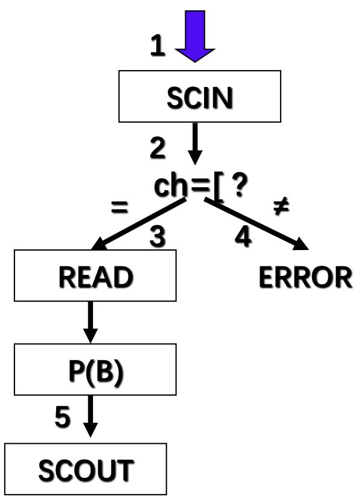

## 原件第5页

构造递归子程序P（B）

$$
\mathbf {B}: := \mathbf {X} ] \mathbf {B} ^ {\prime}
$$

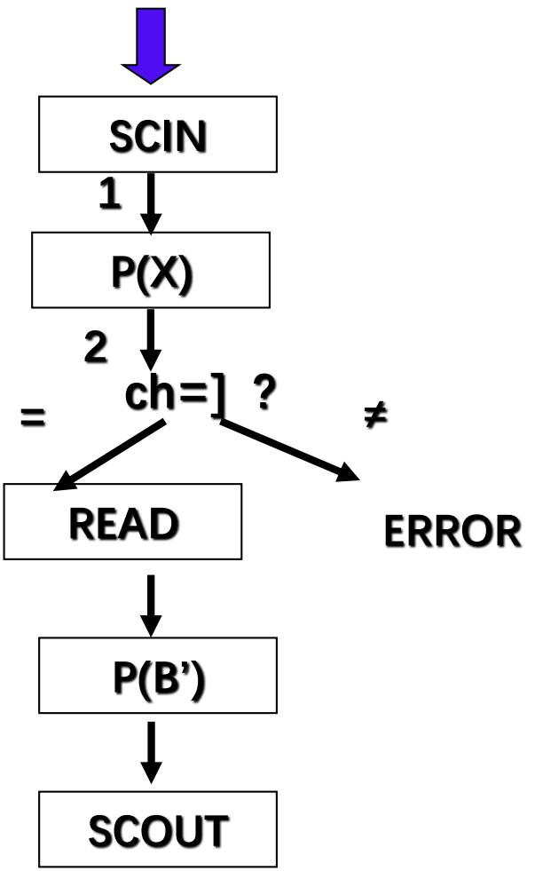

## 原件第6页

构造递归子程序

P（ X）

$$
\begin{array}{c} \text {X:: = a X ^ {\prime} | b X ^ {\prime}} \\ \square \end{array}
$$

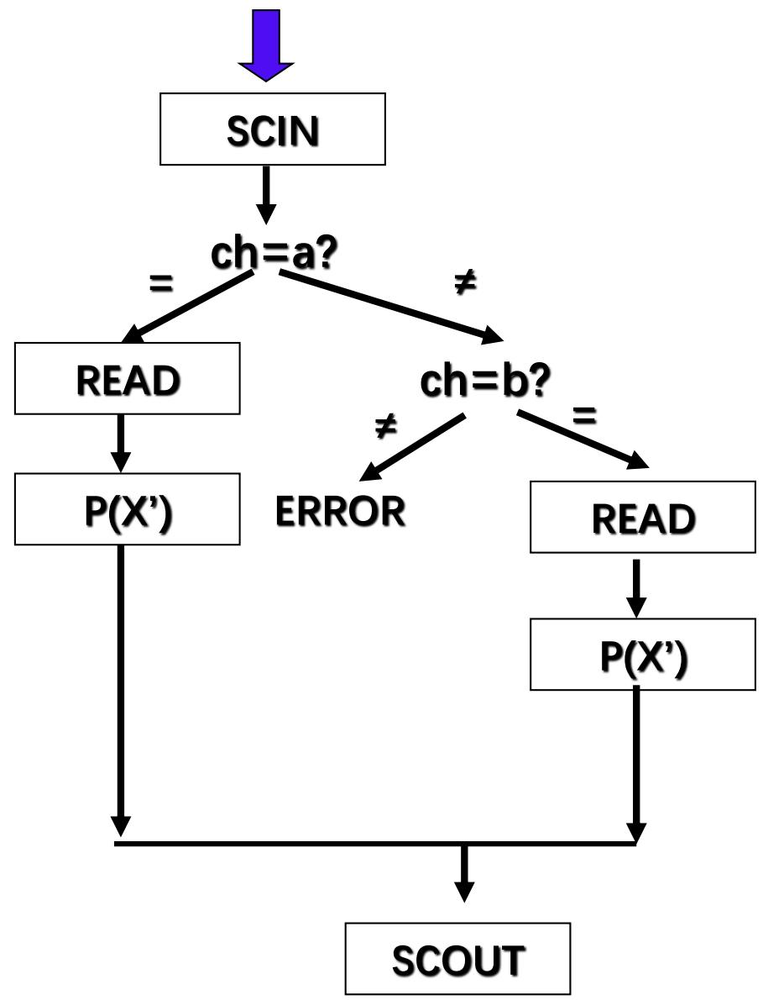

## 原件第7页

P （B’） P （X’）

$$
\mathsf {B} ^ {\prime}: := \mathsf {A B} ^ {\prime} | \varepsilon
$$

$$
X ^ {\prime} := a X ^ {\prime} \mid b X ^ {\prime} \mid \varepsilon
$$

## 原件第8页

### 构造递归子程序

P（B’）

$$
\begin{array}{c} \mathsf {B ^ {\prime}}: := \mathsf {A B ^ {\prime}} | \varepsilon \\ \square \end{array}
$$

当输入符号遇选择项为ε时，就自动认为获得了匹配。

## 原件第9页

构造递归子程序P（B’）

$$
\mathbf {B} ^ {\prime}: := \mathbf {A B} ^ {\prime} | \varepsilon
$$



求解FIRST(AB’)

A::=[B B::=X]B’ B’::=AB’ |ε X::=aX’ | bX’ X’::= aX’ | bX’ |ε

当输入符号遇选择项为ε时，就自动认为获得了匹配。

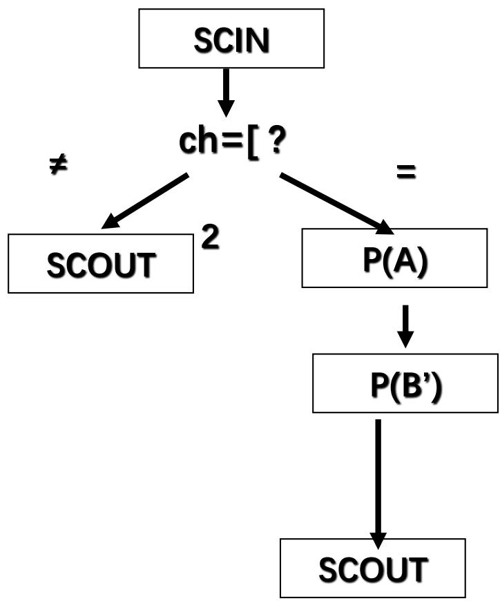

## 原件第10页

构造递归子程序P（X’）

## 原件第11页

分析句 $\mathbb { J } [ \mathsf { a } ] \#$

P（A）

## 原件第12页

### 分析句子[a]#

<table><tr><td>主返</td></tr><tr><td>P(A):5</td></tr><tr><td></td></tr><tr><td></td></tr><tr><td></td></tr></table>

P（B）

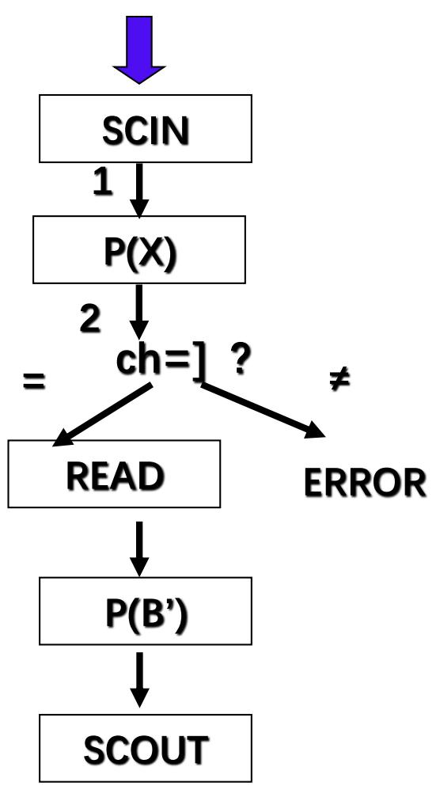

## 原件第13页

### 分析句子[a] #

<table><tr><td>主返</td></tr><tr><td>P(A):5</td></tr><tr><td>P(B):2</td></tr><tr><td></td></tr><tr><td></td></tr></table>

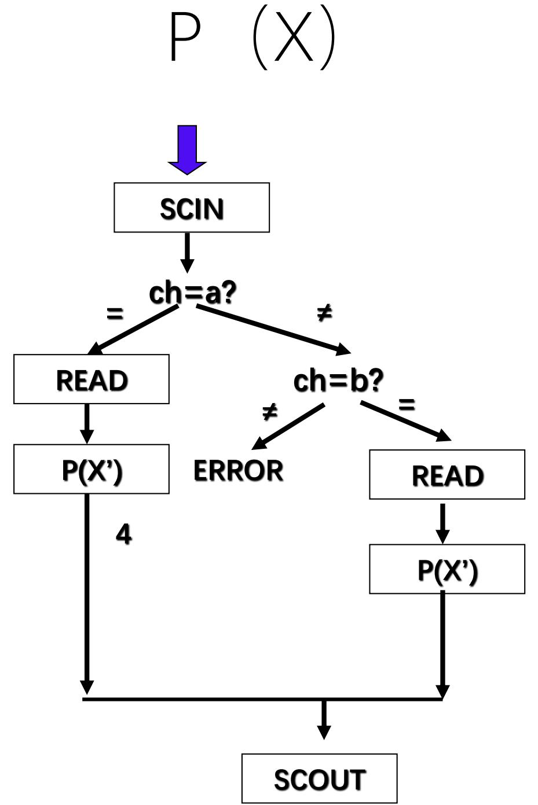

## 原件第14页

分析句子[a] #

<table><tr><td>主返</td></tr><tr><td>P(A):5</td></tr><tr><td>P(B):2</td></tr><tr><td>P(X):4</td></tr><tr><td></td></tr></table>

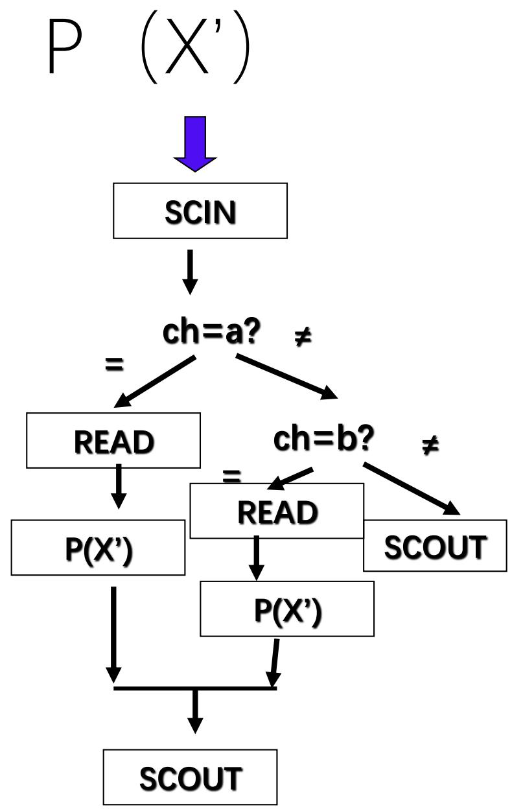

## 原件第15页

分析句子[a]#

<table><tr><td>主返</td></tr><tr><td>P(A):5</td></tr><tr><td>P(B):2</td></tr><tr><td></td></tr><tr><td></td></tr></table>

## 原件第16页

P(B):2

分析句子[a] #

<table><tr><td>主返</td></tr><tr><td>P(A):5</td></tr><tr><td></td></tr><tr><td></td></tr><tr><td></td></tr></table>

P（B）

## 原件第17页

分析句子[a] #

P（A）

<table><tr><td>主返</td></tr><tr><td>P(A):5</td></tr><tr><td>P(B):4</td></tr><tr><td></td></tr><tr><td></td></tr></table>

P（B’）

## 原件第18页

### 分析句子[a] #

<table><tr><td>主返</td></tr><tr><td>P(A):5</td></tr><tr><td></td></tr><tr><td></td></tr><tr><td></td></tr></table>
P(B):4

P（B）

## 原件第19页

P(A):5

分析句 $\mathsf { J } [ \mathsf { a } ] \#$

P（A）

## 原件第20页

分析句子[a]#

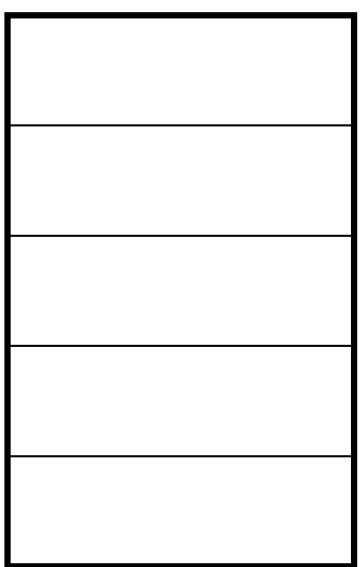

P（A）

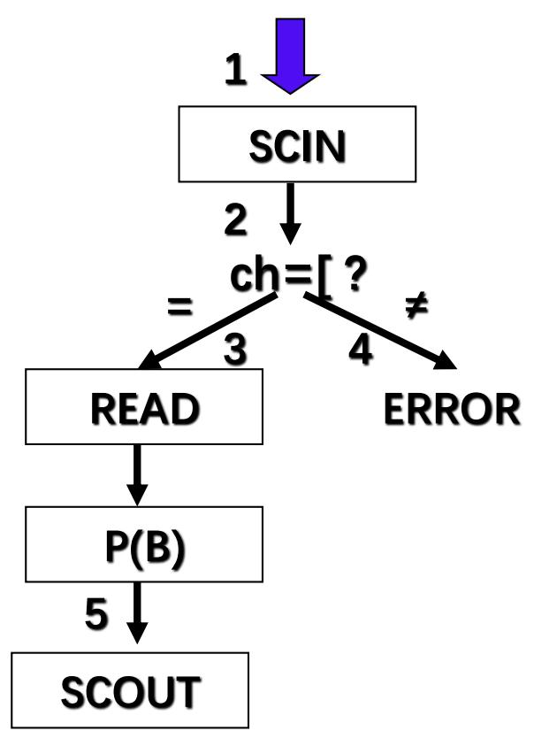

主返判断ch是否为#，如果为#则分析成功

## 原件第21页

P （B’） P （X’）

$$
\mathsf {B ^ {\prime}}: := \mathsf {A B ^ {\prime}} | \varepsilon
$$

$$
X ^ {\prime}: := a X ^ {\prime} \mid b X ^ {\prime} \mid \varepsilon
$$

求解FOLLOW(B’)和 FOLLOW( X’)

if (当前读来的输入符号 FOLLOW(B’))error( )；

## 原件第22页

2)后继终结符号集合

② 构造后继符号集合FOLLOW的算法（方法1）

对文法中每个非终结符B，为了构造FOLLOW（B），可反复应用如下规则，直到每个FOLLOW集不再扩大为止:

a.对于文法的开始符号S，令#∈FOLLOW（S）。

(因为 $\mathsf { S } \Rightarrow \ast \mathsf { S }$ 由定义#∈FOLLOW（S））

b.若文法中有形如 $\mathsf { A } : : = \texttt { q B } \beta$ 的规则，且 $\beta \neq \varepsilon$ ，则将FIRST（β）中一切非ε符号加进FOLLOW（B）中。

c.若文法中有形如 $A : : = { \mathfrak { a } }$ B或 $\mathsf { A } : : = \mathsf { a } \mathrm { ~ B ~ } \mathsf { \beta }$ 的规则，且 $\beta \ \Rightarrow * \ \varepsilon$ 则

$\textsf { F O L L O W }$ （A）中全部终结符均属于FOLLOW（B）

## 原件第23页

$$
\mathbf {A} \mathrel {\mathop :} = [ \mathbf {B}
$$

$$
\mathbf {B} \mathrel {\mathop {: :} = X ]} \mathbf {B} ^ {\prime}
$$

$$
\mathsf {B} ^ {\prime}: := \mathsf {A B} ^ {\prime} | \varepsilon
$$

$$
X: := a X ^ {\prime} \mid b X ^ {\prime}
$$

$$
X ^ {\prime} \because = a X ^ {\prime} | b X ^ {\prime} | \varepsilon
$$

FOLLOW(A) ∈ FOLLOW(B) ∈ FOLLOW(B’)

## 原件第24页

### ②构造头终结符号集合FIRST的算法（1）

对于文法中的每一个文法符 $\mathsf { X } \in ( \mathsf { V } _ { \mathsf { N } } \mathsf { U } \mathsf { V } _ { \mathsf { T } } )$ ，构造 $\textsf { F } \mid \textsf { R S T } \left( \textsf { X } \right)$ 时，只要连续使用下列规则，直至每个FIRST集不再扩大为止。

a.若 $\langle \mathtt { X } \in \mathsf { V } _ { \mathrm { ~ T ~ } }$ ，则 $F ~ | ~ \mathsf { R } ~ \mathsf { S } ~ { \mathsf { T } } ~ \left( \mathsf { X } \right) ~ = ~ \left\{ \mathsf { X } \right\}$ o

b.若 ${ \sf X } \in { \sf V } _ { \sf N }$ 且有形如 ${ \sf X } \mathrel { \mathop : } \mathrel { : } = { \bf b } \ { \sf B }$ 规则 $( \mathsf { b } \in \mathsf { V } _ { \textsf { T } } )$ ，或 $X : : = \mathfrak { e }$ 的规则，把b或（和）ε加入FIRST（X）中。

c.设文法G中有形如 ${ \sf X } : = { \sf Y } _ { 1 } { \sf Y } _ { 2 } . . . { \sf Y } _ { \sf K }$ 的规则，若 $\textsf { Y } _ { 1 } \in \mathsf { V } _ { \mathsf { N } }$ ，则将FIRST $( Y _ { 1 } )$ 中一切非ε符号加进FIRST（X）中，对于一切$2 { \leqslant } \mathrm { i } { \leqslant } \mathrm { k }$ ，若 $Y _ { 1 } \Rightarrow * \varepsilon$ ，则把Y2中首符号集（除ε外）也加进FIRST（X）中，如此继续下去，直到 $\Upsilon \ker 1 \Rightarrow * \mathfrak { e }$ ，则把 ${ \tt Y } _ { \tt K }$ 中首符号集(除ε外)也入FIRST(X)中。

d.若 $\textsf { Y } _ { 1 } \textsf { Y } _ { 2 } . . . \textsf { Y } _ { \mathsf { K } }$ 每个非终结符号都可能推导出空符号串，即$\textsf { Y } _ { 1 } \textsf { Y } _ { 2 } \ldots \textsf { Y } _ { \kappa } \Rightarrow$ \*ε，则把ε也加进FIRST（X）中。

## 原件第25页

25

## 原件第26页

构造递归子程序

P（B’）

$$
\begin{array}{c} \mathsf {B ^ {\prime}}: := \mathsf {A B ^ {\prime}} | \varepsilon \\ \square \end{array}
$$

FOLLOW（ $( B ^ { \prime } ) = \{ [ \# \}$

A::=[B B::=X]B’ B’::=AB’ |ε X::=aX’ | bX’ X’::= aX’ | bX’ |ε

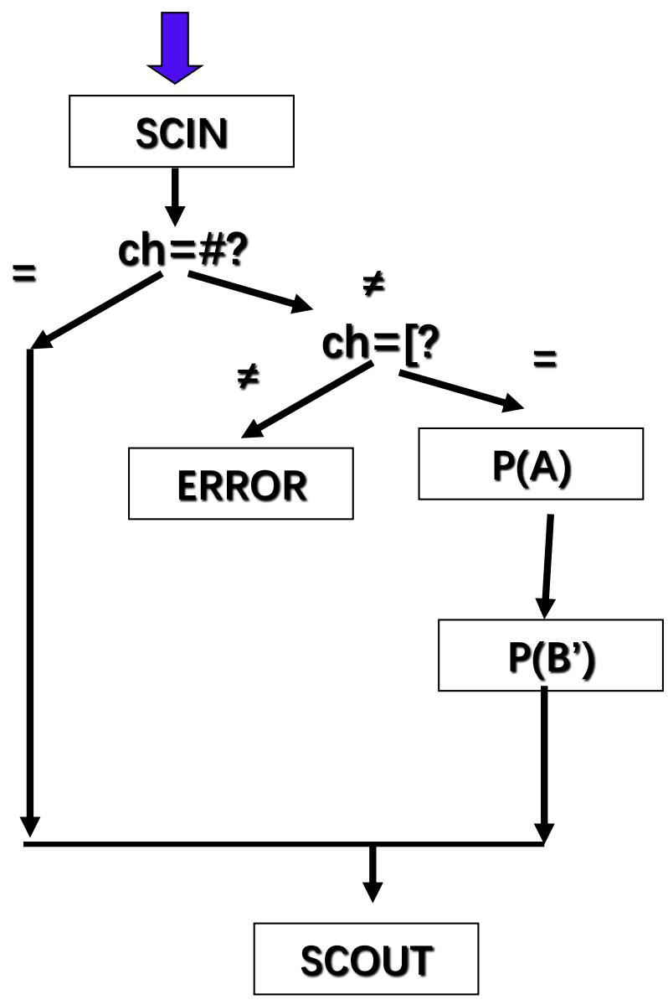

## 原件第27页

27

## 原件第28页

构造递归子程序 P（X’） X’::= aX’ | bX’ |ε 

FOLLOW $( \boldsymbol { \mathsf { X } } ) = \{ \boldsymbol { \mathsf { I } } \}$

A::=[B $\mathbf { B } { \boldsymbol { : : } } = \mathbf { \times } \mathbf { l } \mathbf { B ^ { \prime } }$ $\Delta ^ { \prime } \widetilde { \mathbf { \Gamma } } _ { \infty } ^ { \infty } \equiv \Delta \mathbf { A } \widetilde { \mathbf { \Gamma } } _ { 0 } ^ { \infty }$ |ε X::=aX’ | bX’ $x ^ { \prime } = a x ^ { \prime } \mid \ b x ^ { \prime } \mid \varepsilon$

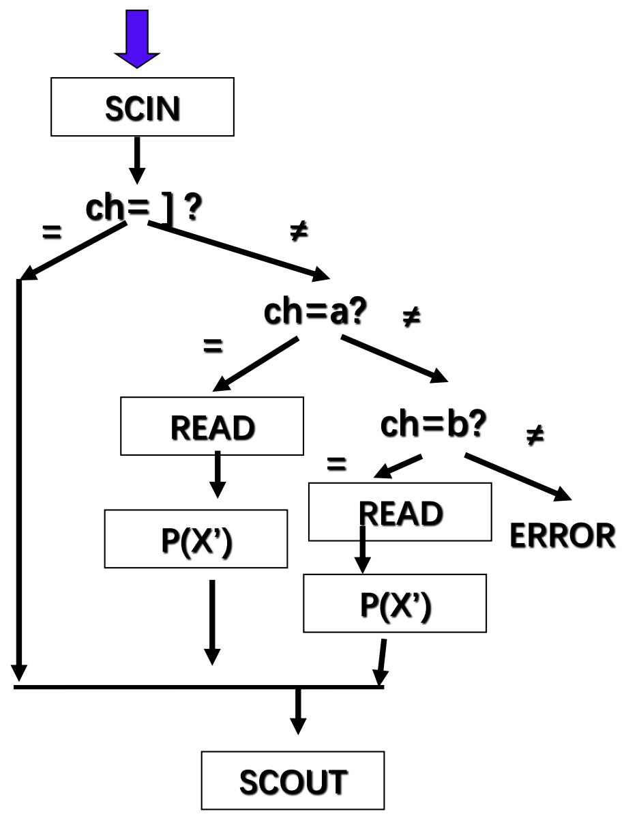

## 原件第29页

利用下面分析表分析符号串(i+)是否为文法所定义的句子

有文法G[E]:

E→TE’

E’→+TE’|ε

T→FT’

T’→\*FT’ |ε

F→(E) | i

LL(1)分析表如下——

<table><tr><td></td><td>i</td><td>+</td><td>*</td><td>(</td><td>)</td><td>#</td></tr><tr><td>E</td><td> $E \rightarrow TE'$ </td><td></td><td></td><td> $E \rightarrow TE'$ </td><td></td><td></td></tr><tr><td> $E'$ </td><td></td><td> $E' \rightarrow +TE'$ </td><td></td><td></td><td> $E' \rightarrow \varepsilon$ </td><td> $E' \rightarrow \varepsilon$ </td></tr><tr><td>T</td><td> $T \rightarrow FT'$ </td><td></td><td></td><td> $T \rightarrow FT'$ </td><td></td><td></td></tr><tr><td> $T'$ </td><td></td><td> $T' \rightarrow \varepsilon$ </td><td> $T' \rightarrow *FT'$ </td><td></td><td> $T' \rightarrow \varepsilon$ </td><td> $T' \rightarrow \varepsilon$ </td></tr><tr><td>F</td><td> $F \rightarrow i$ </td><td></td><td></td><td> $F \rightarrow (E)$ </td><td></td><td></td></tr></table>

## 原件第30页

### 2）分析过程

现在以输入符号串（i+)为例，列出利用上述算法对此符号串的分析过程如下:

<table><tr><td colspan="2">步骤</td><td colspan="2">分析栈</td><td colspan="2">余留输入串</td><td colspan="2">所用产生式</td></tr><tr><td colspan="2">(1)</td><td colspan="2">#E</td><td colspan="2">(i+) #</td><td colspan="2">E→TE&#x27;</td></tr><tr><td colspan="2">(2)</td><td colspan="2">#E&#x27;T</td><td colspan="2">(i+) #</td><td colspan="2">T→FT&#x27;</td></tr><tr><td colspan="2">(3)</td><td colspan="2">#E&#x27;T&#x27;F</td><td colspan="2">(i+) #</td><td colspan="2">F→(E)</td></tr><tr><td colspan="2">(4)</td><td colspan="2">#E&#x27;T&#x27;)E(</td><td colspan="2">(i+) #</td><td colspan="2"></td></tr><tr><td colspan="2">(5)</td><td colspan="2">#E&#x27;T&#x27;)E</td><td colspan="2">i+) #</td><td colspan="2">E→TE&#x27;</td></tr><tr><td colspan="2">(6)</td><td colspan="2"># E&#x27;T&#x27;) E&#x27;T</td><td colspan="2">i+) #</td><td colspan="2">T→FT&#x27;</td></tr><tr><td colspan="2">(7)</td><td colspan="2"># E&#x27;T&#x27;) E&#x27;T&#x27;F</td><td colspan="2">i+) #</td><td colspan="2">F→i</td></tr><tr><td colspan="2">(8)</td><td colspan="2"># E&#x27;T&#x27;) E&#x27;T&#x27;i</td><td colspan="2">i+) #</td><td colspan="2"></td></tr><tr><td colspan="2">(9)</td><td colspan="2"># E&#x27;T&#x27;) E&#x27;T&#x27;</td><td colspan="2">+) #</td><td colspan="2">T&#x27;→ Θ</td></tr><tr><td colspan="2">(10)</td><td colspan="2"># E&#x27;T&#x27;) E&#x27;</td><td colspan="2">+) #</td><td colspan="2">E&#x27;→+TE&#x27;</td></tr><tr><td colspan="2">(11)</td><td colspan="2"># E&#x27;T&#x27;) E&#x27;T+</td><td colspan="2">+) #</td><td colspan="2"></td></tr><tr><td colspan="2">(12)</td><td colspan="2"># E&#x27;T&#x27;) E&#x27;T</td><td colspan="2">) #</td><td colspan="2">失败</td></tr><tr><td></td><td colspan="2">i</td><td>+</td><td>*</td><td>(</td><td>)</td><td>#</td></tr><tr><td>E</td><td colspan="2">E→TE&#x27;</td><td></td><td></td><td>E→TE&#x27;</td><td></td><td></td></tr><tr><td>E&#x27;</td><td colspan="2"></td><td>E&#x27;→+TE&#x27;</td><td></td><td></td><td>E&#x27;→ε</td><td>E&#x27;→ε</td></tr><tr><td>T</td><td colspan="2">T→FT&#x27;</td><td></td><td></td><td>T→FT&#x27;</td><td></td><td></td></tr><tr><td>T&#x27;</td><td colspan="2"></td><td>T&#x27;→ε</td><td>T&#x27;→*FT&#x27;</td><td></td><td>T&#x27;→ε</td><td>T&#x27;→ε</td></tr><tr><td>F</td><td colspan="2">F→i</td><td></td><td></td><td>F→(E)</td><td></td><td></td></tr></table>
