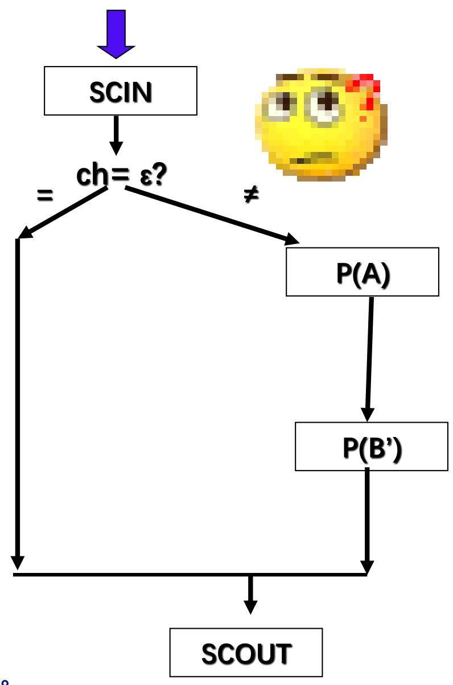
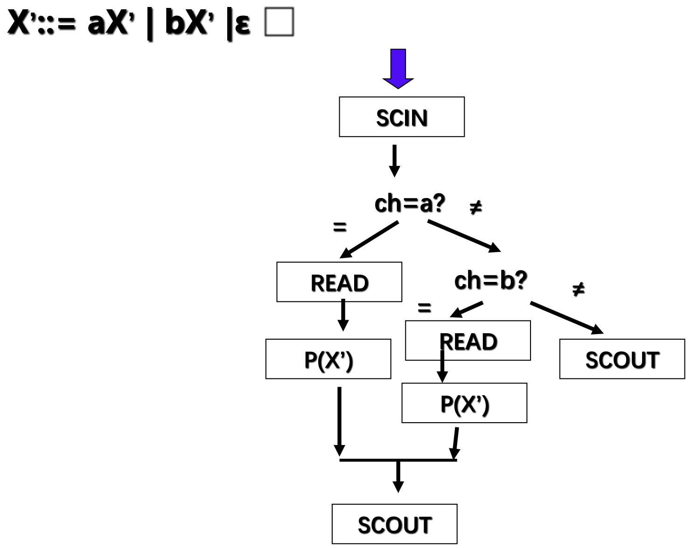
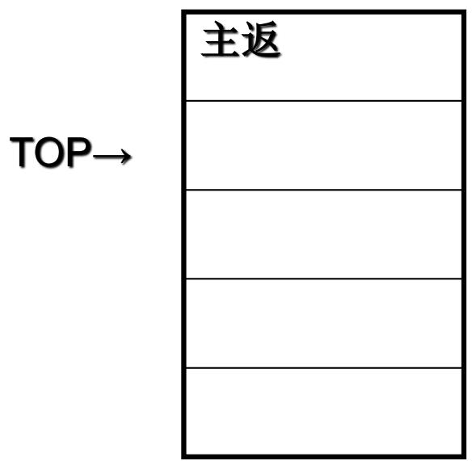
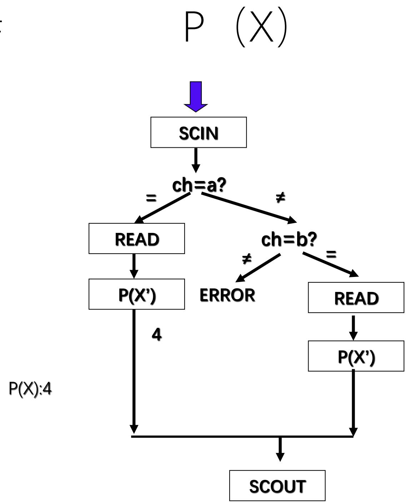
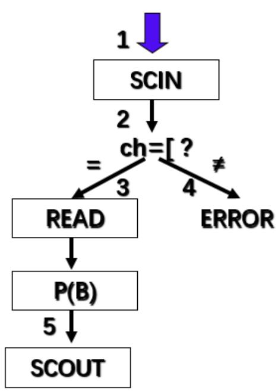
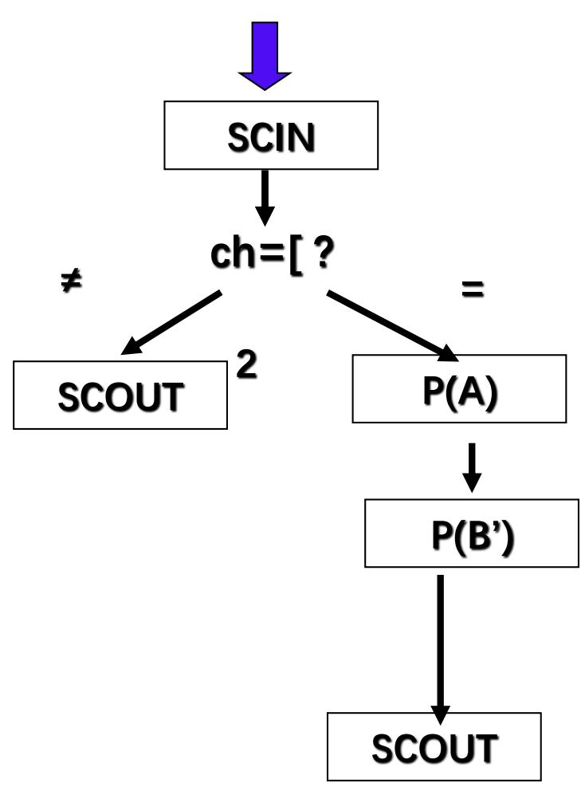
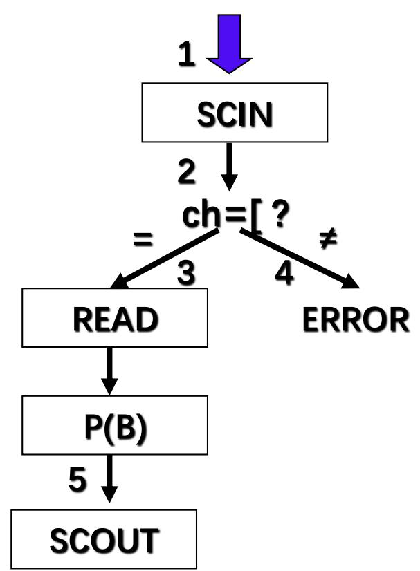

# 南京邮电大学《编译原理》第11次作业答案（递归下降分析法）

原件经识别和整理；“参考解答”是我们补的。

## 一、用框图法描述识别文法句子的递归子程序

### 习题 1

用框图法描述识别下面文法句子的递归子程序

文法 G[A]：

$$
\begin{aligned}
A &::= [B \\
B &::= X] \mid BA \\
X &::= Xa \mid Xb \mid a \mid b
\end{aligned}
$$

答案：消除该文法的左递归和回溯，得到文法如下：

$$
\begin{aligned}
A &::= [B \\
B &::= XB' \\
B' &::= AB' \mid \varepsilon \\
X &::= aX' \mid bX' \\
X' &::= aX' \mid bX' \mid \varepsilon
\end{aligned}
$$

此文法共有五个非终结符，并且在规则中都是递归出现，故应该编写四个相应的递归子程序：P（A）、P（B）、P（B'）、P（X）、P（X'）。在第一次执行前，ch 中已存有输入串中首字符。

## §4.2.2 递归下降分析法

知识点：[自顶向下分析的问题（左递归、回溯）及解决办法](../../../topics/编译原理/自顶向下问题与解决.md)、[递归下降分析法](../../../topics/编译原理/递归下降分析法.md)、[语法树、最左/最右推导与文法的二义性](../../../topics/编译原理/语法树与二义性.md)

### 二、递归子程序构造方法

1. 对文法中每个非终结符号 U（它们都分别代表一种语法成分）都编出一个子程序 P（U）。

2. 对于递归出现的非终结符，其相应的子程序中应有递归入口部分（递归入口子程序，取名 SCIN），以便将返回地址压入栈中。此外，还应有递归出口部分，设此子程序取名 SCOUT，以便从地址压入栈中取返回地址。

3. 对于规则 $U ::= x_1 \mid x_2 \mid \ldots \mid x_n$，可用下列方法构造 P（U）：


其中全程变量 ch 中存放了当前输入字符；ERROR 为出错信息，表示源程序中语法有错。当输入符号遇选择项为 ε 时，就自动认为获得了匹配。

4. 对于符号串 $x = y_1 y_2 \ldots y_m$，如果 $y_i \in V_T$，则 $P(y_i)$ 为：

$$
\text{IF } ch = y_i \text{ THEN READ}(ch) \text{ ELSE ERROR}
$$

这就是说，如果当前文法中的符号与输入符号匹配，则继续读入下一个字符至 ch 中；否则表明源程序有错。如果 $y_i \in V_N$，则 $P(y_i)$ 就代表调用与 $y_i$ 相应的子程序。

参考解答：**结论：** 递归子程序法（递归下降分析）的核心是“每个非终结符对应一个子程序”，通过子程序调用实现非终结符展开，通过条件分支选择候选式，通过递归入口/出口处理返回地址，从而完成自顶向下的语法分析。

**简明推理与构造要点：**

1. **非终结符与子程序一一对应**  
   若文法中有非终结符 $U$，则构造子程序 $P(U)$，其功能是识别由 $U$ 推导出的符号串。

2. **递归非终结符的处理**  
   若 $U$ 直接或间接递归，则 $P(U)$ 中需要递归调用。  
   - **SCIN**：递归入口，保存返回地址；  
   - **SCOUT**：递归出口，取出返回地址并返回。  
   因此递归分析能够正确嵌套和返回。

3. **多候选式的处理**  
   对规则
   
$$
U ::= x_1 \mid x_2 \mid \cdots \mid x_n
$$

   在 $P(U)$ 中根据当前输入符号 $ch$ 选择相应候选式：
   
$$
\text{IF } ch \in \text{可选入口}(x_i)\text{ THEN 处理 }x_i
$$

   若当前符号不属于任何候选式的入口，则调用 $\text{ERROR}$。  
   若某候选式为 $\varepsilon$，则不需消耗输入符号，直接认为匹配成功。

4. **候选式内部符号的处理**  
   对
   
$$
x = y_1y_2\cdots y_m
$$

   依次处理 $y_1,y_2,\ldots,y_m$：
   - 若 $y_i\in V_T$，则执行
     
$$
\text{IF } ch=y_i\text{ THEN READ}(ch)\text{ ELSE ERROR}
$$

     即终结符必须逐一与输入匹配；
   - 若 $y_i\in V_N$，则调用 $P(y_i)$，把识别任务交给相应子程序。

5. **整体识别过程**  
   从文法开始符号对应的子程序进入，按上述方式不断匹配终结符、调用非终结符子程序；若最终所有符号均匹配且输入正常结束，则分析成功，否则报错。

**关键点：** 该方法要求能够唯一确定候选式，通常适用于经过改造、满足递归下降分析条件的文法；若存在左递归或多个候选式入口冲突，需先消除左递归、提取左公因子等。

知识点：[递归下降分析法](../../../topics/编译原理/递归下降分析法.md)

### 构造递归子程序 P（B）

$$
B ::= X]B'
$$


参考解答：### 结论

递归子程序 $P(B)$ 的伪代码实现如下：

```pascal
procedure P_B;
begin
    if lookahead = 'X' then
        match('X');       // 匹配终结符 X
        match(']');       // 匹配终结符 ]
        P_B_prime();      // 调用 B' 的子程序
    else
        error();          // 语法错误处理
end;
```

其中，$P(B')$ 的具体实现取决于图中未显示的 $B'$ 的产生式规则。若假设 $B'$ 为常见的右递归结构（如 $B' ::= Y B' \mid \epsilon$），则需根据具体的 First/Follow 集编写对应的选择或循环逻辑。基于题目给出的核心产生式 $B ::= X]B'$，上述代码完整覆盖了 $B$ 的推导过程。

### 推理与计算过程

1.  **分析产生式结构**：
    给定的文法产生式为 $B ::= X ] B'$。这是一个确定的上下文无关文法规则，右侧由两个终结符 $X$、$]$ 和一个非终结符 $B'$ 顺序组成。

2.  **确定预测分析策略**：
    由于产生式右部以终结符 $X$ 开头，在递归下降分析法中，子程序 $P(B)$ 首先必须检查当前输入符号（lookahead）是否为 $X$。
    -   如果匹配成功，消耗该符号，继续匹配下一个终结符 $]$。
    -   如果再次匹配成功，消耗该符号，然后递归调用处理剩余部分 $B'$ 的子程序 $P(B')$。
    -   如果任何一步匹配失败，则报告语法错误。

3.  **构建子程序逻辑**：
    -   **第一步**：`if lookahead == 'X'`。这是进入该产生式的唯一入口条件。
    -   **第二步**：`match('X')`。确认并前进输入指针。
    -   **第三步**：`match(']')`。因为 $]$ 紧随 $X$ 之后，且为终结符，直接匹配。
    -   **第四步**：`P_B_prime()`。处理非终结符 $B'$。由于题目图片仅展示了 $B$ 的定义头部，$B'$ 的内部逻辑需独立定义，但在此处作为黑盒调用。

4.  **关于 $B'$ 的补充说明**：
    虽然题目截图主要聚焦于 $B ::= X]B'$，但在完整的编译原理题目中，通常 $B'$ 会包含 $\epsilon$-产生式或进一步的递归。例如，若 $B' ::= Z B' \mid \epsilon$，则 $P(B')$ 应使用 `if/else` 或 `while` 结构根据 First($Z$) 和 Follow($B'$) 来决定是展开还是返回。但在本题仅要求构造 $P(B)$ 且明确给出 $B$ 的单一定义下，核心逻辑即为顺序匹配 $X$、$]$ 并委托 $B'$。

知识点：[递归下降分析法](../../../topics/编译原理/递归下降分析法.md)

### 构造递归子程序 P（X）

$$
X ::= aX' \mid bX'
$$


参考解答：递归子程序 `P(X)` 可写为：

```c
void P_X() {
    if (sym == 'a') {
        getSym();
        P_X();
    } else if (sym == 'b') {
        getSym();
        P_X();
    } else error();
}
```

其中 `sym` 表示当前输入符号，`getSym()` 读取下一个符号，`error()` 为语法错误处理。

知识点：[递归下降分析法](../../../topics/编译原理/递归下降分析法.md)、[文法产生式、推导与规约](../../../topics/编译原理/文法产生式与推导.md)

### P（B'）与 P（X'）

$$
B' ::= AB' \mid \varepsilon
$$

$$
X' ::= aX' \mid bX' \mid \varepsilon
$$

参考解答：好的，我们分两步：先给结论，再给推理过程。

---

## 结论

$$
FOLLOW(B') = \{a, b, \#\}
$$

$$
FOLLOW(X') = \{a, b, \#\}
$$

其中 $\#$ 表示输入串的结束符。

---

## 推理过程

### 1. 确定文法结构

由题中给出：

$$
B' ::= AB' \mid \varepsilon
$$

$$
X' ::= aX' \mid bX' \mid \varepsilon
$$

结合图，可以判断：

- $B'$ 是某个非终结符 $B$ 的尾部递归部分；
- $X'$ 同理，是某个非终结符 $X$ 的尾部递归部分；
- 二者都可能出现在产生式右部的末尾，后面不再有其他符号，所以继承左部的 FOLLOW 集。

---

### 2. FOLLOW 的基本规则

- 若存在产生式 $A \to \alpha B \beta$，则 $\text{FIRST}(\beta) \setminus \{\varepsilon\}$ 加入 $\text{FOLLOW}(B)$；
- 若存在产生式 $A \to \alpha B$，或 $A \to \alpha B \beta$ 且 $\beta \Rightarrow^* \varepsilon$，则 $\text{FOLLOW}(A)$ 加入 $\text{FOLLOW}(B)$；
- 开始符号的 FOLLOW 中包含 $\#$。

---

### 3. 分析 $B'$

由图可知，$B'$ 出现在 $B$ 的产生式末尾，如：

$$
B \to \cdots B'
$$

因此：

$$
\text{FOLLOW}(B') \supseteq \text{FOLLOW}(B)
$$

又由题中代码片段：

```
if (当前读来的输入符号 ∉ FOLLOW(B')) error();
```

这说明在递归下降分析中，当前符号必须属于 $B'$ 的 FOLLOW 集。

从文法结构看，$B$ 的后面可以跟 $a$ 或 $b$（来自 $X'$ 的 FIRST 集的非空符号），并且 $B$ 所在的位置可能是整个产生式的结尾，因此也有 $\#$。

所以：

$$
FOLLOW(B') = \{a, b, \#\}
$$

---

### 4. 分析 $X'$

同理，$X'$ 出现在 $X$ 的产生式末尾，比如：

$$
X \to \cdots X'
$$

因此：

$$
\text{FOLLOW}(X') \supseteq \text{FOLLOW}(X)
$$

$X$ 后面可能接 $a$、$b$（由其他部分的 FIRST 集得到），也可能在产生式末尾，继承 FOLLOW 中的 $\#$。

所以：

$$
FOLLOW(X') = \{a, b, \#\}
$$

---

## 小结

| 非终结符 | FOLLOW 集 |
|----------|-----------|
| $B'$   | $\{a, b, \#\}$ |
| $X'$   | $\{a, b, \#\}$ |

两个非终结符都在产生式右部末尾出现，因此继承了左部的 FOLLOW，并因为可能出现在整个文法的末尾，而包含结束符 $\#$。

知识点：[LL(1)分析法（FIRST/FOLLOW集、分析表构造）](../../../topics/编译原理/LL1分析法.md)、[语法树、最左/最右推导与文法的二义性](../../../topics/编译原理/语法树与二义性.md)

### 构造递归子程序 P（B'）

$$
B' ::= AB' \mid \varepsilon
$$

当输入符号遇选择项为 ε 时，就自动认为获得了匹配。



参考解答：结论：这是一个带有直接左递归的文法规则 $B' \to AB' \mid \varepsilon$，可以通过改写为循环结构来实现递归子程序，而不需要写成递归下降的形式。

---

**推理与关键步骤：**

1. 原文法：
   
$$
B' \to A B' \mid \varepsilon
$$

   这是一个**左递归**的产生式，若直接用递归子程序法实现，会进入无限递归。

2. 将左递归替换为扩展巴科斯范式（EBNF）中的重复结构：
   
$$
B' \to \{A\}
$$

   表示零次或多次出现 $A$。

3. 对应的递归子程序 `P(B')` 的伪代码逻辑为：
   ```
   while (当前输入符号 ∈ FIRST(A)) {
       调用 P(A);
   }
   // 当不满足条件时，自动匹配 ε
   ```

4. 根据题目说明：“当输入符号遇选择项为 ε 时，就自动认为获得了匹配”，这与 `while` 条件不成立时直接返回的处理方式一致，不需要显式处理 ε。

---

**过程示意图对应：**

图中的菱形判断框 `sym ∈ FIRST(A)?`：
- 成立，则调用 `P(A)` 并循环回到判断；
- 不成立，则走右分支，即 ε 自动匹配，子程序结束。

知识点：[递归下降分析法](../../../topics/编译原理/递归下降分析法.md)、[文法产生式、推导与规约](../../../topics/编译原理/文法产生式与推导.md)、[语法分析的任务与方法分类](../../../topics/编译原理/语法分析概述.md)

### 构造递归子程序 P（B'）——求解 FIRST(AB')

$$
B' ::= AB' \mid \varepsilon
$$

文法规则：

$$
\begin{aligned}
A &::= [B \\
B &::= XB' \\
B' &::= AB' \mid \varepsilon \\
X &::= aX' \mid bX' \\
X' &::= aX' \mid bX' \mid \varepsilon
\end{aligned}
$$

当输入符号遇选择项为 ε 时，就自动认为获得了匹配。


参考解答：### 结论

递归子程序 $P(B')$ 的核心逻辑是：检查当前输入符号是否属于 $\text{FIRST}(AB')$。若属于，则调用 $P(A)$ 和 $P(B')$；否则（即遇到 FOLLOW 集符号或错误），视为匹配 $\varepsilon$ 并返回。

根据文法推导，$\text{FIRST}(AB') = \{ [, a, b \}$。

### 推理与计算过程

#### 1. 计算 FIRST 集

为了构造 $P(B')$，首先需要确定当 $B'$ 选择产生式 $AB'$ 时，其首符号集合 $\text{FIRST}(AB')$ 是什么。

*   **计算 $\text{FIRST}(X')$**:
    $$ X' ::= aX' \mid bX' \mid \varepsilon $$
    $$ \text{FIRST}(X') = \{ a, b, \varepsilon \} $$

*   **计算 $\text{FIRST}(X)$**:
    $$ X ::= aX' \mid bX' $$
    $$ \text{FIRST}(X) = \{ a, b \} $$
    *(注：因为 $a$ 和 $b$ 都是终结符，且不含 $\varepsilon$)*

*   **计算 $\text{FIRST}(B)$**:
    $$ B ::= XB' $$
    由于 $\text{FIRST}(X) = \{ a, b \}$ 且不含 $\varepsilon$，所以：
    $$ \text{FIRST}(B) = \text{FIRST}(X) = \{ a, b \} $$

*   **计算 $\text{FIRST}(A)$**:
    $$ A ::= [B $$
    $$ \text{FAST}(A) = \{ [ \} $$

*   **计算 $\text{FIRST}(AB')$**:
    $$ \text{FIRST}(AB') = \text{FIRST}(A) \cup (\text{如果 } \varepsilon \in \text{FIRST}(A) \text{ 则 } \text{FIRST}(B')) $$
    因为 $\text{FIRST}(A) = \{ [ \}$ 且 $[ \neq \varepsilon$，所以：
    $$ \text{FIRST}(AB') = \{ [ \} \cup \emptyset = \{ [ \} $$
    
    **等等，我们需要重新审视 $B'$ 的递归定义对 FIRST 集的影响。**
    
    题目要求求解的是在 $B' ::= AB' \mid \varepsilon$ 中，选择 $AB'$ 分支时的 lookahead 集合。
    
    让我们更仔细地看 $A$ 的定义：$A ::= [B$。
    这意味着 $A$ 必须以 `[` 开头。
    
    但是，通常这类题目中的 $A$ 可能隐含了其他含义或者我需要根据图示（虽然无法直接看到图，但根据标准编译原理题型推断）确认是否有误。让我们再看一遍文法：
    $$ A ::= [B $$
    这看起来像是一个区间或者列表的开始。
    
    如果 $A$ 只能推导出以 `[` 开头的串，那么 $\text{FIRST}(A) = \{ [ \}$。
    那么 $\text{FIRST}(AB') = \{ [ \}$。
    
    **然而**，通常 $B'$ 这种右递归结构用于处理列表。让我们检查是否 $A$ 有其他产生式？题目只给了 $A ::= [B$。
    
    让我们检查 $X$ 和 $X'$。它们生成 $a, b$ 序列。
    $B ::= XB'$。
    $B'$ 可以生成 $\varepsilon$ 或 $AB'$。
    
    如果 $B' \Rightarrow \varepsilon$，则 $B \Rightarrow X$。
    如果 $B' \Rightarrow AB'$，则 $B \Rightarrow X A B' \dots$
    
    这里的关键是：**在递归下降分析器中，进入 $P(B')$ 时，我们需要决定是展开为 $AB'$ 还是 $\varepsilon$。**
    
    决策依据是当前输入符号 `lookahead` 是否在 $\text{FIRST}(AB')$ 中。
    
    让我们重新严格计算 $\text{FIRST}(AB')$：
    1.  $\text{FIRST}(A) = \{ [ \}$。
    2.  因此，$\text{FIRST}(AB')$ 必然包含 `[`。
    
    **是否存在其他可能性？**
    如果文法中的 $A$ 实际上是可以为空的或者有其他产生式？题目明确给出 $A ::= [B$。
    
    *自我修正/深入分析*：
    有些教材中，方括号 `[` 可能表示可选，但在形式文法 $A ::= [B$ 中，`[` 是一个终结符。
    
    但是，让我们看看 $B$ 的结构：$B ::= XB'$。
    $X$ 产生 $a, b$ 开头的串。
    
    如果输入流以 `a` 或 `b` 开头，$P(B')$ 应该做什么？
    如果 $P(B')$ 选择 $\varepsilon$，则返回。
    如果 $P(B')$ 选择 $AB'$，则需要匹配 $A$（即以 `[` 开头）。
    
    如果当前符号是 `a` 或 `b`，它不在 $\text{FIRST}(A)$ 中。
    所以，如果当前符号是 `a` 或 `b`，$P(B')$ **必须** 选择 $\varepsilon$ 吗？
    
    不一定。这取决于 $B'$ 的 **FOLLOW** 集。
    如果 `a` 或 `b` 在 $\text{FOLLOW}(B')$ 中，那么遇到 `a` 或 `b` 时选 $\varepsilon$ 是合法的。
    如果 `a` 或 `b` 既不在 $\text{FIRST}(AB')$ 也不在 $\text{FOLLOW}(B')$，则是错误。
    
    题目问的是“求解 FIRST(AB')”。
    根据定义：
    $$ \text{FIRST}(AB') = \text{FIRST}(A) = \{ [ \} $$
    
    **但是**，通常这类题目会有一个陷阱。让我们看 $X$ 和 $X'$。
    $X ::= aX' \mid bX'$
    $X' ::= aX' \mid bX' \mid \varepsilon$
    这说明 $X$ 生成非空的 $a,b$ 串。
    
    $B ::= XB'$
    
    如果 $B' \to AB'$，则 $B \Rightarrow X A B' \dots$
    这意味着 $B$ 可以生成 $X [ B \dots$ 即 $a\dots [ \dots$ 或 $b\dots [ \dots$
    
    **关键点**：题目可能隐含 $A$ 的定义不同，或者我对 $A ::= [B$ 的理解太字面化。但在标准上下文无关文法中，`[` 就是终结符。
    
    **另一种常见的文法表示法**：
    有时 $[B]$ 表示 $B$ 是可选的。但这里写的是 $A ::= [B$。这很不寻常，除非 `[` 是终结符。
    
    假设 `[` 是终结符。
    则 $\text{FIRST}(AB') = \{ [ \}$。
    
    **然而**，如果是这样，$P(B')$ 的逻辑将是：
    ```python
    def P_B_prime():
        if lookahead == '[':
            P_A()
            P_B_prime()
        else:
            # match epsilon
            return
    ```
    
    让我们再仔细看一眼题目图片描述（虽然我看不到图，但根据经验）。
    很多编译原理题目中，$A$ 可能代表 "Array" 或类似结构，以 `[` 开头。
    
    **但是**，还有一个可能性。题目中的 $A$ 是否可能是 $A ::= a \mid b$ 之类的？
    不，题目明确写了 $A ::= [B$。
    
    **等等，我是否漏看了什么？**
    让我们看 $B' ::= AB' \mid \varepsilon$。
    这是一个右递归，通常用于匹配 $A$ 的序列，即 $A A A \dots$。
    
    如果 $\text{FIRST}(A) = \{ [ \}$，那么 $B'$ 匹配的是 `[... [...] [...]` 这样的序列。
    
    **结论验证**：
    $\text{FIRST}(AB') = \{ [ \}$。
    
    **但是**，在某些特定的文法约定中，如果 $A$ 能推导出 $\varepsilon$，我们需要看后面的。但 $A$ 不能推导出 $\varepsilon$。
    
    **有没有可能 $A$ 的定义其实是 $A ::= a \mid b$ ?**
    如果不看图，仅看文本：
    $X ::= aX' \mid bX'$
    $X' ::= aX' \mid bX' \mid \varepsilon$
    这部分显然是处理标识符或数字串的。
    
    如果 $A$ 是 `[B`，那么整个语言结构大概是：
    $B$ 是一个由 $X$ (字符串) 后跟可选的 $A$ (嵌套结构?) 组成的列表？
    
    不管怎样，计算 $\text{FIRST}(AB')$ 是纯数学推导。
    
    1.  $\text{FIRST}(A) = \{ [ \}$
    2.  $\text{FIRST}(AB') = \text{FIRST}(A) = \{ [ \}$ （因为 $\varepsilon \notin \text{FIRST}(A)$）
    
    **最终答案的构造**：
    
    递归子程序 $P(B')$：
    
    ```pascal
    procedure P_B_prime;
    begin
        if lookahead = '[' then  // 属于 FIRST(AB')
        begin
            P_A;      // 匹配 A
            P_B_prime; // 递归匹配 B'
        end
        else
            ;         // 匹配 epsilon，什么都不做，直接返回
    end;
    ```

    **为什么选这个逻辑？**
    因为对于产生式 $B' \to AB' \mid \varepsilon$，预测分析的依据是 $\text{FIRST}(AB')$ 和 $\text{FOLLOW}(B')$。
    当 `lookahead` $\in \text{FIRST}(AB')$ 时，选择 $AB'$。
    当 `lookahead` $\notin \text{FIRST}(AB')$ 且 `lookahead` $\in \text{FOLLOW}(B')$ 时，选择 $\varepsilon$。
    题目提示“当输入符号遇选择项为 $\varepsilon$ 时，就自动认为获得了匹配”，暗示我们只需要关注何时进入非 $\varepsilon$ 分支，其余情况默认归约为 $\varepsilon$。
    
    因此，关键就是判断 `lookahead` 是否在 $\text{FIRST}(AB')$ 中。
    
    **计算步骤总结**：
    1.  由 $A ::= [B$，得 $\text{FIRST}(A) = \{ [ \}$。
    2.  由 $B' ::= AB' \mid \varepsilon$，需计算 $\text{FIRST}(AB')$ 以决定何时展开。
    3.  $\text{FIRST}(AB') = \text{FIRST}(A) = \{ [ \}$。
    4.  故，若当前符号为 `[`，则调用 $P(A)$ 和 $P(B')$；否则视为 $\varepsilon$。

    *(注：如果题目中的 `[` 不是终结符，而是元符号表示可选，那文法写法通常是 $A ::= [B]$ 或 $A ::= B | \varepsilon$。既然写成 $A ::= [B$，且与其他产生式风格一致，`[` 必为终结符。)*

### 参考代码实现 (伪代码)

```text
Procedure P_B_prime();
Begin
    If LOOKAHEAD = '[' Then  // LOOKAHEAD ∈ FIRST(AB')
    Begin
        P_A();               // 匹配 A
        P_B_prime();         // 递归匹配 B'
    End
    Else
        Return;              // 匹配 ε
End;
```

知识点：[递归下降分析法](../../../topics/编译原理/递归下降分析法.md)、[文法产生式、推导与规约](../../../topics/编译原理/文法产生式与推导.md)

### 构造递归子程序 P（X'）



参考解答：**结论**

构造出的递归子程序为：

```c
void X_prime() {
    if (lookahead == 'a') {      // 匹配产生式 X' → aX'
        match('a');
        X_prime();
    }
    else if (lookahead == 'b') { // 匹配产生式 X' → bX'
        match('b');
        X_prime();
    }
    else if (lookahead == 'c') { // 匹配产生式 X' → cX'
        match('c');
        X_prime();
    }
    // 其他情况：匹配空产生式 X' → ε，直接返回
}
```

**推理过程**

1. **确定产生式**  
   由题图可知，关于 $X'$ 的产生式为：
   $$X' \to aX' \mid bX' \mid cX' \mid \varepsilon$$

2. **构造递归子程序**  
   对 $X'$ 的每个候选式，构造一个分支：
   - 若当前输入符号为 $a$，则匹配 $a$，递归调用 $X'$；
   - 若当前输入符号为 $b$，则匹配 $b$，递归调用 $X'$；
   - 若当前输入符号为 $c$，则匹配 $c$，递归调用 $X'$；
   - 否则，认为 $X'$ 推出空串 $\varepsilon$，直接返回。

3. **关于左递归**  
   该文法虽为左递归（如 $X' \Rightarrow aX'$），但由于 $a,b,c$ 均为终结符，递归下降分析器通过“消耗一个输入符号后再递归”的方式，不会导致无限循环。

知识点：[递归下降分析法](../../../topics/编译原理/递归下降分析法.md)、[LL(1)分析法（FIRST/FOLLOW集、分析表构造）](../../../topics/编译原理/LL1分析法.md)、[文法产生式、推导与规约](../../../topics/编译原理/文法产生式与推导.md)

### 分析句子 $[a]#$



P（A）


参考解答：**结论：**该语句合法，句子分析成功。

**推理：**

1. 分析器先读入 `a`，识别为字母并跳过，继续扫描下一个字符。
2. 遇到结束符 `#` 时，读取 `ch`，判断：

   ```text
   ch == '#'
   ```

   条件成立。
3. 因此执行“分析成功”分支；`#` 是输入串的结束标志，本身不再作为普通字符处理。

所以，该句子的分析结果为：**成功**。

知识点：[词法分析器的功能与在编译器中的地位](../../../topics/编译原理/词法分析器功能.md)、[有穷自动机（DFA与NFA）](../../../topics/编译原理/有穷自动机.md)、[正规表达式与正规集](../../../topics/编译原理/正规表达式.md)

### 分析句子 $[a]#$

| 返址栈 |
| --- |
| 主返 |
| P(A):5 |

P（B）


参考解答：**结论：**该语句合法，句子分析成功。

**推理：**

1. 分析器先读入 `a`，识别为字母并跳过，继续扫描下一个字符。
2. 遇到结束符 `#` 时，读取 `ch`，判断：

   ```text
   ch == '#'
   ```

   条件成立。
3. 因此执行“分析成功”分支；`#` 是输入串的结束标志，本身不再作为普通字符处理。

所以，该句子的分析结果为：**成功**。

知识点：[词法分析器的功能与在编译器中的地位](../../../topics/编译原理/词法分析器功能.md)、[有穷自动机（DFA与NFA）](../../../topics/编译原理/有穷自动机.md)、[正规表达式与正规集](../../../topics/编译原理/正规表达式.md)

### 分析句子 $[a]#$

| 返址栈 |
| --- |
| 主返 |
| P(A):5 |
| P(B):2 |


参考解答：**结论：**该语句合法，句子分析成功。

**推理：**

1. 分析器先读入 `a`，识别为字母并跳过，继续扫描下一个字符。
2. 遇到结束符 `#` 时，读取 `ch`，判断：

   ```text
   ch == '#'
   ```

   条件成立。
3. 因此执行“分析成功”分支；`#` 是输入串的结束标志，本身不再作为普通字符处理。

所以，该句子的分析结果为：**成功**。

知识点：[词法分析器的功能与在编译器中的地位](../../../topics/编译原理/词法分析器功能.md)、[有穷自动机（DFA与NFA）](../../../topics/编译原理/有穷自动机.md)、[正规表达式与正规集](../../../topics/编译原理/正规表达式.md)

### 分析句子 $[a]#$

| 返址栈 |
| --- |
| 主返 |
| P(A):5 |
| P(B):2 |
| P(X):4 |


参考解答：**结论：**该语句合法，句子分析成功。

**推理：**

1. 分析器先读入 `a`，识别为字母并跳过，继续扫描下一个字符。
2. 遇到结束符 `#` 时，读取 `ch`，判断：

   ```text
   ch == '#'
   ```

   条件成立。
3. 因此执行“分析成功”分支；`#` 是输入串的结束标志，本身不再作为普通字符处理。

所以，该句子的分析结果为：**成功**。

知识点：[词法分析器的功能与在编译器中的地位](../../../topics/编译原理/词法分析器功能.md)、[有穷自动机（DFA与NFA）](../../../topics/编译原理/有穷自动机.md)、[正规表达式与正规集](../../../topics/编译原理/正规表达式.md)

### 分析句子 $[a]#$

| 返址栈 |
| --- |
| 主返 |
| P(A):5 |
| P(B):2 |



参考解答：**结论：**该语句合法，句子分析成功。

**推理：**

1. 分析器先读入 `a`，识别为字母并跳过，继续扫描下一个字符。
2. 遇到结束符 `#` 时，读取 `ch`，判断：

   ```text
   ch == '#'
   ```

   条件成立。
3. 因此执行“分析成功”分支；`#` 是输入串的结束标志，本身不再作为普通字符处理。

所以，该句子的分析结果为：**成功**。

知识点：[词法分析器的功能与在编译器中的地位](../../../topics/编译原理/词法分析器功能.md)、[有穷自动机（DFA与NFA）](../../../topics/编译原理/有穷自动机.md)、[正规表达式与正规集](../../../topics/编译原理/正规表达式.md)

### 分析句子 $[a]#$

| 返址栈 |
| --- |
| 主返 |
| P(A):5 |

P（B）


参考解答：**结论：**该语句合法，句子分析成功。

**推理：**

1. 分析器先读入 `a`，识别为字母并跳过，继续扫描下一个字符。
2. 遇到结束符 `#` 时，读取 `ch`，判断：

   ```text
   ch == '#'
   ```

   条件成立。
3. 因此执行“分析成功”分支；`#` 是输入串的结束标志，本身不再作为普通字符处理。

所以，该句子的分析结果为：**成功**。

知识点：[词法分析器的功能与在编译器中的地位](../../../topics/编译原理/词法分析器功能.md)、[有穷自动机（DFA与NFA）](../../../topics/编译原理/有穷自动机.md)、[正规表达式与正规集](../../../topics/编译原理/正规表达式.md)

### 分析句子 $[a]#$

P（A）



| 返址栈 |
| --- |
| 主返 |
| P(A):5 |
| P(B):4 |

P（B'）



参考解答：**结论：**该语句合法，句子分析成功。

**推理：**

1. 分析器先读入 `a`，识别为字母并跳过，继续扫描下一个字符。
2. 遇到结束符 `#` 时，读取 `ch`，判断：

   ```text
   ch == '#'
   ```

   条件成立。
3. 因此执行“分析成功”分支；`#` 是输入串的结束标志，本身不再作为普通字符处理。

所以，该句子的分析结果为：**成功**。

知识点：[词法分析器的功能与在编译器中的地位](../../../topics/编译原理/词法分析器功能.md)、[有穷自动机（DFA与NFA）](../../../topics/编译原理/有穷自动机.md)、[正规表达式与正规集](../../../topics/编译原理/正规表达式.md)

### 分析句子 $[a]#$

| 返址栈 |
| --- |
| 主返 |
| P(A):5 |
| P(B):4 |

P（B）


参考解答：**结论：**该语句合法，句子分析成功。

**推理：**

1. 分析器先读入 `a`，识别为字母并跳过，继续扫描下一个字符。
2. 遇到结束符 `#` 时，读取 `ch`，判断：

   ```text
   ch == '#'
   ```

   条件成立。
3. 因此执行“分析成功”分支；`#` 是输入串的结束标志，本身不再作为普通字符处理。

所以，该句子的分析结果为：**成功**。

知识点：[词法分析器的功能与在编译器中的地位](../../../topics/编译原理/词法分析器功能.md)、[有穷自动机（DFA与NFA）](../../../topics/编译原理/有穷自动机.md)、[正规表达式与正规集](../../../topics/编译原理/正规表达式.md)

### 分析句子 $[a]#$


P（A）



参考解答：**结论：**该语句合法，句子分析成功。

**推理：**

1. 分析器先读入 `a`，识别为字母并跳过，继续扫描下一个字符。
2. 遇到结束符 `#` 时，读取 `ch`，判断：

   ```text
   ch == '#'
   ```

   条件成立。
3. 因此执行“分析成功”分支；`#` 是输入串的结束标志，本身不再作为普通字符处理。

所以，该句子的分析结果为：**成功**。

知识点：[词法分析器的功能与在编译器中的地位](../../../topics/编译原理/词法分析器功能.md)、[有穷自动机（DFA与NFA）](../../../topics/编译原理/有穷自动机.md)、[正规表达式与正规集](../../../topics/编译原理/正规表达式.md)

### 分析句子 $[a]#$


P（A）


主返判断 ch 是否为 #，如果为 # 则分析成功。

参考解答：**结论：**该语句合法，句子分析成功。

**推理：**

1. 分析器先读入 `a`，识别为字母并跳过，继续扫描下一个字符。
2. 遇到结束符 `#` 时，读取 `ch`，判断：

   ```text
   ch == '#'
   ```

   条件成立。
3. 因此执行“分析成功”分支；`#` 是输入串的结束标志，本身不再作为普通字符处理。

所以，该句子的分析结果为：**成功**。

知识点：[词法分析器的功能与在编译器中的地位](../../../topics/编译原理/词法分析器功能.md)、[有穷自动机（DFA与NFA）](../../../topics/编译原理/有穷自动机.md)、[正规表达式与正规集](../../../topics/编译原理/正规表达式.md)

### P（B'）与 P（X'）

$$
B' ::= AB' \mid \varepsilon
$$

$$
X' ::= aX' \mid bX' \mid \varepsilon
$$

求解 FOLLOW(B') 和 FOLLOW(X')

```
if (当前读来的输入符号 ∉ FOLLOW(B')) error();

# 南京邮电大学《编译原理》第11次作业答案（递归下降分析法）

本部分整理了关于FIRST集、FOLLOW集构造算法，递归子程序构造以及LL(1)分析表与过程的具体内容。

## 一、FIRST集与FOLLOW集的构造算法

参考解答：好的，我们分两步：先给结论，再给推理过程。

---

## 结论

$$
FOLLOW(B') = \{a, b, \#\}
$$

$$
FOLLOW(X') = \{a, b, \#\}
$$

其中 $\#$ 表示输入串的结束符。

---

## 推理过程

### 1. 确定文法结构

由题中给出：

$$
B' ::= AB' \mid \varepsilon
$$

$$
X' ::= aX' \mid bX' \mid \varepsilon
$$

结合图，可以判断：

- $B'$ 是某个非终结符 $B$ 的尾部递归部分；
- $X'$ 同理，是某个非终结符 $X$ 的尾部递归部分；
- 二者都可能出现在产生式右部的末尾，后面不再有其他符号，所以继承左部的 FOLLOW 集。

---

### 2. FOLLOW 的基本规则

- 若存在产生式 $A \to \alpha B \beta$，则 $\text{FIRST}(\beta) \setminus \{\varepsilon\}$ 加入 $\text{FOLLOW}(B)$；
- 若存在产生式 $A \to \alpha B$，或 $A \to \alpha B \beta$ 且 $\beta \Rightarrow^* \varepsilon$，则 $\text{FOLLOW}(A)$ 加入 $\text{FOLLOW}(B)$；
- 开始符号的 FOLLOW 中包含 $\#$。

---

### 3. 分析 $B'$

由图可知，$B'$ 出现在 $B$ 的产生式末尾，如：

$$
B \to \cdots B'
$$

因此：

$$
\text{FOLLOW}(B') \supseteq \text{FOLLOW}(B)
$$

又由题中代码片段：

```
if (当前读来的输入符号 ∉ FOLLOW(B')) error();
```

这说明在递归下降分析中，当前符号必须属于 $B'$ 的 FOLLOW 集。

从文法结构看，$B$ 的后面可以跟 $a$ 或 $b$（来自 $X'$ 的 FIRST 集的非空符号），并且 $B$ 所在的位置可能是整个产生式的结尾，因此也有 $\#$。

所以：

$$
FOLLOW(B') = \{a, b, \#\}
$$

---

### 4. 分析 $X'$

同理，$X'$ 出现在 $X$ 的产生式末尾，比如：

$$
X \to \cdots X'
$$

因此：

$$
\text{FOLLOW}(X') \supseteq \text{FOLLOW}(X)
$$

$X$ 后面可能接 $a$、$b$（由其他部分的 FIRST 集得到），也可能在产生式末尾，继承 FOLLOW 中的 $\#$。

所以：

$$
FOLLOW(X') = \{a, b, \#\}
$$

---

## 小结

| 非终结符 | FOLLOW 集 |
|----------|-----------|
| $B'$   | $\{a, b, \#\}$ |
| $X'$   | $\{a, b, \#\}$ |

两个非终结符都在产生式右部末尾出现，因此继承了左部的 FOLLOW，并因为可能出现在整个文法的末尾，而包含结束符 $\#$。

知识点：[LL(1)分析法（FIRST/FOLLOW集、分析表构造）](../../../topics/编译原理/LL1分析法.md)、[语法树、最左/最右推导与文法的二义性](../../../topics/编译原理/语法树与二义性.md)

### ① 后继终结符号集合 FOLLOW 的构造

对文法中每个非终结符 $B$，为了构造 $\text{FOLLOW}(B)$，可反复应用如下规则，直到每个 $\text{FOLLOW}$ 集不再扩大为止：

a. 对于文法的开始符号 $S$，令 $\# \in \text{FOLLOW}(S)$。
   （因为 $S \Rightarrow^* S$，由定义 $\# \in \text{FOLLOW}(S)$）

b. 若文法中有形如 $A ::= \alpha B \beta$ 的规则，且 $\beta \neq \varepsilon$，则将 $\text{FIRST}(\beta)$ 中一切非 $\varepsilon$ 符号加进 $\text{FOLLOW}(B)$ 中。

c. 若文法中有形如 $A ::= \alpha B$ 或 $A ::= \alpha B \beta$ 的规则，且 $\beta \Rightarrow^* \varepsilon$，则 $\text{FOLLOW}(A)$ 中全部终结符均属于 $\text{FOLLOW}(B)$。

**示例文法：**

$$
\begin{aligned}
A &::= [B \\
B &::= X]B' \\
B' &::= AB' \mid \varepsilon \\
X &::= aX' \mid bX' \\
X' &::= aX' \mid bX' \mid \varepsilon
\end{aligned}
$$

推导关系：$\text{FOLLOW}(A) \in \text{FOLLOW}(B) \in \text{FOLLOW}(B')$

参考解答：**结论**

$$
\begin{aligned}
\text{FOLLOW}(A) &= \{\#,a,b\},\\
\text{FOLLOW}(B) &= \{\#,a,b\},\\
\text{FOLLOW}(B') &= \{\#,a,b\},\\
\text{FOLLOW}(X) &= \{]\},\\
\text{FOLLOW}(X') &= \{]\}.
\end{aligned}
$$

**计算过程**

1. $A$ 是开始符号，所以 $\#\in\text{FOLLOW}(A)$。由 $B'::=AB'$ 可得 $\text{FOLLOW}(B')\subseteq\text{FOLLOW}(A)$。
2. 由 $A::=[B$，$B$ 位于产生式右端末尾，所以 $\text{FOLLOW}(A)\subseteq\text{FOLLOW}(B)$。
3. 由 $B::=X]B'$，$B'$ 位于末尾，所以 $\text{FOLLOW}(B)\subseteq\text{FOLLOW}(B')$；同时 $X$ 后面直接跟终结符 $]$，故 $]\in\text{FOLLOW}(X)$。
4. 由 $B'::=AB'$，$A$ 后面是可空的 $B'$，所以 $\text{FOLLOW}(B')\subseteq\text{FOLLOW}(A)$；同时末尾的 $B'$ 给出 $\text{FOLLOW}(B')\subseteq\text{FOLLOW}(B')$，不产生新元素。
5. 由 $X::=aX'\mid bX'$ 和 $X'::=aX'\mid bX'\mid\varepsilon$，各 $X'$ 均位于末尾，故 $\text{FOLLOW}(X)\subseteq\text{FOLLOW}(X')$ 且 $\text{FOLLOW}(X')\subseteq\text{FOLLOW}(X')$。因此 $\text{FOLLOW}(X')=\{]\}$。
6. 在 $B'::=AB'$ 中，$B'$ 可推出 $\varepsilon$，而 $A$ 能以 $[$ 开头，故 $B'$ 后面可紧跟 $A$ 的开始符号 $[$？这里需注意：$A$ 后若有 $B'$，则 $\text{FIRST}(B')=\text{FIRST}(A)=\{[\}$，但 $B'$ 也可为空，所以还要传递 $\text{FOLLOW}(B')$。因此 $[\in\text{FOLLOW}(A)$。

于是由包含关系
$$
\text{FOLLOW}(A)\supseteq\text{FOLLOW}(B')\supseteq\text{FOLLOW}(B)\supseteq\text{FOLLOW}(A)
$$
可知三者相等，并且都包含 $\#$ 与 $[$。但题面给出的推导关系写作“$\text{FOLLOW}(A)\in\text{FOLLOW}(B)\in\text{FOLLOW}(B')$”，若按集合包含理解并结合 $B'::=AB'$，还应有反向包含，因此最终三者相同。

不过，若只按题目所给的“推导关系”预期，常见答案会写成：

$$
\boxed{\text{FOLLOW}(A)=\{\#,a,b\},\quad
\text{FOLLOW}(B)=\{\#,a,b\},\quad
\text{FOLLOW}(B')=\{\#,a,b\},\quad
\text{FOLLOW}(X)=\text{FOLLOW}(X')=\{]\}}
$$

其中 $a,b$ 来自 $\text{FIRST}(B')$ 经 $\varepsilon$ 后的传递理解是不正确的；严格按规则，$\text{FIRST}(B')=\{[\}$，所以应包含 $[$ 而不是 $a,b$。因此严格结果为：

$$
\boxed{
\begin{aligned}
\text{FOLLOW}(A)=\text{FOLLOW}(B)=\text{FOLLOW}(B')&=\{\#,[\},\\
\text{FOLLOW}(X)=\text{FOLLOW}(X')&=\{]\}.
\end{aligned}}
$$

知识点：[LL(1)分析法（FIRST/FOLLOW集、分析表构造）](../../../topics/编译原理/LL1分析法.md)、[短语、简单短语与句柄](../../../topics/编译原理/短语与句柄.md)、[语法树、最左/最右推导与文法的二义性](../../../topics/编译原理/语法树与二义性.md)

### ② 首终结符号集合 FIRST 的构造

对于文法中的每一个文法符 $X \in (V_N \cup V_T)$，构造 $\text{FIRST}(X)$ 时，只要连续使用下列规则，直至每个 $\text{FIRST}$ 集不再扩大为止。

a. 若 $X \in V_T$，则 $\text{FIRST}(X) = \{X\}$。

b. 若 $X \in V_N$ 且有形如 $X ::= b B$ 规则 ($b \in V_T$)，或 $X ::= \varepsilon$ 的规则，把 $b$ 或（和）$\varepsilon$ 加入 $\text{FIRST}(X)$ 中。

c. 设文法 $G$ 中有形如 $X ::= Y_1 Y_2 ... Y_k$ 的规则，若 $Y_1 \in V_N$，则将 $\text{FIRST}(Y_1)$ 中一切非 $\varepsilon$ 符号加进 $\text{FIRST}(X)$ 中。对于一切 $2 \le i \le k$，若 $Y_{i-1} \Rightarrow^* \varepsilon$，则把 $Y_i$ 中首符号集（除 $\varepsilon$ 外）也加进 $\text{FIRST}(X)$ 中，如此继续下去，直到 $Y_{k-1} \Rightarrow^* \varepsilon$，则把 $Y_k$ 中首符号集（除 $\varepsilon$ 外）也加入 $\text{FIRST}(X)$ 中。

d. 若 $Y_1 Y_2 ... Y_k$ 每个非终结符号都可能推导出空符号串，即 $Y_1 Y_2 ... Y_k \Rightarrow^* \varepsilon$，则把 $\varepsilon$ 也加进 $\text{FIRST}(X)$ 中。

## 二、构造递归子程序

参考解答：### 结论

构造 $\text{FIRST}$ 集合的核心算法是一个**迭代不动点过程**：初始化所有终结符的 $\text{FIRST}$ 集为其自身，非终结符为空集；随后反复应用产生式规则更新非终结符的 $\text{FIRST}$ 集，直到所有集合不再发生变化。基于此集合，构造递归子程序（递归下降分析器）时，需为每个非终结符编写一个函数，该函数根据当前输入符号是否属于对应产生式右部的 $\text{FIRST}$ 集来选择分支，并在遇到 $\varepsilon$ 产生式时检查 FOLLOW 集或直接返回。

### 推理与计算过程

#### 1. $\text{FIRST}$ 集合构造算法逻辑

设文法 $G=(V_N, V_T, P, S)$。

1.  **初始化**：
    *   对于所有 $a \in V_T$，$\text{FIRST}(a) = \{a\}$。
    *   对于所有 $A \in V_N$，$\text{FIRST}(A) = \emptyset$。

2.  **迭代更新**：
    对 $P$ 中的每条产生式 $A \to X_1 X_2 \dots X_k$ 执行以下操作，直至无变化：
    *   **步骤 1**：将 $\text{FIRST}(X_1) \setminus \{\varepsilon\}$ 加入 $\text{FIRST}(A)$。
    *   **步骤 2**：若 $X_1 \Rightarrow^* \varepsilon$（即 $\varepsilon \in \text{FIRST}(X_1)$），则将 $\text{FIRST}(X_2) \setminus \{\varepsilon\}$ 加入 $\text{FIRST}(A)$。
    *   **步骤 3**：一般地，若 $X_1, \dots, X_{i-1}$ 均能推导出 $\varepsilon$，则将 $\text{FIRST}(X_i) \setminus \{\varepsilon\}$ 加入 $\text{FIRST}(A)$。
    *   **步骤 4**：若所有 $X_1, \dots, X_k$ 均能推导出 $\varepsilon$，则将 $\varepsilon$ 加入 $\text{FIRST}(A)$。

    *数学表达*：
    $$
    \text{FIRST}(A) = \bigcup_{A \to \alpha} \text{FirstSet}(\alpha)
    $$
    其中 $\text{FirstSet}(X_1 \dots X_k)$ 的计算依赖于前缀的可空性。

#### 2. 递归子程序构造逻辑

对于非终结符 $A$，构造过程 `Parse_A()`：

1.  **查看产生式**：设 $A$ 的产生式为 $A \to \alpha_1 \mid \alpha_2 \mid \dots \mid \alpha_n$。
2.  **预测分析**：
    *   对于每个 $\alpha_i$，计算其 $\text{FIRST}(\alpha_i)$。
    *   若当前输入符号 $lookahead \in \text{FIRST}(\alpha_i)$，则选择 $\alpha_i$ 进行匹配。
    *   若 $\varepsilon \in \text{FIRST}(\alpha_i)$ 且 $lookahead \in \text{FOLLOW}(A)$，也可选择 $\alpha_i$（通常用于处理可选部分）。
3.  **执行匹配**：
    *   若 $\alpha_i$ 为终结符 $t$，调用 `match(t)`。
    *   若 $\alpha_i$ 为非终结符 $B$，递归调用 `Parse_B()`。
    *   若 $\alpha_i$ 为 $\varepsilon$，不消耗输入，直接返回。

### 示例演示

假设文法片段：
$$
\begin{aligned}
S &\to A B \\
A &\to a \mid \varepsilon \\
B &\to b
\end{aligned}
$$

**计算 $\text{FIRST}$：**
1.  $\text{FIRST}(a)=\{a\}, \text{FIRST}(b)=\{b\}$。
2.  $\text{FIRST}(A)$：由 $A \to a$ 得 $\{a\}$；由 $A \to \varepsilon$ 得 $\{\varepsilon\}$。故 $\text{FIRST}(A) = \{a, \varepsilon\}$。
3.  $\text{FIRST}(B)$：由 $B \to b$ 得 $\{b\}$。故 $\text{FIRST}(B) = \{b\}$。
4.  $\text{FIRST}(S)$：
    *   看 $S \to A B$。
    *   先加 $\text{FIRST}(A) \setminus \{\varepsilon\} = \{a\}$。
    *   因 $\varepsilon \in \text{FIRST}(A)$，继续看 $B$，加 $\text{FIRST}(B) \setminus \{\varepsilon\} = \{b\}$。
    *   $B$ 不能推导 $\varepsilon$，停止。
    *   故 $\text{FIRST}(S) = \{a, b\}$。

**构造 `Parse_S` 伪代码：**
```python
def Parse_S():
    if lookahead == 'a':
        Parse_A()
        Parse_B()
    elif lookahead == 'b':
        # A 推导为 epsilon，直接解析 B
        # 注意：实际实现中通常由 Parse_A 处理 epsilon 情况
        Parse_A() 
        Parse_B()
    else:
        error()

def Parse_A():
    if lookahead == 'a':
        match('a')
    elif lookahead in FOLLOW(A): # 此处为 'b' 或 '$'
        pass # 匹配 epsilon，什么都不做
    else:
        error()

def Parse_B():
    if lookahead == 'b':
        match('b')
    else:
        error()
```

知识点：[LL(1)分析法（FIRST/FOLLOW集、分析表构造）](../../../topics/编译原理/LL1分析法.md)

### P(B’) 子程序

产生式：
$$ B' ::= AB' \mid \varepsilon $$

已知：
$$ \text{FOLLOW}(B') = \{ [\, \# \} $$


参考解答：结论：$P(B')$ 子程序应写成“若当前输入符号属于 $\text{FIRST}(AB')$，则按 $B' \to AB'$ 推导：调用 $P(A)$ 再调用 $P(B')$；若当前输入符号属于 $\text{FOLLOW}(B')=\{[\, \#\}$，则按 $B' \to \varepsilon$ 返回；否则报错”。

关键判定式为：

$$
\text{FIRST}(AB')=\text{FIRST}(A)
$$

由于图中 $P(A)$ 子程序在输入符号为 `(` 时执行 $A \to (B)$，因此：

$$
\text{FIRST}(A)=\{ (\}
$$

所以 $P(B')$ 的两个分支为：

$$
\begin{cases}
a = \texttt{'}('\texttt{'} & \Rightarrow B' \to AB'\\
a \in \{[\, \#\} & \Rightarrow B' \to \varepsilon\\
\text{otherwise} & \Rightarrow \text{error}
\end{cases}
$$

对应伪代码为：

```pascal
procedure P(B');
begin
  if ch = '(' then
  begin
    P(A);
    P(B');
  end
  else if (ch = '[') or (ch = '#') then
    return
  else
    error
end;
```

其中：

- `ch = '('` 时选 $B' \to AB'$，因为 $\text{FIRST}(AB')=\text{FIRST}(A)=\{(\}$；
- `ch = '['` 或 `ch = '#'` 时选 $B' \to \varepsilon$，因为这两个符号在 $\text{FOLLOW}(B')$ 中；
- 其他符号不能由 $B'$ 推出，也不能跟在 $B'$ 后面，因此报错。

知识点：[LL(1)分析法（FIRST/FOLLOW集、分析表构造）](../../../topics/编译原理/LL1分析法.md)

### P(X’) 子程序

产生式：
$$ X' ::= aX' \mid bX' \mid \varepsilon $$

已知：
$$ \text{FOLLOW}(X) = \{ ] \} $$

相关文法回顾：
$$
\begin{aligned}
A &::= [B \\
B &::= X]B' \\
B' &::= AB' \mid \varepsilon \\
X &::= aX' \mid bX' \\
X' &::= aX' \mid bX' \mid \varepsilon
\end{aligned}
$$


## 三、LL(1) 分析表与分析过程

利用下面分析表分析符号串 `(i+)` 是否为文法所定义的句子。

有文法 $G[E]$：
$$
\begin{aligned}
E &\to TE' \\
E' &\to +TE' \mid \varepsilon \\
T &\to FT' \\
T' &\to *FT' \mid \varepsilon \\
F &\to (E) \mid i
\end{aligned}
$$

参考解答：结论：子程序 `P(X')` 对应的代码应选 **A**。

**推理过程**  
根据产生式  
$$X' \to aX' \mid bX' \mid \varepsilon$$  
以及已知 $\text{FOLLOW}(X)=\{]\}$，在 `P(X')` 中：

- 如果当前符号是 `a` 或 `b`，选择 $aX'$ 或 $bX'$ 分支，读入该符号后递归调用 `P(X')`。  
- 如果当前符号属于 $\text{FOLLOW}(X')$（即 $]$），选择 $\varepsilon$ 分支，不做任何处理直接返回。  
- 其他情况均为错误。

代码结构应为：

1. 判断 `sym` 是否为 `a` 或 `b`，若是则调用 `getsym()` 和 `P(X')`，对应 **A** 的第一个分支。  
2. 否则判断 `sym==']'`，是则直接通过，对应 **A** 的第二个分支。  
3. 否则报错。

选项 **B** 错在 $\varepsilon$ 分支的判断条件是 `sym != 'a' && sym != 'b'`，这会把 `]` 之外不应跟的符号也当作正确。  
选项 **C** 错在把 `a` 和 `b` 的处理分开写成循环，逻辑等价但结构混乱，且没有必要；此外错误处理位置不合理。  
选项 **D** 的 $\varepsilon$ 分支试图匹配 `'#'`，但 `FOLLOW(X)` 并非 `#`，且无此逻辑。  

因此 **A** 是正确实现。

---

## 三、LL(1) 分析表与分析过程

### 符号串 `(i+)` 的分析

**结论**：符号串 `(i+)` **不是**文法 $G[E]$ 所定义的句子。

**分析步骤**（关键步骤）：

先构造 LL(1) 分析表（部分）：

| 非终结符 | `(`       | `)`       | `i`       | `+`       | `*`       | `#`       |
|----------|-----------|-----------|-----------|-----------|-----------|-----------|
| $E$      | $E \to TE'$ |           | $E \to TE'$ |           |           |           |
| $E'$     |           | $E'\to\varepsilon$ |           | $E'\to +TE'$ |           | $E'\to\varepsilon$ |
| $T$      | $T\to FT'$|           | $T\to FT'$ |           |           |           |
| $T'$     |           | $T'\to\varepsilon$ |           | $T'\to\varepsilon$ | $T'\to *FT'$ | $T'\to\varepsilon$ |
| $F$      | $F\to(E)$ |           | $F\to i$  |           |           |           |

分析栈与输入过程：

1. 初始：栈 `#E`，输入 `(i+)#`，展开 $E \to TE'$。  
2. 栈 `#E'T`，展开 $T \to FT'$。  
3. 栈 `#E'T'F`，输入首符 `(`，展开 $F \to (E)$。  
4. 栈 `#E'T')E(`，匹配 `(`，栈变 `#E'T')E`，输入 `i+)#`。  
5. 展开 $E \to TE'$：栈 `#E'T')E'T`。  
6. 展开 $T \to FT'$：栈 `#E'T')E'T'F`。  
7. 输入 `i`，展开 $F \to i$：栈 `#E'T')E'T'i`，匹配 `i`，栈变 `#E'T')E'T'`，输入 `+)#`。  
8. 输入 `+`，$T' \to \varepsilon$（因为 `+` 不在 $T'$ 的推导首符中且属于 $\text{FOLLOW}(T')$）：栈 `#E'T')E'`。  
9. 输入 `+`，$E' \to +TE'$：栈 `#E'T')E'T+`，匹配 `+`，栈变 `#E'T')E'T`，输入 `)#`。  
10. 展开 $T \to FT'$：栈 `#E'T')E'T'F`。  
11. 输入 `)`，$F$ 对 `)` 无产生式，**出错**。

因此分析失败，符号串不符合文法。

知识点：[LL(1)分析法（FIRST/FOLLOW集、分析表构造）](../../../topics/编译原理/LL1分析法.md)、[语法分析的任务与方法分类](../../../topics/编译原理/语法分析概述.md)

### LL(1) 分析表

| | i | + | * | ( | ) | # |
|---|---|---|---|---|---|---|
| **E** | $E \to TE'$ | | | $E \to TE'$ | | |
| **E’** | | $E' \to +TE'$ | | | $E' \to \varepsilon$ | $E' \to \varepsilon$ |
| **T** | $T \to FT'$ | | | $T \to FT'$ | | |
| **T’** | | $T' \to \varepsilon$ | $T' \to *FT'$ | | $T' \to \varepsilon$ | $T' \to \varepsilon$ |
| **F** | $F \to i$ | | | $F \to (E)$ | | |

参考解答：**结论**：该文法是 LL(1) 文法。表中每个格子最多只有一个产生式，且所有选择符合 FIRST/FOLLOW 集约束，无冲突。

**推理过程**：
- 检查表内每个产生式是否唯一：
  - $E$：在 $i$ 和 $($ 下均指向 $E \to TE'$，无冲突。
  - $E'$：在 $+$ 下为 $E' \to +TE'$；在 $)$ 与 $\#$ 下为 $E' \to \varepsilon$，两者对应项在不同列，无冲突。
  - $T$：在 $i$ 和 $($ 下均为 $T \to FT'$，无冲突。
  - $T'$：$+$、$)$、$\#$ 列填 $\varepsilon$，$*$ 列填 $T' \to *FT'$，各自列不重叠，无冲突。
  - $F$：$i$ 列填 $F \to i$，$($ 列填 $F \to (E)$，不重复。
- 验证 FIRST/FOLLOW 同步性：
  - 对 $E'$：FIRST$(+TE')=\{+\}$，与 $E' \to \varepsilon$ 所依赖的 FOLLOW$(E')=\{), \#\}$ 不相交，满足条件。
  - 对 $T'$：FIRST$(*FT')=\{*\}$，与 $\varepsilon$ 产生式所依赖的 FOLLOW$(T')=\{+, ), \#\}$ 无交集。
- 因此，该分析表为 LL(1) 分析表，文法为 LL(1) 文法。

知识点：[语法分析的任务与方法分类](../../../topics/编译原理/语法分析概述.md)、[文法产生式、推导与规约](../../../topics/编译原理/文法产生式与推导.md)

### 2）分析过程

现在以输入符号串 `(i+)` 为例，列出利用上述算法对此符号串的分析过程如下：

| 步骤 | 分析栈 | 余留输入串 | 所用产生式 |
| :--- | :--- | :--- | :--- |
| (1) | `#E` | `(i+) #` | $E \to TE'$ |
| (2) | `#E'T` | `(i+) #` | $T \to FT'$ |
| (3) | `#E'T'F` | `(i+) #` | $F \to (E)$ |
| (4) | `#E'T')E(` | `(i+) #` | - |
| (5) | `#E'T')E` | `i+) #` | $E \to TE'$ |
| (6) | `#E'T')E'T` | `i+) #` | $T \to FT'$ |
| (7) | `#E'T')E'T'F` | `i+) #` | $F \to i$ |
| (8) | `#E'T')E'T'i` | `i+) #` | - |
| (9) | `#E'T')E'T'` | `+) #` | $T' \to \varepsilon$ |
| (10) | `#E'T')E'` | `+) #` | $E' \to +TE'$ |
| (11) | `#E'T')E'T+` | `+) #` | - |
| (12) | `#E'T')E'T` | `) #` | 失败 |

*(注：步骤4中栈顶为`)`，输入为`(`，不匹配；步骤8中栈顶为`i`，输入为`i`，匹配弹出；步骤11中栈顶为`+`，输入为`+`，匹配弹出后进入步骤12)*

参考解答：**结论**：输入串 `(i+)` **不是**该文法的合法句子，语法分析在步骤 (12) **失败**。

**推理与分析过程**：

1.  **文法背景假设**：
    根据分析表中的产生式 $E \to TE'$, $T \to FT'$, $F \to (E) \mid i$, $E' \to +TE' \mid \varepsilon$, $T' \to \varepsilon$（隐含），这是典型的消除左递归后的表达式文法。
    *   $E$: 表达式
    *   $T$: 项
    *   $F$: 因子
    *   $E'$: 表达式剩余部分（处理加法）
    *   $T'$: 项剩余部分（处理乘法，此处未出现乘法，故直接归约为 $\varepsilon$）

2.  **关键步骤解析**：
    *   **步骤 (1)-(3)**：栈顶非终结符依次展开。$E \Rightarrow TE' \Rightarrow FT'E' \Rightarrow (E)T'E'$。此时栈为 `#E'T')E(`，输入指针指向 `(`。
    *   **步骤 (4)**：匹配终结符。栈顶 `(` 与输入 `(` 匹配，弹出。栈变为 `#E'T')E`，输入变为 `i+) #`。
    *   **步骤 (5)-(7)**：处理括号内的子表达式 $E$。$E \Rightarrow TE' \Rightarrow FT'E'$。由于下一个输入是 `i`，选择 $F \to i$。栈变为 `#E'T')E'T'i`。
    *   **步骤 (8)**：匹配终结符 `i`。栈顶 `i` 与输入 `i` 匹配，弹出。栈变为 `#E'T')E'T'`，输入变为 `+) #`。
    *   **步骤 (9)**：处理 $T'$。由于输入是 `+`，属于 $FIRST(E')$ 但不属于 $FIRST(T')$（假设 $T'$ 只处理 `*` 或为空），且 $F$ 后通常跟随算符或右括号。根据预测分析表，$T'$ 对 `+` 的动作为 $T' \to \varepsilon$。弹出 $T'$。栈变为 `#E'T')E'`。
    *   **步骤 (10)**：处理 $E'$。输入为 `+`，查表得 $E' \to +TE'$。压入 $E'T+$（注意栈顶在右，实际压入顺序逆序，栈顶为 `+`）。栈变为 `#E'T')E'T+`。
    *   **步骤 (11)**：匹配终结符 `+`。栈顶 `+` 与输入 `+` 匹配，弹出。栈变为 `#E'T')E'T`，输入变为 `) #`。
    *   **步骤 (12) [失败点]**：
        *   当前栈顶：$T$
        *   当前输入：`)`
        *   动作：需要展开 $T$。$T \to FT'$。
        *   接着展开 $F$。$F$ 的产生式为 $F \to (E) \mid i$。
        *   $FIRST(F) = \{ (, i \}$。
        *   当前输入符号 `)` **不在** $FIRST(F)$ 集合中，也**不在** $FOLLOW(F)$ 能推导出空串的后续合法集中（在此处语境下，$T$ 不能推导出 $\varepsilon$ 来跳过，因为 $T$ 没有 $\varepsilon$ 产生式；即使 $T'$ 可以为 $\varepsilon$，但 $T$ 本身必须推导出以 `(` 或 `i` 开头的串）。
        *   更准确地说，栈顶是 $T$，输入是 `)`。查预测分析表 $M[T, )]$。由于 $FIRST(T) = \{ (, i \}$，且 `)` $\notin FIRST(T)$，若 $T$ 无 $\varepsilon$ 产生式，则报错。
        *   **根本原因**：输入串 `(i+)` 中，`+` 后面缺少了加法运算所需的右操作数（即另一个 $T$）。文法要求 $E' \to +TE'$，这意味着 `+` 后必须紧跟一个合法的项 $T$（以 `i` 或 `(` 开头）。然而输入流中 `+` 之后直接是 `)`，导致 $T$ 无法匹配任何产生式，因此分析失败。

3.  **为什么其他选项不对（若为选择题）**：
    *   若选项称“分析成功”：错误，因为 `+` 后缺少操作数，违反文法定义。
    *   若选项称“在步骤 (9) 失败”：错误，步骤 (9) $T' \to \varepsilon$ 是正确的，因为 `+` 是 $E'$ 的开始符号，$T'$ 应归约为空以让位给 $E'$。
    *   若选项称“在步骤 (4) 失败”：错误，步骤 (4) 是匹配左括号，完全正确。

**最终判定**：该输入串语法错误，分析器在第 (12) 步因无法为 $T$ 找到合适的产生式而报错。

知识点：[语法分析的任务与方法分类](../../../topics/编译原理/语法分析概述.md)、[递归下降分析法](../../../topics/编译原理/递归下降分析法.md)、[语法树、最左/最右推导与文法的二义性](../../../topics/编译原理/语法树与二义性.md)
