# 南京邮电大学《编译原理》第4章 语法分析2（课件）

原件的每一页，下面附识别出的文字。

### 编译原理 Compiler Principles 第四章 语法分析

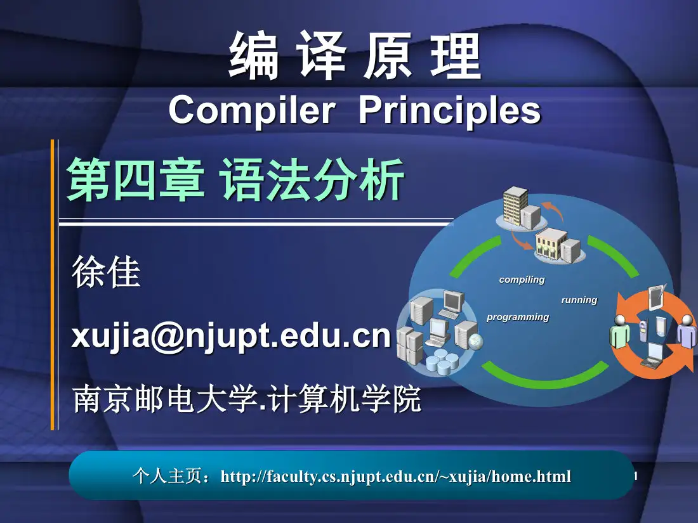

原文：

编译原理 Compiler Principles 第四章 语法分析

徐佳

xujia@njupt.edu.cn
南京邮电大学.计算机学院

compiling

running

programming

个人主页：http://faculty.cs.njupt.edu.cn/\~xujia/home.html

### 本章内容

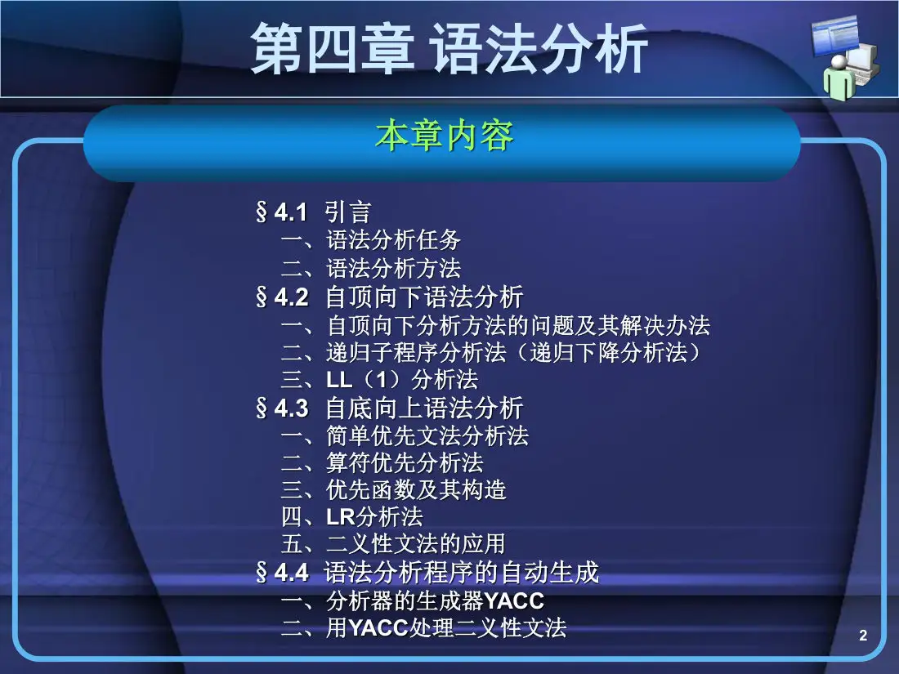

原文：

本章内容

§ 4.1 引言
一、语法分析任务
二、语法分析方法
§ 4.2 自顶向下语法分析
一、自顶向下分析方法的问题及其解决办法
二、递归子程序分析法（递归下降分析法）
三、LL（1）分析法
§ 4.3 自底向上语法分析
一、简单优先文法分析法
二、算符优先分析法
三、优先函数及其构造
四、LR分析法
五、二义性文法的应用
§ 4.4 语法分析程序的自动生成
一、分析器的生成器YACC
二、用YACC处理二义性文法

第四章 语法分析

2

### 本章内容

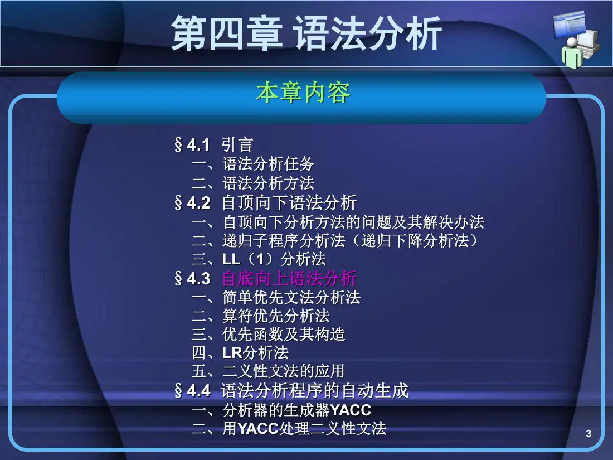

原文：

本章内容

§ 4.1 引言
一、语法分析任务
二、语法分析方法
§ 4.2 自顶向下语法分析
一、自顶向下分析方法的问题及其解决办法
二、递归子程序分析法（递归下降分析法）
三、LL（1）分析法
§ 4.3 自底向上语法分析
一、简单优先文法分析法
二、算符优先分析法
三、优先函数及其构造
四、LR分析法
五、二义性文法的应用
§ 4.4 语法分析程序的自动生成
一、分析器的生成器YACC
二、用YACC处理二义性文法

第四章 语法分析

3

### 一、简单优先文法分析法

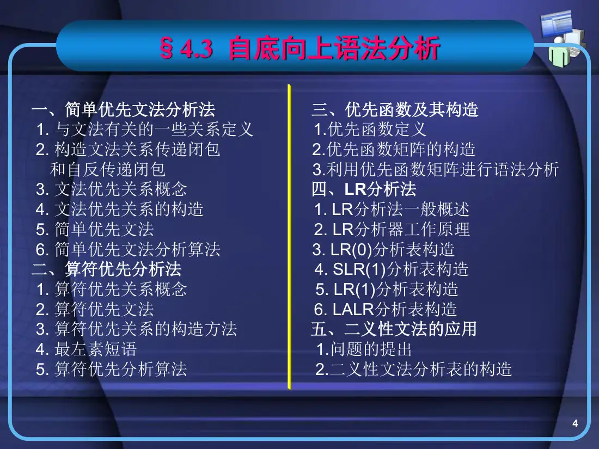

原文：

一、简单优先文法分析法

1. 与文法有关的一些关系定义

2. 构造文法关系传递闭包和自反传递闭包

3. 文法优先关系概念

4. 文法优先关系的构造

5. 简单优先文法

6. 简单优先文法分析算法

二、算符优先分析法

1. 算符优先关系概念

2. 算符优先文法

3. 算符优先关系的构造方法

4. 最左素短语

5. 算符优先分析算法

三、优先函数及其构造

1. 优先函数定义

2. 优先函数矩阵的构造

3. 利用优先函数矩阵进行语法分析

四、LR分析法

1. LR分析法一般概述

2. LR分析器工作原理

3. LR(0)分析表构造

4. SLR(1)分析表构造

5. LR(1)分析表构造

6. LALR分析表构造

五、二义性文法的应用

1. 问题的提出

2.二义性文法分析表的构造

§ 4.3 自底向上语法分析

4

### 自底向上语法分析

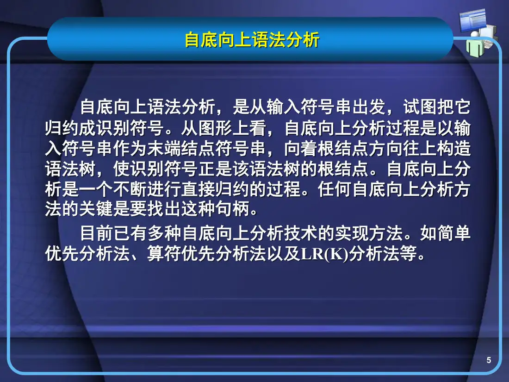

原文：

自底向上语法分析，是从输入符号串出发，试图把它归约成识别符号。从图形上看，自底向上分析过程是以输入符号串作为末端结点符号串，向着根结点方向往上构造语法树，使识别符号正是该语法树的根结点。自底向上分析是一个不断进行直接归约的过程。任何自底向上分析方法的关键是要找出这种句柄。

目前已有多种自底向上分析技术的实现方法。如简单优先分析法、算符优先分析法以及LR(K)分析法等。

自底向上语法分析

5

### 一、简单优先文法分析法

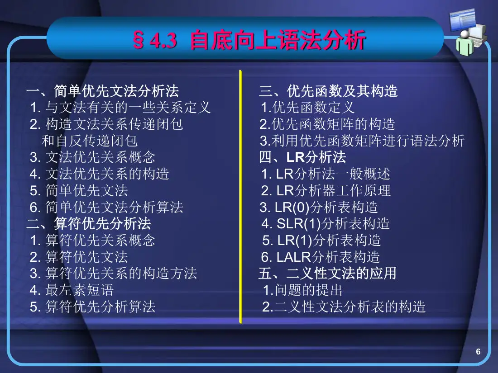

原文：

一、简单优先文法分析法

1. 与文法有关的一些关系定义

2. 构造文法关系传递闭包和自反传递闭包

3. 文法优先关系概念

4. 文法优先关系的构造

5. 简单优先文法

6. 简单优先文法分析算法

二、算符优先分析法

1. 算符优先关系概念

2. 算符优先文法

3. 算符优先关系的构造方法

4. 最左素短语

5. 算符优先分析算法

三、优先函数及其构造

1. 优先函数定义

2. 优先函数矩阵的构造

3. 利用优先函数矩阵进行语法分析

四、LR分析法

1. LR分析法一般概述

2. LR分析器工作原理

3. LR(0)分析表构造

4. SLR(1)分析表构造

5. LR(1)分析表构造

6. LALR分析表构造

五、二义性文法的应用

1. 问题的提出

2.二义性文法分析表的构造

§ 4.3 自底向上语法分析

6

### 一、简单优先文法分析法

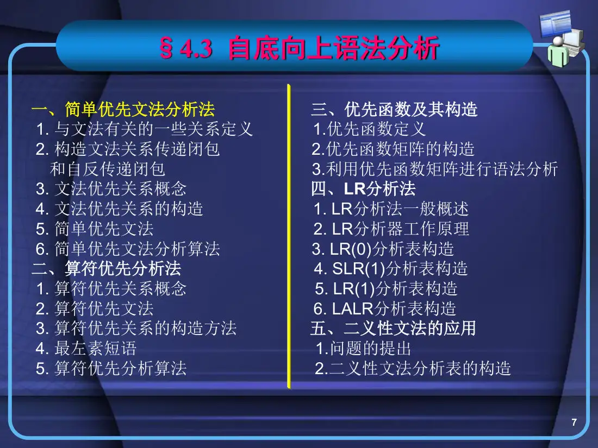

原文：

一、简单优先文法分析法

1. 与文法有关的一些关系定义

2. 构造文法关系传递闭包和自反传递闭包

3. 文法优先关系概念

4. 文法优先关系的构造

5. 简单优先文法

6. 简单优先文法分析算法

二、算符优先分析法

1. 算符优先关系概念

2. 算符优先文法

3. 算符优先关系的构造方法

4. 最左素短语

5. 算符优先分析算法

三、优先函数及其构造

1. 优先函数定义

2. 优先函数矩阵的构造

3. 利用优先函数矩阵进行语法分析

四、LR分析法

1. LR分析法一般概述

2. LR分析器工作原理

3. LR(0)分析表构造

4. SLR(1)分析表构造

5. LR(1)分析表构造

6. LALR分析表构造

五、二义性文法的应用

1. 问题的提出

2.二义性文法分析表的构造

§ 4.3 自底向上语法分析

7

### 一、简单优先文法分析法

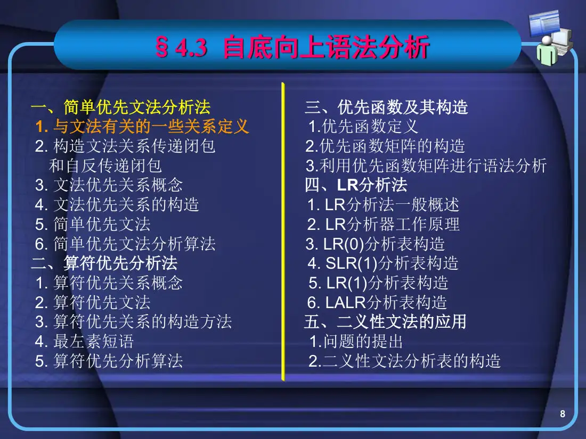

原文：

一、简单优先文法分析法

1. 与文法有关的一些关系定义

2. 构造文法关系传递闭包和自反传递闭包

3. 文法优先关系概念

4. 文法优先关系的构造

5. 简单优先文法

6. 简单优先文法分析算法

二、算符优先分析法

1. 算符优先关系概念

2. 算符优先文法

3. 算符优先关系的构造方法

4. 最左素短语

5. 算符优先分析算法

三、优先函数及其构造

1. 优先函数定义

2. 优先函数矩阵的构造

3. 利用优先函数矩阵进行语法分析

四、LR分析法

1. LR分析法一般概述

2. LR分析器工作原理

3. LR(0)分析表构造

4. SLR(1)分析表构造

5. LR(1)分析表构造

6. LALR分析表构造

五、二义性文法的应用

1. 问题的提出

2.二义性文法分析表的构造

§ 4.3 自底向上语法分析

8

### 1. 与文法有关的一些关系定义

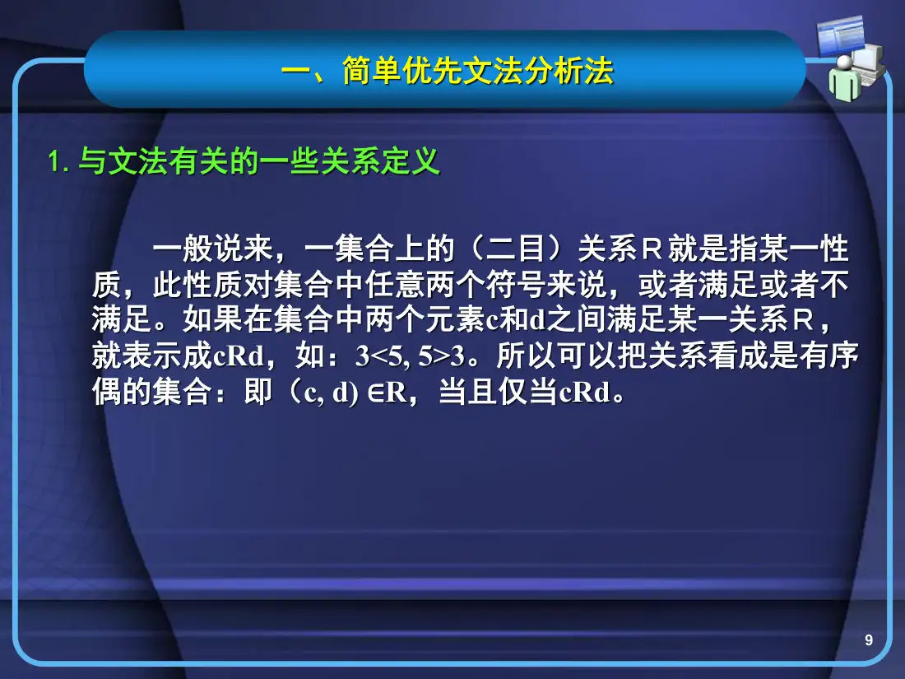

原文：

1. 与文法有关的一些关系定义

一般说来，一集合上的（二目）关系R就是指某一性质，此性质对集合中任意两个符号来说，或者满足或者不满足。如果在集合中两个元素c和d之间满足某一关系R，就表示成cRd，如：3<5, 5>3。所以可以把关系看成是有序偶的集合：即（c, d)∈R，当且仅当cRd。

一、简单优先文法分析法

9

### 一、简单优先文法分析法

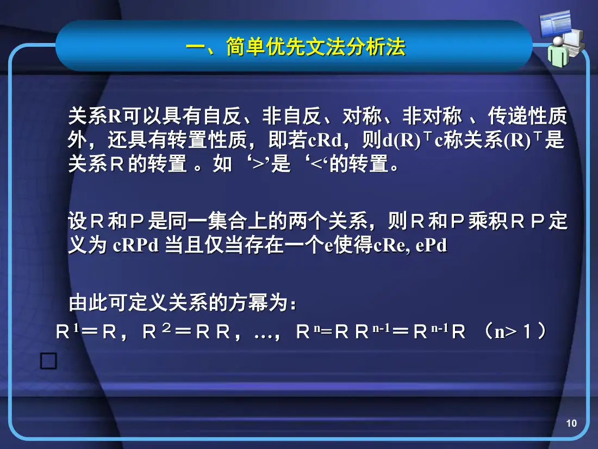

原文：

关系R可以具有自反、非自反、对称、非对称、传递性质外，还具有转置性质，即若cRd，则d(R) $^{T}$ c称关系(R) $^{T}$ 是关系R的转置。如‘>’是‘<’的转置。

设R和P是同一集合上的两个关系，则R和P乘积RP定义为cRPd当且仅当存在一个e使得cRe, ePd

由此可定义关系的方幂为： $R^{1} = R, R^{2} = RR, \ldots, R^{n} = RR^{n-1} = R^{n-1}R$ (n > 1)

一、简单优先文法分析法

10

### 关系 R 自反传递闭包 R\*定义为 aR\*b 当且仅当a=b或aR+b，所以

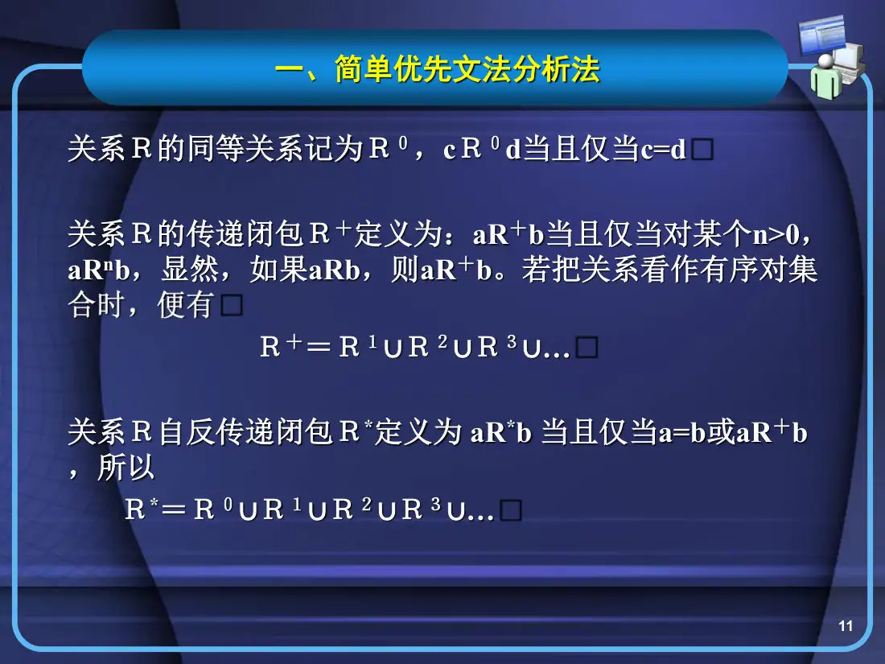

原文：

关系 R 的同等关系记为 $R^{0}$ ， $cR^{0}d$ 当且仅当 c=d □

关系 R 的传递闭包 R $^{+}$ 定义为：aR $^{+}$ b当且仅当对某个n>0，aR $^{n}$ b，显然，如果aRb，则aR $^{+}$ b。若把关系看作有序对集合时，便有□

$\mathrm{R}^{+} = \mathrm{R}^{1}\cup \mathrm{R}^{2}\cup \mathrm{R}^{3}\cup \dots$

关系 R 自反传递闭包 R\*定义为 aR\*b 当且仅当a=b或aR+b，所以

$\mathrm{R}^{*} = \mathrm{R}^{0}\cup \mathrm{R}^{1}\cup \mathrm{R}^{2}\cup \mathrm{R}^{3}\cup \dots$

一、简单优先文法分析法

11

### 下面我们定义与任何文法有关的几个关系。

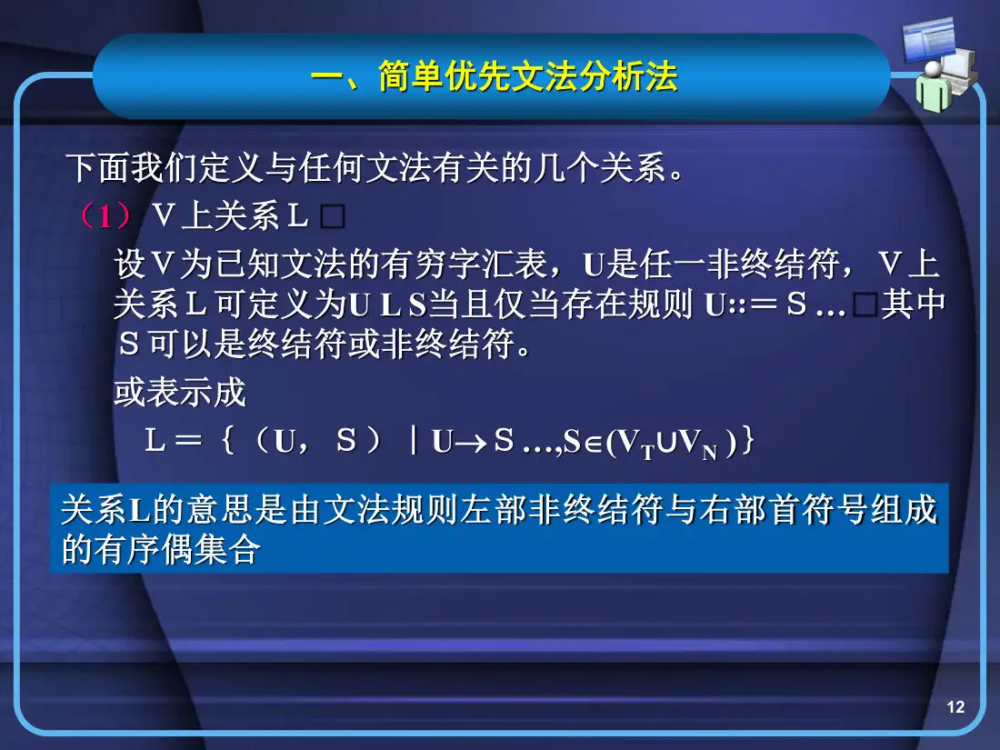

原文：

下面我们定义与任何文法有关的几个关系。

设 V 为已知文法的有穷字汇表，U 是任一非终结符，V 上关系 L 可定义为 U L S 当且仅当存在规则 U::= S ... □ 其中 S 可以是终结符或非终结符。

或表示成

$\mathrm{L} = \{\mathrm{(U,S)}|\mathrm{U}\rightarrow \mathrm{S}\dots ,\mathrm{S}\in (\mathrm{V}_{\mathrm{T}}\cup \mathrm{V}_{\mathrm{N}})\}$

关系L的意思是由文法规则左部非终结符与右部首符号组成的有序偶集合

一、简单优先文法分析法

12

### 例4.5 设文法G [A]

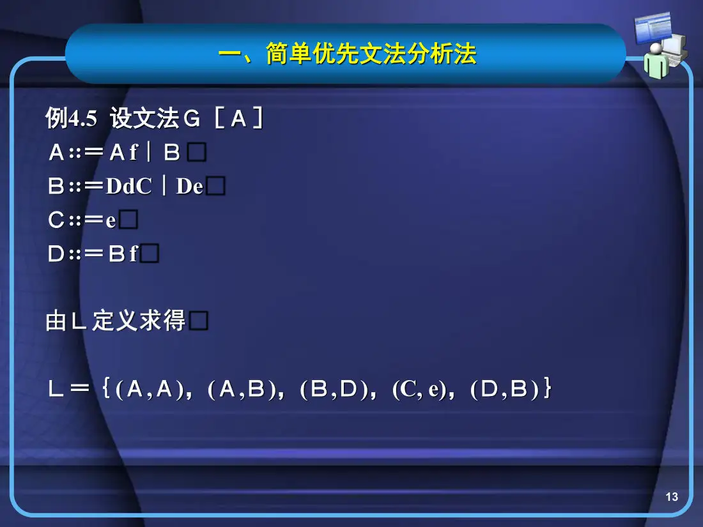

原文：

例4.5 设文法G [A]
A::=Af | B□
B::=DdC | De□
C::=e□
D::=Bf□

由L定义求得□

$L = \{(A,A), (A,B), (B,D), (C,e), (D,B)\}$ (2) V 上关系传递闭包 L $^{+}$ □
V 上关系传递闭包 L $^{+}$ 定义为: U L $^{+}$ S

一、简单优先文法分析法

13

### 一、简单优先文法分析法

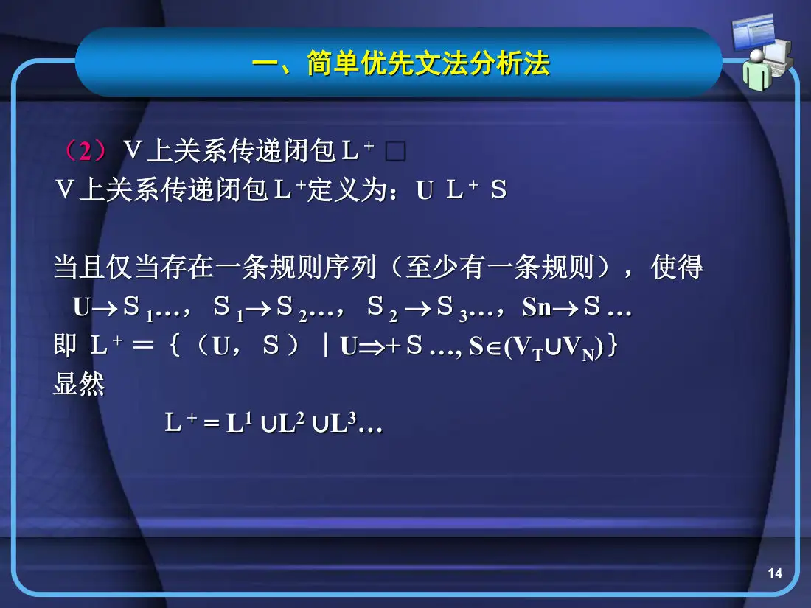

原文：

当且仅当存在一条规则序列（至少有一条规则），使得 $U \to S_{1} \ldots, S_{1} \to S_{2} \ldots, S_{2} \to S_{3} \ldots, Sn \to S \ldots$ 即 $L^{+} = \{ (U, S) | U \Rightarrow +S \ldots, S \in (V_{T} \cup V_{N})\}$ 显然

$\mathrm{L}^{+} = \mathrm{L}^{1}\cup \mathrm{L}^{2}\cup \mathrm{L}^{3}\dots$

一、简单优先文法分析法

14

### $$

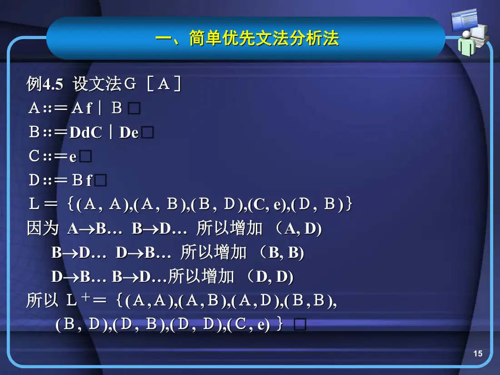

原文：

$$
\mathrm{A}: := \mathrm{Af} \mid \mathrm{B} \square
$$

$$
\mathrm{B}: := \mathrm{DdC} \mid \mathrm{De} \square
$$

$$
C: := e \square
$$

$$
\mathrm{D}: := \mathrm{Bf} \square
$$

L = {(A, A),(A, B),(B, D),(C, e),(D, B)}
因为 A→B... B→D... 所以增加 (A, D)
B→D... D→B... 所以增加 (B, B)
D→B... B→D...所以增加 (D, D)
所以 L+ = {(A, A),(A, B),(A, D),(B, B),
(B, D),(D, B),(D, D),(C, e)} □

一、简单优先文法分析法

15

### (3) V 上关系自反传递闭包L\

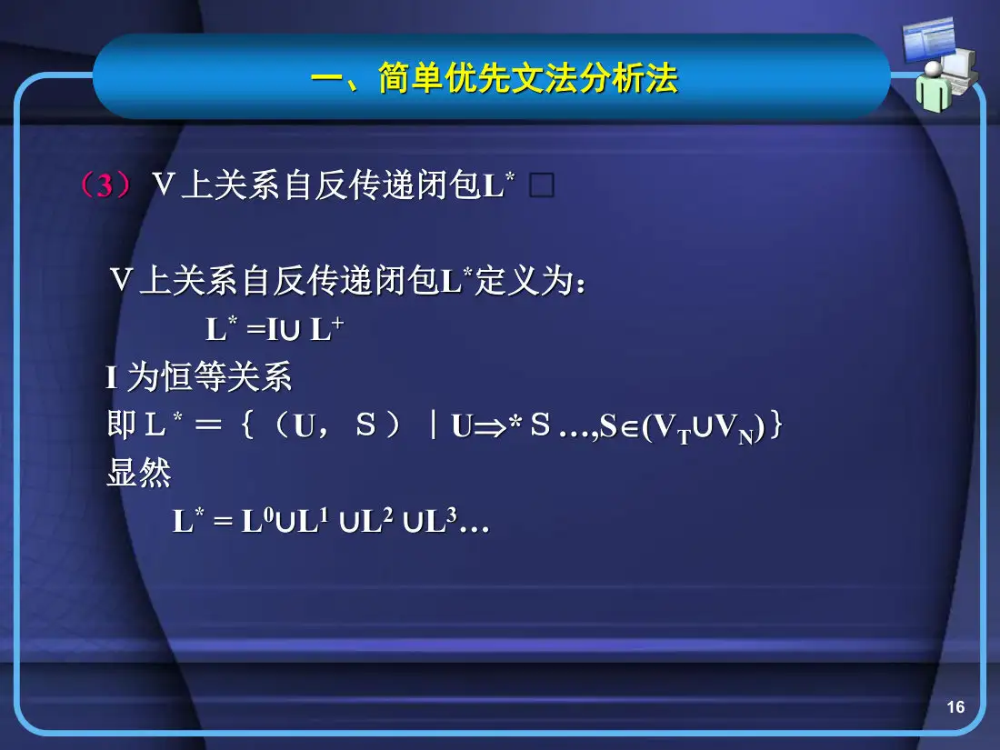

原文：

(3) V 上关系自反传递闭包L\*

V上关系自反传递闭包L\*定义为:

$$
\mathrm{L} ^ {*} = \mathrm{I} \cup \mathrm{L} ^ {+}
$$

I 为恒等关系
即 $L^{*} = \{(U, S) | U \Rightarrow^{*} S \dots, S \in (V_{T} \cup V_{N})\}$ 显然

$$
\mathrm{L} ^ {*} = \mathrm{L} ^ {0} \cup \mathrm{L} ^ {1} \cup \mathrm{L} ^ {2} \cup \mathrm{L} ^ {3} \dots
$$

一、简单优先文法分析法

16

### 例4.5 设文法G [A]

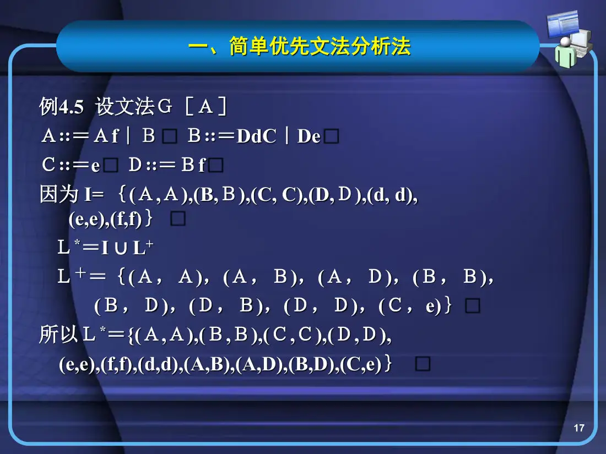

原文：

例4.5 设文法G [A]
A::=Af | B □ B::=DdC | De □
C::=e □ D::=Bf □
因为I= {(A,A),(B,B),(C,C),(D,D),(d,d),(e,e),(f,f)} □
L\* = I ∪ L+
L+ = {(A, A), (A, B), (A, D), (B, B), (B, D), (D, B), (D, D), (C, e)} □
所以L\* = {(A,A),(B,B),(C,C),(D,D), (e,e),(f,f),(d,d),(A,B),(A,D),(B,D),(C,e)} □

一、简单优先文法分析法

17

### (4) V 上关系 R (用类似方法可以定义)

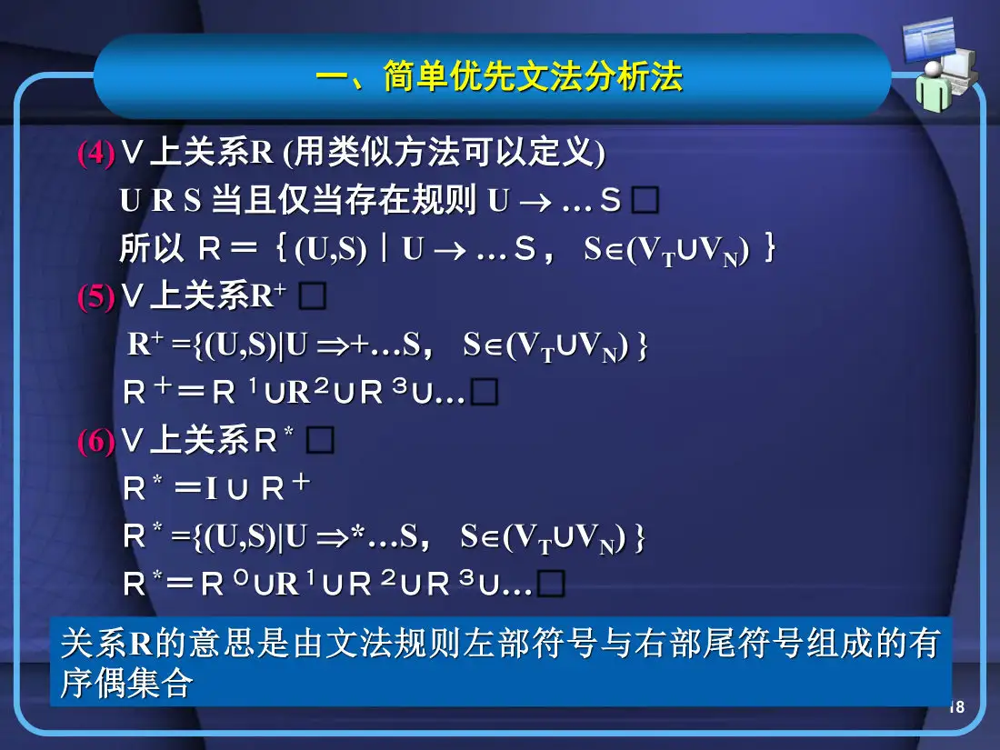

原文：

(4) V 上关系 R (用类似方法可以定义)
URS 当且仅当存在规则 U → ... S □
所以 R = {(U,S) | U → ... S, S ∈ (V\_T ∪ V\_N)}

(5) V 上关系 $R^{+}$ □ $R^{+} = \{(U, S) | U \Rightarrow +...S, \quad S \in (V_{T} \cup V_{N}) \}$ $R^{+} = R^{1} \cup R^{2} \cup R^{3} \cup ...$ □

(6) V 上关系 $R^{*}$ □ $R^{*} = I \cup R^{+}$ $R^{*} = \{(U, S) | U \Rightarrow^{*}...S, \quad S \in (V_{T} \cup V_{N}) \}$ $R^{*} = R^{0} \cup R^{1} \cup R^{2} \cup R^{3} \cup ...$ □

关系R的意思是由文法规则左部符号与右部尾符号组成的有序偶集合

一、简单优先文法分析法

18

### 例4.5 设文法G [A]

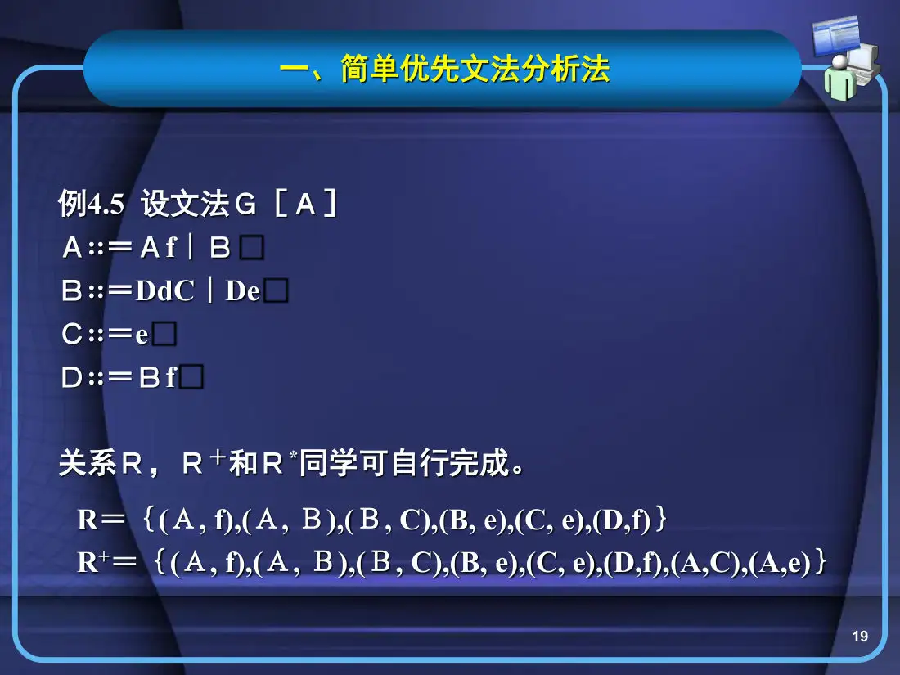

原文：

例4.5 设文法G [A]
A::=Af | B□
B::=DdC | De□
C::=e□
D::=Bf□

关系R，R+和R\*同学可自行完成。

$\mathrm{R} = \{(\mathrm{A},\mathrm{f}),(\mathrm{A},\mathrm{B}),(\mathrm{B},\mathrm{C}),(\mathrm{B},\mathrm{e}),(\mathrm{C},\mathrm{e}),(\mathrm{D},\mathrm{f})\}$ $\mathrm{R}^{+} = \{(\mathrm{A},\mathrm{f}),(\mathrm{A},\mathrm{B}),(\mathrm{B},\mathrm{C}),(\mathrm{B},\mathrm{e}),(\mathrm{C},\mathrm{e}),(\mathrm{D},\mathrm{f}),(\mathrm{A},\mathrm{C}),(\mathrm{A},\mathrm{e})\}$

一、简单优先文法分析法

19

### 一、简单优先文法分析法

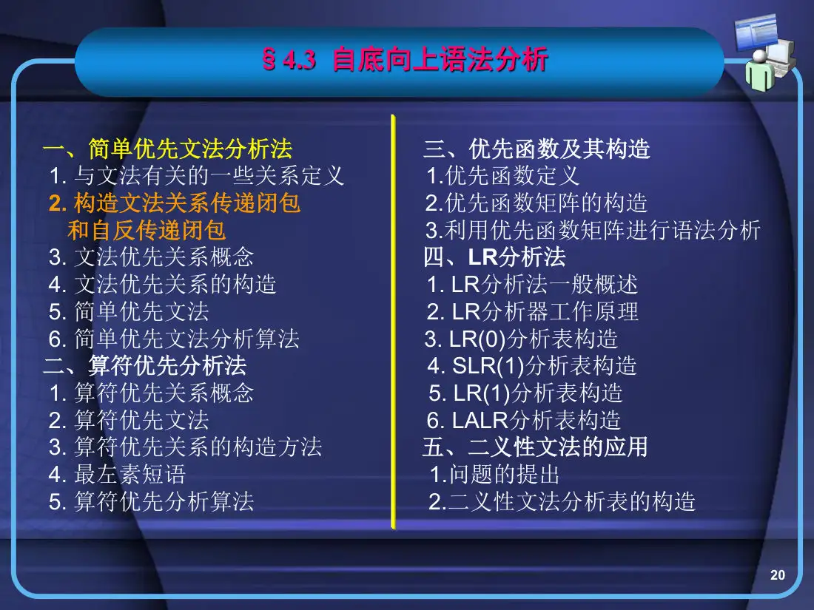

原文：

一、简单优先文法分析法

1. 与文法有关的一些关系定义

2. 构造文法关系传递闭包和自反传递闭包

3. 文法优先关系概念

4. 文法优先关系的构造

5. 简单优先文法

6. 简单优先文法分析算法

二、算符优先分析法

1. 算符优先关系概念

2. 算符优先文法

3. 算符优先关系的构造方法

4. 最左素短语

5. 算符优先分析算法

三、优先函数及其构造

1. 优先函数定义

2. 优先函数矩阵的构造

3. 利用优先函数矩阵进行语法分析

四、LR分析法

1. LR分析法一般概述

2. LR分析器工作原理

3. LR(0)分析表构造

4. SLR(1)分析表构造

5. LR(1)分析表构造

6. LALR分析表构造

五、二义性文法的应用

1. 问题的提出

2.二义性文法分析表的构造

§ 4.3 自底向上语法分析

20

### (1)布尔矩阵的概念

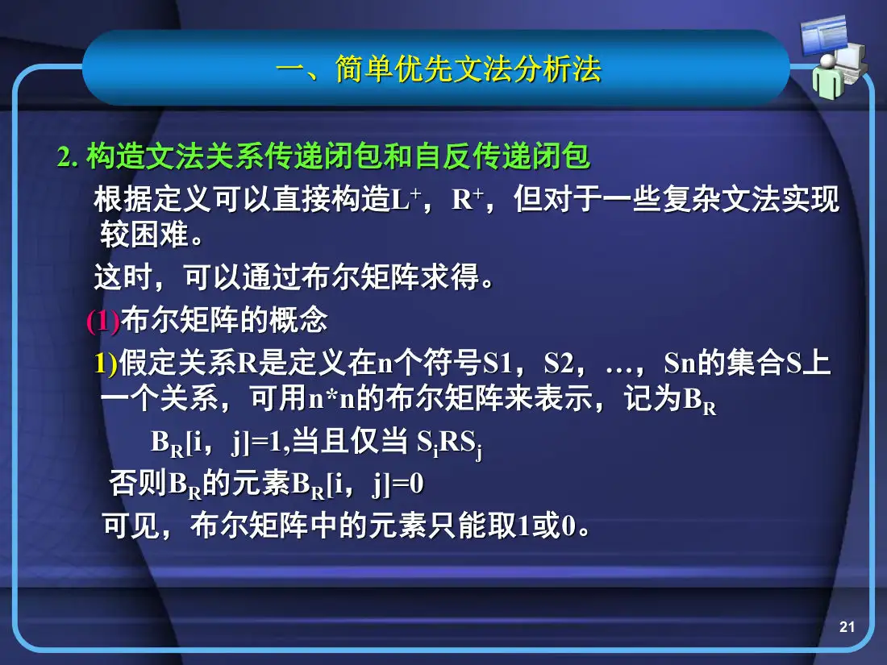

原文：

2. 构造文法关系传递闭包和自反传递闭包根据定义可以直接构造 $\mathrm{L}^{+}$ , $\mathrm{R}^{+}$ , 但对于一些复杂文法实现较困难。这时, 可以通过布尔矩阵求得。

(1)布尔矩阵的概念

1)假定关系R是定义在n个符号S1，S2，…，Sn的集合S上一个关系，可用n\*n的布尔矩阵来表示，记为B $_{R}$ B $_{R}$ [i, j]=1,当且仅当 S $_{i}$ RS $_{j}$ 否则B $_{R}$ 的元素B $_{R}$ [i, j]=0

可见，布尔矩阵中的元素只能取1或0。

一、简单优先文法分析法

21

### 设文法G [A]

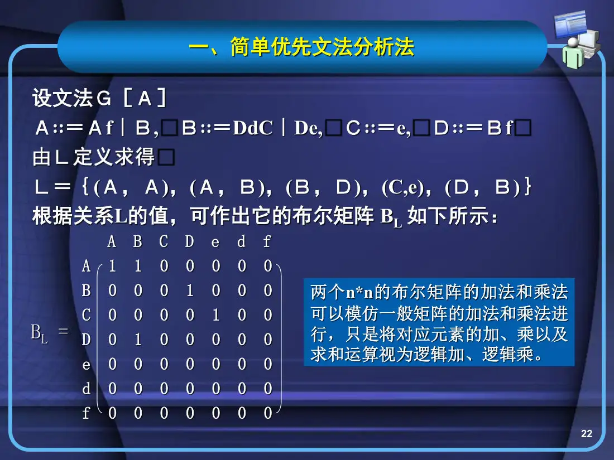

原文：

设文法G [A]
A::=Af | B, □B::=DdC | De, □C::=e, □D::=Bf□
由L定义求得□
L = {(A, A), (A, B), (B, D), (C,e), (D, B)}
根据关系L的值，可作出它的布尔矩阵 B $_{L}$ 如下所示：

$$
\mathrm{B} _ {\mathrm{L}} = \begin{array}{c} \begin{array}{c c c c c c c} & \mathrm{A} & \mathrm{B} & \mathrm{C} & \mathrm{D} & \mathrm{e} & \mathrm{d} & \mathrm{f} \\ \mathrm{A} & 1 & 1 & 0 & 0 & 0 & 0 & 0 \\ \mathrm{B} & 0 & 0 & 0 & 1 & 0 & 0 & 0 \\ \mathrm{C} & 0 & 0 & 0 & 0 & 1 & 0 & 0 \\ \mathrm{D} & 0 & 1 & 0 & 0 & 0 & 0 & 0 \\ \mathrm{e} & 0 & 0 & 0 & 0 & 0 & 0 & 0 \\ \mathrm{d} & 0 & 0 & 0 & 0 & 0 & 0 & 0 \\ \mathrm{f} & 0 & 0 & 0 & 0 & 0 & 0 & 0 \end{array} \end{array}
$$

两个n\*n的布尔矩阵的加法和乘法可以模仿一般矩阵的加法和乘法进行，只是将对应元素的加、乘以及求和运算视为逻辑加、逻辑乘。

一、简单优先文法分析法

22

### ③ 在同一个字母表上两个关系的乘积，可由表示这两个关系的布尔矩阵乘积给出。

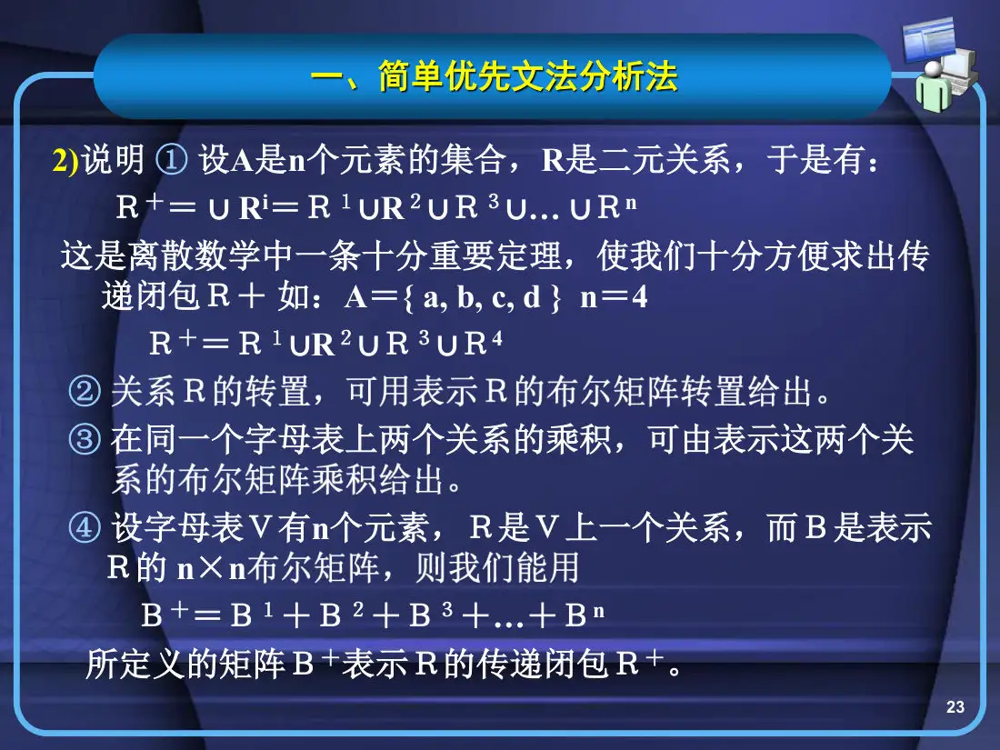

原文：

2)说明 ① 设A是n个元素的集合，R是二元关系，于是有： $R^{+} = \cup R^{i} = R^{1} \cup R^{2} \cup R^{3} \cup \ldots \cup R^{n}$ 这是离散数学中一条十分重要定理，使我们十分方便求出传递闭包R+如： $A=\{a,b,c,d\}$ n=4 $R^{+}=R^{1}\cup R^{2}\cup R^{3}\cup R^{4}$ ② 关系R的转置，可用表示R的布尔矩阵转置给出。
③ 在同一个字母表上两个关系的乘积，可由表示这两个关系的布尔矩阵乘积给出。
④ 设字母表V有n个元素，R是V上一个关系，而B是表示R的n×n布尔矩阵，则我们能用 $B^{+}=B^{1}+B^{2}+B^{3}+\ldots+B^{n}$ 所定义的矩阵 $B^{+}$ 表示R的传递闭包 $R^{+}$ 。

一、简单优先文法分析法

23

### (2)构造文法关系L，L⁺，L\

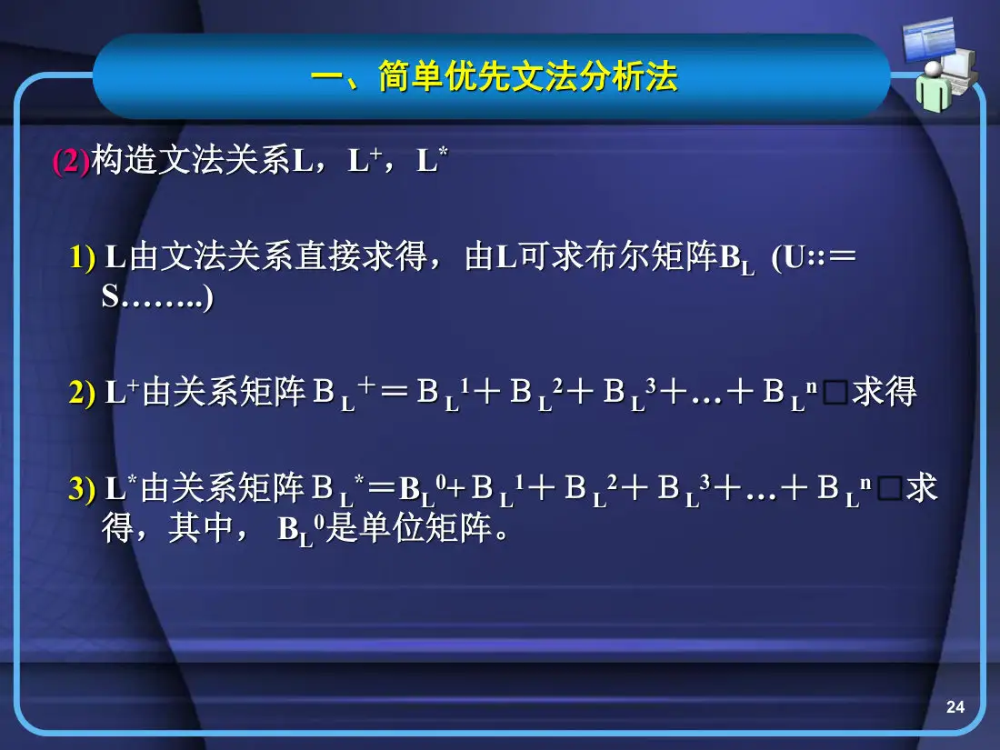

原文：

(2)构造文法关系L，L⁺，L\*

1) L由文法关系直接求得，由L可求布尔矩阵 $B_{L}$ (U::=S......)

2) $\mathrm{L}^{+}$ 由关系矩阵 $\mathrm{B}_{\mathrm{L}}^{+} = \mathrm{B}_{\mathrm{L}}^{1} + \mathrm{B}_{\mathrm{L}}^{2} + \mathrm{B}_{\mathrm{L}}^{3} + \ldots + \mathrm{B}_{\mathrm{L}}^{\mathfrak{n}}$ □求得

3) L\*由关系矩阵 B $_{L}$ \* = B $_{L}$ $^{0}$ + B $_{L}$ $^{1}$ + B $_{L}$ $^{2}$ + B $_{L}$ $^{3}$ +...+ B $_{L}$ $^{n}$ □求得，其中，B $_{L}$ $^{0}$ 是单位矩阵。

一、简单优先文法分析法

24

### (3)构造文法关系R， $R^{+}$ ， $R^{*}$

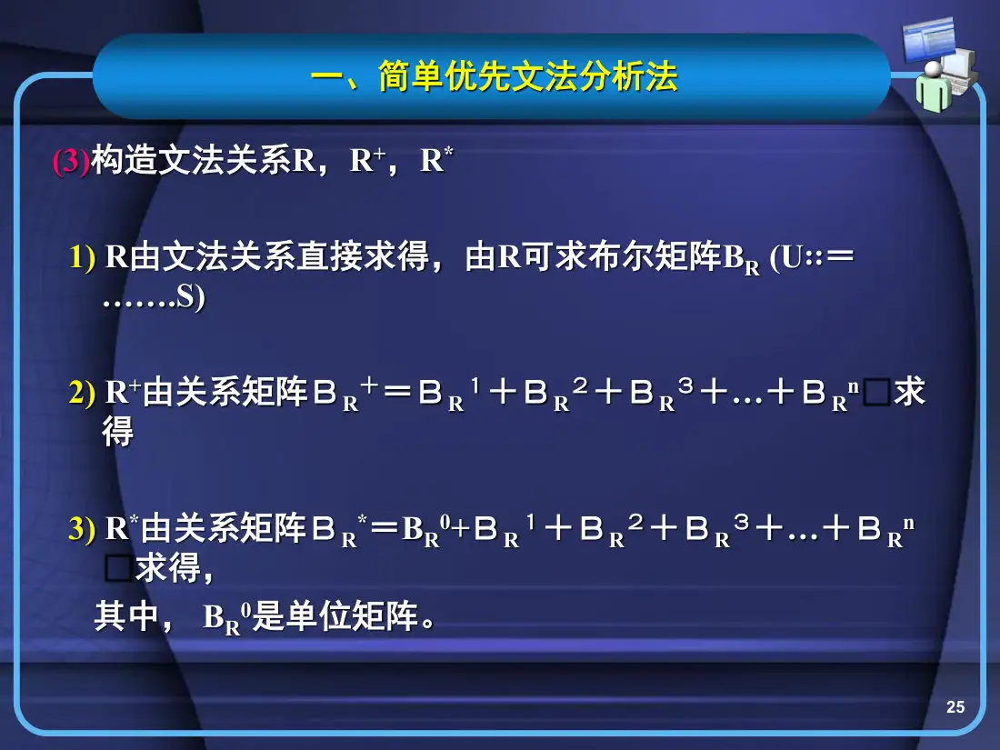

原文：

(3)构造文法关系R， $R^{+}$ ， $R^{*}$

1) R由文法关系直接求得，由R可求布尔矩阵 $B_{R}$ (U::=……S)

2) $\mathrm{R}^{+}$ 由关系矩阵 $B_{\mathrm{R}}^{+} = B_{\mathrm{R}}^{1} + B_{\mathrm{R}}^{2} + B_{\mathrm{R}}^{3} + \ldots + B_{\mathrm{R}}^{\mathrm{n}}$ □求得

3) R\*由关系矩阵B $_{R}$ \*=B $_{R}$ $^{0}$ +B $_{R}$ $^{1}$ +B $_{R}$ $^{2}$ +B $_{R}$ $^{3}$ +...+B $_{R}$ $^{n}$ □求得，
其中，B $_{R}$ $^{0}$ 是单位矩阵。

一、简单优先文法分析法

25

### ①由文法规则求

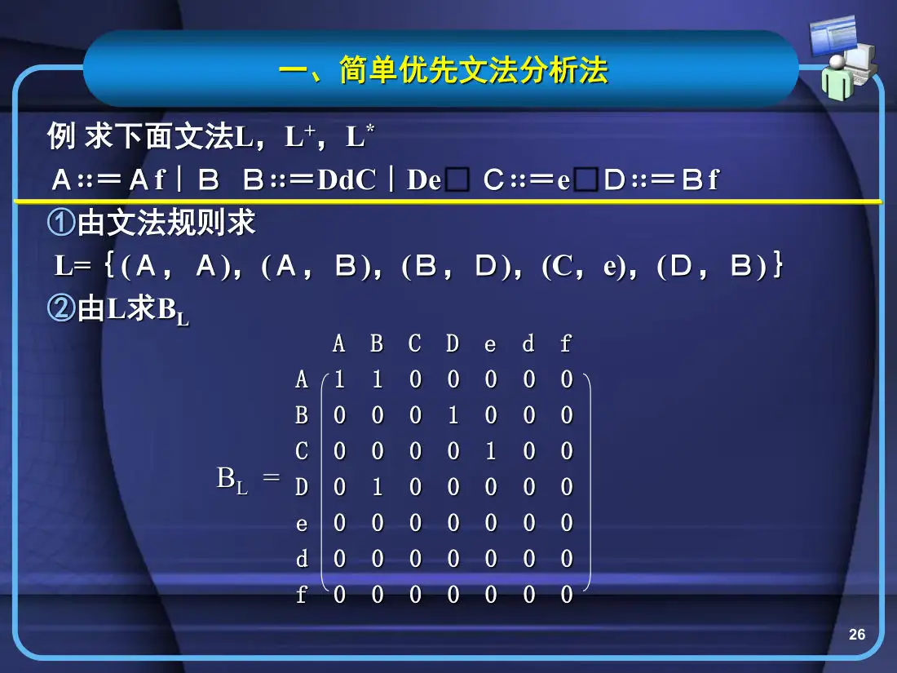

原文：

例 求下面文法L，L $^{+}$ ，L $^{*}$ A::=Af|B B::=DdC|De□ C::=e□D::=Bf

①由文法规则求
L= {(A, A), (A, B), (B, D), (C, e), (D, B)}
②由L求BL

$$
B _ {L} = \begin{array}{c} A \\ B \\ C \\ D \\ e \\ d \\ f \end{array} \left( \begin{array}{l l l l l l l} 1 & 1 & 0 & 0 & 0 & 0 & 0 \\ 0 & 0 & 0 & 1 & 0 & 0 & 0 \\ 0 & 0 & 0 & 0 & 1 & 0 & 0 \\ 0 & 1 & 0 & 0 & 0 & 0 & 0 \\ 0 & 0 & 0 & 0 & 0 & 0 & 0 \\ 0 & 0 & 0 & 0 & 0 & 0 & 0 \\ 0 & 0 & 0 & 0 & 0 & 0 & 0 \end{array} \right)
$$

一、简单优先文法分析法

26

### $$

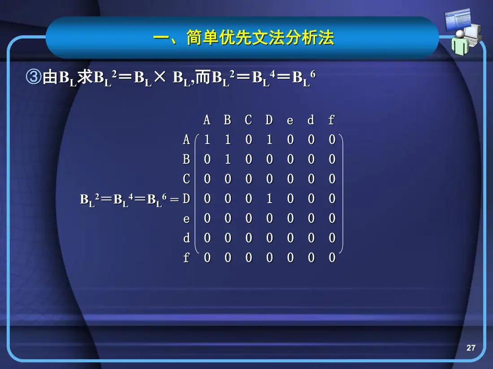

原文：

③由 $B_{L}$ 求 $B_{L}^{2}=B_{L}\times B_{L}$ ，而 $B_{L}^{2}=B_{L}^{4}=B_{L}^{6}$

$$
\mathbf {B} _ {\mathrm{L}} ^ {2} = \mathbf {B} _ {\mathrm{L}} ^ {4} = \mathbf {B} _ {\mathrm{L}} ^ {6} = \left( \begin{array}{c c c c c c c} A & B & C & D & e & d & f \\ A & 1 & 1 & 0 & 1 & 0 & 0 & 0 \\ B & 0 & 1 & 0 & 0 & 0 & 0 & 0 \\ C & 0 & 0 & 0 & 0 & 0 & 0 & 0 \\ D & 0 & 0 & 0 & 1 & 0 & 0 & 0 \\ e & 0 & 0 & 0 & 0 & 0 & 0 & 0 \\ d & 0 & 0 & 0 & 0 & 0 & 0 & 0 \\ f & 0 & 0 & 0 & 0 & 0 & 0 & 0 \end{array} \right)
$$

一、简单优先文法分析法

27

### $$

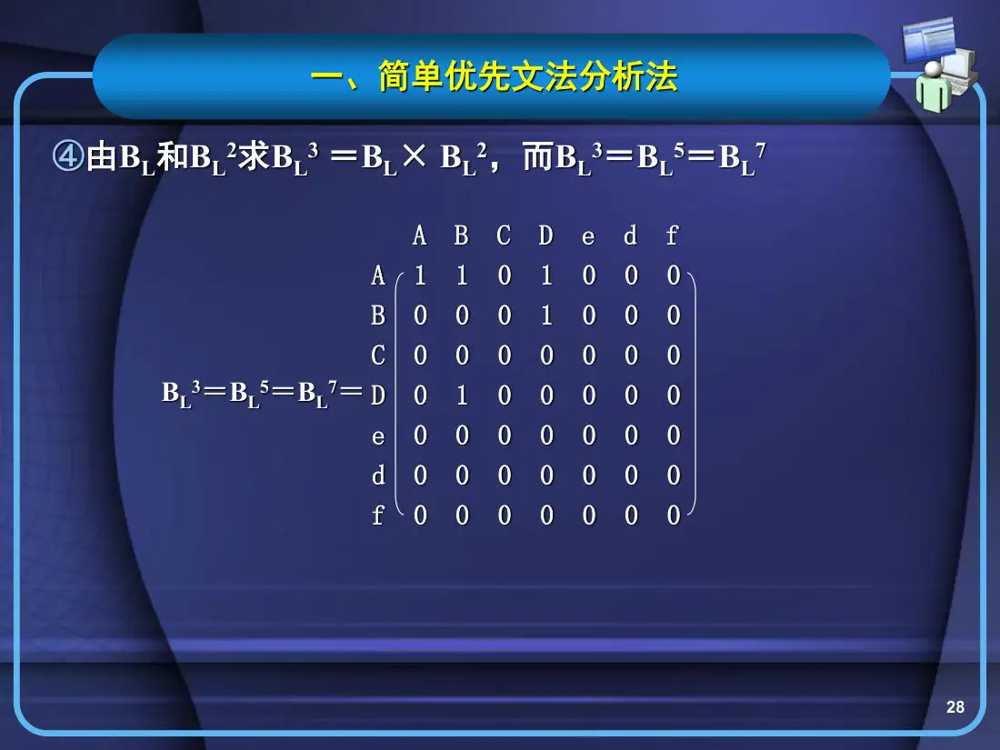

原文：

④由 $B_{L}$ 和 $B_{L}^{2}$ 求 $B_{L}^{3}=B_{L}\times B_{L}^{2}$ ，而 $B_{L}^{3}=B_{L}^{5}=B_{L}^{7}$

$$
\mathbf {B} _ {\mathrm{L}} ^ {3} = \mathbf {B} _ {\mathrm{L}} ^ {5} = \mathbf {B} _ {\mathrm{L}} ^ {7} = \left( \begin{array}{c c c c c c c} A & B & C & D & e & d & f \\ A & 1 & 1 & 0 & 1 & 0 & 0 & 0 \\ B & 0 & 0 & 0 & 1 & 0 & 0 & 0 \\ C & 0 & 0 & 0 & 0 & 0 & 0 & 0 \\ D & 0 & 1 & 0 & 0 & 0 & 0 & 0 \\ e & 0 & 0 & 0 & 0 & 0 & 0 & 0 \\ d & 0 & 0 & 0 & 0 & 0 & 0 & 0 \\ f & 0 & 0 & 0 & 0 & 0 & 0 & 0 \end{array} \right)
$$

一、简单优先文法分析法

28

### $$

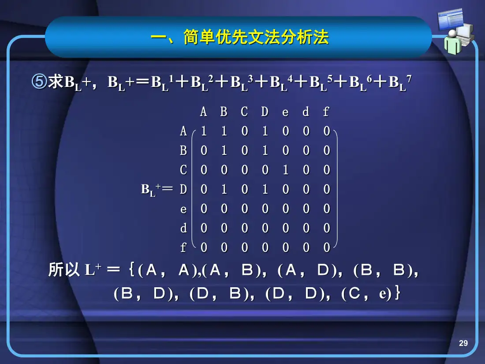

原文：

⑤求 $B_{L}^{+}$ ， $B_{L}^{+}=B_{L}^{1}+B_{L}^{2}+B_{L}^{3}+B_{L}^{4}+B_{L}^{5}+B_{L}^{6}+B_{L}^{7}$

$$
\mathbf {B} _ {\mathrm{L}} ^ {+} = \begin{array}{l} \begin{array}{c c c c c c c} & \mathrm{A} & \mathrm{B} & \mathrm{C} & \mathrm{D} & \mathrm{e} & \mathrm{d} & \mathrm{f} \\ \mathrm{A} & 1 & 1 & 0 & 1 & 0 & 0 & 0 \\ \mathrm{B} & 0 & 1 & 0 & 1 & 0 & 0 & 0 \\ \mathrm{C} & 0 & 0 & 0 & 0 & 1 & 0 & 0 \\ \mathrm{D} & 0 & 1 & 0 & 1 & 0 & 0 & 0 \\ \mathrm{e} & 0 & 0 & 0 & 0 & 0 & 0 & 0 \\ \mathrm{d} & 0 & 0 & 0 & 0 & 0 & 0 & 0 \\ \mathrm{f} & 0 & 0 & 0 & 0 & 0 & 0 & 0 \end{array} \end{array}
$$

所以 $L^{+}=\{(A,A),(A,B),(A,D),(B,B),(B,D),(D,B),(D,D),(C,e)\}$

一、简单优先文法分析法

29

### $$

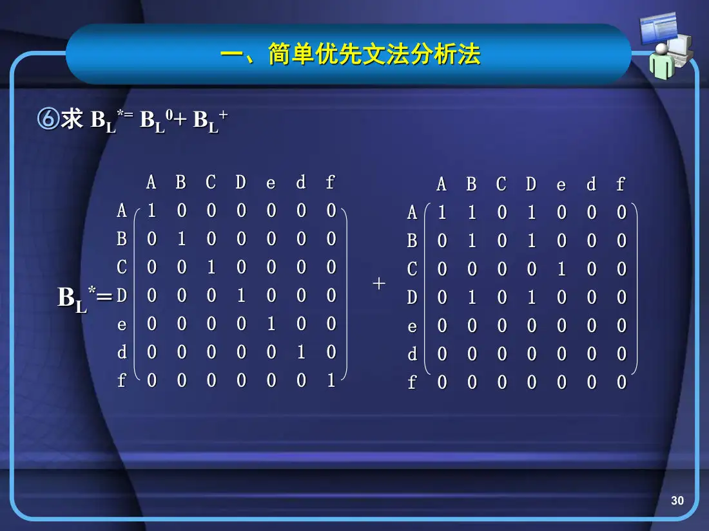

原文：

⑥求 $\mathbf{B}_{\mathrm{L}}^{*} = \mathbf{B}_{\mathrm{L}}^{0} + \mathbf{B}_{\mathrm{L}}^{+}$

$$
\mathbf {B} _ {\mathbf {L}} ^ {*} = \begin{array}{c} \text {A} \\ \text {B} \\ \text {C} \\ \text {D} \\ \text {e} \\ \text {d} \\ \text {f} \end{array} \left( \begin{array}{l l l l l l l} 1 & 0 & 0 & 0 & 0 & 0 & 0 \\ 0 & 1 & 0 & 0 & 0 & 0 & 0 \\ 0 & 0 & 1 & 0 & 0 & 0 & 0 \\ 0 & 0 & 0 & 1 & 0 & 0 & 0 \\ 0 & 0 & 0 & 0 & 1 & 0 & 0 \\ 0 & 0 & 0 & 0 & 0 & 1 & 0 \\ 0 & 0 & 0 & 0 & 0 & 0 & 1 \end{array} \right)
$$

$$
+ \begin{array}{c} \begin{array}{c c c c c c c} & \mathrm{A} & \mathrm{B} & \mathrm{C} & \mathrm{D} & \mathrm{e} & \mathrm{d} & \mathrm{f} \\ + & \mathrm{A} \\ & \mathrm{B} \\ & \mathrm{C} \\ & \mathrm{D} \\ & \mathrm{e} \\ & \mathrm{d} \\ & \mathrm{f} \end{array} \left( \begin{array}{c c c c c c c} 1 & 1 & 0 & 1 & 0 & 0 & 0 \\ 0 & 1 & 0 & 1 & 0 & 0 & 0 \\ 0 & 0 & 0 & 0 & 1 & 0 & 0 \\ 0 & 1 & 0 & 1 & 0 & 0 & 0 \\ 0 & 0 & 0 & 0 & 0 & 0 & 0 \\ 0 & 0 & 0 & 0 & 0 & 0 & 0 \\ 0 & 0 & 0 & 0 & 0 & 0 & 0 \end{array} \right) \end{array}
$$

一、简单优先文法分析法

30

### $$

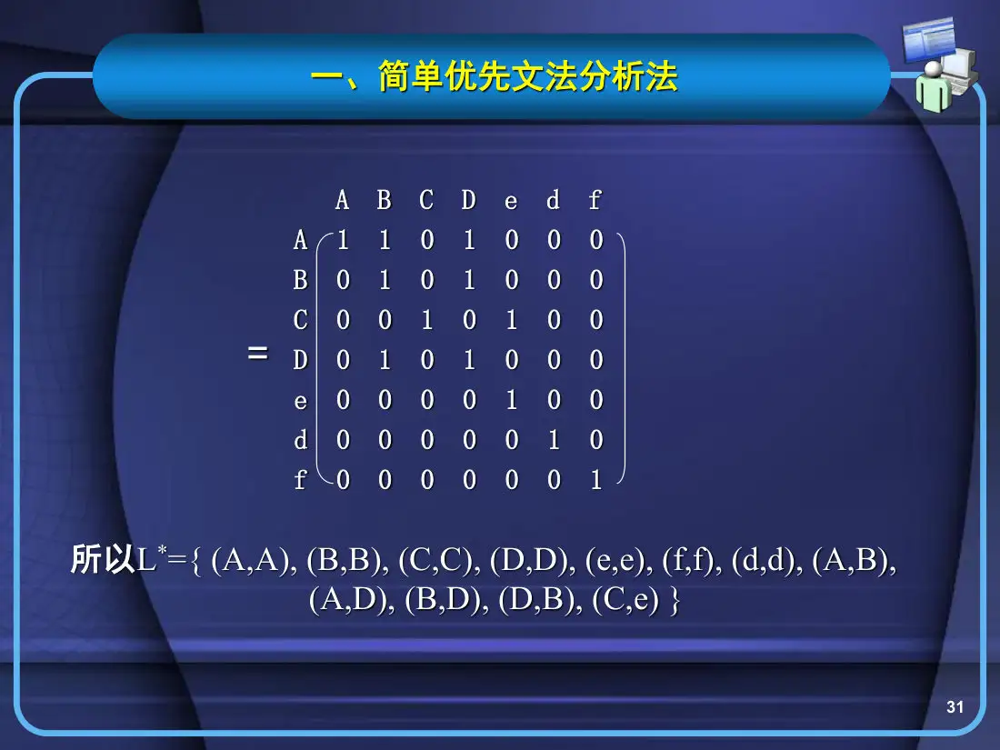

原文：

$$
= \begin{array}{c} \begin{array}{c c c c c c c} & \mathrm{A} & \mathrm{B} & \mathrm{C} & \mathrm{D} & \mathrm{e} & \mathrm{d} & \mathrm{f} \\ = & \mathrm{A} & 1 & 1 & 0 & 1 & 0 & 0 & 0 \\ & \mathrm{B} & 0 & 1 & 0 & 1 & 0 & 0 & 0 \\ & \mathrm{C} & 0 & 0 & 1 & 0 & 1 & 0 & 0 \\ & \mathrm{D} & 0 & 1 & 0 & 1 & 0 & 0 & 0 \\ & \mathrm{e} & 0 & 0 & 0 & 0 & 1 & 0 & 0 \\ & \mathrm{d} & 0 & 0 & 0 & 0 & 0 & 1 & 0 \\ & \mathrm{f} & 0 & 0 & 0 & 0 & 0 & 0 & 1 \end{array} \end{array}
$$

所以 $L^{*}=\{(A,A),(B,B),(C,C),(D,D),(e,e),(f,f),(d,d),(A,B),(A,D),(B,D),(D,B),(C,e)\}$

一、简单优先文法分析法

31

### (3) Warshall算法

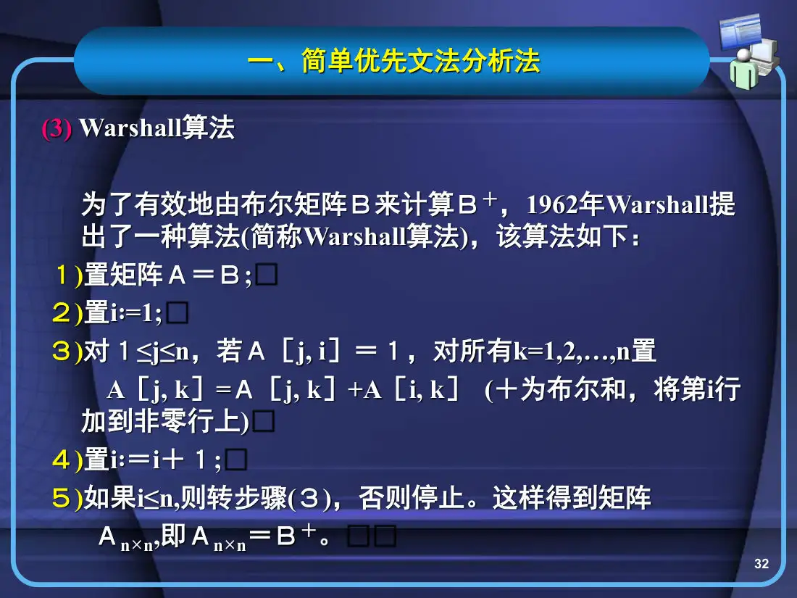

原文：

(3) Warshall算法

为了有效地由布尔矩阵 B 来计算 B $^{+}$ ，1962年Warshall提出了一种算法(简称Warshall算法)，该算法如下：

1) 置矩阵 A = B; □

2) 置i:=1; □

3)对 $1 \leq j \leq n$ ，若 A [j, i] = 1，对所有 k=1,2,...,n 置
A [j, k] = A [j, k] + A [i, k] （+为布尔和，将第i行加到非零行上）□

4) 置i:=i+1;□

5)如果i≤n,则转步骤(3)，否则停止。这样得到矩阵 $A_{n\times n}$ ，即 $A_{n\times n}=B^{+}$ 。□□

一、简单优先文法分析法

32

### i=1

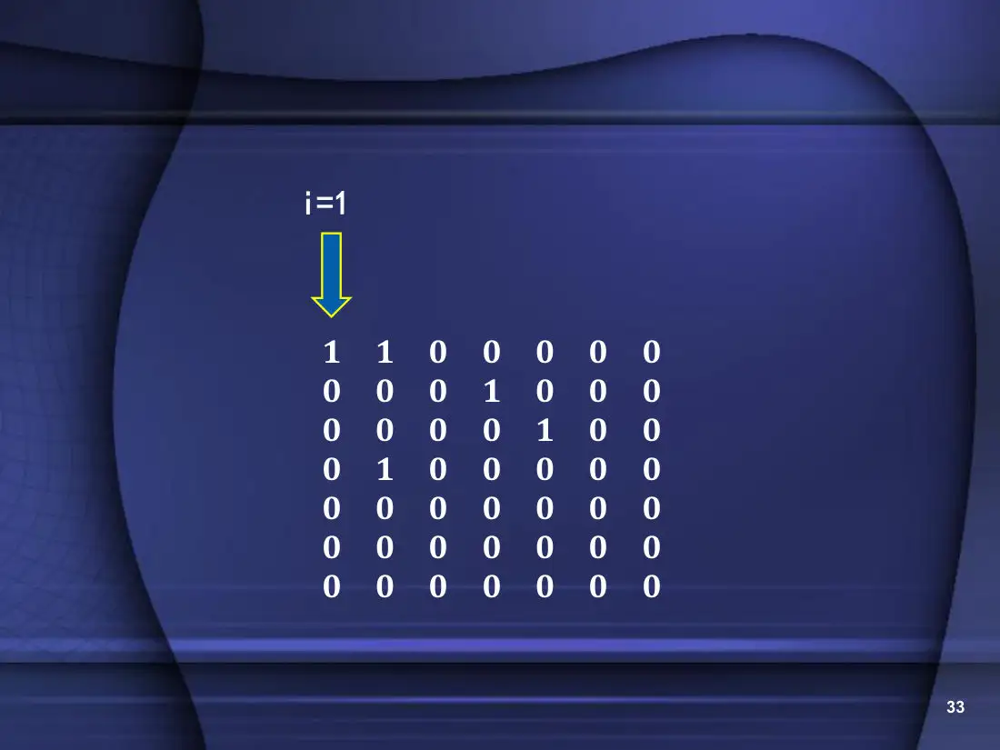

原文：

i=1

$$
\begin{array}{c c c c c c c} 1 & 1 & 0 & 0 & 0 & 0 & 0 \\ 0 & 0 & 0 & 1 & 0 & 0 & 0 \\ 0 & 0 & 0 & 0 & 1 & 0 & 0 \\ 0 & 1 & 0 & 0 & 0 & 0 & 0 \\ 0 & 0 & 0 & 0 & 0 & 0 & 0 \\ 0 & 0 & 0 & 0 & 0 & 0 & 0 \\ 0 & 0 & 0 & 0 & 0 & 0 & 0 \end{array}
$$

33

### $$

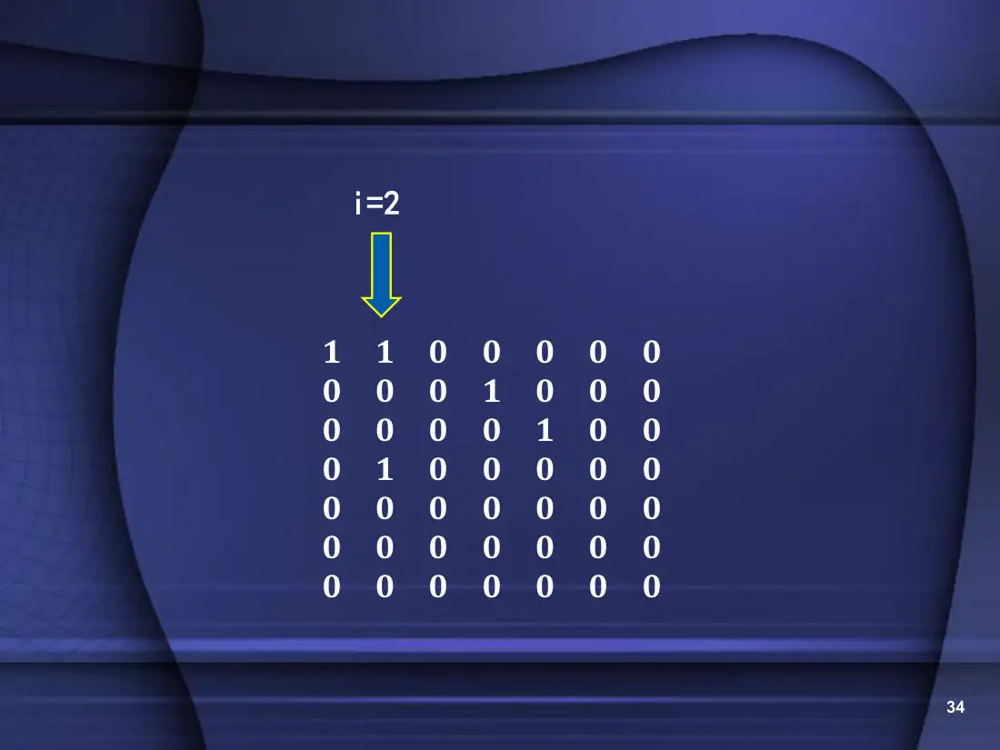

原文：

$$
\begin{array}{c c c c c c c} \text {i = 2} \\ \hline 1 & 1 & 0 & 0 & 0 & 0 & 0 \\ 0 & 0 & 0 & 1 & 0 & 0 & 0 \\ 0 & 0 & 0 & 0 & 1 & 0 & 0 \\ 0 & 1 & 0 & 0 & 0 & 0 & 0 \\ 0 & 0 & 0 & 0 & 0 & 0 & 0 \\ 0 & 0 & 0 & 0 & 0 & 0 & 0 \\ 0 & 0 & 0 & 0 & 0 & 0 & 0 \end{array}
$$

34

### $$

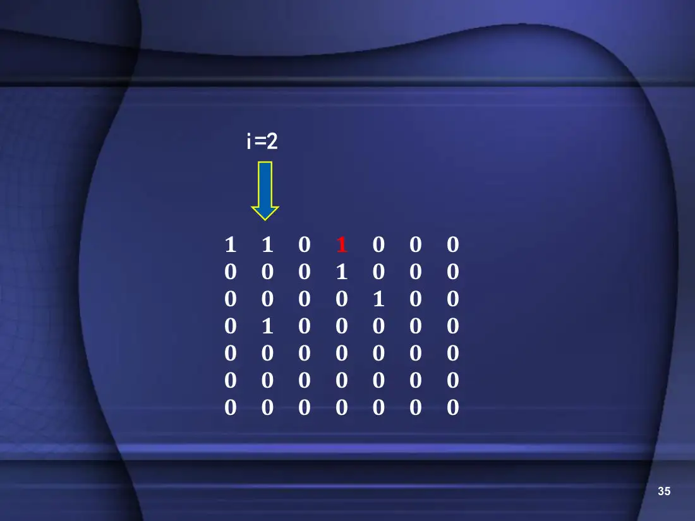

原文：

$$
\begin{array}{c c c c c c c} 1 & 1 & 0 & 1 & 0 & 0 & 0 \\ 0 & 0 & 0 & 1 & 0 & 0 & 0 \\ 0 & 0 & 0 & 0 & 1 & 0 & 0 \\ 0 & 1 & 0 & 0 & 0 & 0 & 0 \\ 0 & 0 & 0 & 0 & 0 & 0 & 0 \\ 0 & 0 & 0 & 0 & 0 & 0 & 0 \\ 0 & 0 & 0 & 0 & 0 & 0 & 0 \end{array}
$$

35

### $$

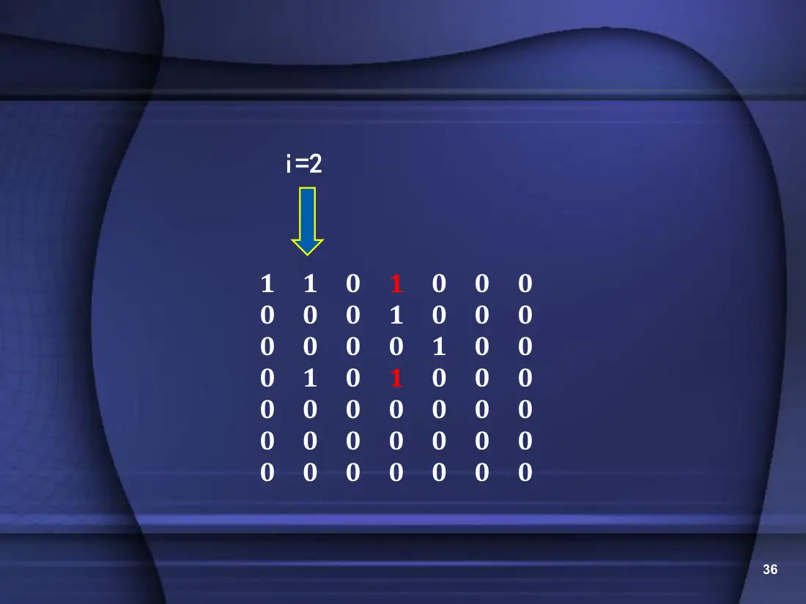

原文：

$$
\begin{array}{c c c c c c c} 1 & 1 & 0 & 1 & 0 & 0 & 0 \\ 0 & 0 & 0 & 1 & 0 & 0 & 0 \\ 0 & 0 & 0 & 0 & 1 & 0 & 0 \\ 0 & 1 & 0 & 1 & 0 & 0 & 0 \\ 0 & 0 & 0 & 0 & 0 & 0 & 0 \\ 0 & 0 & 0 & 0 & 0 & 0 & 0 \\ 0 & 0 & 0 & 0 & 0 & 0 & 0 \end{array}
$$

36

### $$

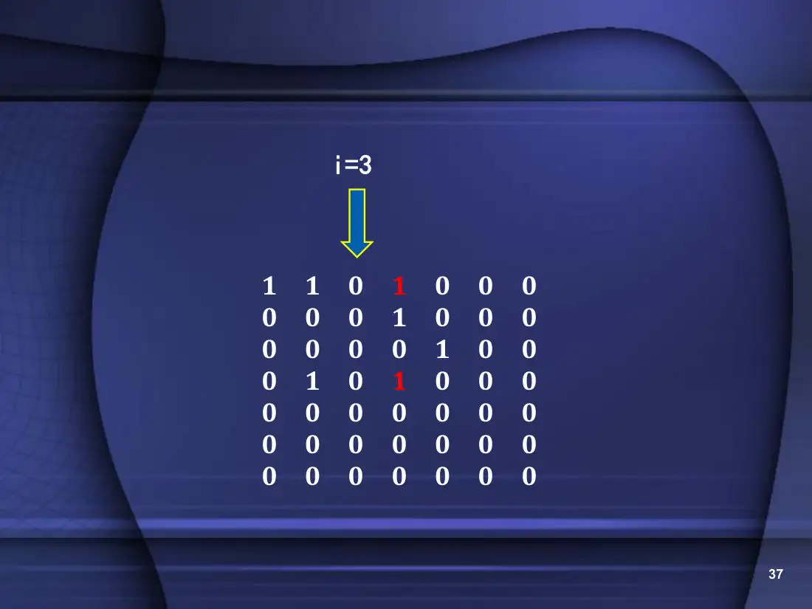

原文：

$$
\begin{array}{c c c c c c c} 1 & 1 & 0 & 1 & 0 & 0 & 0 \\ 0 & 0 & 0 & 1 & 0 & 0 & 0 \\ 0 & 0 & 0 & 0 & 1 & 0 & 0 \\ 0 & 1 & 0 & 1 & 0 & 0 & 0 \\ 0 & 0 & 0 & 0 & 0 & 0 & 0 \\ 0 & 0 & 0 & 0 & 0 & 0 & 0 \\ 0 & 0 & 0 & 0 & 0 & 0 & 0 \end{array}
$$

37

### $$

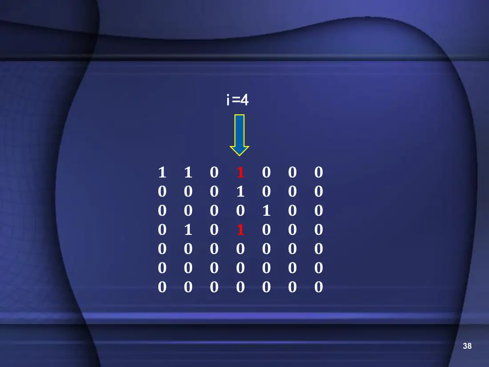

原文：

$$
\begin{array}{c c c c c c c} \text {i = 4} \\ \hline 1 & 1 & 0 & 1 & 0 & 0 & 0 \\ 0 & 0 & 0 & 1 & 0 & 0 & 0 \\ 0 & 0 & 0 & 0 & 1 & 0 & 0 \\ 0 & 1 & 0 & 1 & 0 & 0 & 0 \\ 0 & 0 & 0 & 0 & 0 & 0 & 0 \\ 0 & 0 & 0 & 0 & 0 & 0 & 0 \\ 0 & 0 & 0 & 0 & 0 & 0 & 0 \end{array}
$$

38

### $$

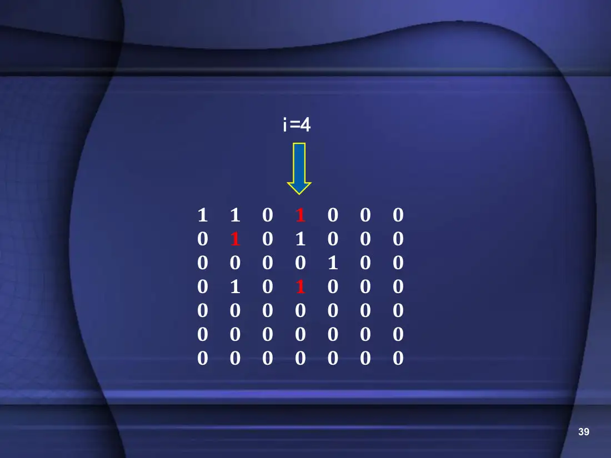

原文：

$$
\begin{array}{c c c c c c c} \text {i = 4} \\ \hline 1 & 1 & 0 & 1 & 0 & 0 & 0 \\ 0 & 1 & 0 & 1 & 0 & 0 & 0 \\ 0 & 0 & 0 & 0 & 1 & 0 & 0 \\ 0 & 1 & 0 & 1 & 0 & 0 & 0 \\ 0 & 0 & 0 & 0 & 0 & 0 & 0 \\ 0 & 0 & 0 & 0 & 0 & 0 & 0 \\ 0 & 0 & 0 & 0 & 0 & 0 & 0 \end{array}
$$

39

### $$

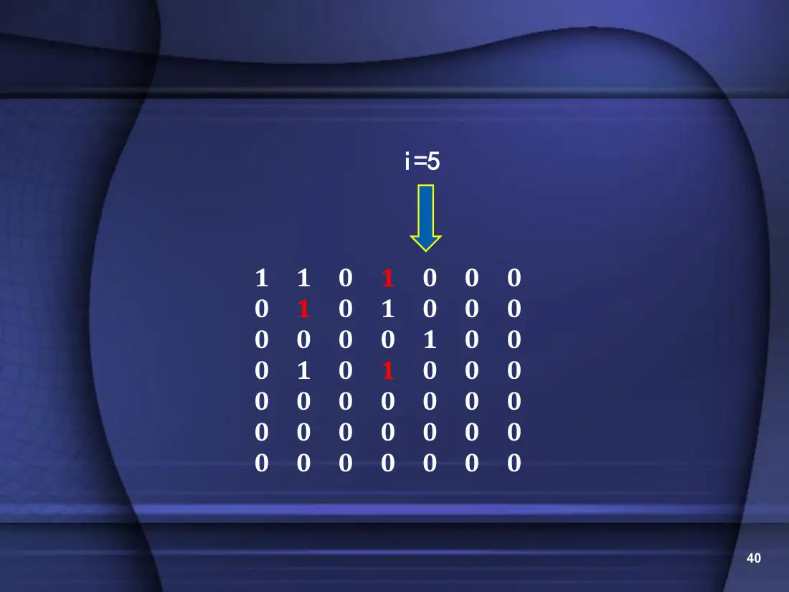

原文：

$$
\begin{array}{c c c c c c c} \text {i = 5} \\ \hline 1 & 1 & 0 & 1 & 0 & 0 & 0 \\ 0 & 1 & 0 & 1 & 0 & 0 & 0 \\ 0 & 0 & 0 & 0 & 1 & 0 & 0 \\ 0 & 1 & 0 & 1 & 0 & 0 & 0 \\ 0 & 0 & 0 & 0 & 0 & 0 & 0 \\ 0 & 0 & 0 & 0 & 0 & 0 & 0 \\ 0 & 0 & 0 & 0 & 0 & 0 & 0 \end{array}
$$

40

### 一、简单优先文法分析法

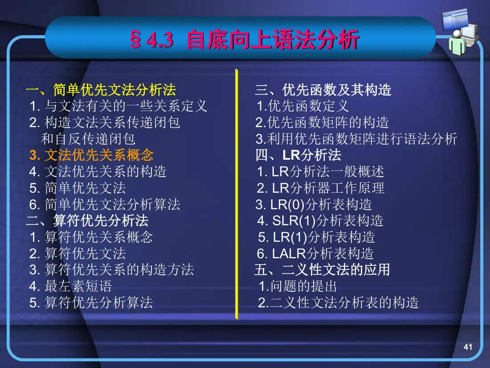

原文：

一、简单优先文法分析法

1. 与文法有关的一些关系定义

2. 构造文法关系传递闭包和自反传递闭包

3. 文法优先关系概念

4. 文法优先关系的构造

5. 简单优先文法

6. 简单优先文法分析算法

二、算符优先分析法

1. 算符优先关系概念

2. 算符优先文法

3. 算符优先关系的构造方法

4. 最左素短语

5. 算符优先分析算法

三、优先函数及其构造

1. 优先函数定义

2. 优先函数矩阵的构造

3. 利用优先函数矩阵进行语法分析

四、LR分析法

1. LR分析法一般概述

2. LR分析器工作原理

3. LR(0)分析表构造

4. SLR(1)分析表构造

5. LR(1)分析表构造

6. LALR分析表构造

五、二义性文法的应用

1. 问题的提出

2.二义性文法分析表的构造

§ 4.3 自底向上语法分析

41

### 3. 文法优先关系概念

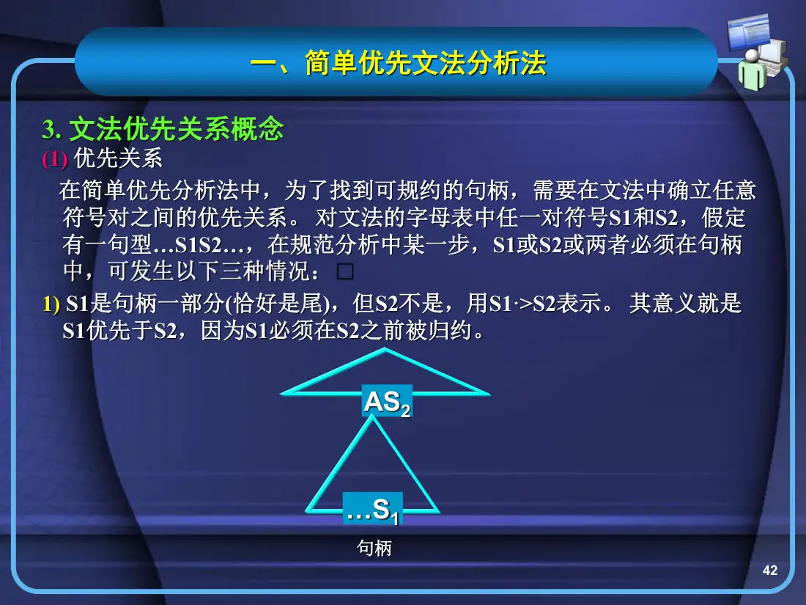

原文：

3. 文法优先关系概念

(1) 优先关系

在简单优先分析法中，为了找到可规约的句柄，需要在文法中确立任意符号对之间的优先关系。对文法的字母表中任一对符号S1和S2，假定有一句型...S1S2...，在规范分析中某一步，S1或S2或两者必须在句柄中，可发生以下三种情况：□

1) S1是句柄一部分(恰好是尾)，但S2不是，用S1·>S2表示。其意义就是S1优先于S2，因为S1必须在S2之前被归约。

句柄

一、简单优先文法分析法

42

### 一、简单优先文法分析法

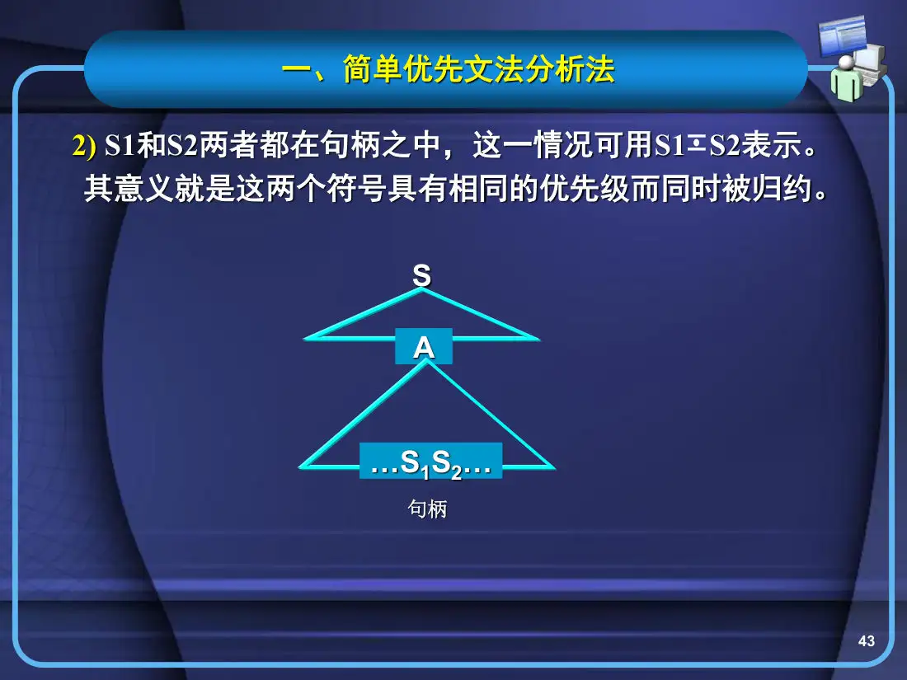

原文：

2) S1和S2两者都在句柄之中，这一情况可用S1≠S2表示。其意义就是这两个符号具有相同的优先级而同时被归约。

一、简单优先文法分析法

43

### 一、简单优先文法分析法

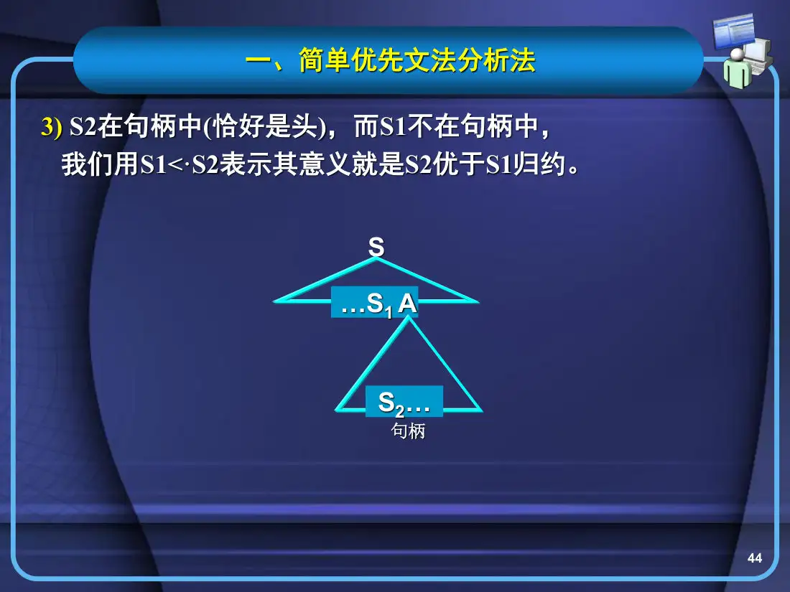

原文：

3) S2在句柄中(恰好是头)，而S1不在句柄中，我们用S1<·S2表示其意义就是S2优于S1归约。

一、简单优先文法分析法

44

### (2)几点说明

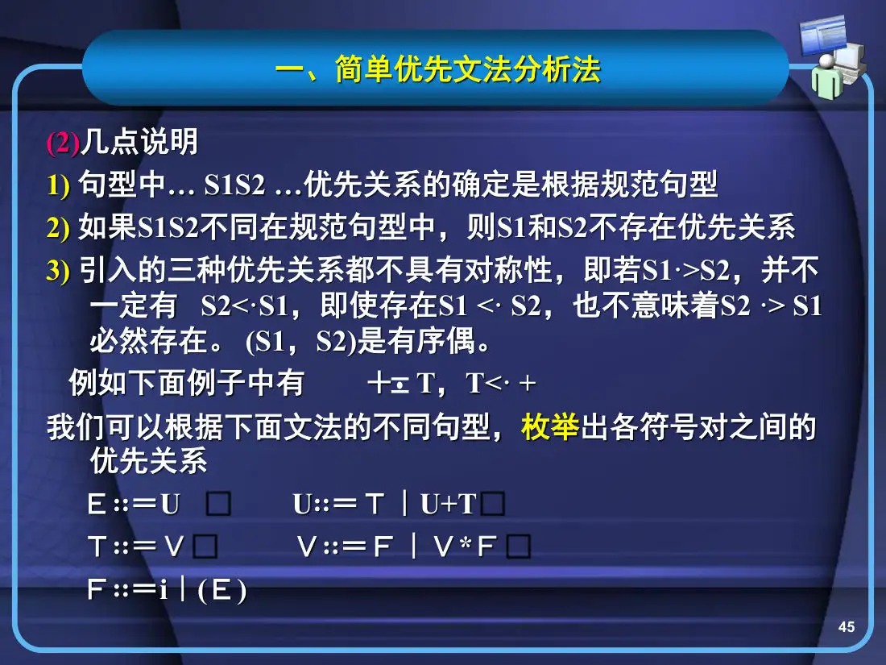

原文：

(2)几点说明

1) 句型中... S1S2 ...优先关系的确定是根据规范句型

2) 如果S1S2不同在规范句型中，则S1和S2不存在优先关系

3) 引入的三种优先关系都不具有对称性，即若S1·>S2，并不一定有 S2<·S1，即使存在S1<·S2，也不意味着S2·>S1必然存在。(S1, S2)是有序偶。

例如下面例子中有 +≡ T，T<·+

我们可以根据下面文法的不同句型，枚举出各符号对之间的优先关系

E ::=U □

U::= T | U+T □

T ::= V □

V ::= F | V \* F □

$F ::= i \mid (E)$

一、简单优先文法分析法

45

### ① 句型U+i\*i

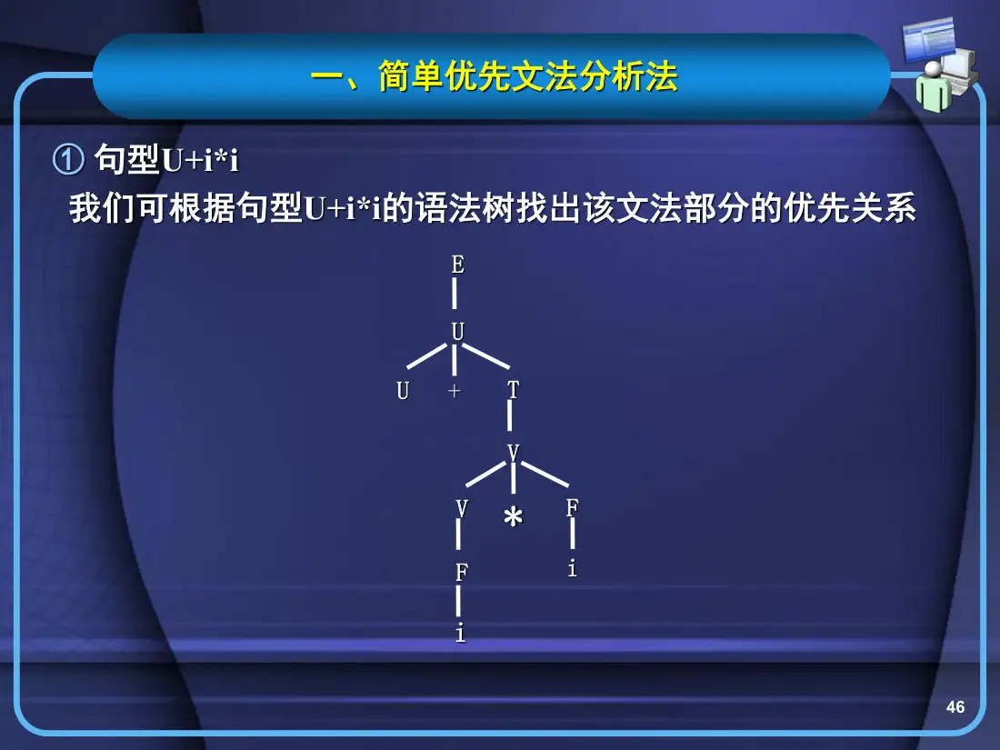

原文：

① 句型U+i\*i

我们可根据句型U+i\*i的语法树找出该文法部分的优先关系

一、简单优先文法分析法

46

### 句型U+i\*i中，第一个i是句柄，

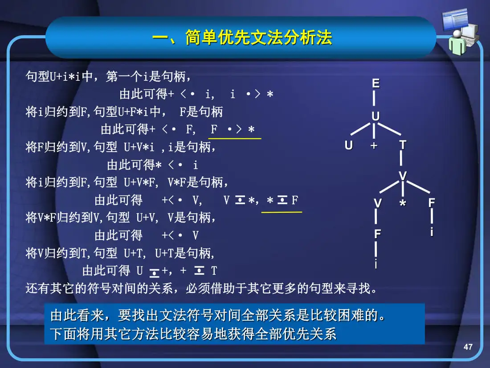

原文：

句型U+i\*i中，第一个i是句柄，

由此可得+ < • i, i • > \*

将i归约到F, 句型U+F\*i中， F是句柄

由此可得+ <· F, F ·> \*

将F归约到V, 句型 U+V\*i , i是句柄,

由此可得\* < • i

将i归约到F, 句型 U+V\*F, V\*F是句柄,

由此可得 +< • V, V ⊃ \*, \* ⊃ F

将V\*F归约到V, 句型 U+V, V是句柄,

由此可得 +< • V

将V归约到T, 句型 U+T, U+T是句柄,

由此可得 U ⊖ +, + ⊖ T

还有其它的符号对间的关系，必须借助于其它更多的句型来寻找。

由此看来，要找出文法符号对间全部关系是比较困难的。

下面将用其它方法比较容易地获得全部优先关系

一、简单优先文法分析法

47

### (3) 优先矩阵

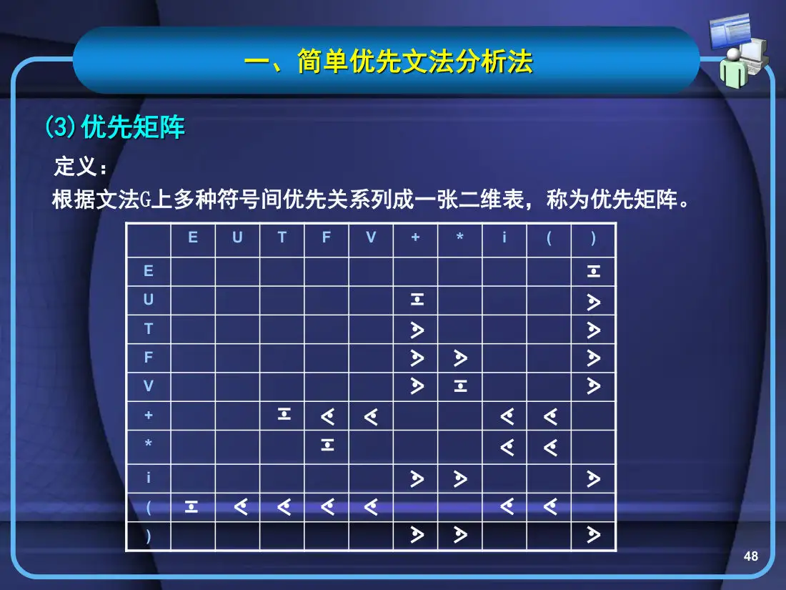

原文：

(3) 优先矩阵

定义：

根据文法G上多种符号间优先关系列成一张二维表，称为优先矩阵。

<table><tr><td></td><td>E</td><td>U</td><td>T</td><td>F</td><td>V</td><td>+</td><td>*</td><td>i</td><td>(</td><td>)</td></tr><tr><td>E</td><td></td><td></td><td></td><td></td><td></td><td></td><td></td><td></td><td></td><td> $\overline{=}$ </td></tr><tr><td>U</td><td></td><td></td><td></td><td></td><td></td><td> $\overline{=}$ </td><td></td><td></td><td></td><td> $\gg$ </td></tr><tr><td>T</td><td></td><td></td><td></td><td></td><td></td><td> $\gg$ </td><td></td><td></td><td></td><td> $\gg$ </td></tr><tr><td>F</td><td></td><td></td><td></td><td></td><td></td><td> $\gg$ </td><td> $\gg$ </td><td></td><td></td><td> $\gg$ </td></tr><tr><td>V</td><td></td><td></td><td></td><td></td><td></td><td> $\gg$ </td><td> $\overline{=}$ </td><td></td><td></td><td> $\gg$ </td></tr><tr><td>+</td><td></td><td></td><td> $\overline{=}$ </td><td> $\ll$ </td><td> $\ll$ </td><td></td><td></td><td> $\ll$ </td><td> $\ll$ </td><td></td></tr><tr><td>*</td><td></td><td></td><td></td><td> $\overline{=}$ </td><td></td><td></td><td></td><td> $\ll$ </td><td> $\ll$ </td><td></td></tr><tr><td>i</td><td></td><td></td><td></td><td></td><td></td><td> $\gg$ </td><td> $\gg$ </td><td></td><td></td><td> $\gg$ </td></tr><tr><td>(</td><td> $\overline{=}$ </td><td> $\ll$ </td><td> $\ll$ </td><td> $\ll$ </td><td> $\ll$ </td><td></td><td></td><td> $\ll$ </td><td> $\ll$ </td><td></td></tr><tr><td>)</td><td></td><td></td><td></td><td></td><td></td><td> $\gg$ </td><td> $\gg$ </td><td></td><td></td><td> $\gg$ </td></tr></table>

一、简单优先文法分析法

48

### 一、简单优先文法分析法

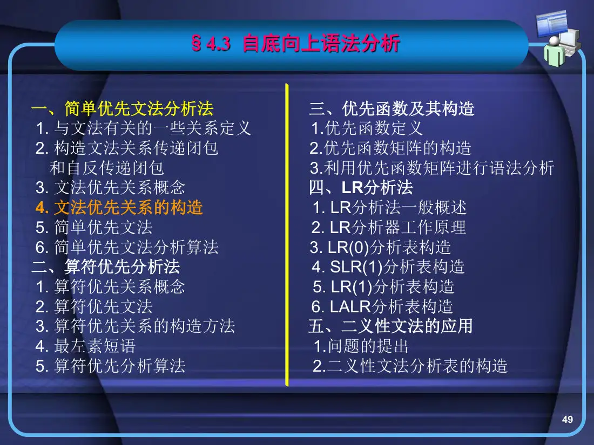

原文：

一、简单优先文法分析法

1. 与文法有关的一些关系定义

2. 构造文法关系传递闭包和自反传递闭包

3. 文法优先关系概念

4. 文法优先关系的构造

5. 简单优先文法

6. 简单优先文法分析算法

二、算符优先分析法

1. 算符优先关系概念

2. 算符优先文法

3. 算符优先关系的构造方法

4. 最左素短语

5. 算符优先分析算法

三、优先函数及其构造

1. 优先函数定义

2. 优先函数矩阵的构造

3. 利用优先函数矩阵进行语法分析

四、LR分析法

1. LR分析法一般概述

2. LR分析器工作原理

3. LR(0)分析表构造

4. SLR(1)分析表构造

5. LR(1)分析表构造

6. LALR分析表构造

五、二义性文法的应用

1. 问题的提出

2.二义性文法分析表的构造

§ 4.3 自底向上语法分析

49

### 4. 文法优先关系的构造

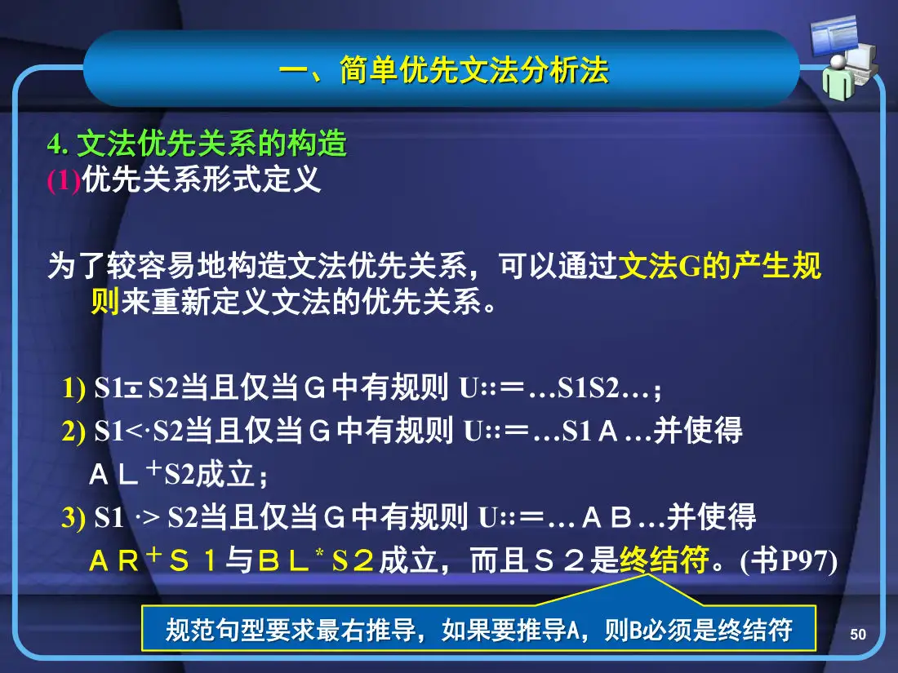

原文：

4. 文法优先关系的构造
(1)优先关系形式定义

为了较容易地构造文法优先关系，可以通过文法G的产生规则来重新定义文法的优先关系。

1) S1= S2当且仅当G中有规则 U::=...S1S2...;

2) S1<·S2当且仅当G中有规则 U::=...S1 A ...并使得 A L +S2成立；

3) S1 $\cdot >$ S2当且仅当G中有规则 U::=... A B ...并使得 AR+ S 1与BL\* S2成立，而且S 2是终结符。(书P97)

规范句型要求最右推导，如果要推导A，则B必须是终结符(2) 优先关系构造根据上面优先关系形式定义的构造文法G字汇表上符号之间优先关系就比较容易做到。

一、简单优先文法分析法

50

### 1) 构造 ⊙ 关系

原文：

1) 构造 ⊙ 关系
 ⊙关系的构造比较简单，对文法中所有形如U::= ...S1S2...的产生式右部...S1S2...，就可得 S1 ⊙ S2

$$
\text {三} = \{(S 1, S 2) | U: := \dots S 1 S 2 \dots \}
$$

所以求 ⊗ 关系，只要察看文法中所有规则，就可以求出文法中全部 ⊗ 关系
2）构造<·关系 $\Leftarrow=(\text{ ⊗ })\cdot(L^{+})$

证明：

由关系S1<·S2的定义，我们知道一定存在规则

U::=...S1A... 且AL $^{+}$ S2□

因此有

$$
\mathrm{S} 1 \text {卍A, AL} ^ {+} \mathrm{S} 2 \square
$$

由关系的乘积得 S1((工)·(L+))S2□

所以

$\langle\cdot=(\text{二})\cdot(L^{+})$

一、简单优先文法分析法

51

### 所以求<·关系，即<·=(∃)·(L+), 只要按下面步骤进行:

原文：

所以求<·关系，即<·=(∃)·(L+), 只要按下面步骤进行:

① 察看文法以求全部 ⊖ 关系；（U::= ...S1S2...）

② 察看文法以求全部 L关系；（U::= S1...）

③ 由L关系求 $L^{+}$ 先由L求 $B_{L}$ ，然后再求 $B_{L}^{+}(B_{L}^{+}=B_{L}^{1}+B_{L}^{2}+B_{L}^{3}+\ldots+B_{L}^{n})$ 由 $B_{L}^{+}$ 可求得 $L^{+}$

④ 由 $\equiv$ 关系和 $L +$ 关系，由公式 $<\cdot = (\equiv) \cdot (L^{+})$ 可求得 $<\cdot$ 关系，同样，也是通过关系矩阵计算

一、简单优先文法分析法

52

### 3) 构造->关系

原文：

3) 构造->关系

$\Rightarrow = (R^{+})^{\top} \cdot (\textcircled{•}) \cdot (L^{*})$ □其中 $(R^{+})^{\top}$ 是 $R^{+}$ 的转置。

由关系S1 -> S2的定义，我们知道一定存在规则，
U::=...AB... 且AR+S1，BL\*S2 并且S2是终结符

根据关系的转置□

$$
A R ^ {+} S 1 \Rightarrow > S 1 (R ^ {+}) ^ {T} A
$$

因此有□

$$
\mathrm{S} 1 \left(\mathrm{R} ^ {+}\right) ^ {\top} \mathrm{A}, \mathrm{A} \text {三} \mathrm{B}, \mathrm{BL} ^ {*} \mathrm{S} 2 \square
$$

由关系的乘积得□

$$
S 1 (R ^ {+}) ^ {\top} \cdot (\overline {{\text {二}}}) \cdot (L ^ {*})) S 2
$$

所以□

$$
\cdot > = (R ^ {+}) ^ {\top}. (\text {三}). (L ^ {*})
$$

一、简单优先文法分析法

53

### ① 察看文法以求全部 R 关系；(U::= ...S1)

原文：

所以求 $\cdot >$ 关系，即 $\cdot > = (R^{+})^{\mathrm{T}}\cdot (\Xi)\cdot (L^{*})$ ，按下面步骤进行：

① 察看文法以求全部 R 关系；(U::= ...S1)

② 由R关系求 $R^{+}$ 先由R求 $B_{R}$ ，然后再求 $B_{R}^{+}(B_{R}^{+}=B_{R}^{1}+B_{R}^{2}+B_{R}^{3}+\ldots+B_{R}^{n})$ 由 $B_{R}^{+}$ 可求得 $R^{+}$

③ 由 $R^{+}$ 关系求 $(R^{+})^{\mathrm{T}}$ ， $((R^{+})^{\mathrm{T}}$ 是 $R^{+}$ 的转置)

④ 察看文法以求全部 ☐关系；(U::= ...S1S2...)

⑤ 察看文法以求全部 L 关系；(U::= S1...)

$$
\mathbf {B} _ {\mathrm{L}}
$$

$$
\mathrm{B} _ {\mathrm{L} +} \left(\mathrm{B} _ {\mathrm{L}} ^ {+} = \mathrm{B} _ {\mathrm{L}} ^ {1} + \mathrm{B} _ {\mathrm{L}} ^ {2} + \mathrm{B} _ {\mathrm{L}} ^ {3} + \dots + \mathrm{B} _ {\mathrm{L}} ^ {\mathrm{n}}\right)
$$

然后再由求 $B_{L}^{+}$ 求 $B_{L}^{+}(B_{L}^{*}=B_{L}^{0}+B_{L}^{+})$ ，最后由 $B_{L}^{*}$ 可求得 $L^{*}$

⑦ 由 $(R^{+})^{T}$ 关系、☐关系和L\*关系求·>关系，由公式·> = $(R^{+})^{T}$ ·(☐)·(L\*) 可求得·>关系，同样，也是通过关系矩阵计算例如：文法G[E]:Z ::= bMb M ::= (L|a L ::= Ma)
下面我们根据上面形式定义求出符号间所有优先关系
(1) 构造 ⊙ 关系:查看文法 U ::= ...S1S2..., 易得
≡ { (b,M),(M,b),((,L),(M,a),(a,)) }

一、简单优先文法分析法

54

### $$

原文：

(2) 构造<关系 $<\cdot=(\text{☐})\cdot(L^{+})$ 1）关系已构造出，据此作出B

$$
B _ {z} = \begin{array}{c c c c c c c c} & Z & M & L & a & b & ( & ) \\ Z & 0 & 0 & 0 & 0 & 0 & 0 & 0 \\ M & 0 & 0 & 0 & 1 & 1 & 0 & 0 \\ L & 0 & 0 & 0 & 0 & 0 & 0 & 0 \\ a & 0 & 0 & 0 & 0 & 0 & 0 & 1 \\ b & 0 & 1 & 0 & 0 & 0 & 0 & 0 \\ ( & 0 & 0 & 1 & 0 & 0 & 0 & 0 \\ ) & 0 & 0 & 0 & 0 & 0 & 0 & 0 \end{array}
$$

一、简单优先文法分析法

55

### Z ::= bMb M ::= (L|a L ::= Ma)

原文：

Z ::= bMb M ::= (L|a L ::= Ma)
由L = {(U, S)|U ::= S...}, 得
L = {(Z, b), (M, (), (M, a), (L,M)}

3) 根据L，作出 $B_{L}$

$$
B _ {L} = \begin{array}{c c c c c c c c} & Z & M & L & a & b & ( & ) \\ & Z & 0 & 0 & 0 & 0 & 1 & 0 & 0 \\ & M & 0 & 0 & 0 & 1 & 0 & 1 & 0 \\ & L & 0 & 1 & 0 & 0 & 0 & 0 & 0 \\ & a & 0 & 0 & 0 & 0 & 0 & 0 & 0 \\ & b & 0 & 0 & 0 & 0 & 0 & 0 & 0 \\ & ( & 0 & 0 & 0 & 0 & 0 & 0 & 0 \\ & ) & 0 & 0 & 0 & 0 & 0 & 0 & 0 \end{array}
$$

一、简单优先文法分析法

56

### $$

原文：

4) 根据前面讲述由BL求BL+ $B_{L}^{+}=B_{L}^{1}+B_{L}^{2}+B_{L}^{3}+B_{L}^{4}+B_{L}^{5}+B_{L}^{6}+B_{L}^{7}$

$$
B _ {L ^ {+}} = \begin{array}{c c c c c c c c} & Z & M & L & a & b & ( & ) \\ Z & 0 & 0 & 0 & 0 & 1 & 0 & 0 \\ M & 0 & 0 & 0 & 1 & 0 & 1 & 0 \\ L & 0 & 1 & 0 & 1 & 0 & 1 & 0 \\ a & 0 & 0 & 0 & 0 & 0 & 0 & 0 \\ b & 0 & 0 & 0 & 0 & 0 & 0 & 0 \\ ( & 0 & 0 & 0 & 0 & 0 & 0 & 0 \\ ) & 0 & 0 & 0 & 0 & 0 & 0 & 0 \end{array}
$$

一、简单优先文法分析法

57

### $$

原文：

5) 由布尔矩阵 $B \perp$ 和 $B_{L}^{+}$ 求 $B < \cdot$

$$
B _ {<  .} = (B _ {\text {二}}) \cdot (B _ {L ^ {+}})
$$

$$
B _ {<  .} = \begin{array}{c c c c c c c c} & Z & M & L & a & b & ( & ) \\ Z & 0 & 0 & 0 & 0 & 0 & 0 & 0 \\ M & 0 & 0 & 0 & 0 & 0 & 0 & 0 \\ L & 0 & 0 & 0 & 0 & 0 & 0 & 0 \\ a & 0 & 0 & 0 & 0 & 0 & 0 & 0 \\ b & 0 & 0 & 0 & 1 & 0 & 1 & 0 \\ ( & 0 & 1 & 0 & 1 & 0 & 1 & 0 \\ ) & 0 & 0 & 0 & 0 & 0 & 0 & 0 \end{array}
$$

6) 根据B<·可求出<·关系

$$
<   \cdot = \left\{\text {(b,() , (b,a) , ((,M), ((,)), ((,a)} \right\}
$$

一、简单优先文法分析法

58

### 1)由R={(U, S)|U ::= .....S}, 得

原文：

(3) 构造>关系 $\cdot\rangle=(R^{+})^{\top}.\left(\overline{ }\right).\left(L^{*}\right)$ Z ::= bMb M ::= (L|a L ::= Ma)
1)由R={(U, S)|U ::= .....S}, 得
R={(Z, b), (M, L), (M, a), (L,))}

2)根据R作出 $\mathrm{B}_{\mathrm{R}}$

$$
B _ {R} = \begin{array}{c c c c c c c c} & Z & M & L & a & b & ( & ) \\ & Z & 0 & 0 & 0 & 0 & 1 & 0 & 0 \\ & M & 0 & 0 & 1 & 1 & 0 & 0 & 0 \\ & L & 0 & 0 & 0 & 0 & 0 & 0 & 1 \\ & a & 0 & 0 & 0 & 0 & 0 & 0 & 0 \\ & b & 0 & 0 & 0 & 0 & 0 & 0 & 0 \\ & ( & 0 & 0 & 0 & 0 & 0 & 0 & 0 \\ & ) & 0 & 0 & 0 & 0 & 0 & 0 & 0 \end{array}
$$

一、简单优先文法分析法

59

### 3)根据前面讲述由BR求BR+

原文：

3)根据前面讲述由BR求BR+

$$
\mathrm{B} _ {\mathrm{R}} ^ {+} = \mathrm{B} _ {\mathrm{R}} ^ {1} + \mathrm{B} _ {\mathrm{R}} ^ {2} + \mathrm{B} _ {\mathrm{R}} ^ {3} + \mathrm{B} _ {\mathrm{R}} ^ {4} + \mathrm{B} _ {\mathrm{R}} ^ {5} + \mathrm{B} _ {\mathrm{R}} ^ {6} + \mathrm{B} _ {\mathrm{R}} ^ {7}
$$

$$
B _ {R ^ {+}} = \begin{array}{c c} & Z \\ & M \\ & L \\ & a \\ & b \\ & (\\ ) \end{array} \left( \begin{array}{c c c c c c c} 0 & 0 & 0 & 0 & 1 & 0 & 0 \\ 0 & 0 & 1 & 1 & 0 & 0 & 1 \\ 0 & 0 & 0 & 0 & 0 & 0 & 1 \\ 0 & 0 & 0 & 0 & 0 & 0 & 0 \\ 0 & 0 & 0 & 0 & 0 & 0 & 0 \\ 0 & 0 & 0 & 0 & 0 & 0 & 0 \\ 0 & 0 & 0 & 0 & 0 & 0 & 0 \end{array} \right)
$$

一、简单优先文法分析法

60

### $$

原文：

4)根据由 $\mathrm{B}_{\mathrm{R}}^{+}$ 求 $(\mathrm{B}_{\mathrm{R}}^{+})^{\mathrm{T}}$

$$
(B _ {R ^ {+}}) ^ {T} = \left( \begin{array}{c c c c c c c} & Z & M & L & a & b & ( & ) \\ Z & 0 & 0 & 0 & 0 & 0 & 0 & 0 \\ M & 0 & 0 & 0 & 0 & 0 & 0 & 0 \\ L & 0 & 1 & 0 & 0 & 0 & 0 & 0 \\ a & 0 & 1 & 0 & 0 & 0 & 0 & 0 \\ b & 1 & 0 & 0 & 0 & 0 & 0 & 0 \\ ( & 0 & 0 & 0 & 0 & 0 & 0 & 0 \\ ) & 0 & 1 & 1 & 0 & 0 & 0 & 0 \end{array} \right)
$$

一、简单优先文法分析法

61

### 5) 三关系前面已构造出，据此作出B

原文：

5) 三关系前面已构造出，据此作出B

$$
B _ {\text {三}} = \left( \begin{array}{c c c c c c c} & Z & M & L & a & b & ( & ) \\ Z & 0 & 0 & 0 & 0 & 0 & 0 & 0 \\ M & 0 & 0 & 0 & 1 & 1 & 0 & 0 \\ L & 0 & 0 & 0 & 0 & 0 & 0 & 0 \\ a & 0 & 0 & 0 & 0 & 0 & 0 & 1 \\ b & 0 & 1 & 0 & 0 & 0 & 0 & 0 \\ ( & 0 & 0 & 1 & 0 & 0 & 0 & 0 \\ ) & 0 & 0 & 0 & 0 & 0 & 0 & 0 \end{array} \right)
$$

一、简单优先文法分析法

62

### ①求 $B_{I}$ ， $B_{I}$ 是使主对角线都置1

原文：

6) 求 L\*关系， $L^{*} = I \cup L^{+}$ L\*由 $B_{L}$ \*求得， $B_{L}$ \*由 $B_{I}$ 和 $B_{L}^{+}$ 求得

①求 $B_{I}$ ， $B_{I}$ 是使主对角线都置1

$$
B _ {I} = \begin{array}{c c} & Z \quad M \quad L \quad a \quad b \quad (\\ Z & 1 \quad 0 \quad 0 \quad 0 \quad 0 \quad 0 \quad 0 \\ M & 0 \quad 1 \quad 0 \quad 0 \quad 0 \quad 0 \quad 0 \\ L & 0 \quad 0 \quad 1 \quad 0 \quad 0 \quad 0 \quad 0 \\ a & 0 \quad 0 \quad 0 \quad 1 \quad 0 \quad 0 \quad 0 \\ b & 0 \quad 0 \quad 0 \quad 0 \quad 1 \quad 0 \quad 0 \\ ( & 0 \quad 0 \quad 0 \quad 0 \quad 0 \quad 1 \quad 0 \\ ) & 0 \quad 0 \quad 0 \quad 0 \quad 0 \quad 0 \quad 1 \end{array}
$$

一、简单优先文法分析法

63

### ② $B_{L}^{+}$ 前面已构造出

原文：

② $B_{L}^{+}$ 前面已构造出

$$
B _ {L ^ {+}} = \begin{array}{c} Z \\ M \\ L \\ a \\ b \\ (\\ ) \end{array} \left( \begin{array}{c c c c c c c} 0 & 0 & 0 & 0 & 1 & 0 & 0 \\ 0 & 0 & 0 & 1 & 0 & 1 & 0 \\ 0 & 1 & 0 & 1 & 0 & 1 & 0 \\ 0 & 0 & 0 & 0 & 0 & 0 & 0 \\ 0 & 0 & 0 & 0 & 0 & 0 & 0 \\ 0 & 0 & 0 & 0 & 0 & 0 & 0 \\ 0 & 0 & 0 & 0 & 0 & 0 & 0 \end{array} \right)
$$

一、简单优先文法分析法

64

### $$

原文：

③求 $B_{L}^{*}$ ， $B_{L}^{*}=B_{I}+B_{L}^{+}$

$$
B _ {L ^ {*}} = \begin{array}{c} Z \\ M \\ L \\ a \\ b \\ (\\ ) \end{array} \left( \begin{array}{c c c c c c c} 1 & 0 & 0 & 0 & 1 & 0 & 0 \\ 0 & 1 & 0 & 1 & 0 & 1 & 0 \\ 0 & 1 & 1 & 1 & 0 & 1 & 0 \\ 0 & 0 & 0 & 1 & 0 & 0 & 0 \\ 0 & 0 & 0 & 0 & 1 & 0 & 0 \\ 0 & 0 & 0 & 0 & 0 & 1 & 0 \\ 0 & 0 & 0 & 0 & 0 & 0 & 1 \end{array} \right)
$$

一、简单优先文法分析法

65

### $$

原文：

7) 由 $\cdot > = ((R^{+})^{\mathrm{T}})\cdot (\Xi)\cdot (L^{*})$ ，作布尔矩阵B.> B.> $= (B_{(R^{+})}^{\mathrm{T}})\cdot (B_{\Xi})\cdot B_{L*}$

根据 • >的形式定义，S1 • > S2，要求S2是终结符，所以将上步B • >中非终结符号的列置零，得B • >

$$
B _ {\cdot \cdot} = \begin{array}{c c c c c c c c} & Z & M & L & a & b & ( & ) \\ Z & 0 & 0 & 0 & 0 & 0 & 0 & 0 \\ M & 0 & 0 & 0 & 0 & 0 & 0 & 0 \\ L & 0 & 0 & 0 & 1 & 1 & 0 & 0 \\ a & 0 & 0 & 0 & 1 & 1 & 0 & 0 \\ b & 0 & 0 & 0 & 0 & 0 & 0 & 0 \\ ( & 0 & 0 & 0 & 0 & 0 & 0 & 0 \\ ) & 0 & 0 & 0 & 1 & 1 & 0 & 0 \end{array}
$$

一、简单优先文法分析法

66

### 一、简单优先文法分析法

原文：

(4) 根据求得布尔矩阵 $B =$ ， $B_{<.}$ ， $B_{.}$ ，便得G[E]的优先关系矩阵。(p102表4.6)

<table><tr><td></td><td>Z</td><td>b</td><td>M</td><td>L</td><td>a</td><td>(</td><td>)</td></tr><tr><td>Z</td><td></td><td></td><td></td><td></td><td></td><td></td><td></td></tr><tr><td>b</td><td></td><td></td><td>I</td><td></td><td>&lt;</td><td>&lt;</td><td></td></tr><tr><td>M</td><td></td><td>I</td><td></td><td></td><td>I</td><td></td><td></td></tr><tr><td>L</td><td></td><td>&gt;</td><td></td><td></td><td>&gt;</td><td></td><td></td></tr><tr><td>a</td><td></td><td>&gt;</td><td></td><td></td><td>&gt;</td><td></td><td>I</td></tr><tr><td>(</td><td></td><td></td><td>&lt;</td><td>I</td><td>&lt;</td><td>&lt;</td><td></td></tr><tr><td>)</td><td></td><td>&gt;</td><td></td><td></td><td>&gt;</td><td></td><td></td></tr></table>

一、简单优先文法分析法

67

### 一、简单优先文法分析法

原文：

为进一步熟悉优先关系的构造方法和步骤请同学们课后将书本上98页的例4.8仔细看一遍！

一、简单优先文法分析法

68

### 一、简单优先文法分析法

原文：

一、简单优先文法分析法

1. 与文法有关的一些关系定义

2. 构造文法关系传递闭包和自反传递闭包

3. 文法优先关系概念

4. 文法优先关系的构造

5. 简单优先文法

6. 简单优先文法分析算法

二、算符优先分析法

1. 算符优先关系概念

2. 算符优先文法

3. 算符优先关系的构造方法

4. 最左素短语

5. 算符优先分析算法

三、优先函数及其构造

1. 优先函数定义

2. 优先函数矩阵的构造

3. 利用优先函数矩阵进行语法分析

四、LR分析法

1. LR分析法一般概述

2. LR分析器工作原理

3. LR(0)分析表构造

4. SLR(1)分析表构造

5. LR(1)分析表构造

6. LALR分析表构造

五、二义性文法的应用

1. 问题的提出

2.二义性文法分析表的构造

§ 4.3 自底向上语法分析

69

### 5.简单优先文法

原文：

5.简单优先文法

(1)简单优先文法定义

根据文法符号之间的优先关系可以确定归约先后，但要使上下文无关文法满足符号间唯一优先关系，使得归约是唯一的，必须对文法作必要的限制。也就是说只有简单优先文法才能满足上述条件。

定义：若文法G满足如下两个条件：

1) 在字汇表中，任意两个符号之间至多只有一种优先关系成立；

2) 任意两条规则都没有相同的右部则称文法G是简单优先文法，或称(1，1)优先文法。

这类文法之所以称为简单优先文法或(1, 1)优先文法，是因为在可能成为句柄的那些符号串两边各取一个符号就能判断它是否是句柄。

要证明一个文法是否是简单优先文法，就是要判断它是否满足上述两个条件。另外，优先关系的确定除了构造优先关系矩阵之外，还可以根据语法树直观判断。(两种方式确定)

一、简单优先文法分析法

70

### 例如：文法G[Z]：□

原文：

例如：文法G[Z]：□
Z::=bMb□
M::=(L | a□
L::=Ma)□

<table><tr><td></td><td>Z</td><td>b</td><td>M</td><td>L</td><td>a</td><td>(</td><td>)</td></tr><tr><td>Z</td><td></td><td></td><td></td><td></td><td></td><td></td><td></td></tr><tr><td>b</td><td></td><td></td><td> $\overline{x}$ </td><td></td><td>&lt;</td><td>&lt;</td><td></td></tr><tr><td>M</td><td></td><td> $\overline{x}$ </td><td></td><td></td><td> $\overline{x}$ </td><td></td><td></td></tr><tr><td>L</td><td></td><td>&gt;</td><td></td><td></td><td>&gt;</td><td></td><td></td></tr><tr><td>a</td><td></td><td>&gt;</td><td></td><td></td><td>&gt;</td><td></td><td> $\overline{x}$ </td></tr><tr><td>(</td><td></td><td></td><td>&lt;</td><td> $\overline{x}$ </td><td>&lt;</td><td>&lt;</td><td></td></tr><tr><td>)</td><td></td><td>&gt;</td><td></td><td></td><td>&gt;</td><td></td><td></td></tr></table>

是简单优先文法，因为其优先关系矩阵中任意两个符号间的优先关系是唯一的，同时任意两条规则没有相同的右部。但是，对于文法E::=E+E|E\*E|(E)|i却不是简单优先文法，因为从句型E+E和句型E+E+E对应的语法树能得出+ ⊖ E, + < • E两种优先关系。

\+ = E

\+ < E

一、简单优先文法分析法

71

### (2) 简单优先文法的性质

原文：

(2) 简单优先文法的性质

1) 它的每个句型S1S2…Sn具有一个唯一句柄，该句柄是满足下列条件
Si-1<·Si Si+1 … Sj·>Sj+1□□

的最左子串 SiSi+1□…Sj

为了保证即便句柄是从第一个符号开始或到最后一个符号结束时，上述结论也正确，约定每个句型被括在两个符号#之间，并且对文法的任意符号S均有□

<·S和S·>#□

由该性质可知：若从左向右看 $S_{j} \cdot > S_{j+1}$ ，说明 $S_{j}$ 是句柄尾。若从右向左看 $S_{i-1} < \cdot S_{i}$ ，说明Si是句柄头

一、简单优先文法分析法

72

### 2) 简单优先文法是无二义性的，因为它的任一句型的句柄都是唯一的。

原文：

2) 简单优先文法是无二义性的，因为它的任一句型的句柄都是唯一的。

二义性就是指一个句型有不同的句柄，如文法E::=E+E|E\*E|(E)|i该文法的一个句型E+E\*E，就存在E+E和E\*E两个不同的句柄，所以该文法是二义的。它也不是简单优先文法。

一、简单优先文法分析法

73

### 一、简单优先文法分析法

原文：

一、简单优先文法分析法

1. 与文法有关的一些关系定义

2. 构造文法关系传递闭包和自反传递闭包

3. 文法优先关系概念

4. 文法优先关系的构造

5. 简单优先文法

6. 简单优先文法分析算法

二、算符优先分析法

1. 算符优先关系概念

2. 算符优先文法

3. 算符优先关系的构造方法

4. 最左素短语

5. 算符优先分析算法

三、优先函数及其构造

1. 优先函数定义

2. 优先函数矩阵的构造

3. 利用优先函数矩阵进行语法分析

四、LR分析法

1. LR分析法一般概述

2. LR分析器工作原理

3. LR(0)分析表构造

4. SLR(1)分析表构造

5. LR(1)分析表构造

6. LALR分析表构造

五、二义性文法的应用

1. 问题的提出

2.二义性文法分析表的构造

§ 4.3 自底向上语法分析

74

### 6.简单优先文法分析算法(即找句柄方法)

原文：

6.简单优先文法分析算法(即找句柄方法)

对于简单优先文法，根据它满足的两个条件及优先关系的定义，不难找到其句型的句柄，即通过自左至右地扫描句型，逐个比较相邻符号直至遇到第一对关系 $S_{j} \cdot >S_{j+1}$ 为止，这时符号 $S_{j}$ 为句柄尾；然后，由 $S_{j}$ 开始自右向左逐个比较相邻符号直到遇到第一对符号 $S_{i-1} < \cdot S_{i}$ 为止，这时 $S_{i}$ 为句柄头。这样很容易找到了句型的句柄。又由于简单优先文法没有相同的右部规则，于是能唯一地确定进行归约句柄的规则。

一、简单优先文法分析法

75

### (1) 分析基本思想

原文：

(1) 分析基本思想

根据上述找句型的句柄的基本方法，可设计出如下简单优先分析算法。在运行此算法之前，需要根据已知优先文法，构造其相应优先关系矩阵，此外还要将文法的规则以适当方式存贮，以供分析时查阅。

在算法分析中，S 为分析栈，用于存放文法符号，其指示器为 i，并用 S(1)，S(2)…表示栈中各项，它随分析进展不断变化。Q 和 R 是以文法符或 # 为值的变量。
a1a2…an # 为所要分析的输入符号串。

一、简单优先文法分析法

76

### (2)分析算法

原文：

(2)分析算法

1)首先将符号“#”送入栈S的栈底。□

2) 将输入符号串 a1a2...an # 依次逐个存入符号栈 S 中，直至符号栈顶的符号 S(j) 与下一个待输入的符号 R，有关系 S(j) > R 为止。□

3)句柄尾符号 S (j)已在符号栈 S 的栈顶, 然后再回头找句柄的首符号 S (i), 即第一个遇到的关系 S (i-1)<· S (i)为止, 这时符号 S (i)是句柄的头。□

4)根据句柄 S(i)...S(j)查文法，即在文法 G 中找和句柄
S(i)...S(j)相同的右部规则。如找到，将句柄归约为相应的左部
即在符号栈顶用规则左部符号取代句柄 S(i)...S(j)；如果找不到，则
输入串 a1a2...an 不是该文法的句子。□

5)重复上述过程，直到栈中只剩下文法开始符号而下一输入符号是#为止。

一、简单优先文法分析法

77

### 算法流程图

原文：

算法流程图

j:=j+1;
S(j):=R开始

停止，当且仅当j=2, R= # 且S(j)为开始符号时，分析成功

S(1):= # ; j:=1; K:=1

S(i) > R?

S(i-1) < S(i)?

i:=i-1

无

检查文法中有无以S(i)...S(j)

为右部的产生式

有

设U是该产生式的左部

Q:=U; j:=1; S(j):=Q

一、简单优先文法分析法

78

### (3) 分析过程

原文：

(3) 分析过程

我们仍然以前面的例子文法来说明分析过程

文法G [Z]：Z::=bMb□

$$
M: := (L \mid a \square
$$

$$
L: := M a)
$$

试用上述算法分析符号串b(aa)b是否为此文法的句子。依据前面构造的该文法的优先关系矩阵

<table><tr><td></td><td>Z</td><td>b</td><td>M</td><td>L</td><td>a</td><td>(</td><td>)</td></tr><tr><td>Z</td><td></td><td></td><td></td><td></td><td></td><td></td><td></td></tr><tr><td>b</td><td></td><td></td><td>I</td><td></td><td>&lt;</td><td>&lt;</td><td></td></tr><tr><td>M</td><td></td><td>I</td><td></td><td></td><td>I</td><td></td><td></td></tr><tr><td>L</td><td></td><td>&gt;</td><td></td><td></td><td>&gt;</td><td></td><td></td></tr><tr><td>a</td><td></td><td>&gt;</td><td></td><td></td><td>&gt;</td><td></td><td>I</td></tr><tr><td>(</td><td></td><td></td><td>&lt;</td><td>I</td><td>&lt;</td><td>&lt;</td><td></td></tr><tr><td>)</td><td></td><td>&gt;</td><td></td><td></td><td>&gt;</td><td></td><td></td></tr></table>

一、简单优先文法分析法

79

### 一、简单优先文法分析法

原文：

一、简单优先文法分析法

我们结合这两个表来说明简单优先文法分析符号串b(aa)b过程。

G [Z]: Z::=bMb □M::=(L | a L::=Ma)

关系 步骤
1
2
3
4
5
6
7
8
9
10
11

$$
\begin{array}{l} \mathrm {L: : = Ma)} \\ \mathrm {M: : = (L} \end{array}
$$

$$
Z: := \mathrm{bMb}
$$

30

### 一、简单优先文法分析法

原文：

一、简单优先文法分析法

1. 与文法有关的一些关系定义

2. 构造文法关系传递闭包和自反传递闭包

3. 文法优先关系概念

4. 文法优先关系的构造

5. 简单优先文法

6. 简单优先文法分析算法

二、算符优先分析法

1. 算符优先关系概念

2. 算符优先文法

3. 算符优先关系的构造方法

4. 最左素短语

5. 算符优先分析算法

三、优先函数及其构造

1. 优先函数定义

2. 优先函数矩阵的构造

3. 利用优先函数矩阵进行语法分析

四、LR分析法

1. LR分析法一般概述

2. LR分析器工作原理

3. LR(0)分析表构造

4. SLR(1)分析表构造

5. LR(1)分析表构造

6. LALR分析表构造

五、二义性文法的应用

1. 问题的提出

2.二义性文法分析表的构造

§ 4.3 自底向上语法分析

81

### 一、简单优先文法分析法

原文：

一、简单优先文法分析法

1. 与文法有关的一些关系定义

2. 构造文法关系传递闭包和自反传递闭包

3. 文法优先关系概念

4. 文法优先关系的构造

5. 简单优先文法

6. 简单优先文法分析算法

二、算符优先分析法

1. 算符优先关系概念

2. 算符优先文法

3. 算符优先关系的构造方法

4. 最左素短语

5. 算符优先分析算法

三、优先函数及其构造

1. 优先函数定义

2. 优先函数矩阵的构造

3. 利用优先函数矩阵进行语法分析

四、LR分析法

1. LR分析法一般概述

2. LR分析器工作原理

3. LR(0)分析表构造

4. SLR(1)分析表构造

5. LR(1)分析表构造

6. LALR分析表构造

五、二义性文法的应用

1. 问题的提出

2.二义性文法分析表的构造

§ 4.3 自底向上语法分析

82

### 1. 算符优先关系概念

原文：

1. 算符优先关系概念

简单优先文法分析技术是对字汇表中一切符号引进优先关系，这种优先关系是建立在任意两个符号之间的，实际上，对于一些语法成分的分析，不需要任意两个符号之间的优先关系。

(1)算符优先关系

只需要对文法的终结符号集中任意两个符号之间的优先关系比较，这种优先关系称算符优先关系。

已知文法G，对于终结符号集 $V_{T}$ 中任意两个符号a和b，其算符优先关系定义如下：

1) a≠b 当且仅当有规则 □U::=...ab... 或 U::=...aAb... □

2) a·<b 当且仅当有规则 □U::=...aA..., 而 A⇒+b...或 A⇒+Bb... □

3) a>·b 当且仅当有规则 □U: :=...Ab... 而 A⇒+...a或 A⇒+...aB □其中 A 和 B∈V $_{N}$ 。此处算符优先关系=、·<和>·与前面简单优先关系含义是不一样的。它只限于两个终结符之间的优先关系。

二、算符优先分析法

83

### 例4.10 已知文法G [E]：□

原文：

例4.10 已知文法G [E]：□
E ::= E + T | T □
T ::= T \* F | F □
F ::= (E) | i □

该文法是一个算符文法。根据算符优先关系的定义，文法G [E] 中：
由形式定义1) □对 F ::= (E) 得 (=)
由形式定义2) 对 E ::= E + T，由于 T ⇒ +i 得 +·<i □
由于 T ⇒ +T\*F 得 +·<\* □
由于 T ⇒ +(E) 得 +·<(□
由形式定义3) 对 E ::= E + T，由于 E ⇒ +i 得 i>·+□
由于 E ⇒ E + T 得 +·+□

二、算符优先分析法

84

### 一、简单优先文法分析法

原文：

一、简单优先文法分析法

1. 与文法有关的一些关系定义

2. 构造文法关系传递闭包和自反传递闭包

3. 文法优先关系概念

4. 文法优先关系的构造

5. 简单优先文法

6. 简单优先文法分析算法

二、算符优先分析法

1. 算符优先关系概念

2. 算符优先文法

3. 算符优先关系的构造方法

4. 最左素短语

5. 算符优先分析算法

三、优先函数及其构造

1. 优先函数定义

2. 优先函数矩阵的构造

3. 利用优先函数矩阵进行语法分析

四、LR分析法

1. LR分析法一般概述

2. LR分析器工作原理

3. LR(0)分析表构造

4. SLR(1)分析表构造

5. LR(1)分析表构造

6. LALR分析表构造

五、二义性文法的应用

1. 问题的提出

2.二义性文法分析表的构造

§ 4.3 自底向上语法分析

85

### 2. 算符优先文法

原文：

2. 算符优先文法

(1) 算符文法
若存在一个文法G，如果G中不含有形如□

$$
\mathrm{U}: := \dots \mathrm{AB} \dots \square
$$

的规则，其中A，B∈V $_{N}$ ，则称文法G为算符文法(

OG: Operator-Grammar).

如：文法 E::=EAE|(E)|-E|i

$$
A: := + | - | ^ {*} | / | \uparrow
$$

就不是算符文法，因为它含有连续两个非终结符在一起的产生式右部EAE

若改成下面的等价文法，就是算符文法。

$\mathbf{E}::= \mathbf{E} + \mathbf{E}|\mathbf{E} - \mathbf{E}|\mathbf{E}^{*}\mathbf{E}|\mathbf{E} / \mathbf{E}|\mathbf{E}\uparrow \mathbf{E}|(\mathbf{E})| - \mathbf{E}|\mathbf{i}$

二、算符优先分析法

86

### (2) 算符优先文法

原文：

(2) 算符优先文法

如果一个算符文法(OG)的任意两个终结符号对(a, b)之间至多只满足下述三个关系之一: □

$$
a \doteq b, a \cdot <   b, a > \cdot b
$$

则称OG是一个算符优先文法(OPG: Operator Precedence Grammar)。

例如：文法G[Z]：□

$$
Z: := \mathrm{bMb}
$$

M::=(L | a□

L ::= Ma)

是简单优先文法，却不是算符优先文法。因为(和a之间有·<和>·两种优先关系。

由形式定义2) 对 M::=(L，由于 L⇒+Ma) 得 (·<a)
由形式定义3) 对 L::=(Ma)，由于 M⇒+(L 得 (>·a

二、算符优先分析法

87

### 一、简单优先文法分析法

原文：

一、简单优先文法分析法

1. 与文法有关的一些关系定义

2. 构造文法关系传递闭包和自反传递闭包

3. 文法优先关系概念

4. 文法优先关系的构造

5. 简单优先文法

6. 简单优先文法分析算法

二、算符优先分析法

1. 算符优先关系概念

2. 算符优先文法

3. 算符优先关系的构造方法

4. 最左素短语

5. 算符优先分析算法

三、优先函数及其构造

1. 优先函数定义

2. 优先函数矩阵的构造

3. 利用优先函数矩阵进行语法分析

四、LR分析法

1. LR分析法一般概述

2. LR分析器工作原理

3. LR(0)分析表构造

4. SLR(1)分析表构造

5. LR(1)分析表构造

6. LALR分析表构造

五、二义性文法的应用

1. 问题的提出

2.二义性文法分析表的构造

§ 4.3 自底向上语法分析

88

### 3. 算符优先关系的构造方法

原文：

3. 算符优先关系的构造方法

按照定义，通过相当数量的推导来构造算符优先关系的办法是不可取的，我们可按和简单优先文法相仿的步骤来构造算符优先矩阵。为了给出构造算符优先关系，对于算符文法，先定义两个新关系：

$$
\mathrm{L} _ {1} \square
$$

设 G 是一算符优先文法，V 是文法 G 上的字汇表，V 上关系 L₁ 定义为 U L₁ b 当且仅当 U: := b... 或 U: := Vb... □
其中 U、V ∈ Vₙ，b ∈ Vₜ。或 □
L₁ = {(U, b) | U: := b... 或 U: := Vb...} □

(2)关系 $R_{1}$ □

$U R_{1}b$ 当且仅当 $U: :=\ldots b$ 或 $U: :=\ldots bV$ 或 □

$R_{1}=\left\{(U,b)\mid U::=...b或U::=...bV\right\}$

二、算符优先分析法

89

### (3) 算符优先关系的构造

原文：

(3) 算符优先关系的构造

1) 对于关系，可以逐个查看文法中各规则右部，对形如...ab...
或...aAb..., a,b∈V\_T, A∈V\_N, 令a=b□
2) 对于<关系，有·<=(x)(L\*)(L 1)
证明：□
由关系a·<b的定义，文法G中有规则形如□
U::=...aA...而A⇒+b...或A⇒+B b...
□
由U::=...aA...规则，得a xA□
由A⇒+b...或A⇒+Bb...,得□
A⇒\*W..., W::=b..., W::=Bb...
□
因此有□ AL\*W及WL\_b□
于是有□ a=A, AL\*W, WL\_b□
□
由关系乘积得□ a(L\*)(L\_1)b□
所以□ □·<=(c)(L\_1)(L\_1)□

二、算符优先分析法

90

### 求·<关系，即·<=(=)(L\*)(L1)，只要按下面步骤进行：

原文：

求·<关系，即·<=(=)(L\*)(L1)，只要按下面步骤进行：

① 察看文法以求全部 = 关系；（U::= ...S1S2...）

② 察看文法以求全部 L 关系；(U::= S...)

③ 由L关系求 $L^{*}$ 先由L求 $B_{L}$ ，然后再求 $B_{L}^{+}(B_{L}^{+}=B_{L}^{1}+B_{L}^{2}+B_{L}^{3}+\ldots+B_{L}^{n})$ 然后再由 $B_{L}^{+}$ 求 $B_{L}^{*}(B_{L}^{*}=B_{L}^{0}+B_{L}^{+})$ ，最后由 $B_{L}^{*}$ 可求得 $L^{*}$ ④ 察看文法以求全部 $L_{1}$ 关系(U::=b...或U::=Vb...)

⑤ 由 $\Xi$ 、 $L^{*}$ 和 $L_{1}$ 关系可求得 $\cdot <$ 关系，即 $\cdot < = (\Xi)(L^{*})(L_{1})$ 可求得 $\cdot <$ 关系，同样，也可以通过关系矩阵计算

二、算符优先分析法

91

### 证明：\$\square\$

原文：

3) 对于关系\$\cdot\$，有\$\cdot\$=(\$(R^{\*})(R1)\$)^{\top}(\overline{\underline{\text{一}}})\square\$
证明：\$\square\$
由关系a>b的定义，文法G中有规则形如\$\square\$
U::=...Ab... 而 A\$\Rightarrow\$+...a或 A\$\Rightarrow\$+...aB\$\square\$
由U::=...Ab... 规则 得A \$\overline{\underline{\text{一}}}\$b\$\square\$
由A\$\Rightarrow\$+...a或 A\$\Rightarrow\$+...aB 得A\$\Rightarrow\$\*...W，W::=...a，W::=...aB\$\square\$
因此有\$\square\$
AR\*W 及 WR\$\_{1}\$a\$\square\$
由关系乘积得\$\square\$ AR\*R\$\_{1}\$a \$\square\$
由关系的转置得\$\square\$
AR\*R\$\_{1}\$a \$\Rightarrow\$ a\$(R^{\*})(R\$\_{1}\$)\$)^{\top}\$A\$\square\$
于是有\$\square\$ a\$(R^{\*})(R\$\_{1}\$)\$)^{\top}\$ A，A \$\overline{\underline{\text{一}}}\$b\$\square\$
由关系乘积得\$\square\$ a\$(R^{\*})(R\$\_{1}\$)\$)^{\top} (\overline{\underline{\text{一}}})b\$\square\$
所以\$\square\$ \$>=\$(R^{\*})(R\$\_{1}\$)\$)^{\top} (\overline{\underline{\text{一}}})\$

二、算符优先分析法

92

### ① 察看文法以求全部R关系；（U: := … S）

原文：

求 >·关系，即>·= $((R^{*})(R_{1}))^{\mathrm{T}}(\text{二})$ ，只要按下面步骤进行：

① 察看文法以求全部R关系；（U: := … S）

② 由R关系求 $R^{+}$ ，先由R求 $B_{R}$ ，然后再求 $B_{R}^{+}(B_{R}^{+}=B_{R}^{1}+B_{R}^{2}+B_{R}^{3}+\cdots+$

$$
\mathrm{B} _ {\mathrm{R}} ^ {\mathrm{n}}
$$

然后再由 $\mathrm{B}_{\mathrm{R}}^{+}$ 求 $\mathrm{B}_{\mathrm{R}}^{*}(\mathrm{B}_{\mathrm{R}}^{*} = \mathrm{B}_{\mathrm{R}}^{0} + \mathrm{B}_{\mathrm{R}}^{+})$ ，最后由 $\mathrm{B}_{\mathrm{R}}^{*}$ 可求得 $\mathbb{R}^*$

③ 察看文法以求全部R $_{1}$ 关系；（U::=⋯b或 U::=⋯bV）

④ 由R\*关系和R₁关系求(R\*)(R₁)关系

⑤ 求 $(R^{*})(R_{1})$ 关系的转置 $((R^{*})(R_{1}))^{\mathrm{T}}$

⑥ 察看文法以求全部 ⊖关系；（U::= …S1S2…）

⑦由 $((R^{*})(R_{1}))^{\mathrm{T}}$ 关系和 $\equiv$ 关系可求得 $\rangle\cdot$ 关系，

$$
\cdot = \left(\left(R ^ {*}\right) \left(R _ {1}\right)\right) ^ {T} (\overline {{=}})
$$

求>·关系，同样，也可以通过关系矩阵计算

类似于简单优先关系的构造，我们可以按照上述两个公式借助于布

尔矩阵求出算符优先关系·〈和〉·

二、算符优先分析法

93

### 例4.11 构造文法G [E] 的算符优先矩阵。□

原文：

例4.11 构造文法G [E] 的算符优先矩阵。□

$\mathrm{E}::=\mathrm{E}+\mathrm{T}\mid\mathrm{T}\square$

T::= T\*F | F □

F::=(E) | i □

先将文法符号按如下顺序排列 V = { E，T，F，(，i，\*,+，) } □

(1)根据定义求≡关系（U::=⋯ab⋯ 或 U::=⋯aAb⋯），作布尔矩阵 B ≡ E T F （i \* +）

$$
\begin{array}{l} \text {尔矩阵} B \doteq \\ B _ {\pm} = \end{array} \left( \begin{array}{c c c c c c c c} E & T & F & ( & i & * & + & ) \\ E & 0 & 0 & 0 & 0 & 0 & 0 & 0 \\ T & 0 & 0 & 0 & 0 & 0 & 0 & 0 \\ F & 0 & 0 & 0 & 0 & 0 & 0 & 0 \\ ( & 0 & 0 & 0 & 0 & 0 & 0 & 1 \\ i & 0 & 0 & 0 & 0 & 0 & 0 & 0 \\ * & 0 & 0 & 0 & 0 & 0 & 0 & 0 \\ + & 0 & 0 & 0 & 0 & 0 & 0 & 0 \\ ) & 0 & 0 & 0 & 0 & 0 & 0 & 0 \end{array} \right)
$$

二、算符优先分析法

94

### 1）求三关系，（U::= ...S1S2...）

原文：

(2)作布尔矩阵 $B_{<}$ 求 $<$ 关系, $< = (\mp)(L*) (L 1)$

1）求三关系，（U::= ...S1S2...）

作布尔矩阵B

$$
B _ {\text {正}} = \begin{array}{c c c c c c c c c} & E & T & F & ( & i & * & + & ) \\ E & 0 & 0 & 0 & 0 & 0 & 0 & 1 & \uparrow \\ T & 0 & 0 & 0 & 0 & 0 & 1 & 0 & 0 \\ F & 0 & 0 & 0 & 0 & 0 & 0 & 0 & 0 \\ (\quad) & 1 & 0 & 0 & 0 & 0 & 0 & 0 & 0 \\ i & 0 & 0 & 0 & 0 & 0 & 0 & 0 & 0 \\ * & 0 & 0 & 1 & 0 & 0 & 0 & 0 & 0 \\ + & 0 & 1 & 0 & 0 & 0 & 0 & 0 & 0 \\ ) & 0 & 0 & 0 & 0 & 0 & 0 & 0 & 0 \end{array}
$$

二、算符优先分析法

95

### $$

原文：

2) 求 L 关系 (U::= S...), 作布尔矩阵 $B_{L}$ E::= E + T | T □T::= T \* F | F □F::=(E) | i

$$
B _ {L} = \begin{array}{c c c c c c c c c} & E & T & F & ( & i & * & + & ) \\ E & 1 & 1 & 0 & 0 & 0 & 0 & 0 & 0 \\ T & 0 & 1 & 1 & 0 & 0 & 0 & 0 & 0 \\ F & 0 & 0 & 0 & 1 & 1 & 0 & 0 & 0 \\ ( & 0 & 0 & 0 & 0 & 0 & 0 & 0 & 0 \\ i & 0 & 0 & 0 & 0 & 0 & 0 & 0 & 0 \\ * & 0 & 0 & 0 & 0 & 0 & 0 & 0 & 0 \\ + & 0 & 0 & 0 & 0 & 0 & 0 & 0 & 0 \\ ) & 0 & 0 & 0 & 0 & 0 & 0 & 0 & 0 \end{array}
$$

二、算符优先分析法

96

### 3) 由 $B_{L}$ 求 $B_{L}^{*}$

原文：

3) 由 $B_{L}$ 求 $B_{L}^{*}$

先由 $B_{L}$ 求 $B_{L}^{+}(B_{L}^{+}=B_{L}^{1}+B_{L}^{2}+B_{L}^{3}+\ldots+B_{L}^{n})$ 然后再由求 $B_{L}^{+}$ 求 $B_{L}^{*}(B_{L}^{*}=B_{L}^{0}+B_{L}^{+})$

$$
B _ {L ^ {*}} = \begin{array}{c c c c c c c c c} & E & T & F & ( & i & * & + & ) \\ E & 1 & 1 & 1 & 1 & 1 & 0 & 0 & 0 \\ T & 0 & 1 & 1 & 1 & 1 & 0 & 0 & 0 \\ F & 0 & 0 & 1 & 1 & 1 & 0 & 0 & 0 \\ ( & 0 & 0 & 0 & 1 & 0 & 0 & 0 & 0 \\ i & 0 & 0 & 0 & 0 & 1 & 0 & 0 & 0 \\ * & 0 & 0 & 0 & 0 & 0 & 1 & 0 & 0 \\ + & 0 & 0 & 0 & 0 & 0 & 0 & 1 & 0 \\ ) & 0 & 0 & 0 & 0 & 0 & 0 & 0 & 1 \end{array}
$$

二、算符优先分析法

97

### $$

原文：

4) 由文法求 L1 关系 (U::=b...或U::=Vb... )，作布尔矩阵 B $_{L1}$ E::=E+T | T□T::=T\*F | F□F::=(E) | i

$$
B _ {L 1} = \begin{array}{c c c c c c c c c} & E & T & F & ( & i & * & + & ) \\ E & 0 & 0 & 0 & 0 & 0 & 0 & 1 & 0 \\ T & 0 & 0 & 0 & 0 & 0 & 1 & 0 & 0 \\ F & 0 & 0 & 0 & 1 & 1 & 0 & 0 & 0 \\ ( & 0 & 0 & 0 & 0 & 0 & 0 & 0 & 0 \\ i & 0 & 0 & 0 & 0 & 0 & 0 & 0 & 0 \\ * & 0 & 0 & 0 & 0 & 0 & 0 & 0 & 0 \\ + & 0 & 0 & 0 & 0 & 0 & 0 & 0 & 0 \\ ) & 0 & 0 & 0 & 0 & 0 & 0 & 0 & 0 \end{array}
$$

二、算符优先分析法

98

### $$

原文：

5) 由 $< = (\mp)(L^{*})(L_{1})$ ，作布尔矩阵 $B < = (B \mp)(B_{L}^{*})(B_{L1})$

$$
B _ {\cdot <  } = B _ {1} B _ {L ^ {*}} B _ {L 1} = \begin{array}{c c c c c c c c c} & E & T & F & ( & i & * & + & ) \\ E & 0 & 0 & 0 & 0 & 0 & 0 & 0 & 0 \\ T & 0 & 0 & 0 & 0 & 0 & 0 & 0 & 0 \\ F & 0 & 0 & 0 & 0 & 0 & 0 & 0 & 0 \\ ( & 0 & 0 & 0 & 1 & 1 & 1 & 1 & 0 \\ i & 0 & 0 & 0 & 0 & 0 & 0 & 0 & 0 \\ * & 0 & 0 & 0 & 1 & 1 & 0 & 0 & 0 \\ + & 0 & 0 & 0 & 1 & 1 & 1 & 0 & 0 \\ ) & 0 & 0 & 0 & 0 & 0 & 0 & 0 & 0 \end{array}
$$

二、算符优先分析法

99

### 1) 由文法以求 R关系 (U::= ...S), 作布尔矩阵 BR

原文：

(3) 作布尔矩阵 B>, 求 >关系, >= ((R\*) (R1)) $^{T}$ (=)
1) 由文法以求 R关系 (U::= ...S), 作布尔矩阵 BR
E::= E + T | T □ T::= T \* F | F □ F::= (E) | i

$$
B _ {R} = \begin{array}{c c c c c c c c c} & E & T & F & ( & i & * & + & ) \\ E & 0 & 1 & 0 & 0 & 0 & 0 & 0 & 0 \\ T & 0 & 0 & 1 & 0 & 0 & 0 & 0 & 0 \\ F & 0 & 0 & 0 & 0 & 1 & 0 & 0 & 1 \\ ( & 0 & 0 & 0 & 0 & 0 & 0 & 0 & 0 \\ i & 0 & 0 & 0 & 0 & 0 & 0 & 0 & 0 \\ * & 0 & 0 & 0 & 0 & 0 & 0 & 0 & 0 \\ + & 0 & 0 & 0 & 0 & 0 & 0 & 0 & 0 \\ ) & 0 & 0 & 0 & 0 & 0 & 0 & 0 & 0 \end{array}
$$

二、算符优先分析法

100

### $$

原文：

2) 由R关系求 $R^{+}$ ，先由R求 $B_{R}$ ，然后再求 $B_{R}^{+}(B_{R}^{+}=B_{R}^{1}+B_{R}^{2}+B_{R}^{3}+\ldots+B_{R}^{7})$ ，然后再由 $B_{R}^{+}$ 求 $B_{R}^{*}(B_{R}^{*}=B_{R}^{0}+B_{R}^{+})$ ，

$$
B _ {R ^ {*}} = \left( \begin{array}{c c c c c c c c} & E & T & F & ( & i & * & + & ) \\ E & 1 & 1 & 1 & 0 & 1 & 0 & 0 & 1 \\ T & 0 & 1 & 1 & 0 & 0 & 0 & 0 & 1 \\ F & 0 & 0 & 1 & 0 & 1 & 0 & 0 & 1 \\ ( & 0 & 0 & 0 & 1 & 0 & 0 & 0 & 0 \\ i & 0 & 0 & 0 & 0 & 1 & 0 & 0 & 0 \\ * & 0 & 0 & 0 & 0 & 0 & 1 & 0 & 0 \\ + & 0 & 0 & 0 & 0 & 0 & 0 & 1 & 0 \\ ) & 0 & 0 & 0 & 0 & 0 & 0 & 0 & 1 \end{array} \right)
$$

二、算符优先分析法

101

### $$

原文：

3) 由文法求R1关系（U::=...b或 U::=......bV），作布尔矩阵B $_{R1}$ E::=E+T | T□T::=T\*F | F□F::=(E) | i

$$
B _ {R 1} = \left( \begin{array}{c c c c c c c c} & E & T & F & ( & i & * & + & ) \\ E & 0 & 0 & 0 & 0 & 0 & 0 & 1 & 0 \\ T & 0 & 0 & 0 & 0 & 0 & 1 & 0 & 0 \\ F & 0 & 0 & 0 & 0 & 1 & 0 & 0 & 1 \\ ( & 0 & 0 & 0 & 0 & 0 & 0 & 0 & 0 \\ i & 0 & 0 & 0 & 0 & 0 & 0 & 0 & 0 \\ * & 0 & 0 & 0 & 0 & 0 & 0 & 0 & 0 \\ + & 0 & 0 & 0 & 0 & 0 & 0 & 0 & 0 \\ ) & 0 & 0 & 0 & 0 & 0 & 0 & 0 & 0 \end{array} \right)
$$

二、算符优先分析法

102

### $$

原文：

4) 由 $\geqslant = ((R^{*})(R^{1}))^{\mathrm{T}}(\text{三})$ ,
作布尔矩阵 B> $\geqslant$ B $((R^{*})(R^{1}))^{\mathrm{T}}$ B

$$
\mathbf {B} _ {> \cdot} = \mathbf {B} _ {\left((R *) (R 1)\right) ^ {T}} \mathbf {B} _ {\overline {{\mathbf {x}}} =} \left( \begin{array}{c c c c c c c c} & E & T & F & (\quad i & * & + & ) \\ E & 0 & 0 & 0 & 0 & 0 & 0 & 0 \\ T & 0 & 0 & 0 & 0 & 0 & 0 & 0 \\ F & 0 & 0 & 0 & 0 & 0 & 0 & 0 \\ ( & 0 & 0 & 0 & 0 & 0 & 0 & 0 \\ i & 0 & 0 & 0 & 0 & 0 & 1 & 1 \\ * & 0 & 0 & 0 & 0 & 0 & 1 & 1 \\ + & 0 & 0 & 0 & 0 & 0 & 0 & 1 \\ ) & 0 & 0 & 0 & 0 & 0 & 1 & 1 \end{array} \right)
$$

二、算符优先分析法

103

### 算符优先关系矩阵

原文：

5) 根据布尔矩阵 B = 、 B • < 、 B > • ，便得到文法 G [E] 算符优先关系矩阵
算符优先关系矩阵

算符优先关系矩阵

$$
B _ {\pm} = \left( \begin{array}{c c c c c c c c} & E & T & F & ( & i & * & + & ) \\ E & 0 & 0 & 0 & 0 & 0 & 0 & 0 & 0 \\ T & 0 & 0 & 0 & 0 & 0 & 0 & 0 & 0 \\ F & 0 & 0 & 0 & 0 & 0 & 0 & 0 & 0 \\ (i & 0 & 0 & 0 & 0 & 0 & 0 & 0 & 1 \\ * & 0 & 0 & 0 & 0 & 0 & 0 & 0 & 0 \\ + & 0 & 0 & 0 & 0 & 0 & 0 & 0 & 0 \\ ) & 0 & 0 & 0 & 0 & 0 & 0 & 0 & 0 \end{array} \right)
$$

$$
\begin{array}{c c c c c} & + & * & ( & ) & i \\ \hline + & & & & \\ \hline * & & & & \\ \hline (\ & & & = & \\ \hline) & & & & \\ \hline i & & & & \end{array}
$$

二、算符优先分析法

104

### 5) 根据布尔矩阵 B = 、 B  ，便得到文法G [E] 算符优先关系矩阵

原文：

5) 根据布尔矩阵 B = 、 B < 、 B > ，便得到文法G [E] 算符优先关系矩阵
算符优先关系矩阵

$$
B _ {\cdot \cdot} = \left( \begin{array}{c c c c c c c c} & E & T & F & ( & i & * & + & ) \\ E & 0 & 0 & 0 & 0 & 0 & 0 & 0 & 0 \\ T & 0 & 0 & 0 & 0 & 0 & 0 & 0 & 0 \\ F & 0 & 0 & 0 & 0 & 0 & 0 & 0 & 0 \\ ( & 0 & 0 & 0 & 1 & 1 & 1 & 1 & 0 \\ i & 0 & 0 & 0 & 0 & 0 & 0 & 0 & 0 \\ * & 0 & 0 & 0 & 1 & 1 & 0 & 0 & 0 \\ + & 0 & 0 & 0 & 1 & 1 & 1 & 0 & 0 \\ ) & 0 & 0 & 0 & 0 & 0 & 0 & 0 & 0 \end{array} \right)
$$

<table><tr><td></td><td>+</td><td>*</td><td>(</td><td>)</td><td>i</td></tr><tr><td>+</td><td></td><td>&lt;</td><td>&lt;</td><td></td><td>&lt;</td></tr><tr><td>*</td><td></td><td></td><td>&lt;</td><td></td><td>&lt;</td></tr><tr><td>(</td><td>&lt;</td><td>&lt;</td><td>&lt;</td><td>=</td><td>&lt;</td></tr><tr><td>)</td><td></td><td></td><td></td><td></td><td></td></tr><tr><td>i</td><td></td><td></td><td></td><td></td><td></td></tr></table>

二、算符优先分析法

105

### 5) 根据布尔矩阵 B = 、 B  ，便得到文法G [E] 算符优先关系矩阵

原文：

5) 根据布尔矩阵 B = 、 B < 、 B > ，便得到文法G [E] 算符优先关系矩阵

$$
B _ {>}. = \left( \begin{array}{c c c c c c c c} & E & T & F & ( & i & * & + \\ E & 0 & 0 & 0 & 0 & 0 & 0 & 0 \\ T & 0 & 0 & 0 & 0 & 0 & 0 & 0 \\ F & 0 & 0 & 0 & 0 & 0 & 0 & 0 \\ ( & 0 & 0 & 0 & 0 & 0 & 0 & 0 \\ i & 0 & 0 & 0 & 0 & 1 & 1 & 1 \\ * & 0 & 0 & 0 & 0 & 1 & 1 & 1 \\ + & 0 & 0 & 0 & 0 & 0 & 1 & 1 \\ ) & 0 & 0 & 0 & 0 & 1 & 1 & 1 \end{array} \right)
$$

算符优先关系矩阵

$$
\begin{array}{c c c c c c} & + & * & ( & ) & i \\ \hline + & >. & <   & <   & >. & <   \\ * & >. & >. & <   & >. & <   \\ \hline ( & <   & <   & <   & = & <   \\ \hline) & >. & >. & & >. \\ \hline i & >. & >. & & >. \end{array}
$$

二、算符优先分析法

106

### 一、简单优先文法分析法

原文：

一、简单优先文法分析法

1. 与文法有关的一些关系定义

2. 构造文法关系传递闭包和自反传递闭包

3. 文法优先关系概念

4. 文法优先关系的构造

5. 简单优先文法

6. 简单优先文法分析算法

二、算符优先分析法

1. 算符优先关系概念

2. 算符优先文法

3. 算符优先关系的构造方法

4. 最左素短语

5. 算符优先分析算法

三、优先函数及其构造

1. 优先函数定义

2. 优先函数矩阵的构造

3. 利用优先函数矩阵进行语法分析

四、LR分析法

1. LR分析法一般概述

2. LR分析器工作原理

3. LR(0)分析表构造

4. SLR(1)分析表构造

5. LR(1)分析表构造

6. LALR分析表构造

五、二义性文法的应用

1. 问题的提出

2.二义性文法分析表的构造

§ 4.3 自底向上语法分析

107

### 4. 最左素短语

原文：

4. 最左素短语

(1) 问题提出

对于算符优先文法，由于仅仅在终结符号之间定义优先关系，完全不考虑非终结符，非终结符对于句型分析是“不可见”的，因而不能使用这些算符优先关系去找出由单个非终结符号组成的句柄，从而也就不能象简单优先分析法那样，每次都是找出一个句型的句柄，然后进行归约。

二、算符优先分析法

108

### 例如 对于 G [E] 文法(见前面)，设有一个句型

原文：

例如 对于 G [E] 文法(见前面)，设有一个句型

F+T#□

我们能较容易地画出它的语法树

若利用简单优先关系很容易发现句柄F，因为有优先关系#<·F和F·>+。但若利用算符优先关系，则仅有关系#<十和十>·#（假定句型括在两个#之间，且对于任何终结符a，都有#<a和a>#），因此无法找到句柄F，也就不能进行规范归约了。为了克服此困难，我们引进素短语和最左素短语的概念。

二、算符优先分析法

109

### (2)最左素短语定义

原文：

(2)最左素短语定义

所谓句型素短语，是指这样一种短语，它至少包含一个终结符号，且除它自身外，不再包含其它的素短语。最左边的素短语就称为最左素短语。

在算符优先分析过程中，每次归约的符号串就是当前句型的最左素短语，它不是规范归约

我们仍然以文法G[E]为例

$\mathrm{E}::= \mathrm{E} + \mathrm{T} \mid \mathrm{T}\square$

T ::= T \* F | F □

F::=(E) | i □

二、算符优先分析法

110

### 考虑文法G [E] 的句型T + T \* F + i，从其语法树可看出

原文：

考虑文法G [E] 的句型T + T \* F + i，从其语法树可看出

T是相对于非终结符E的简单短语，也是句柄

T\*F是相对于非终结符T的简单短语

i是相对于非终结符F的简单短语

$\mathrm{T} + \mathrm{T}^{*}\mathrm{F}$ 是相对于非终结符E的短语

由素短语定义知 T\*F和i 是素短语，T\*F还是最左素短语

$\mathrm{T} + \mathrm{T}^{*}\mathrm{F}$ 不是素短语，因为它包含了素短语 $\mathrm{T}^{*}\mathrm{F}$ ，

T因为不含终结符也不是素短语

二、算符优先分析法

111

### 经验总结

原文：

经验总结

单个的终结符号构成的短语一定是素短语

从长度最短的短语开始找素短语(3) 句型最左素短语判断方法
对于算符文法来说，其句型总可以表示成如下形式：□
N₁a₁N₂a₂…NₙaₙNₙ₊₁#
其中aᵢ为终结符号，Nᵢ是可有可无的非终结符号。换句话说，句型是由n个终结符号组成，而且每对相邻终结符号之间至多只能出现一个非终结符(因为是算符文法)。
最左素短语判断定理：
一个算符优先文法，其句型的最左素短语是满足如下条件□
aᵢ₋₁·<aᵢ, aᵢ = aᵢ₊₁, …, aⱼ₋₁ = aⱼ, aⱼ >·aⱼ₊₁ □ □
的最左子串 □ NᵢaᵢNᵢ₊₁aᵢ₊₁ □ …Nⱼ₋₁aⱼ₋₁NⱼaⱼNⱼ₊₁ □
例如，刚才讨论文法G [E] 的句型□
T+T\*F+i# □
若令N₁=T,N₂=T,N₃=F, a₁=+,a₂=\*,a₃=+,a₄=i, 由表4.8可知□
a₁·<a₂, a₂>·a₃ □
所以T\*F(即N₂a₂N₃)是最左素短语，结论正确。

112

### 二、算符优先分析法

原文：

二、算符优先分析法

113

### 一、简单优先文法分析法

原文：

一、简单优先文法分析法

1. 与文法有关的一些关系定义

2. 构造文法关系传递闭包和自反传递闭包

3. 文法优先关系概念

4. 文法优先关系的构造

5. 简单优先文法

6. 简单优先文法分析算法

二、算符优先分析法

1. 算符优先关系概念

2. 算符优先文法

3. 算符优先关系的构造方法

4. 最左素短语

5. 算符优先分析算法

三、优先函数及其构造

1. 优先函数定义

2. 优先函数矩阵的构造

3. 利用优先函数矩阵进行语法分析

四、LR分析法

1. LR分析法一般概述

2. LR分析器工作原理

3. LR(0)分析表构造

4. SLR(1)分析表构造

5. LR(1)分析表构造

6. LALR分析表构造

五、二义性文法的应用

1. 问题的提出

2.二义性文法分析表的构造

§ 4.3 自底向上语法分析

114

### 5. 算符优先分析算法

原文：

5. 算符优先分析算法

算符优先分析过程是不断识别和归约最左素短语的过程，也是一个自底向上分析方法。

(1) 分析特点

1) 找最左素短语(而非句柄)进行归约，不是规范归约。

2) 寻找素短语仅比较终结符优先关系，与非终结符无关。

3) 在处理最左素短语时，可进行语义加工处理。

(2) 分析基本思想

在算符优先分析中，设 S 为分析栈，用于存放文法符号，其指示器为 i，并用 S(1)，S(2)，…表示栈中各项。R 和 Q 是以文法符号为值的变量， $a_1 a_2 \ldots a_n$ # 是要分析的输入符号串，取任意的名字(如 V)来代替所有的非终结符。

二、算符优先分析法

115

### 1)首先将符号“#”送入栈S的栈底。□

原文：

1)首先将符号“#”送入栈S的栈底。□

2) 将输入符号串 $a_{1} a_{2} \ldots a_{n}$ #依次逐个存入符号栈 S 中，直至符号栈顶符号 S (j) 与下一个待输入符号 R，有关系 S (j) >· R 为止。□

3)最左素短语尾 S (j)已在符号栈 S 栈顶, 然后再回头在栈中找最左素短语的首符号 S (i), 直至找到第一个关系S(i-1)·<S(i)为止,这时符号S(i)是最左素短语头。□

4)最左素短语就是S(i)...S(j)，此时调语义处理程序并同时用一个非终结符V来代替S(i)...S(j)。□

5)重复上述过程，直到i=2和R=#为止。

二、算符优先分析法

116

### 二、算符优先分析法

原文：

二、算符优先分析法

(3)算符优先分析算法

117

### (4) 分析过程实例

原文：

(4) 分析过程实例
下面根据文法G[E]
E ::= E + T | T □
T ::= T \* F | F □
F ::= (E) | i
来分析符号串i\*(i+i)
其优先关系矩阵表为:

<table><tr><td></td><td>+</td><td>*</td><td>(</td><td>)</td><td>i</td></tr><tr><td>+</td><td>&gt;.</td><td>&lt;</td><td>&lt;</td><td>&gt;.</td><td>&lt;</td></tr><tr><td>*</td><td>&gt;.</td><td>&gt;.</td><td>&lt;</td><td>&gt;.</td><td>&lt;</td></tr><tr><td>(</td><td>&lt;</td><td>&lt;</td><td>&lt;</td><td>=</td><td>&lt;</td></tr><tr><td>)</td><td>&gt;.</td><td>&gt;.</td><td></td><td>&gt;.</td><td></td></tr><tr><td>i</td><td>&gt;.</td><td>&gt;.</td><td></td><td>&gt;.</td><td></td></tr></table>

二、算符优先分析法

118

### 自底向上分析符号串 $i*(i+i)$

原文：

自底向上分析符号串 $i*(i+i)$

<table><tr><td>符号栈S</td><td>关系</td><td>输入串</td><td>最左素短语</td></tr><tr><td>#</td><td>•&lt;</td><td>i*(i+i)#</td><td></td></tr><tr><td>#i</td><td>&gt;•</td><td>*(i+i)#</td><td>i</td></tr><tr><td>#V</td><td>•&lt;</td><td>*(i+i)#</td><td></td></tr><tr><td>#V*</td><td>•&lt;</td><td>(i+i)#</td><td></td></tr><tr><td>#V*(</td><td>•&lt;</td><td>i+i)#</td><td></td></tr><tr><td>#V*(i</td><td>&gt;•</td><td>+i)#</td><td>i</td></tr><tr><td>#V*(V</td><td>•&lt;</td><td>+i)#</td><td></td></tr><tr><td>#V*(V+</td><td>•&lt;</td><td>i)#</td><td></td></tr><tr><td>#V*(V+i</td><td>&gt;•</td><td>)#</td><td>i</td></tr><tr><td>#V*(V+V</td><td>&gt;•</td><td>)#</td><td>V+V</td></tr><tr><td>#V*(V</td><td>≡</td><td>)#</td><td></td></tr><tr><td>#V*(V)</td><td>&gt;•</td><td>#</td><td>(V)</td></tr><tr><td>#V*V</td><td>&gt;•</td><td>#</td><td>V*V</td></tr><tr><td>#V</td><td></td><td>#</td><td></td></tr></table>

<table><tr><td></td><td>+</td><td>*</td><td>(</td><td>)</td><td>i</td></tr><tr><td>+</td><td>&gt;.</td><td>.&lt;</td><td>&lt;</td><td>&gt;.</td><td>&lt;</td></tr><tr><td>*</td><td>&gt;.</td><td>&gt;.</td><td>&lt;</td><td>&gt;.</td><td>&lt;</td></tr><tr><td>(</td><td>&lt;</td><td>&lt;</td><td>&lt;</td><td>=</td><td>&lt;</td></tr><tr><td>)</td><td>&gt;.</td><td>&gt;.</td><td></td><td>&gt;.</td><td></td></tr><tr><td>i</td><td>&gt;.</td><td>&gt;.</td><td></td><td>&gt;.</td><td></td></tr></table>

二、算符优先分析法

119

### 算符优先分析优点

原文：

算符优先分析优点

(1)算符优先分析是在终结符号之间建立优先关系，所以算符优先分析比简单优先分析优先关系矩阵体积小，节省存贮空间；

(2)算符优先分析不对规则归约，因此功效更高。

二、算符优先分析法

120

### 一、简单优先文法分析法

原文：

一、简单优先文法分析法

1. 与文法有关的一些关系定义

2. 构造文法关系传递闭包和自反传递闭包

3. 文法优先关系概念

4. 文法优先关系的构造

5. 简单优先文法

6. 简单优先文法分析算法

二、算符优先分析法

1. 算符优先关系概念

2. 算符优先文法

3. 算符优先关系的构造方法

4. 最左素短语

5. 算符优先分析算法

三、优先函数及其构造

1. 优先函数定义

2. 优先函数矩阵的构造

3. 利用优先函数矩阵进行语法分析

四、LR分析法

1. LR分析法一般概述

2. LR分析器工作原理

3. LR(0)分析表构造

4. SLR(1)分析表构造

5. LR(1)分析表构造

6. LALR分析表构造

五、二义性文法的应用

1. 问题的提出

2.二义性文法分析表的构造

§ 4.3 自底向上语法分析

121

### 一、简单优先文法分析法

原文：

一、简单优先文法分析法

1. 与文法有关的一些关系定义

2. 构造文法关系传递闭包和自反传递闭包

3. 文法优先关系概念

4. 文法优先关系的构造

5. 简单优先文法

6. 简单优先文法分析算法

二、算符优先分析法

1. 算符优先关系概念

2. 算符优先文法

3. 算符优先关系的构造方法

4. 最左素短语

5. 算符优先分析算法

三、优先函数及其构造

1. 优先函数定义

2. 优先函数矩阵的构造

3. 利用优先函数矩阵进行语法分析

四、LR分析法

1. LR分析法一般概述

2. LR分析器工作原理

3. LR(0)分析表构造

4. SLR(1)分析表构造

5. LR(1)分析表构造

6. LALR分析表构造

五、二义性文法的应用

1. 问题的提出

2.二义性文法分析表的构造

§ 4.3 自底向上语法分析

122

### 1 优先函数定义

原文：

1 优先函数定义

我们前面讲的优先关系矩阵，当字汇表有n个元素时，则需要n\*n的矩阵表示信息，因此占用大量存储空间，而优先函数只用f和g两个函数来表示优先关系，只需要2n存储空间，因此可节约大量存储空间

利用函数f和g其函数值进行文法符号优先比较，称函数f和g是优先函数

下面给出优先函数具体定义(下面讨论是针对简单优先文法对算符优先文法同样适用): □

对于文法G的字汇表V中所有符号，f和g应满足条件：□

(1) 若 R = S 则 f(R) = g(S) □

(2) 若 R<-S 则 f(R)<g(S) □

(3) 若 R·> S 则 f(R) > g(S) □如：对于文法G[Z]
Z ::= bMb □
M ::= (L | a □
L ::= Ma) □

三、优先函数及其构造

123

### 我们根据前面优先矩阵(表4.6)可得该文法的优先函数f和g

原文：

我们根据前面优先矩阵(表4.6)可得该文法的优先函数f和g

<table><tr><td></td><td>Z</td><td>b</td><td>M</td><td>L</td><td>a</td><td>(</td><td>)</td></tr><tr><td>f</td><td>1</td><td>4</td><td>7</td><td>8</td><td>9</td><td>2</td><td>8</td></tr><tr><td>g</td><td>1</td><td>7</td><td>4</td><td>2</td><td>7</td><td>8</td><td>9</td></tr></table>

对应于M = a，有f(M)=g(a)=7；  
对应于L > b，有f(L)=8 > g(b)=7；  
对应于(<-M, 有f(()=2<g(M)=4等等。显然，函数f和g是满足上述条件的

三、优先函数及其构造

124

### 几点说明：

原文：

几点说明：

①优先函数存贮空间为2n(优先矩阵是 $n^{2}$ )

②使用f和g函数值进行比较，比优先矩阵方便得多

③对于某些符号间不存在优先关系，而存在优先函数值之间大小关系，所以有时会延长分析步骤。

④两个优先函数f, g的值是不唯一的，可以将它们各加上

同一常数，得到的仍然是原文法的优先函数

⑤对于某些优先矩阵并不存在相应的优先函数

三、优先函数及其构造

125

### 例如：

原文：

例如：

如果存在优先函数f和g，由优先函数定义，必然存在：

$$
\mathrm{S1} = \mathrm{S1}
$$

f (S1) = g (S1)

$$
\mathrm{S1} \cdot > \mathrm{S2}
$$

f (S1) > g (S2)

$$
\mathrm{S2} = \mathrm{S1}
$$

f (S2) = g (S1)

$$
\mathrm{S2} \equiv \mathrm{S2}
$$

f (S2) = g (S2)

由此 $f(S1) > g(S2) = f(S2) = g(S1) = f(S1)$

得 $f(S1) > f(S1)$ 矛盾 所以不存在优先函数

三、优先函数及其构造

126

### 一、简单优先文法分析法

原文：

一、简单优先文法分析法

1. 与文法有关的一些关系定义

2. 构造文法关系传递闭包和自反传递闭包

3. 文法优先关系概念

4. 文法优先关系的构造

5. 简单优先文法

6. 简单优先文法分析算法

二、算符优先分析法

1. 算符优先关系概念

2. 算符优先文法

3. 算符优先关系的构造方法

4. 最左素短语

5. 算符优先分析算法

三、优先函数及其构造

1. 优先函数定义

2. 优先函数矩阵的构造

3. 利用优先函数矩阵进行语法分析

四、LR分析法

1. LR分析法一般概述

2. LR分析器工作原理

3. LR(0)分析表构造

4. SLR(1)分析表构造

5. LR(1)分析表构造

6. LALR分析表构造

五、二义性文法的应用

1. 问题的提出

2.二义性文法分析表的构造

§ 4.3 自底向上语法分析

127

### 2. 优先函数矩阵的构造

原文：

2. 优先函数矩阵的构造
对于存在优先函数的优先矩阵，下面给出优先函数的构造法。□

(1)迭代方法(Floyd方法) □
利用迭代方法，可以求出优先函数f和g，其算法如下：□

1) 对文法 G 字汇表 V 中所有符号 S，置初始值, 令 $f(S_{i}) = g(S_{j}) = 1$ ;

2) 对于 $S_{i} < S_{j}$ , 如果 $f(S_{i}) \geqslant g(S_{j})$ , 则令 $g(S_{j}) = f(S_{i}) + 1$ ;

3) 对于 $S_{i} \cdot > S_{j}$ , 如果 $f(S_{i}) \leqslant g(S_{j})$ , 则令 $f(S_{i}) = g(S_{j}) + 1$ ; □

4) 对于 $S_{i} \supseteq S_{j}$ ，如果 $f(S_{i}) \neq g(S_{j})$ ，则令 $f(S_{i})$ 和 $g(S_{j})$ 中小者等于大者；□

5) 重复(2)～(4)，直到构造过程收敛为止，此时得到f和g即所求的优先函数，如果 $f(S_{i})$ 或 $g(S_{j})>2n$ ，则该过程不会收敛，此时表明对应优先函数不存在。

三、优先函数及其构造

128

### 例4.13 根据文法G [Z]:

原文：

例4.13 根据文法G [Z]:

$$
\mathrm{Z}: := \mathrm{bMb}
$$

$$
\mathrm{M}: := (\mathrm{L} | \mathrm{a}
$$

$$
\mathrm{L}: := \mathrm{Ma})
$$

优先关系矩阵
<table><tr><td></td><td>Z</td><td>b</td><td>M</td><td>L</td><td>a</td><td>(</td><td>)</td></tr><tr><td>Z</td><td></td><td></td><td></td><td></td><td></td><td></td><td></td></tr><tr><td>b</td><td></td><td></td><td> $\overline{X}$ </td><td></td><td> $<$ </td><td> $<$ </td><td></td></tr><tr><td>M</td><td></td><td> $\overline{X}$ </td><td></td><td></td><td> $\overline{X}$ </td><td></td><td></td></tr><tr><td>L</td><td></td><td> $>$ </td><td></td><td></td><td> $>$ </td><td></td><td></td></tr><tr><td>a</td><td></td><td> $>$ </td><td></td><td></td><td> $>$ </td><td></td><td> $\overline{X}$ </td></tr><tr><td>(</td><td></td><td></td><td> $<$ </td><td> $\overline{X}$ </td><td> $<$ </td><td> $<$ </td><td></td></tr><tr><td>)</td><td></td><td> $>$ </td><td></td><td></td><td> $>$ </td><td></td><td></td></tr></table>

利用上述迭代算法，求相应优先函数f和g，构造过程如下：

① 根据算法 1)，置初始值

<table><tr><td></td><td>Z</td><td>b</td><td>M</td><td>L</td><td>a</td><td>(</td><td>)</td></tr><tr><td>f</td><td>1</td><td>1</td><td>1</td><td>1</td><td>1</td><td>1</td><td>1</td></tr><tr><td>g</td><td>1</td><td>1</td><td>1</td><td>1</td><td>1</td><td>1</td><td>1</td></tr></table>

三、优先函数及其构造

129

### 例4.13 根据文法G [Z]:

原文：

例4.13 根据文法G [Z]:

$$
\mathrm{Z}: := \mathrm{bMb}
$$

$$
\mathrm{M}: := (\mathrm{L} | \mathrm{a}
$$

$$
\mathrm{L}: := \mathrm{Ma})
$$

优先关系矩阵
<table><tr><td></td><td>Z</td><td>b</td><td>M</td><td>L</td><td>a</td><td>(</td><td>)</td></tr><tr><td>Z</td><td></td><td></td><td></td><td></td><td></td><td></td><td></td></tr><tr><td>b</td><td></td><td></td><td> $\overline{X}$ </td><td></td><td> $<$ </td><td> $<$ </td><td></td></tr><tr><td>M</td><td></td><td> $\overline{X}$ </td><td></td><td></td><td> $\overline{X}$ </td><td></td><td></td></tr><tr><td>L</td><td></td><td> $>$ </td><td></td><td></td><td> $>$ </td><td></td><td></td></tr><tr><td>a</td><td></td><td> $>$ </td><td></td><td></td><td> $>$ </td><td></td><td> $\overline{X}$ </td></tr><tr><td>(</td><td></td><td></td><td> $<$ </td><td> $\overline{X}$ </td><td> $<$ </td><td> $<$ </td><td></td></tr><tr><td>)</td><td></td><td> $>$ </td><td></td><td></td><td> $>$ </td><td></td><td></td></tr></table>

利用上述迭代算法，求相应优先函数f和g，构造过程如下：

②根据算法2)，对于优先关系<·，修改f和g值

<table><tr><td></td><td>Z</td><td>b</td><td>M</td><td>L</td><td>a</td><td>(</td><td>)</td></tr><tr><td>f</td><td>1</td><td>1</td><td>1</td><td>1</td><td>1</td><td>1</td><td>1</td></tr><tr><td>g</td><td>1</td><td>1</td><td>2</td><td>1</td><td>2</td><td>2</td><td>1</td></tr></table>

b<a f(b)=1=g(a)=1
g(a)=f(b)+1=2

b < ( f(b)=1=g(()=1
    g(()=f(b)+1=2

$$
(<   M f (()) = 1 = g (M) = 1
$$

g(M)=f(()+1=2 $^{130}$

三、优先函数及其构造

### 例4.13 根据文法G [Z]:

原文：

例4.13 根据文法G [Z]:

$$
\mathrm{Z}: := \mathrm{bMb}
$$

$$
\mathrm{M}: := (\mathrm{L} | \mathrm{a}
$$

$$
\mathrm{L}: := \mathrm{Ma})
$$

优先关系矩阵
<table><tr><td></td><td>Z</td><td>b</td><td>M</td><td>L</td><td>a</td><td>(</td><td>)</td></tr><tr><td>Z</td><td></td><td></td><td></td><td></td><td></td><td></td><td></td></tr><tr><td>b</td><td></td><td></td><td> $\overline{X}$ </td><td></td><td> $<$ </td><td> $<$ </td><td></td></tr><tr><td>M</td><td></td><td> $\overline{X}$ </td><td></td><td></td><td> $\overline{X}$ </td><td></td><td></td></tr><tr><td>L</td><td></td><td> $>$ </td><td></td><td></td><td> $>$ </td><td></td><td></td></tr><tr><td>a</td><td></td><td> $>$ </td><td></td><td></td><td> $>$ </td><td></td><td> $\overline{X}$ </td></tr><tr><td>(</td><td></td><td></td><td> $<$ </td><td> $\overline{X}$ </td><td> $<$ </td><td> $<$ </td><td></td></tr><tr><td>)</td><td></td><td> $>$ </td><td></td><td></td><td> $>$ </td><td></td><td></td></tr></table>

利用上述迭代算法，求相应优先函数f和g，构造过程如下：②根据算法2)，对于优先关系<·，修改f和g值

<table><tr><td></td><td>Z</td><td>b</td><td>M</td><td>L</td><td>a</td><td>(</td><td>)</td></tr><tr><td>f</td><td>1</td><td>1</td><td>1</td><td>1</td><td>1</td><td>1</td><td>1</td></tr><tr><td>g</td><td>1</td><td>1</td><td>2</td><td>1</td><td>2</td><td>2</td><td>1</td></tr></table>

(< a f(()=1≤g(a)=2
成立

(<)(f(()=1≤g(()=2成立

三、优先函数及其构造

131

### 例4.13 根据文法G [Z]:

原文：

例4.13 根据文法G [Z]:

$$
\mathrm{Z}: := \mathrm{bMb}
$$

$$
\mathrm{M}: := (\mathrm{L} | \mathrm{a}
$$

$$
\mathrm{L}: := \mathrm{Ma})
$$

优先关系矩阵
<table><tr><td></td><td>Z</td><td>b</td><td>M</td><td>L</td><td>a</td><td>(</td><td>)</td></tr><tr><td>Z</td><td></td><td></td><td></td><td></td><td></td><td></td><td></td></tr><tr><td>b</td><td></td><td></td><td> $\overline{X}$ </td><td></td><td> $<$ </td><td> $<$ </td><td></td></tr><tr><td>M</td><td></td><td> $\overline{X}$ </td><td></td><td></td><td> $\overline{X}$ </td><td></td><td></td></tr><tr><td>L</td><td></td><td> $>$ </td><td></td><td></td><td> $>$ </td><td></td><td></td></tr><tr><td>a</td><td></td><td> $>$ </td><td></td><td></td><td> $>$ </td><td></td><td> $\overline{X}$ </td></tr><tr><td>(</td><td></td><td></td><td> $<$ </td><td> $\overline{X}$ </td><td> $<$ </td><td> $<$ </td><td></td></tr><tr><td>)</td><td></td><td> $>$ </td><td></td><td></td><td> $>$ </td><td></td><td></td></tr></table>

利用上述迭代算法，求相应优先函数f和g，构造过程如下：③根据算法3)，对于优先关系 > ，修改f和g值

<table><tr><td></td><td>Z</td><td>b</td><td>M</td><td>L</td><td>a</td><td>(</td><td>)</td></tr><tr><td>f</td><td>1</td><td>1</td><td>1</td><td>2</td><td>1</td><td>1</td><td>1</td></tr><tr><td>g</td><td>1</td><td>1</td><td>2</td><td>1</td><td>2</td><td>2</td><td>1</td></tr></table>

$$
L > b f (L) = 1 = g (b) = 1
$$

f(L)=g(b)+1=2

三、优先函数及其构造

132

### 例4.13 根据文法G [Z]:

原文：

例4.13 根据文法G [Z]:

$$
\mathrm{Z}: := \mathrm{bMb}
$$

$$
\mathrm{M}: := (\mathrm{L} | \mathrm{a}
$$

$$
\mathrm{L}: := \mathrm{Ma})
$$

优先关系矩阵
<table><tr><td></td><td>Z</td><td>b</td><td>M</td><td>L</td><td>a</td><td>(</td><td>)</td></tr><tr><td>Z</td><td></td><td></td><td></td><td></td><td></td><td></td><td></td></tr><tr><td>b</td><td></td><td></td><td> $\overline{X}$ </td><td></td><td> $<$ </td><td> $<$ </td><td></td></tr><tr><td>M</td><td></td><td> $\overline{X}$ </td><td></td><td></td><td> $\overline{X}$ </td><td></td><td></td></tr><tr><td>L</td><td></td><td> $>$ </td><td></td><td></td><td> $>$ </td><td></td><td></td></tr><tr><td>a</td><td></td><td> $>$ </td><td></td><td></td><td> $>$ </td><td></td><td> $\overline{X}$ </td></tr><tr><td>(</td><td></td><td></td><td> $<$ </td><td> $\overline{X}$ </td><td> $<$ </td><td> $<$ </td><td></td></tr><tr><td>)</td><td></td><td> $>$ </td><td></td><td></td><td> $>$ </td><td></td><td></td></tr></table>

利用上述迭代算法，求相应优先函数f和g，构造过程如下：③根据算法3)，对于优先关系 > ，修改f和g值

<table><tr><td></td><td>Z</td><td>b</td><td>M</td><td>L</td><td>a</td><td>(</td><td>)</td></tr><tr><td>f</td><td>1</td><td>1</td><td>1</td><td>3</td><td>1</td><td>1</td><td>1</td></tr><tr><td>g</td><td>1</td><td>1</td><td>2</td><td>1</td><td>2</td><td>2</td><td>1</td></tr></table>

$$
L > a f (L) = 2 = g (a) = 2
$$

f(L)=g(a)+1=3

三、优先函数及其构造

133

### 例4.13 根据文法G [Z]:

原文：

例4.13 根据文法G [Z]:

$$
\mathrm{Z}: := \mathrm{bMb}
$$

$$
\mathrm{M}: := (\mathrm{L} | \mathrm{a}
$$

$$
\mathrm{L}: := \mathrm{Ma})
$$

利用上述迭代算法，求相应优先函数f和g，构造过程如下：④根据算法4)，对于优先关系，修改f和g的值

优先关系矩阵
<table><tr><td></td><td>Z</td><td>b</td><td>M</td><td>L</td><td>a</td><td>(</td><td>)</td></tr><tr><td>Z</td><td></td><td></td><td></td><td></td><td></td><td></td><td></td></tr><tr><td>b</td><td></td><td></td><td>∅</td><td></td><td>&lt;</td><td>&lt;</td><td></td></tr><tr><td>M</td><td></td><td>∅</td><td></td><td></td><td>∅</td><td></td><td></td></tr><tr><td>L</td><td></td><td>&gt;</td><td></td><td></td><td>&gt;</td><td></td><td></td></tr><tr><td>a</td><td></td><td>&gt;</td><td></td><td></td><td>&gt;</td><td></td><td>∅</td></tr><tr><td>(</td><td></td><td></td><td>&lt;</td><td>∅</td><td>&lt;</td><td>&lt;</td><td></td></tr><tr><td>)</td><td></td><td>&gt;</td><td></td><td></td><td>&gt;</td><td></td><td></td></tr></table>

<table><tr><td></td><td>Z</td><td>b</td><td>M</td><td>L</td><td>a</td><td>(</td><td>)</td></tr><tr><td>f</td><td>1</td><td>1</td><td>1</td><td>3</td><td>3</td><td>1</td><td>3</td></tr><tr><td>g</td><td>1</td><td>1</td><td>2</td><td>1</td><td>2</td><td>2</td><td>1</td></tr></table>

根据优先关系矩阵中的其他>关系依次修改其他的f和g值

三、优先函数及其构造

134

### 例4.13 根据文法G [Z]:

原文：

例4.13 根据文法G [Z]:

$$
\mathrm{Z}:: := \mathrm{bMb}
$$

$$
\mathrm{M}: := (\mathrm{L} | \mathrm{a}
$$

$$
\mathrm{L}: := \mathrm{Ma})
$$

利用上述迭代算法，求相应优先函数f和g，构造过程如下：④根据算法4)，对于优先关系，修改f和g的值

优先关系矩阵
<table><tr><td></td><td>Z</td><td>b</td><td>M</td><td>L</td><td>a</td><td>(</td><td>)</td></tr><tr><td>Z</td><td></td><td></td><td></td><td></td><td></td><td></td><td></td></tr><tr><td>b</td><td></td><td></td><td></td><td></td><td></td><td></td><td></td></tr><tr><td>M</td><td></td><td></td><td></td><td></td><td></td><td></td><td></td></tr><tr><td>L</td><td></td><td></td><td></td><td></td><td></td><td></td><td></td></tr><tr><td>a</td><td></td><td></td><td></td><td></td><td></td><td></td><td></td></tr><tr><td>(</td><td></td><td></td><td></td><td></td><td></td><td></td><td></td></tr><tr><td>)</td><td></td><td></td><td></td><td></td><td></td><td></td><td></td></tr></table>

<table><tr><td></td><td>Z</td><td>b</td><td>M</td><td>L</td><td>a</td><td>(</td><td>)</td></tr><tr><td>f</td><td>1</td><td>2</td><td>2</td><td>3</td><td>3</td><td>1</td><td>3</td></tr><tr><td>g</td><td>1</td><td>1</td><td>2</td><td>1</td><td>2</td><td>2</td><td>1</td></tr></table>

b≠M f(b)=1≤g(M)=2
f(b)=g(M)=2
M≠b f(M)=1=g(b)=1
M≠a f(M)=1≤g(a)=2
f(M)=g(a)=2 例4.13 根据文法G [Z]:

三、优先函数及其构造

135

### $$

原文：

$$
\mathrm{Z}: := \mathrm{bMb}
$$

$$
\mathrm{M}: := (\mathrm{L} | \mathrm{a}
$$

$$
\mathrm{L}: := \mathrm{Ma})
$$

利用上述迭代算法，求相应优先函数f和g，构造过程如下：④根据算法4)，对于优先关系，修改f和g的值

优先关系矩阵
<table><tr><td></td><td>Z</td><td>b</td><td>M</td><td>L</td><td>a</td><td>(</td><td>)</td></tr><tr><td>Z</td><td></td><td></td><td></td><td></td><td></td><td></td><td></td></tr><tr><td>b</td><td></td><td></td><td></td><td></td><td></td><td></td><td></td></tr><tr><td>M</td><td></td><td></td><td></td><td></td><td></td><td></td><td></td></tr><tr><td>L</td><td></td><td></td><td></td><td></td><td></td><td></td><td></td></tr><tr><td>a</td><td></td><td></td><td></td><td></td><td></td><td></td><td></td></tr><tr><td>(</td><td></td><td></td><td></td><td></td><td></td><td></td><td></td></tr><tr><td>)</td><td></td><td></td><td></td><td></td><td></td><td></td><td></td></tr></table>

<table><tr><td></td><td>Z</td><td>b</td><td>M</td><td>L</td><td>a</td><td>(</td><td>)</td></tr><tr><td>f</td><td>1</td><td>2</td><td>2</td><td>3</td><td>3</td><td>1</td><td>3</td></tr><tr><td>g</td><td>1</td><td>1</td><td>2</td><td>1</td><td>2</td><td>2</td><td>3</td></tr></table>

根据优先关系矩阵中的其他 $^{+}$ 关系依次修改其他的f和g函数值

三、优先函数及其构造

136

### 例4.13 根据文法G [Z]:

原文：

例4.13 根据文法G [Z]:

$$
\mathrm{Z}: := \mathrm{bMb}
$$

$$
\mathrm{M}: := (\mathrm{L} | \mathrm{a}
$$

$$
\mathrm{L}: := \mathrm{Ma})
$$

优先关系矩阵
<table><tr><td></td><td>Z</td><td>b</td><td>M</td><td>L</td><td>a</td><td>(</td><td>)</td></tr><tr><td>Z</td><td></td><td></td><td></td><td></td><td></td><td></td><td></td></tr><tr><td>b</td><td></td><td></td><td> $\overline{X}$ </td><td></td><td> $<$ </td><td> $<$ </td><td></td></tr><tr><td>M</td><td></td><td> $\overline{X}$ </td><td></td><td></td><td> $\overline{X}$ </td><td></td><td></td></tr><tr><td>L</td><td></td><td> $>$ </td><td></td><td></td><td> $>$ </td><td></td><td></td></tr><tr><td>a</td><td></td><td> $>$ </td><td></td><td></td><td> $>$ </td><td></td><td> $\overline{X}$ </td></tr><tr><td>(</td><td></td><td></td><td> $<$ </td><td> $\overline{X}$ </td><td> $<$ </td><td> $<$ </td><td></td></tr><tr><td>)</td><td></td><td> $>$ </td><td></td><td></td><td> $>$ </td><td></td><td></td></tr></table>

利用上述迭代算法，求相应优先函数f和g，构造过程如下：⑤根据算法5)，重复②～④

<table><tr><td></td><td>Z</td><td>b</td><td>M</td><td>L</td><td>a</td><td>(</td><td>)</td></tr><tr><td>f</td><td>1</td><td>2</td><td>3</td><td>4</td><td>4</td><td>1</td><td>4</td></tr><tr><td>g</td><td>1</td><td>3</td><td>2</td><td>1</td><td>3</td><td>3</td><td>4</td></tr></table>

三、优先函数及其构造

137

### (2) 有向图方法(Bell方法)

原文：

(2) 有向图方法(Bell方法)

我们还可以通过有向图来构造优先函数f和g,其算法步骤如下:若文法G的字汇表V = {S₁, S₂, ..., Sₙ} □

1)画出一个具2n个结点有向图，通常画两排，f排和g排，各排结点分别标记 $S_{1}$ ， $S_{2}$ ，…， $S_{n}$ 。如果 $S_{i} > \cdot S_{j}$ ，则从f排 $S_{i}$ 结点画一条指向g排 $S_{j}$ 结点弧；如果 $S_{i} = S_{j}$ ，则在f排 $S_{i}$ 结点和g排 $S_{j}$ 结点间画一条双向弧；如果 $S_{i} < \cdot S_{j}$ ，则从g排 $S_{j}$ 结点画一条指向f排 $S_{i}$ 结点弧；

2)每个结点从自身出发能到达的结点(包括本身在内)的个数, 作为该结点的优先函数值 $f(S_{i})$ 或 $g(S_{j})$ ; □

3) 若构造出来的优先函数f和g与优先矩阵无矛盾,则f和g是所求优先函数，否则，该文法不存在优先函数。

三、优先函数及其构造

138

### $$

原文：

例4.14 根据算符优先文法G[E]及其算符优先关系矩阵表,利用有向图方法,求相应算符优先函数。

$\mathrm{E}::= \mathrm{E} + \mathrm{T} \mid \mathrm{T}$

$$
\mathrm{T}: := \mathrm{T} ^ {*} \mathrm{F} \mid \mathrm{F}
$$

F ::= (E) | i

<table><tr><td></td><td>+</td><td>*</td><td>(</td><td>)</td><td>i</td></tr><tr><td>+</td><td>&gt;.</td><td>&lt;</td><td>&lt;</td><td>&gt;.</td><td>&lt;</td></tr><tr><td>*</td><td>&gt;.</td><td>&gt;.</td><td>&lt;</td><td>&gt;.</td><td>&lt;</td></tr><tr><td>(</td><td>&lt;</td><td>&lt;</td><td>&lt;</td><td>=</td><td>&lt;</td></tr><tr><td>)</td><td>&gt;.</td><td>&gt;.</td><td></td><td>&gt;.</td><td></td></tr><tr><td>i</td><td>&gt;.</td><td>&gt;.</td><td></td><td>&gt;.</td><td></td></tr></table>

三、优先函数及其构造

139

### ①根据算法 1)，画出结点有向图如下图所示

原文：

例4.14 根据算符优先文法G[E]及其算符优先关系矩阵表,利用有向图方法,求相应算符优先函数。

①根据算法 1)，画出结点有向图如下图所示

$$
\mathrm{E}: := \mathrm{E} + \mathrm{T} \mid \mathrm{T}
$$

$$
\mathrm{T}: := \mathrm{T} ^ {*} \mathrm{F} \mid \mathrm{F}
$$

F ::= (E) | i

<table><tr><td></td><td>+</td><td>*</td><td>(</td><td>)</td><td>i</td></tr><tr><td>+</td><td>&gt;·</td><td>·&lt;</td><td>·&lt;</td><td>&gt;·</td><td>·&lt;</td></tr><tr><td>*</td><td>&gt;·</td><td>&gt;·</td><td>·&lt;</td><td>&gt;·</td><td>·&lt;</td></tr><tr><td>(</td><td>·&lt;</td><td>·&lt;</td><td>·&lt;</td><td>≡</td><td>·&lt;</td></tr><tr><td>)</td><td>&gt;·</td><td>&gt;·</td><td></td><td>&gt;·</td><td></td></tr><tr><td>i</td><td>&gt;·</td><td>&gt;·</td><td></td><td>&gt;·</td><td></td></tr></table>

三、优先函数及其构造

140

### +*()if46266g35727

原文：

例4.14 根据算符优先文法G[E]及其算符优先关系矩阵表,利用有向图方法,求相应算符优先函数。

② 根据算法 2) 求出每个结点所能到达结点个数。例如结点 $f_{(可达结点g)}$ 和自身，所以 $f(()=2, g())$ 也等于 2 。而结点 $g_{(可达结点f_{(、}f_{+}, f_{*}, g_{+}, g)、g_{*}}$ 和自身，所以 $g(()=7$ 。同样方法可以求其它结点的优先函数。

<table><tr><td></td><td>+</td><td>*</td><td>(</td><td>)</td><td>i</td></tr><tr><td>f</td><td>4</td><td>6</td><td>2</td><td>6</td><td>6</td></tr><tr><td>g</td><td>3</td><td>5</td><td>7</td><td>2</td><td>7</td></tr></table>

三、优先函数及其构造

141

### +*()if46266g35727

原文：

例4.14 根据算符优先文法G[E]及其算符优先关系矩阵表,利用有向图方法,求相应算符优先函数。

③ 根据算法 3) 检查优先函数 f 和 g 与优先矩阵是否有矛盾。显然无矛盾，表 4.11 所列出优先函数正确。

<table><tr><td></td><td>+</td><td>*</td><td>(</td><td>)</td><td>i</td></tr><tr><td>f</td><td>4</td><td>6</td><td>2</td><td>6</td><td>6</td></tr><tr><td>g</td><td>3</td><td>5</td><td>7</td><td>2</td><td>7</td></tr></table>

三、优先函数及其构造

142

### 一、简单优先文法分析法

原文：

一、简单优先文法分析法

1. 与文法有关的一些关系定义

2. 构造文法关系传递闭包和自反传递闭包

3. 文法优先关系概念

4. 文法优先关系的构造

5. 简单优先文法

6. 简单优先文法分析算法

二、算符优先分析法

1. 算符优先关系概念

2. 算符优先文法

3. 算符优先关系的构造方法

4. 最左素短语

5. 算符优先分析算法

三、优先函数及其构造

1. 优先函数定义

2. 优先函数矩阵的构造

3. 利用优先函数矩阵进行语法分析

四、LR分析法

1. LR分析法一般概述

2. LR分析器工作原理

3. LR(0)分析表构造

4. SLR(1)分析表构造

5. LR(1)分析表构造

6. LALR分析表构造

五、二义性文法的应用

1. 问题的提出

2.二义性文法分析表的构造

§ 4.3 自底向上语法分析

143

### 3. 利用优先函数矩阵进行语法分析

原文：

3. 利用优先函数矩阵进行语法分析

有了优先函数以后，就可以比较符号的函数f和g的值大小，对输入符号串进行识别，可以取代优先关系矩阵，其分析方法类似于前面给出的简单优先分析或算符优先分析。

三、优先函数及其构造

144

### 下面我们就对例4.9的文法，借助其优先函数对符号串b(aa)b

原文：

下面我们就对例4.9的文法，借助其优先函数对符号串b(aa)b

G [Z]: Z::=bMb □M::=(L | a L::=Ma)

<table><tr><td></td><td>Z</td><td>b</td><td>M</td><td>L</td><td>a</td><td>(</td><td>)</td></tr><tr><td>f</td><td>1</td><td>2</td><td>3</td><td>4</td><td>4</td><td>1</td><td>4</td></tr><tr><td>g</td><td>1</td><td>3</td><td>2</td><td>1</td><td>3</td><td>3</td><td>4</td></tr></table>

关系
f (#) < g (b)
f (b) < g ( )
f ( ) < g (a)
f (a) > g (a)
f (M) = g (a)
f (a) = g ( )
f ( ) > g (b)
f (L) > g (b)
f (M) = g (b)
f (b) > g (#)
f (Z) > g (#)

符号栈
b
b (
b (a
b (M
b (Ma
b (Ma)
b (L
bM
bMb
Z

步骤
1
2
3
4
5
6
7
8
9
10
11 输入串
b(aa)b#
(aa)b#
aa)b#
a)b#
a)b#
)b#
b#
b#
b#
三、优先函数及其构造

145

### 三、优先函数及其构造

原文：

虽然利用优先函数比利用符号优先关系矩阵显得方便，但是利用函数进行分析时，在某些情况下，有时不能及时发现错误，延长分析步骤，其原因是优先函数不能够真实反映符号间的优先关系

三、优先函数及其构造

146

### 例 设有文法G[Z]:

原文：

例 设有文法G[Z]:

$$
Z: := b M b
$$

$$
\mathsf {M}: := (\mathsf {L} | \mathsf {a}
$$

$$
L: := \text { Ma })
$$

文法G [Z]的优先关系矩阵如下:

<table><tr><td></td><td>Z</td><td>b</td><td>M</td><td>L</td><td>a</td><td>(</td><td>)</td></tr><tr><td>Z</td><td></td><td></td><td> $\overline{\text{=}}$ </td><td></td><td></td><td></td><td></td></tr><tr><td>b</td><td></td><td></td><td></td><td></td><td> $\langle$ </td><td> $\langle$ </td><td></td></tr><tr><td>M</td><td></td><td> $\overline{\text{=}}$ </td><td></td><td></td><td> $\overline{\text{=}}$ </td><td></td><td></td></tr><tr><td>L</td><td></td><td> $\rangle$ </td><td></td><td></td><td> $\rangle$ </td><td></td><td></td></tr><tr><td>a</td><td></td><td> $\rangle$ </td><td></td><td></td><td> $\rangle$ </td><td></td><td> $\overline{\text{=}}$ </td></tr><tr><td>(</td><td></td><td></td><td> $\langle$ </td><td> $\overline{\text{=}}$ </td><td> $\langle$ </td><td> $\langle$ </td><td></td></tr><tr><td>)</td><td></td><td> $\rangle$ </td><td></td><td></td><td> $\rangle$ </td><td></td><td></td></tr></table>

三、优先函数及其构造

147

### 文法G[Z]的优先函数表如下:

原文：

文法G[Z]的优先函数表如下:

<table><tr><td></td><td>Z</td><td>b</td><td>M</td><td>L</td><td>a</td><td>(</td><td>)</td></tr><tr><td>f</td><td>1</td><td>2</td><td>3</td><td>4</td><td>4</td><td>1</td><td>4</td></tr><tr><td>g</td><td>1</td><td>3</td><td>2</td><td>1</td><td>3</td><td>3</td><td>4</td></tr></table>

从表优先函数表看，有如下优先关系：

$$
\mathrm{f(M)} = 3 <   \mathrm{g(  ))} = 4 \square
$$

说明M<）。但从优先关系矩阵表(表4.6)看，M和)并不存在优先关系。

仍以例4.9文法G[Z]为例，利用优先函数表(表4.10)和优先关系矩阵表(表4.6)对符号串ba))))b进行分析，看会出现什么结果。

三、优先函数及其构造

148

### 利用优先关系矩阵来分析句子# ba))))b #

原文：

<table><tr><td></td><td>Z</td><td>b</td><td>M</td><td>L</td><td>a</td><td>(</td><td>)</td></tr><tr><td>Z</td><td></td><td></td><td> $\overline{\text{I}}$ </td><td></td><td></td><td></td><td></td></tr><tr><td>b</td><td></td><td></td><td></td><td></td><td>&lt;</td><td>&lt;</td><td></td></tr><tr><td>M</td><td></td><td> $\overline{\text{I}}$ </td><td></td><td></td><td> $\overline{\text{I}}$ </td><td></td><td></td></tr><tr><td>L</td><td></td><td>&gt;</td><td></td><td></td><td>&gt;</td><td></td><td></td></tr><tr><td>a</td><td></td><td>&gt;</td><td></td><td></td><td>&gt;</td><td></td><td> $\overline{\text{I}}$ </td></tr><tr><td>(</td><td></td><td></td><td>&lt;</td><td> $\overline{\text{I}}$ </td><td>&lt;</td><td>&lt;</td><td></td></tr><tr><td>)</td><td></td><td>&gt;</td><td></td><td></td><td>&gt;</td><td></td><td></td></tr></table>

利用优先关系矩阵来分析句子# ba))))b #

步骤

符号栈

关系

输入串

ba))))b#

$$
\nearrow 2
$$

b

$$
\nearrow 3
$$

ba

a))))b#

))))b#

ba)

))))b#

由于)和)不存在优先关系，分析到第四步就知道了错误，不是文法的句子。

三、优先函数及其构造

149

### 利用优先函数表来分析句子# ba))))b #

原文：

利用优先函数表来分析句子# ba))))b #

<table><tr><td></td><td>Z</td><td>b</td><td>M</td><td>L</td><td>a</td><td>(</td><td>)</td></tr><tr><td>f</td><td>1</td><td>4</td><td>7</td><td>8</td><td>9</td><td>2</td><td>8</td></tr><tr><td>g</td><td>1</td><td>7</td><td>4</td><td>2</td><td>7</td><td>8</td><td>9</td></tr></table>

步骤
1
2
3
4
5
6
7
8

符号栈
b
ba
ba)
ba))
ba)))
ba)))))
ba))))))

当分析到第8步时，f () ) > g (b)，出现大于，在栈内比较找句柄，由f () ) < g () ) 可知‘）’为句柄。而文法规则右部找不到对应规则。其原因实际上是步骤4中不存在优先关系的两个‘）’对应的优先函数却存在f () ) < g () )的优先关系。导致错误延误到第8步才被发现。

三、优先函数及其构造

150

### 关于优先分析的2点说明：

原文：

关于优先分析的2点说明：

(1) 优先分析法确实简单，而且容易找句型句柄，但是仅适用于简单优先文法

(2) 在一些常见的文法中虽然没有二义性，但不一定就是简单优先文法

三、优先函数及其构造

151

### 例如:

原文：

例如:

E::=E+T|T

T::=T\*F|F

F::=(E)|i

该文法是无二义的，因为同一句型不会产生两颗语法树，但不是优先文法，存在两种优先关系：

由语法树可知

\+ = T

\+ < T

所以不是简单优先文法

三、优先函数及其构造

152

### 教材第144—145页

原文：

教材第144—145页

第10题(1)，(2)

第11题

第12题(a)

第13题 #((aa)a)#教材第146页
第17题(1)，(2)，(4)
第19题

习题一

153

### 第21题 i\*(i\*i)

原文：

第21题 i\*(i\*i)

习题二

154
