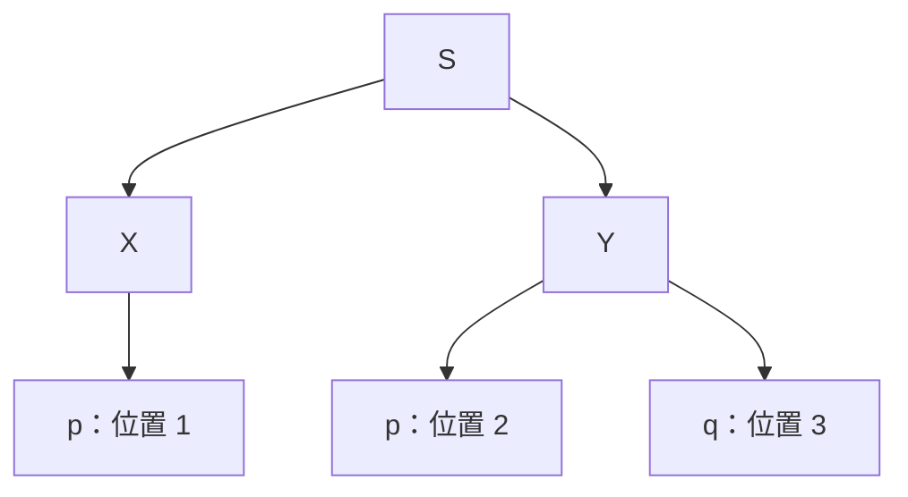

# 形式语言伴读：从符号串到句柄的位置

让编译器判断输入是否合法，要先回答：一个「符号」是什么？怎样用有限规则说明无限多串？同一段输入有两处可套规则时，先选哪一处？这是历史课件形式语言章节的独立伴读，例子、文字和图均独立编写；原题核算按页码标识，不代表现行考纲。

## 输入首先是哪一层的符号串？

字母表 $\Sigma$ 是有限的非空符号集合。串是其符号的有限有序序列，允许长度为零。词法阶段可把字符串划分为记号流，例如把 `x==2` 看成标识符、比较符、整数。==对字符数、记号数和字节数的回答可能不同==。补充原件第 18 页：问 C 或 Java 的「字母表」时，先说明是源字符、实现所用编码，还是词法记号。不能把 ASCII、Unicode 和语法记号当成同一层，精确字符规则还要指明语言标准版本。参见[字母表与符号串](../../../topics/编译原理/字母表与符号串.md)和[词法分析器功能](../../../topics/编译原理/词法分析器功能.md)。

串 $x$ 和 $y$ 连接成 $xy$，长度相加；连接可结合，通常不可交换。方幂满足 $x^0=\varepsilon$，$x^{n+1}=x^nx$。以自编串 `cab` 为例，前缀有空串、`c`、`ca` 和 `cab`，后缀有空串、`b`、`ab` 和 `cab`。排除整个串便是真前缀或真后缀。子串必须连续：`ab` 是子串，`cb` 只是子序列，不是子串；空串和整个串都是子串，只有整个串不是真子串。

语言是 $\Sigma^*$ 的子集，可以有限也可以无限。并、交、差保留或筛掉已有元素，补集要先指定全集，通常取 $\Sigma^*$。连接则从两个语言中各取一个串再拼接。不同选取可以给出相同结果：$A=\{a,ab\}$、$B=\{\varepsilon,b\}$ 时，$AB=\{a,ab,abb\}$，不是四个元素。补充原件第 27 页：笛卡尔积先给有序对，连接再将这些对映成串；笛卡尔积不要求两侧集合来自同一字母表，连接的结果可放在两个字母表的并集上。

| 对象 | 成员 | 连接时的作用 |
|---|---|---|
| 空串 $\varepsilon$ | 串，不是集合，长度为零 | 接在串的任一端不改变该串 |
| 空语言 $\varnothing$ | 没有串 | 接到任何语言上都是空语言 |
| 单元素语言 $\{\varepsilon\}$ | 只含空串 | 接到任何语言上不改变该语言 |

语言方幂 $A^0=\{\varepsilon\}$，$A^{n+1}=A^nA$。$A^*$ 允许零次或更多次连接；$A^+$ 要求至少一次，且 $A^+=AA^*=A^*A$：从非空序列剥去第一个或最后一个因子即可。因子数不等于字数：若 $\varepsilon\in A$，$A^+$ 也含空串。极端情形是 $\varnothing^+=\varnothing$，而 $\varnothing^*=\{\varepsilon\}$。原件称 $\Sigma^*$ 为「行集合」，它是字母表上一切有限串的全集，并不等于一门具体语言已认可的句子集合。

## 有限条规则怎样长成一个句子？

列举能描述有限小集合；识别器判断候选串是否被接受；文法从起点逐步生成句型。不能由「都能描述某些语言」推出「有限自动机能识别所有语言」：状态有限，足够多的前缀中必有两个不同长度的 $0^i,0^j$ 抵达同一状态，随后同读 $1^i$ 不能既接受 $0^i1^i$ 又拒绝 $0^j1^i$。有限自动机不够时，有限条递归规则仍可给出结构。参见[形式语言与文法引入](../../../topics/编译原理/形式语言与文法引入.md)和[有穷自动机](../../../topics/编译原理/有穷自动机.md)。

上下文无关文法 $G=(V_N,V_T,P,S)$：两张有限符号表不相交，$S\in V_N$，$P$ 是规则集合。用 BNF 写时，`::=` 分隔左右部，竖线列候选，尖括号标记语法单位。例如自编的 `<标签> ::= <字母> | <标签><数字>` 能产生 `q7`，前提是另定义字母和数字；原件的标识符示例还允许在首字母之后追加字母。终结符出现在最终串上，非终结符是待展开的位置。**订正（第 36 页）。** CFG 的规则左部为单个非终结符，右部可以为空；课件后面使用了空产生式，不能按此处「右部非空」的字面限制删掉它。

**参考解答（第 39 页）。** 第一组非终结符为 A、B、C、D，终结符为 `a`、`b`、`[`、`]`，空串不是两张表中任何一项，一个符号也不能同时归入两表。第二组非终结符为 S、A、B、C、D，终结符为 `IF`、`THEN`、`ELSE`、`+`、`*`、`X`、`(`、`)`、`-`。`X` 是否大写无关紧要，在给定文法中它是记号而非可展开的语法单位。

选句型的一处非终结符用一条规则替换，是一步推导；逆着看是一次归约。$\Rightarrow^+$ 为至少一步，$\Rightarrow^*$ 为零步或更多步。从 $S$ 能到的串都是句型，消完非终结符才得到句子；语言 $L(G)$ 收集所有句子。开始符号本身是句型，通常不是句子；空串是不是句子，要看能否推出。**参考解答（第 47–49 页）。** 原件整数例的两位数推导一共五步：进入数字串、把它展开为两个单位、结束递归、落实第一个数字、落实第二个。只落实前一位时已是句型，但还不是整数句子。这里的规则只生成无符号数码，不会自行生成负号。参见[文法产生式与推导](../../../topics/编译原理/文法产生式与推导.md)。

## 递归每多走一步，哪里同步增长？

看到循环规则，先问==每走一步增加什么、哪条规则能停下来==。两个位置必须同步增长时，用一条规则同时改两处；次数互不限制时就要让它们独立增长。证明生成规则恰好描述目标语言，既要检查不会多生成，也要给每个目标串构造推导。

| 原件题目 | 推导结果或构造 | 边界检查 |
|---|---|---|
| 第 46、51–52 页，$S\to0S1\mid01$ | 生成 $0^n1^n$，$n\ge1$ | 出口已有一对；每层只多一对，不能生成空串 |
| 第 53 页，$S\to0S\mid01$ 与 $S\to aaS\mid bc$ | 分别生成 $0^k1$（$k\ge1$）与 $(aa)^kbc$（$k\ge0$） | 前者只增加 0，后者一次加两个 a |
| 第 54 页，令 $n\ge0$ | $S\to0S1\mid\varepsilon$ | $n=0$ 要有空串出口；再添 $S\to01$ 不改变语言，却让 `01` 有两棵树 |
| 第 55 页，两个正次数独立 | $S\to AB,\ A\to0A\mid0,\ B\to1B\mid1$ | `001`、`0111` 都要生成；若左右同步就做不到 |

**订正（第 53 页）。** 该页下面留有前一题的成对增长演算，它不是本页 $S\to0S\mid01$ 的推导。不同规则集可生成同一语言；等价不要求相同的步数、语法树或分析方法。例如第 55 页的另一构造 $S\to0S\mid S1\mid01$ 也分别增长两端，却允许先加 0 或先加 1 生成同一个 `0011`，得到不同的树。

**参考解答（第 58 页）。**

1. $ab^na$（$n\ge0$）：$S\to aTa,\ T\to bT\mid\varepsilon$，零次得到 `aa`。
2. $aba^n$（$n\ge1$）：$S\to abT,\ T\to aT\mid a$，末段至少一个 `a`，不能停在 `ab`。
3. $a^nb^mc^p$（三个次数均可为零）：$S\to ABC$，其中 $A\to aA\mid\varepsilon$、$B\to bB\mid\varepsilon$、$C\to cC\mid\varepsilon$。固定的 `ABC` 顺序不能生成 `ba`。
4. $a^mb^nc^n$（$m$ 奇数、$n$ 为正偶数）：$S\to UT,\ U\to aaU\mid a,\ T\to bbTcc\mid bbcc$。$U$ 退出时给一个 `a`，$T$ 退出时给两对 `b`、`c`；两处的递归次数独立。`abbbccc` 不满足偶数约束，`aaabbcc` 满足。

**参考解答（第 59–64 页）。** 偶整数的表示可拆成符号和数码串。设 $F$ 生成 `+`、`-` 或空串，$D$ 生成任何一个十进制数字，$E$ 生成偶数码，$N$ 生成非零数码，$W\to DW\mid\varepsilon$。允许前导零时，用 $S\to FWE$；不允许前导零时，用 $S\to FE\mid FNWE$。后一写法允许带符号的零；若只允许裸 `0`，就把 `0` 独立成不经过 $F$ 的候选，且从第一个分支的 $E$ 去掉 `0`。只检查末位会错误接受 `042`。

直接递归是一条规则就回到同一个非终结符，间接递归经若干步回来；回到首位为左递归，回到末位为右递归。第 68 页的循环从 Q 开始，绕 R、S 再回 Q，Q 仍在左边，故没有直接左递归也可能有间接左递归。无递归的有限 CFG 不能生成无限多句子；反过来，存在递归未必语言无限，例如 $S\to S\mid a$ 只生成 `a`。形成无限语言的循环必须可达、能退出，并能使终端串长度增长。左递归还可能让直接递归下降在读下一个记号前不停调用自身。参见[自顶向下问题与解决](../../../topics/编译原理/自顶向下问题与解决.md)。

## 句柄为什么不只是括出一段串？

语法树以开始符号为根，内部结点按顺序展开一条规则，从左至右读叶子便是当前句型。空产生式可画 $\varepsilon$ 叶，在串中不占长度。固定树后，先展开左支或右支不会变成两棵树；二义性要检查同一句子真有不同的树。子树叶序列给出相对于其根的短语，直接由一条规则到达当前叶序列的是简单短语。要记录每次出现的起止位置，不能只列去重后的字面值。参见[语法树与二义性](../../../topics/编译原理/语法树与二义性.md)与[短语与句柄](../../../topics/编译原理/短语与句柄.md)。

**补充（自编算例）。** $S\to XY,\ X\to p,\ Y\to pq$ 生成 `ppq`。先展开 X 和先展开 Y 都得到同一棵树；在最右推导中最后展开 X，逆向首次归约的是第一个 `p`，不是第二个位置。

**参考解答（第 72、78–84 页）。** 在课件所画的 `baSb` 树中，左侧 A 子树给 `ba`，其中 `a` 是 B 的简单短语；右侧 B 直接展开为 `Sb`，所以 `Sb` 也是简单短语。根 S 按第 70 页的形式定义还给出整串这一短语；课件此处列了供辨认的内层结果。

**订正（第 84 页）。** 该图中的 `a` 是最左简单短语，不能按这棵树称为句柄。若按最右推导，根先展开为 `AB`，再把右侧 `B` 展成 `Sb`，得到 `ASb`；这时应先展开右边的 `S`，但图上它还未展开，左支却已化为 `ba`。这不是这棵树的最右推导能停下的位置。

第 85 页的 `C+B*C` 中，开头的 `C` 和加号后的整个 `B*C` 才是两处简单短语：末尾单独的 `C` 在所示推导中不是另一个 B 展开的结果。左侧更高的 A 子树亦可推出开头的 `C`，最外层是整串短语。

> [!WARNING]
> **补充（第 83 页）。** 「最左简单短语」要放在选定的最右推导及相应右句型中理解。句柄是==逆转该最右推导时，应首先归约的右部及其位置==。一段字面内容恰好等于某条规则右部，不能据此立即归约；二义文法还要指明选的是哪棵树。有空产生式时尤其要记录边界，因为空串没有可圈出的字符。
