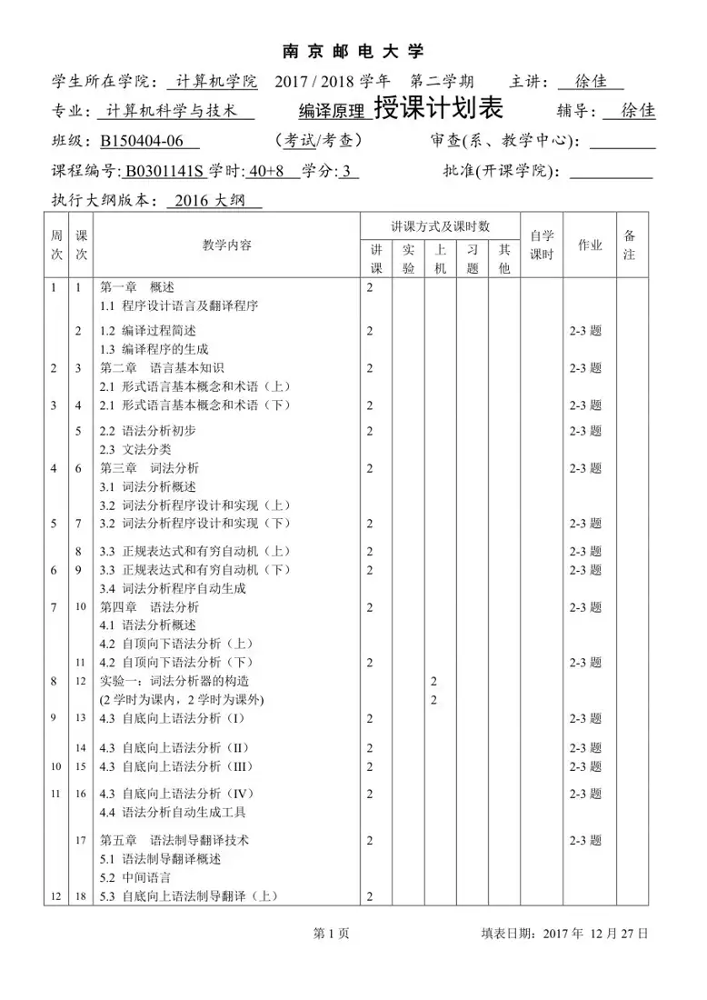
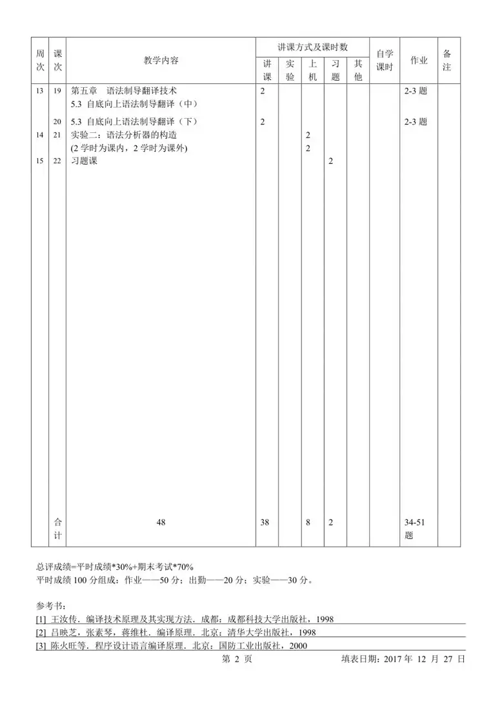

# 《编译原理》2017—2018学年第二学期授课计划表

原件的每一页，下面附识别出的文字。

### 南 京 邮 电 大 学

原文：

南 京 邮 电 大 学

学生所在学院： 计算机学院

2017 / 2018 学年 第二学期编译原理 授课计划表

主讲： 徐佳

专业： 计算机科学与技术

辅导： 徐佳

班级：B150404-06

（考试/考查）

课程编号: B0301141S 学时: 40+8 学分: 3

执行大纲版本： 2016 大纲

审查(系、教学中心)：

批准(开课学院)：

<table><tr><td rowspan="2">周次</td><td rowspan="2">课次</td><td rowspan="2">教学内容</td><td colspan="5">讲课方式及课时数</td><td rowspan="2">自学课时</td><td rowspan="2">作业</td><td rowspan="2">备注</td></tr><tr><td>讲课</td><td>实验</td><td>上机</td><td>习题</td><td>其他</td></tr><tr><td rowspan="4">1</td><td rowspan="2">1</td><td>第一章 概述</td><td rowspan="2">2</td><td rowspan="2"></td><td rowspan="2"></td><td rowspan="2"></td><td rowspan="2"></td><td rowspan="2"></td><td rowspan="2"></td><td rowspan="2"></td></tr><tr><td>1.1 程序设计语言及翻译程序</td></tr><tr><td rowspan="2">2</td><td>1.2 编译过程简述</td><td rowspan="2">2</td><td rowspan="2"></td><td rowspan="2"></td><td rowspan="2"></td><td rowspan="2"></td><td rowspan="2"></td><td rowspan="2">2-3 题</td><td rowspan="2"></td></tr><tr><td>1.3 编译程序的生成</td></tr><tr><td rowspan="2">2</td><td rowspan="2">3</td><td>第二章 语言基本知识</td><td rowspan="2">2</td><td rowspan="2"></td><td rowspan="2"></td><td rowspan="2"></td><td rowspan="2"></td><td rowspan="2"></td><td rowspan="2">2-3 题</td><td rowspan="2"></td></tr><tr><td>2.1 形式语言基本概念和术语(上)</td></tr><tr><td rowspan="3">3</td><td rowspan="3">4</td><td>2.1 形式语言基本概念和术语(下)</td><td>2</td><td></td><td></td><td></td><td></td><td></td><td>2-3 题</td><td></td></tr><tr><td>2.2 语法分析初步</td><td rowspan="2">2</td><td rowspan="2"></td><td rowspan="2"></td><td rowspan="2"></td><td rowspan="2"></td><td rowspan="2"></td><td rowspan="2">2-3 题</td><td rowspan="2"></td></tr><tr><td>2.3 文法分类</td></tr><tr><td rowspan="3">4</td><td rowspan="3">6</td><td>第三章 词法分析</td><td rowspan="3">2</td><td rowspan="3"></td><td rowspan="3"></td><td rowspan="3"></td><td rowspan="3"></td><td rowspan="3"></td><td rowspan="3">2-3 题</td><td rowspan="3"></td></tr><tr><td>3.1 词法分析概述</td></tr><tr><td>3.2 词法分析程序设计和实现(上)</td></tr><tr><td rowspan="2">5</td><td rowspan="2">7</td><td>3.2 词法分析程序设计和实现(下)</td><td>2</td><td></td><td></td><td></td><td></td><td></td><td>2-3 题</td><td></td></tr><tr><td>3.3 正规表达式和有穷自动机(上)</td><td>2</td><td></td><td></td><td></td><td></td><td></td><td>2-3 题</td><td></td></tr><tr><td rowspan="2">6</td><td rowspan="2">9</td><td>3.3 正规表达式和有穷自动机(下)</td><td rowspan="2">2</td><td rowspan="2"></td><td rowspan="2"></td><td rowspan="2"></td><td rowspan="2"></td><td rowspan="2"></td><td rowspan="2">2-3 题</td><td rowspan="2"></td></tr><tr><td>3.4 词法分析程序自动生成</td></tr><tr><td rowspan="4">7</td><td rowspan="3">10</td><td>第四章 语法分析</td><td rowspan="3">2</td><td rowspan="3"></td><td rowspan="3"></td><td rowspan="3"></td><td rowspan="3"></td><td rowspan="3"></td><td rowspan="3">2-3 题</td><td rowspan="3"></td></tr><tr><td>4.1 语法分析概述</td></tr><tr><td>4.2 自顶向下语法分析(上)</td></tr><tr><td>11</td><td>4.2 自顶向下语法分析(下)</td><td>2</td><td></td><td></td><td></td><td></td><td></td><td>2-3 题</td><td></td></tr><tr><td>8</td><td>12</td><td>实验一:词法分析器的构造(2学时为课内,2学时为课外)</td><td></td><td></td><td>2</td><td></td><td></td><td></td><td></td><td></td></tr><tr><td rowspan="2">9</td><td rowspan="2">13</td><td>4.3 自底向上语法分析(I)</td><td>2</td><td></td><td></td><td></td><td></td><td></td><td>2-3 题</td><td></td></tr><tr><td>4.3 自底向上语法分析(II)</td><td>2</td><td></td><td></td><td></td><td></td><td></td><td>2-3 题</td><td></td></tr><tr><td>10</td><td>15</td><td>4.3 自底向上语法分析(III)</td><td>2</td><td></td><td></td><td></td><td></td><td></td><td>2-3 题</td><td></td></tr><tr><td rowspan="5">11</td><td rowspan="2">16</td><td>4.3 自底向上语法分析(IV)</td><td rowspan="2">2</td><td rowspan="2"></td><td rowspan="2"></td><td rowspan="2"></td><td rowspan="2"></td><td rowspan="2"></td><td rowspan="2">2-3 题</td><td rowspan="2"></td></tr><tr><td>4.4 语法分析自动生成工具</td></tr><tr><td rowspan="3">17</td><td>第五章 语法制导翻译技术</td><td rowspan="3">2</td><td rowspan="3"></td><td rowspan="3"></td><td rowspan="3"></td><td rowspan="3"></td><td rowspan="3"></td><td rowspan="3">2-3 题</td><td rowspan="3"></td></tr><tr><td>5.1 语法制导翻译概述</td></tr><tr><td>5.2 中间语言</td></tr><tr><td>12</td><td>18</td><td>5.3 自底向上语法制导翻译(上)</td><td>2</td><td></td><td></td><td></td><td></td><td></td><td></td><td></td></tr></table>

填表日期：2017 年 12 月 27 日

第 1 页

### 参考书：

原文：

<table><tr><td rowspan="2">周次</td><td rowspan="2">课次</td><td rowspan="2">教学内容</td><td colspan="5">讲课方式及课时数</td><td rowspan="2">自学课时</td><td rowspan="2">作业</td><td rowspan="2">备注</td></tr><tr><td>讲课</td><td>实验</td><td>上机</td><td>习题</td><td>其他</td></tr><tr><td>13</td><td>19</td><td>第五章 语法制导翻译技术5.3 自底向上语法制导翻译(中)</td><td>2</td><td></td><td></td><td></td><td></td><td></td><td>2-3 题</td><td></td></tr><tr><td>14</td><td>20</td><td rowspan="2">5.3 自底向上语法制导翻译(下)实验二:语法分析器的构造(2 学时为课内,2 学时为课外)</td><td>2</td><td></td><td>2</td><td></td><td></td><td></td><td>2-3 题</td><td></td></tr><tr><td rowspan="2">15</td><td>21</td><td></td><td></td><td>2</td><td></td><td></td><td></td><td></td><td></td></tr><tr><td>22</td><td>习题课</td><td></td><td></td><td></td><td>2</td><td></td><td></td><td></td><td></td></tr><tr><td></td><td>合计</td><td>48</td><td>38</td><td></td><td>8</td><td>2</td><td></td><td></td><td>34-51题</td><td></td></tr></table>
总评成绩=平时成绩\*30%+期末考试\*70% 平时成绩100分组成：作业——50分；出勤——20分；实验——30分。

参考书：

[1] 王汝传．编译技术原理及其实现方法．成都：成都科技大学出版社，1998

[2] 吕映芝，张素琴，蒋维杜．编译原理．北京：清华大学出版社，1998

[3] 陈火旺等．程序设计语言编译原理．北京：国防工业出版社，2000

第 2 页

填表日期：2017 年 12 月 27 日
