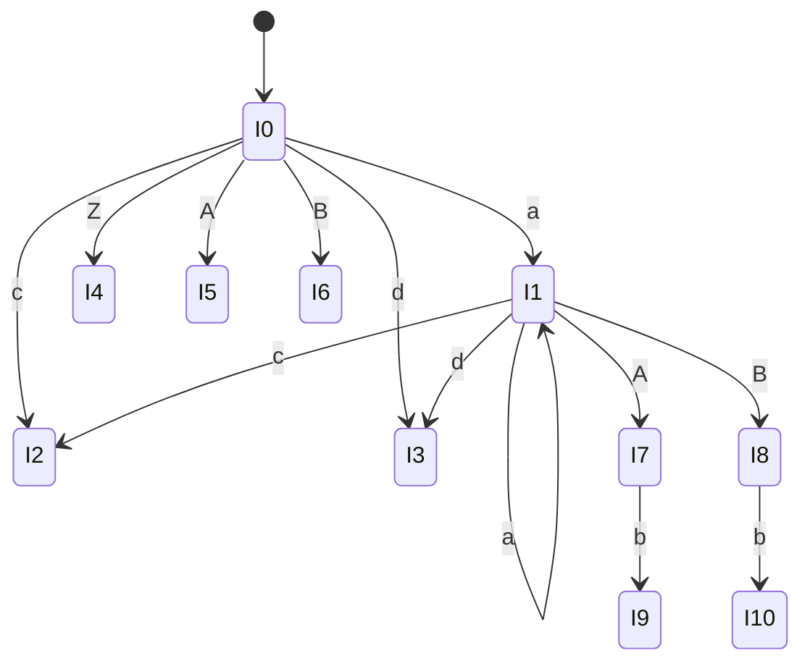
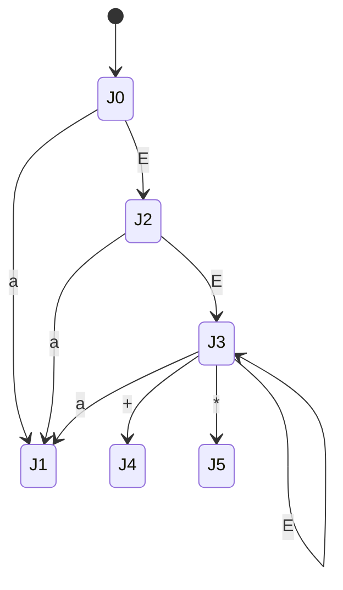

# 《编译原理》2020—2021 学年第二学期第16次作业（LR分析）

原件两页各有一题，没有给出结果表。下面按原规则编号给出独立验算的**参考解答**。状态号从 0 开始，仅用于本解；输入结束记号为 `#`。表中 `s` 表示移进，`r` 表示归约，未列项或空格表示报错。

## 第一题：两种中心符号，共用外层配对

**订正。** 第 1 页左侧文法的基础分支是小写终结符 `c`，右侧编号表把第 4 条误写为大写 `C`。原件没有给非终结符 C 的定义，本解按左侧明确写法取 `A→c`。

**参考解答。** 拓广后按原编号排列：`0: Z'→Z`、`1: Z→A`、`2: Z→B`、`3: A→aAb`、`4: A→c`、`5: B→aBb`、`6: B→d`。两路语言分别在 `c` 和 `d` 外裹等量的 `a`、`b`，故整体语言为

$$
\{a^ncb^n:n\ge0\}\ \cup\ \{a^ndb^n:n\ge0\}.
$$

用 [CLOSURE 与 GOTO](../../../topics/编译原理/LR0分析表构造.md) 机械构造项目集，不先猜一条完整句子。初态圆点后的 Z、A、B 都是非终结符，所以将它们可开始的项目依次并入闭包。移进一个 `a` 后仍面对 A、B，闭包再次加入同样的起始项目；再移进任意多个 `a` 不产生新项目集。这就是状态 1 自环的来源。右括号一类的收尾在本题中由 `b` 承担，但必须先从中间的 `c` 或 `d` 获得 A 或 B。

```text
I0  Z'→·Z，Z→·A，Z→·B，A→·aAb，A→·c，B→·aBb，B→·d
I1  A→a·Ab，B→a·Bb，以及 A、B 各自的全部圆点在首位项目
I2  A→c·
I3  B→d·
I4  Z'→Z·
I5  Z→A·
I6  Z→B·
I7  A→aA·b
I8  B→aB·b
I9  A→aAb·
I10 B→aBb·
```



上图画的是活前缀的转移；某条边能走，只说明当前前缀可达，不表示整个输入可接受。完整句法识别还要查下表。普通完成项在 LR(0) 表的所有终结符列和结束列填归约；拓广完成项只在 `#` 上填接受。

| 状态 | ACTION `a` | ACTION `b` | ACTION `c` | ACTION `d` | ACTION `#` | GOTO Z | GOTO A | GOTO B |
|---|---|---|---|---|---|---|---|---|
| 0 | s1 |  | s2 | s3 |  | 4 | 5 | 6 |
| 1 | s1 |  | s2 | s3 |  |  | 7 | 8 |
| 2 | r4 | r4 | r4 | r4 | r4 |  |  |  |
| 3 | r6 | r6 | r6 | r6 | r6 |  |  |  |
| 4 |  |  |  |  | acc |  |  |  |
| 5 | r1 | r1 | r1 | r1 | r1 |  |  |  |
| 6 | r2 | r2 | r2 | r2 | r2 |  |  |  |
| 7 |  | s9 |  |  |  |  |  |  |
| 8 |  | s10 |  |  |  |  |  |  |
| 9 | r3 | r3 | r3 | r3 | r3 |  |  |  |
| 10 | r5 | r5 | r5 | r5 | r5 |  |  |  |

11 个状态的每格最多一个动作。独立试走 `aacbb`：先移进两个 `a` 和 `c`，按 r4 得到中心 A；随后每读进一个 `b` 就归约一层 aAb，最后由 r1 把外层 A 归约成 Z。未配齐的 `aacb` 到末尾仍缺第二个 `b`，不是因为曾经获得一个 A 就可以接受。

## 第二题：后缀表达式，何时才够两个操作数？

**参考解答。** 取 `0: E'→E`、`1: E→EE+`、`2: E→EE*`、`3: E→a`。运算符位于两个操作数之后；`aa+` 合法，而 `a+` 不合法。写项目时记公共闭包 $K$ 为三个首位项目 `E→·EE+`、`E→·EE*`、`E→·a`：

```text
J0  E'→·E，加 K
J1  E→a·
J2  E'→E·，E→E·E+，E→E·E*，加 K
J3  E→EE·+，E→EE·*，E→E·E+，E→E·E*，加 K
J4  E→EE+·
J5  E→EE*·
```



再求 FOLLOW。开始 E 带来结束记号；第一处 E 后面是第二个 E 且 $mathrm{FIRST}(E)=\{a\}$，因此加入 `a`；第二处 E 后面直接是 `+` 或 `*`。综上 $mathrm{FOLLOW}(E)=\{a,+,*,\#\}$。它是本题的全部 ACTION 列，所以本题的 SLR 和 LR(0) 表恰好相同，不是所有文法都有这个性质。

| 状态 | ACTION `a` | ACTION `+` | ACTION `*` | ACTION `#` | GOTO E |
|---|---|---|---|---|---|
| 0 | s1 |  |  |  | 2 |
| 1 | r3 | r3 | r3 | r3 |  |
| 2 | s1 |  |  | acc | 3 |
| 3 | s1 | s4 | s5 |  | 3 |
| 4 | r1 | r1 | r1 | r1 |  |
| 5 | r2 | r2 | r2 | r2 |  |

因此原文法是 SLR(1) 文法，事实上也是 LR(0) 文法。J2 有拓广完成项和移进候选，但 `acc` 只在 `#`、移进只在 `a`，不冲突。独立检查 `aaa*+`：三个 `a` 均可先变成 E，`*` 取最后两个 E 合成一个，`+` 再取余下的两个 E，最终只剩一个 E。相反 `aa` 到末尾还剩两份值，对应 J3 的结束列为空。这个计数是独立验算器，不替代表格本身。

> [!TIP]
> ==同一状态有多个项目不是冲突，同行同一列有多个可行动作才是冲突==。判定时标明冲突列、先区分拓广接受与普通归约，再问 FOLLOW 是否会缩小归约集合。参见 [SLR 分析表构造](../../../topics/编译原理/SLR1分析表构造.md)。
