# 《编译原理》习题解答

按原件页序整理。原文中的“解”“答”等保留原件答案；“参考解答”为补充。

## 原件第1页

《编译原理》习题解答:

第一次作业：

P14 2、何谓源程序、目标程序、翻译程序、汇编程序、编译程序和解释程序？它们之间可能有何种关系？

答：被翻译的程序称为源程序；

翻译出来的程序称为目标程序或目标代码；

将汇编语言和高级语言编写的程序翻译成等价的机器语言，实现此功能的程序称为翻译程序；

把汇编语言写的源程序翻译成机器语言的目标程序称为汇编程序；

解释程序不是直接将高级语言的源程序翻译成目标程序后再执行，而是一个个语句读入源程序，即边解释边执行；

编译程序是将高级语言写的源程序翻译成目标语言的程序。

关系：汇编程序、解释程序和编译程序都是翻译程序，具体见 P4 图 1.3。

P14 3、编译程序是由哪些部分组成？试述各部分的功能？

答：编译程序主要由8个部分组成：（1）词法分析程序；（2）语法分析程序；（3）语义分析程序；（4）中间代码生成；（5）代码优化程序；（6）目标代码生成程序；（7）错误检查和处理程序；（8）信息表管理程序。具体功能见P7-9。

P14 4、语法分析和语义分析有什么不同？试举例说明。

答：语法分析是将单词流分析如何组成句子而句子又如何组成程序，看句子乃至程序是否符合语法规则，例如：对变量 x: = y 符合语法规则就通过。语义分析是对语句意义进行检查，如赋值语句中 x 与 y 类型要一致，否则语法分析正确，语义分析则错误。

P15 5、编译程序分遍由哪些因素决定？

答：计算机存储容量大小；编译程序功能强弱；源语言繁简；目标程序优化程度；设计和实现编译程序时使用工具的先进程度以及参加人员多少和素质等等。

补充：1、为什么要对单词进行内部编码？其原则是什么？对标识符是如何进行内部编码的？

答：内部编码从“源字符串”中识别单词并确定单词的类型和值；原则：长度统一，即刻画了单词本身，也刻画了它所具有的属性，以供其它部分分析使用。对于标识符编码，先判断出该单词是标识符，然后在类别编码中写入相关信息，以表示为标识符，再根据具体标识符的含义编码该单词的值。

补充：2、赋值语句：A: = 5 \* C 的语法和语义指的是什么？

答：语法分析将检查该语句是否符合赋值语句规则，语义是指将 $5^{*}\mathrm{C}$ 的结果赋值为A。

第二次作业：

P38 1、设 $\mathrm{T}_{1} = \{11,010\}$ ， $\mathrm{T}_{2} = \{0,01,1001\}$ ，计算： $\mathrm{T}_2\mathrm{T}_1$ ， $\mathrm{T}_1^*$ ， $\mathrm{T}_2^+$ 。

$\mathrm{T}_2\mathrm{T}_1 = \{011, 0010, 0111, 01010, 100111, 1001010\}$

$\mathrm{T}_{1}^{*} = \{\varepsilon , 11, 010, 1111, 11010, 01011, 010010\dots\dots\}$

$\mathrm{T}_{2}^{+} = \{\mathbf{0},\mathbf{01},\mathbf{1001},\mathbf{00},\mathbf{001},\mathbf{01001},\mathbf{010},\mathbf{0101}\dots \dots \}$

## 原件第2页

P38 3、令 $\mathbf{A} = \{0, 1, 2\}$ ，写出集合 $\mathbf{A}^{+}$ 和 $\mathbf{A}^{*}$ 的七个最短符号串。

P38 5、试证明： $A^{+}=AA^{*}=A^{*}A$ 。

证明： $\mathbf{A}^{+} = \mathbf{A}^{1}\cup \mathbf{A}^{2}\cup \dots\dots \cup \mathbf{A}^{\mathrm{n}}\cup \dots\dots$

P38 7、设有文法 G[S]:

P38-39 8、设有文法 G[S]:

试问下列符号串（1）aidtcBcAb （3）ab （5）aidtcidtcidtb 是否为该文法的句型或句子。

(5) $S \Rightarrow aAb \Rightarrow aBcAb \Rightarrow aidtcAb \Rightarrow aidtcBcAb \Rightarrow aidtcidtcBb \Rightarrow aidtcidtcidtb$ 句型也是句子。

P39 10、给定文法:

$$
\begin{array}{l} \mathrm{S}: := \mathrm{aB} | \mathrm{bA} \\ \mathrm{A}: := \mathrm{aS} | \mathrm{bAA} | \mathrm{a} \\ \mathrm{B}: := \mathrm{bS} | \mathrm{aBB} | \mathrm{b} \end{array}
$$

$\mathbf{L}(\mathbf{G}) = \{\text{相同个数的}\mathbf{a}\text{与}\mathbf{b}\text{以任意次序连接而成的非空符号串}\}$ 。

P39 11、试分别描述下列文法所产生的语言（文法开始符号为 S）:

{解题思路：将文法转换为正规表达式}

## 原件第3页

(2) $\mathbf{L}(\mathbf{G}) = \{\mathbf{a}^{2\mathrm{n}}\mathbf{bc}\mid \mathbf{n}\geqslant 0\}$

(3) $\mathrm{L}(\mathrm{G}) = \{\mathrm{a^{i}bc^{j}d^{k}}\mid \mathrm{i},\mathrm{j},\mathrm{k}\geqslant 1,\mathrm{i} = \mathrm{j} + \mathrm{k} - 1\}$ ；或者 $\mathrm{L}(\mathrm{G}) = \{\mathrm{a^{j + k - 1}bc^{j}d^{k}}\mid \mathrm{j},\mathrm{k}\geqslant 1\}$

(4) $\mathrm{L}(\mathbf{G}) = \{\mathbf{a}^{\mathrm{n}}\mathbf{b}^{\mathrm{n}}\mathbf{c}^{\mathrm{m}}\mathbf{d}^{\mathrm{m}}\mid \mathbf{m}\geqslant 0,\mathbf{n}\geqslant 1\}$

P39 12、试分别构造产生下列语言的文法：

(1) { ab^n a | n=0, 1, 2, 3……}

(2) $\{\mathbf{a}^{\mathrm{n}}\mathbf{b}^{\mathrm{n}}|\mathbf{n} = 1,2,3,4\dots \}$ 无法转换成正规表达式，因为 $\mathbf{a}$ 和 $\mathbf{b}$ 的个数相同

(3) $\{\mathsf{aba}^{\mathfrak{n}}|\mathfrak{n}\geqslant 1\}$ 可以转换但慎用

(4) $\{\mathbf{a}^{\mathrm{n}}\mathbf{b}\mathbf{a}^{\mathrm{m}}|\mathbf{n},\mathbf{m}\geqslant 1\}$ 可以转换但慎用

(5) $\{\mathbf{a}^{\mathrm{n}}\mathbf{b}^{\mathrm{m}}\mathbf{c}^{\mathrm{p}}|\mathbf{n},\mathbf{m},\mathbf{p}\geqslant 0\}$ 可以转换

$$
\{a ^ {m} b ^ {m} c ^ {p} \mid m, p \geqslant 0 \} \tag {6}
$$

（1） $G=\{V_{N}, V_{T}, P, S\}$ ， $V_{N}=\{S, A\}$ ， $V_{T}=\{a, b\}$ ，[可将其看成正规表达式 $ab^{*}a$ ，再画出其状态转换图来求解]

P: S::=aAa 或 S::=aB
A::=bA | ε B::=bB | a

(2) $\mathbf{G} = \{\mathbf{V}_{\mathrm{N}}, \mathbf{V}_{\mathrm{T}}, \mathbf{P}, \mathbf{S}\}$ , $\mathbf{V}_{\mathrm{N}} = \{\mathbf{S}\}$ , $\mathbf{V}_{\mathrm{T}} = \{\mathbf{a}, \mathbf{b}\}$ ,

$$
\mathrm{P}: \quad \mathrm{S}:: := \mathrm{aSb} | \varepsilon
$$

(3) $G=\{V_{N}, V_{T}, P, S\}$ , $V_{N}=\{S, A\}$ , $V_{T}=\{a, b\}$ ,
P: S::=abA 或 S::=Sa | aba
A::=aA | a

(4) $\mathbf{G} = \{\mathbf{V}_{\mathrm{N}},\mathbf{V}_{\mathrm{T}},\mathbf{P},\mathbf{S}\} ,\mathbf{V}_{\mathrm{N}} = \{\mathbf{S},\mathbf{A}\} ,\mathbf{V}_{\mathrm{T}} = \{\mathbf{a},\mathbf{b}\} ,$

$$
\mathrm{P}: \quad \mathrm{S} \because = \mathrm{aS} \mid \mathrm{abA}
$$

$$
\mathbf {A}: := \mathbf {a A} \mid \mathbf {a}
$$

$$
\mathbf {Z} \mathrel {\mathop :} = \mathbf {a Z} \mid \mathbf {a}
$$

$$
\mathbf {Z} \mathrel {\mathop :} = \mathbf {a Z} \mid \mathbf {a}
$$

(5) $\mathbf{G} = \{\mathbf{V}_{\mathrm{N}},\mathbf{V}_{\mathrm{T}},\mathbf{P},\mathbf{S}\} ,\mathbf{V}_{\mathrm{N}} = \{\mathbf{S},\mathbf{A},\mathbf{B},\mathbf{C}\} ,\mathbf{V}_{\mathrm{T}} = \{\mathbf{a},\mathbf{b},\mathbf{c}\} ,$

$$
\mathrm{P}: \quad \mathrm{S}:: := \mathrm{ABC}
$$

$$
\mathrm{S}: := \mathrm{aS} | \mathrm{bS} | \mathrm{cS} | \varepsilon
$$

$$
\mathbf {A} \because = \mathbf {a A} | \varepsilon
$$

或

$$
\mathbf {B}: := \mathbf {b B} \mid \varepsilon
$$

$$
\mathrm{C}: := \mathrm{cC} \mid \varepsilon
$$

(6) $\mathbf{G} = \{\mathbf{V}_{\mathrm{N}},\mathbf{V}_{\mathrm{T}},\mathbf{P},\mathbf{S}\} ,\mathbf{V}_{\mathrm{N}} = \{\mathbf{S},\mathbf{A}\} ,\mathbf{V}_{\mathrm{T}} = \{\mathbf{a},\mathbf{b},\mathbf{c}\} ,$

$$
\mathrm{P}: \mathrm{S} \because = \mathrm{aSbA} | \varepsilon
$$

第三次作业：

P39 15. 设文法 G 规则为:

$$
\mathbf {S}:: = \mathbf {A B}
$$

$$
\mathbf {B}:: = \mathbf {a} | \mathbf {S b}
$$

$$
\mathbf {A}:: = \mathbf {A a} | \mathbf {b B}
$$

对下列句型给出推导语法树，并求出其句型短语，简单短语和句柄。

(2) baabaab (3)bBABb

(2)

## 原件第4页

句型 baabaab 的短语 a, ba, baa, baab, baabaab，简单短语 a，句柄 a

(3)

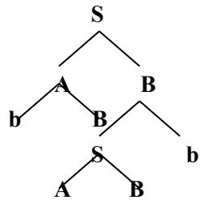

短语 bB, AB, ABb, bBABb

简单短语 bB, AB,

句柄 bB

P40 18. 分别对 $\mathbf{i} + \mathbf{i}^{*}\mathbf{i}$ 和 $\mathbf{i} + \mathbf{i} + \mathbf{i}$ 中每一个句子构造两棵语法树，从而证明下述文法 $\mathbf{G}[<\text{表达式}>]$ 是二义的。

<表达式>: =i|(<表达式>)|<表达式><运算符><表达式>

<运算符>::=+|-|\*|/

1. $\mathbf{i} + \mathbf{i}^{*}\mathbf{i}$

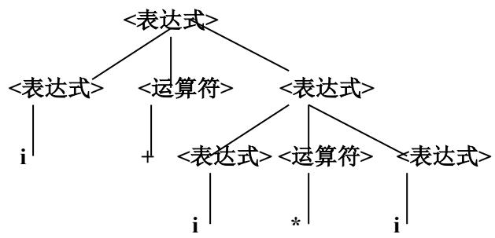

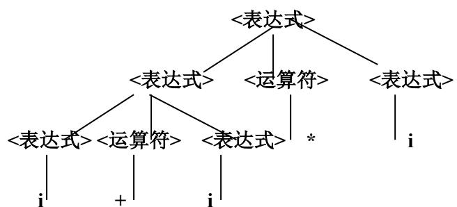

由于句子 $i+i*i$ 可构造两棵不同的语法树，所以证明该文法是二义的。

2. $i+i+i$

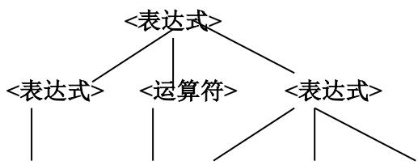

## 原件第5页

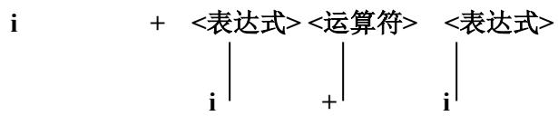

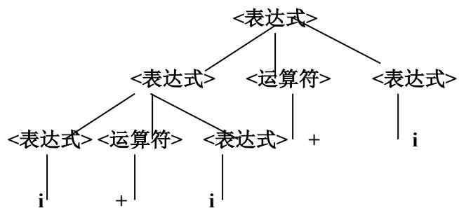

由于句子 $i+i+i$ 可构造两棵不同的语法树，所以证明该文法是二义的。

P40 19. 证明下述文法是二义的

1) S::=iSeS|iS|i

2) S::=iEtS|iEtSeS|a E::=b 存在句子 ibtibtaeibta 或者 ibtibtaea 有两颗不同的语法树

3) S::=A|B
A::=aCbA|a
B::=BCC|a
C::=ba (最简单的就是 a 为句型)

1) 对于句子 iiieii 可构造两棵不同的语法树，所以证明该文法是二义的。

3）对于句子 ababa 可构造两棵不同的语法树，所以证明该文法是二义的。

## 原件第6页

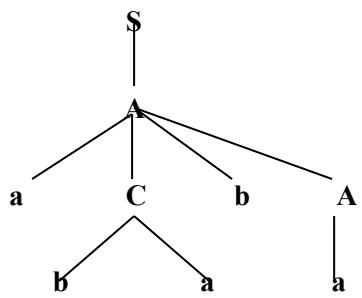

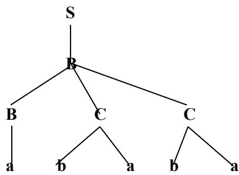

P41 21. 令文法 N:: =D|ND

$$
\mathbf {D}: := \mathbf {0} | \mathbf {1} | \mathbf {2} | \mathbf {3} | \mathbf {4} | \mathbf {5} | \mathbf {6} | \mathbf {7} | \mathbf {8} | \mathbf {9}
$$

给出句子 0127，34，568 最左推导和最右推导。

解：0127 的最左推导 N=>ND=>NDD=>NDDD=>DDDD=>0DDD=>01DD=>012D=>0127
0127 的最右推导 N=>ND=>N7=>ND7=>N27=>ND27=>N127=>D127=>0127
34 的最左推导 N=>ND=>DD=>3D=>34
34 的最右推导 N=>ND=>N4=>D4=>34
568 的最左推导 N=>ND=>NDD=>DDD=>5DD=>56D=>568
568 的最右推导 N=>ND=>N8=>ND8=>N68=>D68=>568

P41 24. 下面文法那些是短语结构文法，上下文有关文法，上下文无关文法，及正规文法？
1.S::=aB B::=cB B::=b C::=c

## 原件第7页

P41 26. 给出产生下列语言 L（G）= $\{W|W\in\{0,1\}^{+}$ 且 W 不含相邻 1 的正规文法。

解题思路一：写出满足要求的符号串，例如 0，1，00，01，10，000，101，010，001 等，根据符号串从左至右的次序画出状态转换图，然后根据状态转换图来推导出文法。这将会得到 S::=0|1|0S|1A|0Z|1Z A::=0|0S|0Z 经过分析其中 Z 为多余状态可删去。

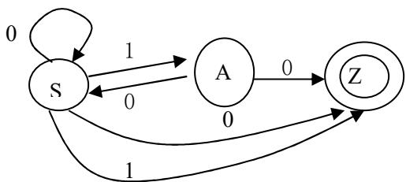

解题思路二：写出其正规表达式(0|10)\*(10|0|1)【如果仅有(0|10)\*的话推导不出1，因为是连接关系，后面缺了10的话就会以1结尾，同样的道理还要推导出0，所以得到此正规式】，画出转换系统，然后根据转换系统来推导出文法。也可以根据正规表达式直接写文法，例如正规表达式(0|10)\*(10|0|1)可以看成是a\*b，推导出A::=(0|10)A|10|0|1，即A::=0A|1B|10|0|1，其中B::=0A，但是10此项不符合正规文法的选项，可以进行改写从而得到A::=0A|1B|0|1 B::=0A|0。

P41 27. 给出一个产生下列语言 L（G）= $\{W|W\in\{a,b\}^{*}$ 且 W 中含 a 的个数是 b 个数两倍的前后文无关文法。

## 原件第8页

P41 28. 给出一个产生下列语言 $\mathbf{L}(\mathbf{G}) = \{\mathbf{w} \mid \mathbf{w} \in \{\mathbf{a}, \mathbf{b}, \mathbf{c}\}^{+}$ 且 $\mathbf{w}$ 由相同个数的 $\mathbf{a}, \mathbf{b}, \mathbf{c}$ 组成的前后文有关文法。

P42 29. 用扩充的 BNF 表示以下文法规则：

第四次作业：

P74 2. 什么叫超前搜索？扫描缓冲区的作用是什么？

词法分析程序在识别单词的时候，为进一步判明情况，确定下一步要做什么，一般采用超前读字符的方法，称超前搜索，扫描缓冲区的作用是为了识别单词符号。

P74 4. 画出下列文法的状态图:

$$
\mathbf {B} \mathrel {\text {:}} := \mathbf {A} \mathbf {f}
$$

A::=e|Ae 并使用该状态图检查下列句子是否该文法的合法句子：f, eeff, eefe。

## 原件第9页

P74 5. 设右线性文法 $\mathbf{G} = (\{\mathbf{S}, \mathbf{A}, \mathbf{B}\}, \{\mathbf{a}, \mathbf{b}\}, \mathbf{S}, \mathbf{P})$ ，其中 $\mathbf{P}$ 组成如下：

S:: =bA A:: =bB A:: =aA A:: =b B:: =a

画出该文法的状态转换图。

第五次作业：

P746. 构造下述文法G[Z]的自动机，该自动机是确定的吗？它相应的语言是什么？

$$
\mathbf {Z}: := \mathbf {A 0} \quad \mathbf {A}: := \mathbf {A 0} | \mathbf {Z 1} | \mathbf {0}
$$

解 1: 将左线性文法转换为右线性文法，由于在规则中出现了识别符号出现在规则右部的情形，因此不能直接使用书上的左右线性文法对应规则，可以引入非终结符号 B，将左线性文法变为 Z:: =A0 A:: =A0|B1|0 B:: =A0，具体为：

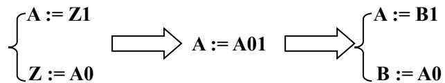

将所得的新左线性文法转换成右线性文法：

此时利用书上规则，其对应的右线性文法为：A::=0A|0B|0 Z::=0A B::=1A

解 2：先画出该文法状态转换图：

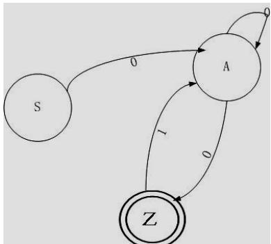

$\mathrm{NFA} = (\{\mathrm{S}, \mathrm{A}, \mathrm{Z}\}, \{\mathbf{0}, \mathbf{1}\}, \mathrm{M}, \{\mathrm{S}\}, \{\mathrm{Z}\})$ 其中 $\mathbf{M}: \quad \mathbf{M}(\mathbf{S}, \mathbf{0}) = \{\mathbf{A}\} \quad \mathbf{M}(\mathbf{S}, \mathbf{1}) = \varnothing$ $\mathbf{M}(\mathbf{A}, \mathbf{0}) = \{\mathbf{A}, \mathbf{Z}\} \quad \mathbf{M}(\mathbf{A}, \mathbf{1}) = \varnothing$ $\mathbf{M}(\mathbf{Z}, \mathbf{0}) = \varnothing \quad \mathbf{M}(\mathbf{Z}, \mathbf{1}) = \{\mathbf{A}\}$

显然该文法的自动机是非确定的；它相应的语言为： $\{0, 1\}$ 上所有满足以 00 开头以 0 结尾且每个 1 必有 0 直接跟在其后的字符串的集合；也可以通过求解正规表达式得到 $A = 0(0|01)^*$ ， $Z = 0(0|01)^*0$

那么如何构造其相应的有穷自动机呢？

先构造其转换系统：

## 原件第10页

根据其转换系统可得状态转换集、状态子集转换矩阵如下表所示：(其中 S' 可以忽略，结果是一样的)

<table><tr><td>I</td><td> $I_0$ </td><td> $I_1$ </td><td>S</td><td>0</td><td>1</td></tr><tr><td> $\{S', S\}$ </td><td> $\{A\}$ </td><td> $\Phi$ </td><td>0</td><td>1</td><td> $\Phi$ </td></tr><tr><td> $\{A\}$ </td><td> $\{A, Z, Z'\}$ </td><td> $\Phi$ </td><td>1</td><td>2</td><td> $\Phi$ </td></tr><tr><td> $\{A, Z, Z'\}$ </td><td> $\{A, Z, Z'\}$ </td><td> $\{A\}$ </td><td>2</td><td>2</td><td>1</td></tr></table>
则其相应的 DFA 为:

P74 7. 构造一个 DFA，它接受{0，1}上所有满足下述条件的字符串，其条件是：字符串中每个 1 都有 0 直接跟在右边，然后，再构造该语言的正规文法。【其它解法可参考 P41-26 题】

解(一): 其状态转换图为 (状态 S 表示空串开始, 状态 A 表明串的末尾是 1, 状态 Z 表示串的末尾是 0)

$\mathrm{DFA} = (\{\mathrm{S}, \mathrm{A}, \mathrm{Z}\}, \{\mathbf{0}, 1\}, \mathrm{M}, \mathrm{S}, \{\mathrm{Z}\})$ 其中 $\mathbf{M}: \quad \mathbf{M}(\mathbf{S}, \mathbf{0}) = \mathbf{Z} \quad \mathbf{M}(\mathbf{S}, \mathbf{1}) = \mathbf{A}$ $\mathbf{M}(\mathbf{A}, \mathbf{0}) = \mathbf{Z}$ $\mathbf{M}(\mathbf{Z}, \mathbf{0}) = \mathbf{Z} \quad \mathbf{M}(\mathbf{Z}, \mathbf{1}) = \mathbf{A}$

该语言的正规文法 G[Z] 为:

右线性文法：//S::=0|1A|0Z 左线性文法：
A::=0|0Z    A::=1|Z1
Z::=0|1A|0Z    Z::=0|A0|Z0

若终止状态只引入不引出则适合构造右线性文法，若开始状态只引出不引入则适合构造左线性文法，若终态和初态均既有引入又有引出，则构造文法要注意。

解(二): 可以先写出该文法的正规表达式为 $(0 \mid 10)^{*}$ , 根据该正规式构造转换系统

对于该转换系统可以采用子集法将

其转变为 DFA，再根据 DFA 写出其正规文法；但是注意观察后，发现开始状态 S 通过 ε 到达 A 状态，可以直接删去 S 状态，由 A 状态作为新的开始状态，同理，只有 A 状态通过 ε 才能到达终止状态 Z，因此可以删去 Z 状态，由 A 状态作为终止状态。这样，A 状态就既为开始状态又为终止状态。可画出化简后的转换图。可写出右线性文法为：

1 0

## 原件第11页

$$
\mathbf {A}: := \mathbf {0} | \mathbf {0 A} | \mathbf {1 B} \quad \mathbf {B}: := \mathbf {0} | \mathbf {0 A}
$$

(写出该右线性文法时应注意，开始状态和终止状态都为 A，右线性文法转换为状态转换图时，增加了虚假的终止状态，因此要判定该状态是否是多余的，由于增加的终止状态只有引入而无引出，而该图中的终止状态既有引入又有引出，所以不是多余状态，转换为左线性文法时也是如此考虑)

解(一)和解(二)的结果是等价的，但是依据课本上介绍的 DFA 的化简方法，由解(一)化不出解(二)，但是解(一)中的 S 和 Z 是等价的(由图可知)。

P74 8. 设 (NFA) $\mathbf{M} = (\{\mathbf{A},\mathbf{B}\} ,\{\mathbf{a},\mathbf{b}\} ,\mathbf{M},\{\mathbf{A}\} ,\{\mathbf{B}\})$ ，其中 $\mathbf{M}$ 定义如下：

$\mathbf{M}(\mathbf{A},\mathbf{a}) = \{\mathbf{A},\mathbf{B}\} \quad \mathbf{M}(\mathbf{A},\mathbf{b}) = \{\mathbf{B}\} \quad \mathbf{M}(\mathbf{B},\mathbf{a}) = \varnothing \quad \mathbf{M}(\mathbf{B},\mathbf{b}) = \{\mathbf{A},\mathbf{B}\}$

请构造相应确定有穷自动机(DFA) M'。

解：构造一个如下的自动机(DFA) M', (DFA) M'={K', {a, b}, M', S', Z'}

K'的元素是[A] [B] [A, B]

由于 $\mathbf{M}(\mathbf{A},\mathbf{a}) = \{\mathbf{A},\mathbf{B}\}$ ，故有 $\mathbf{M}'([A],\mathbf{a}) = [A,B]$

同样 $\mathbf{M}'([A],\mathbf{b}) = [B]$

$$
\mathbf {M} ^ {\prime} ([ \mathbf {B} ], \mathbf {a}) = \varnothing
$$

$$
\mathbf {M} ^ {\prime} ([ \mathbf {B} ], \mathbf {b}) = [ \mathbf {A}, \mathbf {B} ]
$$

由于 $\mathbf{M}(\{\mathbf{A},\mathbf{B}\},\mathbf{a}) = \mathbf{M}(\mathbf{A},\mathbf{a})\mathbf{U}\mathbf{M}(\mathbf{B},\mathbf{a}) = \{\mathbf{A},\mathbf{B}\} \mathbf{U}\boldsymbol {\varnothing} = \{\mathbf{A},\mathbf{B}\}$

故 $\mathbf{M}^{\prime}$ ([A, B], a) = [A, B]

由于 $\mathbf{M}(\{\mathbf{A},\mathbf{B}\},\mathbf{b}) = \mathbf{M}(\mathbf{A},\mathbf{b})\mathbf{U}\mathbf{M}(\mathbf{B},\mathbf{b}) = \{\mathbf{B}\} \mathbf{U}\{\mathbf{A},\mathbf{B}\} = \{\mathbf{A},\mathbf{B}\}$

故 $\mathbf{M}^{\prime}$ ([A, B], b) = [A, B]

$S'=[A]$ ，终态集 $Z'=\{[A, B], [B]\}$

重新定义：令 0=[A] 1=[B] 2=[A, B]，则 DFA 如下所示：

P74 9. 设有穷自动机 $\mathbf{M} = (\{\mathbf{S}, \mathbf{A}, \mathbf{E}\}, \{\mathbf{a}, \mathbf{b}, \mathbf{c}\}, \mathbf{M}, \mathbf{S}, \{\mathbf{E}\})$ ，其中 $\mathbf{M}$ 定义为 $\mathbf{M}(\mathbf{S}, \mathbf{c}) = \mathbf{A} \quad \mathbf{M}(\mathbf{A}, \mathbf{b}) = \mathbf{A} \quad \mathbf{M}(\mathbf{A}, \mathbf{a}) = \mathbf{E}$ 请构造一个左线性文法。

$\mathrm{S}\rightarrow \mathrm{cA}$ $\mathrm{A}\rightarrow \mathrm{bA}$ $\mathrm{A}\rightarrow \mathrm{a}|\mathrm{aE}$ $\{\mathrm{A}\rightarrow \mathrm{aE}$ 实际上是多余的规则，应该去掉}

$$
\mathbf {G} = \left(\mathbf {V} _ {\mathrm{N}}, \mathbf {V} _ {\mathrm{T}}, \mathbf {P}, \mathbf {S}\right)
$$

$\mathbf{V}_{\mathrm{N}} = \{\mathbf{A},\mathbf{S}\} \quad \mathbf{V}_{\mathrm{T}} = \{\mathbf{a},\mathbf{b},\mathbf{c}\}$ 根据书上左右线性文法的转换规则，得到 $\mathbf{P}:\mathbf{A}\rightarrow \mathbf{c}\quad \mathbf{A}\rightarrow \mathbf{Ab}\quad \mathbf{S}\rightarrow \mathbf{Aa}\quad \{\mathbf{E}\rightarrow \mathbf{Aa}$ 实际上是多余的规则，应该去掉

画出状态转换图之后就非常清晰。

P74 10. 已知正规文法 $\mathbf{G} = (\{\mathbf{S}, \mathbf{B}, \mathbf{C}\}, \{\mathbf{a}, \mathbf{b}, \mathbf{c}\}, \mathbf{P}, \mathbf{S})$ ，其中 $\mathbf{P}$ 内包含如下产生式：

$$
\mathrm{S}: := \mathrm{aS} \mid \mathrm{aB} \quad \dots \dots ①
$$

1 1

## 原件第12页

请构造一个等价的有穷自动机。

解： $\mathrm{M} = (\{\mathrm{S}, \mathrm{B}, \mathrm{C}, \mathrm{T}\}, \{\mathrm{a}, \mathrm{b}, \mathrm{c}\}, \mathrm{M}, \{\mathrm{S}\}, \{\mathrm{T}\})$ $M(S,a)=S$ $M(S,a)=B$ $M(S,b)=\varnothing$ $M(S,c)=\varnothing$ $M(B,a)=\varnothing$ $M(B,b)=B$ $M(B,b)=C$ $M(B,c)=\varnothing$ $M(C,a)=\varnothing$ $M(C,b)=\varnothing$ $M(C,c)=T$ $M(C,c)=C$

第六次作业：

P74 11. 构造下列正规式相应的 DFA:

(1) $1(0|1)*101$ 【老课本】

解：先构造该正规式的转换系统：

由上述转换系统可得状态转换集 $\mathbf{K} = \{\mathrm{S},1,2,3,4,5,\mathbf{Z}\}$ ，状态子集转换矩阵如下表所示：

<table><tr><td>I</td><td> $I_0$ </td><td> $I_1$ </td><td>K</td><td>0</td><td>1</td></tr><tr><td>{S}</td><td> $\Phi$ </td><td>{1, 2, 3}</td><td>0</td><td> $\Phi$ </td><td>1</td></tr><tr><td>{1, 2, 3}</td><td>{2, 3}</td><td>{2, 3, 4}</td><td>1</td><td>2</td><td>3</td></tr><tr><td>{2, 3}</td><td>{2, 3}</td><td>{2, 3, 4}</td><td>2</td><td>2</td><td>3</td></tr><tr><td>{2, 3, 4}</td><td>{2, 3, 5}</td><td>{2, 3, 4}</td><td>3</td><td>4</td><td>3</td></tr><tr><td>{2, 3, 5}</td><td>{2, 3}</td><td>{2, 3, 4, Z}</td><td>4</td><td>2</td><td>5</td></tr><tr><td>{2, 3, 4, Z}</td><td>{2, 3, 5}</td><td>{2, 3, 4}</td><td>5</td><td>4</td><td>3</td></tr></table>
其对应的 DFA 状态转换图为:

现在对该 DFA 进行化简，最终得到下列化简后的状态转换图（先将其分成两组——终态组 $\{5\}$ 和非终态组 $\{0,1,2,3,4\}$ ，再根据是否可继续划分来确定最后的组数）：

## 原件第13页

(1) $(0 \mid 11^{*}0)^{*}$ 【新课本】

解：先构造该正规式的转换系统：

由上述转换系统可得状态转换集 $\mathbf{K} = \{\mathbf{S},1,2,3,4,\mathbf{Z}\}$ ，状态子集转换矩阵如下表所示：

<table><tr><td>I</td><td> $I_0$ </td><td> $I_1$ </td><td>K</td><td>0</td><td>1</td></tr><tr><td>{S, 1, Z}</td><td>{1, Z}</td><td>{2, 3, 4}</td><td>0</td><td>1</td><td>2</td></tr><tr><td>{1, Z}</td><td>{1, Z}</td><td>{2, 3, 4}</td><td>1</td><td>1</td><td>2</td></tr><tr><td>{2, 3, 4}</td><td>{1, Z}</td><td>{3, 4}</td><td>2</td><td>1</td><td>3</td></tr><tr><td>{3, 4}</td><td>{1, Z}</td><td>{3, 4}</td><td>3</td><td>1</td><td>3</td></tr></table>

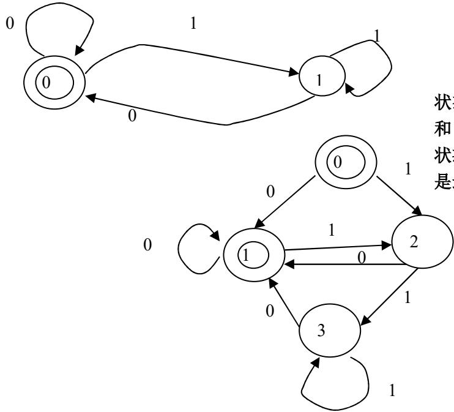

由状态子集转换矩阵可知，状态 0 和 1 是等价的，而状态 2 和 3 是等价的，因此，合并等价状态之后只剩下 2 个状态，也即是最少状态的 DFA。

P74 12. 将图 3.24 非确定有穷自动机 NFA 确定化和最少化。[一眼可看出 a,b 箭弧上的 a 是多余的]

解：设(DFA) $M=\{K,V_{T},M,S,Z\}$ ，其中， $K=\{[0],[0,1],[1]\}$ ， $V_{T}=\{a,b\}$ ，M: M([1],a)=[0] M([1],b)=Φ M([0,1],a)=[0,1] M([0,1],b)=[1]

1 3

## 原件第14页

$\mathbf{M}([0], \mathbf{a}) = [0, 1]$ $\mathbf{M}([0], \mathbf{b}) = [1]$

$\mathrm{S} = [1], \quad \mathrm{Z} = \{[0], [0, 1]\}$

令 $[0,1] = 2$ ，则其相应的状态转换图为：

现在对该 DFA 进行化简，先把状态分为两组：

终态组 $\{0,2\}$ 和非终态组 $\{1\}$ ，易于发现 $\{0,2\}$ 不可以继续划分，因此化简后的状态转换图如下：

正规文法为： $\mathrm{S}\rightarrow \mathrm{a}\mid \mathrm{aZ}$ $\mathbf{Z}\rightarrow \mathbf{a}\mathbf{Z}\mid \mathbf{a}\mid \mathbf{bS}$

将 $\mathbf{S} \to \mathbf{a} \mid \mathbf{aZ}$ 代入第二个式子, 得到 $\mathbf{Z} \to (\mathbf{a} \mid \mathbf{ba})\mathbf{Z} \mid \mathbf{a} \mid \mathbf{ba}$ 得到 $\mathbf{Z}$ 的正规表达式为 $(\mathbf{a} \mid \mathbf{ba}) + \mathbf{S}$ 的正规表达式 $\mathbf{a}(\mathbf{a} \mid \mathbf{ba}) + |\mathbf{a}$

同理转换前的正规表达式为： $\mathbf{a}(\mathbf{a}\mid (\mathbf{aa}\mid \mathbf{ba})) + |\mathbf{a}$ 可证两个正规表达式等价。

P74 13. 构造下列正规式的 DFA:

(1) b(a|b)\*bab

此题的与 P74 第 11 题基本一样，见上；

P74 15. 用两种方法将(NFA) $\mathbf{M} = (\{\mathbf{X}, \mathbf{Y}, \mathbf{Z}\}, \{\mathbf{0}, \mathbf{1}\}, \mathbf{M}, \{\mathbf{X}\}, \{\mathbf{Z}\})$ ，构造相应的 DFA，其中： $\mathbf{M}(\mathbf{X}, \mathbf{0}) = \{\mathbf{Z}\} \quad \mathbf{M}(\mathbf{X}, \mathbf{1}) = \{\mathbf{X}\} \quad \mathbf{M}(\mathbf{Y}, \mathbf{0}) = \{\mathbf{X}, \mathbf{Y}\} \quad \mathbf{M}(\mathbf{Y}, \mathbf{1}) = \Phi \quad \mathbf{M}(\mathbf{Z}, \mathbf{0}) = \{\mathbf{X}, \mathbf{Z}\} \quad \mathbf{M}(\mathbf{Z}, \mathbf{1}) = \{\mathbf{Y}\}$

第一种方法：先画出其状态转换图，利用非子集法：

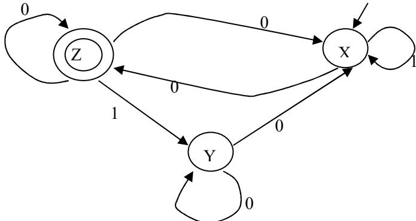

假设(DFA) $\mathbf{M}' = (\mathbf{K}',\mathbf{V}_{\mathrm{T}},\mathbf{M}',\mathbf{S}',\mathbf{Z}')$ ，其中 $\mathbf{K}' = \{[\mathbf{X}],[\mathbf{Y}],[\mathbf{Z}],[\mathbf{X},\mathbf{Y}],[\mathbf{X},\mathbf{Z}],[\mathbf{Y},\mathbf{Z}],[\mathbf{X},\mathbf{Y},\mathbf{Z}]\}$ $\mathbf{V}_{\mathrm{T}}' = \{\mathbf{0},1\}$ ， $\mathbf{M}'$ 的规则如下表：

<table><tr><td>I</td><td> $I_0$ </td><td> $I_1$ </td><td>K</td><td>0</td><td>1</td></tr><tr><td>[X]</td><td>[Z]</td><td>[X]</td><td>0</td><td>2</td><td>0</td></tr><tr><td>[Y]</td><td>[X, Y]</td><td>Φ</td><td>1</td><td>3</td><td>Φ</td></tr><tr><td>[Z]</td><td>[X, Z]</td><td>[Y]</td><td>2</td><td>4</td><td>1</td></tr><tr><td>[X, Y]</td><td>[X, Y, Z]</td><td>[X]</td><td>3</td><td>6</td><td>0</td></tr><tr><td>[X, Z]</td><td>[X, Z]</td><td>[X, Y]</td><td>4</td><td>4</td><td>3</td></tr><tr><td>[Y, Z]</td><td>[X, Y, Z]</td><td>[Y]</td><td>5</td><td>6</td><td>1</td></tr><tr><td>[X, Y, Z]</td><td>[X, Y, Z]</td><td>[X, Y]</td><td>6</td><td>6</td><td>3</td></tr></table>

1 4

## 原件第15页

其中[Y, Z]为不可到达状态，应该删去，所以 $S'=\{[X]\}$ ， $Z'=\{[Z], [X, Z], [X, Y, Z]\}$ ，再进行化简，发现4和6两状态等价，最后其 DFA 如下所示：

第二种方法：先构造其对应的转换系统：

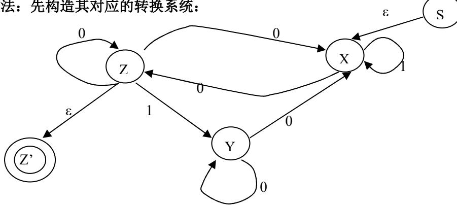

由上述转换系统可得状态转换集、状态子集转换矩阵如下表所示：
<table><tr><td>I</td><td> $I_0$ </td><td> $I_1$ </td><td>K</td><td>0</td><td>1</td></tr><tr><td>{S, X}</td><td>{Z, Z&#x27;}</td><td>{X}</td><td>0</td><td>1</td><td>2</td></tr><tr><td>{Z, Z&#x27;}</td><td>{X, Z, Z&#x27;}</td><td>{Y}</td><td>1</td><td>3</td><td>4</td></tr><tr><td>{X}</td><td>{Z, Z&#x27;}</td><td>{X}</td><td>2</td><td>1</td><td>2</td></tr><tr><td>{X, Z, Z&#x27;}</td><td>{X, Z, Z&#x27;}</td><td>{X, Y}</td><td>3</td><td>3</td><td>5</td></tr><tr><td>{Y}</td><td>{X, Y}</td><td>Φ</td><td>4</td><td>5</td><td>Φ</td></tr><tr><td>{X, Y}</td><td>{X, Y, Z, Z&#x27;}</td><td>{X}</td><td>5</td><td>6</td><td>2</td></tr><tr><td>{X, Y, Z, Z&#x27;}</td><td>{X, Y, Z, Z&#x27;}</td><td>{X, Y}</td><td>6</td><td>6</td><td>5</td></tr></table>

先化简，分为非终态集 $\{2,4,5,0\}$ 和终态集 $\{6,1,3\}$ ，易于发现可划分为 $\{0,2\}$ ， $\{1\}$ ， $\{3,6\}$ ， $\{4\}$ ， $\{5\}$ ，其 DFA 如下所示：

P74 16. 已知 $\mathbf{e}_{1}=(\mathbf{a}|\mathbf{b})^{*}$ ， $\mathbf{e}_{2}=(\mathbf{a}^{*}\mathbf{b}^{*})^{*}$ ，试证明 $e_{1}=e_{2}$ 。

证明： $\mathrm{L}(\mathrm{e}_{1}) = \mathrm{L}((\mathrm{a}|\mathrm{b})^{*}) = (\mathrm{L}(\mathrm{a}|\mathrm{b}))^{*} = (\mathrm{L}(\mathrm{a}) \cup \mathrm{L}(\mathrm{b}))^{*} = \{\mathrm{a}, \mathrm{b}\}^{*}$ ;

$$
\mathrm{L} \left(\mathrm{e} _ {2}\right) = \mathrm{L} \left(\left(\mathrm{a} ^ {*} \mathrm{b} ^ {*}\right) ^ {*}\right) = (\mathrm{L} \left(\mathrm{a} ^ {*} \mathrm{b} ^ {*}\right)) ^ {*} = (\mathrm{L} \left(\mathrm{a} ^ {*}\right) \mathrm{L} (\mathrm{b} ^ {*})) ^ {*} = \{\{\mathrm{a} \} ^ {*} \{\mathrm{b} \} ^ {*} \} ^ {*} = \{\mathrm{a}, \mathrm{b} \} ^ {*};
$$

1 5

## 原件第16页

P74 18. 根据下面正规文法构造等价的正规表达式:

$$
\begin{array}{l l} \mathrm{S::=cC|a} & \dots \dots ① \\ \mathrm{A::=cA|aB} & \dots \dots ② \\ \mathrm{B::=aB|c} & \dots \dots ③ \\ \mathrm{C::=aS|aA|bB|cC|a} & \dots \dots ④ \end{array}
$$

解：由③式可得 $\mathbf{B} = \mathbf{a}\mathbf{B} + \mathbf{c}\rightarrow \mathbf{B} = \mathbf{a}^{*}\mathbf{c}$

$$
\mathrm{A} = \mathrm{cA} + \mathrm{aB} \rightarrow \mathrm{A} = \mathrm{c} ^ {*} \mathrm{aa} ^ {*} \mathrm{c}
$$

$$
\text { 由④式可得 } \mathrm{C} = \mathrm{aS} + \mathrm{aA} + \mathrm{bB} + \mathrm{cC} + \mathrm{a} \rightarrow \mathrm{C} = \mathrm{c} ^ {*} (\mathrm{aS} + \mathrm{aA} + \mathrm{bB} + \mathrm{a}) \rightarrow
$$

P74 19. $\Sigma = \{\mathbf{a},\mathbf{b}\}$ ，写出下列正规集：

$$
\begin{array}{r l} & {\text {(1)} (\mathbf {a} \mid \mathbf {b}) ^ {*} (\mathbf {a a} \mid \mathbf {b b}) (\mathbf {a} \mid \mathbf {b}) ^ {*}} \\ & {\text {解}: \mathbf {L} ((\mathbf {a} \mid \mathbf {b}) ^ {*} (\mathbf {a a} \mid \mathbf {b b}) (\mathbf {a} \mid \mathbf {b}) ^ {*}) = \mathbf {L} ((\mathbf {a} \mid \mathbf {b}) ^ {*}) \mathbf {L} ((\mathbf {a a} \mid \mathbf {b b})) \mathbf {L} ((\mathbf {a} \mid \mathbf {b}) ^ {*}) = (\mathbf {L} (\mathbf {a} \mid \mathbf {b})) ^ {*} \{\mathbf {a a}, \mathbf {b b} \} (\mathbf {L}} \\ & {\quad (\mathbf {a} \mid \mathbf {b})) ^ {*} = \{\mathbf {a}, \mathbf {b} \} ^ {*} \{\mathbf {a a}, \mathbf {b b} \} \{\mathbf {a}, \mathbf {b} \} ^ {*}} \end{array}
$$

P75 20. 证明下列关系式成立，其中 A、B 是任意正规表达式。

(1) $\mathbf{A}|\mathbf{A} = \mathbf{A}$ (3) $\mathbf{A}^{*} = \varepsilon |\mathbf{AA}^{*}$ (4) $(\mathbf{AB})^{*}\mathbf{A} = \mathbf{A}(\mathbf{BA})^{*}$

（1）解： $\mathbf{L}(\mathbf{A} \mid \mathbf{A}) = \mathbf{L}(\mathbf{A}) \cup \mathbf{L}(\mathbf{A}) = \mathbf{L}(\mathbf{A})$ ，所以 $A \mid A = A$ ;

（3）解： $\mathbf{L}(\mathbf{A}^{*}) = (\mathbf{L}(\mathbf{A}))^{*}$ ， $\mathbf{L}(\varepsilon |\mathbf{AA}^{*}) = \{\varepsilon \} \cup \mathbf{L}(\mathbf{A})\mathbf{L}(\mathbf{A}^{*}) = (\mathbf{L}(\mathbf{A}))^{*}$ ，所以 $\mathbf{A}^{*} = \varepsilon |\mathbf{AA}^{*}$

(4) 解: $(\mathbf{AB})^{*}\mathbf{A} = ((\mathbf{AB})^{0} \cup (\mathbf{AB})^{1} \cup (\mathbf{AB})^{2} \cup \cdots \cdots)\mathbf{A} = \mathbf{A} \cup \mathbf{A}\mathbf{B}\mathbf{A} \cup \mathbf{A}\mathbf{B}\mathbf{A}\mathbf{B}\mathbf{A} \cup \cdots \cdots =$

$$
\mathrm{A} ((\mathrm{BA}) ^ {0} \cup (\mathrm{BA}) ^ {1} \cup (\mathrm{BA}) ^ {2} \cup \dots \dots) = \mathrm{A} (\mathrm{BA}) ^ {*} 。
$$

第七次作业：

P142 1. 试分别消除下列文法的直接左递归（采用两种方法——重复法和改写法）

(1) G[E]:

$$
\begin{array}{l l} \mathbf {E}: := \mathbf {T} \mid \mathbf {E A T} & \dots \dots ① \\ \mathbf {T}: := \mathbf {F} \mid \mathbf {T M F} & \dots \dots ② \\ \mathbf {F}: := (\mathbf {E}) \mid \mathbf {i} & \dots \dots ③ \\ \mathbf {A}: := + | - \quad \dots \dots ④ \\ \mathbf {M}: := * | / & \dots \dots ⑤ \end{array}
$$

解：先采用“重复法”：

$$
\begin{array}{l} \mathbf {E}: := \mathbf {T} \{\mathbf {A T} \} \\ \mathbf {T}: := \mathbf {F} \{\mathbf {M F} \} \\ \mathbf {F}: := (\mathbf {E}) | \mathbf {i} \\ \mathbf {A}: := + | - \\ \mathbf {M}: := * | / \end{array}
$$

(4) G[Z]:

因此 $\mathbf{e}_1 = \mathbf{e}_2$ （得证）

$\mathbf{e}_1 = \mathbf{e}_2$

1 6

## 原件第17页

$$
\begin{array}{l} \mathbf {Z}: := \mathbf {V} _ {1} \quad \dots \dots ① \\ \mathbf {V} _ {1}: := \mathbf {V} _ {2} | \mathbf {V} _ {1} \mathbf {i} \mathbf {V} _ {2} \quad \dots \dots ② \\ \mathbf {V} _ {2}: := \mathbf {V} _ {3} | \mathbf {V} _ {2} + \mathbf {V} _ {3} \quad \dots \dots ③ \\ \mathbf {V} _ {3}: :=) \mathbf {V} _ {1} ^ {*} | (\quad \dots \dots ④ \end{array}
$$

解：先采用“重复法”：

$$
\mathbf {V} _ {1}: := \mathbf {V} _ {2} \left\{\mathbf {i V} _ {2} \right\}
$$

$$
\mathbf {V} _ {2}: := \mathbf {V} _ {3} \left\{+ \mathbf {V} _ {3} \right\}
$$

P142 2. 试分别消除下列文法的间接左递归

(2) G[Z]:

$$
\begin{array}{l l} \mathbf {Z}: := \mathbf {A Z} \mid \mathbf {b} & \dots \dots ① \\ \mathbf {A}: := \mathbf {Z A} \mid \mathbf {a} & \dots \dots ② \end{array}
$$

解(一)：将②式代入①式可得， $Z: := ZAZ \mid aZ \mid b$ 消除左递归后得到：

$$
\begin{array}{l} \mathbf {Z}: := (\mathbf {a Z} \mid \mathbf {b}) \mathbf {Z} ^ {\prime} \\ \mathbf {Z} ^ {\prime}: := \mathbf {A Z Z} ^ {\prime} \mid \varepsilon \\ \mathbf {A}: := \mathbf {Z A} \mid \mathbf {a} \end{array}
$$

解(二)：将①式代入②式可得，A::=AZA|bA|a 消除左递归后得到：

$$
\begin{array}{l} \mathbf {Z}: := \mathbf {A Z} | \mathbf {b} \\ \mathbf {A}: := \mathbf {b A A ^ {\prime}} | \mathbf {a A ^ {\prime}} \\ \mathbf {A ^ {\prime}}: := \mathbf {Z A A ^ {\prime}} | \varepsilon \end{array}
$$

P142 4. 试分别用两种方法（框图法和类 Pascal 语言或类 C 语言）写一个识别下面文法句子的递归子程序

$$
\begin{array}{r l} & {\text {文法} \mathbf {G} [ \mathbf {A} ]:} \\ & {\quad \mathbf {A}: := [ \mathbf {B} \qquad \dots \dots ①} \\ & {\quad \mathbf {B}: := \mathbf {X} ] \mid \mathbf {B A} \qquad \dots \dots ②} \\ & {\quad \mathbf {X}: := \mathbf {X a} \mid \mathbf {X b} \mid \mathbf {a} \mid \mathbf {b} \qquad \dots \dots ③} \end{array}
$$

解：消除该文法的左递归和回溯，得到文法如下：

$$
\begin{array}{l} \mathrm {A:: = [B} \\ \mathrm {B:: = X] B ^ {\prime}} \\ \mathrm {B ^ {\prime} :: = AB^ {\prime} | \varepsilon} \\ \mathrm {X:: = a X ^ {\prime} | b X ^ {\prime}} \\ \mathrm {X ^ {\prime} :: = a X ^ {\prime} | b X ^ {\prime} | \varepsilon} \end{array}
$$

用类 Pascal 语言写出其递归子程序:

$$
\begin{array}{l l} \text {P(A):} & \text {SCIN} \\ & \text {IF ch = '[' THEN READ (ch) ELSE ERROR} \\ & \text {P(B)} \\ & \text {SCOUT} \\ \text {P(B):} & \text {SCIN} \\ & \text {P(X)} \end{array}
$$

1 7

## 原件第18页

用框图法来表述：（此处仅给出 P(A) 和 P(X') 的框图形式，其余相似从略）

当消除左递归和回溯之后，可能某些非终结符号例如 U 的右部会出现 $\varepsilon$ 的情况，书上的处理方法是 $\varepsilon$ 将自动获得匹配，并无对此类规则的具体处理方法，实际上应该求出 FOLLOW(U)，对于 FOLLOW(U) 中的每个终结符号进行判定，例如此例中的 P(X')，否则将无法判定出 [a]

P(A):

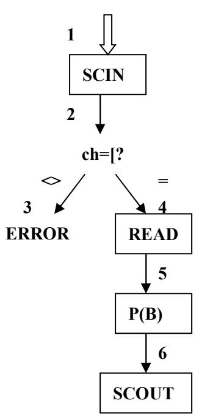

$\mathbf{P}(\mathbf{X}^{\prime})$

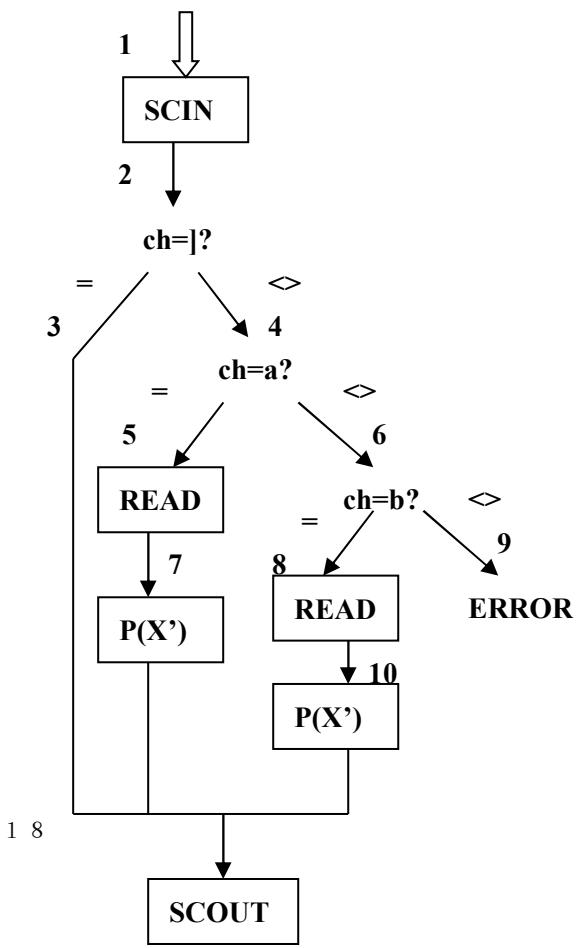

## 原件第19页

1 9

## 原件第20页

最后结果为:

FIRST(E')={+, ε }

FIRST(F')={\*, ε }

$$
\operatorname{FIRST} (\mathrm{E}) = \operatorname{FIRST} (\mathrm{T}) = \operatorname{FIRST} (\mathrm{F}) = \operatorname{FIRST} (\mathrm{P}) = \left\{\left(, \mathrm{a}, \mathrm{b}, \wedge \right. \right\}
$$

FIRST(T')={ (, a, b, ε, ∧)

FOLLOE(E)=(), # }

FOLLOW(E')={#, })

$$
\operatorname{FOLLOW} (\mathrm{T}) = \{+, \#, \}
$$

$$
\operatorname{FOLLOW} \left(\mathrm{T} ^ {\prime}\right) = \{+, \#,)
$$

(2) 证明该文法是 LL (1) 文法:

证明：对于规则 $E'::=+E \mid \varepsilon$ ， $T'::=T \mid \varepsilon$ ， $F'::=*F' \mid \varepsilon$ （仅有一边能推出空串）

有 $\mathrm{FIRST}(+\mathbf{E}) = \{+\} \cap \mathrm{FIRST}(\varepsilon) = \emptyset, \mathrm{FIRST}(\mathbf{T}) = \{(\mathbf{a},\mathbf{b},\wedge\} \cap \mathrm{FIRST}(\varepsilon) = \emptyset$

$\mathrm{FIRST}(*\mathrm{F}') = \{* \} \cap \mathrm{FIRST}(\varepsilon) = \varnothing, \quad \mathrm{FIRST}(+\mathrm{E}) = \{+\} \cap \mathrm{FOLLOW}(\mathrm{E}') = \{\#, \}\} = \varnothing$

FIRST(T)={{, a, b, ∧} ∩ FOLLOW(T')={+, #, )}=0

FIRST(\*F')={\*}∩ FOLLOW(F')= { (, ), a, b, +, #, ∧}=0

所以该文法是 LL（1）文法。

### (3) 构造文法分析表

<table><tr><td></td><td>a</td><td>b</td><td>+</td><td>*</td><td>(</td><td>)</td><td> $\land$ </td><td>#</td></tr><tr><td>E</td><td>E→TE&#x27;</td><td>E→TE&#x27;</td><td></td><td></td><td>E→TE&#x27;</td><td></td><td>E→TE&#x27;</td><td></td></tr><tr><td>E&#x27;</td><td></td><td></td><td>E&#x27;→+E</td><td></td><td></td><td>E&#x27;→ε</td><td></td><td>E&#x27;→ε</td></tr><tr><td>T</td><td>T→FT&#x27;</td><td>T→FT&#x27;</td><td></td><td></td><td>T→FT&#x27;</td><td></td><td>T→FT&#x27;</td><td></td></tr><tr><td>T&#x27;</td><td>T&#x27;→T</td><td>T&#x27;→T</td><td>T&#x27;→ε</td><td></td><td>T&#x27;→T</td><td>T&#x27;→ε</td><td>T&#x27;→T</td><td>T&#x27;→ε</td></tr><tr><td>F</td><td>F→PF&#x27;</td><td>F→PF&#x27;</td><td></td><td></td><td>F→PF&#x27;</td><td></td><td>F→PF&#x27;</td><td></td></tr><tr><td>F&#x27;</td><td>F&#x27;→ε</td><td>F&#x27;→ε</td><td>F&#x27;→ε</td><td>F&#x27;→*F&#x27;</td><td>F&#x27;→ε</td><td>F&#x27;→ε</td><td>F&#x27;→ε</td><td>F&#x27;→ε</td></tr><tr><td>P</td><td>P→a</td><td>P→b</td><td></td><td></td><td>P→(E)</td><td></td><td>P→ $\land$ </td><td></td></tr></table>

下面分析符号串 $a*b+b$

<table><tr><td>步骤</td><td>分析栈</td><td>余留输入串</td><td>所用的产生式</td></tr><tr><td>1</td><td>#E</td><td>a*b+b#</td><td>E→TE&#x27;</td></tr><tr><td>2</td><td>#E&#x27;T</td><td>a*b+b#</td><td>T→FT&#x27;</td></tr><tr><td>3</td><td>#E&#x27;T&#x27;F</td><td>a*b+b#</td><td>F→PF&#x27;</td></tr><tr><td>4</td><td>#E&#x27;T&#x27;F&#x27;P</td><td>a*b+b#</td><td>P →a</td></tr><tr><td>5</td><td>#E&#x27;T&#x27;F&#x27;a</td><td>a*b+b#</td><td></td></tr><tr><td>6</td><td># E&#x27;T&#x27;F&#x27;</td><td>*b+b#</td><td>F&#x27;→*F&#x27;</td></tr><tr><td>7</td><td># E&#x27;T&#x27;F&#x27;*</td><td>*b+b#</td><td></td></tr><tr><td>8</td><td># E&#x27;T&#x27;F&#x27;</td><td>b+b#</td><td>F&#x27; → ε</td></tr><tr><td>9</td><td># E&#x27;T&#x27;</td><td>b+b#</td><td>T&#x27; →T</td></tr><tr><td>10</td><td># E&#x27;T</td><td>b+b#</td><td>T→FT&#x27;</td></tr><tr><td>11</td><td># E&#x27;T&#x27;F</td><td>b+b#</td><td>F→PF&#x27;</td></tr><tr><td>12</td><td># E&#x27;T&#x27;F&#x27;P</td><td>b+b#</td><td>P →b</td></tr><tr><td>13</td><td>#E&#x27;T&#x27;F&#x27;b</td><td>b+b#</td><td></td></tr></table>

## 原件第21页

<table><tr><td>14</td><td>#E&#x27;T&#x27;F&#x27;</td><td>+b#</td><td> $F' \rightarrow \varepsilon$ </td></tr><tr><td>15</td><td>#E&#x27;T&#x27;</td><td>+b#</td><td> $T' \rightarrow \varepsilon$ </td></tr><tr><td>16</td><td>#E&#x27;</td><td>+b#</td><td> $E' \rightarrow +E$ </td></tr><tr><td>17</td><td>#E+</td><td>+b#</td><td></td></tr><tr><td>18</td><td>#E</td><td>b#</td><td> $E \rightarrow TE'$ </td></tr><tr><td>19</td><td>#E&#x27;T</td><td>b#</td><td> $T \rightarrow FT'$ </td></tr><tr><td>20</td><td>#E&#x27;T&#x27;F</td><td>b#</td><td> $F \rightarrow PF'$ </td></tr><tr><td>21</td><td># E&#x27;T&#x27;F&#x27;P</td><td>b#</td><td> $P \rightarrow b$ </td></tr><tr><td>22</td><td># E&#x27;T&#x27;F&#x27;b</td><td>b#</td><td></td></tr><tr><td>23</td><td># E&#x27;T&#x27;F&#x27;</td><td>#</td><td> $F' \rightarrow \varepsilon$ </td></tr><tr><td>24</td><td># E&#x27;T&#x27;</td><td>#</td><td> $T' \rightarrow \varepsilon$ </td></tr><tr><td>25</td><td>#E&#x27;</td><td>#</td><td> $E' \rightarrow \varepsilon$ </td></tr><tr><td>26</td><td>#</td><td>#</td><td>成功</td></tr></table>
所以符号串 $a*b+b$ 是该文法的句子； P144 6. 对下列文法，构造相应的 FIRST 和 FOLLOW:

规则一

$$
\# \in \mathbf {F O L L O W} (\mathbf {S})
$$

$$
\operatorname{FOLLOW} (\mathrm{S}) = \{\# \}
$$

$$
\mathbf {d} \in \mathrm{FOLLOW} (\mathbf {A})
$$

$$
\operatorname{FOLLOE} (\mathrm{A}) = \{\mathrm{d} \}
$$

$$
\operatorname{FIRST} (\mathrm{C}) - \{\varepsilon \} \subseteq \operatorname{FOLLOW} (\mathrm{B})
$$

$$
\mathrm{FOLLOW} (\mathbf {B}) = \{\mathbf {c} \}
$$

规则三

$$
\operatorname{FOLLOW} (\mathrm{A}) \subseteq \operatorname{FOLLOW} (\mathrm{B})
$$

$$
\operatorname{FOLLOW} (\mathbf {B}) = \{\mathbf {d}, \mathbf {c} \}
$$

$$
\operatorname{FOLLOW} (\mathrm{A}) \subseteq \operatorname{FOLLOW} (\mathrm{C})
$$

$$
\mathrm{FOLLOW} (\mathrm{C}) = \{\mathrm{d} \}
$$

最后结果为:

$$
\operatorname{FIRST} (\mathbf {S}) = \{\mathbf {a} \}
$$

2 1

## 原件第22页

2 2

## 原件第23页

最后结果为:

P144 9. 设已给文法 G[S]:

（1）将此文法改写为 LL（1）文法

（4）构造LL（1）分析表

解：该题消除左递归之后，文法变为 S::=bBS' S' ::=aBS' | ε A::=Sa | a

<table><tr><td></td><td>a</td><td>b</td><td>c</td><td>#</td></tr><tr><td>S</td><td></td><td>S::=bBS&#x27;</td><td></td><td></td></tr><tr><td>A</td><td>A::=a</td><td>A::=Sa</td><td></td><td></td></tr><tr><td>B</td><td>B::=Ac</td><td>B::=Ac</td><td></td><td></td></tr><tr><td>S&#x27;</td><td>S&#x27;::=aBS&#x27;, S&#x27;::=ε</td><td></td><td></td><td>S&#x27;::=ε</td></tr></table>

存在冲突，不是 LL(1)文法，主要的冲突在于[S', a]此栏，是 LL(2)文法，即每次遇见当前非终结符号为 S'时，要向前看两个符号才可，改写以上 LL(1)分析表如下：

<table><tr><td></td><td colspan="2">a(第一个字符)</td><td>b</td><td>c</td><td>#</td></tr><tr><td>S</td><td colspan="2"></td><td>S::=bBS&#x27;</td><td></td><td></td></tr><tr><td>A</td><td colspan="2">A::=a</td><td>A::=Sa</td><td></td><td></td></tr><tr><td>B</td><td colspan="2">B::=Ac</td><td>B::=Ac</td><td></td><td></td></tr><tr><td rowspan="2">S&#x27;</td><td>a或b(第二个字符)</td><td>c(第二个字符)</td><td></td><td></td><td></td></tr><tr><td>S&#x27;::=aBS&#x27;</td><td>S&#x27;::=ε</td><td></td><td></td><td>S&#x27;::=ε</td></tr></table>

2 3

## 原件第24页

第九次作业：

P144 10. 证明下述文法不是简单优先文法:

证明：

(1)画语法树：

$$
\begin{array}{c c c} & \text {S} \\ / & | \setminus \\ \text {b} & \text {E} & \text {b} \\ / & | \setminus \\ \text {E} & + & \text {T} \end{array}
$$

可以得出 $\mathbf{b} = \mathbf{E}$ 和 $\mathbf{b} < \mathbf{E}$ , 因此该文法不是简单优先文法。

(2)因该文法中含

$$
\begin{array}{c} \mathbf {E}: := \mathbf {i} \\ \mathbf {T}: := \mathbf {i} \end{array}
$$

右部两个产生式相同，故该文法不是简单优先文法.

P145 11. 构造下述文法的优先关系矩阵，它们是简单优先文法吗？

$$
\mathbf {B} \boldsymbol {\Xi} = \begin{array}{c} \mathrm{S}: := \mathrm{M} \mid \mathrm{U} \\ \mathrm{M}: := \mathrm{iEtMeM} \mid \mathrm{a} \\ \mathrm{U}: := \mathrm{iEtS} \mid \mathrm{iEtMeU} \\ \mathrm{E}: := \mathrm{b} \\ \left( \begin{array}{c c c c c c c c c} & \mathrm{SMUEi} & \mathrm{te} & \mathrm{aab} \\ \mathrm{S} & 0 & 0 & 0 & 0 & 0 & 0 & 0 & 0 \\ \mathrm{M} & 0 & 0 & 0 & 0 & 0 & 1 & 0 & 0 \\ \mathrm{U} & 0 & 0 & 0 & 0 & 0 & 0 & 0 & 0 \\ \mathrm{E} & 0 & 0 & 0 & 0 & 1 & 0 & 0 & 0 \\ \mathrm{i} & 0 & 0 & 1 & 0 & 0 & 0 & 0 & 0 \\ \mathrm{t} & 1 & 1 & 0 & 0 & 0 & 0 & 0 & 0 \\ \mathrm{e} & 0 & 1 & 1 & 0 & 0 & 0 & 0 & 0 \\ \mathrm{a} & 0 & 0 & 0 & 0 & 0 & 0 & 0 & 0 \\ \mathrm{b} & 0 & 0 & 0 & 0 & 0 & 0 & 0 & 0 \end{array} \right) \end{array}
$$

$$
\mathbf {B} _ {\mathrm{L}} = \begin{array}{c} \text {S} \\ \text {M} \\ \text {U} \\ \text {E} \\ \text {i} \\ \text {t} \\ \text {e} \\ \text {a} \\ \text {b} \end{array} \left( \begin{array}{c c c c c c c c c} 0 & 1 & 1 & 0 & 0 & 0 & 0 & 0 & 0 \\ 0 & 0 & 0 & 0 & 1 & 0 & 0 & 1 & 0 \\ 0 & 0 & 0 & 0 & 1 & 0 & 0 & 0 & 0 \\ 0 & 0 & 0 & 0 & 0 & 0 & 0 & 0 & 1 \\ 0 & 0 & 0 & 0 & 0 & 0 & 0 & 0 & 0 \\ 0 & 0 & 0 & 0 & 0 & 0 & 0 & 0 & 0 \\ 0 & 0 & 0 & 0 & 0 & 0 & 0 & 0 & 0 \\ 0 & 0 & 0 & 0 & 0 & 0 & 0 & 0 & 0 \\ 0 & 0 & 0 & 0 & 0 & 0   \text {with}   \text {a} \\ \text {b} \end{array} \right)
$$

$$
\mathbf {B} _ {\mathrm{L} ^ {2}} = \begin{array}{c c} & \texttt {S M U E i t e a b} \\ \texttt {S} & \theta 0 0 0 0 1 0 0 1 0 \\ \texttt {M} & 0 0 0 0 0 0 0 0 0 \\ \texttt {U} & 0 0 0 0 0 0 0 0 0 \\ \texttt {E} & 0 0 0 0 0 0 0 0 0 \\ \texttt {i} & 0 0 0 0 0 0 0 0 0 \\ \texttt {t} & 0 0 0 0 0 0 0 0 0 \\ \texttt {e} & 0 0 0 0 0 0 0 0 0 \\ \texttt {a} & 0 0 0 0 0 0 0 0 0 \end{array}
$$

$$
\mathbf {B} _ {\mathrm{L} ^ {+}} = \begin{array}{l} \text {S} \\ \text {M} \\ \text {U} \\ \text {E} \\ \text {i} \\ \text {t} \\ \text {e} \\ \text {a} \end{array} \left( \begin{array}{c c c c c c c c c} \text {0 1 1 0 1 0 0 1 0} \\ \text {0 0 0 0 1 0 0 1 0} \\ \text {0 0 0 0 1 0 0 0 0} \\ \text {0 0 0 0 0 0 0 0 1} \\ \text {0 0 0 0 0 0 0 0 0} \\ \text {0 0 0 0 0 0 0 0 0} \\ \text {0 0 0 0 0 0 0 0 0} \\ \text {0 0 0 0 0 0 0 0 0} \end{array} \right)
$$

2 4

## 原件第25页

该页为优先关系矩阵的原始推导。

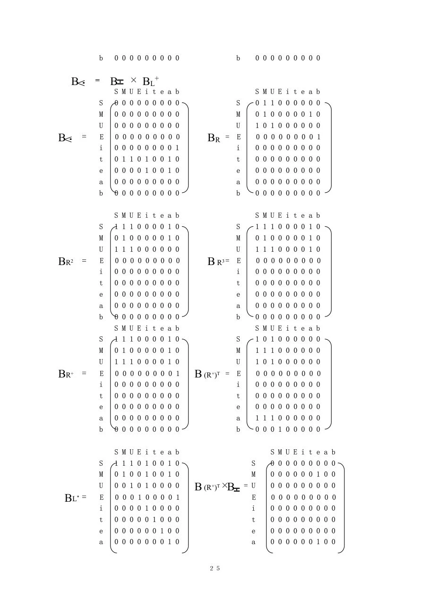

## 原件第26页

$$
\begin{array}{c c c c c c c c c} & \text {S M U E i t e a b} \\ \text {S} & 0   0   0   0   0   0   0   0   0 \\ \text {M} & 0   0   0   0   0   0   1   0   0 \\ \text {U} & 0   0   0   0   0   0   0   0   0 \\ \text {E} & 0   0   0   0   0   0   0   0   0 \\ \text {i} & 0   0   0   0   0   0   0   0   0 \\ \text {t} & 0   0   0   0   0   0   0   0   0 \\ \text {e} & 0   0   0   0   0   0   0   0   0 \\ \text {a} & 0   0   0   0   0   0   1   0   0 \\ \text {b} & 0   0   0   0   0   1   0   0   0 \end{array}
$$

$$
\begin{array}{c} \text {S M U E i t e a b} \\ \text {S} \left( \begin{array}{c c c c c c c c c} 1 & 1 & 1 & 0 & 1 & 0 & 0 & 1 & 0 \\ 0 & 1 & 0 & 0 & 1 & 0 & 0 & 1 & 0 \\ 0 & 0 & 1 & 0 & 1 & 0 & 0 & 0 & 0 \\ 0 & 0 & 0 & 1 & 0 & 0 & 0 & 0 & 1 \\ 0 & 0 & 0 & 0 & 1 & 0 & 0 & 0 & 0 \\ 0 & 0 & 0 & 0 & 0 & 1 & 0 & 0 & 0 \\ 0 & 0 & 0 & 0 & 0 & 0 & 1 & 0 & 0 \\ 0 & 0 & 0 & 0 & 0 & 0 & 0 & 1 & 0 \\ 0 & 0 & 0 & 0 & 0 & 0 & 0 & 1 & 0 \\ 0 & 0 & 0 & 0 & 0 & 0 & 0 & 0 & 1 \end{array} \right) \end{array}
$$

$$
= \begin{array}{r l} & \text {S M U E i t e a b} \\ & \text {S} \left( \begin{array}{l l l l l l l l l} 0 & 0 & 0 & 0 & 0 & 0 & 0 & 0 & 0 \\ 0 & 0 & 0 & 0 & 0 & 0 & 1 & 0 & 0 \\ 0 & 0 & 0 & 0 & 0 & 0 & 0 & 0 & 0 \\ 0 & 0 & 0 & 0 & 0 & 0 & 0 & 0 & 0 \\ 0 & 0 & 0 & 0 & 0 & 0 & 0 & 0 & 0 \\ 0 & 0 & 0 & 0 & 0 & 0 & 0 & 0 & 0 \\ 0 & 0 & 0 & 0 \\ 0 & 0 & 0 & 0 & 0 & 0 & 0 & 0 \\ 0 & 0 & 0 & 0 & 0 & 0 & 0 & 0 \\ 0 & 0 & 0 & 0 & 0 & 1 & 0 & 0 \\ 0 & 0 & 0 & 0 & 1 & 0 & 0 & 0 \end{array} \right) \end{array}
$$

解法二：找个句型画棵语法树即可：

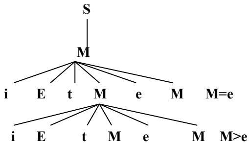

优先关系矩阵如下：

<table><tr><td></td><td>S</td><td>M</td><td>U</td><td>i</td><td>E</td><td>t</td><td>e</td><td>a</td><td>b</td></tr><tr><td>S</td><td></td><td></td><td></td><td></td><td></td><td></td><td></td><td></td><td></td></tr><tr><td>M</td><td></td><td></td><td></td><td></td><td></td><td></td><td>=</td><td> $\blacktriangleright$ </td><td></td></tr><tr><td>U</td><td></td><td></td><td></td><td></td><td></td><td></td><td></td><td></td><td></td></tr><tr><td>i</td><td></td><td></td><td></td><td></td><td>=</td><td></td><td></td><td></td><td> $\blacktriangleleft$ </td></tr><tr><td>E</td><td></td><td></td><td></td><td></td><td></td><td>=</td><td></td><td></td><td></td></tr><tr><td>t</td><td>=</td><td>=</td><td> $\blacktriangleleft$ </td><td> $\blacktriangleleft$ </td><td> $\blacktriangleleft$ </td><td></td><td></td><td> $\blacktriangleleft$ </td><td></td></tr><tr><td>e</td><td></td><td>=</td><td>=</td><td> $\blacktriangleleft$ </td><td></td><td></td><td></td><td> $\blacktriangleleft$ </td><td></td></tr><tr><td>a</td><td></td><td></td><td></td><td></td><td></td><td></td><td> $\blacktriangleright$ </td><td></td><td></td></tr><tr><td>b</td><td></td><td></td><td></td><td></td><td></td><td> $\blacktriangleright$ </td><td></td><td></td><td></td></tr></table>
其中含多重定义的表项，因而该文法不是简单优先文法。

P145 12. 根据图 4.25 的语法树，确定全部优先关系：

(a) E=+ +=T T=\* \*=F (=E E=)
\*<( +<F +<i F>\* i>\* )>+ T>+

(b) <说明表>=; BEGIN=<说明表> REAL=<标识符表>
<变量>=:= ;=<语句表> :==i
BEGIN<<说明> BEGIN<REAL REAL<i
;<语句> ;<<变量> ;<i
<说明>>; <标识符表>>; i>; i>:=

b 0 0 0 0 0 0 0 0 1

b 0 0 0 0 0 1 0 0 0

2 6

## 原件第27页

P145 13. 利用表 4.6 文法 G[E] 的优先关系矩阵，来分析符号串 #b(((aa)a)a)b# 和 #(aa)a)#。 (1) 是文法的句子
<table><tr><td>步骤</td><td>符号栈</td><td>关系</td><td>输入串</td><td>规则</td></tr><tr><td>1</td><td>#</td><td>&lt;</td><td>b(((aa)a)a)b#</td><td></td></tr><tr><td>2</td><td>#b</td><td>&lt;</td><td>(((aa)a)a)b#</td><td></td></tr><tr><td>3</td><td>#b(</td><td>&lt;</td><td>((aa)a)a)b#</td><td></td></tr><tr><td>4</td><td>#b((</td><td>&lt;</td><td>(aa)a)a)b#</td><td></td></tr><tr><td>5</td><td>#b(((</td><td>&lt;</td><td>aa)a)a)b#</td><td></td></tr><tr><td>6</td><td>#b(((a</td><td>&gt;</td><td>a)a)a)b#</td><td></td></tr><tr><td>7</td><td>#b(((M</td><td>=</td><td>a)a)a)b#</td><td>M::=a</td></tr><tr><td>8</td><td>#b(((Ma</td><td>=</td><td>)a)a)b#</td><td></td></tr><tr><td>9</td><td>#b(((Ma)</td><td>&gt;</td><td>a)a)b#</td><td></td></tr><tr><td>10</td><td>#b(((L</td><td>&gt;</td><td>a)a)b#</td><td>L::=Ma)</td></tr><tr><td>11</td><td>#b((M</td><td>=</td><td>a)a)b#</td><td>M::=(L</td></tr><tr><td>12</td><td>#b((Ma</td><td>=</td><td>)a)b#</td><td></td></tr><tr><td>13</td><td>#b((Ma)</td><td>&gt;</td><td>a)b#</td><td></td></tr><tr><td>14</td><td>#b((L</td><td>&gt;</td><td>a)b#</td><td>L::=Ma)</td></tr><tr><td>15</td><td>#b(M</td><td>=</td><td>a)b#</td><td>M::=(L</td></tr><tr><td>16</td><td>#b(Ma</td><td>=</td><td>)b#</td><td></td></tr><tr><td>17</td><td>#b(Ma)</td><td>&gt;</td><td>b#</td><td></td></tr><tr><td>18</td><td>#b(L</td><td>&gt;</td><td>b#</td><td>L::=Ma)</td></tr><tr><td>19</td><td>#bM</td><td>=</td><td>b#</td><td>M::=(L</td></tr><tr><td>20</td><td>#bMb</td><td>&gt;</td><td>#</td><td></td></tr><tr><td>21</td><td>#Z</td><td>&gt;</td><td>#</td><td>Z::=bMb</td></tr><tr><td colspan="5">(2) 不是文法的句子</td></tr><tr><td>步骤</td><td>符号栈</td><td>关系</td><td>输入串</td><td>规则</td></tr><tr><td>1</td><td>#</td><td>&lt;</td><td>((aa)a)#</td><td></td></tr><tr><td>2</td><td>#(</td><td>&lt;</td><td>(aa)a)#</td><td></td></tr><tr><td>3</td><td>#((</td><td>&lt;</td><td>aa)a)#</td><td></td></tr><tr><td>4</td><td>#((a</td><td>&gt;</td><td>a)a)#</td><td></td></tr><tr><td>5</td><td>#((M</td><td>=</td><td>a)a)#</td><td>M::=a</td></tr><tr><td>6</td><td>#((Ma</td><td>=</td><td>)a)#</td><td></td></tr><tr><td>7</td><td>#((Ma)</td><td>&gt;</td><td>a)#</td><td></td></tr><tr><td>8</td><td>#((L</td><td>&gt;</td><td>a)#</td><td>L::=Ma)</td></tr><tr><td>9</td><td>#(M</td><td>=</td><td>a)#</td><td>M::=(L</td></tr><tr><td>10</td><td>#(Ma</td><td>=</td><td>)#</td><td></td></tr><tr><td>11</td><td>#(Ma)</td><td>&gt;</td><td>#</td><td></td></tr><tr><td>12</td><td>#(L</td><td>&gt;</td><td>#</td><td>L::=Ma)</td></tr><tr><td>13</td><td>#M</td><td>&gt;</td><td>#</td><td>M::=(L</td></tr></table>
第十次作业： P146 17. 设已给文法 G[S]:

2 7

## 原件第28页

$$
\begin{array}{l} \mathbf {E} \because = \mathbf {E} + \mathbf {T} | \mathbf {T} \\ \mathbf {T} \because = \mathbf {T} ^ {*} \mathbf {F} | \mathbf {F} \\ \mathbf {F} \because = \mathbf {P} \uparrow \mathbf {F} | \mathbf {P} \\ \mathbf {P} \because = (\mathbf {E}) | \mathbf {i} \end{array}
$$

(1) 构造此文法的算符优先矩阵;

(2) 用迭代法构造优先函数;

(3) 用有向图法构造优先函数;

(4) 用优先函数表分析符号串 $i+i*i\uparrow i$

解：(1)

$$
\mathbf {B} \underline {{\underline {{\cdot}}}} = \begin{array}{l l} & \begin{array}{c c c c c c c c c} & \texttt {E T F P (i * +)} & \uparrow \\ \texttt {E} & \theta 0 0 0 0 0 0 0 0 0 0 \\ \texttt {T} & 0 0 0 0 0 0 0 0 0 0 0 \\ \texttt {F} & 0 0 0 0 0 0 0 0 0 0 \\ \texttt {P} & 0 0 0 0 0 0 0 0 0 0 \\ (\texttt {i} & 0 0 0 0 0 0 0 0 1 0 \\ * & 0 0 0 0 0 0 0 0 0 \\ + & 0 0 0 0 0 0 0 0 0 \\ ) & 0 0 0 0 0 0 0 0 0 \\ \uparrow & \theta 0 0 0 0 0 0 0 0 0 \end{array} \end{array}
$$

$$
\begin{array}{r l r} & & {\texttt {E T F P (i * +)} \uparrow} \\ {\mathbf {B} \boldsymbol {\Xi} =} & & {\texttt {E} \left( \begin{array}{l l l l l l l l l l} 0 & 0 & 0 & 0 & 0 & 0 & 0 & 1 & 1 & 0 \\ 0 & 0 & 0 & 0 & 0 & 0 & 1 & 0 & 0 & 0 \\ 0 & 0 & 0 & 0 & 0 & 0 & 0 & 0 & 0 & 0 \\ 0 & 0 & 0 & 0 & 0 & 0 & 0 & 0 & 0 & 1 \\ 1 & 0 & 0 & 0 & 0 & 0 & 0 & 0 & 0 & 0 \\ 0 & 0 & 0 & 0 & 0 & 0 & 0 & 0 & 0 & 0 \\ 0 & 0 & 1 & 0 & 0 & 0 & 0 & 0 & 0 & 0 \\ 0 & 1 & 0 & 0 & 0 & 0 & 0 & 0 & 0 & 0 \\ 0 & 0 & 0 & 0 & 0 & 0 & 0 & 0 & 0 & 0 \\ \theta & 0 & 1 & 0 & 0 & 0 & 0 & 0 & 0 & 0 \end{array} \right)} \\ & & {\texttt {E T F P (i * +)} \uparrow} \\ {\mathbf {B} _ {\mathrm{L}} =} & & {\texttt {E} \left( \begin{array}{l l l l l l l l l l} 1 & 1 & 0 & 0 & 0 & 0 & 0 & 0 & 0 \\ 0 & 1 & 1 & 0 & 0 & 0 & 0 & 0 & 0 \\ 0 & 0 & 0 & 1 & 0 & 0 & 0 & 0 & 0 \\ 0 & 0 & 0 & 0 & 1 & 1 & 0 & 0 & 0 \\ 0 & 0 & 0 & 0 & 0 & 0 & 0 & 0 & 0 \\ i & o & o & o & o & o & o & o \\ * & o & o & o & o & o & o & o \\ + & o & o & o & o & o & o & o \\ \end{array} \right)} \end{array}
$$

2 8

## 原件第29页

$$
\begin{array}{r l} & {\textbf {B} _ {\mathrm{L} ^ {*}} = \begin{array}{l l} & {\textbf {)}} \\ & {\uparrow} \\ & {\textbf {E}} \\ & {\textbf {T}} \\ & {\textbf {F}} \\ & {\textbf {P}} \\ & {\textbf {(}} \\ & {\textbf {i}} \\ & {\textbf {*}} \\ & {+} \\ & {\textbf {)}} \\ & {\uparrow} \end{array} \left( \begin{array}{l l l l l l l l l l} 1 & 1 & 1 & 1 & 1 & 1 & 0 & 0 & 0 & 0 \\ 0 & 1 & 1 & 1 & 1 & 1 & 0 & 0 & 0 & 0 \\ 0 & 0 & 1 & 1 & 1 & 1 & 0 & 0 & 0 & 0 \\ 0 & 0 & 0 & 1 & 1 & 1 & 0 & 0 & 0 & 0 \\ 0 & 0 & 0 & 0 & 1 & 0 & 0 & 0 & 0 & 0 \\ 0 & 0 & 0 & 0 & 0 & 1 & 0 & 0 & 0 & 0 \\ 0 & 0 & 0 & 0 & 0 & 0 & 1 & 0 & 0 & 0 \\ 0 & 0 & 0 & 0 & 0 & 0 & 0 & 1 & 0 & 0 \\ 0 & 0 & 0 & 0 & 0 & 0 & 0 & 0 & 1 & 0 \\ \theta_ {i} \theta_ {j} \theta_ {k} \theta_ {l} \theta_ {m} \theta_ {n} \theta_ {o} \theta_ {p} \theta_ {q} \theta_ {r} \theta_ {s} \theta_ {t} \theta_ {u} \theta_ {v} \theta_ {w} \theta_ {x} \theta_ {y} \theta_ {z} \theta_ {w} \theta_ {z} \theta_ {w} \theta_ {w} \theta_ {x} \theta_ {y} \theta_ {z} \theta_ {w} \theta_ {x} \theta_ {y} \theta_ {z} \theta_ {w} \theta_ {x} \theta_ {y} \theta_ {z} \theta_ {w} \theta_ {x} \theta_ {y} \theta_ {z} \theta_ {w} \theta_ {x} \theta_ {y} \theta_ {z} \theta^ {*} +} \\ & {\textbf {E}} \\ {\textbf {B} _ {\mathrm{L} ^ {*}}} = \begin{array}{l l} {\textbf {E}} \\ {\textbf {T}} \\ {\textbf {F}} \\ {\textbf {P}} \\ {\textbf {(}} \\ {\textbf {E}} \\ {\textbf {T}} \\ {\textbf {F}} \\ {\textbf {(}} \\ {\textbf {E}} \\ {\textbf {(}} \\ {\textbf {E}} \\ {\textbf {(}} \\ {\textbf {(}} \\ {\textbf {(}} \\ {\textbf {(}} \\ {\textbf {(}} \\ {\textbf {(}} \\ {\textbf {(}} \\ {\textbf {(}} \\ {\textbf {(}} \\ {\textbf {(}} \\ {\textbf {(}} \\ {\textbf {(}} \\ {\textbf {(}} \\ {\textbf {(}} \\ {\textbf {(}} \\ {\textbf {(}} \\ {\textbf {(}} \\ {\mathbf {B} _ {\mathrm{L} _ {1}}} = \begin{array}{l l} {\textbf {E}} \\ {\textbf {T}} \\ {\textbf {F}} \\ {\textbf {(}} \\ {\textbf {(}} \\ {\textbf {(}} \\ {\textbf {(}} \\ {\textbf {(}} \\ {\textbf {(}} \\ {\textbf {(}} \\ {\textbf {(}} \\ {\textbf {(}} \\ {\textbf {(}} \\ {\textbf {(}} \\ {\textbf {(}} \\ {\textbf {(}} \\ {\textbf {(}} \\ {\textbf {(}} \\ {\textbf {(}} \\ {\mathrm{B} _ {\mathrm{L} _ {1}}} = \begin{array}{l l} {\textbf {E}} \\ {\textbf {T}} \\ {\textbf {(}} \\ {\textbf {(}} \\ {\textbf {(}} \\ {\textbf {(}} \\ {\textbf {(}} \\ {\textbf {(}} \\ {\textbf {(}} \\ {\textbf {(}} \\ {\textbf {(}} \\ {\textbf {(}} \\ {\textbf {(}} \\ {\textbf {(}} \\ {\textbf {(}} \\ {\textbf {(}} \\ {\textbf {(}} \\ {\textbf {(}} \\ {\boldsymbol B _ {\mathrm{L} ^ {*}}} = \begin{array}{l l} {{\boldsymbol E}} \\ {{\boldsymbol F}} \\ {{\boldsymbol P}} \\ {{\boldsymbol (}} \\ {{\boldsymbol i}} \\ {{\boldsymbol *}} \\ {{\boldsymbol +}} \\ {{\boldsymbol)}} \end{array} \left( \begin{array}{l l l l l l l l l l l l l l l l l l l l l l l l l l l l l l l l l l l l l l l l l l l l l l l l l l l l l l l l l l l l l l l l l l l l l l l l l l l l l l l l l l l l l l l l l l l l l l l l l l l l l} {{\boldsymbol E}} \\ {{\boldsymbol F}} \\ {{\boldsymbol P}} \\ {{\boldsymbol (}} \\ {{\boldsymbol i}} \\ {{\boldsymbol *}} \\ {{\boldsymbol +}} \\ {{\boldsymbol)}} \end{array} \left( \begin{array}{l l l l l l l l l l l l l l l l l l l l l l l l l l l l l l} {{\boldsymbol E}} \\ {{\boldsymbol F}} \\ {{\boldsymbol P}} \\ {{\boldsymbol (}} \\ {{\boldsymbol i}} \\ {{\boldsymbol *}} \\ {{\boldsymbol +}} \\ {{\boldsymbol)}} \end{array} \left( \begin{array}{l l} {{\boldsymbol E}} \\ {{\boldsymbol F}} \\ {{\boldsymbol P}} \\ {{\boldsymbol (}} \\ {{\boldsymbol i}} \\ {{\boldsymbol *}} \\ {{\boldsymbol +}} \\ {{\boldsymbol)}} \end{array} \right) \left( \begin{array}{l} {{\boldsymbol E}} \\ {{\boldsymbol F}} \\ {{\boldsymbol P}} \\ {{\boldsymbol (}} \\ {{\boldsymbol i}} \\ {{\boldsymbol *}} \\ {{\boldsymbol +}} \\ {{\boldsymbol)}} \end{array} \right) \left( \begin{array}{l} {{\boldsymbol E}} \\ {{\boldsymbol F}} \\ {{\boldsymbol P}} \\ {{\boldsymbol (})}, \end{array} \right) \left( \begin{array}{l} {{\boldsymbol E}} \\ {{\boldsymbol F}} \\ {{\boldsymbol P}}, \end{array} \right) = -, +, -, -, -, -, -, -, -, -, -, -, -, -, -, -, -, -, -, -, -, -, -, -, -, -, -, -, -, -, -, -, -, -, -, -, -, -, -, -, -, -, -, -, -, -, -, -, -, -, -, -, . +, +, +, +, +, +, +, +, +, +, +, +, +, +, +, +, +, +, +, +, +, +, +, +, +, +, +, +, +, +, +, +, +, +, +, +, +, +, +, +, +, +, +, +, +, +, +, + , + , + , + , + , + , + , + , + , + , + , + , + , + , + , + , + , + , + , + , + , + , + , + , + , + , + , + , + , + , + , + , + , + , + , + , + , + , + , + , + , + , + , + , + , + , + , + , + , + , +   . +   . .   . .   . .   . .   . .   . .   . .   . .   . .   . .   . .   . .   . .   . .   . .   . .   . .   . .   . .   . .   . .   . .   . .   . .   . .   . .   . .   . .   . .   . .   . .   . .   . .   . .    .    .    .    .    .    .    .    .    .    .    .    .    .    .    .    .    .    .    .    .    .    .    .    .    .    .    .    .    .    .    .    .    .    .    .    .    .    .    .    .    .    .    .    .    .    .    .    .    .    .     .    .    .    .    .    .    .    .    .    .    .    .    .    .    .    .    .    .    .    .    .    .    .    .    .    .    .    .    .    .    .    .    .    .    .    .    .    .    .    .    ..      ..      ..      ..      ..      ..      ..      ..      ..      ..      ..      ..      ..      ..      ..      ..      ..      ..      ..      ..      ..      ..      ..      ..      ..      ..      ..      ..      ..      ..      ..      ..      ..      ..      ..      ..      ..      ..      ..      ..      ..      ..      ..      ..      ..      ..      ..      ..      ..      ..      ..     :            :            :            :            :            :            :            :            :            :            :            :            :            :            :            :            :            :            :            :            :            :            :            :            :            :            :            :            :            :            :            :            :            :            :            :            :            :            :            :            :            :            :            :            :            :            :            :            :            :            :             :            :            :            :            :            :            :            :            :            :            :            :            :            :            :            :            :            :            :            :            :            :            :            :            :            :            :            :            :            :            :            :            :            :            :            :            :            :            :            :            :            :            :            :            :            :            :            :            |              |              |              |              |              |              |              |              |              |              |              |              |              |              |              |              |              |              |              |              |              |              |              |              |              |              |              |              |              |              |              |              |              |              |              |              |              |              |              |              |              |              |              |              |              |              |              |              |              |              |               |
.
$$

$$
\mathrm{B} \cdot <   = \mathrm{B} \text {三} \mathrm{B} _ {\mathrm{L}} * \mathrm{B} _ {\mathrm{L} _ {1}} =
$$

$$
\mathbf {B} \bullet <   =\begin{array}{l}\text {E}\\\text {T}\\\text {F}\\\text {P}\\(\text {i}\\*\\+)\\\uparrow\end{array}\left(\begin{array}{c c c c c c c c c c}\text {E T F P (i* +)}&\uparrow\\\theta&0&0&0&0&0&0&1&1&0\\0&0&0&0&0&0&1&0&0&0\\0&0&0&0&0&0&0&0&0&0\\0&0&0&0&0&0&0&0&0&1\\1&1&1&1&1&1&0&0&0&0\\0&0&0&0&0&0&0&0&0\\0&0&1&1&1&1&0&0&0&0\\0&1&1&1&1&1&0&0&0&0\\0&0&0&0&0&0&0&0&0\\\theta&0&1&1&1&1&0&0&0\end{array}\right) \times\begin{array}{l}\text {E T F P (i* +)}\\\text {E}\\\text {T}\\\text {F}\\\text {P}\\(\text {i}\\*\\+)\\\uparrow\end{array}\left( \right.\begin{array}{c c c c c c c c c c}\text {E T F P (i* +)}\\\text {E T F P (i* +)}\\\text {T F P (i* +)}\\\text {P T F P (i* +)}\\\text {P T F P (i* +)}\\\text {P T F P (i* +)}\\\text {P T F P (i* +)}\\\text {P T F P (i* +)}\\\text {P T F P (i* +)}\\\text {P T F P (i* +)}\\\text {P T F P (i* +)}\\(\text {i}\\\text {i}\\*\\+)\\\uparrow\end{array}
$$

$$
\mathbf {B} \cdot <   = \begin{array}{l} \text {E} \\ \text {T} \\ \text {F} \\ \text {P} \end{array} \left( \begin{array}{c c c c c c c c c} \text {E T F P (i * +)} & \uparrow \\ \theta & 0 & 0 & 0 & 0 & 0 & 0 & 0 & 0 \\ 0 & 0 & 0 & 0 & 0 & 0 & 0 & 0 & 0 \\ 0 & 0 & 0 & 0 & 0 & 0 & 0 & 0 & 0 \\ 0 & 0 & 0 & 0 & 0 & 0 & 0 & 0 & 0 \\ 0 & 0 & 0 & 0 & 0 & 0 & 0 \\ \end{array} \right)
$$

2 9

## 原件第30页

$$
\begin{array}{r l r}&&{\left(\begin{array}{l l l l l l l l l l l}0&0&0&0&1&1&1&1&0&1\\\mathrm{i}&0&0&0&0&0&0&0&0&0\\*&0&0&0&0&1&1&0&0&0&1\\+&0&0&0&0&1&1&1&0&0&1\\)&0&0&0&0&0&0&0&0&0\\\uparrow&0&0&0&0&1&1&0&0&0&1\end{array}\right)}\\{\mathbf {B} _ {\mathrm{R}}} =&&{\mathrm{E} \quad \mathrm{T} \quad \mathrm{F} \quad \mathrm{P} \quad (\textit {i} * +) \quad \uparrow}\\&&{\mathrm{E} \quad \left( \right.\begin{array}{l l l l l l l l l l}\theta&1&0&0&0&0&0&0&0\\T&0&0&1&0&0&0&0&0\\F&0&0&1&1&0&0&0&0\\P&0&0&0&0&1&0&0&1\\(\begin{array}{l l l l l l l l l}0&0&0&0&0&0&0&0\\i\end{array})\begin{array}{l l l l l l l l l}o&o&o&o&o&o&o&o\\*\end{array}\end{array}}\\&+&{\left(\begin{array}{l l l l l l l l l}o&o&o&o&o&o&o&o\\o\end{array}\right)}\\\uparrow&{\left(\begin{array}{l l l l l l l l l}o&o&o&o&o&o&o&o\\o\end{array}\right)}\end{array}
$$

$$
\begin{array}{r l r} & & {\texttt {E T F P (i * +)} \uparrow} \\ {\mathbf {B} _ {\mathbf {R} ^ {*}} =} & & {\texttt {E} \left( \begin{array}{c c c c c c c c c c} 1 & 1 & 1 & 1 & 0 & 1 & 0 & 0 & 1 & 0 \\ 0 & 1 & 1 & 1 & 0 & 1 & 0 & 0 & 1 & 0 \\ 0 & 0 & 1 & 1 & 0 & 1 & 0 & 0 & 1 & 0 \\ 0 & 0 & 0 & 1 & 0 & 1 & 0 & 0 & 1 & 0 \\ 0 & 0 & 0 & 0 & 1 & 0 & 0 & 0 & 0 & 0 \\ 0 & 0 & 0 & 0 & 0 & 1 & 0 & 0 & 0 & 0 \\ 0 & 0 & 0 & 0 & 0 & 0 & 1 & 0 & 0 & 0 \\ 0 & 0 & 0 & 0 & 0 & 0 & 0 & 1 & 0 & 0 \\ 0 & 0 & 0 & 0 & 0 & 0 & 0 & 0 & 1 & 0 \\ \theta & \theta & \theta & \theta & \theta & \theta & \theta & \theta & \theta & \theta \\ \uparrow \end{array} \right)} \\ & & {\texttt {E T F P (i * +)} \uparrow} \\ {\mathbf {B} _ {\mathbf {R} _ {1}} =} & & {\texttt {E} \left( \begin{array}{c c c c c c c c c c} \theta & 0 & 0 & 0 & 0 & 0 & 0 & 1 & 0 & 0 \\ 0 & 0 & 0 & 0 & 0 & 0 & 1 & 0 & 0 & 0 \\ 0 & 0 & 0 & 0 & 0 & 0 & 0 & 0 & 1 \\ 0 & 0 & 0 & 0 & 0 & 1 & 0 & 0 & 1 \\ \theta_ {i} ^ {*} + \theta_ {i} ^ {*} + \theta_ {i} ^ {*} + \theta_ {i} ^ {*} + \theta_ {i} ^ {*} + \theta_ {i} ^ {*} + \theta_ {i} ^ {*} + \theta_ {i} ^ {*} + \theta_ {i} ^ {*} + \theta_ {i} ^ {*} + \theta_ {i} ^ {*} + \theta_ {i} ^ {*} +,} \\ {\texttt {P}} \end{array}
$$

3 0

## 原件第31页

$$
\begin{array}{r l} & \text {) } \quad 0   0   0   0   0   0   0   0   0   0 \\ & \uparrow \quad 0   0   0   0   0   0   0   0   0   0 \end{array}
$$

$$
\mathrm{B} _ {> \cdot} = \left(\mathrm{B} _ {\left(\mathrm{R} ^ {*}\right)} \mathrm{B} _ {\left(\mathrm{R} 1\right)}\right) ^ {\mathrm{T}} \quad \mathrm{B} _ {\text {工}}
$$

$$
\mathbf {B} _ {(R ^ {*}) (R 1)} = \begin{array}{l} \text {E T F P (i * +) \uparrow} \\ \text {E} \\ \text {T} \\ \text {F} \\ \text {P} \\ (\text {0 0 0 0 0 1 1 1 1 1} \\ \text {0 0 0 0 0 1 1 0 1 1} \\ \text {0 0 0 0 0 1 0 0 1 1} \\ \text {0 0 0 0 0 1 0 0 1 0} \\ \text {0 0 0 0 0 0 0 0 0 0} \\ \text {i} \\ \text {*} \\ + \\ ) \\ \uparrow \\ \theta & 0 & 1 & 0 & 0 & 0 & 0 & 0 & 0 \\ \end{array}
$$

$$
\mathbf {B} \left( \right.\left. _ {(R ^ {*}) (R 1)}\right) ^ {T} =\begin{array}{l}E\\T\\F\\P\\(i\\*\\+)\\\uparrow\end{array}\left(\begin{array}{c c c c c c c c c}E&T&F&P&(i&*&+)&\uparrow\\0&0&0&0&0&0&0&0&0\\0&0&0&0&0&0&0&0&0\\0&0&0&0&0&0&0&0&0\\0&0&0&0&0&0&0&0&0\\0&0&0&0&0&0\\1&1&1&1&0&0&0&0&0\\1&1&0&0&0&0&0&0&0\\1&0&0&0&0&0&0&0&0\\1&1&1&1&0&0&0&0&0\\1&1&1&0&0&0&0&0&0\end{array}\right)
$$

$$
\therefore \mathbf {B} _ {>}. = \begin{array}{l} \text {E} \\ \text {T} \\ \text {F} \\ \text {P} \\ (\text {i} \\ * \\ \end{array} \left( \begin{array}{c c c c c c c c c} \theta & 0 & 0 & 0 & 0 & 0 & 0 & 0 & 0 \\ 0 & 0 & 0 & 0 & 0 & 0 & 0 & 0 & 0 \\ 0 & 0 & 0 & 0 & 0 & 0 & 0 & 0 & 0 \\ 0 & 0 & 0 & 0 & 0 & 0 & 0 & 0 & 0 \\ 0 & 0 & 0 & 0 & 0 & 0 & 0 \\ 1 & 1 & 1 & 1 & 0 & 0 & 0 & 0 & 0 \\ 1 & 1 & 0 & 0 & 0 & 0 & 0 & 0 & 0 \\ \end{array} \right) \times \begin{array}{l} \text {E} \\ \text {T} \\ \text {F} \\ \text {P} \\ (\text {i} \\ * \\ \text {31} \end{array} \left( \begin{array}{c c c c c c c c c} \theta & 0 & 0 & 0 & 0 & 0 & 1 & 1 & 0 \\ T & 0 & 0 & 0 & 0 & 1 & 0 & 0 \\ F & 0 & 0 & 0 & 0 & 0 & 0 & 0 \\ P & 0 & 0 & 0 & 0 & 0 & 0 & 1 \\ i & 1 & 0 & 0 & 0 & 0 & 0 & 0 \\ * \\ \end{array} \right)
$$

## 原件第32页

$$
\begin{array}{c c c c c c c c c c c} + & 1 & 0 & 0 & 0 & 0 & 0 & 0 & 0 & 0 \\ ) & 1 & 1 & 1 & 1 & 0 & 0 & 0 & 0 & 0 \\ \uparrow & 1 & 1 & 1 & 0 & 0 & 0 & 0 & 0 & 0 \end{array}
$$

$$
\mathbf {B} _ {>}. = \begin{array}{c} \text {E} \\ \text {T} \\ \text {F} \\ \text {P} \\ (\text {i} \\ * \\ +) \\ \uparrow \end{array} \left( \begin{array}{l l l l l l l l l l} \theta & 0 & 0 & 0 & 0 & 0 & 0 & 0 & 0 & 0 \\ 0 & 0 & 0 & 0 & 0 & 0 & 0 & 0 & 0 & 0 \\ 0 & 0 & 0 & 0 & 0 & 0 & 0 & 0 & 0 & 0 \\ 0 & 0 & 0 & 0 & 0 & 0 & 0 & 0 & 0 & 0 \\ 0 & 0 & 0 & 0 \\ 0 & 0 & 0 & 0 & 0 & 0 & 1 & 1 & 1 & 1 \\ 0 & 0 & 0 & 0 & 0 & 1 & 1 & 1 & 0 \\ 0 & 0 & 0 & 0 & 0 & 0 & 1 & 1 & 1 & 0 \\ 0 & 0 & 0 & 0 & 0 & 1 & 1 & 1 & 1 \\ \theta & 0 & 0 & 0 & 0 & 1 & 1 & 1 & 0 \end{array} \right)
$$

或
<table><tr><td></td><td>(</td><td>i</td><td>*</td><td>+</td><td>)</td><td>↑</td></tr><tr><td>(</td><td>• &lt;</td><td>• &lt;</td><td>• &lt;</td><td>• &lt;</td><td>=</td><td>• &lt;</td></tr><tr><td>i</td><td></td><td></td><td>&gt; •</td><td>&gt; •</td><td>&gt; •</td><td>&gt; •</td></tr><tr><td>*</td><td>• &lt;</td><td>• &lt;</td><td>&gt; •</td><td>&gt; •</td><td>&gt; •</td><td>• &lt;</td></tr><tr><td>+</td><td>• &lt;</td><td>• &lt;</td><td>• &lt;</td><td>&gt; •</td><td>&gt; •</td><td>• &lt;</td></tr><tr><td>)</td><td></td><td></td><td>&gt; •</td><td>&gt; •</td><td>&gt; •</td><td>&gt; •</td></tr><tr><td>↑</td><td>• &lt;</td><td>• &lt;</td><td>&gt; •</td><td>&gt; •</td><td>&gt; •</td><td>• &lt;</td></tr></table>

<table><tr><td></td><td>+</td><td>*</td><td>↑</td><td>(</td><td>)</td><td>i</td></tr><tr><td>+</td><td>&gt;•</td><td>•&lt;</td><td>•&lt;</td><td>•&lt;</td><td>&gt;•</td><td>•&lt;</td></tr><tr><td>*</td><td>&gt;•</td><td>&gt;•</td><td>•&lt;</td><td>•&lt;</td><td>&gt;•</td><td>•&lt;</td></tr><tr><td>↑</td><td>&gt;•</td><td>&gt;•</td><td>•&lt;</td><td>•&lt;</td><td>&gt;•</td><td>•&lt;</td></tr><tr><td>(</td><td>•&lt;</td><td>•&lt;</td><td>•&lt;</td><td>•&lt;</td><td>=</td><td>•&lt;</td></tr><tr><td>)</td><td>&gt;•</td><td>&gt;•</td><td>&gt;•</td><td></td><td>&gt;•</td><td></td></tr><tr><td>i</td><td>&gt;•</td><td>&gt;•</td><td>&gt;•</td><td></td><td>&gt;•</td><td></td></tr></table>

(2) 用迭代法构造优先函数

若 $\mathbf{R} = \mathbf{S}$ 则 $\mathbf{f}(\mathbf{R}) = \mathbf{g}(\mathbf{S})$

若 $\mathbf{R} \cdot <\mathbf{S}$ 则 $\mathbf{f}(\mathbf{R}) < \mathbf{g}(\mathbf{S})$

若 $\mathbf{R} > \cdot \mathbf{S}$ 则 $\mathbf{f}(\mathbf{R}) > \mathbf{g}(\mathbf{S})$

① 初始值

<table><tr><td></td><td>+</td><td>*</td><td>↑</td><td>( )</td><td>i</td></tr><tr><td>f</td><td>1</td><td>1</td><td>1</td><td>1</td><td>1</td></tr><tr><td>g</td><td>1</td><td>1</td><td>1</td><td>1</td><td>1</td></tr></table>

②根据·<的优先关系修改 f 和 g 值

<table><tr><td></td><td>+</td><td>*</td><td>↑</td><td>( )</td><td>i</td></tr></table>

3 2

## 原件第33页

<table><tr><td>f</td><td>1</td><td>1</td><td>1</td><td>1</td><td>1</td><td>1</td></tr><tr><td>g</td><td>2</td><td>2</td><td>2</td><td>2</td><td>1</td><td>2</td></tr></table>

③根据>·的优先关系修改f和g值
<table><tr><td></td><td>+</td><td>*</td><td>↑</td><td>(</td><td>)</td><td>i</td></tr><tr><td>f</td><td>3</td><td>3</td><td>3</td><td>1</td><td>3</td><td>3</td></tr><tr><td>g</td><td>2</td><td>2</td><td>2</td><td>2</td><td>1</td><td>2</td></tr></table>

④根据=的优先关系修改 f 和 g 值
<table><tr><td></td><td>+</td><td>*</td><td>↑</td><td>(</td><td>)</td><td>i</td></tr><tr><td>f</td><td>3</td><td>3</td><td>3</td><td>1</td><td>3</td><td>3</td></tr><tr><td>g</td><td>2</td><td>4</td><td>4</td><td>4</td><td>1</td><td>4</td></tr></table>

重复②-④
<table><tr><td></td><td>+</td><td>*</td><td>↑</td><td>(</td><td>)</td><td>i</td></tr><tr><td>f</td><td>3</td><td>5</td><td>5</td><td>1</td><td>5</td><td>5</td></tr><tr><td>g</td><td>2</td><td>4</td><td>4</td><td>4</td><td>1</td><td>4</td></tr></table>

<table><tr><td></td><td>+</td><td>*</td><td>↑</td><td>(</td><td>)</td><td>i</td></tr><tr><td>f</td><td>3</td><td>5</td><td>5</td><td>1</td><td>5</td><td>5</td></tr><tr><td>g</td><td>2</td><td>4</td><td>6</td><td>6</td><td>1</td><td>6</td></tr></table>

<table><tr><td></td><td>+</td><td>*</td><td>↑</td><td>(</td><td>)</td><td>i</td></tr><tr><td>f</td><td>3</td><td>5</td><td>5</td><td>1</td><td>7</td><td>7</td></tr><tr><td>g</td><td>2</td><td>4</td><td>6</td><td>6</td><td>1</td><td>6</td></tr></table>

最终结果: (3)
<table><tr><td></td><td>+</td><td>*</td><td>↑</td><td>(</td><td>)</td><td>i</td></tr><tr><td>f</td><td>3</td><td>5</td><td>5</td><td>1</td><td>7</td><td>7</td></tr><tr><td>g</td><td>2</td><td>4</td><td>6</td><td>6</td><td>1</td><td>6</td></tr></table>

3 3

## 原件第34页

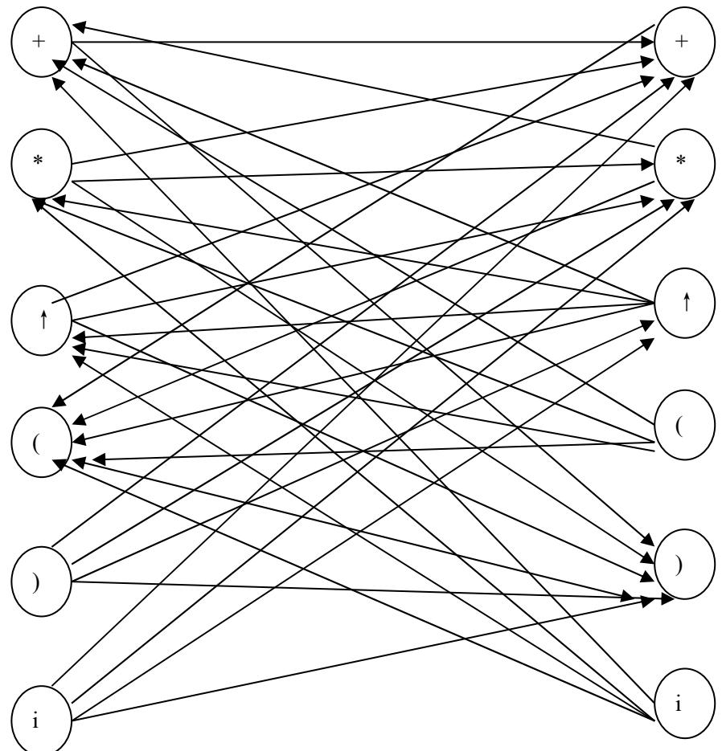

优先函数为:
<table><tr><td></td><td>+</td><td>*</td><td>↑</td><td>(</td><td>)</td><td>i</td></tr><tr><td>f</td><td>4</td><td>6</td><td>6</td><td>2</td><td>9</td><td>9</td></tr><tr><td>g</td><td>3</td><td>5</td><td>8</td><td>8</td><td>2</td><td>8</td></tr></table>

（4）用优先函数表分析字符串 $\mathbf{i} + \mathbf{i}^{*}\mathbf{i}\uparrow \mathbf{i}$
<table><tr><td>符号栈</td><td>关系</td><td>输入串</td><td>最左素短语</td></tr><tr><td>#</td><td>f(#) • &lt; g(i)</td><td>i+i*i↑i#</td><td></td></tr><tr><td>#i</td><td>f(i) &gt; • g(+)</td><td>+i*i↑i#</td><td>i</td></tr><tr><td>#V</td><td>f(#) • &lt; g(+)</td><td>+i*i↑i#</td><td></td></tr><tr><td>#V+</td><td>f(+) • &lt; g(i)</td><td>i*i↑i#</td><td></td></tr><tr><td>#V+i</td><td>f(i) &gt; • g(*)</td><td>*i↑i#</td><td>i</td></tr><tr><td>#V+V</td><td>f(+) • &lt; g(*)</td><td>*i↑i#</td><td></td></tr><tr><td>#V+V*</td><td>f(*) • &lt; g(i)</td><td>i↑i#</td><td></td></tr><tr><td>#V+V*i</td><td>f(i) &gt; • g(↑)</td><td>↑i#</td><td>i</td></tr><tr><td>#V+V*V</td><td>f(*) • &lt; g(↑)</td><td>↑i#</td><td></td></tr><tr><td>#V+V*V↑</td><td>f(↑) • &lt; g(i)</td><td>i#</td><td></td></tr><tr><td>#V+V*V↑i</td><td>f(i) &gt; • g(#)</td><td>#</td><td>i</td></tr><tr><td>#V+V*V↑V</td><td>f(↑) &gt; • g(#)</td><td>#</td><td>V↑V</td></tr><tr><td>#V+V*V</td><td>f(*) &gt; • g#)</td><td>#</td><td>V*V</td></tr><tr><td>#V+V</td><td>f(+) &gt; • g(#)</td><td>#</td><td>V+V</td></tr><tr><td>#V</td><td></td><td>#</td><td>成功</td></tr></table>

3 4

## 原件第35页

i, i+i, i\*i+i, i\*(i\*i)以及 i\*(i+i\*i)+((i+i)\*i

P146 19. 证明下面文法不是算符优先文法:

S::=A[] | [

A::=aA|B]

B::=a

证明： $\mathbf{S}\rightarrow \mathbf{A}[ ]$

$\mathbf{A}\rightarrow \mathbf{aA}$

$\because A \rightarrow aA$

$\mathbf{A}\rightarrow \mathbf{B}]$

∴a·<]

$\because A\rightarrow B]$

$\mathbf{B}\rightarrow \mathbf{a}$

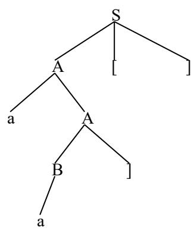

$\mathbf{a} > \cdot ]$ 和 $\mathbf{a} <   ]$ 矛盾，所以该文法非算符优先文法

P146 21. 利用表 4.8 文法 G[E]优先关系矩阵分析下列句子:

解：以 $i*i+i$ 为例，其余类似：

<table><tr><td>符号栈</td><td>关系</td><td>输入串</td><td>最左素短语</td></tr><tr><td>#</td><td>&lt;</td><td>i*i+i#</td><td></td></tr><tr><td>#i</td><td>&gt;·</td><td>*i+i#</td><td>i</td></tr><tr><td>#V</td><td>&lt;</td><td>*i+i#</td><td></td></tr><tr><td>#V*</td><td>&lt;</td><td>i+i#</td><td></td></tr><tr><td>#V*i</td><td>&gt;·</td><td>+i#</td><td>i</td></tr><tr><td>#V*V</td><td>&gt;·</td><td>+i#</td><td>V*V</td></tr><tr><td>#V</td><td>&lt;</td><td>+i#</td><td></td></tr><tr><td>#V+</td><td>&lt;</td><td>i#</td><td></td></tr><tr><td>#V+i</td><td>&gt;·</td><td>#</td><td>i</td></tr><tr><td>#V+V</td><td>&gt;·</td><td>#</td><td>V+V</td></tr><tr><td>#V</td><td></td><td>#</td><td>成功</td></tr></table>

∴i\*i+i 是文法 G[E] 的句子；

再以 $\mathbf{i}^{*}(\mathbf{i}^{*}\mathbf{i})$ 为例：

<table><tr><td>符号栈</td><td>关系</td><td>输入串</td><td>最左素短语</td></tr><tr><td>#</td><td>&lt;</td><td>i*(i*i)#</td><td></td></tr><tr><td>#i</td><td>&gt;</td><td>*(i*i)#</td><td>i</td></tr><tr><td>#V</td><td>&lt;</td><td>*(i*i)#</td><td></td></tr><tr><td>#V*</td><td>&lt;</td><td>(i*i)#</td><td></td></tr><tr><td>#V*(</td><td>&lt;</td><td>i*i)#</td><td></td></tr><tr><td>#V*(i</td><td>&gt;</td><td>*i)#</td><td>i</td></tr><tr><td>#V*(V</td><td>&lt;</td><td>*i)#</td><td></td></tr><tr><td>#V*(V*</td><td>&lt;</td><td>i)#</td><td></td></tr><tr><td># V*(V*i</td><td>&gt;.</td><td>)#</td><td>i</td></tr><tr><td># V*(V*V</td><td>&gt;.</td><td>)#</td><td>V*V</td></tr><tr><td># V*(V</td><td> $\doteq$ </td><td>)#</td><td></td></tr><tr><td># V*(V)</td><td>&gt;.</td><td>#</td><td>(V)</td></tr><tr><td># V*V</td><td>&gt;.</td><td>#</td><td>V*V</td></tr><tr><td># V</td><td></td><td>#</td><td>成功</td></tr></table>
∴i\*（i\*i）是文法 G[E]的句子；

3 5

## 原件第36页

P146 22. 设有文法 G[Z]:

$$
\begin{array}{l} \mathbf {Z}: := \mathbf {A} | \mathbf {B} \\ \mathbf {A}: := \mathbf {a A b} | \mathbf {c} \\ \mathbf {B}: := \mathbf {a B b} | \mathbf {d} \end{array}
$$

(1) 试构造能识别此文法的全部活前缀 DFA;

(2) 试构造 LR(0) 分析表;

(3) 试分析符号串 aacbb 是否为此文法的句子。

解：在上述文法中引入新的开始符号 $Z'$ ，并将 $Z'::=Z$ 作为第 0 个规则，从而得到所谓的拓广文法 $G'$ ，则其 LR（0）项目有：

① $Z' ::= \cdot Z$ ② $Z' ::= Z\cdot$ ③ $Z ::= \cdot A$ ④ $Z ::= A\cdot$

⑤ Z ::= ·B ⑥ Z ::= B· ⑦ A ::= ·aAb ⑧ A ::= a·Ab

⑨ A::= aA · b ⑩ A ::= aAb · ⑪ B ::= ·aBb ⑫ B ::= a·Bb

⑬ B ::= aB · b ⑭ B ::= aBb · ⑮ B ::= · d ⑯ B ::= d ·

⑰ A::=·c (18)A::= c·

(1)

3 6

## 原件第37页

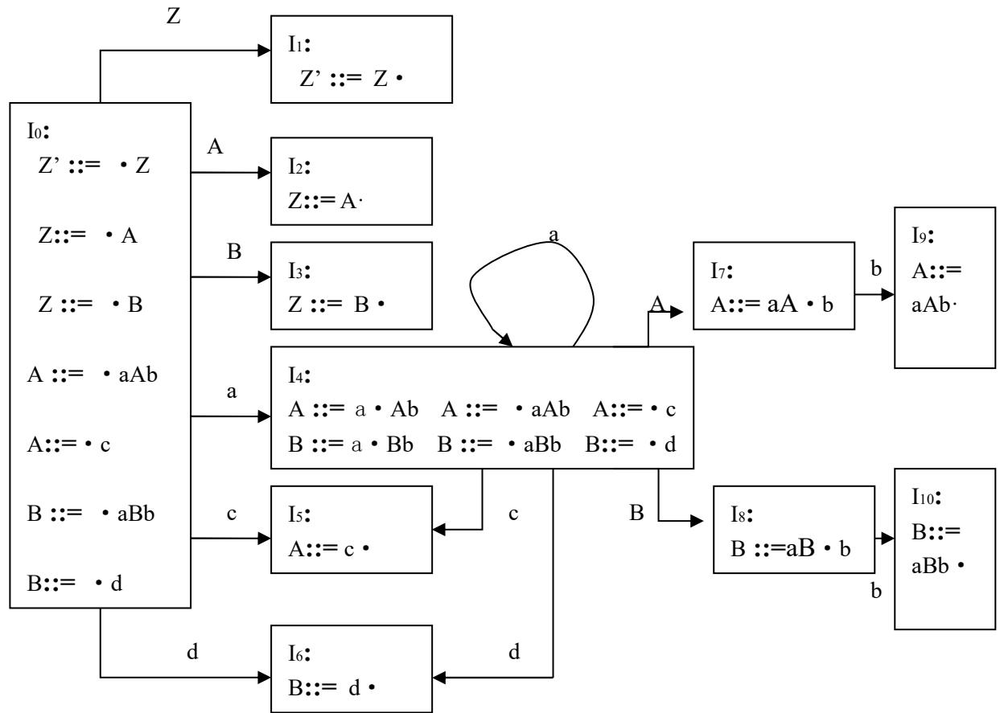

(2)构造 LR（0）分析表
<table><tr><td rowspan="2">状态</td><td colspan="5">ACTION</td><td colspan="3">GOTO</td></tr><tr><td>a</td><td>b</td><td>c</td><td>d</td><td>#</td><td>Z</td><td>A</td><td>B</td></tr><tr><td>0</td><td>S4</td><td></td><td>S5</td><td>S6</td><td></td><td rowspan="10">1</td><td rowspan="4">2</td><td rowspan="4">3</td></tr><tr><td>1</td><td></td><td></td><td></td><td></td><td>acc</td></tr><tr><td>2</td><td>r1</td><td>r1</td><td>r1</td><td>r1</td><td>r1</td></tr><tr><td>3</td><td>r2</td><td>r2</td><td>r2</td><td>r2</td><td>r2</td></tr><tr><td>4</td><td>S4</td><td></td><td>S5</td><td>S6</td><td></td><td rowspan="6">7</td><td rowspan="6">8</td></tr><tr><td>5</td><td>r4</td><td>r4</td><td>r4</td><td>r4</td><td>r4</td></tr><tr><td>6</td><td>r6</td><td>r6</td><td>r6</td><td>r6</td><td>r6</td></tr><tr><td>7</td><td></td><td>S9</td><td></td><td></td><td></td></tr><tr><td>8</td><td></td><td>S10</td><td></td><td></td><td></td></tr><tr><td>9</td><td>r3</td><td>r3</td><td>r3</td><td>r3</td><td>r3</td></tr><tr><td>10</td><td>r5</td><td>r5</td><td>r5</td><td>r5</td><td>r5</td><td colspan="3"></td></tr><tr><td colspan="9">规则顺序: r1: Z→A r2: Z→B r3: A→aAb r4: A→C</td></tr></table>
r5: B→aBb r6: B→d

(3)分析符号串aacbb是否为该文法的句子
<table><tr><td>步骤</td><td>状态栈</td><td>符号栈</td><td>输入串</td><td>分析动作</td><td>下一状态</td></tr><tr><td>1</td><td>0</td><td>#</td><td>aacbb #</td><td>S4</td><td>4</td></tr><tr><td>2</td><td>04</td><td>#a</td><td>acbb #</td><td>S4</td><td>4</td></tr><tr><td>3</td><td>044</td><td>#aa</td><td>cbb #</td><td>S5</td><td>5</td></tr><tr><td>4</td><td>0445</td><td>#aac</td><td>bb #</td><td>r4</td><td>GOTO[4,A]=7</td></tr><tr><td>5</td><td>0447</td><td>#aaA</td><td>bb #</td><td>S9</td><td>9</td></tr><tr><td>6</td><td>04479</td><td>#aaAb</td><td>b #</td><td>r3</td><td>GOTO[4,A]=7</td></tr><tr><td>7</td><td>047</td><td>#aA</td><td>b #</td><td>S9</td><td>9</td></tr><tr><td>8</td><td>0479</td><td>#aAb</td><td>#</td><td>r3</td><td>GOTO[0,A]=2</td></tr><tr><td>9</td><td>02</td><td>#A</td><td>#</td><td>r1</td><td>GOTO[0,Z]=1</td></tr><tr><td>10</td><td>01</td><td>#Z</td><td>#</td><td>acc</td><td>成功</td></tr></table>

3 7

## 原件第38页

P147 24. 给定文法:

$$
\mathbf {E} \mathrel {\mathop :} = \mathbf {E E} + | \mathbf {E E} ^ {*} | \mathbf {a}
$$

(1) 构造它的 LR(0) 项目集规范族;

(2) 它是 SLR(1)文法吗？若是，构造它的 SLR(1)分析表；

(3) 它是 LR(1) 文法吗？若是，构造它的 LR(1) 分析表；

(4) 它是 LALR(1) 吗？若是，构造它的 LALR(1) 分析表。

### 解：

(1) 在上述文法中引入新的开始符号 E', 并将 E' 作为第 0 个规则

r1:E::=EE+ r2:E::=EE\* r3:E::=a

则基本 LR(0) 项目集为:

(1) $E'$ : := •E

(2) $E'$ : :=E•

(5) $\mathbf{E}::= \mathbf{EE}\bullet +$

(6) $\mathbf{E}::=\mathbf{E}\mathbf{E}+\bullet$

(3) $E\because=\bullet EE+$

(4) $\mathbf{E}:\mathbf{\cdot}:=\mathbf{E}\bullet\mathbf{E}+$

(9) $\mathbf{E}:\mathbf{:} = \mathbf{EE}\bullet *$

(10) $E::=EE^{*}$

(7) $\mathbf{E}:\mathbf{:}:=\bullet\mathbf{E}\mathbf{E}^{*}$

(8) $\mathbf{E}:\mathbf{:}:=\mathbf{E}\bullet\mathbf{E}^{*}$

(11) $\mathbf{E}:\cdot:=\bullet\mathbf{a}$

(12) $\mathbf{E}::=\mathbf{a}\bullet$

$$
\begin{array}{c} \text {I_0: E'::= •E} \\ \text {E::= •EE+} \\ \text {E::= •EE*} \\ \text {E::= •a} \end{array} \xrightarrow {\text {E}} \begin{array}{c} \text {I_1: E'::= E•} \\ \text {E::= E•E+} \\ \text {E::= •EE+} \\ \text {E::= E•E*} \\ \text {E::= •EE*} \\ \text {E::= •a} \end{array} \xrightarrow {\text {E}} \begin{array}{c} \text {I_3: E::= •a} \\ \text {E::= EE•+} \\ \text {E::= E•E+} \\ \text {E::= EE•+} \\ \text {E::= EE•*} \\ \text {E::= E•E*} \\ \text {E::= •EE*} \end{array} \xrightarrow {+} \begin{array}{c} \text {I_4: E::= EE+•} \\ \text {*} \\ \text {I_5: E::= EE••} \end{array}
$$

(2) 在 $\mathbf{I}_1$ 中存在“移进 $\mathrm{E} - >\bullet \mathrm{a}$ ”和“归约： $\mathrm{E}' - >\mathrm{E}\cdot$ ”冲突，因此该文法不是LR(0)文法，但有FOLLOW(E')={#}∩{a}=Φ，而该动作冲突可用SLR(1)方法解决，该文法是SLR(1)文法，其分析表如下：

<table><tr><td rowspan="2">状态</td><td colspan="4">ACTION</td><td>GOTO</td></tr><tr><td>+</td><td>*</td><td>a</td><td>#</td><td>E</td></tr><tr><td>0</td><td></td><td></td><td>S2</td><td></td><td>1</td></tr><tr><td>1</td><td></td><td></td><td>S2</td><td>acc</td><td>3</td></tr><tr><td>2</td><td>r3</td><td>r3</td><td>r3</td><td>r3</td><td></td></tr><tr><td>3</td><td>S4</td><td>S5</td><td>S2</td><td></td><td>3</td></tr><tr><td>4</td><td>r1</td><td>r1</td><td>r1</td><td>r1</td><td></td></tr><tr><td>5</td><td>r2</td><td>r2</td><td>r2</td><td>r2</td><td></td></tr></table>

(3) 拓广文法:

3 8

## 原件第39页

① S'::= E

② E::= EE+

③ E ::= EE\*

④ E::=a

识别 G[S'] 的 LR(1)项目集及状态转移图如下:

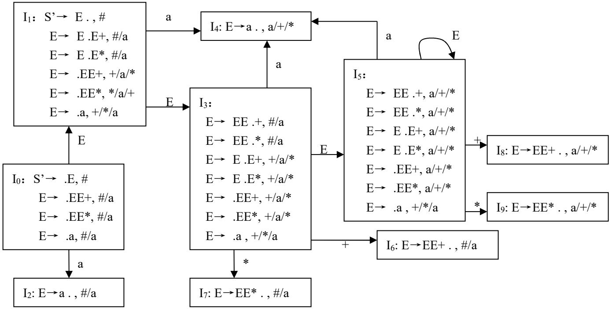

文法 G[S']LR(1)分析表:

<table><tr><td rowspan="2">状态</td><td colspan="4">Action</td><td>goto</td></tr><tr><td>+</td><td>*</td><td>a</td><td>#</td><td>E</td></tr><tr><td>0</td><td></td><td></td><td> $S_{2}$ </td><td></td><td>1</td></tr><tr><td>1</td><td></td><td></td><td> $S_{4}$ </td><td>acc</td><td>3</td></tr><tr><td>2</td><td></td><td></td><td> $r_{4}$ </td><td> $r_{4}$ </td><td></td></tr><tr><td>3</td><td> $S_{6}$ </td><td> $S_{7}$ </td><td> $S_{4}$ </td><td></td><td>5</td></tr><tr><td>4</td><td> $r_{4}$ </td><td> $r_{4}$ </td><td> $r_{4}$ </td><td></td><td></td></tr><tr><td>5</td><td> $S_{8}$ </td><td> $S_{9}$ </td><td> $S_{4}$ </td><td></td><td>5</td></tr><tr><td>6</td><td></td><td></td><td> $r_{2}$ </td><td> $r_{2}$ </td><td></td></tr><tr><td>7</td><td></td><td></td><td> $r_{3}$ </td><td> $r_{3}$ </td><td></td></tr><tr><td>8</td><td> $r_{2}$ </td><td> $r_{2}$ </td><td> $r_{2}$ </td><td></td><td></td></tr><tr><td>9</td><td> $r_{3}$ </td><td> $r_{3}$ </td><td> $r_{3}$ </td><td></td><td></td></tr></table>
不存在多重定义的元素，所以该文法是 LR(1) 文法。

（4）为 LALR(1)文法，其分析如下：

<table><tr><td rowspan="2">状态</td><td colspan="4">Action</td><td>goto</td></tr><tr><td>+</td><td>*</td><td>a</td><td>#</td><td>E</td></tr><tr><td>0</td><td></td><td></td><td> $S_{24}$ </td><td></td><td>1</td></tr><tr><td>1</td><td></td><td></td><td> $S_{24}$ </td><td>acc</td><td>35</td></tr><tr><td>24</td><td>r4</td><td>r4</td><td>r4</td><td>r4</td><td></td></tr><tr><td>35</td><td> $S_{68}$ </td><td> $S_{79}$ </td><td> $S_{24}$ </td><td></td><td>35</td></tr><tr><td>68</td><td> $r_2$ </td><td> $r_2$ </td><td> $r_2$ </td><td> $r_2$ </td><td></td></tr><tr><td>79</td><td> $r_3$ </td><td> $r_3$ </td><td> $r_3$ </td><td> $r_3$ </td><td></td></tr></table>

3 9

## 原件第40页

P147 26. 对如下文法 G:

$$
\mathrm{S} \mathrel {\mathop :} = \mathrm{S} (\mathrm{S}) \quad \mathrm{S} \mathrel {\mathop :} = \varepsilon
$$

构造 LR(1) 项目规范集以及 LR(1) 分析表，并用分析器给出 (()) 的分析过程。

解：

引入开始符号 S'。则拓广文法：S'->S，S->S(S)，S->ε。其中 r1: S->S(S) r2: S->ε

LR(1)分析表如下所示:

<table><tr><td rowspan="2">状态</td><td colspan="3">ACTION</td><td>GOTO</td></tr><tr><td>(</td><td>)</td><td>#</td><td>S</td></tr><tr><td>0</td><td>r2</td><td></td><td>r2</td><td>1</td></tr><tr><td>1</td><td>S2</td><td></td><td>acc</td><td></td></tr><tr><td>2</td><td>r2</td><td>r2</td><td></td><td>3</td></tr><tr><td>3</td><td>S5</td><td>S4</td><td></td><td></td></tr><tr><td>4</td><td>r1</td><td></td><td>r1</td><td></td></tr><tr><td>5</td><td>r2</td><td>r2</td><td></td><td>6</td></tr><tr><td>6</td><td>S5</td><td>S7</td><td></td><td></td></tr><tr><td>7</td><td>r1</td><td>r1</td><td></td><td></td></tr></table>

分析符号串（（）） P148 30. 给出如下文法:
<table><tr><td>步骤</td><td>状态栈</td><td>符号栈</td><td>输入串</td><td>分析动作</td><td>下一状态</td></tr><tr><td>0</td><td>0</td><td>#</td><td>(())#</td><td>r2</td><td>GOTO[0,S]=1</td></tr><tr><td>1</td><td>01</td><td>#S</td><td>(())#</td><td>S2</td><td>2</td></tr><tr><td>2</td><td>012</td><td>#S(</td><td>())#</td><td>r2</td><td>GOTO[2,S]=3</td></tr><tr><td>3</td><td>0123</td><td>#S(S</td><td>())#</td><td>S5</td><td>5</td></tr><tr><td>4</td><td>01235</td><td>#S(S(</td><td>))#</td><td>r2</td><td>GOTO[5,S]=6</td></tr><tr><td>5</td><td>012356</td><td>#S(S(S</td><td>))#</td><td>S7</td><td>7</td></tr><tr><td>6</td><td>0123567</td><td>#S(S(S)</td><td>)#</td><td>r1</td><td>GOTO[2,S]=3</td></tr><tr><td>7</td><td>0123</td><td>#S(S</td><td>)#</td><td>S4</td><td>4</td></tr><tr><td>8</td><td>01234</td><td>#S(S)</td><td>#</td><td>r1</td><td>GOTO[0,S]=1</td></tr><tr><td>9</td><td>01</td><td>#S</td><td>#</td><td>acc</td><td>成功</td></tr></table>

## 原件第41页

$$
\mathrm{G} _ {1} [ \mathrm{S} ]: \mathrm{S}: := \mathrm{aSbS} | \mathrm{aS} | \mathrm{c}
$$

$$
\mathrm{G} _ {2} [ \mathrm{S} ]: \mathrm{S}: := \mathrm{aAa} \mid \mathrm{aBb} \quad \mathrm{A}: := \mathrm{x} \quad \mathrm{B}: := \mathrm{x}
$$

$$
\mathrm{G} _ {3} [ \mathrm{S} ]: \mathrm{S}: := \mathrm{aAa} | \mathrm{aBb} | \mathrm{bAb} \quad \mathrm{A}: := \mathrm{x} \quad \mathrm{B}: := \mathrm{x}
$$

$$
\mathbf {B}: := \mathbf {x}
$$

(1) 证明二义性文法 $G_{1}[S]$ 不是 LR(0) 文法；

(2) 证明 $\mathbf{G}_2[\mathbf{S}]$ 是SLR(1)文法但不是LR(0)文法；

(3) 证明 $\mathbf{G}_3[\mathbf{S}]$ 是 LR(1) 文法但不是 SLR(1) 文法;

(4) 证明 $\mathbf{G}_4[\mathrm{S}]$ 是LR(1)文法但不是LALR文法。

(1) 证明：构造其 LR(0)项目集： $I_{0}$ : S'->•S S->•aSbS S->•aS S->•c $I_{1}$ : S->a•SbS S->a•S S->•c S->•aSbS S->•aS $I_{2}$ : S->aS•bS S->aS•

因为 $I_{2}$ 中出现了 “移进-归约” 冲突，因此不是 LR(0) 文法；

(2) 证明：构造其 LR(0)项目集： $I_{0}$ : S'->•S S->•aAa S->•aBb $I_{1}$ : S'->S• $I_{2}$ : S->a•Aa S->a•Bb A->•x B->•x $I_{3}$ : S->aA•a $I_{4}$ : S->aB•b $I_{5}$ : A->x• B->x• $I_{6}$ : S->aAa• $I_{7}$ : S->aBb•

由于 $I_{5}$ 中出现了 “归约-规约” 冲突，因此 $G_{2}[S]$ 不是 LR(0) 文法；
∵ FOLLOW(A)={a} ∩ FOLLOW(B)={b}=Φ
∴ ACTION[i, a] = “用产生式 A->x 进行归约”；
ACTION[i, b] = “用产生式 B->x 进行归约”；
因而该文法为 SLR(1) 文法。

(3) 证明：构造其 LR(1)项目集：
I₀: S'->•S, #    S->•aAa, #    S->•aBb, #    S->•bAb, #
I₁: S'->S•, #
I₂: S->a•Aa, #    A->•x, a    S->a•Bb, #    B->•x, b
I₃: S->b•Ab, #    A->•x, b
I₄: A->x•, a    B->x•, b

(其余从略)

此时由 $I_{4}$ 可知存在 “归约-归约” 冲突，且 FOLLOW(A)= $\{a,b\}\cap FOLLOW(B)=\{b\}\neq\Phi$ 故该文法不是 SLR(1) 文法，但有 ACTION[i, a]=“用产生式 A->x 进行归约”，ACTION[i, b]=“用产生式 B->x 进行归约”，所以是 LR(1) 文法。

(4) 证明：构造其 LR(1)项目规范集：

$$
\mathrm{I} _ {0}: \mathrm{S} ^ {\prime} - > \bullet \mathrm{S}, \# \quad \mathrm{S} - > \bullet \mathrm{aAa}, \# \quad \mathrm{S} - > \bullet \mathrm{aBb}, \# \quad \mathrm{S} - > \bullet \mathrm{bAb}, \# \quad \mathrm{S} - > \bullet \mathrm{bBa}, \#
$$

$$
\mathrm{I} _ {1}: \mathrm{S} ^ {\prime} - > \mathrm{S} \bullet , \#
$$

$$
\mathrm{I} _ {2}: \mathrm{S} - > \mathrm{a} \bullet \mathrm{Aa}, \# \quad \mathrm{S} - > \mathrm{a} \bullet \mathrm{Bb}, \# \quad \mathrm{A} - > \bullet \mathrm{x}, \mathrm{a} \quad \mathrm{B} - > \bullet \mathrm{x}, \mathrm{b}
$$

$$
\mathbf {B} - > \bullet \mathbf {x}, \mathbf {a}
$$

$$
\mathrm{I} _ {4}: \mathrm{S} - > \mathrm{aA} \cdot \mathrm{a}, \#
$$

$$
\mathbf {I} _ {5}: \mathbf {S} - > \mathbf {a B} \cdot \mathbf {b}, \#
$$

4 1

## 原件第42页

$$
\mathbf {I} _ {6}: \mathbf {A} - > \mathbf {x} ^ {\bullet}, \mathbf {a} \quad \mathbf {B} - > \mathbf {x} ^ {\bullet}, \mathbf {b}
$$

$$
\mathbf {I} _ {7}: \mathbf {S} - > \mathbf {b A} \cdot \mathbf {b}, \#
$$

$$
\mathbf {I} _ {8}: \mathbf {S} - > \mathbf {b B} \cdot \mathbf {a}, \#
$$

$$
\mathbf {I} _ {9}: \mathbf {A} - > \mathbf {x} ^ {\bullet}, \mathbf {b} \quad \mathbf {B} - > \mathbf {x} ^ {\bullet}, \mathbf {a}
$$

$$
\mathbf {I} _ {1 0}: \mathbf {S} - > \mathbf {a A a} ^ {\bullet}, \#
$$

$$
\mathbf {I} _ {1 1}: \mathbf {S} - > \mathbf {a B b} ^ {\bullet}, \#
$$

$$
\mathbf {I} _ {1 2}: \mathbf {S} - > \mathbf {b A b} ^ {\bullet}, \#
$$

$$
\mathrm{I} _ {1 3}: \mathrm{S} - > \mathrm{bBa} ^ {\bullet}, \#
$$

对于 $I_{6}$ 与 $I_{9}$ 并不存在 “归约-归约” 冲突，于 LR(1) 文法相符；

然合并同心集 $I_{6}$ 和 $I_{9}$ ，得：A->x, a/b B->x, a/b

出现了“归约-归约”冲突，故该文法并非LALR文法。

### 第十一次作业：

P194 1. 按照语法制导翻译的一般原理，给出表达式 $(5*4+8)*2$ 的语法树各结点并注明语义值 VAL。

解：

P1942. 给出下面表达式的后缀式表示:

解：(2) $\neg a \lor \neg (c \lor \neg d)$ : $a \neg cd \neg \lor \neg \lor$

(3) a+b\*(c+d/e) : abcde/++

(4) (a∧b)∨(¬ c∨d) : ab∧c¬ d∨∨

(5) $-\mathbf{a} + \mathbf{b}^{*}(-\mathbf{c} + \mathbf{d})$ : a-bc-d+ $^*$ +

(6) (a ∨ b) ∧ (c ∨ ¬ d ∧ e) : ab ∨ cd ¬ e ∧ ∨ ∧

4 2

## 原件第43页

(7) if $(x+y)^{*}z\Leftrightarrow0$ then $(a+b)\uparrow c$ else $a\uparrow b\uparrow c$ : $xy+z^{*}p1JEZab+c\uparrow p2JUMPab\uparrow c\uparrow$

P1954. 将下列中缀式改写为后缀式表示:

解：(2) $((\mathbf{a}^{*}\mathbf{d} + \mathbf{c})^{*}\mathbf{d} + \mathbf{e})^{*}\mathbf{f} + \mathbf{g}$ ：ad\*c+d\*e+f\*g+

P195 5. 将下列后缀式改写为中缀式表示:

解：(1) abc-\*cd+e/- : a\*(b-c)-(c+d)/e
(3) abc+≤a0>∧ab+0<>a0<∧∨ : (a≤b+c∧a>0) ∨(a+b<>0∧a<0)

P1956. 利用所给的语义子程序给出下列算术表达式语法制导翻译过程：

以（1） $(\mathbf{a} + \mathbf{b})$ 为例进行分析，（2）（3）两题与（1）类似；

解：参看P118表4.15，该表存在错位，应纠正：

<table><tr><td>步骤</td><td>状态栈</td><td>符号栈</td><td>输入串</td><td>规约规则</td><td>调用子程序</td><td>后缀表示</td></tr><tr><td>1</td><td>0</td><td>#</td><td>(a+b)#</td><td></td><td></td><td></td></tr><tr><td>2</td><td>04</td><td>#(</td><td>a+b)#</td><td></td><td></td><td></td></tr><tr><td>3</td><td>045</td><td>#(a</td><td>+b)#</td><td>F::=i</td><td>SUB6</td><td>a</td></tr><tr><td>4</td><td>043</td><td>#(F</td><td>+b)#</td><td>T::=F</td><td>SUB4</td><td>a</td></tr><tr><td>5</td><td>042</td><td>#(T</td><td>+b)#</td><td>E::=T</td><td>SUB2</td><td>a</td></tr><tr><td>6</td><td>041</td><td>#(E</td><td>+b)#</td><td></td><td></td><td>a</td></tr><tr><td>7</td><td>0416</td><td>#(E+</td><td>b)#</td><td></td><td></td><td>a</td></tr><tr><td>8</td><td>04165</td><td>#(E+b</td><td>)#</td><td>F::=i</td><td>SUB6</td><td>ab</td></tr><tr><td>9</td><td>04163</td><td>#(E+F</td><td>)#</td><td>T::=F</td><td>SUB4</td><td>ab</td></tr><tr><td>10</td><td>04169</td><td>#(E+T</td><td>)#</td><td>E::=E(1)+T</td><td>SUB1</td><td>ab+</td></tr><tr><td>11</td><td>048</td><td>#(E</td><td>)#</td><td></td><td></td><td>ab+</td></tr><tr><td>12</td><td>0481</td><td>#(E)</td><td>#</td><td>F::=(E)</td><td>SUB5</td><td>ab+</td></tr><tr><td>13</td><td>03</td><td>#F</td><td>#</td><td>T::=F</td><td>SUB4</td><td>ab+</td></tr><tr><td>14</td><td>02</td><td>#T</td><td>#</td><td>E::=T</td><td>SUB2</td><td>ab+</td></tr><tr><td>15</td><td>01</td><td>#E</td><td>#</td><td>acc</td><td></td><td></td></tr></table>

P1958. 写出下列赋值语句的自下而上语法制导翻译过程，并给出产生四元式序列：

<table><tr><td>步骤</td><td>状态栈</td><td>符号栈</td><td>PLACE</td><td>输入串</td><td>规约规则</td><td>调用子程序</td><td>四元式</td></tr><tr><td>1</td><td>0</td><td>#</td><td>-</td><td>a:=b*(c+d)#</td><td></td><td></td><td></td></tr><tr><td>2</td><td>02</td><td>#a</td><td>-Va</td><td>:=b*(c+d)#</td><td>V::=i</td><td>SUB8</td><td></td></tr><tr><td>3</td><td>03</td><td>#V</td><td>-Va</td><td>:=b*(c+d)#</td><td></td><td></td><td></td></tr><tr><td>4</td><td>034</td><td>#V:=</td><td>-Va-</td><td>b*(c+d)#</td><td></td><td></td><td></td></tr><tr><td>5</td><td>0349</td><td>#V:=b</td><td>-Va-Fb</td><td>*(c+d)#</td><td>F::=i</td><td>SUB7</td><td></td></tr><tr><td>6</td><td>0347</td><td>#V:=F</td><td>-Va-Tb</td><td>*(c+d)#</td><td>T::=F</td><td>SUB5</td><td></td></tr><tr><td>7</td><td>0346</td><td>#V:=T</td><td>-Va-Tb</td><td>*(c+d)#</td><td></td><td></td><td></td></tr><tr><td>8</td><td>03461</td><td>#V:=T*</td><td>-Va-Tb</td><td>(c+d)#</td><td></td><td></td><td></td></tr><tr><td>9</td><td>034618</td><td>#V:=T*(</td><td>-Va-Tb-</td><td>c+d)#</td><td></td><td></td><td></td></tr><tr><td>10</td><td>0346189</td><td>#V:=T*(c</td><td>-Va-Tb-Fc</td><td>+d)#</td><td>F::=i</td><td>SUB7</td><td></td></tr><tr><td>11</td><td>0346187</td><td>#V:=T*(F</td><td>-Va-Tb-Tc</td><td>+d)#</td><td>T::=F</td><td>SUB5</td><td></td></tr><tr><td>12</td><td>0346186</td><td>#V:=T*(T</td><td>-Va-Tb-Ec</td><td>+d)#</td><td>E::=T</td><td>SUB3</td><td></td></tr><tr><td>13</td><td>0346182</td><td>#V:=T*(E</td><td>-Va-Tb-Ec</td><td>+d)#</td><td></td><td></td><td></td></tr><tr><td>14</td><td>03461820</td><td>#V:=T*(E+</td><td>-Va-Tb-Ec-</td><td>d)#</td><td></td><td></td><td></td></tr><tr><td>15</td><td>034618209</td><td>#V:=T*(E+d</td><td>-Va-Tb-Ec-Fd</td><td>)#</td><td>F::=i</td><td>SUB7</td><td></td></tr><tr><td>16</td><td>034618207</td><td>#V:=T*(E+F</td><td>-Va-Tb-Ec-Td</td><td>)#</td><td>T::=F</td><td>SUB5</td><td></td></tr><tr><td>17</td><td>034618203</td><td>#V:=T*(E+T</td><td>-Va-Tb-T1</td><td>)#</td><td>E::=E(1)+T</td><td>SUB2</td><td>(+, c, d, T1)</td></tr><tr><td>18</td><td>0346182</td><td>#V:=T*(E</td><td>-Va-Tb-T1</td><td>)#</td><td></td><td></td><td></td></tr><tr><td>19</td><td>03461825</td><td>#V:=T*(E)</td><td>-Va-Tb-T1</td><td>#</td><td>F::=(E)</td><td>SUB6</td><td></td></tr><tr><td>20</td><td>034614</td><td>#V:=T*F</td><td>-Va-T2</td><td>#</td><td>T::=T(1)*F</td><td>SUB4</td><td>(*, b, T1, T2)</td></tr><tr><td>21</td><td>0346</td><td>#V:=T</td><td>-Va-T2</td><td>#</td><td>E::=T</td><td>SUB3</td><td>(*, b, T1, T2)</td></tr><tr><td>22</td><td>0345</td><td>#V:=E</td><td>-Va-T2</td><td>#</td><td>A::=V:=E</td><td>SUB1</td><td>(:=, T2, , a)</td></tr><tr><td>23</td><td>01</td><td>#A</td><td>-</td><td>#</td><td>acc</td><td></td><td></td></tr></table>
P195 10. 将下列布尔表达式翻译成四元式序列，并给出语法制导翻译过程（作为条件控制）： $a \wedge b \wedge c > d$

4 3

## 原件第44页

解：四元式序列如下所示：

(1) (jnz, a, , 3)
(2) (j, , , 0)
(3) (jnz, b, , 5)
(4) (j, , , 2)
(5) (j>, c, d, 0)
(6) (j, , , 4)

a 的四元式，当 a 为真时，则转向第 3 个四元式
b 的四元式，当 b 为真时，则转向第 3 个四元式
无条件转向第 2 个四元式
c>d 的四元式
无条件转向第 4 个四元式

<BE>·TC 表示<BE>真出口的链首

<BE>•FC 表示<BE>假出口的链首，每个链尾的四元式第 4 分量均为 0，表示结束标记

(1) $\underline{\mathbf{E}}\wedge \mathbf{b}\wedge \mathbf{c} > \mathbf{d}$ $\{\mathbf{E}\bullet \mathbf{TC}:=  100;\mathbf{E}\bullet \mathbf{FC}:=  101\}$

(3) $E^{\wedge}E\wedge c>d$ $\{E\cdot TC:=102;E\cdot FC:=103\}$ (4) $E^{\wedge}E^{\wedge'}c>d$

4 4

## 原件第45页

### 第十二次作业：

P195 12. 写出下列条件赋值语句的四元式序列:

P195 13. 将下列条件语句翻译成四元式序列：

P195 14. 将下列 while 语句翻译成四元式序列:

(2) while a<c∧b<d do

4 5

## 原件第46页

$$
\begin{array}{l} \text {if a = 1 then c := c + 1 else} \\ \text {while a < = d do a := a + 2} \end{array}
$$

### 一 语法制导翻译过程:

(1) $\underline{\mathbf{W}}$ A<C<B<D do...... $\{\mathbf{W}\cdot\mathbf{Q}\cup\mathbf{AD}:=100\}$ (2) $\mathbf{W}\underline{\mathbf{E}}^{(1)}\wedge\mathbf{B}<\mathbf{D}\quad\text{do......}\quad 100(\mathrm{J}<,\mathrm{A},\mathrm{C},102);$ $\{\mathbf{E}^{(1)}\cdot\mathbf{T}\mathbf{C}:=100,\mathbf{E}^{(1)}\cdot\mathbf{F}\mathbf{C}:=101\}\quad 101(\mathrm{J},-,-,0);$

(3) $\mathbf{W}\underline{\mathbf{E}}^{\mathbf{A}}\mathbf{B} <   \mathbf{D}$ do...... $\{\mathrm{BACKPATCH}(\mathrm{E}^{(1)}\cdot \mathrm{TC}:=  100,\mathrm{NXQ} = 102);$ $\mathbf{E}^{\mathbf{A}}\cdot \mathbf{FC}:= \mathbf{E}^{(1)}\cdot \mathbf{FC}:=  101\}$

$$
\begin{array}{r l r} \text {(4)} & \mathrm{WE} ^ {\mathrm{A}} \mathrm{E} ^ {(2)} \quad \text {do.....} & 1 0 2 (\mathrm{J} <  , \mathrm{B}, \mathrm{D}, 1 0 4) \\ & \{\mathrm{E} ^ {(2)} \cdot \mathrm{TC} := 1 0 2; \mathrm{E} ^ {(2)} \cdot \mathrm{FC} := 1 0 3 \} & 1 0 3 (\mathrm{J}, -, -, 1 0 1) \end{array}
$$

$$
\begin{array}{r l} \underline {{\text { WE }}} & \quad \text { do..... } \\ & \{\mathrm{E} \cdot \mathrm{TC} := \mathrm{E} ^ {(2)} \cdot \mathrm{TC} := 1 0 2; \\ & \quad \mathrm{E} \cdot \mathrm{FC} := \mathrm{MERG} (\mathrm{E} ^ {\mathrm{A}} \cdot \mathrm{FC} = 1 0 1, \mathrm{E} ^ {(2)} \cdot \mathrm{FC} = 1 0 3) = 1 0 3 \} \end{array} \tag {5}
$$

(6) $\underline{\mathbf{W}}^{\mathrm{d}}$ if A:=1 then......
{BACKPATCH(E·TC=102,NXQ=104); $\mathbf{W}^{\mathrm{d}}\cdot \mathbf{CHAIN}:= \mathbf{E}\cdot \mathbf{TC}=103;$ $\mathbf{W}^{\mathrm{d}}\cdot \mathbf{Q}\cup \mathbf{AD}:= \mathbf{W}\cdot \mathbf{Q}\cup \mathbf{AD}=100\}$

(7) $W^{d}$ if $\underline{E}$ then C:=C+1...... $\{E\cdot TC:=104;E\cdot FC:=105\}$ 104(J=,A,'1'.106)
105(J,-,-,109)

(8) $W^{d} \underline{C}$ C:=C+1 else......
{BACKPATCH(E·TC=104,NXQ=106);
C·CHAIN:=E·FC=105}

$$
\begin{array}{l l} \text {(9)} & \mathrm{W} ^ {\mathrm{d}} \mathrm{C} \underline {{\mathrm{S}}} ^ {(1)} \quad \text {else.....} \\ & \{\mathrm{S} ^ {(1)} \cdot \text {CHAIN} := 0; \\ & \mathrm{T} _ {1} := \text {NEWTEMP} \} \end{array} \quad \begin{array}{l l} 1 0 6 (+, C, ^ {\prime} 1 ^ {\prime}, T _ {1}) \\ 1 0 7 (: = , T _ {1}, -, C) \end{array}
$$

$$
\begin{array}{l l} \text {(10)} & \mathrm {W^ {d} \underline {{T}} ^ {P}} \quad \text {while} \quad \mathrm{A< =D} \quad \text {do.....} \\ & \{\mathrm{q:=108;} \quad 1 0 8 (\mathrm{J}, -, -. 1 0 0) \\ & \text {BACKPATCH(C\cdot CHAIN = 105,NXQ = 109);} \\ & \mathrm {T^ {P} \cdot CHAIN: = MFRG(S^{(1)} \cdot CHAN = 0,q: = 108)} \} \end{array}
$$

4 6

## 原件第47页

$$
\mathbf {W} ^ {\mathrm{d}} \mathbf {T} ^ {\mathrm{P}} \underline {{\mathbf {W}}} ^ {\prime} \mathbf {A} <   = \mathbf {D} \quad \text { do..... }\tag{11}
$$

$$
\{\mathbf {W} ^ {\prime} \cdot \mathbf {Q} \cup \mathbf {A D} := \mathbf {N X Q} = 1 0 9 \}\tag{12}
$$

$$
\mathbf {W} ^ {\mathrm{d}} \mathbf {T} ^ {\mathrm{P}} \mathbf {W} ^ {\prime} \underline {{\mathbf {E}}} \quad \text { do   A: = A + 2 }
$$

$$
\{\mathrm{E} \cdot \mathrm{TC} := 1 0 9;
$$

$$
\mathbf {E} \cdot \mathbf {F C} := 1 1 0 \}\tag{13}
$$

$$
\mathbf {W} ^ {\mathrm{d}} \mathbf {T} ^ {\mathrm{P}} \underline {{\mathbf {W}}} ^ {\mathrm{d}} \quad \mathbf {A} := \mathbf {A} + 2
$$

$$
\{\text { BACKPATCH } (\mathrm{E} \cdot \mathrm{TC} = 1 0 9, \mathrm{NXQ} = 1 1 1);
$$

$$
\mathbf {W} ^ {\mathbf {d}} \cdot \text { CHAIN } := \mathbf {E} \cdot \mathbf {F C} = 1 1 0;
$$

$$
\mathbf {W} ^ {\mathbf {d}} \cdot \mathbf {Q} \cup \mathbf {A D} := \mathbf {W} \cdot \mathbf {Q} \cup \mathbf {A D} = 1 0 9 \}\tag{14}
$$

$$
\begin{array}{r l r} \mathbf {W} ^ {\mathbf {d}} \mathbf {T} ^ {\mathbf {P}} \mathbf {W} ^ {\mathbf {d} ^ {\prime}} \underline {{\mathbf {S}}} ^ {(1)} \\ \{\mathbf {S} \cdot \text {CHAIN} := 0; & 1 1 1 (+, \mathrm{A}, ^ {\prime} 2 ^ {\prime}, \mathrm{T} _ {2}) \\ \mathrm{T} _ {2} := \text {NEWTEMP} \} & 1 1 2 (:= , \mathrm{T} _ {2}, -, \mathrm{A}) \end{array}\tag{15}
$$

$$
\mathbf {W} ^ {\mathbf {d}} \mathbf {T} ^ {\mathbf {P}} \underline {{\mathbf {S}}} ^ {(2)}
$$

$$
\{\text { BACKPATCH } (S ^ {(1)} \cdot \text { CHAINW } ^ {d ^ {\prime}} \cdot Q \cup A D = 1 0 9)
$$

$$
\mathrm{S} ^ {(2)} \cdot \text { CHAIN } := \mathrm{W} ^ {\mathrm{d} ^ {\prime}} \cdot \text { CHAIN } = 1 1 0 \} \quad 1 1 3 (\mathrm{J}, -, -, 1 0 9)\tag{16}
$$

$$
\mathbf {W} ^ {\mathbf {d}} \mathbf {S} ^ {(1)}
$$

$$
\{\mathrm{S} \cdot \text { CHAIN } := \text { MERG } (\mathrm{T} ^ {\mathrm{P}} \cdot \text { CHAIN } = 1 0 8;
$$

$$
\mathrm{S} ^ {(1)} \cdot \text { CHAIN } = 1 1 0) = 1 1 0 \}
$$

(17) S

$$
\{\text { BACKPATCH } (S ^ {(1)} \cdot \text { CHAIN } = 1 1 0, W ^ {d} Q \cup A D = 1 0 0);
$$

$$
\mathrm{S} \cdot \text { CHAIN } := \mathrm{W} ^ {\mathrm{d}} \cdot \text { CHAIN } = 1 0 3 \}
$$

$$
1 1 4 (\text { return }, -, -, 0)
$$

二 序列:

$$
1 0 0 (\mathrm{J} <  , \mathrm{A}, \mathrm{C}, 1 0 2);
$$

$$
\mathbf {1 0 1} (\mathrm{J}, -, -, \mathbf {0})
$$

$$
1 0 2 (\mathrm{J} <  , \mathrm{B}, \mathrm{D}, 1 0 4)
$$

$$
1 0 3 (\mathrm{J}, -, -, 1 0 1)
$$

$$
1 0 4 (\mathrm{J} = , \mathrm{A}, ^ {\prime} 1 ^ {\prime}. 1 0 6)
$$

4 7

## 原件第48页

$$
1 0 5 (\mathrm{J}, -, -, 1 0 9)
$$

$$
\mathbf {1 0 6} (+, \mathrm{C}, ^ {\prime} \mathbf {1} ^ {\prime}, \mathrm{T} _ {1})
$$

$$
1 0 7 (: = , \mathrm{T} _ {1}, -, \mathrm{C})
$$

$$
1 0 8 (\mathrm{J}, -, -. 1 0 0)
$$

$$
1 0 9 (\mathrm{J} = , \mathrm{A}, \mathrm{D}, 1 1 1)
$$

$$
1 1 0 (\mathrm{J}, -, -, 1 0 0)
$$

$$
\mathbf {1 1 1} (+, \mathrm{A}, ^ {\prime} 2 ^ {\prime}, \mathrm{T} _ {2})
$$

$$
1 1 2 (: = , \mathrm{T} _ {2}, -, \mathrm{A})
$$

$$
1 1 3 (\mathrm{J}, -, -, 1 0 9)
$$

$$
1 1 4 (\text { return }, -, -, 0)
$$

$$
\mathbf {S} \cdot \mathbf {C H A I N} = 1 0 3
$$

P195 15. 根据 for 循环语句和条件语句的语义子程序, for i:=a+b\*2 to c+d+10 do if h>g then p:=p+1 被翻译成如下四元式序列:

<table><tr><td>100</td><td> $(*, b, 2, T_1)$ </td></tr><tr><td>101</td><td> $(+, a, T_1, T_2)$ </td></tr><tr><td>102</td><td> $(:=, T_2, , i)$ </td></tr><tr><td>103</td><td> $(+, c, d, T_3)$ </td></tr><tr><td>104</td><td> $(+, T_3, 10, T_4)$ </td></tr><tr><td>105</td><td> $(:=, T_4, , T)$ </td></tr><tr><td>106</td><td> $(j, , , 108)$ </td></tr><tr><td>107</td><td> $(+, i, 1, i)$ </td></tr><tr><td>108</td><td> $(j>, i, T, 114)$ </td></tr><tr><td>109</td><td> $(j>, h, g, 111)$ </td></tr><tr><td>110</td><td> $(j, , , 113)$ </td></tr><tr><td>111</td><td> $(+, p, 1, T_5)$ </td></tr><tr><td>112</td><td> $(:=, T_5, , p)$ </td></tr><tr><td>113</td><td> $(j, , , 107)$ </td></tr><tr><td>114</td><td></td></tr></table>

4 8
