# 《编译原理》优先函数分析法（课件）

原件的每一页，下面附识别出的文字。

### 1 优先函数定义

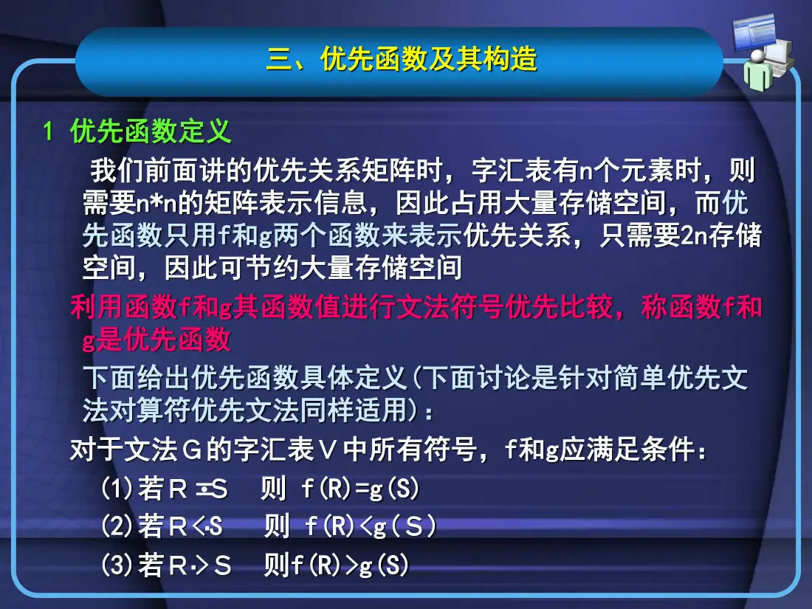

原文：

1 优先函数定义

我们前面讲的优先关系矩阵时，字汇表有n个元素时，则需要n\*n的矩阵表示信息，因此占用大量存储空间，而优先函数只用f和g两个函数来表示优先关系，只需要2n存储空间，因此可节约大量存储空间

利用函数f和g其函数值进行文法符号优先比较，称函数f和g是优先函数

下面给出优先函数具体定义(下面讨论是针对简单优先文法对算符优先文法同样适用):

对于文法G的字汇表V中所有符号，f和g应满足条件：

(1) 若 R ≡ S 则 f(R)=g(S)

(2) 若 R < -S 则 $f(R) < g(S)$

(3) 若 R·> S 则 f(R) > g(S)

三、优先函数及其构造

### 如：对于文法G[Z]

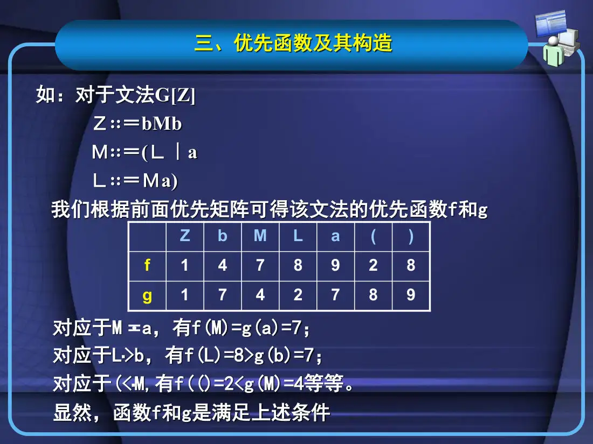

原文：

如：对于文法G[Z]
Z ::= bMb
M ::= (L | a
L ::= Ma)

我们根据前面优先矩阵可得该文法的优先函数f和g

<table><tr><td></td><td>Z</td><td>b</td><td>M</td><td>L</td><td>a</td><td>(</td><td>)</td></tr><tr><td>f</td><td>1</td><td>4</td><td>7</td><td>8</td><td>9</td><td>2</td><td>8</td></tr><tr><td>g</td><td>1</td><td>7</td><td>4</td><td>2</td><td>7</td><td>8</td><td>9</td></tr></table>

对应于M = a，有f(M)=g(a)=7；
对应于L > b，有f(L)=8 > g(b)=7；
对应于(<-M, 有f(()=2<g(M)=4等等。
显然，函数f和g是满足上述条件

三、优先函数及其构造

### 几点说明：

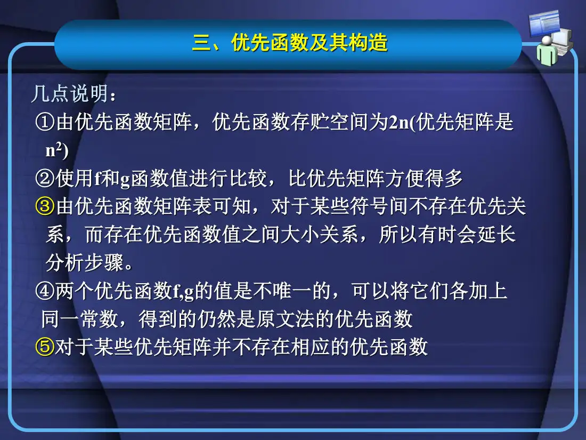

原文：

几点说明：

①由优先函数矩阵，优先函数存贮空间为2n(优先矩阵是 $n^{2}$ )

②使用f和g函数值进行比较，比优先矩阵方便得多

③由优先函数矩阵表可知，对于某些符号间不存在优先关系，而存在优先函数值之间大小关系，所以有时会延长分析步骤。

④两个优先函数f,g的值是不唯一的，可以将它们各加上同一常数，得到的仍然是原文法的优先函数

⑤对于某些优先矩阵并不存在相应的优先函数

三、优先函数及其构造

### 例如：

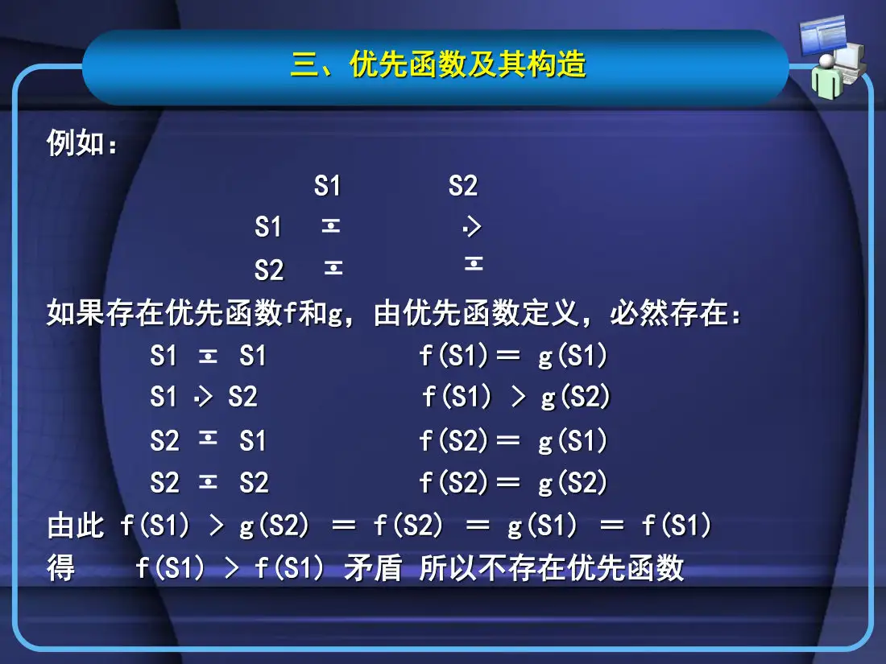

原文：

例如：

如果存在优先函数f和g，由优先函数定义，必然存在：

$$
\mathrm{S1} = \mathrm{S1}
$$

f(S1) = g(S1)

$$
\mathrm{S1} \cdot > \mathrm{S2}
$$

f(S1) > g(S2)

$$
\mathrm{S2} = \mathrm{S1}
$$

$$
f (S 2) = g (S 1)
$$

$$
\mathrm{S2} \equiv \mathrm{S2}
$$

f (S2) = g (S2)

由此 $f(S1) > g(S2) = f(S2) = g(S1) = f(S1)$

得 $f(S1) > f(S1)$ 矛盾 所以不存在优先函数

三、优先函数及其构造

### 2. 优先函数矩阵的构造

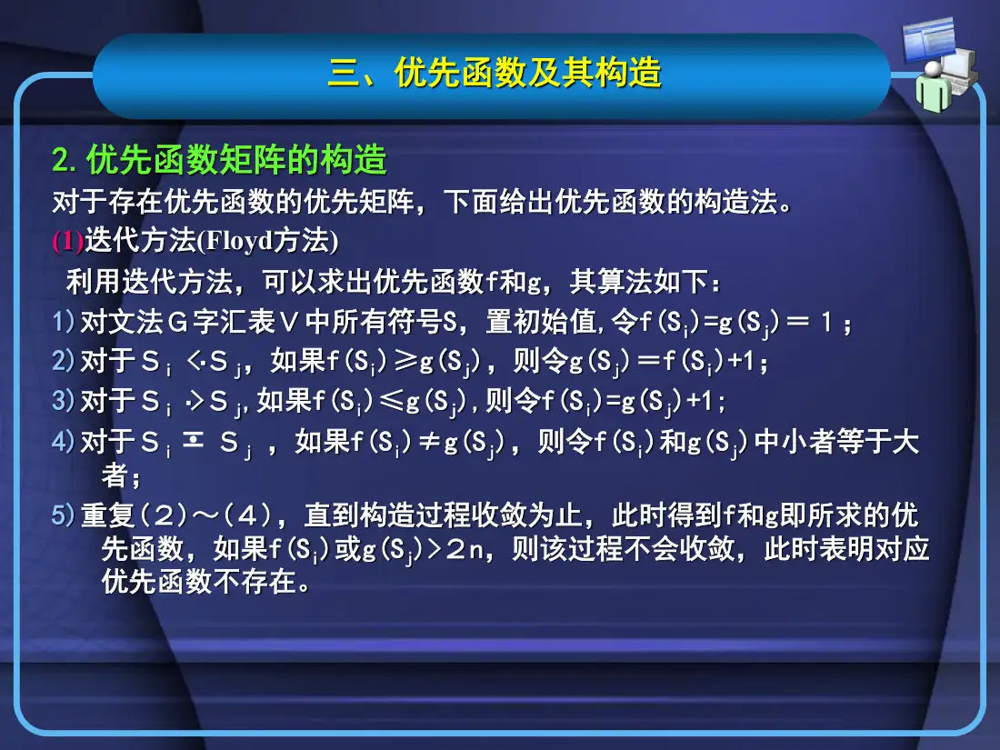

原文：

2. 优先函数矩阵的构造
对于存在优先函数的优先矩阵，下面给出优先函数的构造法。

(1)迭代方法(Floyd方法)
利用迭代方法，可以求出优先函数f和g，其算法如下：

1) 对文法 G 字汇表 V 中所有符号 S，置初始值, 令 $f(S_{i}) = g(S_{j}) = 1$ ;

2) 对于 $S_{i} < S_{j}$ , 如果 $f(S_{i}) \geqslant g(S_{j})$ , 则令 $g(S_{j}) = f(S_{i}) + 1$ ;

3) 对于 $S_{i} \cdot > S_{j}$ , 如果 $f(S_{i}) \leqslant g(S_{j})$ , 则令 $f(S_{i}) = g(S_{j}) + 1$ ;

4) 对于 $S_{i} \supseteq S_{j}$ ，如果 $f(S_{i}) \neq g(S_{j})$ ，则令 $f(S_{i})$ 和 $g(S_{j})$ 中小者等于大者；

5) 重复(2)～(4)，直到构造过程收敛为止，此时得到f和g即所求的优先函数，如果 $f(S_{i})$ 或 $g(S_{j})>2n$ ，则该过程不会收敛，此时表明对应优先函数不存在。

三、优先函数及其构造

### 例4.13 根据文法G [Z]:

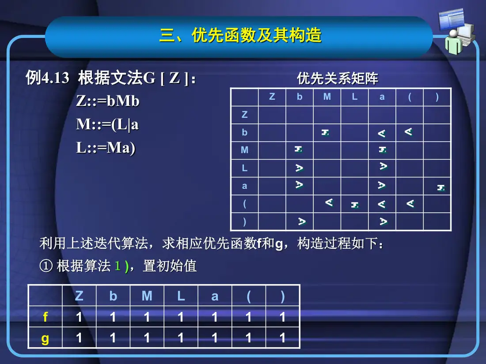

原文：

例4.13 根据文法G [Z]:

$$
\mathrm{Z}: := \mathrm{bMb}
$$

$$
\mathrm{M}: := (\mathrm{L} | \mathrm{a}
$$

$$
\mathrm{L}: := \mathrm{Ma})
$$

优先关系矩阵
<table><tr><td></td><td>Z</td><td>b</td><td>M</td><td>L</td><td>a</td><td>(</td><td>)</td></tr><tr><td>Z</td><td></td><td></td><td></td><td></td><td></td><td></td><td></td></tr><tr><td>b</td><td></td><td></td><td> $\overline{X}$ </td><td></td><td> $<$ </td><td> $<$ </td><td></td></tr><tr><td>M</td><td></td><td> $\overline{X}$ </td><td></td><td></td><td> $\overline{X}$ </td><td></td><td></td></tr><tr><td>L</td><td></td><td> $>$ </td><td></td><td></td><td> $>$ </td><td></td><td></td></tr><tr><td>a</td><td></td><td> $>$ </td><td></td><td></td><td> $>$ </td><td></td><td> $\overline{X}$ </td></tr><tr><td>(</td><td></td><td></td><td> $<$ </td><td> $\overline{X}$ </td><td> $<$ </td><td> $<$ </td><td></td></tr><tr><td>)</td><td></td><td> $>$ </td><td></td><td></td><td> $>$ </td><td></td><td></td></tr></table>

利用上述迭代算法，求相应优先函数f和g，构造过程如下：

① 根据算法 1)，置初始值

<table><tr><td></td><td>Z</td><td>b</td><td>M</td><td>L</td><td>a</td><td>(</td><td>)</td></tr><tr><td>f</td><td>1</td><td>1</td><td>1</td><td>1</td><td>1</td><td>1</td><td>1</td></tr><tr><td>g</td><td>1</td><td>1</td><td>1</td><td>1</td><td>1</td><td>1</td><td>1</td></tr></table>

三、优先函数及其构造

### 例4.13 根据文法G [Z]:

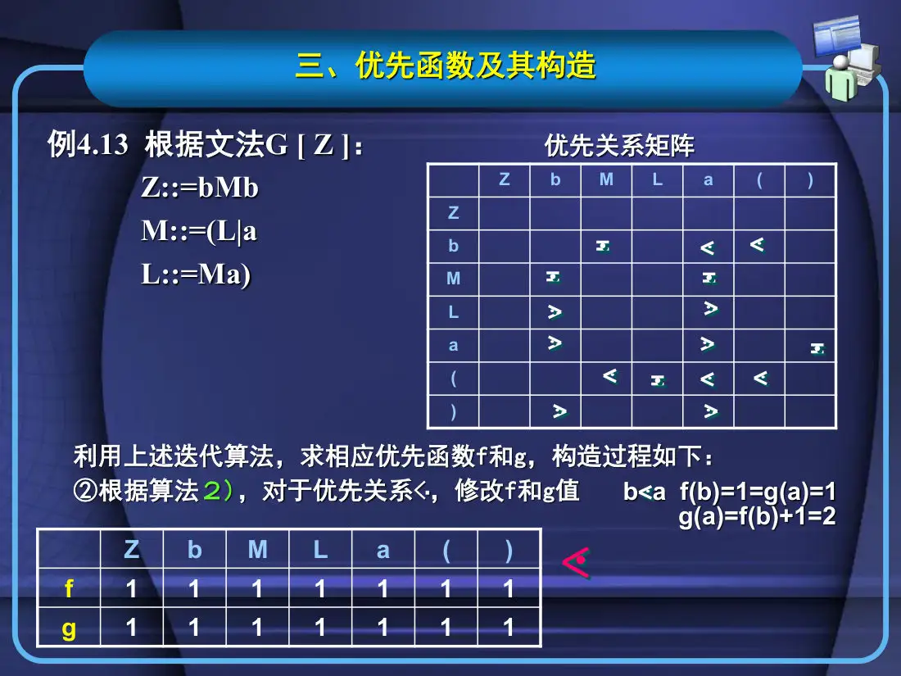

原文：

例4.13 根据文法G [Z]:

$$
\mathrm{Z}: := \mathrm{bMb}
$$

$$
\mathrm{M}: := (\mathrm{L} | \mathrm{a}
$$

$$
\mathrm{L}: := \mathrm{Ma})
$$

优先关系矩阵
<table><tr><td></td><td>Z</td><td>b</td><td>M</td><td>L</td><td>a</td><td>(</td><td>)</td></tr><tr><td>Z</td><td></td><td></td><td></td><td></td><td></td><td></td><td></td></tr><tr><td>b</td><td></td><td></td><td> $\overline{X}$ </td><td></td><td> $<$ </td><td> $<$ </td><td></td></tr><tr><td>M</td><td></td><td> $\overline{X}$ </td><td></td><td></td><td> $\overline{X}$ </td><td></td><td></td></tr><tr><td>L</td><td></td><td> $>$ </td><td></td><td></td><td> $>$ </td><td></td><td></td></tr><tr><td>a</td><td></td><td> $>$ </td><td></td><td></td><td> $>$ </td><td></td><td> $\overline{X}$ </td></tr><tr><td>(</td><td></td><td></td><td> $<$ </td><td> $\overline{X}$ </td><td> $<$ </td><td> $<$ </td><td></td></tr><tr><td>)</td><td></td><td> $>$ </td><td></td><td></td><td> $>$ </td><td></td><td></td></tr></table>

利用上述迭代算法, 求相应优先函数 $f$ 和 $g$ , 构造过程如下: ②根据算法2), 对于优先关系<. , 修改 $f$ 和 $g$ 值 $b < a f(b) = 1 = g(a) = 1$

<table><tr><td></td><td>Z</td><td>b</td><td>M</td><td>L</td><td>a</td><td>(</td><td>)</td></tr><tr><td>f</td><td>1</td><td>1</td><td>1</td><td>1</td><td>1</td><td>1</td><td>1</td></tr><tr><td>g</td><td>1</td><td>1</td><td>1</td><td>1</td><td>1</td><td>1</td><td>1</td></tr></table>

三、优先函数及其构造

### 例4.13 根据文法G [Z]:

原文：

例4.13 根据文法G [Z]:

$$
\mathrm{Z}: := \mathrm{bMb}
$$

$$
\mathrm{M}: := (\mathrm{L} | \mathrm{a}
$$

$$
\mathrm{L}: := \mathrm{Ma})
$$

优先关系矩阵
<table><tr><td></td><td>Z</td><td>b</td><td>M</td><td>L</td><td>a</td><td>(</td><td>)</td></tr><tr><td>Z</td><td></td><td></td><td></td><td></td><td></td><td></td><td></td></tr><tr><td>b</td><td></td><td></td><td> $\overline{X}$ </td><td></td><td> $<$ </td><td> $<$ </td><td></td></tr><tr><td>M</td><td></td><td> $\overline{X}$ </td><td></td><td></td><td> $\overline{X}$ </td><td></td><td></td></tr><tr><td>L</td><td></td><td> $>$ </td><td></td><td></td><td> $>$ </td><td></td><td></td></tr><tr><td>a</td><td></td><td> $>$ </td><td></td><td></td><td> $>$ </td><td></td><td> $\overline{X}$ </td></tr><tr><td>(</td><td></td><td></td><td> $<$ </td><td> $\overline{X}$ </td><td> $<$ </td><td> $<$ </td><td></td></tr><tr><td>)</td><td></td><td> $>$ </td><td></td><td></td><td> $>$ </td><td></td><td></td></tr></table>

利用上述迭代算法, 求相应优先函数 $f$ 和 $g$ , 构造过程如下: ②根据算法2), 对于优先关系<. , 修改 $f$ 和 $g$ 值 $b < a f(b) = 1 = g(a) = 1$

<table><tr><td></td><td>Z</td><td>b</td><td>M</td><td>L</td><td>a</td><td>(</td><td>)</td></tr><tr><td>f</td><td>1</td><td>1</td><td>1</td><td>1</td><td>1</td><td>1</td><td>1</td></tr><tr><td>g</td><td>1</td><td>1</td><td>1</td><td>1</td><td>2</td><td>1</td><td>1</td></tr></table>

三、优先函数及其构造

### 例4.13 根据文法G [Z]:

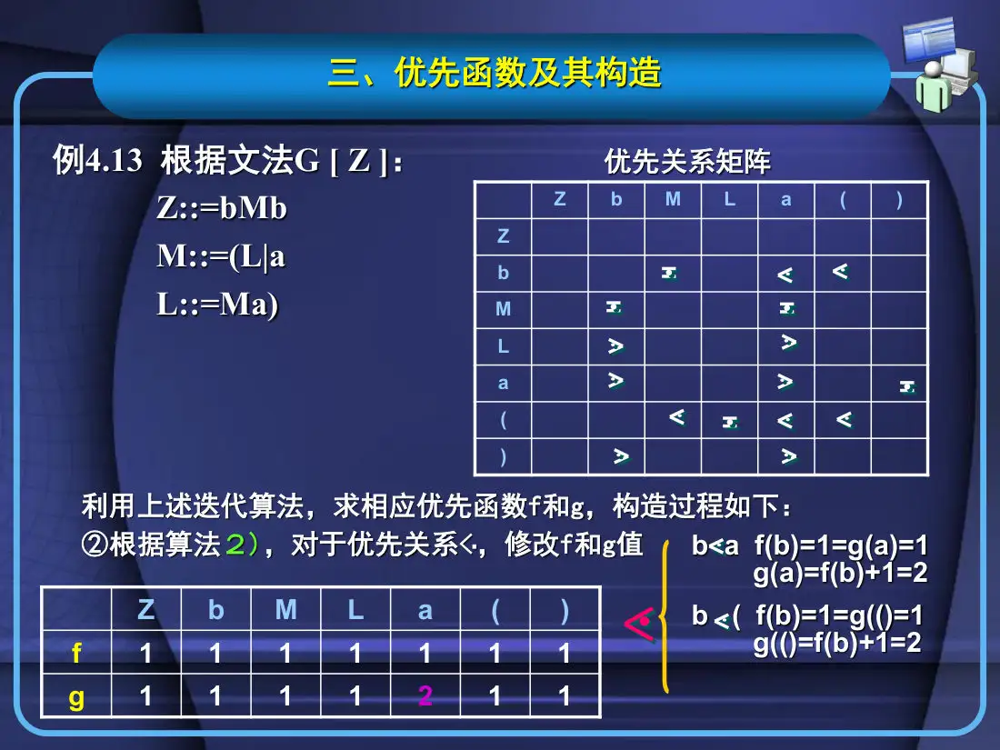

原文：

例4.13 根据文法G [Z]:

$$
\mathrm{Z}: := \mathrm{bMb}
$$

$$
\mathrm{M}: := (\mathrm{L} | \mathrm{a}
$$

$$
\mathrm{L}: := \mathrm{Ma})
$$

优先关系矩阵
<table><tr><td></td><td>Z</td><td>b</td><td>M</td><td>L</td><td>a</td><td>(</td><td>)</td></tr><tr><td>Z</td><td></td><td></td><td></td><td></td><td></td><td></td><td></td></tr><tr><td>b</td><td></td><td></td><td> $\overline{X}$ </td><td></td><td> $<$ </td><td> $<$ </td><td></td></tr><tr><td>M</td><td></td><td> $\overline{X}$ </td><td></td><td></td><td> $\overline{X}$ </td><td></td><td></td></tr><tr><td>L</td><td></td><td> $>$ </td><td></td><td></td><td> $>$ </td><td></td><td></td></tr><tr><td>a</td><td></td><td> $>$ </td><td></td><td></td><td> $>$ </td><td></td><td> $\overline{X}$ </td></tr><tr><td>(</td><td></td><td></td><td> $<$ </td><td> $\overline{X}$ </td><td> $<$ </td><td> $<$ </td><td></td></tr><tr><td>)</td><td></td><td> $>$ </td><td></td><td></td><td> $>$ </td><td></td><td></td></tr></table>

利用上述迭代算法，求相应优先函数f和g，构造过程如下：

②根据算法2)，对于优先关系<·，修改f和g值

<table><tr><td></td><td>Z</td><td>b</td><td>M</td><td>L</td><td>a</td><td>(</td><td>)</td></tr><tr><td>f</td><td>1</td><td>1</td><td>1</td><td>1</td><td>1</td><td>1</td><td>1</td></tr><tr><td>g</td><td>1</td><td>1</td><td>1</td><td>1</td><td>2</td><td>1</td><td>1</td></tr></table>

b<a f(b)=1=g(a)=1
g(a)=f(b)+1=2

b < ( f(b)=1=g(()=1
    g(()=f(b)+1=2例4.13 根据文法G [Z]:

三、优先函数及其构造

### $$

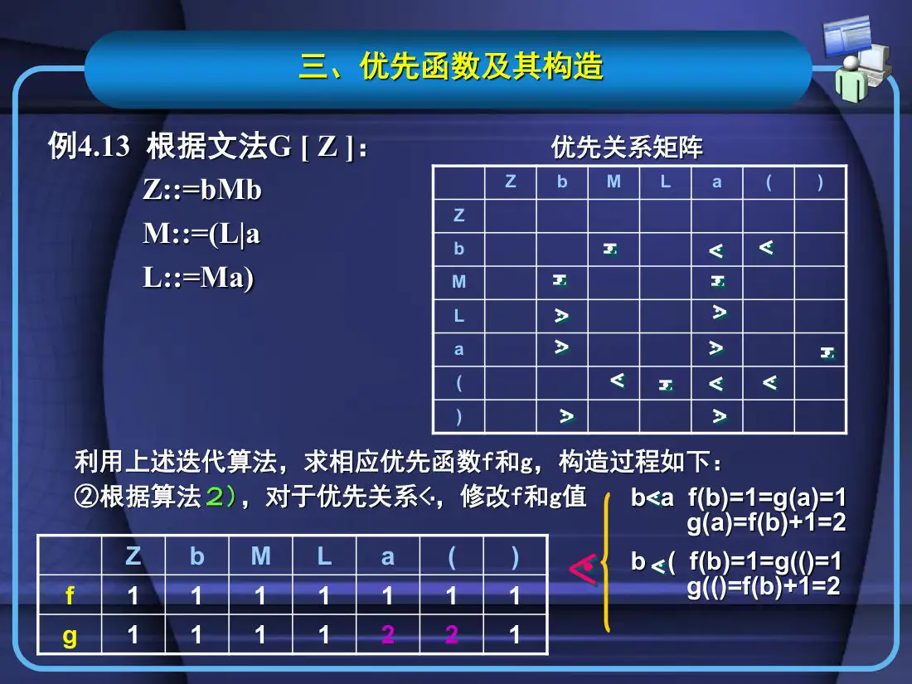

原文：

$$
\mathrm{Z}: := \mathrm{bMb}
$$

$$
\mathrm{M}: := (\mathrm{L} | \mathrm{a}
$$

$$
\mathrm{L}: := \mathrm{Ma})
$$

优先关系矩阵
<table><tr><td></td><td>Z</td><td>b</td><td>M</td><td>L</td><td>a</td><td>(</td><td>)</td></tr><tr><td>Z</td><td></td><td></td><td></td><td></td><td></td><td></td><td></td></tr><tr><td>b</td><td></td><td></td><td> $\overline{X}$ </td><td></td><td> $<$ </td><td> $<$ </td><td></td></tr><tr><td>M</td><td></td><td> $\overline{X}$ </td><td></td><td></td><td> $\overline{X}$ </td><td></td><td></td></tr><tr><td>L</td><td></td><td> $>$ </td><td></td><td></td><td> $>$ </td><td></td><td></td></tr><tr><td>a</td><td></td><td> $>$ </td><td></td><td></td><td> $>$ </td><td></td><td> $\overline{X}$ </td></tr><tr><td>(</td><td></td><td></td><td> $<$ </td><td> $\overline{X}$ </td><td> $<$ </td><td> $<$ </td><td></td></tr><tr><td>)</td><td></td><td> $>$ </td><td></td><td></td><td> $>$ </td><td></td><td></td></tr></table>

利用上述迭代算法，求相应优先函数f和g，构造过程如下：

②根据算法2)，对于优先关系<·，修改f和g值

<table><tr><td></td><td>Z</td><td>b</td><td>M</td><td>L</td><td>a</td><td>(</td><td>)</td></tr><tr><td>f</td><td>1</td><td>1</td><td>1</td><td>1</td><td>1</td><td>1</td><td>1</td></tr><tr><td>g</td><td>1</td><td>1</td><td>1</td><td>1</td><td>2</td><td>2</td><td>1</td></tr></table>

b<a f(b)=1=g(a)=1
g(a)=f(b)+1=2

b < ( f(b)=1=g(()=1
    g(()=f(b)+1=2例4.13 根据文法G [Z]:

三、优先函数及其构造

### $$

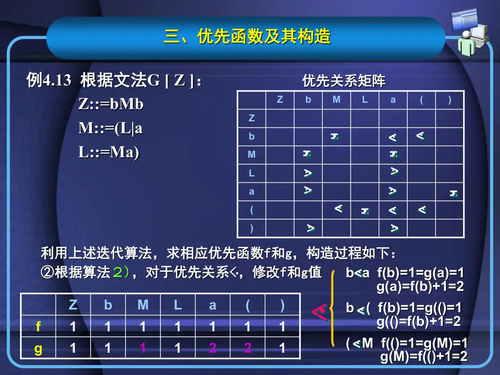

原文：

$$
\mathrm{Z}: := \mathrm{bMb}
$$

$$
\mathrm{M}: := (\mathrm{L} | \mathrm{a}
$$

$$
\mathrm{L}: := \mathrm{Ma})
$$

优先关系矩阵
<table><tr><td></td><td>Z</td><td>b</td><td>M</td><td>L</td><td>a</td><td>(</td><td>)</td></tr><tr><td>Z</td><td></td><td></td><td></td><td></td><td></td><td></td><td></td></tr><tr><td>b</td><td></td><td></td><td> $\overline{X}$ </td><td></td><td> $<$ </td><td> $<$ </td><td></td></tr><tr><td>M</td><td></td><td> $\overline{X}$ </td><td></td><td></td><td> $\overline{X}$ </td><td></td><td></td></tr><tr><td>L</td><td></td><td> $>$ </td><td></td><td></td><td> $>$ </td><td></td><td></td></tr><tr><td>a</td><td></td><td> $>$ </td><td></td><td></td><td> $>$ </td><td></td><td> $\overline{X}$ </td></tr><tr><td>(</td><td></td><td></td><td> $<$ </td><td> $\overline{X}$ </td><td> $<$ </td><td> $<$ </td><td></td></tr><tr><td>)</td><td></td><td> $>$ </td><td></td><td></td><td> $>$ </td><td></td><td></td></tr></table>

利用上述迭代算法，求相应优先函数f和g，构造过程如下：

②根据算法2)，对于优先关系<·，修改f和g值

<table><tr><td></td><td>Z</td><td>b</td><td>M</td><td>L</td><td>a</td><td>(</td><td>)</td></tr><tr><td>f</td><td>1</td><td>1</td><td>1</td><td>1</td><td>1</td><td>1</td><td>1</td></tr><tr><td>g</td><td>1</td><td>1</td><td>1</td><td>1</td><td>2</td><td>2</td><td>1</td></tr></table>

b<a f(b)=1=g(a)=1
g(a)=f(b)+1=2

b < ( f(b)=1=g(()=1
    g(()=f(b)+1=2

$$
(<   M f (()) = 1 = g (M) = 1
$$

三、优先函数及其构造

### 例4.13 根据文法G [Z]:

原文：

例4.13 根据文法G [Z]:

$$
\mathrm{Z}: := \mathrm{bMb}
$$

$$
\mathrm{M}: := (\mathrm{L} | \mathrm{a}
$$

$$
\mathrm{L}: := \mathrm{Ma})
$$

优先关系矩阵
<table><tr><td></td><td>Z</td><td>b</td><td>M</td><td>L</td><td>a</td><td>(</td><td>)</td></tr><tr><td>Z</td><td></td><td></td><td></td><td></td><td></td><td></td><td></td></tr><tr><td>b</td><td></td><td></td><td> $\overline{X}$ </td><td></td><td> $<$ </td><td> $<$ </td><td></td></tr><tr><td>M</td><td></td><td> $\overline{X}$ </td><td></td><td></td><td> $\overline{X}$ </td><td></td><td></td></tr><tr><td>L</td><td></td><td> $>$ </td><td></td><td></td><td> $>$ </td><td></td><td></td></tr><tr><td>a</td><td></td><td> $>$ </td><td></td><td></td><td> $>$ </td><td></td><td> $\overline{X}$ </td></tr><tr><td>(</td><td></td><td></td><td> $<$ </td><td> $\overline{X}$ </td><td> $<$ </td><td> $<$ </td><td></td></tr><tr><td>)</td><td></td><td> $>$ </td><td></td><td></td><td> $>$ </td><td></td><td></td></tr></table>

利用上述迭代算法，求相应优先函数f和g，构造过程如下：

②根据算法2)，对于优先关系<·，修改f和g值

<table><tr><td></td><td>Z</td><td>b</td><td>M</td><td>L</td><td>a</td><td>(</td><td>)</td></tr><tr><td>f</td><td>1</td><td>1</td><td>1</td><td>1</td><td>1</td><td>1</td><td>1</td></tr><tr><td>g</td><td>1</td><td>1</td><td>2</td><td>1</td><td>2</td><td>2</td><td>1</td></tr></table>

b<a f(b)=1=g(a)=1
g(a)=f(b)+1=2

b < ( f(b)=1=g(()=1
    g(()=f(b)+1=2

$$
(<   M f (()) = 1 = g (M) = 1
$$

三、优先函数及其构造

### 例4.13 根据文法G [Z]:

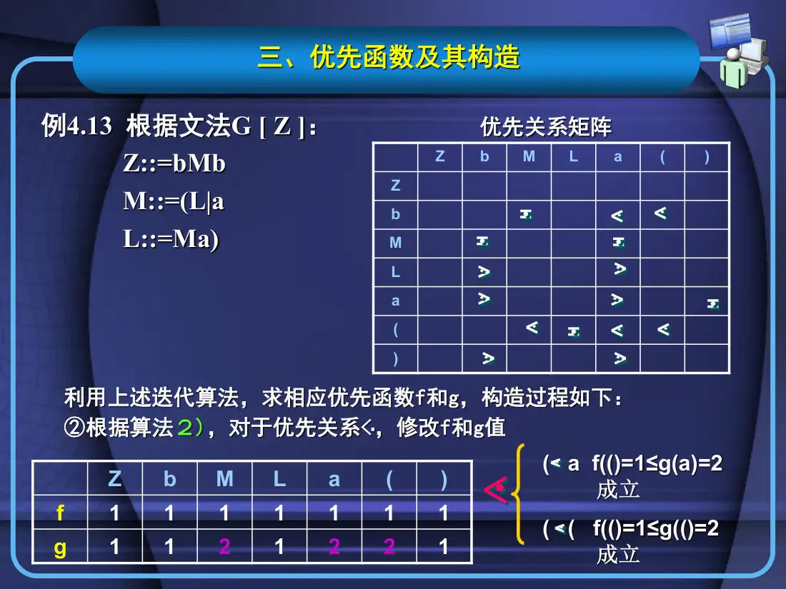

原文：

例4.13 根据文法G [Z]:

$$
\mathrm{Z}: := \mathrm{bMb}
$$

$$
\mathrm{M}: := (\mathrm{L} | \mathrm{a}
$$

$$
\mathrm{L}: := \mathrm{Ma})
$$

优先关系矩阵
<table><tr><td></td><td>Z</td><td>b</td><td>M</td><td>L</td><td>a</td><td>(</td><td>)</td></tr><tr><td>Z</td><td></td><td></td><td></td><td></td><td></td><td></td><td></td></tr><tr><td>b</td><td></td><td></td><td> $\overline{X}$ </td><td></td><td> $<$ </td><td> $<$ </td><td></td></tr><tr><td>M</td><td></td><td> $\overline{X}$ </td><td></td><td></td><td> $\overline{X}$ </td><td></td><td></td></tr><tr><td>L</td><td></td><td> $>$ </td><td></td><td></td><td> $>$ </td><td></td><td></td></tr><tr><td>a</td><td></td><td> $>$ </td><td></td><td></td><td> $>$ </td><td></td><td> $\overline{X}$ </td></tr><tr><td>(</td><td></td><td></td><td> $<$ </td><td> $\overline{X}$ </td><td> $<$ </td><td> $<$ </td><td></td></tr><tr><td>)</td><td></td><td> $>$ </td><td></td><td></td><td> $>$ </td><td></td><td></td></tr></table>

利用上述迭代算法，求相应优先函数f和g，构造过程如下：②根据算法2)，对于优先关系<·，修改f和g值

<table><tr><td></td><td>Z</td><td>b</td><td>M</td><td>L</td><td>a</td><td>(</td><td>)</td></tr><tr><td>f</td><td>1</td><td>1</td><td>1</td><td>1</td><td>1</td><td>1</td><td>1</td></tr><tr><td>g</td><td>1</td><td>1</td><td>2</td><td>1</td><td>2</td><td>2</td><td>1</td></tr></table>

(< a f(()=1≤g(a)=2
成立

( < ( f(()=1≤g(()=2
    成立

三、优先函数及其构造

### 例4.13 根据文法G [Z]:

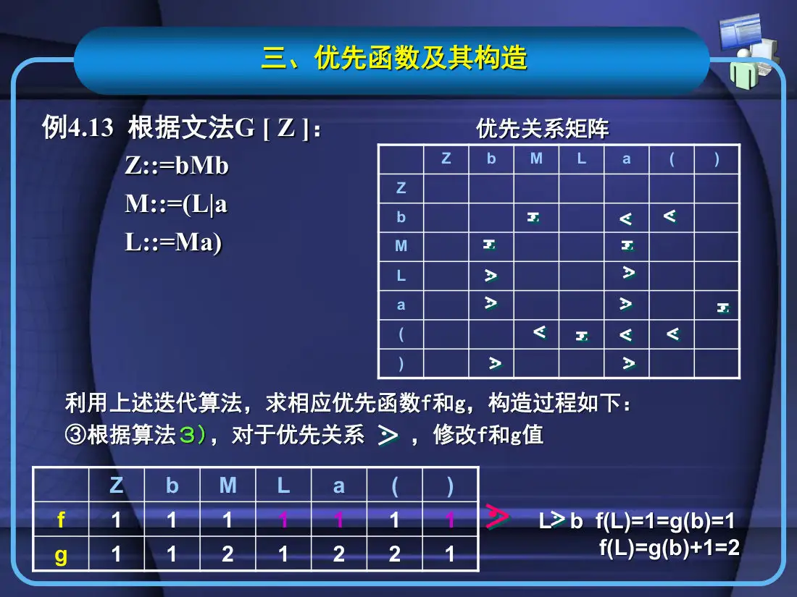

原文：

例4.13 根据文法G [Z]:

$$
\mathrm{Z}: := \mathrm{bMb}
$$

$$
\mathrm{M}: := (\mathrm{L} | \mathrm{a}
$$

$$
\mathrm{L}: := \mathrm{Ma})
$$

优先关系矩阵
<table><tr><td></td><td>Z</td><td>b</td><td>M</td><td>L</td><td>a</td><td>(</td><td>)</td></tr><tr><td>Z</td><td></td><td></td><td></td><td></td><td></td><td></td><td></td></tr><tr><td>b</td><td></td><td></td><td> $\overline{X}$ </td><td></td><td> $<$ </td><td> $<$ </td><td></td></tr><tr><td>M</td><td></td><td> $\overline{X}$ </td><td></td><td></td><td> $\overline{X}$ </td><td></td><td></td></tr><tr><td>L</td><td></td><td> $>$ </td><td></td><td></td><td> $>$ </td><td></td><td></td></tr><tr><td>a</td><td></td><td> $>$ </td><td></td><td></td><td> $>$ </td><td></td><td> $\overline{X}$ </td></tr><tr><td>(</td><td></td><td></td><td> $<$ </td><td> $\overline{X}$ </td><td> $<$ </td><td> $<$ </td><td></td></tr><tr><td>)</td><td></td><td> $>$ </td><td></td><td></td><td> $>$ </td><td></td><td></td></tr></table>

利用上述迭代算法，求相应优先函数f和g，构造过程如下：③根据算法3)，对于优先关系 > ，修改f和g值

<table><tr><td></td><td>Z</td><td>b</td><td>M</td><td>L</td><td>a</td><td>(</td><td>)</td></tr><tr><td>f</td><td>1</td><td>1</td><td>1</td><td>1</td><td>1</td><td>1</td><td>1</td></tr><tr><td>g</td><td>1</td><td>1</td><td>2</td><td>1</td><td>2</td><td>2</td><td>1</td></tr></table>

L>b f(L)=1=g(b)=1
f(L)=g(b)+1=2例4.13 根据文法G [Z]:

三、优先函数及其构造

### $$

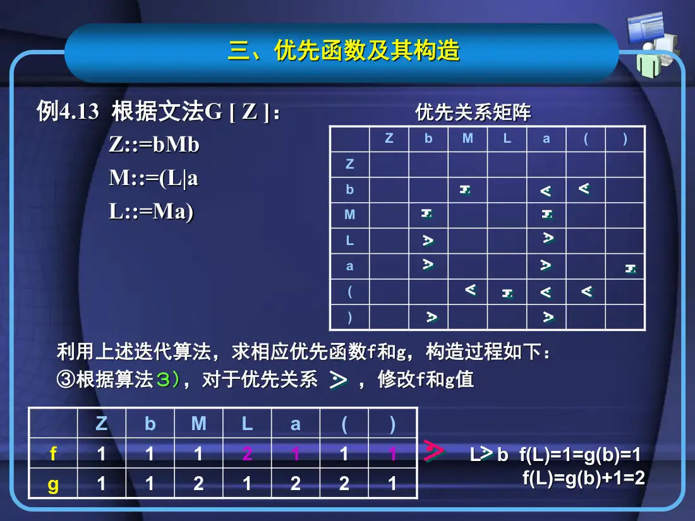

原文：

$$
\mathrm{Z}:: := \mathrm{bMb}
$$

$$
\mathrm{M}: := (\mathrm{L} | \mathrm{a}
$$

$$
\mathrm{L}: := \mathrm{Ma})
$$

优先关系矩阵
<table><tr><td></td><td>Z</td><td>b</td><td>M</td><td>L</td><td>a</td><td>(</td><td>)</td></tr><tr><td>Z</td><td></td><td></td><td></td><td></td><td></td><td></td><td></td></tr><tr><td>b</td><td></td><td></td><td> $\overline{X}$ </td><td></td><td> $<$ </td><td> $<$ </td><td></td></tr><tr><td>M</td><td></td><td> $\overline{X}$ </td><td></td><td></td><td> $\overline{X}$ </td><td></td><td></td></tr><tr><td>L</td><td></td><td> $>$ </td><td></td><td></td><td> $>$ </td><td></td><td></td></tr><tr><td>a</td><td></td><td> $>$ </td><td></td><td></td><td> $>$ </td><td></td><td> $\overline{X}$ </td></tr><tr><td>(</td><td></td><td></td><td> $<$ </td><td> $\overline{X}$ </td><td> $<$ </td><td> $<$ </td><td></td></tr><tr><td>)</td><td></td><td> $>$ </td><td></td><td></td><td> $>$ </td><td></td><td></td></tr></table>

利用上述迭代算法，求相应优先函数f和g，构造过程如下：③根据算法3)，对于优先关系 > ，修改f和g值

<table><tr><td></td><td>Z</td><td>b</td><td>M</td><td>L</td><td>a</td><td>(</td><td>)</td></tr><tr><td>f</td><td>1</td><td>1</td><td>1</td><td>2</td><td>1</td><td>1</td><td>1</td></tr><tr><td>g</td><td>1</td><td>1</td><td>2</td><td>1</td><td>2</td><td>2</td><td>1</td></tr></table>

L>b f(L)=1=g(b)=1
f(L)=g(b)+1=2例4.13 根据文法G [Z]:

三、优先函数及其构造

### $$

原文：

$$
\mathrm{Z}:: := \mathrm{bMb}
$$

$$
\mathrm{M}: := (\mathrm{L} | \mathrm{a}
$$

$$
\mathrm{L}: := \mathrm{Ma})
$$

优先关系矩阵
<table><tr><td></td><td>Z</td><td>b</td><td>M</td><td>L</td><td>a</td><td>(</td><td>)</td></tr><tr><td>Z</td><td></td><td></td><td></td><td></td><td></td><td></td><td></td></tr><tr><td>b</td><td></td><td></td><td> $\overline{X}$ </td><td></td><td> $<$ </td><td> $<$ </td><td></td></tr><tr><td>M</td><td></td><td> $\overline{X}$ </td><td></td><td></td><td> $\overline{X}$ </td><td></td><td></td></tr><tr><td>L</td><td></td><td> $>$ </td><td></td><td></td><td> $>$ </td><td></td><td></td></tr><tr><td>a</td><td></td><td> $>$ </td><td></td><td></td><td> $>$ </td><td></td><td> $\overline{X}$ </td></tr><tr><td>(</td><td></td><td></td><td> $<$ </td><td> $\overline{X}$ </td><td> $<$ </td><td> $<$ </td><td></td></tr><tr><td>)</td><td></td><td> $>$ </td><td></td><td></td><td> $>$ </td><td></td><td></td></tr></table>

利用上述迭代算法，求相应优先函数f和g，构造过程如下：③根据算法3)，对于优先关系 > ，修改f和g值

<table><tr><td></td><td>Z</td><td>b</td><td>M</td><td>L</td><td>a</td><td>(</td><td>)</td></tr><tr><td>f</td><td>1</td><td>1</td><td>1</td><td>2</td><td>1</td><td>1</td><td>1</td></tr><tr><td>g</td><td>1</td><td>1</td><td>2</td><td>1</td><td>2</td><td>2</td><td>1</td></tr></table>

L >a f(L)=2=g(a)=2
f(L)=g(a)+1=3 例4.13 根据文法G [Z]:

三、优先函数及其构造

### $$

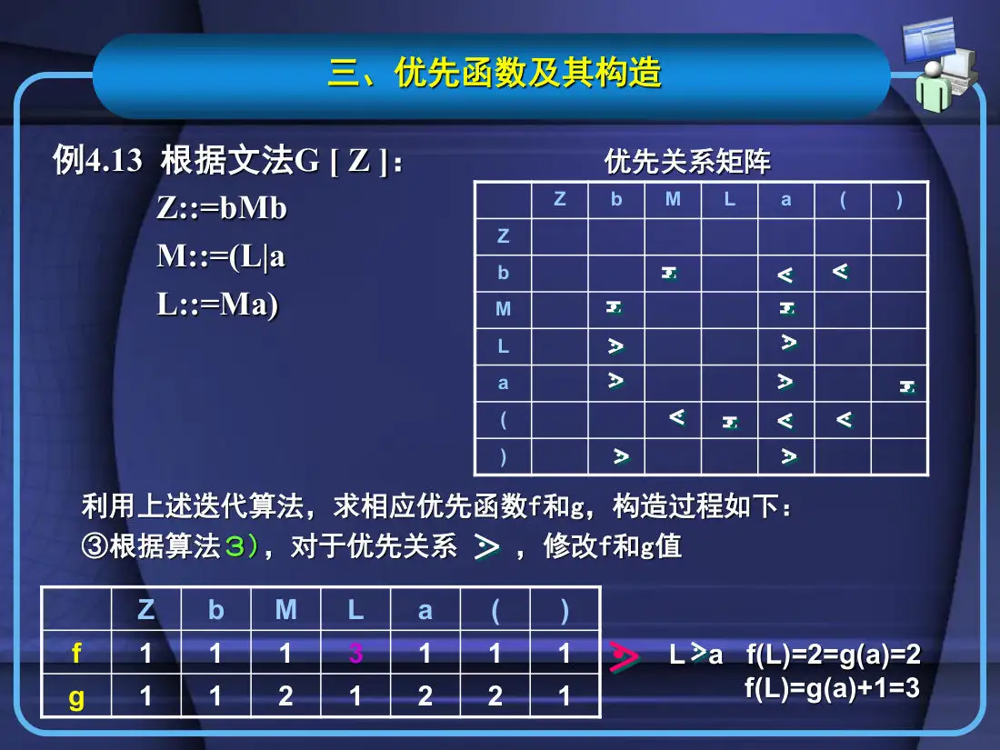

原文：

$$
\mathrm{Z}:: := \mathrm{bMb}
$$

$$
\mathrm{M}: := (\mathrm{L} | \mathrm{a}
$$

$$
\mathrm{L}: := \mathrm{Ma})
$$

优先关系矩阵
<table><tr><td></td><td>Z</td><td>b</td><td>M</td><td>L</td><td>a</td><td>(</td><td>)</td></tr><tr><td>Z</td><td></td><td></td><td></td><td></td><td></td><td></td><td></td></tr><tr><td>b</td><td></td><td></td><td> $\overline{X}$ </td><td></td><td> $<$ </td><td> $<$ </td><td></td></tr><tr><td>M</td><td></td><td> $\overline{X}$ </td><td></td><td></td><td> $\overline{X}$ </td><td></td><td></td></tr><tr><td>L</td><td></td><td> $>$ </td><td></td><td></td><td> $>$ </td><td></td><td></td></tr><tr><td>a</td><td></td><td> $>$ </td><td></td><td></td><td> $>$ </td><td></td><td> $\overline{X}$ </td></tr><tr><td>(</td><td></td><td></td><td> $<$ </td><td> $\overline{X}$ </td><td> $<$ </td><td> $<$ </td><td></td></tr><tr><td>)</td><td></td><td> $>$ </td><td></td><td></td><td> $>$ </td><td></td><td></td></tr></table>

利用上述迭代算法，求相应优先函数f和g，构造过程如下：③根据算法3)，对于优先关系 > ，修改f和g值

<table><tr><td></td><td>Z</td><td>b</td><td>M</td><td>L</td><td>a</td><td>(</td><td>)</td></tr><tr><td>f</td><td>1</td><td>1</td><td>1</td><td>3</td><td>1</td><td>1</td><td>1</td></tr><tr><td>g</td><td>1</td><td>1</td><td>2</td><td>1</td><td>2</td><td>2</td><td>1</td></tr></table>

L > a f(L)=2=g(a)=2
f(L)=g(a)+1=3 例4.13 根据文法G [Z]:

三、优先函数及其构造

### $$

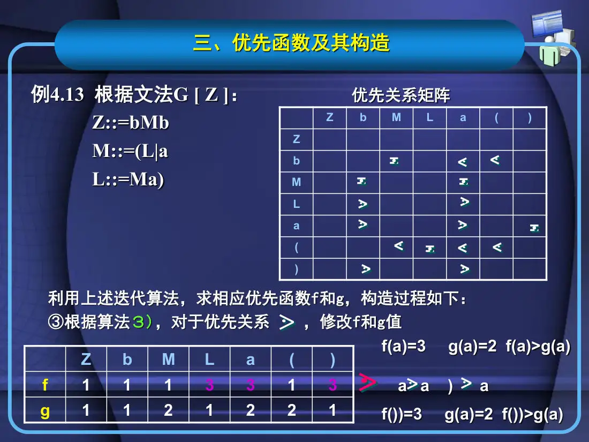

原文：

$$
\mathrm{Z}: := \mathrm{bMb}
$$

$$
\mathrm{M}: := (\mathrm{L} | \mathrm{a}
$$

$$
\mathrm{L}: := \mathrm{Ma})
$$

优先关系矩阵
<table><tr><td></td><td>Z</td><td>b</td><td>M</td><td>L</td><td>a</td><td>(</td><td>)</td></tr><tr><td>Z</td><td></td><td></td><td></td><td></td><td></td><td></td><td></td></tr><tr><td>b</td><td></td><td></td><td> $\overline{x}$ </td><td></td><td>&lt;</td><td>&lt;</td><td></td></tr><tr><td>M</td><td></td><td> $\overline{x}$ </td><td></td><td></td><td> $\overline{x}$ </td><td></td><td></td></tr><tr><td>L</td><td></td><td>&gt;</td><td></td><td></td><td>&gt;</td><td></td><td></td></tr><tr><td>a</td><td></td><td>&gt;</td><td></td><td></td><td>&gt;</td><td></td><td> $\overline{x}$ </td></tr><tr><td>(</td><td></td><td></td><td>&lt;</td><td> $\overline{x}$ </td><td>&lt;</td><td>&lt;</td><td></td></tr><tr><td>)</td><td></td><td>&gt;</td><td></td><td></td><td>&gt;</td><td></td><td></td></tr></table>

利用上述迭代算法，求相应优先函数f和g，构造过程如下：③根据算法3)，对于优先关系 > ，修改f和g值

<table><tr><td></td><td>Z</td><td>b</td><td>M</td><td>L</td><td>a</td><td>(</td><td>)</td></tr><tr><td>f</td><td>1</td><td>1</td><td>1</td><td>3</td><td>3</td><td>1</td><td>3</td></tr><tr><td>g</td><td>1</td><td>1</td><td>2</td><td>1</td><td>2</td><td>2</td><td>1</td></tr></table>

$f(a)=3$ $g(a)=2$ $f(a)>g(a)$

a>a )>a

f( ))=3 g(a)=2 f( ))>g(a)

三、优先函数及其构造

### 例4.13 根据文法G [Z]:

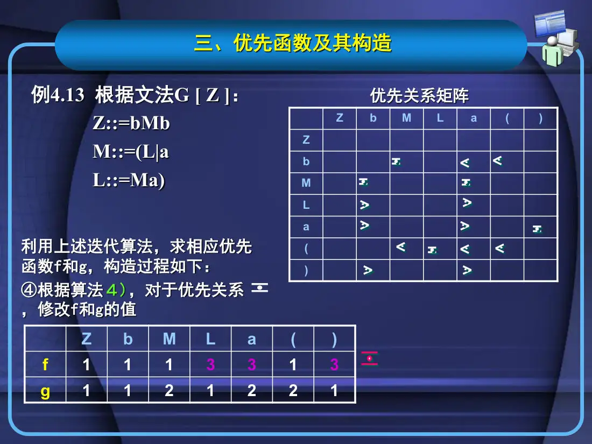

原文：

例4.13 根据文法G [Z]:

$$
\mathrm{Z}: := \mathrm{bMb}
$$

$$
\mathrm{M}: := (\mathrm{L} | \mathrm{a}
$$

$$
\mathrm{L}: := \mathrm{Ma})
$$

利用上述迭代算法，求相应优先函数f和g，构造过程如下：④根据算法4)，对于优先关系，修改f和g的值

优先关系矩阵
<table><tr><td></td><td>Z</td><td>b</td><td>M</td><td>L</td><td>a</td><td>(</td><td>)</td></tr><tr><td>Z</td><td></td><td></td><td></td><td></td><td></td><td></td><td></td></tr><tr><td>b</td><td></td><td></td><td></td><td></td><td></td><td></td><td></td></tr><tr><td>M</td><td></td><td></td><td></td><td></td><td></td><td></td><td></td></tr><tr><td>L</td><td></td><td></td><td></td><td></td><td></td><td></td><td></td></tr><tr><td>a</td><td></td><td></td><td></td><td></td><td></td><td></td><td></td></tr><tr><td>(</td><td></td><td></td><td></td><td></td><td></td><td></td><td></td></tr><tr><td>)</td><td></td><td></td><td></td><td></td><td></td><td></td><td></td></tr></table>

<table><tr><td></td><td>Z</td><td>b</td><td>M</td><td>L</td><td>a</td><td>(</td><td>)</td></tr><tr><td>f</td><td>1</td><td>1</td><td>1</td><td>3</td><td>3</td><td>1</td><td>3</td></tr><tr><td>g</td><td>1</td><td>1</td><td>2</td><td>1</td><td>2</td><td>2</td><td>1</td></tr></table>

三、优先函数及其构造

### 例4.13 根据文法G [Z]:

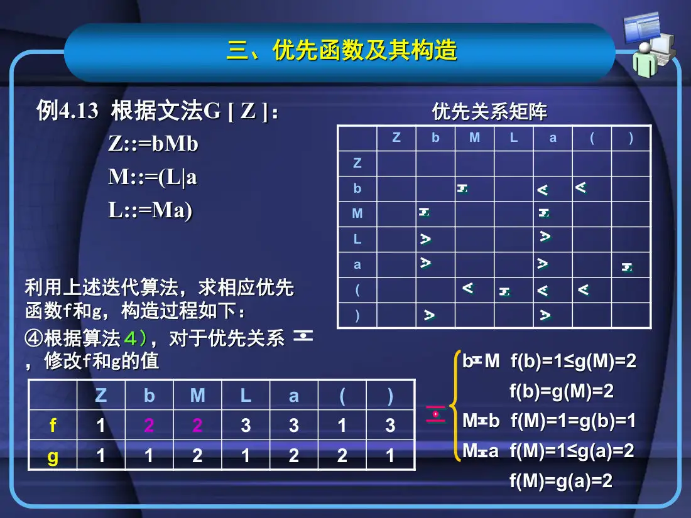

原文：

例4.13 根据文法G [Z]:

$$
\mathrm{Z}: := \mathrm{bMb}
$$

$$
\mathrm{M}: := (\mathrm{L} | \mathrm{a}
$$

$$
\mathrm{L}: := \mathrm{Ma})
$$

利用上述迭代算法，求相应优先函数f和g，构造过程如下：④根据算法4)，对于优先关系，修改f和g的值

<table><tr><td></td><td>Z</td><td>b</td><td>M</td><td>L</td><td>a</td><td>(</td><td>)</td></tr><tr><td>f</td><td>1</td><td>2</td><td>2</td><td>3</td><td>3</td><td>1</td><td>3</td></tr><tr><td>g</td><td>1</td><td>1</td><td>2</td><td>1</td><td>2</td><td>2</td><td>1</td></tr></table>

优先关系矩阵
<table><tr><td></td><td>Z</td><td>b</td><td>M</td><td>L</td><td>a</td><td>(</td><td>)</td></tr><tr><td>Z</td><td></td><td></td><td></td><td></td><td></td><td></td><td></td></tr><tr><td>b</td><td></td><td></td><td></td><td></td><td></td><td></td><td></td></tr><tr><td>M</td><td></td><td></td><td></td><td></td><td></td><td></td><td></td></tr><tr><td>L</td><td></td><td></td><td></td><td></td><td></td><td></td><td></td></tr><tr><td>a</td><td></td><td></td><td></td><td></td><td></td><td></td><td></td></tr><tr><td>(</td><td></td><td></td><td></td><td></td><td></td><td></td><td></td></tr><tr><td>)</td><td></td><td></td><td></td><td></td><td></td><td></td><td></td></tr></table>

b≠M f(b)=1≤g(M)=2
f(b)=g(M)=2
M≠b f(M)=1=g(b)=1
M≠a f(M)=1≤g(a)=2
f(M)=g(a)=2 例4.13 根据文法G [Z]:

三、优先函数及其构造

### $$

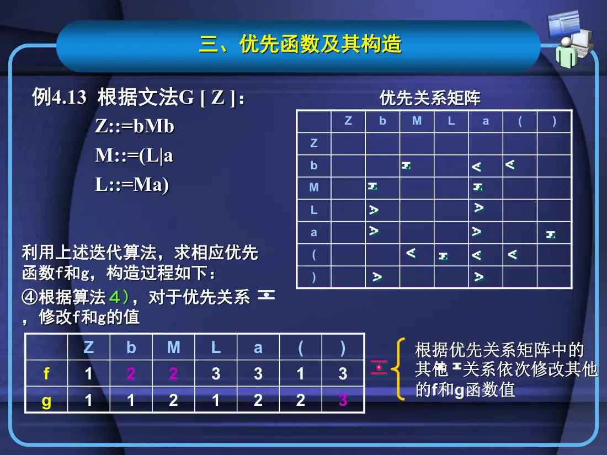

原文：

$$
\mathrm{Z}: := \mathrm{bMb}
$$

$$
\mathrm{M}: := (\mathrm{L} | \mathrm{a}
$$

$$
\mathrm{L}: := \mathrm{Ma})
$$

利用上述迭代算法，求相应优先函数f和g，构造过程如下：
④根据算法4)，对于优先关系 = ，修改f和g的值

优先关系矩阵
<table><tr><td></td><td>Z</td><td>b</td><td>M</td><td>L</td><td>a</td><td>(</td><td>)</td></tr><tr><td>Z</td><td></td><td></td><td></td><td></td><td></td><td></td><td></td></tr><tr><td>b</td><td></td><td></td><td></td><td></td><td></td><td></td><td></td></tr><tr><td>M</td><td></td><td></td><td></td><td></td><td></td><td></td><td></td></tr><tr><td>L</td><td></td><td></td><td></td><td></td><td></td><td></td><td></td></tr><tr><td>a</td><td></td><td></td><td></td><td></td><td></td><td></td><td></td></tr><tr><td>(</td><td></td><td></td><td></td><td></td><td></td><td></td><td></td></tr><tr><td>)</td><td></td><td></td><td></td><td></td><td></td><td></td><td></td></tr></table>

<table><tr><td></td><td>Z</td><td>b</td><td>M</td><td>L</td><td>a</td><td>(</td><td>)</td></tr><tr><td>f</td><td>1</td><td>2</td><td>2</td><td>3</td><td>3</td><td>1</td><td>3</td></tr><tr><td>g</td><td>1</td><td>1</td><td>2</td><td>1</td><td>2</td><td>2</td><td>3</td></tr></table>

根据优先关系矩阵中的其他 $^{+}$ 关系依次修改其他的f和g函数值

三、优先函数及其构造

### 例4.13 根据文法G [Z]:

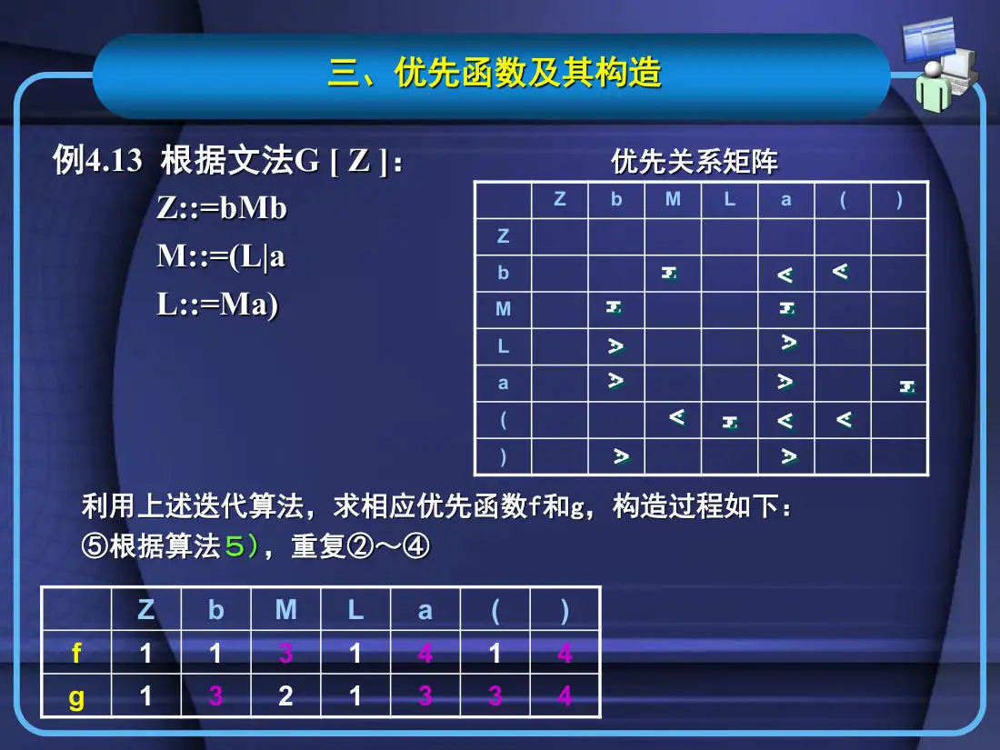

原文：

例4.13 根据文法G [Z]:

$$
\mathrm{Z}: := \mathrm{bMb}
$$

$$
\mathrm{M}: := (\mathrm{L} | \mathrm{a}
$$

$$
\mathrm{L}: := \mathrm{Ma})
$$

优先关系矩阵
<table><tr><td></td><td>Z</td><td>b</td><td>M</td><td>L</td><td>a</td><td>(</td><td>)</td></tr><tr><td>Z</td><td></td><td></td><td></td><td></td><td></td><td></td><td></td></tr><tr><td>b</td><td></td><td></td><td> $\overline{X}$ </td><td></td><td> $<$ </td><td> $<$ </td><td></td></tr><tr><td>M</td><td></td><td> $\overline{X}$ </td><td></td><td></td><td> $\overline{X}$ </td><td></td><td></td></tr><tr><td>L</td><td></td><td> $>$ </td><td></td><td></td><td> $>$ </td><td></td><td></td></tr><tr><td>a</td><td></td><td> $>$ </td><td></td><td></td><td> $>$ </td><td></td><td> $\overline{X}$ </td></tr><tr><td>(</td><td></td><td></td><td> $<$ </td><td> $\overline{X}$ </td><td> $<$ </td><td> $<$ </td><td></td></tr><tr><td>)</td><td></td><td> $>$ </td><td></td><td></td><td> $>$ </td><td></td><td></td></tr></table>

利用上述迭代算法，求相应优先函数f和g，构造过程如下：⑤根据算法5)，重复②～④

<table><tr><td></td><td>Z</td><td>b</td><td>M</td><td>L</td><td>a</td><td>(</td><td>)</td></tr><tr><td>f</td><td>1</td><td>1</td><td>3</td><td>1</td><td>4</td><td>1</td><td>4</td></tr><tr><td>g</td><td>1</td><td>3</td><td>2</td><td>1</td><td>3</td><td>3</td><td>4</td></tr></table>

三、优先函数及其构造

### (2) 有向图方法(Bell方法)

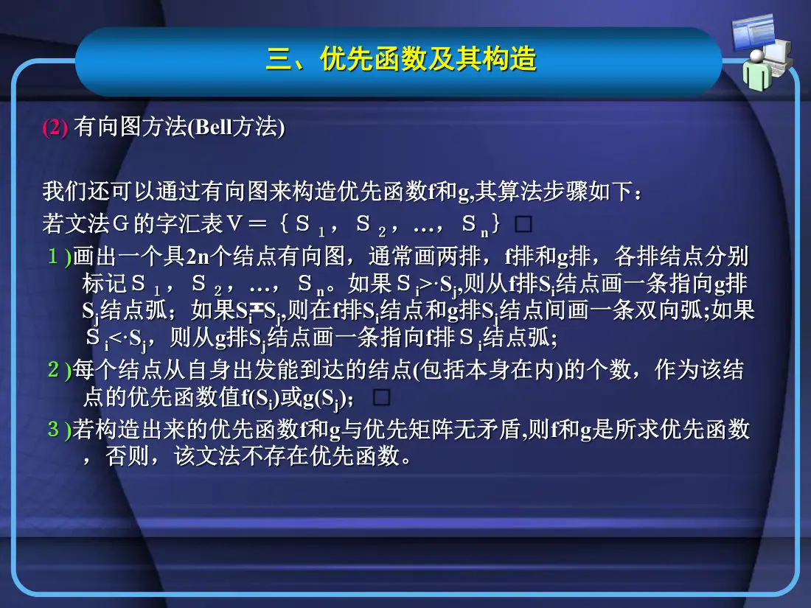

原文：

(2) 有向图方法(Bell方法)

我们还可以通过有向图来构造优先函数f和g,其算法步骤如下:若文法G的字汇表V = {S₁, S₂, ..., Sₙ} □

1)画出一个具2n个结点有向图，通常画两排，f排和g排，各排结点分别标记 $S_{1}$ ， $S_{2}$ ，…， $S_{n}$ 。如果 $S_{i} > \cdot S_{j}$ ，则从f排 $S_{i}$ 结点画一条指向g排 $S_{j}$ 结点弧；如果 $S_{i} \neq S_{j}$ ，则在f排 $S_{i}$ 结点和g排 $S_{j}$ 结点间画一条双向弧；如果 $S_{i} < \cdot S_{j}$ ，则从g排 $S_{j}$ 结点画一条指向f排 $S_{i}$ 结点弧；

2)每个结点从自身出发能到达的结点(包括本身在内)的个数, 作为该结点的优先函数值 $f(S_{i})$ 或 $g(S_{j})$ ; □

3) 若构造出来的优先函数f和g与优先矩阵无矛盾,则f和g是所求优先函数，否则，该文法不存在优先函数。

三、优先函数及其构造

### $$

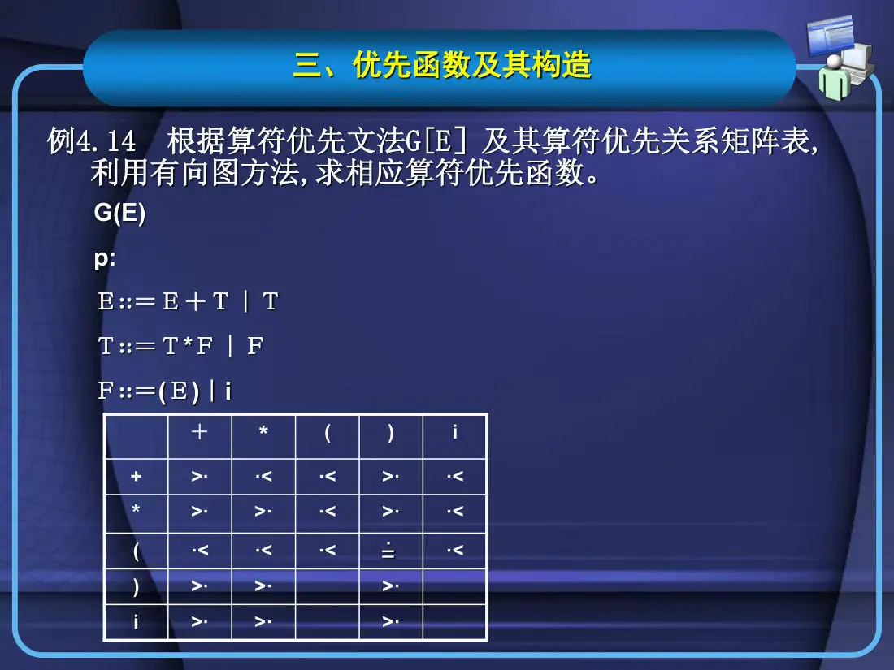

原文：

例4.14 根据算符优先文法G[E]及其算符优先关系矩阵表,利用有向图方法,求相应算符优先函数。

$$
\mathrm{E}: := \mathrm{E} + \mathrm{T} \mid \mathrm{T}
$$

$$
\mathrm{T}: := \mathrm{T} ^ {*} \mathrm{F} \mid \mathrm{F}
$$

$$
\mathrm{F}: := (\mathrm{E}) \mid \mathrm{i}
$$

<table><tr><td></td><td>+</td><td>*</td><td>(</td><td>)</td><td>i</td></tr><tr><td>+</td><td>&gt;.</td><td>&lt;</td><td>&lt;</td><td>&gt;.</td><td>&lt;</td></tr><tr><td>*</td><td>&gt;.</td><td>&gt;.</td><td>&lt;</td><td>&gt;.</td><td>&lt;</td></tr><tr><td>(</td><td>&lt;</td><td>&lt;</td><td>&lt;</td><td>≡</td><td>&lt;</td></tr><tr><td>)</td><td>&gt;.</td><td>&gt;.</td><td></td><td>&gt;.</td><td></td></tr><tr><td>i</td><td>&gt;.</td><td>&gt;.</td><td></td><td>&gt;.</td><td></td></tr></table>

三、优先函数及其构造

### ①根据算法 1)，画出结点有向图如下图所示

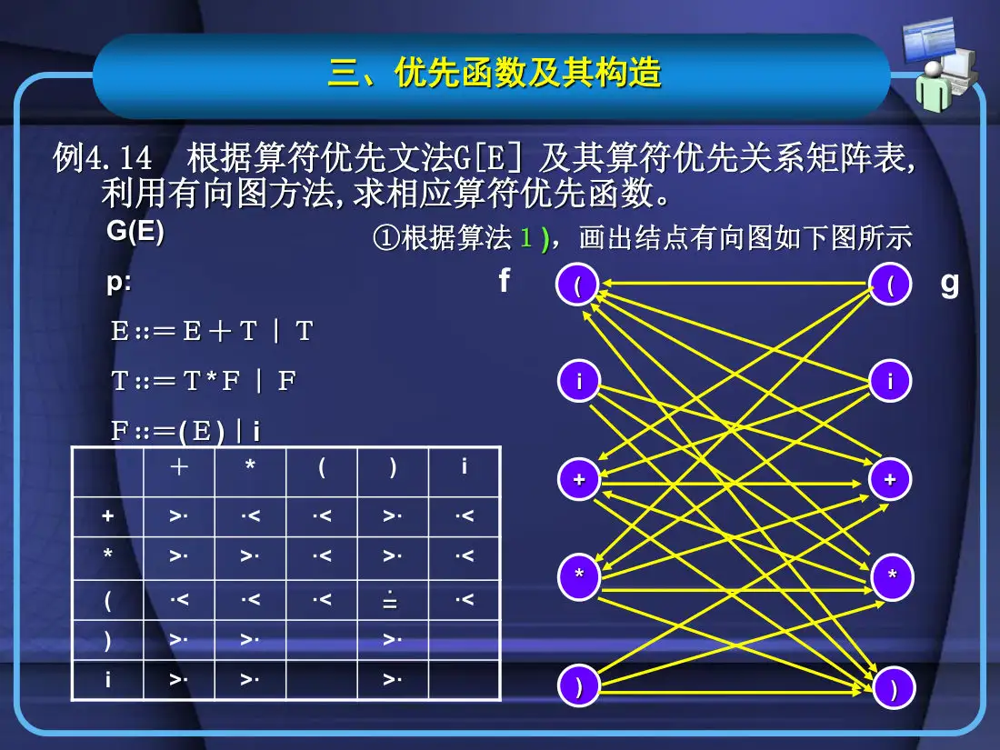

原文：

例4.14 根据算符优先文法G[E]及其算符优先关系矩阵表,利用有向图方法,求相应算符优先函数。

①根据算法 1)，画出结点有向图如下图所示

$$
\mathrm{E}: := \mathrm{E} + \mathrm{T} \mid \mathrm{T}
$$

$$
\mathrm{T}: := \mathrm{T} ^ {*} \mathrm{F} \mid \mathrm{F}
$$

F ::= (E) | i

<table><tr><td></td><td>+</td><td>*</td><td>(</td><td>)</td><td>i</td></tr><tr><td>+</td><td>&gt;·</td><td>·&lt;</td><td>·&lt;</td><td>&gt;·</td><td>·&lt;</td></tr><tr><td>*</td><td>&gt;·</td><td>&gt;·</td><td>·&lt;</td><td>&gt;·</td><td>·&lt;</td></tr><tr><td>(</td><td>·&lt;</td><td>·&lt;</td><td>·&lt;</td><td>≡</td><td>·&lt;</td></tr><tr><td>)</td><td>&gt;·</td><td>&gt;·</td><td></td><td>&gt;·</td><td></td></tr><tr><td>i</td><td>&gt;·</td><td>&gt;·</td><td></td><td>&gt;·</td><td></td></tr></table>

三、优先函数及其构造

### +*()if46266g35727

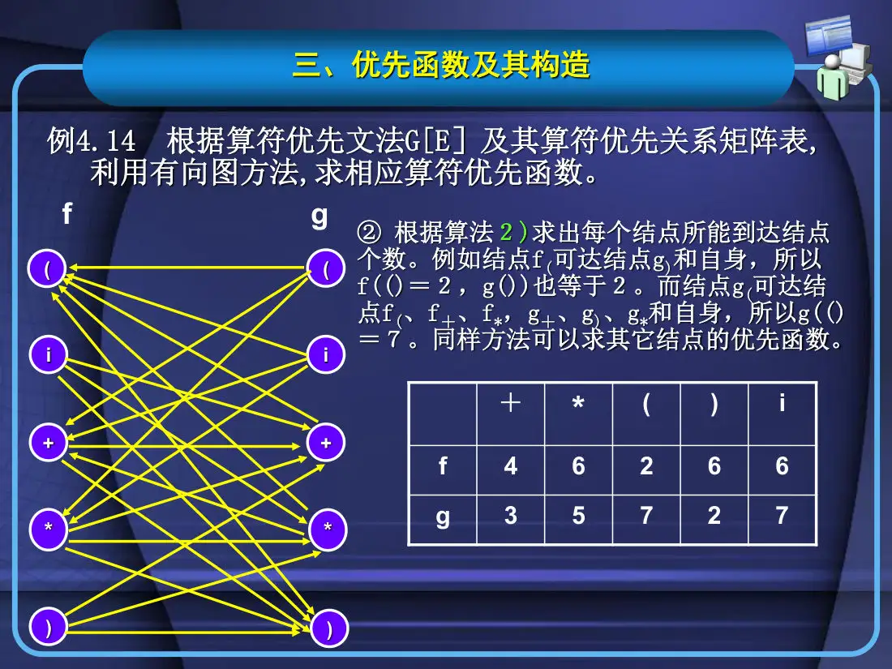

原文：

例4.14 根据算符优先文法G[E]及其算符优先关系矩阵表,利用有向图方法,求相应算符优先函数。

② 根据算法 2) 求出每个结点所能到达结点个数。例如结点 $f_{(可达结点g)}$ 和自身，所以 $f(()=2, g())$ 也等于 2 。而结点 $g_{(可达结点f_{(、}f_{+}, f_{*}, g_{+}, g)、g_{*}}$ 和自身，所以 $g(()=7$ 。同样方法可以求其它结点的优先函数。

<table><tr><td></td><td>+</td><td>*</td><td>(</td><td>)</td><td>i</td></tr><tr><td>f</td><td>4</td><td>6</td><td>2</td><td>6</td><td>6</td></tr><tr><td>g</td><td>3</td><td>5</td><td>7</td><td>2</td><td>7</td></tr></table>

三、优先函数及其构造

### +*()if46266g35727

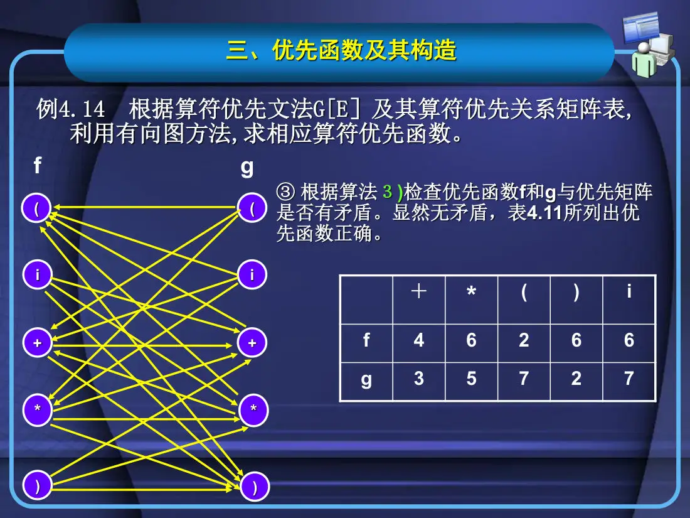

原文：

例4.14 根据算符优先文法G[E]及其算符优先关系矩阵表,利用有向图方法,求相应算符优先函数。

③ 根据算法 3) 检查优先函数 f 和 g 与优先矩阵是否有矛盾。显然无矛盾，表 4.11 所列出优先函数正确。

<table><tr><td></td><td>+</td><td>*</td><td>(</td><td>)</td><td>i</td></tr><tr><td>f</td><td>4</td><td>6</td><td>2</td><td>6</td><td>6</td></tr><tr><td>g</td><td>3</td><td>5</td><td>7</td><td>2</td><td>7</td></tr></table>

三、优先函数及其构造

### 3. 利用优先函数矩阵进行语法分析

原文：

3. 利用优先函数矩阵进行语法分析

有了优先函数以后，就可以比较符号的函数f和g的值大小，对输入符号串进行识别，可以取代优先关系矩阵，其分析方法类似于前面给出的简单优先分析或算符优先分析。

三、优先函数及其构造

### ZbMLa()f1234414g1321334

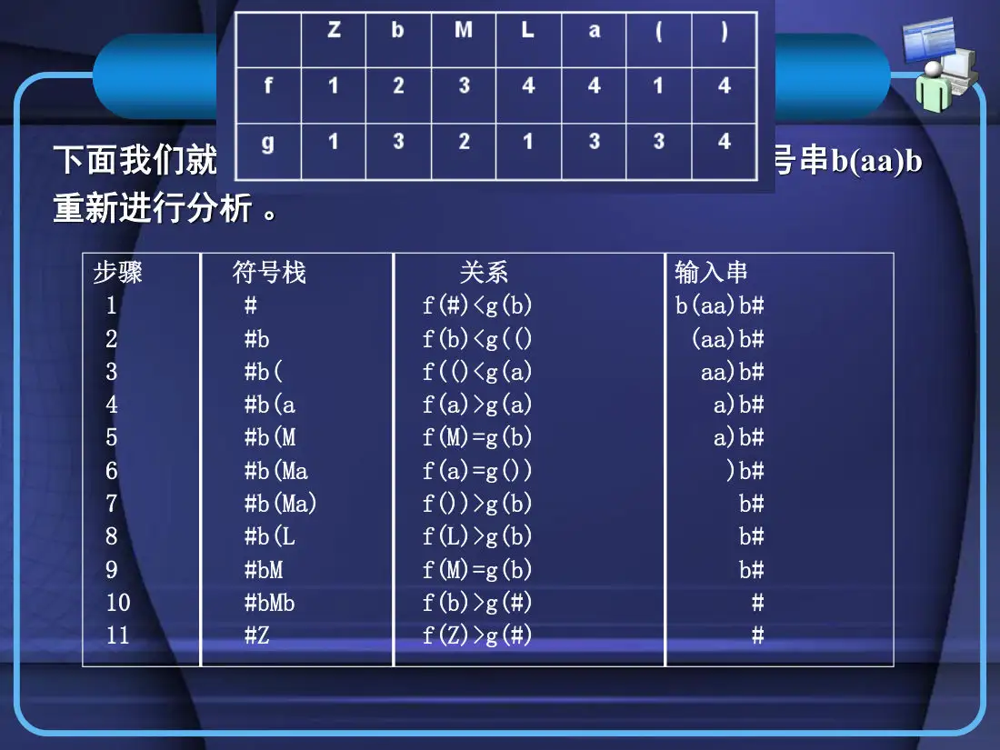

原文：

<table><tr><td></td><td>Z</td><td>b</td><td>M</td><td>L</td><td>a</td><td>(</td><td>)</td></tr><tr><td>f</td><td>1</td><td>2</td><td>3</td><td>4</td><td>4</td><td>1</td><td>4</td></tr><tr><td>g</td><td>1</td><td>3</td><td>2</td><td>1</td><td>3</td><td>3</td><td>4</td></tr></table>

下面我们就重新进行分析。

号串b(aa)b

$$
\begin{array}{r l} & {\text {关系}} \\ & {f (\#) <   g (b)} \\ & {f (b) <   g (\quad)} \\ & {f (\quad) <   g (a)} \\ & {f (a) > g (a)} \\ & {f (M) = g (b)} \\ & {f (a) = g (\quad)}) \\ & {f (\quad)) > g (b)} \\ & {f (L) > g (b)} \\ & {f (M) = g (b)} \\ & {f (b) > g (\#)} \\ & {f (Z) > g (\#)} \end{array}
$$

### 三、优先函数及其构造

原文：

虽然利用优先函数比利用符号优先关系矩阵显得方便，但是利用函数进行分析时，在某些情况下，有时不能及时发现错误，延长分析步骤，其原因是优先函数不能够真实反映符号间的优先关系

三、优先函数及其构造

### 例 设有文法G[Z]:

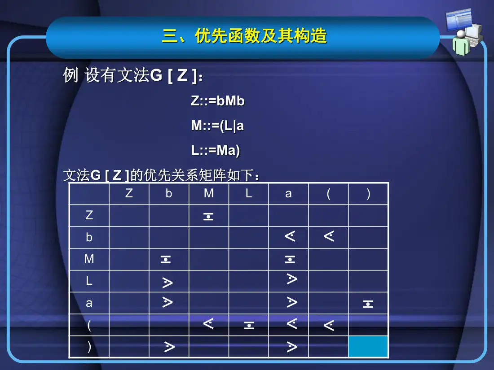

原文：

例 设有文法G[Z]:

$$
Z: := b M b
$$

$$
\mathsf {M}: := (\mathsf {L} | \mathsf {a}
$$

$$
L: := \text { Ma })
$$

文法G [Z]的优先关系矩阵如下:

<table><tr><td></td><td>Z</td><td>b</td><td>M</td><td>L</td><td>a</td><td>(</td><td>)</td></tr><tr><td>Z</td><td></td><td></td><td> $\overline{\text{=}}$ </td><td></td><td></td><td></td><td></td></tr><tr><td>b</td><td></td><td></td><td></td><td></td><td> $\langle$ </td><td> $\langle$ </td><td></td></tr><tr><td>M</td><td></td><td> $\overline{\text{=}}$ </td><td></td><td></td><td> $\overline{\text{=}}$ </td><td></td><td></td></tr><tr><td>L</td><td></td><td> $\rangle$ </td><td></td><td></td><td> $\rangle$ </td><td></td><td></td></tr><tr><td>a</td><td></td><td> $\rangle$ </td><td></td><td></td><td> $\rangle$ </td><td></td><td> $\overline{\text{=}}$ </td></tr><tr><td>(</td><td></td><td></td><td> $\langle$ </td><td> $\overline{\text{=}}$ </td><td> $\langle$ </td><td> $\langle$ </td><td></td></tr><tr><td>)</td><td></td><td> $\rangle$ </td><td></td><td></td><td> $\rangle$ </td><td></td><td></td></tr></table>

三、优先函数及其构造

### 文法G[Z]的优先函数表如下:

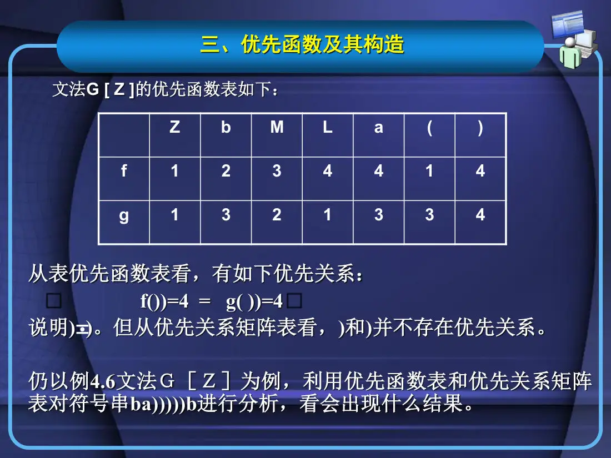

原文：

文法G[Z]的优先函数表如下:

<table><tr><td></td><td>Z</td><td>b</td><td>M</td><td>L</td><td>a</td><td>(</td><td>)</td></tr><tr><td>f</td><td>1</td><td>2</td><td>3</td><td>4</td><td>4</td><td>1</td><td>4</td></tr><tr><td>g</td><td>1</td><td>3</td><td>2</td><td>1</td><td>3</td><td>3</td><td>4</td></tr></table>

从表优先函数表看，有如下优先关系：
□ $f() = 4 = g() = 4$ 说明(☐)。但从优先关系矩阵表看，)和)并不存在优先关系。

仍以例4.6文法G [Z]为例，利用优先函数表和优先关系矩阵表对符号串ba))))b进行分析，看会出现什么结果。

三、优先函数及其构造

### 利用优先关系矩阵来分析句子# ba))))b #

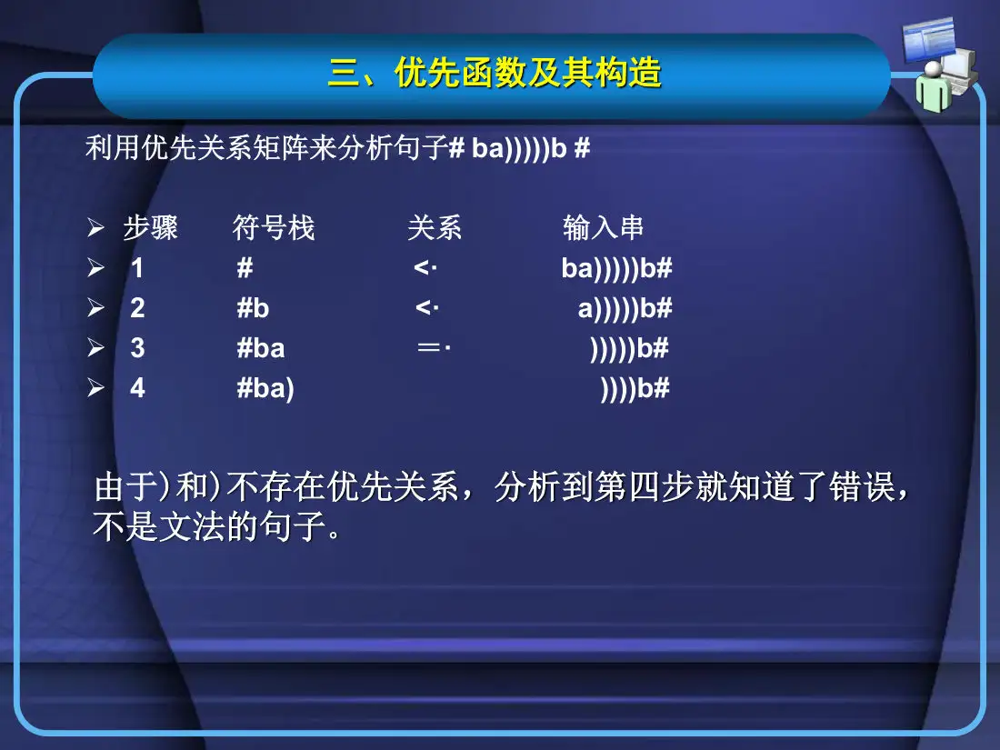

原文：

利用优先关系矩阵来分析句子# ba))))b #

<table><tr><td>步骤</td><td>符号栈</td><td>关系</td><td>输入串</td></tr><tr><td>1</td><td>#</td><td>&lt;·</td><td>ba))))b#</td></tr><tr><td>2</td><td>#b</td><td>&lt;·</td><td>a))))b#</td></tr><tr><td>3</td><td>#ba</td><td>=·</td><td>))))b#</td></tr><tr><td>4</td><td>#ba)</td><td></td><td>))))b#</td></tr></table>

由于)和)不存在优先关系，分析到第四步就知道了错误，不是文法的句子。

三、优先函数及其构造

### 利用优先

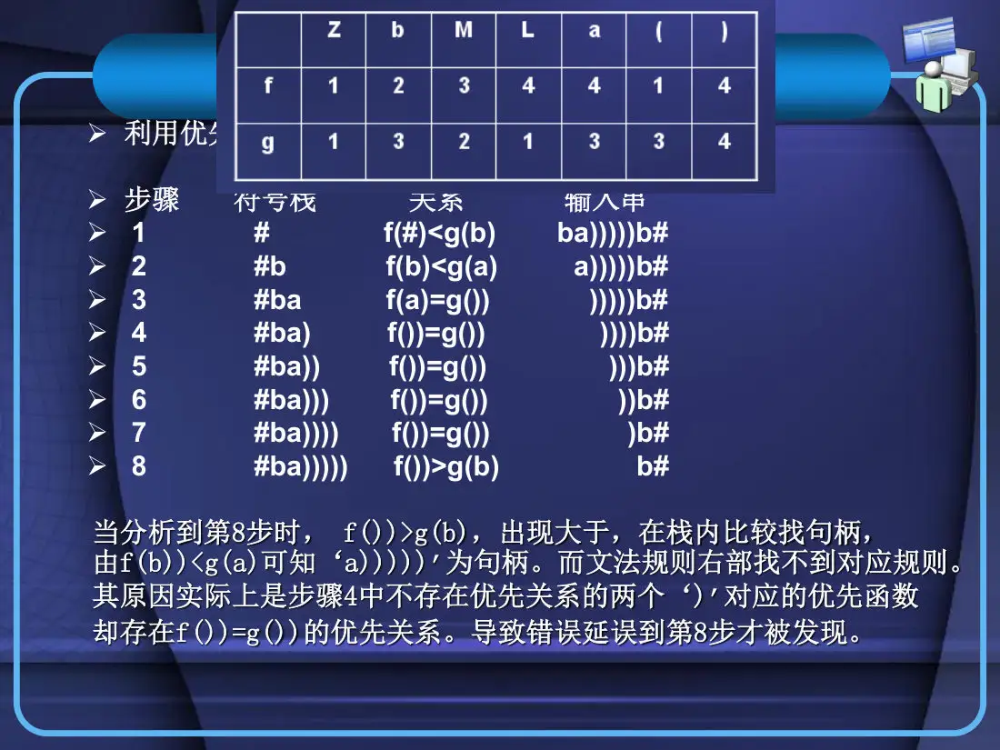

原文：

利用优先

步骤

<table><tr><td></td><td>Z</td><td>b</td><td>M</td><td>L</td><td>a</td><td>(</td><td>)</td></tr><tr><td>f</td><td>1</td><td>2</td><td>3</td><td>4</td><td>4</td><td>1</td><td>4</td></tr><tr><td>g</td><td>1</td><td>3</td><td>2</td><td>1</td><td>3</td><td>3</td><td>4</td></tr></table>

$$
\begin{array}{r l} & \text {天杀} \\ & f (\#) <   g (b) \\ & f (b) <   g (a) \\ & f (a) = g ( ) \\ & f ( ) = g ( ) \\ & f ( ) = g ( ) \\ & f ( ) = g ( ) \\ & f ( ) = g ( ) \\ & f ( ) > g (b) \end{array}
$$

当分析到第8步时，f () ) > g (b)，出现大于，在栈内比较找句柄，由f (b)) < g (a) 可知 ‘a)))) )’ 为句柄。而文法规则右部找不到对应规则。其原因实际上是步骤4中不存在优先关系的两个 ‘) ’ 对应的优先函数却存在f () ) = g () ) 的优先关系。导致错误延误到第8步才被发现。
