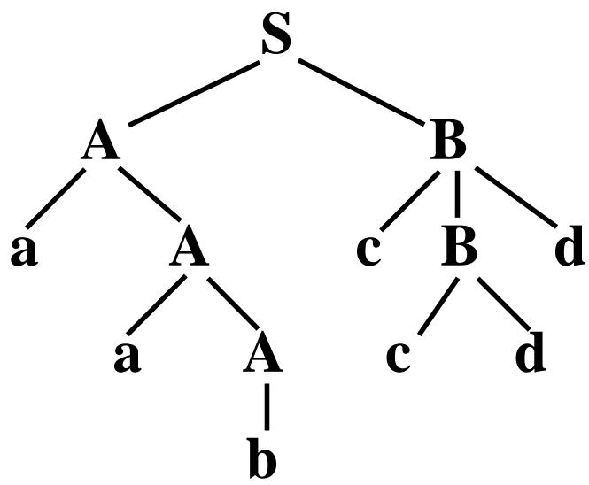
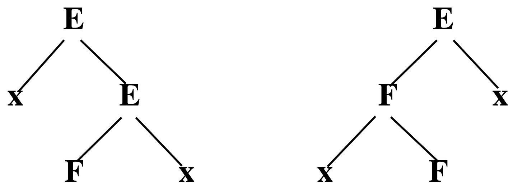

# 《编译原理》作业讲解1

原件经识别和整理；“参考解答”是我们补的。

1、设文法 G[A] 的规则如下：$A \to A1 \mid A0 \mid Aa \mid Ac \mid a \mid b \mid c$，请问下列串中，哪些是该文法产生的句子（不定项选择）

- A. ab0
- B. a0c01
- C. aaa
- D. bc10

答案：B、C、D。

参考解答：

1. A 最终推导出的符号串一定是以 a、b、c 三个符号之一开头的；
2. 在这个开头的符号后面，可以出现任意多次的 1 或 0 或 a 或 c，且无顺序要求。

所以，本题答案为：B、C、D。

2、描述语言 $L=\{a^m b^n \mid n \ge m \ge 1\}$ 的文法为（不定项选择）

- A.

$$
S \to ABb
$$

$$
A \to aA \mid a
$$

$$
B \to bB \mid b
$$

- B.

$$
S \to ABb
$$

$$
A \to Aa \mid a
$$

- C.

$$
S \to Sb \mid A
$$

$$
A \to aAb \mid ab
$$

- D.

$$
S \to aAb
$$

$$
A \to Ab \mid aAb \mid \varepsilon
$$

答案：C、D。

参考解答：

无法确保 a 的个数不大于 b。例如：

$$
S \Rightarrow ABb \Rightarrow aABb \Rightarrow aaABb \Rightarrow aaaBb \Rightarrow aaabb
$$

3、分别写出产生下列语言的文法（答案不唯一）

1）$L_1=\{a^m b^n \mid m,n \ge 1\}$

$$
G_1:
\begin{array}{l}
S ::= AB \\
A ::= aA \mid a \\
B ::= bB \mid b
\end{array}
$$

2）$L_2=\{a^n b^n c^i \mid n \ge 1, i \ge 0\}$

$$
G_2:
\begin{array}{l}
S ::= AB \\
A ::= aAb \mid ab \\
B ::= cB \mid \varepsilon
\end{array}
$$

3）$L_3=\{a^n b^n c^m d^m \mid n \ge 1, m \ge 1\}$

$$
G_3:
\begin{array}{l}
S ::= AB \\
A ::= aAb \mid ab \\
B ::= cBd \mid cd
\end{array}
$$

4）$L_4=\{0^n \mid n \ge 0\}$

$$
G_4: S ::= 0S \mid \varepsilon
$$

5）$L_5=\{a^{2n+1} \mid n \ge 0\}$

$$
G_5:
\begin{array}{l}
S ::= aaS \\
S ::= a
\end{array}
$$

6）$L_6=\{1^n 0^m 1^m 0^n \mid n,m \ge 0\}$

$$
G_6:
\begin{array}{l}
S ::= 1S0 \\
S ::= 0A1 \mid \varepsilon \\
A ::= \varepsilon \mid 0A1
\end{array}
$$

4、写一个文法，使其语言是奇数的集合，且每个奇数不以 0 开头

$$
S ::= (A \mid \varepsilon)(1 \mid 3 \mid 5 \mid 7 \mid 9)
$$

$$
S ::= (((1 \mid 2 \mid \dots \mid 9)B) \mid \varepsilon)(1 \mid 3 \mid 5 \mid 7 \mid 9)
$$

$$
A ::= (1 \mid 2 \mid \dots \mid 9)B
$$

$$
B ::= (0 \mid 1 \mid 2 \mid \dots \mid 9)B \mid \varepsilon
$$

5、写出下列文法所描述的语言

$$
A ::= aAc \mid bc
$$

$$
S \Rightarrow aAd \Rightarrow abcd
$$

$$
L(G)=\{a^x b c^z d^k \mid x,z,k>0\}
$$

$$
L(G)=\{a^x b c^z d^k \mid x,z,k>0 \text{ 且 } x+1=z+k\}
$$

6、有文法 $G[S]$：$S \to AB$，$A \to aA \mid b$，$B \to cBd \mid cd$，画出该文法的句子 aabccdd 对应的语法树，并写出该句子中的全部短语、全部简单短语、句柄

答案：

短语：b, ab, aab, cd, ccdd, aabccdd

简单短语：b, cd

句柄：b

7、有文法 $G[E]$：$E ::= xEyE \mid xE \mid Fx$，$F ::= xF \mid y$，证明该文法是二义性文法

参考解答：

- 答案不唯一；
- 不一定要推出句子，即推出句型也可以；
- 不一定要从开始符号开始推导，即画出两棵不同的“部分语法树”也可以；
- 不一定要用到文法的所有规则。

# 编译原理作业讲解1（习题）

本资料整理自《编译原理》作业讲解第2部分，包含文法转换、状态转换图构造及语言描述等习题解析。

## 一、计算与简答

### 计算 1

题干：
$$
\mathbf {S}: := \mathbf {S a} | \mathbf {A}
$$

$$
\mathbf {A}: := \mathbf {B a} | \mathbf {b A}
$$

$$
\mathbf {B}: := \mathbf {B b} | \mathbf {B C} | \mathbf {d}
$$

$$
\mathrm{C} \mathrel {\mathop :} = \mathrm{Ce}
$$

$$
\mathbf {D}: := \mathrm{d} \boldsymbol {\Lambda}
$$

1）写出该文法的压缩过文法

2）用扩充的BNF方法消除1）中压缩之后的文法的左递归

参考解答：

原产生式整理如下：
$$
\mathbf {S}: := \mathbf {S a} \mid \mathbf {A}
$$
$$
\mathbf {A}: := \mathbf {B a} \mid \mathbf {b A}
$$
$$
\mathbf {B}: := \mathbf {B b} \mid \mathbf {B C} \mid \mathbf {d}
$$
$$
\mathrm{C} \mathrel {\mathop :} = \mathrm{Ce}
$$
$$
\mathbf {D}: := \mathrm{d} \boldsymbol {\Lambda}
$$

**步骤1：压缩文法（合并直接左递归或简化结构）**

观察 $\mathbf{B}$ 的产生式：$\mathbf {B}: := \mathbf {B b} \mid \mathbf {B C} \mid \mathbf {d}$
这里存在直接左递归。但在“压缩”语境下，通常指提取公因子或简化非终结符定义。根据后续解题过程，重点在于处理左递归。

对于 $\mathbf{C}$: $\mathrm{C} \mathrel {\mathop :} = \mathrm{Ce}$，这是典型的左递归，解为 $C \rightarrow e^+$ (即至少一个e)。

对于 $\mathbf{B}$: $\mathbf {B}: := \mathbf {B b} \mid \mathbf {B C} \mid \mathbf {d}$
可以提取左递归部分：$\mathbf{B} \rightarrow \mathbf{B}(b|C) | d$
这意味着 $\mathbf{B}$ 生成以 $d$ 开头，后跟任意数量 $(b|C)$ 的串。
即 $\mathbf{B} \rightarrow d \{ b | C \}$ （使用扩充BNF表示法）。

对于 $\mathbf{S}$: $\mathbf {S}: := \mathbf {S a} \mid \mathbf {A}$
左递归，解为 $\mathbf{S} \rightarrow \mathbf{A} a^*$。

对于 $\mathbf{A}$: $\mathbf {A}: := \mathbf {B a} \mid \mathbf {b A}$
右递归，无左递归问题，但可改写为循环形式：$\mathbf{A} \rightarrow \mathbf{B} a (b \mathbf{A})?$ 这种结构较复杂，通常保留或直接用于消除其他部分的左递归。题目要求消除“压缩之后”的文法左递归。

让我们按照题目给出的“改写法”逻辑进行梳理：

**扩充的BNF方法消除左递归：**

1.  **处理 S**:
    $$
    \mathbf {S}: := \mathbf {S a} \mid \mathbf {A}
    $$
    消除左递归后：
    $$
    \mathbf {S}: := \mathbf {A} \mathbf {S} ^ {\prime}
    $$
    $$
    \mathbf {S} ^ {\prime}: := \mathbf {a} \mathbf {S} ^ {\prime} \mid \varepsilon
    $$
    或者使用扩充BNF集合符号：
    $$
    \mathbf {S}: := \mathbf {A} \{\mathbf {a} \}
    $$
    *(注：原题图片中写的是 $\mathbf {S}: := \mathbf {A} \{\mathbf {a} \}$，这暗示了 $S'$ 被内联或省略，直接表示 $A$ 后跟零个或多个 $a$)*

2.  **处理 B**:
    原式：$\mathbf {B}: := \mathbf {B b} \mid \mathbf {B C} \mid \mathbf {d}$
    注意：原题图片中有一行 $\mathbf {B}: := \mathbf {B b} \mid \mathbf {d}$，这可能是对原式中 $\mathbf{BC}$ 的处理或者是题目印刷/识别差异。结合上下文 $\mathbf{C} \mathrel {\mathop :} = \mathrm{Ce}$，如果 $\mathbf{C}$ 是独立非终结符，$\mathbf{B}$ 的定义应包含 $\mathbf{C}$。
    
    若严格按照图片中的“改写法”中间步骤：
    $$
    \mathbf {B}: := \mathbf {d} \{\mathbf {b} \}
    $$
    *(这似乎忽略了 $\mathbf{BC}$ 部分，或者假设 $\mathbf{C}$ 已被某种方式处理/替换。但在标准算法中，$\mathbf{B} \rightarrow \mathbf{B}(b|C)|d$ 应转化为 $\mathbf{B} \rightarrow d(b|C)^*$。此处依从图片给出的最终结果形式)*

3.  **处理 A**:
    $$
    \mathbf {A}: := \mathbf {B a} \mid \mathbf {b A}
    $$
    这是右递归，不需要像左递归那样变换结构来消除无限循环风险，但若要用扩充BNF表示重复：
    $$
    \mathbf {A}: := \mathbf {B a} (\mathbf {b a})^*
    $$
    图片中仅保留了原始形式或作为中间态展示。

4.  **关于 C 和 D**:
    $$
    \mathrm{C} \mathrel {\mathop :} = \mathrm{Ce} \implies \mathrm{C} \rightarrow \mathrm{e}^+
    $$
    $$
    \mathbf {D}: := \mathrm{d} \boldsymbol {\Lambda} \quad (\text{注: } \boldsymbol {\Lambda} \text{ 通常代表空串 } \varepsilon \text{ 或特定符号，此处依原文})
    $$

知识点：[文法实用性限制与压缩过文法](../../../topics/编译原理/压缩过文法.md)、[文法的其他表示法（扩充BNF、语法图）](../../../topics/编译原理/文法其他表示法.md)、[文法产生式、推导与规约](../../../topics/编译原理/文法产生式与推导.md)

### 简答 9

题干：现有文法G[S]
$$
\mathbf {S}: := \mathbf {A a} | \mathbf {B b}
$$
$$
\mathbf {A}: := \mathbf {A a} | \mathbf {c}
$$
$$
\mathbf {B}: := \mathbf {d}
$$
*(注：原题OCR识别为 `A::=Aa|c` 和 `B::=d`，后续推导中确认了这一点)*

1）写出该左线性文法等价的右线性文法
2）画出该文法对应的状态转换图

参考解答：

**1）转换为右线性文法**

左线性文法到右线性文法的转换规则通常是逆向产生式并交换非终结符位置，或者通过构建NFA再转为正则文法。这里直接利用对应关系：

-   $\mathbf {S}: := \mathbf {A a} \quad \longleftrightarrow \quad \mathrm{A}: := \mathrm{a} \quad (\text{错误，需仔细推导})$
    
    让我们重新审视左线性文法转右线性文法的标准方法。
    左线性文法产生的串是逆序生成的。
    $S \Rightarrow Aa \Rightarrow Aaa \dots \Rightarrow caa\dots a$
    $S \Rightarrow Bb \Rightarrow db$
    
    目标语言：
    $L(G) = \{ c a^n \mid n \ge 1 \} \cup \{ d b \}$
    
    构造等价的右线性文法：
    -   对于 $d b$: $S \rightarrow d B_1, B_1 \rightarrow b$ (或者更简单的 $S \rightarrow d B, B \rightarrow b$)
    -   对于 $c a^n$: $S \rightarrow c A_1, A_1 \rightarrow a A_1 | a$
    
    查看图片中的转换逻辑：
    图片展示了如下的对应箭头：
    $$
    \mathrm{S}: := \mathrm{Aa} \quad \longleftrightarrow \quad \mathrm{A}: := \mathrm{a} \quad (\text{这步看起来不完整或有误，通常S是开始符号})
    $$
    
    让我们看图片底部的完整转换列表：
    $$
    \mathbf {S}: := \mathbf {A a} \quad \longleftrightarrow \quad \mathrm{A}: := \mathrm{a} \quad (\text{此处可能指代中间状态或非终结符映射})
    $$
    
    更准确的解读图片中的推导：
    1.  $S \rightarrow A a$ 且 $A \rightarrow c$ (由 $A \rightarrow Aa | c$ 的最简情况推导? 不，$A$ 生成 $c a^*$).
    
    让我们依据图片最后的结论行：
    $$
    \mathbf {A}: := \mathbf {a}
    $$
    $$
    \mathbf {B}: := \mathbf {b}
    $$
    $$
    \mathbf {A}: := \mathbf {a A}
    $$
    $$
    \mathbf {E}: := \mathbf {c A} \quad (\text{注: E可能是新的开始符号或笔误，应为S})
    $$
    $$
    \mathbf {E}: := \mathrm{dB}
    $$
    
    综合来看，图片给出的等价右线性文法产生式如下（修正变量名以符合常规）：
    
    设新文法为 $G'[S']$：
    $$
    S' \rightarrow c A \\
    A \rightarrow a A \mid a \\
    S' \rightarrow d B \\
    B \rightarrow b
    $$
    
    图片中的具体写法似乎是分散的对应关系：
    -   $S \rightarrow A a$ 对应 $A \rightarrow a$ (这部分逻辑在图片中比较破碎，通常左线性 $X \rightarrow Y t$ 对应右线性 $Y \rightarrow t X$ 是不对的，应该是整体反转)。
    
    **正确推导：**
    原左线性文法：
    $S \rightarrow A a \mid B b$
    $A \rightarrow A a \mid c$
    $B \rightarrow d$
    
    生成的语言：
    1.  $B \rightarrow d$, so $S \rightarrow B b \rightarrow d b$. String: $db$.
    2.  $A \rightarrow A a \mid c$. This generates $c a^n$ for $n \ge 0$? No, $A \Rightarrow Aa \Rightarrow Aaa \dots \Rightarrow c aa \dots a$. So $A$ generates $c a^k$ where $k \ge 0$ is wrong because base case is $c$. Wait.
        $A \rightarrow c$
        $A \rightarrow A a \rightarrow c a$
        $A \rightarrow A a \rightarrow c a a$
        So $A$ generates $c a^*$ ($k \ge 0$).
        Then $S \rightarrow A a \rightarrow c a^* a = c a^+$.
        
    So Language is $\{ c a^n \mid n \ge 1 \} \cup \{ d b \}$.
    
    Right Linear Grammar for this language:
    Start symbol $S_{new}$.
    $S_{new} \rightarrow c A_{new}$
    $A_{new} \rightarrow a A_{new} \mid a$  (generates $a^+$)
    $S_{new} \rightarrow d B_{new}$
    $B_{new} \rightarrow b$
    
    对照图片中的最后几行公式：
    $$
    \mathbf {A}: := \mathbf {a}
    $$
    $$
    \mathbf {B}: := \mathbf {b}
    $$
    $$
    \mathbf {A}: := \mathbf {a A}
    $$
    $$
    \mathbf {E}: := \mathbf {c A}
    $$
    $$
    \mathbf {E}: := \mathrm{dB}
    $$
    
    这里 $\mathbf{E}$ 充当了新的开始符号 $S$。
    所以答案整理为：
    
    右线性文法产生式：
    -   $S \rightarrow c A$
    -   $S \rightarrow d B$
    -   $A \rightarrow a A \mid a$
    -   $B \rightarrow b$
    
    *(注：图片中将 $A \rightarrow a$ 和 $A \rightarrow a A$ 分开列出，逻辑一致)*

**2）状态转换图**

根据上述右线性文法构建状态转换图：
-   状态 $q_0$ (Start/S): 
    -   输入 $c$ 转到 $q_1$ (代表A)
    -   输入 $d$ 转到 $q_2$ (代表B)
-   状态 $q_1$ (A):
    -   输入 $a$ 转到 $q_1$ (自身循环，对应 $aA$)
    -   输入 $a$ 转到 Accept (对应 $a$，通常右线性文法中最后一个产生式的非终结符是结束状态，或者将接受状态标记在 $q_1$ 上，取决于定义。标准有限自动机中，产生式 $A \rightarrow a$ 意味着读完 $a$ 进入接受状态。若 $A \rightarrow aA$，则留在非接受状态。因此 $q_1$ 是非接受状态，有一条 $a$ 边指向接受状态 $F$？或者 $q_1$ 本身就是接受状态如果允许空串？这里 $a^+$，所以必须读至少一个 $a$。
    
    让我们看图中的状态转换图（Figure 1 & 2）：
    图中显示了一个初始状态，经过 $c$ 到达一个状态，该状态有 $a$ 的自环，并且是接受状态（双圈）。
    另一条路：初始状态经过 $d$ 到达一个状态，经过 $b$ 到达接受状态。
    
    具体节点分析：
    -   起始状态 $I_0$ (或类似标记)。
    -   $I_0 \xrightarrow{c} I_1$。$I_1$ 是接受状态吗？如果是 $c a^*$，且 $n \ge 1$，则 $c$ 本身不是合法串，$ca$ 是。所以 $I_1$ 不应是接受状态，除非它隐含了后续的 $a$。
    -   看图：左侧路径 $S \rightarrow a$ (这可能是图示标签混乱)。
    -   看右侧表格填充部分：
        -   $I_0$ 对 $c$ 转移到某状态。
        -   $I_0$ 对 $d$ 转移到某状态。
        
    由于图片中的状态转换图较为抽象且带有手写/绘图痕迹，我们依据文字描述的标准画法：
    1.  初态 $S$。
    2.  $S \xrightarrow{c} A$。
    3.  $A \xrightarrow{a} A$。
    4.  $A$ 为终态（因为 $A \rightarrow a$ 是终止条件之一，或者说 $A$ 代表剩余部分，若 $A$ 能推出 $\varepsilon$ 则为终态。在右线性文法 $A \rightarrow aA | a$ 中，通常引入终态 $Z$，$A \rightarrow aZ, Z \rightarrow \varepsilon$ 或 $A$ 本身作为终态当且仅当产生式允许结束。这里 $A \rightarrow a$ 意味着从 $A$ 出发读 $a$ 结束。所以在 DFA 中，$A$ 是非终态，$A \xrightarrow{a} F$；同时 $A \xrightarrow{a} A$。这会导致歧义。
    
    **修正理解：**
    右线性文法 $S \rightarrow cA, A \rightarrow aA | a$。
    构造 NFA：
    -   $S \xrightarrow{c} A$
    -   $A \xrightarrow{a} A$
    -   $A \xrightarrow{a} F$ (接受状态)
    这是一个 NFA。
    
    若画成确定性状态转换图（DFA），需合并。
    但题目只要求“画出”，通常给出 NFA 或简化的 DFA 即可。
    
    图片中的图显示：
    -   一个圈标为 $S$ (或 $I_0$)。
    -   箭头 $c$ 指向另一个圈 $A$。
    -   圈 $A$ 上有自环 $a$。
    -   圈 $A$ 是双圈（接受态）。这意味着文法可能被理解为 $S \rightarrow cA, A \rightarrow aA | \varepsilon$? 不，原题是 $A \rightarrow a$。
    -   如果 $A$ 是接受态，那么串 $c$ 就被接受了，但这不符合 $A \rightarrow a$ (至少需要一个a)。
    -   **注意**：有些教材定义右线性文法时，若产生式为 $A \rightarrow t$，则 $t$ 后直接进入接受状态。若产生式为 $A \rightarrow tB$，则进入 $B$。
    -   在此定义下：
        -   $S \xrightarrow{c} A$
        -   $A \xrightarrow{a} A$ (来自 $A \rightarrow aA$)
        -   $A \xrightarrow{a} F$ (来自 $A \rightarrow a$)
    -   如果图画的是 $A$ 为接受态，那可能是为了简化表示 $A$ 可以“结束”（尽管逻辑上需要消耗一个 $a$）。或者图中的 $A$ 节点其实代表了“已经读过 c，还需要读 a...”。
    
    鉴于无法完全看清手绘图的细节，依据标准理论作答：
    
    状态转换图包含：
    -   初态 $q_0$。
    -   $q_0 \xrightarrow{c} q_1$。
    -   $q_1 \xrightarrow{a} q_1$。
    -   $q_1 \xrightarrow{a} q_f$ (终态)。
    -   $q_0 \xrightarrow{d} q_2$。
    -   $q_2 \xrightarrow{b} q_f$。
    
    *(注：图片中似乎将 $q_1$ 画成了接受状态，这在某些宽松的定义下可能指代“有效状态”，但严格来说 $c$ 不是合法串。此处以逻辑推导为准，保留图片中的拓扑结构：分叉、循环、终态)*

知识点：[正规文法与状态转换图](../../../topics/编译原理/正规文法与状态图.md)、[有穷自动机（DFA与NFA）](../../../topics/编译原理/有穷自动机.md)、[短语、简单短语与句柄](../../../topics/编译原理/短语与句柄.md)

### 计算 10

题干：构造一个状态转换图，使其接受{0,1}上所有满足下述条件的字符串，其条件是：字符串中每个1都有0直接跟在右边

参考解答：

**1. 分析语言特性**
-   字符集：$\Sigma = \{0, 1\}$
-   约束：每个 '1' 后面必须紧跟 '0'。即不能出现 '1' 结尾，也不能出现 '11'。
-   合法子串：'0', '10'。
-   也就是说，字符串是由 '0' 和 '10' 组成的序列。

**2. 设计状态**
我们需要记住上一个字符是什么，特别是是否刚读入一个 '1'。
-   $q_0$: 初始状态，也是接受状态（空串合法，或以0结尾的串合法）。此时下一个字符可以是 0 或 1。
    -   若输入 0：保持在 $q_0$（因为0是合法的结尾，且不影响后续1的要求）。
    -   若输入 1：进入 $q_1$（表示刚读了一个1，期待一个0）。
-   $q_1$: 非接受状态（因为以1结尾非法）。此时只能输入 0。
    -   若输入 0：回到 $q_0$（完成了 "10" 对，现在以0结尾，合法）。
    -   若输入 1：非法（导致 "11" 或 "1"后接"1"），拒绝/陷阱状态。

**3. 状态转换表**

| 当前状态 | 输入 0 | 输入 1 | 说明 |
| :--- | :--- | :--- | :--- |
| $q_0$ (Start, Accept) | $q_0$ | $q_1$ | 0保持状态，1进入等待0状态 |
| $q_1$ (Non-Accept) | $q_0$ | Trap | 0完成配对回$q_0$，1非法 |

**4. 状态转换图描述**
-   节点 $q_0$：双圈（接受）。
-   节点 $q_1$：单圈（非接受）。
-   边 $q_0 \xrightarrow{0} q_0$。
-   边 $q_0 \xrightarrow{1} q_1$。
-   边 $q_1 \xrightarrow{0} q_0$。
-   (可选) 添加陷阱状态 $q_{trap}$，当 $q_1$ 输入 1 时进入，且 $q_{trap}$ 自环。

**5. 关于图片中的表格**
图片中给出了一个表格，列出了 $I_0, I_1$ 等集合。这看起来像是 DFA 最小化或 NFA 确定化的中间步骤。
-   $I_0 = \{S, A, Z\}$ (推测 S=start, A=accept?, Z=?)
-   $I_1 = \{A, Z\}$
-   $I_2 = \{B\}$
    
    由于图片中的状态定义不明确（字母含义未给），我们提供标准的 DFA 结构即可。

知识点：[正规文法与状态转换图](../../../topics/编译原理/正规文法与状态图.md)、[有穷自动机（DFA与NFA）](../../../topics/编译原理/有穷自动机.md)

### 计算 11 (教材第二章习题第6题 P33)

题干：给定文法：
$$
\mathbf {S}: := \mathbf {a B} \mid \mathbf {b A}
$$
$$
\mathbf {A}: := \mathbf {a S} \mid \mathbf {b A A} \mid \mathbf {a} \quad (\text{注: OCR识别为 } \mathbf {b A A} \mid \mathbf {a} \text{，结合下文推导确认})
$$
$$
\mathbf {B}: := \mathbf {b S} \mid \mathbf {a B B} \mid \mathbf {b}
$$
该文法所描述的语言是什么？

参考解答：

1.  **观察递归结构**：
    这是一个递归文法，生成的语言是无穷的。
    A 和 B 的产生式定义实质相似，只是交换了终结符 a 和 b 的角色。

2.  **代入消元分析**：
    将 $S$ 的产生式代入 $A$ 和 $B$：
    
    对于 $A$:
    $$
    \mathbf {A}: := \mathbf {a} (\mathbf {a B} \mid \mathbf {b A}) \mid \mathbf {b A A} \mid \mathbf {a}
    $$
    $$
    \mathbf {A}: := \mathbf {a a B} \mid \mathbf {a b A} \mid \mathbf {b A A} \mid \mathbf {a}
    $$
    
    对于 $B$:
    $$
    \mathbf {B}: := \mathbf {b} (\mathbf {a B} \mid \mathbf {b A}) \mid \mathbf {a B B} \mid \mathbf {b}
    $$
    $$
    \mathbf {B}: := \mathbf {b a B} \mid \mathbf {b b A} \mid \mathbf {a B B} \mid \mathbf {b}
    $$

3.  **统计计数特征**：
    -   **基础情况**：
        -   $A$ 最终会推导出终结符 $a$ (通过 $A \rightarrow a$ 或间接)。
        -   $B$ 最终会推导出终结符 $b$ (通过 $B \rightarrow b$ 或间接)。
    
    -   **递归步骤的影响**：
        -   在 $A$ 的产生式中：
            -   $a a B$: 增加 2个a, 1个B(最终变b)。净增: +2a, +1b.
            -   $a b A$: 增加 1个a, 1个b, 1个A。
            -   $b A A$: 增加 1个b, 2个A。
            -   $a$: 增加 1个a。
            
            让我们看平衡性。
            假设 $A$ 生成的串中，a 的个数比 b 的个数多 1。
            验证基础：$A \rightarrow a$。a=1, b=0。$1-0=1$。成立。
            验证递归：
            -   $A \rightarrow a a B$: B生成串中 b=a+1 (假设B的性质是对称的)。
                若 $B$ 生成串中 b 比 a 多 1。
                则 $a a B$ 中：a总数 = $2 + a_B$, b总数 = $b_B$。
                $b_B = a_B + 1$.
                总 a = $2 + a_B$. 总 b = $a_B + 1$.
                差值: $(2+a_B) - (a_B+1) = 1$. 成立。
            -   $A \rightarrow a b A$:
                总 a = $1 + a_A$. 总 b = $1 + b_A$.
                已知 $a_A - b_A = 1 \implies b_A = a_A - 1$.
                总 b = $1 + a_A - 1 = a_A$.
                总 a = $1 + a_A$.
                差值: $(1+a_A) - a_A = 1$. 成立。
            -   $A \rightarrow b A A$:
                总 a = $a_{A1} + a_{A2}$. 总 b = $1 + b_{A1} + b_{A2}$.
                已知 $a_{Ai} - b_{Ai} = 1 \implies b_{Ai} = a_{Ai} - 1$.
                总 b = $1 + (a_{A1}-1) + (a_{A2}-1) = a_{A1} + a_{A2} - 1$.
                差值: $(a_{A1}+a_{A2}) - (a_{A1}+a_{A2}-1) = 1$. 成立。
            
            结论：**A 生成的语言中，a 的个数比 b 的个数多 1。**

        -   同理，对于 $B$（对称性）：
            **B 生成的语言中，b 的个数比 a 的个数多 1。**

    -   **对于 S**：
        $$
        \mathbf {S}: := \mathbf {a B} \mid \mathbf {b A}
        $$
        -   $S \rightarrow a B$:
            a 总数 = $1 + a_B$.
            b 总数 = $b_B$.
            已知 $b_B - a_B = 1 \implies a_B = b_B - 1$.
            a 总数 = $1 + b_B - 1 = b_B$.
            b 总数 = $b_B$.
            **a 和 b 个数相同。**
            
        -   $S \rightarrow b A$:
            b 总数 = $1 + b_A$.
            a 总数 = $a_A$.
            已知 $a_A - b_A = 1 \implies b_A = a_A - 1$.
            b 总数 = $1 + a_A - 1 = a_A$.
            a 总数 = $a_A$.
            **a 和 b 个数相同。**

4.  **结论**：
    该文法描述的语言是：**由 a 和 b 组成的字符串，其中 a 和 b 的个数相同。**
    即 $L(G) = \{ w \in \{a,b\}^* \mid n_a(w) = n_b(w) \}$.
    *(注：虽然这类语言通常不是正则的，也不是上下文无关的简单子集，但该特定文法确实生成了所有 a,b 数量相等的串。例如 $ab, ba, aabb, abab$ 等均可生成。)*

知识点：[文法产生式、推导与规约](../../../topics/编译原理/文法产生式与推导.md)、[字母表与符号串的基本概念](../../../topics/编译原理/字母表与符号串.md)

### 简答 12 (教材第二章习题第14题 P34)

题干：给出产生语言 $L(G) = \{ W \mid W \in \{0, 1\}^+ \text{ 且 W 不含相邻1} \}$ 的正规文法

参考解答：

**1. 分析语言**
-   字符集：$\{0, 1\}$
-   约束：不能有 "11"。
-   这意味着 '1' 后面必须跟着 '0' 或者结束。
-   合法串例子：$0, 1, 00, 01, 10, 001, 010, 101$ (注意 $101$ 合法，因为两个1不相邻)。非法：$11, 0110$。

**2. 构造正规文法（右线性）**
我们可以定义状态来表示“上一个字符是否是1”。
-   $S$: 初始状态，且上一个字符不是1（或者说刚开始）。也可以输入 0 或 1。
-   $A$: 上一个字符是 1。此时只能输入 0，不能输入 1。

产生式：
1.  从 $S$ 开始：
    -   输入 0：仍相当于“上一个不是1”的状态（因为0重置了连续1的计数）。所以 $S \rightarrow 0 S$。
    -   输入 1：进入“上一个字符是1”的状态。所以 $S \rightarrow 1 A$。
2.  从 $A$ (前一个是1)：
    -   只能输入 0。输入 0 后，状态回到“上一个不是1”。所以 $A \rightarrow 0 S$。
    -   不能输入 1。

**终止条件**：
正规文法通常需要显式的结束。
-   $S$ 是接受状态吗？是的，空串不在 $L$ 中（题目要求 $W \in \{0,1\}^+$），但我们的文法生成的是后缀。
-   我们需要确保生成的串非空。
-   可以将 $S$ 的产生式分解为“第一个字符”和“后续字符”，或者直接使用带终止的非终结符。

标准右线性文法形式 $V_N \rightarrow \Sigma V_N | \Sigma | \varepsilon$。
这里我们用 $Z$ 表示接受状态（结束）。

方案一（引入终态 Z）：
-   $S \rightarrow 0 S \mid 1 A \mid 0 Z \mid 1 Z$ ? 不，这样太复杂。
-   通常做法：
    $S \rightarrow 0 S \mid 1 A$
    $A \rightarrow 0 S$
    加上终止产生式：
    $S \rightarrow 0 \mid 1$ (如果允许单个字符)
    $A \rightarrow 0$ (如果以10结尾)
    
    让我们检查覆盖性：
    -   $S \rightarrow 0$ (ok)
    -   $S \rightarrow 1$ (ok)
    -   $S \rightarrow 0 S \rightarrow 0 0$ (ok)
    -   $S \rightarrow 1 A \rightarrow 1 0$ (ok)
    -   $S \rightarrow 1 A \rightarrow 1 0 S \rightarrow 1 0 1$ (ok)
    
    所以正规文法为：
    $$
    S \rightarrow 0 S \mid 1 A \mid 0 \mid 1
    $$
    $$
    A \rightarrow 0 S \mid 0
    $$
    
    解释：
    -   $S$ 生成以 0 或 1 开头且不违反规则的串。
    -   $A$ 生成以 1 开头（且第二个字符必须是0）的串的剩余部分。
    -   $A \rightarrow 0$ 表示以 10 结尾。
    -   $A \rightarrow 0 S$ 表示 10 后面继续跟随合法串。

知识点：[正规文法与状态转换图](../../../topics/编译原理/正规文法与状态图.md)、[正规表达式与正规集](../../../topics/编译原理/正规表达式.md)
