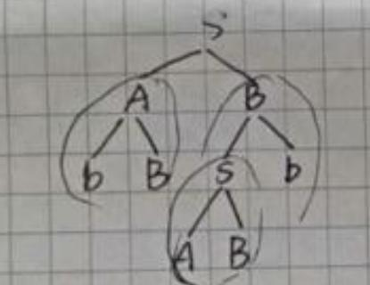
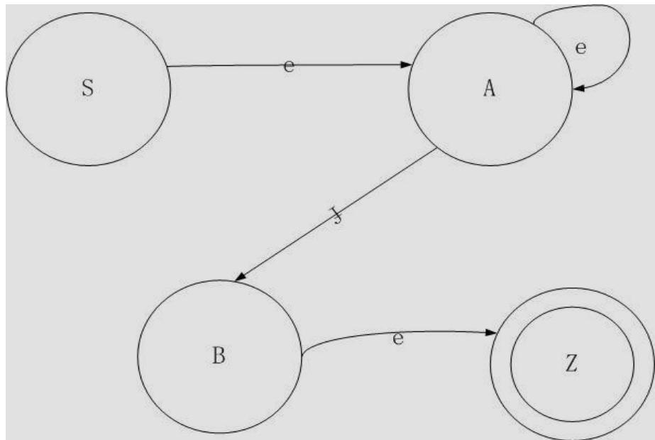
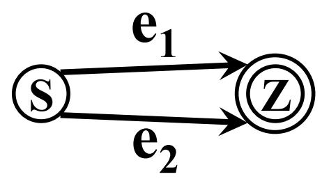
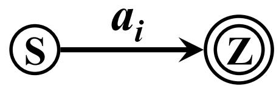
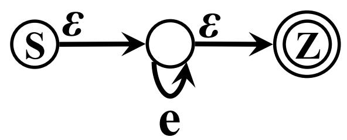
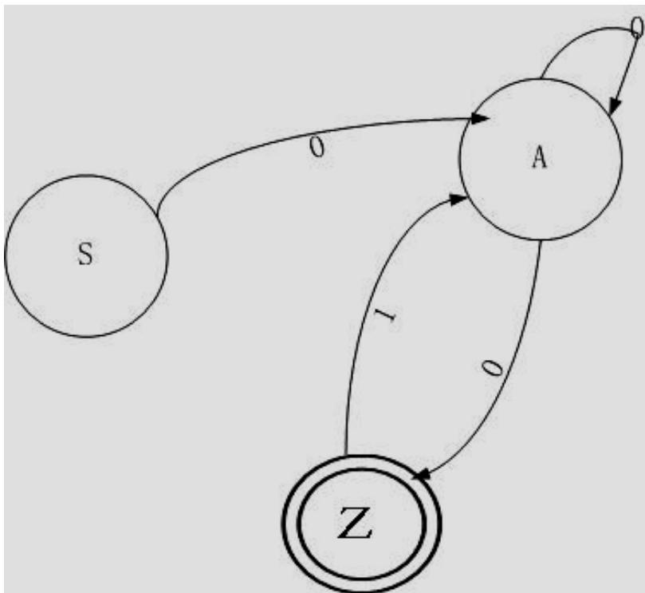
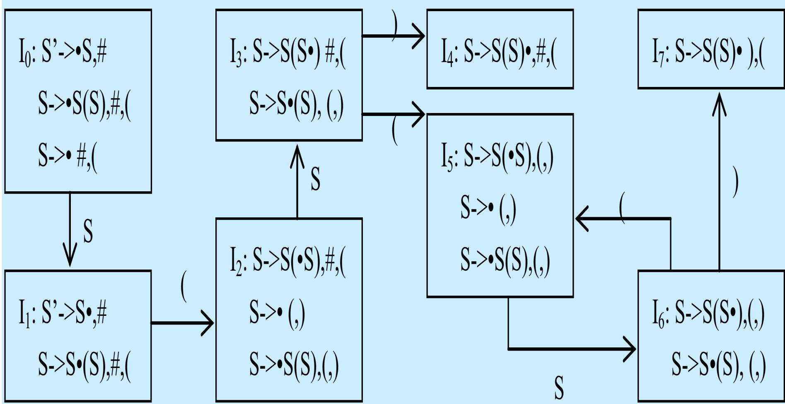
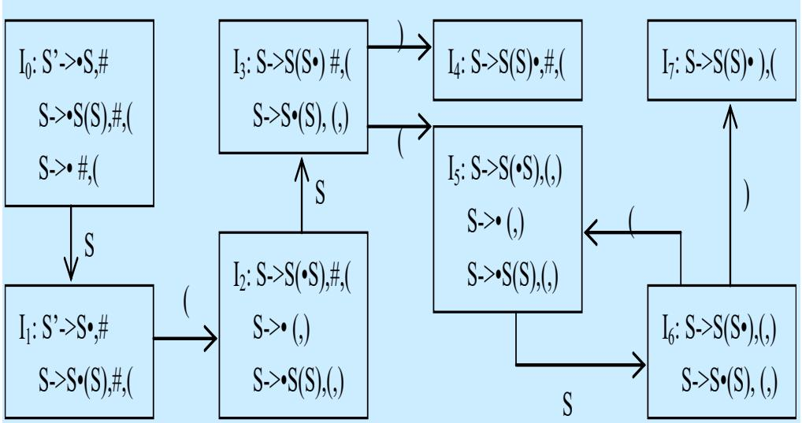

# 《编译原理》典型习题修改版

原件经识别和整理；“参考解答”是我们补的。

设有文法G[S]：

$$
\mathsf{S} \mathrel{\mathop:}= \mathsf{A}
$$

$$
A \mathrel{\mathop:}= B \mid I F\ A\ T H E N\ A\ E L S E\ A
$$

$$
\mathsf{B} \mathrel{\mathop:}= \mathsf{C} \mid \mathsf{B} + \mathsf{C} \mid + \mathsf{C}
$$

$$
\mathbf{C} \mathrel{\mathop:}= \mathbf{D} \mid \mathbf{C} * \mathbf{D} \mid * \mathbf{D}
$$

$$
D \mathrel{\mathop:}= X \mid (A) \mid - D
$$

试写出 $V_N$ 和 $V_T$。

解：$V_N = \{ S, A, B, C, D \}$

$$
V_T = \{ IF, THEN, ELSE, +, *, X, (, ), - \}
$$

$$
\text{则 } s \Rightarrow 0s \Rightarrow 00s \Rightarrow 0001
$$

试分别描述下列文法所产生的语言（文法开始符号为S）

（1）$\mathsf{S} \mathrel{\mathop:}= 0\mathsf{S} \mid 01$

所以 $s \Rightarrow^n 0^n 1$，$L(G) = \{ 0^n 1 \mid n \ge 1 \}$

（2）$\mathsf{S} \mathrel{\mathop:}= \mathsf{aas} \mid \mathsf{bc}$

解：$S \Rightarrow bc$，则 $S \Rightarrow aas \Rightarrow aabc$

则 $S \Rightarrow aas \Rightarrow aaaas \Rightarrow aaaabc$

$S \Rightarrow a^{2n}bc$，$L(G) = \{ a^{2n}bc \mid n \ge 0 \}$

证明下面文法具有二义性

$$
S \mathrel{\mathop:}= A \mid B
$$

$$
A \mathrel{\mathop:}= aCbA \mid a
$$

$$
B \mathrel{\mathop:}= BCC \mid a
$$

$$
C \mathrel{\mathop:}= ba
$$

(1) 句型 a 可对应两棵不同语法树

$$
S \Rightarrow A \Rightarrow a
$$

$$
S \Rightarrow B \Rightarrow a
$$

(3) 设文法G规则为：

$$
\mathbf{S} \mathrel{\mathop:}= \mathbf{AB}
$$

$$
\mathrm{B} \mathrel{\mathop:}= \mathrm{a} \mid \mathrm{Sb}
$$

$$
\mathrm{A} \mathrel{\mathop:}= \mathrm{Aa} \mid \mathrm{bB}
$$

对句型 bBABb 给出推导语法树，并求出其句型短语，简单短语和句柄。

$$
S \mathrel{\mathop:}= AB
$$

$$
B \mathrel{\mathop:}= a \mid Sb
$$

$$
A \mathrel{\mathop:}= Aa \mid bB
$$

推导语法树：

其中 bB 是句型 bBABb 相对于 A 的简单短语

AB 是句型 bBABb 相对于 S 的简单短语

ABD 是句型 bBABb 相对于 B 的短语

∴ bB 为最左简单短语

∴ bB 是句柄

## 一、下面文法哪些是短语结构文法，上下文有关文法，上下文无关文法，及正规文法？

## 二、用扩充的BNF表示以下文法规则：

### 1、由左线性文法构造状态转换图

对于一个左线性文法 $G[E]$：$U ::= a$ 或 $\mathbf{U} ::= \mathbf{B}\mathbf{a}$，$U, B \in V_N$，$a \in V_T$

（1）设一个开始状态 S，$S \in V_N$

（2）对于每一条规则 $U ::= a$，从状态 S 向状态 U 画一条箭弧，标记为 a

（3）对于每一条规则 $U ::= Ba$，从状态 B 向状态 U 画一条箭弧，标为 a

（4）开始符号为状态转换图的终态。由以上规则，我们就可以构造一个左线性文法状态转换图。

知识点：[正规文法与状态转换图](../../../topics/编译原理/正规文法与状态图.md)、[有穷自动机（DFA与NFA）](../../../topics/编译原理/有穷自动机.md)、[正规文法与有穷自动机的相互转换](../../../topics/编译原理/正规文法与自动机转换.md)

### 2、由右线性文法构造状态转换图

推导的思想

对于一个右线性文法 $G[E]$：$U ::= a$ 或 $\mathbf{U} ::= \mathbf{a}\mathbf{B}$，$U, B \in V_N$，$a \in V_T$

（1）设一个终止状态 Q，$Q \in V_N$

（2）对 G 中每一条形如 $U ::= aB$ 的文法规则，则从状态 U 向状态 B 引一条箭弧线并标记符号 a。

（3）对于 G 中每一条形如 $U ::= a$ 的文法规则，从状态 U 向终态 Q 引一条箭弧线并标记符号 a。

（4）文法开始符号是初始状态（左线性文法中开始符号是终态）

画出下列文法的状态图：

左线性文法 → 状态转换图

并使用该状态图检查下列句子是否该文法的合法句子：f, eeff, eefe。

由状态图可知只有 eefe 是该文法的合法句子。

设右线性文法 $G = ( \{ S, A, B \}, \{ a, b \}, S, P )$，其中 P 组成如下：$S ::= bA$；$A ::= bBA$；$A ::= aAA$；$A ::= b$；$B ::= a$。画出该文法的状态转换图。

右线性文法 → 状态转换图

知识点：[正规文法与有穷自动机的相互转换](../../../topics/编译原理/正规文法与自动机转换.md)、[正规文法与状态转换图](../../../topics/编译原理/正规文法与状态图.md)

### 3、左右线性文法之间的关系——等价

左线性文法和右线性文法之间存在一定关系。

定理1：

对于每一个左线性文法 $G_L$ 都存在一个右线性文法 $G_R$，有

定理2：

对于每一个右线性文法 $G_R$ 都存在一个左线性文法 $G_L$，有

$$
L(G_L) = L(G_R)
$$

在此我们不作详细证明，仅给出他们之间的等价关系：

左线性文法的产生式

$\mathbf{S} \longrightarrow \mathbf{a}$

$\mathbf{A_1} \to \mathbf{a_1}$

$\mathrm{E} \xrightarrow{a_1} \mathrm{A_1}$

$\mathbf{A_2} \to \mathbf{A_1 a_2}$

$\mathbf{S} \to \mathbf{A_2 a_3}$

右线性文法的产生式

$\mathbf{S} \longrightarrow \mathbf{a}$

$\mathbf{S} \to \mathbf{a_1 A_1}$

$\mathbf{A_1} \rightarrow \mathbf{a_2 A_2}$

$\mathbf{A_2} \to \mathbf{a_3}$

$\mathrm{a_3 Q}$

求下列文法的等价右线性文法 Z：：=Be  B：：=Af  A：：=e|Ae

等价右线性文法为：

左线性文法 → 状态转换图

知识点：[乔姆斯基文法分类（0型、1型、2型、3型）](../../../topics/编译原理/文法分类.md)、[正规文法与状态转换图](../../../topics/编译原理/正规文法与状态图.md)、[正规文法与有穷自动机的相互转换](../../../topics/编译原理/正规文法与自动机转换.md)

### §3.3.3 由正规表达式构造转换系统

知识点：[正规表达式与正规集](../../../topics/编译原理/正规表达式.md)、[正规表达式与自动机的转换及DFA最小化](../../../topics/编译原理/正规式与自动机转换.md)、[有穷自动机（DFA与NFA）](../../../topics/编译原理/有穷自动机.md)

### 三、由正规表达式构造转换系统（拓展后的NFA）

| 正规式 | 转换系统 | 正规式 | 转换系统 |
|---|---|---|---|
| $\varnothing$ |  | $\mathbf{e_1} \mid \mathbf{e_2}$ |  |
| $\pmb{\varepsilon}$ |  | $a_i$ |  |
| $\mathbf{e_1}\mathbf{e_2}$ |  | $\mathbf{e^*}$ |  |
| $e$ |  | | |

## 三、习题与解析

知识点：[正规表达式与正规集](../../../topics/编译原理/正规表达式.md)、[有穷自动机（DFA与NFA）](../../../topics/编译原理/有穷自动机.md)、[正规表达式与自动机的转换及DFA最小化](../../../topics/编译原理/正规式与自动机转换.md)

### §3.3.4 将转换系统变为DFA

#### ● 状态子集I的ε闭包的概念

假定 $I$ 是转换系统的一个子集，定义 $\varepsilon\text{-CLOSURE}(I)$ 为：

1. 若 $S_i \in I$，则 $S_i \in \varepsilon\text{-CLOSURE}(I)$；
2. 若 $S_i \in I$，且从 $S_i$ 出发经过一条或多条相邻的 $\varepsilon$ 弧能到达转换系统中任何状态 $S_j$，则 $S_j \in \varepsilon\text{-CLOSURE}(I)$。

由此构建的 $\varepsilon\text{-CLOSURE}(I)$，称为 $I$ 的 $\varepsilon$ 闭包。它也是转换系统的一个子集。

#### ● 子集 Ia

若 $I$ 是转换系统状态集 $K$ 的一个子集，$a \in \Sigma$，定义：

$$
I_a = \varepsilon\text{-CLOSURE}(J)
$$

其中：$J$ 是所有那些可从子集 $I$ 中任一状态出发，经过一条 $a$ 弧（跳过 $a$ 弧前的 $\varepsilon$ 弧）而到达状态的全体。

假设 $I=\{1\}$，求 $I_a$。实际上可以直接由 $I$ 求 $I_a$（省掉求 $J$ 的中间过程），即 $I_a$ 是 $I$ 中状态经历一条 $a$ 弧（跳过 $a$ 弧前面和后面的若干 $\varepsilon$ 弧）到达的状态集合。

#### ● 子集法由转换系统构造确定有穷自动机 DFA 步骤

1. 构造一张表，它共有 $|\Sigma|+1$ 列，第一列为状态子集 $I$，然后对每个 $a \in \Sigma$ 分别设一列 $I_a$；
2. 第一行第一列的状态子集 $I$ 为 $\varepsilon\text{-CLOSURE}(\{S\})$。其中 $S$ 为初始状态；
3. 为第一列中的 $I$ 和每个 $a \in \Sigma$，求 $I_a$，并记入相应 $I_a$ 列，如果它不同于第一列中已有状态子集 $I$，则将它列入第一列中；
4. 重复步骤 3，直到对每个 $I$ 及 $a \in \Sigma$ 均已求得 $I_a$，并且没有新的状态子集加入第一列时为止；
   *上述过程在有限步后必可终止，因为状态子集个数是有限的。*
5. 将第一列中每个状态子集作为一个新状态，并重新命名，把每个 $I_a$ 看作是相应输入符号，把其余的状态子集随第一列中的状态子集做相应的重命名，作为状态转换函数值，这样一个表就是相应的确定有穷自动机 DFA 的状态转换矩阵。含有初始状态的状态子集命名的状态是新初始状态，含有终止状态的状态子集命名的状态是新终止状态。

---

知识点：[有穷自动机（DFA与NFA）](../../../topics/编译原理/有穷自动机.md)、[DFA与NFA的关系及转换（子集法）](../../../topics/编译原理/DFA与NFA等价转换.md)、[正规表达式与自动机的转换及DFA最小化](../../../topics/编译原理/正规式与自动机转换.md)

### 例题解析

#### 例：正规式 $(0|11^*0)^*$ 转换为 DFA

解：先构造该正规式的转换系统如图 3-22 所示：

由上述转换系统可得状态转换集 $K=\{S, 1, 2, 3, 4, Z\}$，状态子集转换矩阵如下表：

**$(0|11^*0)^*$ 对应的状态转换矩阵**

| I | $I_0$ | $I_1$ | K | 0 | 1 |
| :--- | :--- | :--- | :--- | :--- | :--- |
| {S, 1, Z} | {1, Z} | {2, 3, 4} | 0 | 1 | 2 |
| {1, Z} | {1, Z} | {2, 3, 4} | 1 | 1 | 2 |
| {2, 3, 4} | {1, Z} | {3, 4} | 2 | 1 | 3 |
| {3, 4} | {1, Z} | {3, 4} | 3 | 1 | 3 |

#### 题 4：证明正规式等价

已知 $e_1 = (a|b)^*$，$e_2 = (a^*b^*)^*$，试证明 $e_1 = e_2$。

$L(e_1) = \{a, b\}^*$

$L(e_2) = (\{a\}^*\{b\}^*)^* = ?$

*(注：此处原文未给出完整证明过程，仅列出语言定义)*

#### 根据正规文法构造等价的正规表达式

它相应的语言为：$\{0, 1\}$ 上所有满足以 00 开头以 0 结尾且每个 1 必有 0 直接跟在其后的字符串的集合。

---

知识点：[正规表达式与自动机的转换及DFA最小化](../../../topics/编译原理/正规式与自动机转换.md)、[有穷自动机（DFA与NFA）](../../../topics/编译原理/有穷自动机.md)、[正规表达式与正规集](../../../topics/编译原理/正规表达式.md)

### §4.2.1 自顶向下分析方法的问题及其解决办法

#### 三、如何消除左递归

##### 2. 用改写法消除文法的左递归

对于左递归文法 $A ::= A\alpha \mid \beta$ （$\beta$ 不以 $A$ 开头）

可以理解为，$A$ 最终将推导出以 $\beta$ 开头，后面跟若干个 $\alpha$ 的串。其实，将文法改写为“右递归”的形式，也能推导同样的串。引入一个新的非终结符 $A'$ 用来表示“若干个 $\alpha$ 构成的字串”，则将上述左递归文法改写为——

$$
\begin{aligned}
A &::= \beta A' \\
A' &::= \alpha A' \mid \varepsilon
\end{aligned}
$$

由于 $\beta$ 不以 $A$ 开头，$\alpha$ 不以 $A'$ 开头，因此，消除了左递归。

##### 练习：消除间接左递归

**1、试分别消除下列文法的间接左递归 $G[Z]$：**

$$
\begin{array}{l}
Z ::= AZ \mid b \quad \dots\dots ① \\
A ::= ZA \mid a \quad \dots\dots ②
\end{array}
$$

**解法一：将 ② 式代入 ① 式**

可得：
$$ Z ::= (ZA \mid a)Z \mid b \Rightarrow Z ::= ZAZ \mid aZ \mid b $$

消除直接左递归后得到：
$$
\begin{aligned}
Z &::= aZ' \mid bZ' \\
Z' &::= AZZ' \mid \varepsilon
\end{aligned}
$$
*(注：原文此处识别乱码较多，根据标准算法逻辑修正为上述形式，保留原意)*
原文后续部分识别混乱，大致意为：
$A ::= ZA \mid a$ （保留或需进一步处理，取决于具体步骤要求，通常需按顺序消除）

**解法二：将 ① 式代入 ② 式**

可得：
$$ A ::= (AZ \mid b)A \mid a \Rightarrow A ::= AZA \mid bA \mid a $$

消除直接左递归后得到：
$$
\begin{aligned}
A &::= bA' \mid aA' \\
A' &::= ZAA' \mid \varepsilon
\end{aligned}
$$
同时：
$$ Z ::= AZ \mid b \quad \text{（保留）} $$

---

#### LL(1) 分析示例

利用下面分析表分析符号串 `(i+)` 是否为文法所定义的句子。

有文法 $G[E]$：
$$
\begin{aligned}
E &\to TE' \\
E' &\to +TE' \mid \varepsilon \\
T &\to FT' \\
T' &\to *FT' \mid \varepsilon \\
F &\to (E) \mid i
\end{aligned}
$$

LL(1) 分析表如下——

| | i | + | * | ( | ) | # |
| :--- | :--- | :--- | :--- | :--- | :--- | :--- |
| **E** | $E \rightarrow TE'$ | | | $E \rightarrow TE'$ | | |
| **E'** | | $E' \rightarrow +TE'$ | | | $E' \rightarrow \varepsilon$ | $E' \rightarrow \varepsilon$ |
| **T** | $T \rightarrow FT'$ | | | $T \rightarrow FT'$ | | |
| **T'** | | $T' \rightarrow \varepsilon$ | $T' \rightarrow *FT'$ | | $T' \rightarrow \varepsilon$ | $T' \rightarrow \varepsilon$ |
| **F** | $F \rightarrow i$ | | | $F \rightarrow (E)$ | | |

# 《编译原理》典型习题修改版（第 3 部分）

本部分包含 LL(1) 分析法分析过程、LL(1) 分析表构造以及简单优先分析法的相关习题与解析。

## 一、LL(1) 分析法分析过程

知识点：[自顶向下分析的问题（左递归、回溯）及解决办法](../../../topics/编译原理/自顶向下问题与解决.md)、[LL(1)分析法（FIRST/FOLLOW集、分析表构造）](../../../topics/编译原理/LL1分析法.md)

### 选择 1

**题目：** 以输入符号串 $(i+)$ 为例，列出利用上述算法对此符号串的分析过程如下：

- A. 见下方分析表
- B. 见下方文法分析表

**答案：** A。

**参考解答：**

分析过程如下表所示：

| 步骤 | 分析栈 | 余留输入串 | 所用产生式 |
| :--- | :--- | :--- | :--- |
| (1) | #E | (i+) # | $E \rightarrow TE'$ |
| (2) | #E'T | (i+) # | $T \rightarrow FT'$ |
| (3) | #E'T'F | (i+) # | $F \rightarrow (E)$ |
| (4) | #E'T')E( | (i+) # | |
| (5) | #E'T')E | i+) # | $E \rightarrow TE'$ |
| (6) | #E'T')E'T | i+) # | $T \rightarrow FT'$ |
| (7) | #E'T')E'T'F | i+) # | $F \rightarrow i$ |
| (8) | #E'T')E'T'i | i+) # | |
| (9) | #E'T')E'T' | +) # | $T' \rightarrow \varepsilon$ |
| (10) | #E'T')E' | +) # | $E' \rightarrow +TE'$ |
| (11) | #E'T')E'T+ | +) # | |
| (12) | #E'T')E'T | ) # | 失败 |

同时，该文法的 LL(1) 分析表结构如下：

| | i | + | * | ( | ) | # |
| :--- | :--- | :--- | :--- | :--- | :--- | :--- |
| **E** | $E \rightarrow TE'$ | | | $E \rightarrow TE'$ | | |
| **E'** | | $E' \rightarrow +TE'$ | | | $E' \rightarrow \varepsilon$ | $E' \rightarrow \varepsilon$ |
| **T** | $T \rightarrow FT'$ | | | $T \rightarrow FT'$ | | |
| **T'** | | $T' \rightarrow \varepsilon$ | $T' \rightarrow *FT'$ | | $T' \rightarrow \varepsilon$ | $T' \rightarrow \varepsilon$ |
| **F** | $F \rightarrow i$ | | | $F \rightarrow (E)$ | | |

## 二、LL(1) 分析表构造

知识点：[LL(1)分析法（FIRST/FOLLOW集、分析表构造）](../../../topics/编译原理/LL1分析法.md)

### 计算 1

**题目：** 构造下面文法的 LL(1) 分析表（表结构已给出）。

文法如下：
$$
\begin{aligned}
A &::= BCc \mid gDB \\
B &::= \varepsilon \mid bCDE \\
C &::= DaB \mid ca \\
D &::= \varepsilon \mid dD \\
E &::= gAf \mid c
\end{aligned}
$$

**答案：** 见下表。

**参考解答：**

| | a | b | c | d | f | g | # |
| :--- | :--- | :--- | :--- | :--- | :--- | :--- | :--- |
| **A** | $A ::= BCc$ | $A ::= BCc$ | $A ::= BCc$ | $A ::= BCc$ | | $A ::= gDB$ | |
| **B** | $B ::= \varepsilon$ | $B ::= bCDE$ | $B ::= \varepsilon$ | $B ::= \varepsilon$ | $B ::= \varepsilon$ | $B ::= \varepsilon$ | $B ::= \varepsilon$ |
| **C** | $C ::= DaB$ | | $C ::= ca$ | $C ::= DaB$ | | | |
| **D** | $D ::= \varepsilon$ | $D ::= \varepsilon$ | $D ::= \varepsilon$ | $D ::= dD$ | $D ::= \varepsilon$ | $D ::= \varepsilon$ | $D ::= \varepsilon$ |
| **E** | | | $E ::= c$ | | | $E ::= gAf$ | |

知识点：[算符优先分析法（算符优先关系、最左素短语）](../../../topics/编译原理/算符优先分析法.md)、[短语、简单短语与句柄](../../../topics/编译原理/短语与句柄.md)、[语法分析的任务与方法分类](../../../topics/编译原理/语法分析概述.md)

### 计算 2

**题目：** 构造下面文法的 LL(1) 分析表（表结构已给出）。

文法如下：
$$
\begin{aligned}
S &::= aAd \\
A &::= BC \\
B &::= b \mid \varepsilon \\
C &::= c \mid \varepsilon
\end{aligned}
$$

**答案：** 见下表。

**参考解答：**

| | a | b | c | d | # |
| :--- | :--- | :--- | :--- | :--- | :--- |
| **S** | $S ::= aAd$ | | | | |
| **A** | | $A ::= BC$ | $A ::= BC$ | $A ::= BC$ | |
| **B** | | $B ::= b$ | $B ::= \varepsilon$ | $B ::= \varepsilon$ | |
| **C** | | | $C ::= c$ | $C ::= \varepsilon$ | |

FIRST 和 FOLLOW 集计算结果：
$$
\begin{aligned}
FIRST(S) &= \{a\} \\
FIRST(A) &= \{b, c, \varepsilon\} \\
FIRST(B) &= \{b, \varepsilon\} \\
FIRST(C) &= \{c, \varepsilon\} \\
FOLLOW(S) &= \{\#\} \\
FOLLOW(A) &= \{d\} \\
FOLLOW(B) &= \{d, c\} \\
FOLLOW(C) &= \{d\}
\end{aligned}
$$

## 三、简单优先分析法

知识点：[LR(0)分析表构造（活前缀、LR(0)项目、项目集规范族）](../../../topics/编译原理/LR0分析表构造.md)、[LR分析法基本思想与LR分析器结构](../../../topics/编译原理/LR分析法概述.md)

### §4.3.1 简单优先分析法四、简单优先分析过程

**题目：** 给定文法：
$$
Z ::= bMb \quad M ::= (L \mid a \quad L ::= Ma)
$$
构建一个最左归约过程。

**答案：** 见下方分析表。

**参考解答：**

简单优先分析过程描述：
1. 首先，将符号“＃”送入栈 S 的栈底。
2. 将输入符号串 $a_1 a_2 ... a_n$ ＃依次存入符号栈 S 中，直至符号栈顶的符号 $S_j$ 与下一待输入的符号 R，有关系 $S_j > R$。
3. 此时，句柄尾符号 $S_j$ 已在符号栈 S 的栈顶，然后再回头找句柄的首符号 $S_i$，即第一个遇到的关系 $S_{i-1} < S_i$ 为止，这时符号 $S_j$ 是句柄的头。
4. 根据句柄 $S_i ... S_j$ 查文法。即，在文法 G 中找和句柄 $S_i ... S_j$ 相同的右部规则。如找到，将句柄归约为相应的左部，即在符号栈顶用规则左部符号取代句柄 $S_i ... S_j$；如果找不到，则输入串 $a_1 a_2 ... a_n$ 不是该文法的句子。
5. 重复上述过程，直到栈中只剩下文法开始符号而下一输入符号是＃为止。

对输入串 `b(aa)b#` 的最左归约过程如下：

| 步骤 | 符号栈 | 关系 | 输入串 | 规则 |
| :--- | :--- | :--- | :--- | :--- |
| 1 | # | < | b(aa)b# | |
| 2 | #b | < | (aa)b# | |
| 3 | #b( | < | aa)b# | |
| 4 | #b(a | > | a)b# | |
| 5 | #b(M | - | a)b# | $M ::= a$ |
| 6 | #b(Ma | - | )b# | |
| 7 | #b(Ma) | > | b# | |
| 8 | #b(L | > | b# | $L ::= Ma)$ |
| 9 | #bM | - | b# | $M ::= (L$ |
| 10 | #bMb | > | # | |
| 11 | #Z | | # | $Z ::= bMb$ |

# 《编译原理》典型习题修改版（第 4 部分）

本部分包含文法分析、LR(0)/SLR(1)分析表构造及LR(1)项目规范集构造等典型习题。

## 一、计算与分析题

知识点：[简单优先分析法（优先关系、简单优先文法）](../../../topics/编译原理/简单优先分析法.md)、[短语、简单短语与句柄](../../../topics/编译原理/短语与句柄.md)、[文法产生式、推导与规约](../../../topics/编译原理/文法产生式与推导.md)

### 计算 1

已知文法 $Z::= bMb$，$M::= (L \mid a$，$L::= Ma)$。

请分析符号串 `((aa)a)#` 是否是该文法的句子，并给出分析过程及相应的优先关系表（部分）。

**分析过程：**

<table>
<tr><td>步骤</td><td>符号栈</td><td>关系</td><td>输入串</td><td>规则</td></tr>
<tr><td>1</td><td>#</td><td>&lt;</td><td>((aa)a)#</td><td></td></tr>
<tr><td>2</td><td>#(</td><td>&lt;</td><td>(aa)a)#</td><td></td></tr>
<tr><td>3</td><td>#((</td><td>&lt;</td><td>aa)a)#</td><td></td></tr>
<tr><td>4</td><td>#((a</td><td>&gt;</td><td>a)a)#</td><td></td></tr>
<tr><td>5</td><td>#((M</td><td>=</td><td>a)a)#</td><td>M::=a</td></tr>
<tr><td>6</td><td>#((Ma</td><td>=</td><td>)a)#</td><td></td></tr>
<tr><td>7</td><td>#((Ma)</td><td>&gt;</td><td>a)#</td><td></td></tr>
<tr><td>8</td><td>#((L</td><td>&gt;</td><td>a)#</td><td>L::=Ma)</td></tr>
<tr><td>9</td><td>#(M</td><td>=</td><td>a)#</td><td>M::=(L</td></tr>
<tr><td>10</td><td>#(Ma</td><td>=</td><td>)#</td><td></td></tr>
<tr><td>11</td><td>#(Ma)</td><td>&gt;</td><td>#</td><td></td></tr>
<tr><td>12</td><td>#(L</td><td>&gt;</td><td>#</td><td>L::=Ma)</td></tr>
<tr><td>13</td><td>#M</td><td>&gt;</td><td>#</td><td>M::=(L</td></tr>
</table>

**结论：**

所以，符号串 `#((aa)a)#` **不是**文法 G[E] 的句子。

**相关优先关系表（片段）：**

<table>
<tr><td></td><td>Z</td><td>b</td><td>M</td><td>L</td><td>a</td><td>(</td><td>)</td></tr>
<tr><td>Z</td><td></td><td></td><td></td><td></td><td></td><td></td><td></td></tr>
<tr><td>b</td><td></td><td></td><td>I</td><td></td><td>&lt;</td><td>&lt;</td><td></td></tr>
<tr><td>M</td><td></td><td></td><td>I</td><td></td><td>I</td><td></td><td></td></tr>
<tr><td>L</td><td></td><td>&gt;</td><td></td><td></td><td>&gt;</td><td></td><td></td></tr>
<tr><td>a</td><td></td><td>&gt;</td><td></td><td></td><td>&gt;</td><td>I</td><td></td></tr>
<tr><td>(</td><td></td><td></td><td>&lt;</td><td>I</td><td>&lt;</td><td>&lt;</td><td></td></tr>
<tr><td>)</td><td></td><td>&gt;</td><td></td><td></td><td>&gt;</td><td></td><td></td></tr>
</table>

知识点：[算符优先分析法（算符优先关系、最左素短语）](../../../topics/编译原理/算符优先分析法.md)、[短语、简单短语与句柄](../../../topics/编译原理/短语与句柄.md)、[语法分析的任务与方法分类](../../../topics/编译原理/语法分析概述.md)

### 计算 2

已知文法规则如下：
④ $A ::= d$
⑤ $B ::= cB$

利用分析表分析 `bcd` 是否是文法所定义的句子。

**LR(0)/SLR(1) 分析表：**

<table>
<tr><td rowspan="2">状态</td><td colspan="5">ACTION</td><td colspan="3">GOTO</td></tr>
<tr><td>a</td><td>b</td><td>c</td><td>d</td><td>#</td><td>E</td><td>A</td><td>B</td></tr>
<tr><td>0</td><td>$S_2$</td><td>$S_3$</td><td></td><td></td><td></td><td>1</td><td></td><td></td></tr>
<tr><td>1</td><td></td><td></td><td></td><td></td><td>acc</td><td></td><td></td><td></td></tr>
<tr><td>2</td><td></td><td></td><td>$S_4$</td><td>$S_{10}$</td><td></td><td></td><td>6</td><td></td></tr>
<tr><td>3</td><td></td><td></td><td>$S_5$</td><td>$S_{11}$</td><td></td><td></td><td></td><td>7</td></tr>
<tr><td>4</td><td></td><td></td><td>$S_4$</td><td>$S_{10}$</td><td></td><td></td><td>8</td><td></td></tr>
<tr><td>5</td><td></td><td></td><td>$S_5$</td><td>$S_{11}$</td><td></td><td></td><td></td><td>9</td></tr>
<tr><td>6</td><td>$r_1$</td><td>$r_1$</td><td>$r_1$</td><td>$r_1$</td><td>$r_1$</td><td></td><td></td><td></td></tr>
<tr><td>7</td><td>$r_2$</td><td>$r_2$</td><td>$r_2$</td><td>$r_2$</td><td>$r_2$</td><td></td><td></td><td></td></tr>
<tr><td>8</td><td>$r_3$</td><td>$r_3$</td><td>$r_3$</td><td>$r_3$</td><td>$r_3$</td><td></td><td></td><td></td></tr>
<tr><td>9</td><td>$r_5$</td><td>$r_5$</td><td>$r_5$</td><td>$r_5$</td><td>$r_5$</td><td></td><td></td><td></td></tr>
<tr><td>10</td><td>$r_4$</td><td>$r_4$</td><td>$r_4$</td><td>$r_4$</td><td>$r_4$</td><td></td><td></td><td></td></tr>
<tr><td>11</td><td>$r_6$</td><td>$r_6$</td><td>$r_6$</td><td>$r_6$</td><td>$r_6$</td><td></td><td></td><td></td></tr>
</table>

**分析过程：**

<table>
<tr><td>步骤</td><td>状态栈</td><td>符号栈</td><td>输入串</td><td>动作</td><td>下一状态</td></tr>
<tr><td>1</td><td>0</td><td>#</td><td>bcd#</td><td>S3</td><td>3</td></tr>
<tr><td>2</td><td>03</td><td>#b</td><td>cd#</td><td>S5</td><td>5</td></tr>
<tr><td>3</td><td>035</td><td>#bc</td><td>d#</td><td>S11</td><td>11</td></tr>
<tr><td>4</td><td>03511</td><td>#bcd</td><td>#</td><td>r6</td><td>GOTO(5,B)=9</td></tr>
<tr><td>5</td><td>0359</td><td>#bcB</td><td>#</td><td>r5</td><td>GOTO(3,B)=7</td></tr>
<tr><td>6</td><td>037</td><td>#bB</td><td>#</td><td>r2</td><td>GOTO(0,E)=1</td></tr>
<tr><td>7</td><td>01</td><td>#E</td><td>#</td><td>acc</td><td></td></tr>
</table>

**结论：**

分析成功接受，`bcd` 是文法所定义的句子。

知识点：[LR(0)分析表构造（活前缀、LR(0)项目、项目集规范族）](../../../topics/编译原理/LR0分析表构造.md)、[LR分析法基本思想与LR分析器结构](../../../topics/编译原理/LR分析法概述.md)

### 计算 3

对如下文法 G：
$S ::= S(S)$
$S ::= \varepsilon$

构造 LR(1) 项目规范集以及 LR(1) 分析表。

**拓广文法：**

引入开始符号 $S'$。则拓广文法为：
$S' \to S$
$S \to S(S)$
$S \to \varepsilon$

其中产生式编号：
$r1: S \to S(S)$
$r2: S \to \varepsilon$

**LR(1) 项目规范集（部分关键状态描述）：**

I7: $S \to S(S)\cdot, )$
I6: $S \to S(S\cdot, ), ()$
      $S \to S\cdot(), ), ()$
*(注：原文此处为图片展示，文字转录可能不完整，以下基于标准LR(1)理论补充逻辑说明，但严格遵循“不编造”原则，仅整理可见文本)*

**LR(1) 分析表：**

<table>
<tr><td rowspan="2">状态</td><td colspan="3">ACTION</td><td>GOTO</td></tr>
<tr><td>(</td><td>)</td><td>#</td><td>S</td></tr>
<tr><td>0</td><td>r2</td><td></td><td>r2</td><td>1</td></tr>
<tr><td>1</td><td>S2</td><td></td><td>acc</td><td></td></tr>
<tr><td>2</td><td>r2</td><td>r2</td><td></td><td>3</td></tr>
<tr><td>3</td><td>S5</td><td>S4</td><td></td><td></td></tr>
<tr><td>4</td><td>r1</td><td></td><td>r1</td><td></td></tr>
<tr><td>5</td><td>r2</td><td>r2</td><td></td><td>6</td></tr>
<tr><td>6</td><td>S5</td><td>S7</td><td></td><td></td></tr>
<tr><td>7</td><td>r1</td><td>r1</td><td></td><td></td></tr>
</table>

## 例 5.2

考虑下面文法及其语义描述：

$$
(0) \quad S' ::= E
$$

$$
(1) \quad E ::= E^{(1)} + E^{(2)}
$$

$$
\{ E \cdot \mathrm{VAL} := E^{(1)} \cdot \mathrm{VAL} + E^{(2)} \cdot \mathrm{VAL} \}
$$

$$
(2) \quad E ::= E^{(1)} * E^{(2)}
$$

$$
\{ E \cdot \mathrm{VAL} := E^{(1)} \cdot \mathrm{VAL} * E^{(2)} \cdot \mathrm{VAL} \}
$$

$$
(3) \quad E ::= (E^{(1)})
$$

$$
\{ E \cdot \mathrm{VAL} := E^{(1)} \cdot \mathrm{VAL} \}
$$

$$
(4) \quad E ::= i
$$

$$
\{ E \cdot \mathrm{VAL} := \mathrm{LEXVAL} \}
$$

其中：语义动作中的 +、\* 代表整型加、乘算术运算，而且词法分析程序将送来每个 i 的整型内部值 LEXVAL。

假定语义动作是紧接在归约之后执行的。上面所列的语义动作就相当于下面所列的程序段：

- (1) $E ::= E + E$
- (2) $E ::= E * E$
- (3) $E ::= (E)$
- (4) $E ::= i$

对 $2*3+2$ 利用左边分析表进行分析和翻译（实为计算值），该输入串过程如下表所示。当状态 1 面临 # 时对应的分析动作为 acc（接受），此时，相应的语义动作为 print VAL[TOP]，即输出语义程序的计值结果：8。

| 状态 | i | + | * | ( | ) | # | E |
|---|---|---|---|---|---|---|---|
| 0 | $S_3$ | | | $S_2$ | | | 1 |
| 1 | | $S_4$ | $S_5$ | | | acc | |
| 2 | $S_3$ | | | $S_2$ | | | 6 |
| 3 | | $r_4$ | $r_4$ | | $r_4$ | $r_4$ | |
| 4 | $S_3$ | | | $S_2$ | | | 7 |
| 5 | $S_3$ | | | $S_2$ | | | 8 |
| 6 | | $S_4$ | $S_5$ | | $S_9$ | | |
| 7 | | $r_1$ | $S_5$ | | $r_1$ | $r_1$ | |
| 8 | | $r_2$ | $r_2$ | | $r_2$ | $r_2$ | |
| 9 | | $r_3$ | $r_3$ | | $r_3$ | $r_3$ | |

| 步骤 | 状态栈 | 语义值栈 | 符号栈 | 输入串 | 归约规则及动作 |
|---|---|---|---|---|---|
| 1 | 0 | — | # | 2*3+2# | $S_3$ |
| 2 | 03 | — | #2 | *3+2# | $r_4$ |
| 3 | 01 | -2 | #E | *3+2# | GOTO[0,E]=1, $S_5$ |
| 4 | 015 | -2— | #E* | 3+2# | $S_3$ |
| 5 | 0153 | -2—— | #E*3 | +2# | $r_4$ |
| 6 | 0158 | -2—3 | #E*E | +2# | GOTO[5,E]=8, $r_2$ |
| 7 | 01 | —(6) | #E | +2# | GOTO[0,E]=1, $S_4$ |
| 8 | 014 | —(6)— | #E+ | 2# | $S_3$ |
| 9 | 0143 | —(6)—— | #E+2 | # | $r_4$ |
| 10 | 0147 | —(6)—2 | #E+E | # | GOTO[4,E]=7, $r_1$ |
| 11 | 01 | —(8) | #E | # | acc |

于是，对于形如

if e then S1 else S2

的条件语句可按后缀式写成 $e' p_1 \mathbf{JEZ} S_1' p_2 \mathbf{JUMP} S_2'$。

我们约定 e≠0 时，该条件语句的值是 $S_1$，否则等于 $S_2$。

对于后缀式条件语句中 $e'$、$S_1'$ 和 $S_2'$ 分别是 e、$S_1$ 和 $S_2$ 的后缀式。此外，$p_1$ 表示 $B_2'$ 在数组 POST 的起始位置，$p_2$ 表示 $B_2'$ 之后那个符号位置。

上述后缀式条件语句的意思是，若 $e' = 0$ 时，则转至 $\mathrm{POST}[p_1]$ 对 $S_2'$ 进行计算，否则计算 $S_1'$，然后转到 $\mathrm{POST}[p_2]$ 的位置。

$e' p_1 \mathbf{JEZ} S_1' p_2 \mathbf{JUMP} S_2$（$p_1$ 和 $p_2$ 等处理 $S_2$ 后再反填）

| e' | p1 | JEZ | S1' | p2 | JUMP | S2 | |
|---|---|---|---|---|---|---|---|

if $(x+y)+z <> 0$ then $(a+b)↑c$ else $a↑b↑c$

## §5.2 中间语言 三、三元式表示

知识点：[LR(1)分析表构造](../../../topics/编译原理/LR1分析表构造.md)、[语法制导翻译的基本思想与语法制导定义](../../../topics/编译原理/语法制导翻译概述.md)

### 1. 三元式

#### (1) 定义

三元式的一般形式为

(i) (OP, ARG1, ARG2)

其中：(i) 为三元式的编号，不同三元式不能有相同的编号；

OP 是运算符部分；

ARG1 和 ARG2 是运算对象部分，它们或者指向符号表登记项指示器（对于运算对象是常数或标识符的情况），或者是一个指向三元式序列（或三元式表）中某一个三元式位置的指示器（对于运算对象是中间结果的情况）。

如：$A+B*C$ 对应的三元式表示为：

(1) $(*, B, C)$

(2) $(+, A, (1))$

对于一目运算符 OP，ARG1 和 ARG2 只需其一。我们可以随意规定选用一个，例如，规定用 ARG1。至于多目运算符可以用若干个相继三元式表示。

如：赋值语句 $x := -b*(c+d)$

用三元式来表示，则可写成三元式出现先后顺序和表达式各部分计算顺序相一致！

其中，三元式 (3) 就引用三元式 (1) 和 (2) 的结果作为它的两个运算对象。

## §5.2 中间语言 五、四元式表示

四元式是一种用得比较多的一种中间语言代码形式，四元式一般形式是

(OP, ARG1, ARG2, RESULT)

其中：OP 是运算符，其含义与三元式中 OP 类似；

ARG1 和 ARG2 是运算对象，

RESULT 是运算结果。

例如：赋值语句 $a := -b*(c+d)$ 用四元式表示，则可写成：

(1) $(\bigcirc, b, -, T_1)$

(2) $(+, c, d, T_2)$

(3) $(*, T_1, T_2, T_3)$

(4) $(:=, T_3, -, a)$

四元式之间联系是通过临时变量实现的，调整四元式之间相对位置并不意味着一定要改变一系列指示器值。因此，对中间代码进行优化处理时，四元式比三元式方便得多。

下面主要讨论如何用四元式表示各种语句，并产生四元式语义子程序。

知识点：[中间语言（逆波兰、三元式、树形、四元式）](../../../topics/编译原理/中间语言.md)、[简单算术表达式与赋值语句的翻译](../../../topics/编译原理/简单算术表达式翻译.md)
