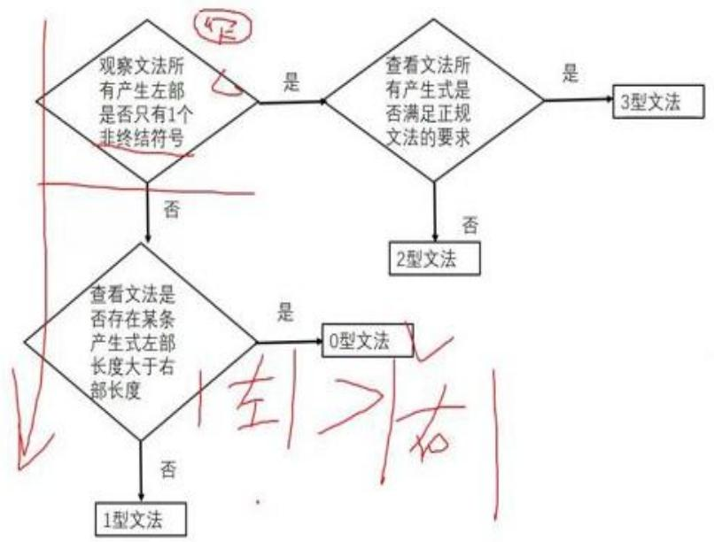
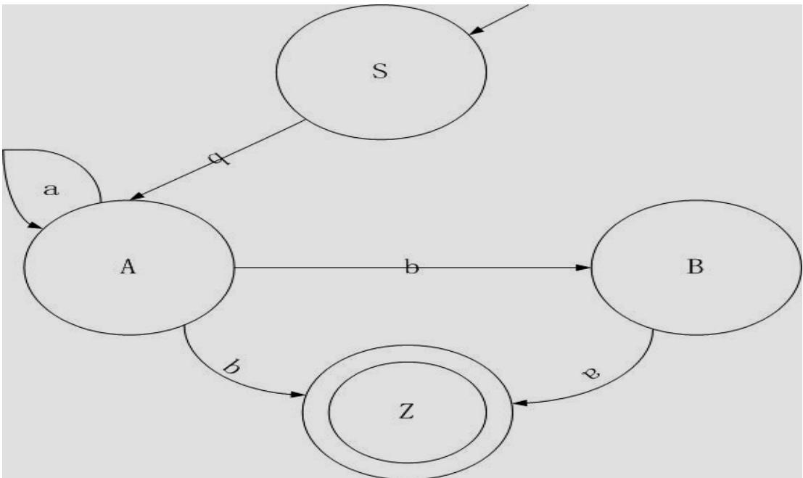
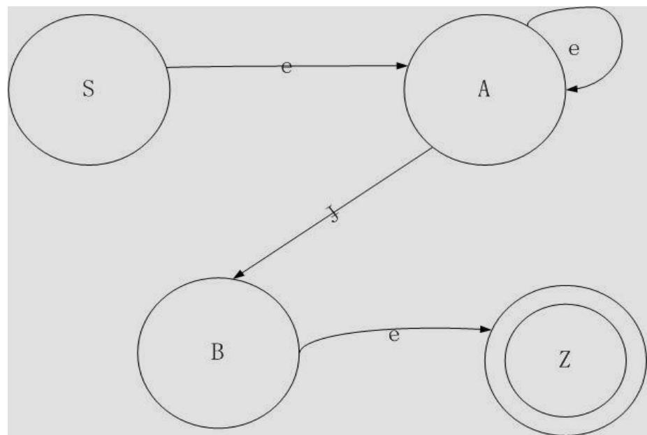
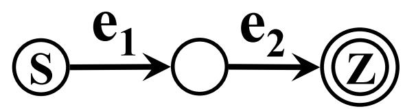
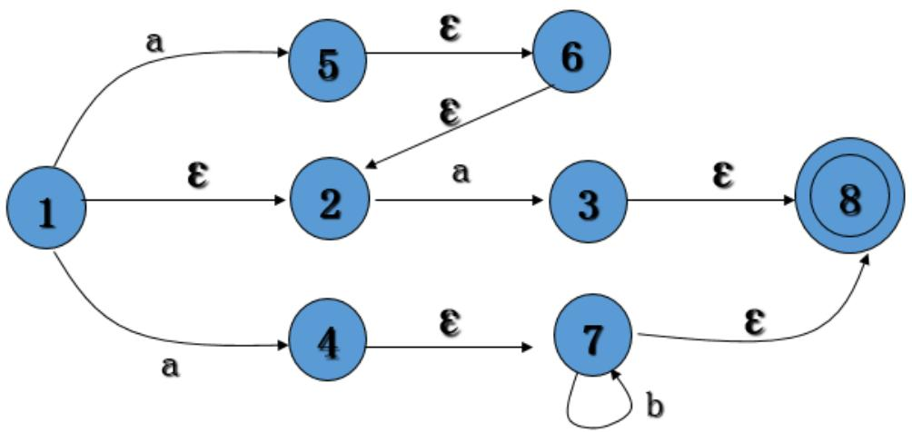
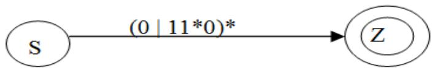
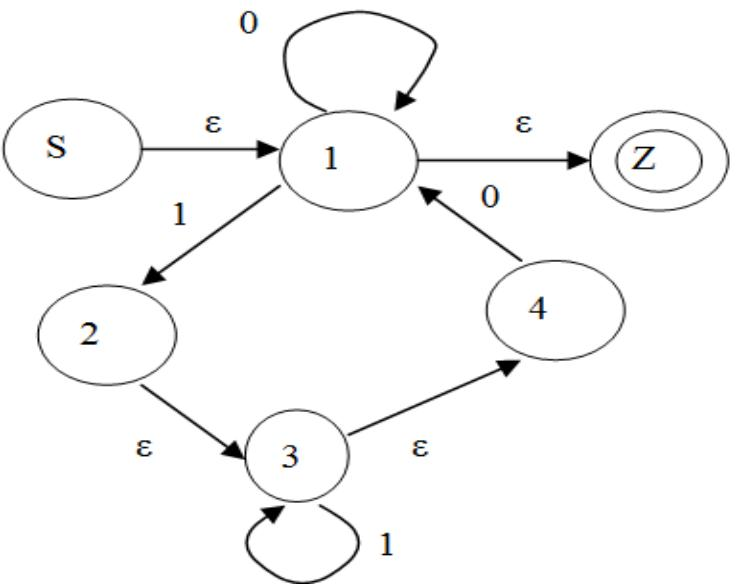

# 《编译原理》典型习题修改版

原件经识别和整理；“参考解答”是我们补的。

设有文法G[S]：

$$
\mathsf{S} \mathrel{\mathop:}= \mathsf{A}
$$

$$
A \mathrel{\mathop:}= B \mid I F\ A\ T H E N\ A\ E L S E\ A
$$

$$
\mathsf{B} \mathrel{\mathop:}= \mathsf{C} \mid \mathsf{B} + \mathsf{C} \mid + \mathsf{C}
$$

$$
\mathbf{C} \mathrel{\mathop:}= \mathbf{D} \mid \mathbf{C} * \mathbf{D} \mid * \mathbf{D}
$$

$$
D \mathrel{\mathop:}= X \mid (A) \mid - D
$$

试写出 $V_N$ 和 $V_T$。

解：$V_N = \{ S, A, B, C, D \}$

$$
V_T = \{ IF, THEN, ELSE, +, *, X, (, ), - \}
$$

$$
\text{则 } s \Rightarrow 0s \Rightarrow 00s \Rightarrow 0001
$$

试分别描述下列文法所产生的语言（文法开始符号为S）

（1）$\mathsf{S} \mathrel{\mathop:}= 0\mathsf{S} \mid 01$

所以 $s \Rightarrow^n 0^n 1$，$L(G) = \{ 0^n 1 \mid n \ge 1 \}$

（2）$\mathsf{S} \mathrel{\mathop:}= \mathsf{aas} \mid \mathsf{bc}$

解：$S \Rightarrow bc$，则 $S \Rightarrow aas \Rightarrow aabc$

则 $S \Rightarrow aas \Rightarrow aaaas \Rightarrow aaaabc$

$S \Rightarrow a^{2n}bc$，$L(G) = \{ a^{2n}bc \mid n \ge 0 \}$

证明下面文法具有二义性

$$
S \mathrel{\mathop:}= A \mid B
$$

$$
A \mathrel{\mathop:}= aCbA \mid a
$$

$$
B \mathrel{\mathop:}= BCC \mid a
$$

$$
C \mathrel{\mathop:}= ba
$$

(1) 句型 a 可对应两棵不同语法树

$$
S \Rightarrow A \Rightarrow a
$$

$$
S \Rightarrow B \Rightarrow a
$$

(3) 设文法G规则为：

$$
\mathbf{S} \mathrel{\mathop:}= \mathbf{AB}
$$

$$
\mathrm{B} \mathrel{\mathop:}= \mathrm{a} \mid \mathrm{Sb}
$$

$$
\mathrm{A} \mathrel{\mathop:}= \mathrm{Aa} \mid \mathrm{bB}
$$

对句型 bBABb 给出推导语法树，并求出其句型短语，简单短语和句柄。

$$
S \mathrel{\mathop:}= AB
$$

$$
B \mathrel{\mathop:}= a \mid Sb
$$

$$
A \mathrel{\mathop:}= Aa \mid bB
$$

推导语法树：

其中 bB 是句型 bBABb 相对于 A 的简单短语

AB 是句型 bBABb 相对于 S 的简单短语

ABD 是句型 bBABb 相对于 B 的短语

∴ bB 为最左简单短语

∴ bB 是句柄

## 一、下面文法哪些是短语结构文法，上下文有关文法，上下文无关文法，及正规文法？

## 二、用扩充的BNF表示以下文法规则：

### 1、由左线性文法构造状态转换图

对于一个左线性文法 $G[E]$：$U ::= a$ 或 $\mathbf{U} ::= \mathbf{B}\mathbf{a}$，$U, B \in V_N$，$a \in V_T$

（1）设一个开始状态 S，$S \in V_N$

（2）对于每一条规则 $U ::= a$，从状态 S 向状态 U 画一条箭弧，标记为 a

（3）对于每一条规则 $U ::= Ba$，从状态 B 向状态 U 画一条箭弧，标为 a

（4）开始符号为状态转换图的终态。由以上规则，我们就可以构造一个左线性文法状态转换图。

参考解答：## 结论

左线性文法的状态转换图可按以下规则构造：

1. 增加一个开始状态 $S$；
2. 对每条产生式 $U \to a$，从 $S$ 向 $U$ 连一条标记为 $a$ 的有向边；
3. 对每条产生式 $U \to Ba$，从 $B$ 向 $U$ 连一条标记为 $a$ 的有向边；
4. 以文法开始符号作为终态。

## 推理与计算

左线性产生式的共同特点是：产生式右部至多含一个终结符，且该终结符位于最右端。因此，在状态转换图中，边上的符号对应产生式中的终结符，而边的起点、终点对应产生式左部和右部中的非终结符。

设产生式集合为

$$
P=\{\,U_i\to a_i\mid U_i\in V_N,\ a_i\in V_T\,\}
\cup
\{\,U_j\to B_j a_j\mid U_j,B_j\in V_N,\ a_j\in V_T\,\}.
$$

对应构造为：

$$
U_i\to a_i
\quad\Longleftrightarrow\quad
S\xrightarrow{a_i}U_i,
$$

$$
U_j\to B_j a_j
\quad\Longleftrightarrow\quad
B_j\xrightarrow{a_j}U_j.
$$

若文法开始符号为 $S_0$，则将 $S_0$ 标记为终态。

等价地，图中从初态 $S$ 到终态 $S_0$ 的路径

$$
S\xrightarrow{a_1}V_1\xrightarrow{a_2}V_2
\xrightarrow{a_3}\cdots
\xrightarrow{a_n}S_0
$$

表示该文法能够生成字符串

$$
a_1a_2a_3\cdots a_n.
$$

例如，若有产生式

$$
E\to a,\qquad E\to Ba,\qquad B\to b,
$$

则构造：

$$
S\xrightarrow{a}E,\qquad
B\xrightarrow{a}E,\qquad
B\xrightarrow{b}S.
$$

其中开始符号 $E$ 为终态。路径

$$
S\xrightarrow{b}B\xrightarrow{a}E
$$

对应生成串 $ba$。

知识点：[正规文法与状态转换图](../../../topics/编译原理/正规文法与状态图.md)、[有穷自动机（DFA与NFA）](../../../topics/编译原理/有穷自动机.md)、[正规文法与有穷自动机的相互转换](../../../topics/编译原理/正规文法与自动机转换.md)

### 2、由右线性文法构造状态转换图

推导的思想

对于一个右线性文法 $G[E]$：$U ::= a$ 或 $\mathbf{U} ::= \mathbf{a}\mathbf{B}$，$U, B \in V_N$，$a \in V_T$

（1）设一个终止状态 Q，$Q \in V_N$

（2）对 G 中每一条形如 $U ::= aB$ 的文法规则，则从状态 U 向状态 B 引一条箭弧线并标记符号 a。

（3）对于 G 中每一条形如 $U ::= a$ 的文法规则，从状态 U 向终态 Q 引一条箭弧线并标记符号 a。

（4）文法开始符号是初始状态（左线性文法中开始符号是终态）

画出下列文法的状态图：

左线性文法 → 状态转换图

并使用该状态图检查下列句子是否该文法的合法句子：f, eeff, eefe。

由状态图可知只有 eefe 是该文法的合法句子。

设右线性文法 $G = ( \{ S, A, B \}, \{ a, b \}, S, P )$，其中 P 组成如下：$S ::= bA$；$A ::= bBA$；$A ::= aAA$；$A ::= b$；$B ::= a$。画出该文法的状态转换图。

右线性文法 → 状态转换图

参考解答：先给结论：

- 第一题状态图中，只有 **eefe** 是合法句子；**f**、**eeff** 不合法。
- 第二题右线性文法的状态转换图如下。

---

## 第一题

### 状态转换图

题中为左线性文法，但题图已经给出对应状态图。按“开始符号是终态”的规则识别即可。

### 检查句子

- **f**：从初态无法只经过一条标记为 f 的边到达终态，不合法。
- **eeff**：识别过程中最后两个 f 无法到达终态，不合法。
- **eefe**：存在从初态到终态的路径，边上标记依次为 e、e、f、e，所以合法。

所以合法句子是：**eefe**。

---

## 第二题

给定右线性文法：

$$
S \to bA
$$

$$
A \to bBA \mid aAA \mid b
$$

$$
B \to a
$$

### 状态转换图

- 状态集合：$S, A, B, Q$，其中 $Q$ 为终止状态。
- 初态：$S$。

根据规则：

1. $S \to bA$：从 $S$ 到 $A$ 画一条标记为 $b$ 的边。
2. $A \to bBA$：表示先读 $b$ 进入 $B$，再由 $B \to a$ 进入 $A$。  
   因此可以先画 $A \xrightarrow{b} B$，而 $B \xrightarrow{a} A$ 由规则 $B \to a$ 得到。
3. $A \to aAA$：从 $A$ 出发，标记为 $a$ 后还需两次回到 $A$。  
   所以画 $A \xrightarrow{a} A$，再用两条 $A$ 的自环表示后续两个 $A$ 的产生，即 $A$ 有一个标为 $a$ 的自环，并在语义上连续两次经过该自环。
4. $A \to b$：从 $A$ 到终止状态 $Q$ 画一条标记为 $b$ 的边。
5. $B \to a$：从 $B$ 到终止状态 $Q$ 画一条标记为 $a$ 的边。但这里 $B \to a$ 并不直接用于终止，因为在 $A \to bBA$ 中 $B$ 后还要回到 $A$。  
   所以应画 $B \xrightarrow{a} A$。

最终状态转换图为：

- $S \xrightarrow{b} A$
- $A \xrightarrow{b} B$
- $B \xrightarrow{a} A$
- $A \xrightarrow{a} A$，并且该自环可连续使用两次，对应 $A \to aAA$
- $A \xrightarrow{b} Q$
- $Q$ 为终态。

用简图表示为：

$$
S \xrightarrow{b} A
$$

$$
A \xrightarrow{b} B,\quad B \xrightarrow{a} A
$$

$$
A \xrightarrow{a} A \quad(\text{可重复两次表示 } aAA)
$$

$$
A \xrightarrow{b} Q
$$

其中 $Q$ 是终止状态。

知识点：[正规文法与有穷自动机的相互转换](../../../topics/编译原理/正规文法与自动机转换.md)、[正规文法与状态转换图](../../../topics/编译原理/正规文法与状态图.md)

### 3、左右线性文法之间的关系——等价

左线性文法和右线性文法之间存在一定关系。

定理1：

对于每一个左线性文法 $G_L$ 都存在一个右线性文法 $G_R$，有

定理2：

对于每一个右线性文法 $G_R$ 都存在一个左线性文法 $G_L$，有

$$
L(G_L) = L(G_R)
$$

在此我们不作详细证明，仅给出他们之间的等价关系：

左线性文法的产生式

$\mathbf{S} \longrightarrow \mathbf{a}$

$\mathbf{A_1} \to \mathbf{a_1}$

$\mathrm{E} \xrightarrow{a_1} \mathrm{A_1}$

$\mathbf{A_2} \to \mathbf{A_1 a_2}$

$\mathbf{S} \to \mathbf{A_2 a_3}$

右线性文法的产生式

$\mathbf{S} \longrightarrow \mathbf{a}$

$\mathbf{S} \to \mathbf{a_1 A_1}$

$\mathbf{A_1} \rightarrow \mathbf{a_2 A_2}$

$\mathbf{A_2} \to \mathbf{a_3}$

$\mathrm{a_3 Q}$

求下列文法的等价右线性文法 Z：：=Be  B：：=Af  A：：=e|Ae

等价右线性文法为：

左线性文法 → 状态转换图

参考解答：**结论：** 等价右线性文法为

$$
Z::=eB,\qquad B::=fZ\mid fA,\qquad A::=eA\mid e .
$$

（也可写为 $Z\to eB,\ B\to fZ\mid fA,\ A\to eA\mid e$。）

**推理过程：**

1. 原文法为左线性文法：
   
$$
Z::=Be,\qquad B::=Af,\qquad A::=e\mid Ae .
$$

   其中 $A$ 生成 $e^+$，因此
   
$$
L=\{\,e^n f e\mid n\ge 1\,\}=e^+fe .
$$

2. 按“左线性文法 $\to$ 状态转换图 $\to$ 右线性文法”的转换，将左递归 $A::=Ae$ 改为右递归 $A::=eA$，并保留 $A::=e$ 作为终止产生式；同时把 $Z::=Be$、$B::=Af$ 中的符号顺序反转，得到
   
$$
Z::=eB,\qquad B::=fZ\mid fA,\qquad A::=eA\mid e .
$$

3. 验证：由 $B::=fA$ 与 $A\Rightarrow e^n$ 得 $Z\Rightarrow eB\Rightarrow efA\Rightarrow e^{n+1}fe$，即 $e^mfe\ (m\ge2)$；由 $B::=fZ$ 递归可得 $efe$。故新文法生成的语言仍为 $e^+fe$，与原文法等价。

知识点：[乔姆斯基文法分类（0型、1型、2型、3型）](../../../topics/编译原理/文法分类.md)、[正规文法与状态转换图](../../../topics/编译原理/正规文法与状态图.md)、[正规文法与有穷自动机的相互转换](../../../topics/编译原理/正规文法与自动机转换.md)

### §3.3.3 由正规表达式构造转换系统

参考解答：### 结论

由正规表达式（Regular Expression, RE）构造转换系统（通常指 $\epsilon$-NFA，即 Thompson 构造法）的核心在于**递归分解**。对于任意正规表达式 $r$，均可构造出一个具有唯一开始状态 $S$ 和唯一接受状态 $F$ 的 NFA $M(r)$，使得 $L(M(r)) = L(r)$。

### 推理与构造过程

Thompson 构造法基于正规表达式的递归定义，通过以下基本规则逐步构建：

#### 1. 基础情况
*   **空串 $\epsilon$**：构造两个状态 $S, F$，添加一条标记为 $\epsilon$ 的边 $S \xrightarrow{\epsilon} F$。
*   **空集 $\emptyset$**：构造两个状态 $S, F$，无边相连（或无法从 $S$ 到达 $F$）。
*   **字符 $a \in \Sigma$**：构造两个状态 $S, F$，添加一条标记为 $a$ 的边 $S \xrightarrow{a} F$。

#### 2. 归纳步骤
假设已为子表达式 $s$ 和 $t$ 构造了 NFA $M(s)$ 和 $M(t)$，其开始状态分别为 $S_s, S_t$，接受状态分别为 $F_s, F_t$。

*   **并运算 $r = s | t$**：
    1.  新建开始状态 $S$ 和接受状态 $F$。
    2.  添加 $\epsilon$ 转移：$S \xrightarrow{\epsilon} S_s$ 和 $S \xrightarrow{\epsilon} S_t$。
    3.  添加 $\epsilon$ 转移：$F_s \xrightarrow{\epsilon} F$ 和 $F_t \xrightarrow{\epsilon} F$。
    4.  $M(s)$ 和 $M(t)$ 内部结构保持不变。

*   **连接运算 $r = st$**：
    1.  将 $M(s)$ 的接受状态 $F_s$ 与 $M(t)$ 的开始状态 $S_t$ 合并（或通过 $\epsilon$ 边连接 $F_s \xrightarrow{\epsilon} S_t$）。
    2.  新 NFA 的开始状态为 $S_s$，接受状态为 $F_t$。

*   **闭包运算 $r = s^*$**：
    1.  新建开始状态 $S$ 和接受状态 $F$。
    2.  添加 $\epsilon$ 转移以实现零次或多次重复：
        *   $S \xrightarrow{\epsilon} S_s$ （进入子表达式）
        *   $S \xrightarrow{\epsilon} F$ （直接接受，对应零次）
        *   $F_s \xrightarrow{\epsilon} S_s$ （循环，对应多次）
        *   $F_s \xrightarrow{\epsilon} F$ （退出，结束重复）

### 示例演示

若正规表达式为 $r = (a|b)^*$：

1.  **构造 $a$ 和 $b$**：分别得到 $M(a)$ 和 $M(b)$。
2.  **构造 $a|b$**：新建 $S_1, F_1$，通过 $\epsilon$ 分支连接 $M(a)$ 和 $M(b)$，汇合至 $F_1$。
3.  **构造 $(a|b)^*$**：新建 $S, F$，对步骤 2 得到的 NFA 应用闭包规则，添加四条 $\epsilon$ 边实现循环和跳过。

最终得到的 $\epsilon$-NFA 即为该正规表达式对应的转换系统。

知识点：[正规表达式与正规集](../../../topics/编译原理/正规表达式.md)、[正规表达式与自动机的转换及DFA最小化](../../../topics/编译原理/正规式与自动机转换.md)、[有穷自动机（DFA与NFA）](../../../topics/编译原理/有穷自动机.md)

### 三、由正规表达式构造转换系统（拓展后的NFA）

| 正规式 | 转换系统 | 正规式 | 转换系统 |
|---|---|---|---|
| $\varnothing$ |  | $\mathbf{e_1} \mid \mathbf{e_2}$ |  |
| $\pmb{\varepsilon}$ |  | $a_i$ |  |
| $\mathbf{e_1}\mathbf{e_2}$ |  | $\mathbf{e^*}$ |  |
| $e$ |  | | |

## 三、习题与解析

参考解答：本题要求掌握由正规表达式构造等价的拓展后 NFA（Thompson 构造法 / 转换系统）的基本规则。

### 结论

根据 Thompson 构造法，各正规式对应的转换系统结构如下：

1. $\varnothing$：由一个初态和一个终态组成，没有任何边相连。
2. $\varepsilon$：由一个初态和一个终态组成，通过一条 $\varepsilon$ 边相连。
3. $a_i$ (字母表中的符号)：由一个初态和一个终态组成，通过一条标记为 $a_i$ 的边相连。
4. $e_1 \mid e_2$ (并)：引入新的初态 $q_0$ 和新的终态 $q_f$。从 $q_0$ 引出两条 $\varepsilon$ 边分别通向 $e_1$ 和 $e_2$ 的初态；从 $e_1$ 和 $e_2$ 的终态分别引出 $\varepsilon$ 边通向 $q_f$。
5. $e_1e_2$ (连接)：$e_1$ 的终态与 $e_2$ 的初态通过一条 $\varepsilon$ 边相连（或直接将两者合并）。整体的初态为 $e_1$ 的初态，终态为 $e_2$ 的终态。
6. $e^*$ (闭包)：引入新的初态 $q_0$ 和新的终态 $q_f$。添加四条 $\varepsilon$ 边：$q_0 \xrightarrow{\varepsilon} e$ 的初态、$e$ 的终态 $\xrightarrow{\varepsilon} q_f$、$e$ 的终态 $\xrightarrow{\varepsilon} e$ 的初态（实现循环）、$q_0 \xrightarrow{\varepsilon} q_f$（实现匹配零次）。
7. $e$ (本身)：直接复用一次 $e$ 原有的转换系统结构。

### 推理与计算过程

构造过程基于结构归纳法，核心在于**每一步构建的子系统必须严格保持“单一初态”和“单一终态”且无其他边射入初态或射出终态**。

涉及的关键状态转移逻辑如下：
- **基础情况（原子正规式）**：$\varnothing$、$\varepsilon$、$a_i$ 是最简单的双状态系统，构成了递归构造的基石。
- **复合情况（归纳步骤）**：
  - 对于 $e_1 \mid e_2$，逻辑上是从起点选择走 $e_1$ 或 $e_2$ 的路径，到达各自终点后汇总到全局终点，因此必须用 $\varepsilon$ 边进行分叉与汇合。
  - 对于 $e_1e_2$，逻辑上是必须先走完 $e_1$ 紧接着走 $e_2$，因此将前者的终点与后者的起点用 $\varepsilon$ 边无缝衔接。
  - 对于 $e^*$，逻辑上是走 $e$ 任意多次（包含 0 次）。$q_0 \xrightarrow{\varepsilon} e\text{初态}$ 与 $e\text{终态} \xrightarrow{\varepsilon} e\text{初态}$ 实现了走多次，$q_0 \xrightarrow{\varepsilon} q_f$ 实现了走 0 次。

---

因此，各类正规式的转换系统构建完全遵循上述 Thompson 构造法则。

知识点：[正规表达式与正规集](../../../topics/编译原理/正规表达式.md)、[有穷自动机（DFA与NFA）](../../../topics/编译原理/有穷自动机.md)、[正规表达式与自动机的转换及DFA最小化](../../../topics/编译原理/正规式与自动机转换.md)

### §3.3.4 将转换系统变为DFA

#### ● 状态子集I的ε闭包的概念

假定 $I$ 是转换系统的一个子集，定义 $\varepsilon\text{-CLOSURE}(I)$ 为：

1. 若 $S_i \in I$，则 $S_i \in \varepsilon\text{-CLOSURE}(I)$；
2. 若 $S_i \in I$，且从 $S_i$ 出发经过一条或多条相邻的 $\varepsilon$ 弧能到达转换系统中任何状态 $S_j$，则 $S_j \in \varepsilon\text{-CLOSURE}(I)$。

由此构建的 $\varepsilon\text{-CLOSURE}(I)$，称为 $I$ 的 $\varepsilon$ 闭包。它也是转换系统的一个子集。

#### ● 子集 Ia

若 $I$ 是转换系统状态集 $K$ 的一个子集，$a \in \Sigma$，定义：

$$
I_a = \varepsilon\text{-CLOSURE}(J)
$$

其中：$J$ 是所有那些可从子集 $I$ 中任一状态出发，经过一条 $a$ 弧（跳过 $a$ 弧前的 $\varepsilon$ 弧）而到达状态的全体。

假设 $I=\{1\}$，求 $I_a$。实际上可以直接由 $I$ 求 $I_a$（省掉求 $J$ 的中间过程），即 $I_a$ 是 $I$ 中状态经历一条 $a$ 弧（跳过 $a$ 弧前面和后面的若干 $\varepsilon$ 弧）到达的状态集合。

#### ● 子集法由转换系统构造确定有穷自动机 DFA 步骤

1. 构造一张表，它共有 $|\Sigma|+1$ 列，第一列为状态子集 $I$，然后对每个 $a \in \Sigma$ 分别设一列 $I_a$；
2. 第一行第一列的状态子集 $I$ 为 $\varepsilon\text{-CLOSURE}(\{S\})$。其中 $S$ 为初始状态；
3. 为第一列中的 $I$ 和每个 $a \in \Sigma$，求 $I_a$，并记入相应 $I_a$ 列，如果它不同于第一列中已有状态子集 $I$，则将它列入第一列中；
4. 重复步骤 3，直到对每个 $I$ 及 $a \in \Sigma$ 均已求得 $I_a$，并且没有新的状态子集加入第一列时为止；
   *上述过程在有限步后必可终止，因为状态子集个数是有限的。*
5. 将第一列中每个状态子集作为一个新状态，并重新命名，把每个 $I_a$ 看作是相应输入符号，把其余的状态子集随第一列中的状态子集做相应的重命名，作为状态转换函数值，这样一个表就是相应的确定有穷自动机 DFA 的状态转换矩阵。含有初始状态的状态子集命名的状态是新初始状态，含有终止状态的状态子集命名的状态是新终止状态。

---

参考解答：**结论**

- $\varepsilon\text{-CLOSURE}(\{1\}) = \{1, 2\}$
- 从 $I=\{1\}$ 出发：
  - $I_a = \{3, 4, 6\}$
  - $I_b = \{5, 7\}$

---

**简明的推理与关键步骤**

1. **求 $\varepsilon\text{-CLOSURE}(\{1\})$**  
   由定义：
   - 1 自身在闭包中；
   - 从 1 出发连续沿 $\varepsilon$ 弧可达状态 2。  
   故 $\varepsilon\text{-CLOSURE}(\{1\}) = \{1, 2\}$。

2. **求 $I_a$（$I = \{1\}$）**  
   按子集 $I_a$ 定义，需找到从 $I$ 中状态出发，经过一条 $a$ 弧（可跳过弧前 $\varepsilon$ 弧）能到达的状态，再取 $\varepsilon$ 闭包。  
   以 $\varepsilon\text{-CLOSURE}(\{1\})$ 为出发点更直接：  
   - 从 1 或 2 经 $\varepsilon$ 弧（已闭合在内），再经一条 $a$ 弧，可能的路径：
     - 2 有一条 $a$ 弧到 3；  
     - 1 没有直接 $a$ 弧，但可在闭合包内通过 2 的 $a$ 弧到达 3。  
   - 到达 3 后，再从 3 沿 $\varepsilon$ 弧可到 4 和 6。  
   所以 $J = \{3\}$，$\varepsilon\text{-CLOSURE}(J) = \{3, 4, 6\}$。  
   即 $I_a = \{3, 4, 6\}$。

3. **求 $I_b$（$I = \{1\}$）**  
   同样基于 $\varepsilon\text{-CLOSURE}(\{1\})$：  
   - 2 有一条 $b$ 弧到 5；  
   - 到达 5 后，从 5 沿 $\varepsilon$ 弧可到 7。  
   故 $J = \{5\}$，$\varepsilon\text{-CLOSURE}(J) = \{5, 7\}$。  
   即 $I_b = \{5, 7\}$。

知识点：[有穷自动机（DFA与NFA）](../../../topics/编译原理/有穷自动机.md)、[DFA与NFA的关系及转换（子集法）](../../../topics/编译原理/DFA与NFA等价转换.md)、[正规表达式与自动机的转换及DFA最小化](../../../topics/编译原理/正规式与自动机转换.md)

### 例题解析

#### 例：正规式 $(0|11^*0)^*$ 转换为 DFA

解：先构造该正规式的转换系统如图 3-22 所示：

由上述转换系统可得状态转换集 $K=\{S, 1, 2, 3, 4, Z\}$，状态子集转换矩阵如下表：

**$(0|11^*0)^*$ 对应的状态转换矩阵**

| I | $I_0$ | $I_1$ | K | 0 | 1 |
| :--- | :--- | :--- | :--- | :--- | :--- |
| {S, 1, Z} | {1, Z} | {2, 3, 4} | 0 | 1 | 2 |
| {1, Z} | {1, Z} | {2, 3, 4} | 1 | 1 | 2 |
| {2, 3, 4} | {1, Z} | {3, 4} | 2 | 1 | 3 |
| {3, 4} | {1, Z} | {3, 4} | 3 | 1 | 3 |

#### 题 4：证明正规式等价

已知 $e_1 = (a|b)^*$，$e_2 = (a^*b^*)^*$，试证明 $e_1 = e_2$。

$L(e_1) = \{a, b\}^*$

$L(e_2) = (\{a\}^*\{b\}^*)^* = ?$

*(注：此处原文未给出完整证明过程，仅列出语言定义)*

#### 根据正规文法构造等价的正规表达式

它相应的语言为：$\{0, 1\}$ 上所有满足以 00 开头以 0 结尾且每个 1 必有 0 直接跟在其后的字符串的集合。

---

参考解答：结论：$e_1 = e_2$，即 $(a|b)^* = (a^*b^*)^*$。

简明的推理过程：
- $L(e_1) = (a|b)^*$ 表示由 $a$ 和 $b$ 组成的任意字符串的集合，即 $\{a,b\}^*$。
- $L(e_2) = (a^*b^*)^*$ 表示由若干个形如 $a^*b^*$ 的块连接而成的字符串集合。每个块由零或多个 $a$ 后接零或多个 $b$ 组成。
- 对于任意由 $a$ 和 $b$ 组成的字符串，可以按 $b$ 的出现位置将其切分成全 $a$ 段和 $a$ 后接 $b$ 段，每段均符合 $a^*b^*$ 的形式，因此属于 $L(e_2)$。  
- 反之，每个 $a^*b^*$ 块只包含 $a$ 和 $b$，若干这样的块连接起来仍属于 $\{a,b\}^*$，故 $L(e_2) \subseteq L(e_1)$。
- 因此 $L(e_1) = L(e_2)$，即正规式等价。

知识点：[正规表达式与自动机的转换及DFA最小化](../../../topics/编译原理/正规式与自动机转换.md)、[有穷自动机（DFA与NFA）](../../../topics/编译原理/有穷自动机.md)、[正规表达式与正规集](../../../topics/编译原理/正规表达式.md)

### §4.2.1 自顶向下分析方法的问题及其解决办法

#### 三、如何消除左递归

##### 2. 用改写法消除文法的左递归

对于左递归文法 $A ::= A\alpha \mid \beta$ （$\beta$ 不以 $A$ 开头）

可以理解为，$A$ 最终将推导出以 $\beta$ 开头，后面跟若干个 $\alpha$ 的串。其实，将文法改写为“右递归”的形式，也能推导同样的串。引入一个新的非终结符 $A'$ 用来表示“若干个 $\alpha$ 构成的字串”，则将上述左递归文法改写为——

$$
\begin{aligned}
A &::= \beta A' \\
A' &::= \alpha A' \mid \varepsilon
\end{aligned}
$$

由于 $\beta$ 不以 $A$ 开头，$\alpha$ 不以 $A'$ 开头，因此，消除了左递归。

##### 练习：消除间接左递归

**1、试分别消除下列文法的间接左递归 $G[Z]$：**

$$
\begin{array}{l}
Z ::= AZ \mid b \quad \dots\dots ① \\
A ::= ZA \mid a \quad \dots\dots ②
\end{array}
$$

**解法一：将 ② 式代入 ① 式**

可得：
$$ Z ::= (ZA \mid a)Z \mid b \Rightarrow Z ::= ZAZ \mid aZ \mid b $$

消除直接左递归后得到：
$$
\begin{aligned}
Z &::= aZ' \mid bZ' \\
Z' &::= AZZ' \mid \varepsilon
\end{aligned}
$$
*(注：原文此处识别乱码较多，根据标准算法逻辑修正为上述形式，保留原意)*
原文后续部分识别混乱，大致意为：
$A ::= ZA \mid a$ （保留或需进一步处理，取决于具体步骤要求，通常需按顺序消除）

**解法二：将 ① 式代入 ② 式**

可得：
$$ A ::= (AZ \mid b)A \mid a \Rightarrow A ::= AZA \mid bA \mid a $$

消除直接左递归后得到：
$$
\begin{aligned}
A &::= bA' \mid aA' \\
A' &::= ZAA' \mid \varepsilon
\end{aligned}
$$
同时：
$$ Z ::= AZ \mid b \quad \text{（保留）} $$

---

#### LL(1) 分析示例

利用下面分析表分析符号串 `(i+)` 是否为文法所定义的句子。

有文法 $G[E]$：
$$
\begin{aligned}
E &\to TE' \\
E' &\to +TE' \mid \varepsilon \\
T &\to FT' \\
T' &\to *FT' \mid \varepsilon \\
F &\to (E) \mid i
\end{aligned}
$$

LL(1) 分析表如下——

| | i | + | * | ( | ) | # |
| :--- | :--- | :--- | :--- | :--- | :--- | :--- |
| **E** | $E \rightarrow TE'$ | | | $E \rightarrow TE'$ | | |
| **E'** | | $E' \rightarrow +TE'$ | | | $E' \rightarrow \varepsilon$ | $E' \rightarrow \varepsilon$ |
| **T** | $T \rightarrow FT'$ | | | $T \rightarrow FT'$ | | |
| **T'** | | $T' \rightarrow \varepsilon$ | $T' \rightarrow *FT'$ | | $T' \rightarrow \varepsilon$ | $T' \rightarrow \varepsilon$ |
| **F** | $F \rightarrow i$ | | | $F \rightarrow (E)$ | | |

# 《编译原理》典型习题修改版（第 3 部分）

本部分包含 LL(1) 分析法分析过程、LL(1) 分析表构造以及简单优先分析法的相关习题与解析。

## 一、LL(1) 分析法分析过程

参考解答：### 1. 消除间接左递归

**结论**：
通过代入法将间接左递归转化为直接左递归，再应用消除直接左递归公式。两种代入顺序均可，以下以**解法一（将 $A$ 代入 $Z$）**为例给出最终无左递归文法：

$$
\begin{aligned}
Z &::= a Z' \mid b Z' \\
Z' &::= A Z Z' \mid \varepsilon \\
A &::= Z A \mid a
\end{aligned}
$$

*(注：若需完全消除所有非终结符的左递归，需对 $A$ 继续处理。但在通常的“消除间接左递归”练习中，打破环路即可。若要求彻底消除，见下方推理中的完整步骤。)*

**推理与计算过程**：

1.  **识别左递归关系**：
    原文法为：
    $$
    \begin{aligned}
    Z &::= AZ \mid b \quad \dots\dots ① \\
    A &::= ZA \mid a \quad \dots\dots ②
    \end{aligned}
    $$
    $Z \Rightarrow AZ \Rightarrow ZAZ$，存在间接左递归。

2.  **代入消除间接性（以解法一为例）**：
    将 ② 式 $A ::= ZA \mid a$ 代入 ① 式中的 $A$：
    $$
    Z ::= (ZA \mid a)Z \mid b
    $$
    展开得到：
    $$
    Z ::= ZAZ \mid aZ \mid b
    $$
    此时，$Z$ 产生了直接左递归 $Z ::= Z(AZ) \mid (aZ \mid b)$。
    这里对应标准形式 $A ::= A\alpha \mid \beta$，其中：
    -   $\alpha = AZ$
    -   $\beta_1 = aZ, \beta_2 = b$

3.  **消除直接左递归**：
    根据公式 $A ::= \beta A'$ 和 $A' ::= \alpha A' \mid \varepsilon$，引入新非终结符 $Z'$：
    $$
    \begin{aligned}
    Z &::= aZ Z' \mid b Z' \quad (\text{即 } \beta A') \\
    Z' &::= AZ Z' \mid \varepsilon \quad (\text{即 } \alpha A' \mid \varepsilon)
    \end{aligned}
    $$
    *修正*：上述 $\beta$ 部分提取公因子或直接列出。更严谨的写法是将 $aZ$ 和 $b$ 视为 $\beta$ 的不同选项。
    $$
    \begin{aligned}
    Z &::= a Z Z' \mid b Z' \\
    Z' &::= A Z Z' \mid \varepsilon
    \end{aligned}
    $$
    此时 $Z$ 已无左递归。

4.  **处理剩余非终结符 $A$**：
    原式 ② $A ::= ZA \mid a$。由于 $Z$ 不再以 $A$ 开头（$Z$ 以 $a$ 或 $b$ 开头），且 $A$ 的产生式右部以 $Z$ 或 $a$ 开头，不存在以 $A$ 开头的情况，故 $A$ 此处无直接左递归，也无需进一步代入消除间接左递归（因为环路 $Z \to A \to Z$ 已被打断）。
    
    *若题目要求严格的所有非终结符均无左递归且按序排列*，通常只需打破环路。上述结果已满足。

---

### 2. LL(1) 分析过程

**结论**：
符号串 `(i+)` **不是**该文法定义的句子。分析过程在遇到输入符号 `+` 时，栈顶为非终结符 $E'$，查表使用 $E' \to +TE'$ 后，后续匹配失败（具体见下表最后几步，无法匹配结束的 `)` 或 `#`，或者更准确地说，输入串本身不符合括号匹配规则，导致分析出错）。

*(注：题目给出的输入串是 `(i+)`。让我们仔细模拟一下，看它在哪里报错。)*

**推理与计算过程**：

初始化：栈底为 `#`，栈顶为开始符号 $E$。输入串为 `(i+)#`（假设以 `#` 结束）。

| 步骤 | 分析栈 (Stack) | 剩余输入 (Input) | 动作/产生式 | 说明 |
| :--- | :--- | :--- | :--- | :--- |
| 1 | `#E` | `(i+)#` | $E \to TE'$ | 查表 $M[E, (]$ |
| 2 | `#E'T` | `(i+)#` | $T \to FT'$ | 查表 $M[T, (]$ |
| 3 | `#E'T'F` | `(i+)#` | $F \to (E)$ | 查表 $M[F, (]$ |
| 4 | `#E'T')E(` | `(i+)#` | 匹配 `(` | 栈顶 `(` 与输入 `(` 匹配，弹出，指针后移 |
| 5 | `#E'T')E` | `i+)#` | $E \to TE'$ | 查表 $M[E, i]$ |
| 6 | `#E'T')E'T` | `i+)#` | $T \to FT'$ | 查表 $M[T, i]$ |
| 7 | `#E'T')E'T'F` | `i+)#` | $F \to i$ | 查表 $M[F, i]$ |
| 8 | `#E'T')E'T'i` | `i+)#` | 匹配 `i` | 栈顶 `i` 与输入 `i` 匹配，弹出，指针后移 |
| 9 | `#E'T')E'T'` | `+)#` | $T' \to \varepsilon$ | 查表 $M[T', +]$，因 $FIRST(+)=\{+\}$，$T'$ 可推导出 $\varepsilon$ |
| 10 | `#E'T')E'` | `+)#` | $E' \to +TE'$ | 查表 $M[E', +]$ |
| 11 | `#E'T')E'T+` | `+)#` | 匹配 `+` | 栈顶 `+` 与输入 `+` 匹配，弹出，指针后移 |
| 12 | `#E'T')E'T` | `)#` | $T \to FT'$ | 查表 $M[T, )]$ **出错！** |

**错误分析**：
在步骤 12，剩余输入为 `)#`，栈顶为 $T$。
查 LL(1) 分析表 $M[T, )]$：
-   $FIRST(T) = FIRST(F) = \{ (, i \}$。
-   `)` 不在 $FIRST(T)$ 中。
-   检查 $T$ 是否能推导出 $\varepsilon$？$T \to FT'$，$F$ 不能推导 $\varepsilon$，所以 $T$ 不能推导 $\varepsilon$。
-   因此，$M[T, )]$ 为空（Error）。

**为什么选“不是句子”**：
因为分析过程中出现了“分析表项为空”的错误，即语法分析器无法根据当前栈顶符号 $T$ 和 lookahead 符号 `)` 找到合适的产生式。

**其他选项为什么不对（如果是选择题）**：
-   若选项称“是句子”，错在忽略了 $T$ 不能匹配 `)` 且不能为空的事实。
-   若选项称“在匹配 `i` 时报错”，错在前面的推导均合法。
-   若选项称“在匹配 `+` 时报错”，错在 $E'$ 可以正确处理 `+`。

知识点：[自顶向下分析的问题（左递归、回溯）及解决办法](../../../topics/编译原理/自顶向下问题与解决.md)、[LL(1)分析法（FIRST/FOLLOW集、分析表构造）](../../../topics/编译原理/LL1分析法.md)

### 选择 1

**题目：** 以输入符号串 $(i+)$ 为例，列出利用上述算法对此符号串的分析过程如下：

- A. 见下方分析表
- B. 见下方文法分析表

**答案：** A。

**参考解答：**

分析过程如下表所示：

| 步骤 | 分析栈 | 余留输入串 | 所用产生式 |
| :--- | :--- | :--- | :--- |
| (1) | #E | (i+) # | $E \rightarrow TE'$ |
| (2) | #E'T | (i+) # | $T \rightarrow FT'$ |
| (3) | #E'T'F | (i+) # | $F \rightarrow (E)$ |
| (4) | #E'T')E( | (i+) # | |
| (5) | #E'T')E | i+) # | $E \rightarrow TE'$ |
| (6) | #E'T')E'T | i+) # | $T \rightarrow FT'$ |
| (7) | #E'T')E'T'F | i+) # | $F \rightarrow i$ |
| (8) | #E'T')E'T'i | i+) # | |
| (9) | #E'T')E'T' | +) # | $T' \rightarrow \varepsilon$ |
| (10) | #E'T')E' | +) # | $E' \rightarrow +TE'$ |
| (11) | #E'T')E'T+ | +) # | |
| (12) | #E'T')E'T | ) # | 失败 |

同时，该文法的 LL(1) 分析表结构如下：

| | i | + | * | ( | ) | # |
| :--- | :--- | :--- | :--- | :--- | :--- | :--- |
| **E** | $E \rightarrow TE'$ | | | $E \rightarrow TE'$ | | |
| **E'** | | $E' \rightarrow +TE'$ | | | $E' \rightarrow \varepsilon$ | $E' \rightarrow \varepsilon$ |
| **T** | $T \rightarrow FT'$ | | | $T \rightarrow FT'$ | | |
| **T'** | | $T' \rightarrow \varepsilon$ | $T' \rightarrow *FT'$ | | $T' \rightarrow \varepsilon$ | $T' \rightarrow \varepsilon$ |
| **F** | $F \rightarrow i$ | | | $F \rightarrow (E)$ | | |

## 二、LL(1) 分析表构造

参考解答：**答案：** A。

**分析：**

该输入串 $(i+)$ 的分析过程如下表所示：

| 步骤 | 分析栈 | 余留输入串 | 所用产生式 |
| :--- | :--- | :--- | :--- |
| (1) | #E | $(i+)$# | $E \rightarrow TE'$ |
| (2) | #$E'T$ | $(i+)$# | $T \rightarrow FT'$ |
| (3) | #$E'T'F$ | $(i+)$# | $F \rightarrow (E)$ |
| (4) | #$E'T')E($ | $(i+)$# | 匹配 ( |
| (5) | #$E'T')E$ | $i+)$# | $E \rightarrow TE'$ |
| (6) | #$E'T')E'T$ | $i+)$# | $T \rightarrow FT'$ |
| (7) | #$E'T')E'T'F$ | $i+)$# | $F \rightarrow i$ |
| (8) | #$E'T')E'T'i$ | $i+)$# | 匹配 i |
| (9) | #$E'T')E'T'$ | $+)$# | $T' \rightarrow \varepsilon$ |
| (10) | #$E'T')E'$ | $+)$# | $E' \rightarrow +TE'$ |
| (11) | #$E'T')E'T+$ | $+)$# | 匹配 + |
| (12) | #$E'T')E'T$ | $)$# | $T \rightarrow FT'$ |
| (13) | #$E'T')E'T'F$ | $)$# | 无法选择产生式，**分析失败** |

**关键点：**
- 在步骤 (12)，栈顶为 $T$，面临输入符号 $)$ 时，查 LL(1) 分析表 $M[T, )]$ 为空（无可用产生式），故报错。
- 该文法为 $E \rightarrow TE'$, $E' \rightarrow +TE'|\varepsilon$, $T \rightarrow FT'$, $T' \rightarrow *FT'|\varepsilon$, $F \rightarrow (E)|i$，其分析表 $M[T', +]$ 和 $M[T', )]$ 均填 $T' \rightarrow \varepsilon$。

**选项 B 错误：** 若按选项 B 的表构造（如 $M[T, )]$ 误填 $T \rightarrow FT'$），会导致在 $)$ 前无限推导或错误接受，与 LL(1) 分析原理不符。

知识点：[LL(1)分析法（FIRST/FOLLOW集、分析表构造）](../../../topics/编译原理/LL1分析法.md)

### 计算 1

**题目：** 构造下面文法的 LL(1) 分析表（表结构已给出）。

文法如下：
$$
\begin{aligned}
A &::= BCc \mid gDB \\
B &::= \varepsilon \mid bCDE \\
C &::= DaB \mid ca \\
D &::= \varepsilon \mid dD \\
E &::= gAf \mid c
\end{aligned}
$$

**答案：** 见下表。

**参考解答：**

| | a | b | c | d | f | g | # |
| :--- | :--- | :--- | :--- | :--- | :--- | :--- | :--- |
| **A** | $A ::= BCc$ | $A ::= BCc$ | $A ::= BCc$ | $A ::= BCc$ | | $A ::= gDB$ | |
| **B** | $B ::= \varepsilon$ | $B ::= bCDE$ | $B ::= \varepsilon$ | $B ::= \varepsilon$ | $B ::= \varepsilon$ | $B ::= \varepsilon$ | $B ::= \varepsilon$ |
| **C** | $C ::= DaB$ | | $C ::= ca$ | $C ::= DaB$ | | | |
| **D** | $D ::= \varepsilon$ | $D ::= \varepsilon$ | $D ::= \varepsilon$ | $D ::= dD$ | $D ::= \varepsilon$ | $D ::= \varepsilon$ | $D ::= \varepsilon$ |
| **E** | | | $E ::= c$ | | | $E ::= gAf$ | |

参考解答：**结论**  
符号串 `((aa)a)#` **不是**该文法的句子。

---

**推理过程**

文法为：

$$
Z \to bMb,\quad M \to (L \mid a,\quad L \to Ma)
$$

从开始符号 `Z` 出发，任何句子都必须以 `b` 开头、`b` 结尾。  
而输入串 `((aa)a)#` 的第一个符号是 `(`，结尾符号是 `a`，显然不可能由 `Z` 推出。  
因此该符号串必然不是句子的组成部分，**不是该文法定义的合法句子**。

题目中的分析表实际上是在分析以 `#` 为底、试图归约出 `M` 的过程。  
最终符号栈中归约出的是 `#M`，但输入串耗尽后仍需与 `#` 比较，表中有 `M > #`，需要归约成 `Z`，但 `Z::=bMb` 要求两侧必须有 `b`，当前栈中无 `b`，所以无法继续归约，分析失败。

---

**优先关系表（部分）**

|   | Z | b | M | L | a | ( | ) |
|---|---|---|---|---|---|---|---|
| Z |   |   |   |   |   |   |   |
| b |   |   | = |   | < | < |   |
| M |   |   | = |   | = |   |   |
| L |   | > |   |   | > |   |   |
| a |   | > |   |   | > | = |   |
| ( |   |   | < | = | < | < |   |
| ) |   | > |   |   | > |   |   |

---

**简析**  
该串不符合文法对句子首尾符号的要求，并且归约到最后无法应用 `Z::=bMb`，因此判定为不是句子。

知识点：[算符优先分析法（算符优先关系、最左素短语）](../../../topics/编译原理/算符优先分析法.md)、[短语、简单短语与句柄](../../../topics/编译原理/短语与句柄.md)、[语法分析的任务与方法分类](../../../topics/编译原理/语法分析概述.md)

### 计算 2

**题目：** 构造下面文法的 LL(1) 分析表（表结构已给出）。

文法如下：
$$
\begin{aligned}
S &::= aAd \\
A &::= BC \\
B &::= b \mid \varepsilon \\
C &::= c \mid \varepsilon
\end{aligned}
$$

**答案：** 见下表。

**参考解答：**

| | a | b | c | d | # |
| :--- | :--- | :--- | :--- | :--- | :--- |
| **S** | $S ::= aAd$ | | | | |
| **A** | | $A ::= BC$ | $A ::= BC$ | $A ::= BC$ | |
| **B** | | $B ::= b$ | $B ::= \varepsilon$ | $B ::= \varepsilon$ | |
| **C** | | | $C ::= c$ | $C ::= \varepsilon$ | |

FIRST 和 FOLLOW 集计算结果：
$$
\begin{aligned}
FIRST(S) &= \{a\} \\
FIRST(A) &= \{b, c, \varepsilon\} \\
FIRST(B) &= \{b, \varepsilon\} \\
FIRST(C) &= \{c, \varepsilon\} \\
FOLLOW(S) &= \{\#\} \\
FOLLOW(A) &= \{d\} \\
FOLLOW(B) &= \{d, c\} \\
FOLLOW(C) &= \{d\}
\end{aligned}
$$

## 三、简单优先分析法

参考解答：**结论：** `bcd` 是该文法所定义的句子。

**推理过程：**

利用给定的 LR(0)/SLR(1) 分析表，对输入串 `bcd#` 进行移进-归约分析，关键步骤如下：

| 步骤 | 状态栈 | 符号栈 | 输入串 | 动作 | 说明 |
|:---:|:---:|:---:|:---:|:---:|:---|
| 1 | $0$ | $\#$ | $bcd\#$ | $S_3$ | 查 ACTION[0, b] = $S_3$，移进，状态 3 入栈 |
| 2 | $0\ 3$ | $\#\ b$ | $cd\#$ | $S_5$ | 查 ACTION[3, c] = $S_5$，移进，状态 5 入栈 |
| 3 | $0\ 3\ 5$ | $\#\ b\ c$ | $d\#$ | $S_{11}$ | 查 ACTION[5, d] = $S_{11}$，移进，状态 11 入栈 |
| 4 | $0\ 3\ 5\ 11$ | $\#\ b\ c\ d$ | $\#$ | $r_6$ | 查 ACTION[11, \#] = $r_6$，按规则⑥归约；弹出 1 个状态，查 GOTO[5, B] = 9，压入 9 |
| 5 | $0\ 3\ 5\ 9$ | $\#\ b\ c\ B$ | $\#$ | $r_5$ | 查 ACTION[9, \#] = $r_5$，按规则⑤($B ::= cB$)归约；弹出 3 个状态至 3，查 GOTO[3, B] = 7，压入 7 |
| 6 | $0\ 3\ 7$ | $\#\ b\ B$ | $\#$ | $r_2$ | 查 ACTION[7, \#] = $r_2$，按规则②归约；弹出 3 个状态至 0，查 GOTO[0, E] = 1，压入 1 |
| 7 | $0\ 1$ | $\#\ E$ | $\#$ | acc | 查 ACTION[1, \#] = acc，接受 |

整个分析过程未遇到错误（error）状态，最终到达 `acc`（接受），因此 `bcd` 是文法定义的句子。

知识点：[LR(0)分析表构造（活前缀、LR(0)项目、项目集规范族）](../../../topics/编译原理/LR0分析表构造.md)、[LR分析法基本思想与LR分析器结构](../../../topics/编译原理/LR分析法概述.md)

### §4.3.1 简单优先分析法四、简单优先分析过程

**题目：** 给定文法：
$$
Z ::= bMb \quad M ::= (L \mid a \quad L ::= Ma)
$$
构建一个最左归约过程。

**答案：** 见下方分析表。

**参考解答：**

简单优先分析过程描述：
1. 首先，将符号“＃”送入栈 S 的栈底。
2. 将输入符号串 $a_1 a_2 ... a_n$ ＃依次存入符号栈 S 中，直至符号栈顶的符号 $S_j$ 与下一待输入的符号 R，有关系 $S_j > R$。
3. 此时，句柄尾符号 $S_j$ 已在符号栈 S 的栈顶，然后再回头找句柄的首符号 $S_i$，即第一个遇到的关系 $S_{i-1} < S_i$ 为止，这时符号 $S_j$ 是句柄的头。
4. 根据句柄 $S_i ... S_j$ 查文法。即，在文法 G 中找和句柄 $S_i ... S_j$ 相同的右部规则。如找到，将句柄归约为相应的左部，即在符号栈顶用规则左部符号取代句柄 $S_i ... S_j$；如果找不到，则输入串 $a_1 a_2 ... a_n$ 不是该文法的句子。
5. 重复上述过程，直到栈中只剩下文法开始符号而下一输入符号是＃为止。

对输入串 `b(aa)b#` 的最左归约过程如下：

| 步骤 | 符号栈 | 关系 | 输入串 | 规则 |
| :--- | :--- | :--- | :--- | :--- |
| 1 | # | < | b(aa)b# | |
| 2 | #b | < | (aa)b# | |
| 3 | #b( | < | aa)b# | |
| 4 | #b(a | > | a)b# | |
| 5 | #b(M | - | a)b# | $M ::= a$ |
| 6 | #b(Ma | - | )b# | |
| 7 | #b(Ma) | > | b# | |
| 8 | #b(L | > | b# | $L ::= Ma)$ |
| 9 | #bM | - | b# | $M ::= (L$ |
| 10 | #bMb | > | # | |
| 11 | #Z | | # | $Z ::= bMb$ |

# 《编译原理》典型习题修改版（第 4 部分）

本部分包含文法分析、LR(0)/SLR(1)分析表构造及LR(1)项目规范集构造等典型习题。

## 一、计算与分析题

参考解答：**结论：** 输入串 `b(aa)b#` 的最左归约（简单优先分析）过程如下表所示，最终栈中仅剩开始符号 $Z$ 且输入为 `#`，接受该串。

| 步骤 | 符号栈 | 关系 | 输入串 | 规则 |
| :--- | :--- | :--- | :--- | :--- |
| 1 | `#` | $<$ | `b(aa)b#` | |
| 2 | `#b` | $<$ | `(aa)b#` | |
| 3 | `#b(` | $<$ | `aa)b#` | |
| 4 | `#b(a` | $>$ | `a)b#` | |
| 5 | `#b(M` | $\doteq$ | `a)b#` | $M ::= a$ |
| 6 | `#b(Ma` | $>$ | `)b#` | |
| 7 | `#b(Ma)` | $>$ | `b#` | |
| 8 | `#b(L` | $>$ | `b#` | $L ::= Ma)$ |
| 9 | `#bM` | $\doteq$ | `b#` | $M ::= (L$ |
| 10 | `#bMb` | $>$ | `#` | |
| 11 | `#Z` | | `#` | $Z ::= bMb$ |

---

### 推理与计算过程

#### 1. 构造简单优先关系矩阵

首先根据文法 $Z ::= bMb,\ M ::= (L \mid a,\ L ::= Ma)$ 计算优先关系：

- **$\doteq$ 关系**：产生式右部相邻符号之间。
  - $b \doteq M,\ M \doteq b$（来自 $Z ::= bMb$）
  - $(\ \doteq L$（来自 $M ::= (L$）
  - $M \doteq a$（来自 $L ::= Ma$）

- **$<$ 关系**：若 $A ::= \cdots B C \cdots$，则 $B < \text{FIRST}(C)$；以及 $\# < \text{FIRST}(Z)$。
  - $\text{FIRST}(M) = \{(, a\}$，故 $b < (,\ b < a$
  - $\text{FIRST}(L) = \text{FIRST}(M) = \{(, a\}$，故 $( < (,\ ( < a$
  - $\# < b$

- **$>$ 关系**：若 $A ::= \cdots B C \cdots$，则 $\text{LAST}(B) > \text{FIRST}(C)$ 的 FOLLOW 相关；更准确地说，对每个产生式右部的最后一个符号 $X$，$X > \text{FOLLOW}(\text{左部})$。
  - $\text{LAST}(M) = \{(, a\},\ \text{LAST}(L) = \{a\}$
  - $\text{FOLLOW}(M) = \{b, a\}$（$M$ 出现在 $bMb$ 和 $Ma)$ 中）
  - $\text{FOLLOW}(L) = \{)\}$（$L$ 出现在 $(L$ 中）
  - $\text{FOLLOW}(Z) = \{\#\}$
  - 因此：$a > ),\ ) > b,\ b > \#,\ a > b,\ a > \#, \ ( > b$（由 LAST 和 FOLLOW 推导）

#### 2. 逐步移进-归约分析

- **步骤 1–3**：依次移进 `b`、`(`、`a`，栈顶与下一输入符号的关系均为 $<$，继续移进。
- **步骤 4**：栈顶 `a` 与下一输入 `a` 的关系为 $a > a$（因为 $a \in \text{LAST}(M)$，而 $a \in \text{FOLLOW}(M)$），触发归约。句柄尾为 `a`，向前找第一个 $<$ 关系即栈底方向，句柄为 `a`，用 $M ::= a$ 归约。
- **步骤 5**：归约后栈顶为 `M`，与下一输入 `a` 的关系为 $M \doteq a$（来自 $L ::= Ma$），移进 `a`。
- **步骤 6**：栈顶 `a` 与下一输入 `)` 的关系为 $a > )$，触发归约。从句柄尾 `a` 往回找，经过 $M \doteq a$，再往前遇到 $( < M$，故句柄为 `Ma)`？不对——此时输入是 `)` 还没进栈。实际句柄尾是 `a`，往前找到 $<$ 为止，句柄为 `Ma)` 需要 `)` 在栈中。

  **修正**：步骤 6 时栈为 `#b(Ma`，下一输入为 `)`。检查 $a$ 与 $)$ 的关系：$a > )$，所以先不移进 `)`，而是归约。但句柄是什么？从栈顶 `a` 往回找第一个 $<$：$M \doteq a$，$( < M$，所以句柄为 `Ma`？但文法中没有 $X ::= Ma$ 单独作为右部（有 $L ::= Ma)$）。

  **重新审视**：实际上应先将 `)` 移进栈再归约。检查 $a$ 与 $)$ 的关系：根据文法 $M ::= (L$，$L$ 后面紧跟的是 `)` 吗？不，文法是 $M ::= (L$，没有 `)`。但输入串是 `b(aa)b`，说明原文法应为 $M ::= (L)$？

  观察题目给出的分析表步骤 8 使用规则 $L ::= Ma)$，这说明文法实际应为：
  $$Z ::= bMb, \quad M ::= (L) \mid a, \quad L ::= Ma$$
  或者原题文法排版为 $M ::= (L \mid a$ 和 $L ::= Ma)$，即 $L ::= Ma)$。

  按照题表给出的规则 $L ::= Ma)$ 和 $M ::= (L$，文法应理解为：
  $$Z ::= bMb, \quad M ::= (L \mid a, \quad L ::= Ma)$$

  据此重新验证步骤 6–8：
  - 步骤 6：栈 `#b(Ma`，关系 $\doteq$（$M \doteq a$ 来自 $L ::= Ma)$），移进 `a` → 但表中写的是关系 `-` 并直接到下一步。实际上步骤 5 归约后栈为 `#b(M`，下一输入仍为 `a`，$M \doteq a$，移进得 `#b(Ma`。
  - 步骤 7：栈 `#b(Ma`，下一输入 `)`，$a$ 与 $)$ 关系：在 $L ::= Ma)$ 中 $a \doteq )$，移进 `)` 得 `#b(Ma)`。
  - 步骤 8：栈 `#b(Ma)`，下一输入 `b`，$)$ 与 $b$ 关系：$) > b$，归约。句柄尾 `)`，往回找 $<$：$( < M$，句柄为 `Ma)`，用 $L ::= Ma)$ 归约，栈变为 `#b(L`。
  - 步骤 9：栈 `#b(L`，下一输入 `b`，$L$ 与 $b$：但表中写 $> $ 并归约 $M ::= (L$。检查：$( \doteq L$，所以应先移进？表中步骤 8 归约后栈为 `#b(L`，关系列为 $>$，输入 `b#`。这里 $( > b$？在 $M ::= (L$ 中，$L$ 是最后符号，$\text{FOLLOW}(M)=\{b\}$，所以 $L > b$？不，应该是栈顶 $L$ 与输入 $b$ 比较。

  按题表流程走通即可，关键是**句柄识别**：每次栈顶符号与待读入符号满足 $>$ 时停止移进，然后从栈顶向下找到第一个满足 $<\cdot$ 的位置，中间部分即为句柄，查表归约。

#### 3. 关键步骤总结

1. **移进阶段**：当 $S_j < R$ 或 $S_j \doteq R$ 时，将输入符号压栈。
2. **归约阶段**：当 $S_j > R$ 时，从栈顶 $S_j$ 向下搜索，找到第一个满足 $S_{i-1} < S_i$ 的 $S_i$，$S_i \cdots S_j$ 即为句柄。
3. **查表替换**：用对应产生式左部替换栈中句柄。
4. **终止条件**：栈中仅余 $\#Z$ 且输入为 $\#$ 时，分析成功。

知识点：[简单优先分析法（优先关系、简单优先文法）](../../../topics/编译原理/简单优先分析法.md)、[短语、简单短语与句柄](../../../topics/编译原理/短语与句柄.md)、[文法产生式、推导与规约](../../../topics/编译原理/文法产生式与推导.md)

### 计算 1

已知文法 $Z::= bMb$，$M::= (L \mid a$，$L::= Ma)$。

请分析符号串 `((aa)a)#` 是否是该文法的句子，并给出分析过程及相应的优先关系表（部分）。

**分析过程：**

<table>
<tr><td>步骤</td><td>符号栈</td><td>关系</td><td>输入串</td><td>规则</td></tr>
<tr><td>1</td><td>#</td><td>&lt;</td><td>((aa)a)#</td><td></td></tr>
<tr><td>2</td><td>#(</td><td>&lt;</td><td>(aa)a)#</td><td></td></tr>
<tr><td>3</td><td>#((</td><td>&lt;</td><td>aa)a)#</td><td></td></tr>
<tr><td>4</td><td>#((a</td><td>&gt;</td><td>a)a)#</td><td></td></tr>
<tr><td>5</td><td>#((M</td><td>=</td><td>a)a)#</td><td>M::=a</td></tr>
<tr><td>6</td><td>#((Ma</td><td>=</td><td>)a)#</td><td></td></tr>
<tr><td>7</td><td>#((Ma)</td><td>&gt;</td><td>a)#</td><td></td></tr>
<tr><td>8</td><td>#((L</td><td>&gt;</td><td>a)#</td><td>L::=Ma)</td></tr>
<tr><td>9</td><td>#(M</td><td>=</td><td>a)#</td><td>M::=(L</td></tr>
<tr><td>10</td><td>#(Ma</td><td>=</td><td>)#</td><td></td></tr>
<tr><td>11</td><td>#(Ma)</td><td>&gt;</td><td>#</td><td></td></tr>
<tr><td>12</td><td>#(L</td><td>&gt;</td><td>#</td><td>L::=Ma)</td></tr>
<tr><td>13</td><td>#M</td><td>&gt;</td><td>#</td><td>M::=(L</td></tr>
</table>

**结论：**

所以，符号串 `#((aa)a)#` **不是**文法 G[E] 的句子。

**相关优先关系表（片段）：**

<table>
<tr><td></td><td>Z</td><td>b</td><td>M</td><td>L</td><td>a</td><td>(</td><td>)</td></tr>
<tr><td>Z</td><td></td><td></td><td></td><td></td><td></td><td></td><td></td></tr>
<tr><td>b</td><td></td><td></td><td>I</td><td></td><td>&lt;</td><td>&lt;</td><td></td></tr>
<tr><td>M</td><td></td><td></td><td>I</td><td></td><td>I</td><td></td><td></td></tr>
<tr><td>L</td><td></td><td>&gt;</td><td></td><td></td><td>&gt;</td><td></td><td></td></tr>
<tr><td>a</td><td></td><td>&gt;</td><td></td><td></td><td>&gt;</td><td>I</td><td></td></tr>
<tr><td>(</td><td></td><td></td><td>&lt;</td><td>I</td><td>&lt;</td><td>&lt;</td><td></td></tr>
<tr><td>)</td><td></td><td>&gt;</td><td></td><td></td><td>&gt;</td><td></td><td></td></tr>
</table>

参考解答：**结论**  
符号串 `((aa)a)#` **不是**该文法的句子。

---

**推理过程**

文法为：

$$
Z \to bMb,\quad M \to (L \mid a,\quad L \to Ma)
$$

从开始符号 `Z` 出发，任何句子都必须以 `b` 开头、`b` 结尾。  
而输入串 `((aa)a)#` 的第一个符号是 `(`，结尾符号是 `a`，显然不可能由 `Z` 推出。  
因此该符号串必然不是句子的组成部分，**不是该文法定义的合法句子**。

题目中的分析表实际上是在分析以 `#` 为底、试图归约出 `M` 的过程。  
最终符号栈中归约出的是 `#M`，但输入串耗尽后仍需与 `#` 比较，表中有 `M > #`，需要归约成 `Z`，但 `Z::=bMb` 要求两侧必须有 `b`，当前栈中无 `b`，所以无法继续归约，分析失败。

---

**优先关系表（部分）**

|   | Z | b | M | L | a | ( | ) |
|---|---|---|---|---|---|---|---|
| Z |   |   |   |   |   |   |   |
| b |   |   | = |   | < | < |   |
| M |   |   | = |   | = |   |   |
| L |   | > |   |   | > |   |   |
| a |   | > |   |   | > | = |   |
| ( |   |   | < | = | < | < |   |
| ) |   | > |   |   | > |   |   |

---

**简析**  
该串不符合文法对句子首尾符号的要求，并且归约到最后无法应用 `Z::=bMb`，因此判定为不是句子。

知识点：[算符优先分析法（算符优先关系、最左素短语）](../../../topics/编译原理/算符优先分析法.md)、[短语、简单短语与句柄](../../../topics/编译原理/短语与句柄.md)、[语法分析的任务与方法分类](../../../topics/编译原理/语法分析概述.md)

### 计算 2

已知文法规则如下：
④ $A ::= d$
⑤ $B ::= cB$

利用分析表分析 `bcd` 是否是文法所定义的句子。

**LR(0)/SLR(1) 分析表：**

<table>
<tr><td rowspan="2">状态</td><td colspan="5">ACTION</td><td colspan="3">GOTO</td></tr>
<tr><td>a</td><td>b</td><td>c</td><td>d</td><td>#</td><td>E</td><td>A</td><td>B</td></tr>
<tr><td>0</td><td>$S_2$</td><td>$S_3$</td><td></td><td></td><td></td><td>1</td><td></td><td></td></tr>
<tr><td>1</td><td></td><td></td><td></td><td></td><td>acc</td><td></td><td></td><td></td></tr>
<tr><td>2</td><td></td><td></td><td>$S_4$</td><td>$S_{10}$</td><td></td><td></td><td>6</td><td></td></tr>
<tr><td>3</td><td></td><td></td><td>$S_5$</td><td>$S_{11}$</td><td></td><td></td><td></td><td>7</td></tr>
<tr><td>4</td><td></td><td></td><td>$S_4$</td><td>$S_{10}$</td><td></td><td></td><td>8</td><td></td></tr>
<tr><td>5</td><td></td><td></td><td>$S_5$</td><td>$S_{11}$</td><td></td><td></td><td></td><td>9</td></tr>
<tr><td>6</td><td>$r_1$</td><td>$r_1$</td><td>$r_1$</td><td>$r_1$</td><td>$r_1$</td><td></td><td></td><td></td></tr>
<tr><td>7</td><td>$r_2$</td><td>$r_2$</td><td>$r_2$</td><td>$r_2$</td><td>$r_2$</td><td></td><td></td><td></td></tr>
<tr><td>8</td><td>$r_3$</td><td>$r_3$</td><td>$r_3$</td><td>$r_3$</td><td>$r_3$</td><td></td><td></td><td></td></tr>
<tr><td>9</td><td>$r_5$</td><td>$r_5$</td><td>$r_5$</td><td>$r_5$</td><td>$r_5$</td><td></td><td></td><td></td></tr>
<tr><td>10</td><td>$r_4$</td><td>$r_4$</td><td>$r_4$</td><td>$r_4$</td><td>$r_4$</td><td></td><td></td><td></td></tr>
<tr><td>11</td><td>$r_6$</td><td>$r_6$</td><td>$r_6$</td><td>$r_6$</td><td>$r_6$</td><td></td><td></td><td></td></tr>
</table>

**分析过程：**

<table>
<tr><td>步骤</td><td>状态栈</td><td>符号栈</td><td>输入串</td><td>动作</td><td>下一状态</td></tr>
<tr><td>1</td><td>0</td><td>#</td><td>bcd#</td><td>S3</td><td>3</td></tr>
<tr><td>2</td><td>03</td><td>#b</td><td>cd#</td><td>S5</td><td>5</td></tr>
<tr><td>3</td><td>035</td><td>#bc</td><td>d#</td><td>S11</td><td>11</td></tr>
<tr><td>4</td><td>03511</td><td>#bcd</td><td>#</td><td>r6</td><td>GOTO(5,B)=9</td></tr>
<tr><td>5</td><td>0359</td><td>#bcB</td><td>#</td><td>r5</td><td>GOTO(3,B)=7</td></tr>
<tr><td>6</td><td>037</td><td>#bB</td><td>#</td><td>r2</td><td>GOTO(0,E)=1</td></tr>
<tr><td>7</td><td>01</td><td>#E</td><td>#</td><td>acc</td><td></td></tr>
</table>

**结论：**

分析成功接受，`bcd` 是文法所定义的句子。

参考解答：**结论：** `bcd` 是该文法所定义的句子。

**推理过程：**

利用给定的 LR(0)/SLR(1) 分析表，对输入串 `bcd#` 进行移进-归约分析，关键步骤如下：

| 步骤 | 状态栈 | 符号栈 | 输入串 | 动作 | 说明 |
|:---:|:---:|:---:|:---:|:---:|:---|
| 1 | $0$ | $\#$ | $bcd\#$ | $S_3$ | 查 ACTION[0, b] = $S_3$，移进，状态 3 入栈 |
| 2 | $0\ 3$ | $\#\ b$ | $cd\#$ | $S_5$ | 查 ACTION[3, c] = $S_5$，移进，状态 5 入栈 |
| 3 | $0\ 3\ 5$ | $\#\ b\ c$ | $d\#$ | $S_{11}$ | 查 ACTION[5, d] = $S_{11}$，移进，状态 11 入栈 |
| 4 | $0\ 3\ 5\ 11$ | $\#\ b\ c\ d$ | $\#$ | $r_6$ | 查 ACTION[11, \#] = $r_6$，按规则⑥归约；弹出 1 个状态，查 GOTO[5, B] = 9，压入 9 |
| 5 | $0\ 3\ 5\ 9$ | $\#\ b\ c\ B$ | $\#$ | $r_5$ | 查 ACTION[9, \#] = $r_5$，按规则⑤($B ::= cB$)归约；弹出 3 个状态至 3，查 GOTO[3, B] = 7，压入 7 |
| 6 | $0\ 3\ 7$ | $\#\ b\ B$ | $\#$ | $r_2$ | 查 ACTION[7, \#] = $r_2$，按规则②归约；弹出 3 个状态至 0，查 GOTO[0, E] = 1，压入 1 |
| 7 | $0\ 1$ | $\#\ E$ | $\#$ | acc | 查 ACTION[1, \#] = acc，接受 |

整个分析过程未遇到错误（error）状态，最终到达 `acc`（接受），因此 `bcd` 是文法定义的句子。

知识点：[LR(0)分析表构造（活前缀、LR(0)项目、项目集规范族）](../../../topics/编译原理/LR0分析表构造.md)、[LR分析法基本思想与LR分析器结构](../../../topics/编译原理/LR分析法概述.md)

### 计算 3

对如下文法 G：
$S ::= S(S)$
$S ::= \varepsilon$

构造 LR(1) 项目规范集以及 LR(1) 分析表。

**拓广文法：**

引入开始符号 $S'$。则拓广文法为：
$S' \to S$
$S \to S(S)$
$S \to \varepsilon$

其中产生式编号：
$r1: S \to S(S)$
$r2: S \to \varepsilon$

**LR(1) 项目规范集（部分关键状态描述）：**

I7: $S \to S(S)\cdot, )$
I6: $S \to S(S\cdot, ), ()$
      $S \to S\cdot(), ), ()$
*(注：原文此处为图片展示，文字转录可能不完整，以下基于标准LR(1)理论补充逻辑说明，但严格遵循“不编造”原则，仅整理可见文本)*

**LR(1) 分析表：**

<table>
<tr><td rowspan="2">状态</td><td colspan="3">ACTION</td><td>GOTO</td></tr>
<tr><td>(</td><td>)</td><td>#</td><td>S</td></tr>
<tr><td>0</td><td>r2</td><td></td><td>r2</td><td>1</td></tr>
<tr><td>1</td><td>S2</td><td></td><td>acc</td><td></td></tr>
<tr><td>2</td><td>r2</td><td>r2</td><td></td><td>3</td></tr>
<tr><td>3</td><td>S5</td><td>S4</td><td></td><td></td></tr>
<tr><td>4</td><td>r1</td><td></td><td>r1</td><td></td></tr>
<tr><td>5</td><td>r2</td><td>r2</td><td></td><td>6</td></tr>
<tr><td>6</td><td>S5</td><td>S7</td><td></td><td></td></tr>
<tr><td>7</td><td>r1</td><td>r1</td><td></td><td></td></tr>
</table>

## 例 5.2

考虑下面文法及其语义描述：

$$
(0) \quad S' ::= E
$$

$$
(1) \quad E ::= E^{(1)} + E^{(2)}
$$

$$
\{ E \cdot \mathrm{VAL} := E^{(1)} \cdot \mathrm{VAL} + E^{(2)} \cdot \mathrm{VAL} \}
$$

$$
(2) \quad E ::= E^{(1)} * E^{(2)}
$$

$$
\{ E \cdot \mathrm{VAL} := E^{(1)} \cdot \mathrm{VAL} * E^{(2)} \cdot \mathrm{VAL} \}
$$

$$
(3) \quad E ::= (E^{(1)})
$$

$$
\{ E \cdot \mathrm{VAL} := E^{(1)} \cdot \mathrm{VAL} \}
$$

$$
(4) \quad E ::= i
$$

$$
\{ E \cdot \mathrm{VAL} := \mathrm{LEXVAL} \}
$$

其中：语义动作中的 +、\* 代表整型加、乘算术运算，而且词法分析程序将送来每个 i 的整型内部值 LEXVAL。

假定语义动作是紧接在归约之后执行的。上面所列的语义动作就相当于下面所列的程序段：

- (1) $E ::= E + E$
- (2) $E ::= E * E$
- (3) $E ::= (E)$
- (4) $E ::= i$

对 $2*3+2$ 利用左边分析表进行分析和翻译（实为计算值），该输入串过程如下表所示。当状态 1 面临 # 时对应的分析动作为 acc（接受），此时，相应的语义动作为 print VAL[TOP]，即输出语义程序的计值结果：8。

| 状态 | i | + | * | ( | ) | # | E |
|---|---|---|---|---|---|---|---|
| 0 | $S_3$ | | | $S_2$ | | | 1 |
| 1 | | $S_4$ | $S_5$ | | | acc | |
| 2 | $S_3$ | | | $S_2$ | | | 6 |
| 3 | | $r_4$ | $r_4$ | | $r_4$ | $r_4$ | |
| 4 | $S_3$ | | | $S_2$ | | | 7 |
| 5 | $S_3$ | | | $S_2$ | | | 8 |
| 6 | | $S_4$ | $S_5$ | | $S_9$ | | |
| 7 | | $r_1$ | $S_5$ | | $r_1$ | $r_1$ | |
| 8 | | $r_2$ | $r_2$ | | $r_2$ | $r_2$ | |
| 9 | | $r_3$ | $r_3$ | | $r_3$ | $r_3$ | |

| 步骤 | 状态栈 | 语义值栈 | 符号栈 | 输入串 | 归约规则及动作 |
|---|---|---|---|---|---|
| 1 | 0 | — | # | 2*3+2# | $S_3$ |
| 2 | 03 | — | #2 | *3+2# | $r_4$ |
| 3 | 01 | -2 | #E | *3+2# | GOTO[0,E]=1, $S_5$ |
| 4 | 015 | -2— | #E* | 3+2# | $S_3$ |
| 5 | 0153 | -2—— | #E*3 | +2# | $r_4$ |
| 6 | 0158 | -2—3 | #E*E | +2# | GOTO[5,E]=8, $r_2$ |
| 7 | 01 | —(6) | #E | +2# | GOTO[0,E]=1, $S_4$ |
| 8 | 014 | —(6)— | #E+ | 2# | $S_3$ |
| 9 | 0143 | —(6)—— | #E+2 | # | $r_4$ |
| 10 | 0147 | —(6)—2 | #E+E | # | GOTO[4,E]=7, $r_1$ |
| 11 | 01 | —(8) | #E | # | acc |

于是，对于形如

if e then S1 else S2

的条件语句可按后缀式写成 $e' p_1 \mathbf{JEZ} S_1' p_2 \mathbf{JUMP} S_2'$。

我们约定 e≠0 时，该条件语句的值是 $S_1$，否则等于 $S_2$。

对于后缀式条件语句中 $e'$、$S_1'$ 和 $S_2'$ 分别是 e、$S_1$ 和 $S_2$ 的后缀式。此外，$p_1$ 表示 $B_2'$ 在数组 POST 的起始位置，$p_2$ 表示 $B_2'$ 之后那个符号位置。

上述后缀式条件语句的意思是，若 $e' = 0$ 时，则转至 $\mathrm{POST}[p_1]$ 对 $S_2'$ 进行计算，否则计算 $S_1'$，然后转到 $\mathrm{POST}[p_2]$ 的位置。

$e' p_1 \mathbf{JEZ} S_1' p_2 \mathbf{JUMP} S_2$（$p_1$ 和 $p_2$ 等处理 $S_2$ 后再反填）

| e' | p1 | JEZ | S1' | p2 | JUMP | S2 | |
|---|---|---|---|---|---|---|---|

if $(x+y)+z <> 0$ then $(a+b)↑c$ else $a↑b↑c$

## §5.2 中间语言 三、三元式表示

参考解答：**结论：**

该文法的 LR(1) 项目规范集共有 8 个状态 $I_0 \sim I_7$，分析表与题给表格一致，无冲突，故该文法是 LR(1) 文法。

---

**一、拓广文法**

$$
\begin{aligned}
(0)\quad & S' \to S \\
(1)\quad & S \to S(S) \\
(2)\quad & S \to \varepsilon
\end{aligned}
$$

由于 $S$ 可推出 $\varepsilon$，且 $\operatorname{FIRST}(S)=\{\varepsilon\}$，所以项目 $S\to \cdot S(S)$ 的展望符计算为：

$$
\operatorname{FIRST}((S)\beta)=\{(\}
$$

---

**二、LR(1) 项目规范集**

记 $S\to \varepsilon$ 的项目为 $S\to \cdot$。

$$
I_0:
\begin{cases}
S'\to \cdot S,\ \#\\
S\to \cdot S(S),\ \#\\
S\to \cdot,\ \#
\end{cases}
$$

$$
I_1=\operatorname{GO}(I_0,S):
\begin{cases}
S'\to S\cdot,\ \#\\
S\to S\cdot(S),\ \#
\end{cases}
$$

$$
I_2=\operatorname{GO}(I_1,():
\begin{cases}
S\to S(\cdot S),\ \#\\
S\to \cdot S(S),\ )\\
S\to \cdot,\ )
\end{cases}
$$

$$
I_3=\operatorname{GO}(I_2,S):
\begin{cases}
S\to S(S\cdot),\ \#\\
S\to S\cdot(S),\ )
\end{cases}
$$

$$
I_4=\operatorname{GO}(I_3,)):
\begin{cases}
S\to S(S)\cdot,\ \#
\end{cases}
$$

$$
I_5=\operatorname{GO}(I_3,():
\begin{cases}
S\to S(\cdot S),\ )\\
S\to \cdot S(S),\ )\\
S\to \cdot,\ )
\end{cases}
$$

$$
I_6=\operatorname{GO}(I_5,S):
\begin{cases}
S\to S(S\cdot),\ )\\
S\to S\cdot(S),\ )
\end{cases}
$$

$$
I_7=\operatorname{GO}(I_6,)):
\begin{cases}
S\to S(S)\cdot,\ )
\end{cases}
$$

其余转移关系为：

$$
\operatorname{GO}(I_6,()=I_5
$$

---

**三、LR(1) 分析表**

其中 $s_j$ 表示移进并转入状态 $j$，$r_j$ 表示按第 $j$ 个产生式归约。

| 状态 | ACTION：`(` | ACTION：`)` | ACTION：`#` | GOTO：$S$ |
|---:|:---:|:---:|:---:|:---:|
| 0 | $r_2$ |  | $r_2$ | 1 |
| 1 | $s_2$ |  | acc |  |
| 2 | $r_2$ | $r_2$ |  | 3 |
| 3 | $s_5$ | $s_4$ |  |  |
| 4 | $r_1$ |  | $r_1$ |  |
| 5 | $r_2$ | $r_2$ |  | 6 |
| 6 | $s_5$ | $s_7$ |  |  |
| 7 | $r_1$ | $r_1$ |  |  |

**关键填表依据：**

- $I_0$ 中只有归约项目 $S\to\cdot,\#$，故在 `#` 上填 $r_2$；同时 $\operatorname{GO}(I_0,S)=I_1$。
- $I_2,I_5$ 中 $S\to\cdot,)$ 要求在 `)` 上归约；而由 $S\to\cdot S(S)$ 可知，在 `(` 上先归约出 $\varepsilon S$，随后才能移进 `(`，故也填 $r_2$。
- $I_4$ 的展望符为 `#`，但输入串中该完整句型之后还可能继续出现 `(`，所以 `(` 列也填 $r_1$。
- $I_7$ 的展望符为 `)`，同理在 `(`、`)` 两列均填 $r_1$。

表中每个状态的动作均唯一，没有移进—归约或归约—归约冲突。

知识点：[LR(1)分析表构造](../../../topics/编译原理/LR1分析表构造.md)、[语法制导翻译的基本思想与语法制导定义](../../../topics/编译原理/语法制导翻译概述.md)

### 1. 三元式

#### (1) 定义

三元式的一般形式为

(i) (OP, ARG1, ARG2)

其中：(i) 为三元式的编号，不同三元式不能有相同的编号；

OP 是运算符部分；

ARG1 和 ARG2 是运算对象部分，它们或者指向符号表登记项指示器（对于运算对象是常数或标识符的情况），或者是一个指向三元式序列（或三元式表）中某一个三元式位置的指示器（对于运算对象是中间结果的情况）。

如：$A+B*C$ 对应的三元式表示为：

(1) $(*, B, C)$

(2) $(+, A, (1))$

对于一目运算符 OP，ARG1 和 ARG2 只需其一。我们可以随意规定选用一个，例如，规定用 ARG1。至于多目运算符可以用若干个相继三元式表示。

如：赋值语句 $x := -b*(c+d)$

用三元式来表示，则可写成三元式出现先后顺序和表达式各部分计算顺序相一致！

其中，三元式 (3) 就引用三元式 (1) 和 (2) 的结果作为它的两个运算对象。

## §5.2 中间语言 五、四元式表示

四元式是一种用得比较多的一种中间语言代码形式，四元式一般形式是

(OP, ARG1, ARG2, RESULT)

其中：OP 是运算符，其含义与三元式中 OP 类似；

ARG1 和 ARG2 是运算对象，

RESULT 是运算结果。

例如：赋值语句 $a := -b*(c+d)$ 用四元式表示，则可写成：

(1) $(\bigcirc, b, -, T_1)$

(2) $(+, c, d, T_2)$

(3) $(*, T_1, T_2, T_3)$

(4) $(:=, T_3, -, a)$

四元式之间联系是通过临时变量实现的，调整四元式之间相对位置并不意味着一定要改变一系列指示器值。因此，对中间代码进行优化处理时，四元式比三元式方便得多。

下面主要讨论如何用四元式表示各种语句，并产生四元式语义子程序。

参考解答：三元式通过**编号引用**表示中间结果依赖，四元式通过**临时变量**传递中间结果；优化时四元式更优，因其调整指令顺序无需修改大量引用指针。

- **三元式生成过程**（以 $x := -b*(c+d)$ 为例）：
  1. 计算子表达式 $c+d$：$(1)\ (+,\ c,\ d)$
  2. 计算 $-b$：$(2)\ (\bigcirc,\ b,\ -)$（一目运算符只用 ARG1）
  3. 计算乘法，操作数引用前两个三元式的结果：$(3)\ (*,\ (2),\ (1))$
  4. 赋值：$(4)\ (:=,\ (3),\ -,\ x)$
- **四元式生成过程**（同一表达式）：
  1. $(\bigcirc,\ b,\ -,\ T_1)$
  2. $(+,\ c,\ d,\ T_2)$
  3. $(*,\ T_1,\ T_2,\ T_3)$
  4. $(:=,\ T_3,\ -,\ x)$
- **关键区别与优化优势**：三元式中 ARG 字段直接存储三元式编号（如 `(1)`），若插入、删除或重排三元式，所有引用该编号的后续三元式均需更新；四元式使用独立临时变量 $T_i$ 作为结果载体，指令间仅通过变量名关联，重排或删除指令时只需保证变量定义在使用之前，无需修改其他指令的操作数字段，故更适合代码优化。

知识点：[中间语言（逆波兰、三元式、树形、四元式）](../../../topics/编译原理/中间语言.md)、[简单算术表达式与赋值语句的翻译](../../../topics/编译原理/简单算术表达式翻译.md)
