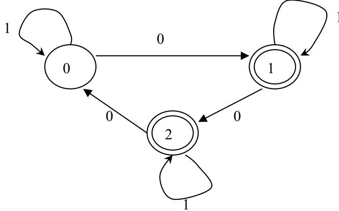

# 《编译原理》期末复习大纲（2017—2018学年第二学期）

原件经识别和整理；“参考解答”是我们补的。

---
title: 《编译原理》期末复习大纲（2017—2018学年第二学期）
kind: 复习要点
course: 编译原理
term: 2017-2018-2
source: <原件地址或来源路径>
---

# 《编译原理》期末复习大纲（2017—2018学年第二学期）

本资料整理自《编译原理》2017—2018学年第二学期期末复习大纲，涵盖题型分值、核心知识点及典型例题。

## 一、题型与分值（可能会微调）

1. 填空题：10 题 20 分
2. 判断题：5 题 10 分
3. 简答题：5 题 30 分
4. 解答题：2 题 30 分
5. 设计题：2 题 10 分

## 二、考试内容

### 00. BNF 范式

第一次采用形式化体系方法巴科斯—瑙尔范式（BNF）定义语法规则的语言是 Algol 语言。

知识点：[形式语言的提出与文法的引入](../../../topics/编译原理/形式语言与文法引入.md)

### 01. 基本概念

汇编程序、解释程序、编译程序的概念。

知识点：[翻译程序、编译程序与编译系统](../../../topics/编译原理/翻译程序与编译程序.md)、[编译的基本过程（词法、语法、语义、优化、目标代码生成）](../../../topics/编译原理/编译过程概述.md)、[编译器在计算机系统中的位置](../../../topics/编译原理/编译器与计算机系统.md)

### 02. 编译过程组成

编译过程的八大组成部分的名称——见第一章的框图 P7 图 1.4。

知识点：[编译的基本过程（词法、语法、语义、优化、目标代码生成）](../../../topics/编译原理/编译过程概述.md)

### 03. 分遍（趟程）

分遍（趟程）的概念及其适用情况。

知识点：[编译的基本过程（词法、语法、语义、优化、目标代码生成）](../../../topics/编译原理/编译过程概述.md)、[翻译程序、编译程序与编译系统](../../../topics/编译原理/翻译程序与编译程序.md)

### 04. 系统程序设计相关概念

系统程序设计语言、自编译、交叉编译的概念。

知识点：[编译程序的构建方法（T型图、自编译、自展、交叉编译、移植）](../../../topics/编译原理/编译程序构建方法.md)

### 05. 产生式与推导归约

产生式、文法、推导（推导的长度）与归约（不仅知道概念，要会灵活运用）。

知识点：[文法产生式、推导与规约](../../../topics/编译原理/文法产生式与推导.md)、[短语、简单短语与句柄](../../../topics/编译原理/短语与句柄.md)、[语法树、最左/最右推导与文法的二义性](../../../topics/编译原理/语法树与二义性.md)

### 06. 句型、句子与语言

句型、句子、语言（给文法写语言）、BNF（不仅知道概念，要会灵活运用）。

知识点：[文法产生式、推导与规约](../../../topics/编译原理/文法产生式与推导.md)、[语法树、最左/最右推导与文法的二义性](../../../topics/编译原理/语法树与二义性.md)、[文法的其他表示法（扩充BNF、语法图）](../../../topics/编译原理/文法其他表示法.md)

### 07. 符号分类

文法非终结符号 $V_N$、终结符号 $V_T$。

知识点：[字母表与符号串的基本概念](../../../topics/编译原理/字母表与符号串.md)、[文法产生式、推导与规约](../../../topics/编译原理/文法产生式与推导.md)、[形式语言的提出与文法的引入](../../../topics/编译原理/形式语言与文法引入.md)

### 08. 递归规则与文法

递归规则、递归文法的含义（消除文法的左递归 P78-79，作业也有相应习题）。

知识点：[文法产生式、推导与规约](../../../topics/编译原理/文法产生式与推导.md)、[语法树、最左/最右推导与文法的二义性](../../../topics/编译原理/语法树与二义性.md)、[乔姆斯基文法分类（0型、1型、2型、3型）](../../../topics/编译原理/文法分类.md)

### 09. 短语与句柄

短语、简单短语、句柄、素短语、最左素短语（P109，很重要，要会找）。

知识点：[短语、简单短语与句柄](../../../topics/编译原理/短语与句柄.md)、[语法树、最左/最右推导与文法的二义性](../../../topics/编译原理/语法树与二义性.md)、[算符优先分析法（算符优先关系、最左素短语）](../../../topics/编译原理/算符优先分析法.md)

### 10. 规范推导与归约

规范推导（最右推导）和规范归约（最左规约）（互为逆过程）。

知识点：[文法产生式、推导与规约](../../../topics/编译原理/文法产生式与推导.md)、[短语、简单短语与句柄](../../../topics/编译原理/短语与句柄.md)

### 11. 语法树

语法树（必须掌握）P27-28。

知识点：[语法树、最左/最右推导与文法的二义性](../../../topics/编译原理/语法树与二义性.md)

### 12. 文法的二义性

文法的二义性（会证明：找到一个句型画出两棵不同的语法树，或者找到一个句子有两个不同的最左（右）推导）。

知识点：[语法树、最左/最右推导与文法的二义性](../../../topics/编译原理/语法树与二义性.md)、[文法产生式、推导与规约](../../../topics/编译原理/文法产生式与推导.md)、[短语、简单短语与句柄](../../../topics/编译原理/短语与句柄.md)

### 13. 文法分类与自动机对应

文法和语言的分类、文法与自动机的对应。

知识点：[乔姆斯基文法分类（0型、1型、2型、3型）](../../../topics/编译原理/文法分类.md)、[有穷自动机（DFA与NFA）](../../../topics/编译原理/有穷自动机.md)

### 14. 文法压缩

会求一个文法的压缩过文法（课件上有专门的例子）。

知识点：[文法实用性限制与压缩过文法](../../../topics/编译原理/压缩过文法.md)

### 15. 扫描缓冲区

扫描缓冲区，超前搜索的概念和作用。

知识点：[单词的内部编码与预处理（超前搜索）](../../../topics/编译原理/单词编码与预处理.md)

### 16. 正规文法与状态转换图

正规文法和状态转换图转换（全套理解+掌握，左右线性文法都要会画）。

知识点：[正规文法与状态转换图](../../../topics/编译原理/正规文法与状态图.md)、[有穷自动机（DFA与NFA）](../../../topics/编译原理/有穷自动机.md)

### 17. 有穷自动机

有穷自动机的概念和特点（DFA和NFA的各自特点和区别）。

知识点：[有穷自动机（DFA与NFA）](../../../topics/编译原理/有穷自动机.md)、[DFA与NFA的关系及转换（子集法）](../../../topics/编译原理/DFA与NFA等价转换.md)、[正规文法与有穷自动机的相互转换](../../../topics/编译原理/正规文法与自动机转换.md)

### 18. 正规表达式与自动机转换

正规表达式（会求其正规集）和有穷自动机（含利用子集法把 NFA 转 DFA）（全套理解+掌握）见习题 P75 11 13。

知识点：[正规表达式与正规集](../../../topics/编译原理/正规表达式.md)、[有穷自动机（DFA与NFA）](../../../topics/编译原理/有穷自动机.md)、[DFA与NFA的关系及转换（子集法）](../../../topics/编译原理/DFA与NFA等价转换.md)

### 19. 文法转正规表达式

会利用解方程的方法把左线性或右线性文法转换为正规表达式 见习题 P75 18。

知识点：[正规表达式与正规集](../../../topics/编译原理/正规表达式.md)、[正规文法与有穷自动机的相互转换](../../../topics/编译原理/正规文法与自动机转换.md)

### 20. LL(1) 分析法

LL(1) 分析法（全套理解+掌握）P85-90 必须会求 First 和 Follow 集，会造表，会根据造出的分析表分析符号串（P87伪代码除外）。

知识点：[LL(1)分析法（FIRST/FOLLOW集、分析表构造）](../../../topics/编译原理/LL1分析法.md)、[自顶向下分析的问题（左递归、回溯）及解决办法](../../../topics/编译原理/自顶向下问题与解决.md)、[语法分析的任务与方法分类](../../../topics/编译原理/语法分析概述.md)

### 21. 简单优先分析法

简单优先分析法（文法优先关系的概念理解与掌握 P94-96；简单优先文法的概念和判别 P101；简单优先分析法 P103，L、R、L+，等于大于小于关系的求解思想）。

知识点：[简单优先分析法（优先关系、简单优先文法）](../../../topics/编译原理/简单优先分析法.md)、[算符优先分析法（算符优先关系、最左素短语）](../../../topics/编译原理/算符优先分析法.md)

### 22. 算符优先分析法

算符优先分析法（概念与判别 P104；算符文法、算符优先关系的概念理解与掌握 P104；L1、R1关系，等于大于小于关系的求解思想，最左素短语的作用 P109；算符优先分析法 P110）。

知识点：[算符优先分析法（算符优先关系、最左素短语）](../../../topics/编译原理/算符优先分析法.md)、[短语、简单短语与句柄](../../../topics/编译原理/短语与句柄.md)、[简单优先分析法（优先关系、简单优先文法）](../../../topics/编译原理/简单优先分析法.md)

### 23. LR 分析法

LR 分析法（LR(0)和 SLR(1)、LR(1) LALR(1) 全套理解+掌握，包括对活前缀、LR(0)、LR(1) LALR(1) 项目的理解、LR(0)闭包和LR(1)闭包的求解、LR分析法。P121-122构造识别活前缀的NFA不用掌握，）P115-125 可参看习题：P147-148 24 26 30 DFA+造分析表+分析符号串全套掌握。

知识点：[LR分析法基本思想与LR分析器结构](../../../topics/编译原理/LR分析法概述.md)、[LR(0)分析表构造（活前缀、LR(0)项目、项目集规范族）](../../../topics/编译原理/LR0分析表构造.md)、[SLR(1)分析表构造](../../../topics/编译原理/SLR1分析表构造.md)

### 24. 语法制导翻译

语法制导翻译的概念（记忆）P149。

知识点：[语法制导翻译的基本思想与语法制导定义](../../../topics/编译原理/语法制导翻译概述.md)

### 25. 中间语言

中间语言的分类（记忆）P154。

知识点：[中间语言（逆波兰、三元式、树形、四元式）](../../../topics/编译原理/中间语言.md)

### 26. 中缀后缀转换与四元式

中缀和后缀的相互转换 P155、会将赋值语句、条件语句转变为后缀表达式（POST数组）P156 会写出四元式序列。

## 三、典型例题

知识点：[中间语言（逆波兰、三元式、树形、四元式）](../../../topics/编译原理/中间语言.md)、[简单算术表达式与赋值语句的翻译](../../../topics/编译原理/简单算术表达式翻译.md)

### 例 1：构造 DFA

**题目**：构造一个 DFA，对于集合 $V_T = \{ 0, 1 \}$ ，构成的任意字符串中 0 的个数不能被 3 整除。

**解题思路**：该题应用电路图法。

假设：
- 状态 0 表示：构成的任意串中 0 的个数模 3 余 0，1 的个数无所谓；
- 状态 1 表示：构成的任意串中 0 的个数模 3 余 1，1 的个数无所谓；
- 状态 2 表示：构成的任意串中 0 的个数模 3 余 2，1 的个数无所谓；

很明显，状态 0 不能作为终止状态，但是恰好可作为初始状态，状态 1 和 2 都有可能是终止状态，这三个状态之间的关系用电路图法可表示如下 DFA：

知识点：[有穷自动机（DFA与NFA）](../../../topics/编译原理/有穷自动机.md)、[DFA与NFA的关系及转换（子集法）](../../../topics/编译原理/DFA与NFA等价转换.md)

### 例 2：源代码高亮着色设计

**题目**：在一个界面友好的源程序集成开发环境中，对不同类别的单词和符号进行不同颜色的区分，有助于程序员更好的完成源代码的撰写和开发任务。本题假设基于某种高级程序设计语言的子集开发了一个集成开发环境，要求对其在该开发环境中书写的源代码进行各类别单词的高亮着色，编程实现该功能。

知识点：[词法分析器的功能与在编译器中的地位](../../../topics/编译原理/词法分析器功能.md)、[单词的内部编码与预处理（超前搜索）](../../../topics/编译原理/单词编码与预处理.md)
