# 《编译原理》期末试题汇总（8套含答案）

按原件页序整理。原文中的“解”“答”等保留原件答案；“参考解答”为补充。

## 原件第1页

## 编译原理考试题及答案汇总

### 一、选择

1. 将编译程序分成若干个“遍”是为了\_B\_\_。
A．提高程序的执行效率
B. 使程序的结构更加清晰
C. 利用有限的机器内存并提高机器的执行效率
D. 利用有限的机器内存但降低了机器的执行效率

2. 正规式 MI 和 M2 等价是指\_C\_\_。
A. MI 和 M2 的状态数相等 B. M1 和 M2 的有向弧条数相等。
C. M1 和 M2 所识别的语言集相等 D. M1 和 M2 状态数和有向弧条数相等

3. 中间代码生成时所依据的是 $\mathrm{C}_{-}$ 。A. 语法规则 B. 词法规则 C. 语义规则 D. 等价变换规则

4. 后缀式 $ab + cd^{+}$ /可用表达式\_B\_来表示。A. $a + b / c + d$ B. $(a + b) / (c + d)$ C. $a + b / (c + d)$ D. $a + b + c / d$

6. 一个编译程序中，不仅包含词法分析，\_A\_\_\_\_，中间代码生成，代码优化，目标代码生成等五个部分。
A.（）语法分析 B.（）文法分析 C.（）语言分析 D.（）解释分析

7. 词法分析器用于识别\_C\_\_\_\_。
A.（）字符串 B.（）语句 C.（）单词 D.（）标识符

8. 语法分析器则可以发现源程序中的\_\_\_\_D\_\_\_\_。
A.（）语义错误    B.（）语法和语义错误
C.（）错误并校正    D.（）语法错误

9. 下面关于解释程序的描述正确的是\_\_B\_\_。
(1) 解释程序的特点是处理程序时不产生目标代码
(2) 解释程序适用于 COBOL 和 FORTRAN 语言
(3) 解释程序是为打开编译程序技术的僵局而开发的
A. () (1) (2)    B. () (1)    C. () (1) (2) (3)    D. () (2) (3)

10. 解释程序处理语言时，大多数采用的是\_B\_方法。
A.（）源程序命令被逐个直接解释执行
B.（）先将源程序转化为中间代码，再解释执行
C.（）先将源程序解释转化为目标程序，再执行
D.（）以上方法都可以

11. 编译过程中，语法分析器的任务就是\_\_B\_\_。
(1) 分析单词是怎样构成的 (2) 分析单词串是如何构成语句和说明的
(3) 分析语句和说明是如何构成程序的 (4) 分析程序的结构
A. () (2) (3) B. () (2) (3) (4) C. () (1) (2) (3) D. () (1) (2) (3) (4)

12. 编译程序是一种\_\_\_\_C\_\_。
A.（）汇编程序 B.（）翻译程序 C.（）解释程序 D.（）目标程序

13. 文法 G 所描述的语言是\_C\_\_\_\_的集合。
A.（）文法 G 的字母表 V 中所有符号组成的符号串
B.（）文法 G 的字母表 V 的闭包 V\* 中的所有符号串
C.（）由文法的开始符号推出的所有终极符串
D.（）由文法的开始符号推出的所有符号串

14. 文法分为四种类型，即 0 型、1 型、2 型、3 型。其中 3 型文法是\_\_\_\_B\_\_\_\_。

A. （）短语文法 B. （）正则文法 C. （）上下文有关文法 D. （）上下文无关文法 15. 一个上下文无关文法 G 包括四个组成部分，它们是：一组非终结符号，一组终结符号，一个开始符号，以及一组 \_\_D\_\_。
A. （）句子 B. （）句型 C. （）单词 D. （）产生式

16. 通常一个编译程序中，不仅包含词法分析，语法分析，中间代码生成，代码优化，目标代码生成等五个部分，还应包括\_C\_\_\_\_。

## 原件第2页

A.（）模拟执行器 B.（）解释器

C.（）表格处理和出错处理 D.（）符号执行器

17. 文法 G[N] = ( {b} , {N, B} , N, {N→b | bB, B→bN})，该文法所描述的语言是 C
A. () L(G[N]) = {bi | i ≥ 0}    B. () L(G[N]) = {b2i | i ≥ 0}
C. () L(G[N]) = {b2i + 1 | i ≥ 0} D. () L(G[N]) = {b2i + 1 | i ≥ 1}

18. 一个句型中的最左\_B\_\_\_\_称为该句型的句柄。
A.（）短语    B.（）简单短语    C.（）素短语    D.（）终结符号

19. 设 G 是一个给定的文法，S 是文法的开始符号，如果 S->x（其中 x∈V\*），则称 x 是文法 G 的一个\_\_\_\_B\_\_。
A. （）候选式 B. （）句型 C. （）单词 D. （）产生式

20. 文法 G[E] :
E → T | E + T
T → F | T \* F
F → a | ( E )

该文法句型 E + F \* (E + T) 的简单短语是下列符号串中的 \_\_\_\_。
① （E + T） ② E + T ③ F ④ F \* (E + T)
A.（）① 和 ③ B.（）② 和 ③ C.（）③ 和 ④ D.（）③

21. 若一个文法是递归的, 则它所产生的语言的句子\_A\_\_。
A.（）是无穷多个    B.（）是有穷多个
C.（）是可枚举的    D.（）个数是常量

22. 词法分析器用于识别\_\_\_\_C\_\_。
A.（）句子    B.（）句型    C.（）单词    D.（）产生式

23. 在语法分析处理中，FIRST 集合、 FOLLOW 集合、 SELECT 集合均是 B \_\_\_\_。
A．（）非终极符集 B．（）终极符集 C．（）字母表 D．（）状态集

24. 在自底向上的语法分析方法中，分析的关键是\_\_A\_\_。
A.（）寻找句柄    B.（）寻找句型    C.（）消除递归    D.（）选择候选式

25. 在 LR 分析法中，分析栈中存放的状态是识别规范句型\_\_C\_\_的 DFA 状态。
A.（）句柄    B.（）前缀    C.（）活前缀    D.（）LR(0) 项目

26. 文法 G 产生的\_D\_的全体是该文法描述的语言。
A.（）句型 B.（）终结符集 C.（）非终结符集 D.（）句子

27. 若文法 G 定义的语言是无限集，则文法必然是 \_\_\_\_ A \_\_\_\_
A.（）递归的    B.（）前后文无关的
C.（）二义性的    D.（）无二义性的

28. 四种形式语言文法中，1型文法又称为\_\_A\_\_文法。
A.（）短语结构文法    B.（）前后文无关文法
C.（）前后文有关文法    D.（）正规文法

29. 一个文法所描述的语言是\_\_A\_\_。
A.（）唯一的    B.（）不唯一的
C.（）可能唯一，好可能不唯一    D.（）都不对

31. \_B\_ 是两类程序语言处理程序。
A.（）高级语言程序和低级语言程序    B.（）解释程序和编译程序
C.（）编译程序和操作系统    D.（）系统程序和应用程序

32. 数组的内情向量中肯定不含有数组的\_A\_\_\_\_的信息。
A．（）维数    B．（）类型    C．（）维上下界    D．（）各维的界差

33. 一个上下文无关文法 G 包括四个组成部分，它们是：一组非终结符号，一组终结符号，一个开始符号，以及一组 \_D\_\_。
A.（）句子    B.（）句型

## 原件第3页

C.（）单词 D.（）产生式

34. 文法分为四种类型，即 0 型、1 型、2 型、3 型。其中 2 型文法是\_\_\_\_D\_\_。
A．（）短语文法    B．（）正则文法
C．（）上下文有关文法    D．（）上下文无关文法

35. 一个上下文无关文法 G 包括四个组成部分，它们是：一组非终结符号，一组终结符号，一个开始符号，以及一组 D \_\_\_\_。
A.（）句子    B.（）句型 C.（）单词    D.（）产生式

36. \_\_A\_\_是一种典型的解释型语言。
A. () BASIC B. () C C. () FORTRAN D. () PASCAL

37. 与编译系统相比，解释系统\_\_\_\_D\_\_。
A.（）比较简单，可移植性好，执行速度快
B.（）比较复杂，可移植性好，执行速度快
C．（）比较简单，可移植性差，执行速度慢
D.（）比较简单，可移植性好，执行速度慢

38. 用高级语言编写的程序经编译后产生的程序叫\_\_B\_\_。
A.（）源程序 B.（）目标程序 C.（）连接程序 D.（）解释程序

39. 编写一个计算机高级语言的源程序后，到正式上机运行之前，一般要经过\_\_B\_\_这几
步:
(1) 编辑 (2) 编译 (3) 连接 (4) 运行
A. () (1) (2) (3) (4) B. () (1) (2) (3) C. () (1) (3) D. () (1) (4)

40. 把汇编语言程序翻译成机器可执行的目标程序的工作是由\_A\_完成的。
A.（）编译器    B.（）汇编器
C.（）解释器 D.（）预处理器

41. 词法分析器的输出结果是\_C\_\_。
A.（）单词的种别编码 B.（）单词在符号表中的位置
C.（）单词的种别编码和自身值 D.（）单词自身值

42. 文法 G : S→xSx|y 所识别的语言是\_C\_\_。
A. () xyx B. () (xyx)\* C . () xnyxn(n≥0) D. () x\*yx\*

43. 如果文法 G 是无二义的，则它的任何句子 α \_\_\_\_A\_\_\_\_。
A.（）最左推导和最右推导对应的语法树必定相同
B.（）最左推导和最右推导对应的语法树可能不同
C.（）最左推导和最右推导必定相同
D.（）可能存在两个不同的最左推导，但它们对应的语法树相同

44. 构造编译程序应掌握\_\_\_\_D\_\_\_\_。
A.（）源程序    B.（）目标语言
C.（）编译方法 D.（）以上三项都是

45. 四元式之间的联系是通过\_B\_\_实现的。
A.（）指示器    B.（）临时变量
C.（）符号表    D.（）程序变量

46. 表达式( $\neg A \lor B) \land (C \lor D)$ 的逆波兰表示为\_\_B\_\_。
A. () $\neg AB \lor \wedge CD \lor$ B. () A $\neg B \lor CD \lor \wedge$ C. () AB $\lor$ CD $\lor$ $\wedge$ D. () A $\neg B \lor \wedge CD \lor$

47. 优化可生成\_D\_\_的目标代码。
A.（）运行时间较短 B.（）占用存储空间较小
C.（）运行时间短但占用内存空间大 D.（）运行时间短且占用存储空间小

48. 下列\_C\_优化方法不是针对循环优化进行的。
A．（）强度削弱    B．（）删除归纳变量
C．（）删除多余运算    D．（）代码外提

49. 编译程序使用\_\_B\_\_区别标识符的作用域。
A．（）说明标识符的过程或函数名
B．（）说明标识符的过程或函数的静态层次

## 原件第4页

C.（）说明标识符的过程或函数的动态层次
D．（）标识符的行号

50. 编译程序绝大多数时间花在\_\_\_\_D\_\_\_\_上。
A.（）出错处理 B.（）词法分析 C.（）目标代码生成 D.（）表格管理

51. 编译程序是对\_\_D\_\_。
A.（）汇编程序的翻译    B.（）高级语言程序的解释执行
C.（）机器语言的执行    D.（）高级语言的翻译

52. 采用自上而下分析，必须\_C\_\_。
A.（）消除左递归 B.（）消除右递归 C.（）消除回溯 D.（）提取公共左因子

53. 在规范归约中，用\_B\_来刻画可归约串。
A.（）直接短语 B.（）句柄
C.（）最左素短语 D.（）素短语

54. 若 a 为终结符，则 A -> α · aβ 为\_\_B\_\_项目。
A.（）归约    B.（）移进    C.（）接受    D.（）待约

55. 间接三元式表示法的优点为\_\_A\_\_。
A.（）采用间接码表，便于优化处理    B.（）节省存储空间，不便于表的修改
C.（）便于优化处理，节省存储空间    D.（）节省存储空间，不便于优化处理

56. 基本块内的优化为\_\_B\_\_。
A．（）代码外提，删除归纳变量    B．（）删除多余运算，删除无用赋值
C．（）强度削弱，代码外提    D．（）循环展开，循环合并

57. 在目标代码生成阶段，符号表用\_\_\_\_D\_\_\_\_。
A.（）目标代码生成 B.（）语义检查 C.（）语法检查 D.（）地址分配

58. 若项目集 Ik 含有 A -> a · ，则在状态 k 时，仅当面临的输入符号 a ∈ FOLLOW(A)

时，才采取“A -> a · ”动作的一定是\_\_D\_\_。
A．（）LALR 文法    B．（）LR(0)文法
C．（）LR(1)文法    D．（）SLR(1)文法

59. 堆式动态分配申请和释放存储空间遵守\_D\_\_原则。
A．（）先请先放    B．（）先请后放
C．（）后请先放    D．（）任意

### 二、判断

1. 计算机高级语言翻译成低级语言只有解释一种方式。(×)

2. 在编译中进行语法检查的目的是为了发现程序中所有错误。(×)

3. 甲机上的某编译程序在乙机上能直接使用的必要条件是甲机和乙机的操作系统功能完全相同。（√）

4. 正则文法其产生式为 A->a，A->Bb，A, B∈VN，a、b∈VT。（×）

5. 每个文法都能改写为 LL(1) 文法。（√）

6. 递归下降法不允许任一非终极符是直接左递归的。（√）

7. 算符优先关系表不一定存在对应的优先函数。（×）

8. 自底而上语法分析方法的主要问题是候选式的选择。（×）

9. LR 法是自顶向下语法分析方法。（×）

10. 简单优先文法允许任意两个产生式具有相同右部。（×）

11. “用高级语言书写的源程序都必须通过编译，产生目标代码后才能投入运行”这种说法。（×）

12. 若一个句型中出现了某产生式的右部，则此右部一定是该句型的句柄。（×）

13. 一个句型的句柄一定是文法某产生式的右部。（√）

14. 在程序中标识符的出现仅为使用性的。（×）

15. 仅考虑一个基本块，不能确定一个赋值是否真是无用的。（√）

16. 削减运算强度破坏了临时变量在一基本块内仅被定义一次的特性。（√）

## 原件第5页

17. 在中间代码优化中循环上的优化主要有不变表达式外提和削减运算强度。（×）
18. 数组元素的地址计算与数组的存储方式有关。（×）
19. 编译程序与具体的机器有关,与具体的语言无关。（×）
20. 递归下降分析法是自顶向上分析方法。（√）

21. 产生式是用于定义词法成分的一种书写规则。（×）

23. 在 SLR（1）分析法的名称中，S 的含义是简单的。（√）

24. 综合属性是用于 “自上而下” 传递信息。（×）

25. 符号表中的信息栏中登记了每个名字的属性和特征等有关信息，如类型、种属、所占单元大小、地址等等。（×）

26. 程序语言的语言处理程序是一种应用软件。（×）

27. 一个 LL(1) 文法一定是无二义的。（×）

28. 正规文法产生的语言都可以用上下文无关文法来描述。（×）

29. 一张转换图只包含有限个状态, 其中有一个被认为是初态, 最多只有一个终态。(√)

30. 目标代码生成时，应考虑如何充分利用计算机的寄存器的问题。（×）

34. 对于数据空间的存贮分配，FORTRAN 采用动态贮存分配策略。（×）

35. 编译程序是对高级语言程序的解释执行。（×）

36. 一个有限状态自动机中，有且仅有一个唯一的终态。（×）
37. 语法分析时必须先消除文法中的左递归。（×）

38. LR 分析法在自左至右扫描输入串时就能发现错误, 但不能准确地指出出错地点。(√)

39. 逆波兰表示法表示表达式时无须使用括号。（√）

40. 静态数组的存储空间可以在编译时确定。（×）

41. 进行代码优化时应着重考虑循环的代码优化，这对提高目标代码的效率将起更大作用。（×）

42. 两个正规集相等的必要条件是他们对应的正规式等价。(×)

43. 一个语义子程序描述了一个文法所对应的翻译工作。（×）
44. r 和 s 分别是正规式，则有 $L(r|s)=L(r)L(s)$ 。（×）

45. 确定的的自动机以及不确定的自动机都能正确地识别正集(√)

46. 分析作为单独的一遍来处理较好。（×）

47. LR 分析器的任务就是产生 LR 分析表。（√）

48. 归约和规范推导是互逆的两个过程。（√）

49. 同心集的合并有可能产生新的 “移进” / “归约” 冲突（×）

50.1R 分析技术无法适用二义文法。（×）

51树形表示和四元式不便于优化，而三元式和间接三元式则便于优化。（×）

52序中的表达式语句在语义翻译时不需要回填技术。（√）

### 三、填空

1. 编译程序的工作过程一般可以划分为词法分析,语法分析,语义分析,中间代码生成,代码优化等几个基本阶段,同时还会伴有\_表格处理\_和\_出错处理\_。

2. 若源程序是用高级语言编写的,\_\_\_\_目标程序\_\_\_\_是机器语言程序或汇编程序,则其翻译程序称为\_\_\_\_编译程序\_\_\_\_。

3. 编译方式与解释方式的根本区别在于\_\_\_\_是否生成目标代码\_\_\_\_。

4. 对编译程序而言,输入数据是\_\_\_\_源程序\_\_\_\_,输出结果是\_\_\_\_目标程序\_\_\_\_。

## 原件第6页

5. 产生式是用于定义\_\_\_\_语法成分\_\_\_\_的一种书写规则。

6. 语法分析最常用的两类方法是\_\_\_\_自上而下\_\_\_\_和\_\_\_\_自下而上\_\_\_\_分析法

7. 设 G 是一个给定的文法, S 是文法的开始符号, 如果 S->x(其中 x∈VT\*), 则称 x 是文法的一个句子。

8. 递归下降法不允许任一非终极符是直接左\_递归的。

9. 自顶向下的语法分析方法的基本思想是:从文法的\_\_开始符号\_\_\_\_开始, 根据给定的输入串并按照文法的产生式一步一步的向下进行\_\_直接推导\_\_\_\_, 试图推导出文法的\_\_句子\_\_\_\_, 使之与给定的输入串\_\_匹配\_\_\_\_。

10. 自底向上的语法分析方法的基本思想是:从输入串入手, 利用文法的产生式一步一步地向上进行\_\_\_\_直接归约\_\_\_\_, 力求归约到文法的\_\_\_\_开始符号\_\_\_\_。

11常用的参数传递方式有\_\_\_\_传地址\_\_\_\_，传值和传名。

12. 在使用高级语言编程时,首先可通过编译程序发现源程序的全部\_语法\_错误和语义的部分错误。

13. 一个句型中的最左简单短语称为该句型的\_\_\_\_句柄。

14. 对于文法的每个产生式都配备了一组属性的计算规则, 称为 \_语义规则\_。

15. 一个典型的编译程序中, 不仅包括\_\_词法分析\_\_、\_\_语法分析\_\_、\_\_中间代码生成\_\_、代码优化、目标代码生成等五个部分, 还应包括表格处理和出错处理。

16. 从功能上说, 程序语言的语句大体可分为\_执行性\_语句和\_说明性\_语句两大类。

17. 产生式是用于定义\_语法范畴\_的一种书写规则。

18. 语法分析是依据语言的\_语法\_规则进行的, 中间代码产生是依据语言的\_语义\_规 进行的。

19. 语法分析器的输入是\_\_单词符号串\_\_\_\_，其输出是\_\_语法单位\_\_\_\_。

20. 产生式是用于定义\_\_\_\_语法成分\_\_\_\_的一种书写规则。

21. 逆波兰式 $ab + c + d^{*}e-$ 所表达的表达式为 $(a + b + c)^{*}d - e$ 。

22. 语法分析最常用的两类方法是\_自上而下\_和\_自下而上\_分析法。

23. 计算机执行用高级语言编写的程序主要有两种途径: 解释 和 编译。

24. 扫描器是\_\_词法分析器\_\_\_\_，它接受输入的\_\_源程序\_\_\_\_，对源程序进行\_\_词法分析\_\_\_\_并识别出一个个单词符号，其输出结果是单词符号，供语法分析器使用。

25. 自上而下分析法采用\_\_\_\_移进\_\_\_\_、归约、错误处理、\_\_\_\_接受\_\_\_\_等四种操作。

26. 一个 LR 分析器包括两部分: 一个总控程序和 \_\_\_\_ 一张分析表。

27. 后缀式 abc-/所代表的表达式是\_\_\_\_a/(b-c)\_\_\_\_。

28. 局部优化是在基本块范围内进行的一种优化。

29. 词法分析基于\_\_正则\_\_文法进行, 即识别的单词是该类文法的句子。

30. 语法分析基于\_\_上下文无关\_\_文法进行, 即识别的是该类文法的句子。语法分析的有效工具是\_\_语法树\_\_。

31. 分析句型时, 应用算符优先分析技术时, 每步被直接归约的是最左素短语\_, 而应用

LR 分析技术时, 每步被直接归约的是\_\_\_\_句柄\_\_\_\_。

32. 语义分析阶段所生成的与源程序等价的中间表示形式可以有\_\_逆波兰\_\_\_\_、\_\_\_\_三元式表示\_\_\_\_与\_\_\_\_四元式表示\_\_\_\_等。

33. 按 Chomsky 分类法, 文法按照\_\_\_\_规则定义的形式\_\_\_\_进行分类。

34. 一个文法能用有穷多个规则描述无穷的符号串集合(语言)是因为文法中存在有\_\_\_\_递归\_\_\_\_定义的规则。

## 原件第7页

35. 一个名字的属性包括\_类型\_和\_作用域\_。

### 四、综合题

1. 已知文法 G(E)

E → T | E + T

T→F|T \*F

$F \rightarrow (E) | i$

(1)给出句型(T \*F+i)的最右推导;

(2)给出句型(T \*F+i)的短语、简单短语、句柄、素短语、最左素短语。解：

(1) 最右推导: E ->T->F->(E)->(E + T)->(E + F)->(E + i)->(T+i)->(T\*F+i)

(2) 短语: (T\*F+i), T\*F+i, T\*F, i

简单短语：T\*F, i

句柄：T\*F

素短语：T\*F, i

最左素短语：T\*F

2. 构造正规式 $1(0|1)*101$ 相应的 DFA 。

解：先构造 NFA :

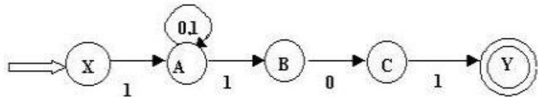

确定化:

<table><tr><td></td><td>0</td><td>1</td></tr><tr><td>X</td><td></td><td>A</td></tr><tr><td>A</td><td>A</td><td>AB</td></tr><tr><td>AB</td><td>AC</td><td>AB</td></tr><tr><td>AC</td><td>A</td><td>AB Y</td></tr><tr><td>AB Y</td><td>AC</td><td>AB</td></tr></table>

重新命名，令 AB 为 B、AC 为 C、ABY 为 D 得:

<table><tr><td></td><td>0</td><td>1</td></tr><tr><td>X</td><td></td><td>A</td></tr><tr><td>A</td><td>A</td><td>B</td></tr><tr><td>B</td><td>C</td><td>B</td></tr><tr><td>C</td><td>A</td><td>D</td></tr><tr><td>D</td><td>C</td><td>B</td></tr></table>

## 原件第8页

所以，可得 DFA 为:

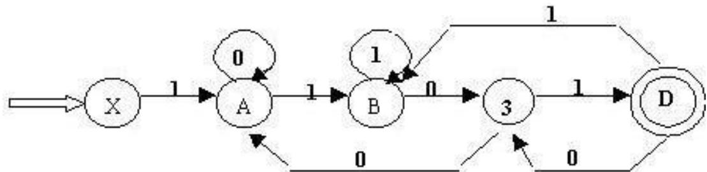

3. 文法:

S->MH|a

H ->LSo | ε

K ->dML | ε

L ->eHf

M->K | bLM

判断 G 是否为 LL(1) 文法，如果是，构造 LL(1) 分析表。

解：各符号的 FIRST 集和 FOLLOW集为：

<table><tr><td></td><td>FIRST</td><td>FOLLOW</td></tr><tr><td>S</td><td>{a,d,b, c,e}</td><td>{#,o}</td></tr><tr><td>M</td><td>{d, c,b}</td><td>{e,#,o}</td></tr><tr><td>H</td><td>{c,e}</td><td>{#,f,o}</td></tr><tr><td>L</td><td>{e}</td><td>{a,d,b,e,o,#}</td></tr><tr><td>K</td><td>{d,c}</td><td>{e,#,o}</td></tr></table>

各产生式SELECT集为:

<table><tr><td></td><td>SELECT</td></tr><tr><td>S-&gt;MH</td><td>{d,b,e,#,o}</td></tr><tr><td>S-&gt;a</td><td>{a}</td></tr><tr><td>H -&gt;LSo</td><td>{e}</td></tr><tr><td>H -&gt;ε</td><td>{#,f,o}</td></tr><tr><td>K -&gt;dML</td><td>{d}</td></tr><tr><td>K -&gt;ε</td><td>{e,#,o}</td></tr><tr><td>L -&gt;eHf</td><td>{e}</td></tr><tr><td>M-&gt;K</td><td>{d,e,#,o}</td></tr><tr><td>M-&gt;bLM</td><td>{b}</td></tr></table>

预测分析表

<table><tr><td></td><td>a</td><td>o</td><td>d</td><td>e</td><td>f</td><td>b</td><td>#</td></tr><tr><td>S</td><td>-&gt;a</td><td>-&gt;MH</td><td>-&gt;MH</td><td>-&gt;MH</td><td></td><td>-&gt;MH</td><td>-&gt;MH</td></tr><tr><td>M</td><td></td><td>-&gt;K</td><td>-&gt;K</td><td>-&gt;K</td><td></td><td>-&gt;bLM</td><td>-&gt;K</td></tr><tr><td>H</td><td></td><td>-&gt;ε</td><td></td><td>-&gt;LSo</td><td>-&gt;ε</td><td></td><td>-&gt;ε</td></tr><tr><td>L</td><td></td><td></td><td></td><td>-&gt;eHf</td><td></td><td></td><td></td></tr><tr><td>K</td><td></td><td>-&gt;ε</td><td>-&gt;dML</td><td>-&gt;ε</td><td></td><td></td><td>-&gt;ε</td></tr></table>

## 原件第9页

## 原件第10页

可见，相同左部产生式的 SELECT 集的交集均为空，所以文法 G[E] 是 LL(1) 文法。

(3)构造它的预测分析表。文法 G[E]的预测

分析表如下:

<table><tr><td></td><td>+</td><td>*</td><td>(</td><td>)</td><td>a</td><td>b</td><td>^</td><td>#</td></tr><tr><td>E</td><td></td><td></td><td> $\rightarrow TE'$ </td><td></td><td> $\rightarrow TE'$ </td><td> $\rightarrow TE'$ </td><td> $\rightarrow TE'$ </td><td></td></tr><tr><td> $E'$ </td><td> $\rightarrow+E$ </td><td></td><td></td><td> $\rightarrow \varepsilon$ </td><td></td><td></td><td></td><td> $\rightarrow \varepsilon$ </td></tr><tr><td>T</td><td></td><td></td><td> $\rightarrow FT'$ </td><td></td><td> $\rightarrow FT'$ </td><td> $\rightarrow FT'$ </td><td> $\rightarrow FT'$ </td><td></td></tr><tr><td> $T'$ </td><td> $\rightarrow \varepsilon$ </td><td></td><td> $\rightarrow T$ </td><td> $\rightarrow \varepsilon$ </td><td> $\rightarrow T$ </td><td> $\rightarrow T$ </td><td> $\rightarrow T$ </td><td> $\rightarrow \varepsilon$ </td></tr><tr><td>F</td><td></td><td></td><td> $\rightarrow PF'$ </td><td></td><td> $\rightarrow PF'$ </td><td> $\rightarrow PF'$ </td><td> $\rightarrow PF'$ </td><td></td></tr><tr><td> $F'$ </td><td> $\rightarrow \varepsilon$ </td><td> $\rightarrow *F'$ </td><td> $\rightarrow \varepsilon$ </td><td> $\rightarrow \varepsilon$ </td><td> $\rightarrow \varepsilon$ </td><td> $\rightarrow \varepsilon$ </td><td> $\rightarrow \varepsilon$ </td><td> $\rightarrow \varepsilon$ </td></tr><tr><td>P</td><td></td><td></td><td> $\rightarrow (E)$ </td><td></td><td> $\rightarrow a$ </td><td> $\rightarrow b$ </td><td> $\rightarrow ^$ </td><td></td></tr></table>

### 5. 已知文法 G[S] 为:

S->a | ^ | (T)

T-> T, S | S

(1) 计算 G[S] 的 FIRSTVT 和 LASTVT。

(2) 构造 G[S] 的算符优先关系表并说明 G[S] 是否未算符优先文法。

(3) 给出输入串 $(a, a)\#$ 的算符优先分析过程。

解：（1）各符号的 FIRSTVT 和 LASTVT:

<table><tr><td></td><td>FIRSTVT</td><td>LASTVT</td></tr><tr><td>S</td><td>a、^、(</td><td>a、^、)</td></tr><tr><td>T</td><td>,、a、^、(</td><td>,、a、^、)</td></tr></table>

(2) 算符优先关系表:

<table><tr><td></td><td>a</td><td>(</td><td>)</td><td>,</td><td>^</td><td>#</td></tr><tr><td>a</td><td></td><td></td><td>&gt;</td><td>&gt;</td><td></td><td>&gt;</td></tr><tr><td>(</td><td>&lt;</td><td>&lt;</td><td>≡</td><td></td><td>&lt;</td><td></td></tr><tr><td>),</td><td>&lt;</td><td>&lt;</td><td>&gt;</td><td>&gt;</td><td>&lt;</td><td>&gt;</td></tr><tr><td>^</td><td></td><td></td><td>&gt;</td><td>&gt;</td><td></td><td>&gt;</td></tr><tr><td>#</td><td>&lt;</td><td>&lt;</td><td></td><td></td><td>&lt;</td><td></td></tr></table>

（3）句子(a, a)#分析过程如下：

<table><tr><td>步骤</td><td>栈</td><td>优先关系</td><td>当前符号</td><td>剩余输入串</td><td>移进或归约</td></tr><tr><td>1</td><td>#</td><td>#K(</td><td>(</td><td>a,a)#</td><td>移进</td></tr><tr><td>2</td><td>#(</td><td>(&lt;a</td><td>a</td><td>,a)#</td><td>移进</td></tr><tr><td>3</td><td>#(a</td><td>a),</td><td>,</td><td>a)#</td><td>归约</td></tr><tr><td>4</td><td>#(F</td><td>(&lt;,</td><td>,</td><td>a)#</td><td>移进</td></tr><tr><td>5</td><td>#(F,</td><td>,&lt;a</td><td>A</td><td>)#</td><td>移进</td></tr><tr><td>6</td><td>#(F,a</td><td>A&gt;)</td><td>)</td><td>#</td><td>归约</td></tr><tr><td>7</td><td>#(F,F</td><td>,*)</td><td>)</td><td>#</td><td>归约</td></tr><tr><td>8</td><td>#(F</td><td>(=)</td><td>)</td><td>#</td><td>移进</td></tr><tr><td>9</td><td>#(F)</td><td>)≠#</td><td>#</td><td></td><td>归约</td></tr><tr><td>10</td><td>#F</td><td>#≡#</td><td>#</td><td></td><td>接受</td></tr></table>

## 原件第11页

### 6. 已知文法为:

S->a | ^ | (T)

T->T, S | S

构造它的 LR(0) 分析表。

解：加入非终结符 S'，方法的增广文法为：

$S^{\prime} \rightarrow S$

S->a

S->^

$S->(T)$

T -> T, S

T ->S 下面构造它的 LR(0) 项目集规范族为:
<table><tr><td>状态\当前符号</td><td>a</td><td>^</td><td>(</td><td>)</td><td>,</td><td>#</td><td>S</td><td>T</td></tr><tr><td> $I_0$ : $S' \rightarrow \cdot S$  $S \rightarrow \cdot a$  $S \rightarrow \cdot ^$  $S \rightarrow \cdot (T)$ </td><td> $I_2$ : $S \rightarrow a \cdot$ </td><td> $I_3$ : $S \rightarrow ^ \cdot$ </td><td> $I$ : $S \rightarrow (\cdot T)$  $T \rightarrow \cdot T, S$  $T \rightarrow \cdot S$  $S \rightarrow \cdot a$  $S \rightarrow \cdot ^$  $S \rightarrow \cdot (T)$ </td><td></td><td></td><td></td><td> $I_1$ : $S' \rightarrow S \cdot$ </td><td></td></tr><tr><td> $I_1$ </td><td></td><td></td><td></td><td></td><td></td><td>acc</td><td></td><td></td></tr><tr><td> $I_2$ </td><td></td><td></td><td></td><td></td><td></td><td></td><td></td><td></td></tr><tr><td> $I_3$ </td><td></td><td></td><td></td><td></td><td></td><td></td><td></td><td></td></tr><tr><td> $I$ : $S \rightarrow (\cdot T)$  $T \rightarrow \cdot T, S$  $T \rightarrow \cdot S$  $S \rightarrow \cdot a$  $S \rightarrow \cdot ^$  $S \rightarrow \cdot (T)$ </td><td> $I_2$ </td><td> $I_3$ </td><td>I</td><td></td><td></td><td></td><td> $I_6$ : $T \rightarrow S \cdot$ </td><td> $I_5$ : $S \rightarrow (T \cdot)$  $T \rightarrow T \cdot, S$ </td></tr><tr><td> $I_6$ : $S \rightarrow (T \cdot)$  $T \rightarrow T \cdot, S$ </td><td></td><td></td><td></td><td> $I_7$ : $S \rightarrow (T) \cdot$ </td><td> $I_8$ : $T \rightarrow T, \cdot S$  $S \rightarrow \cdot a$  $S \rightarrow \cdot ^$  $S \rightarrow \cdot (T)$ </td><td></td><td></td><td></td></tr><tr><td> $I_9$ </td><td></td><td></td><td></td><td></td><td></td><td></td><td></td><td></td></tr><tr><td> $I_{::}$ </td><td></td><td></td><td></td><td></td><td></td><td></td><td></td><td></td></tr><tr><td> $I_0$ : $T \rightarrow T, \cdot S$  $S \rightarrow \cdot a$  $S \rightarrow \cdot ^$  $S \rightarrow \cdot (T)$ </td><td> $I_2$ </td><td> $I_3$ </td><td>I</td><td></td><td></td><td></td><td> $I_1$  $T \rightarrow T, S \cdot$ </td><td></td></tr><tr><td> $I_3$ </td><td></td><td></td><td></td><td></td><td></td><td></td><td></td><td></td></tr></table>

从上表可看出, 不存在移进- 归约冲突以及归约归约冲突, 该文法是 LR(0) 文法。从而有下面的 LR(0) 分析表:

<table><tr><td rowspan="2">状态</td><td colspan="6">ACTION</td><td colspan="2">GOTO</td></tr><tr><td>a</td><td>^</td><td>(</td><td>)</td><td>,</td><td>#</td><td>S</td><td>T</td></tr><tr><td>0</td><td> $S_{2}$ </td><td> $S_{3}$ </td><td>S</td><td></td><td></td><td></td><td>1</td><td></td></tr><tr><td>1</td><td></td><td></td><td></td><td></td><td></td><td>acc</td><td></td><td></td></tr><tr><td>2</td><td> $r_{1}$ </td><td> $r_{1}$ </td><td> $r_{1}$ </td><td> $r_{1}$ </td><td> $r_{1}$ </td><td> $r_{1}$ </td><td></td><td></td></tr><tr><td>3</td><td> $r_{2}$ </td><td> $r_{2}$ </td><td> $r_{2}$ </td><td> $r_{2}$ </td><td> $r_{2}$ </td><td> $r_{2}$ </td><td></td><td></td></tr><tr><td>4</td><td> $S_{2}$ </td><td> $S_{3}$ </td><td>S</td><td></td><td></td><td></td><td>6</td><td>5</td></tr><tr><td>5</td><td></td><td></td><td></td><td> $S_{7}$ </td><td> $S_{0}$ </td><td></td><td></td><td></td></tr><tr><td>6</td><td> $r_{6}$ </td><td> $r_{6}$ </td><td> $r_{6}$ </td><td> $r_{6}$ </td><td> $r_{6}$ </td><td> $r_{6}$ </td><td></td><td></td></tr><tr><td>7</td><td> $r_{7}$ </td><td> $r_{7}$ </td><td> $r_{7}$ </td><td> $r_{7}$ </td><td> $r_{7}$ </td><td> $r_{7}$ </td><td></td><td></td></tr><tr><td>8</td><td> $S_{7}$ </td><td> $S_{7}$ </td><td>S</td><td></td><td></td><td></td><td>9</td><td></td></tr><tr><td>9</td><td>r</td><td>r</td><td>r</td><td>r</td><td>r</td><td>r</td><td></td><td></td></tr></table>

7. 已知文法为:

A ->aAd|aAb| ε

## 原件第12页

判断该文法是否是 SLR(1) 文法, 若是构造相应分析表, 并对输入串 ab# 给出分析过程。解: 增加一个非终结符 S/后, 产生原文法的增广文法有: S'->A A ->aAd|aAb|ε 下面构造它的 LR(0)项目集规范族为:

<table><tr><td>状态\当前符号</td><td>a</td><td>b</td><td>d</td><td>#</td><td>A</td></tr><tr><td> $I_0$ : $S' \rightarrow \cdot A$ A→·aAdA→·aAbA→·</td><td> $I_2$ :A→a·AdA→a·AbA→·aAdA→·aAbA→·</td><td></td><td></td><td></td><td> $I_1$ : $S' \rightarrow A$ ·</td></tr><tr><td> $I_1$ : $S' \rightarrow A$ ·</td><td></td><td></td><td></td><td>acc</td><td></td></tr><tr><td> $I_2$ :A→a·AdA→a·AbA→·aAdA→·aAbA→·</td><td> $I_3$ </td><td></td><td></td><td></td><td> $I_3$ :A→aA·dA→aA·b</td></tr><tr><td> $I_5$ :A→aA·dA→aA·b</td><td></td><td>I:A→aAb·</td><td> $I_5$ :A→aAd·</td><td></td><td></td></tr><tr><td>I:A→aAb·</td><td></td><td></td><td></td><td></td><td></td></tr><tr><td> $I_6$ :A→aAd·</td><td></td><td></td><td></td><td></td><td></td></tr></table>

从上表可看出，状态 I0 和 I2 存在移进-归约冲突，该文法不是 LR(0)文法。对于 I0 来说有：
FOLLOW(A)∩{a}={b,d,#}∩{a}=Φ，所以在 I0 状态下面临输入符号为 a 时移进，为 b,d,# 时归约，为其他时报错。对于 I2 来说有也有与 I0 完全相同的结论。这就是说，以上的移进 - 归约冲突是可以解决的，因此该文法是 SLR(1)文法。
其 SLR(1)分析表为：

<table><tr><td rowspan="2">状态</td><td colspan="4">ACTION</td><td>GOTO</td></tr><tr><td>a</td><td>b</td><td>d</td><td>#</td><td>A</td></tr><tr><td>0</td><td> $S_{2}$ </td><td> $r_{1}$ </td><td> $r_{2}$ </td><td> $r_{3}$ </td><td>1</td></tr><tr><td>1</td><td></td><td></td><td></td><td>acc</td><td></td></tr><tr><td>2</td><td> $S_{2}$ </td><td> $r_{1}$ </td><td> $r_{2}$ </td><td> $r_{3}$ </td><td>3</td></tr><tr><td>3</td><td></td><td>S</td><td> $S_{2}$ </td><td></td><td></td></tr><tr><td>4</td><td> $r_{2}$ </td><td> $r_{2}$ </td><td> $r_{2}$ </td><td> $r_{2}$ </td><td></td></tr><tr><td>5</td><td> $r_{1}$ </td><td> $r_{1}$ </td><td> $r_{1}$ </td><td> $r_{1}$ </td><td></td></tr></table>
对输入串 ab#给出分析过程为:

<table><tr><td>步骤</td><td>状态栈</td><td>符号栈</td><td>输入串</td><td>ACTION</td><td>GOTO</td></tr><tr><td>1</td><td>0</td><td>#</td><td>ab#</td><td> $S_{2}$ </td><td></td></tr><tr><td>2</td><td>02</td><td>#a</td><td>b#</td><td>r,</td><td>3</td></tr><tr><td>3</td><td>023</td><td>#aA</td><td>b#</td><td>S</td><td></td></tr><tr><td>4</td><td>0234</td><td>#aAb</td><td>#</td><td>r,</td><td>1</td></tr><tr><td>5</td><td>01</td><td>#A</td><td>#</td><td>acc</td><td></td></tr></table>
《编译原理》历年试题及答案

## 原件第13页

### 一．（每项选择2分，共20分）选择题

1. 将编译程序分成若干个“遍”是为了\_b\_\_。
a. 提高程序的执行效率
b. 使程序的结构更加清晰
c. 利用有限的机器内存并提高机器的执行效率
d. 利用有限的机器内存但降低了机器的执行效率

2. 构造编译程序应掌握\_\_d\_\_。
a.源程序 b.目标语言
c.编译方法 d.以上三项都是

3. 变量应当 c\_\_。
a. 持有左值 b. 持有右值
c. 既持有左值又持有右值 d. 既不持有左值也不持有右值

4. 编译程序绝大多数时间花在\_d\_上。
a. 出错处理 b. 词法分析
c. 目标代码生成 d. 管理表格
5. 词法分析器的输出结果是 c。

a. 单词的种别编码 b. 单词在符号表中的位置 c. 单词的种别编码和自身值 d. 单词自身值

a. MI 和 M2 的状态数相等 b.MI 和 M2 的有向弧条数相等。
C.M1 和 M2 所识别的语言集相等 d.MI 和 M2 状态数和有向弧条数相等

7. 中间代码生成时所依据的是一c。
a. 语法规则 b. 词法规则 c. 语义规则 d. 等价变换规则

8. 后缀式 $ab + cd+$ /可用表达式\_b\_来表示。  
a. $a + b / c + d$ b. $(a + b) / (c + d)$ c. $a + b / (c + d)$ d. $a + b + c / d$

9. 程序所需的数据空间在程序运行前就可确定，称为\_\_\_\_c\_\_\_\_管理技术。

a.动态存储 b.栈式存储 c.静态存储 d.堆式存储

10. 堆式动态分配申请和释放存储空间遵守 \_\_\_\_ d \_\_\_\_ 原则。
a. 先请先放 b. 先请后放 c. 后请先放 d. 任意

### 二（每小题10分，共80分）简答题

1. 画出编译程序的总体结构图，简述各部分的主要功能。

2. 已知文法 G[E]:

$E \rightarrow ET + |TT \rightarrow TF^{*} | FF \rightarrow F^{\wedge} | a$

试证：FF^^\*是文法的句型，指出该句型的短语、简单短语和句柄.

3. 为正规式(a|b)\*a(a|b)构造一个确定的有限自动机。

4. 设文法 G(S):

$$
S \rightarrow (L) | a S | a
$$

L→L, S|S

(1) 消除左递归和回溯;

## 原件第14页

(2) 计算每个非终结符的 FIRST 和 FOLLOW;

### (3) 构造预测分析表。

### 5. 已知文法

A->aAd| aAb|ε

判断该文法是否 SLR（1）文法，若是构造相应分析表，并对输入串 ab#给出分析过程。

### 6. 构造算符文法 G[H] 的算符优先关系（含 #）。

G[H]: H→H;M|M

M→d|aHb

7. 已构造出文法 G（S）

(1) SBB

(2) B aB

(3) B b

### 1)。给出 DFA 图

2）.给出 LR 分析表

3). 假定输入串为 abaab，请给出 LR 分析过程（即状态，符号，输入串的变化过程）。

8. 将下面的语句翻译成四元式序列:

while A<C∧B<D do

else while A≤ D do

9. 对下面的流图，

(1)求出流图中各结点 N 的必经结点集 $D(n)$ ,

(2)求出流图中的回边，

(3)求出流图中的循环。

### 参考答案

### 一．单项选择题

1. 将编译程序分成若干个“遍”是为了使编译程序的结构更加清晰，故选 b。

2. 构造编译程序应掌握源程序、目标语言及编译方法等三方面的知识，故选 d。

3. 对编译而言，变量既持有左值又持有右值，故选 c。

4. 编译程序打交道最多的就是各种表格，因此选 d。

5. 词法分析器输出的结果是单词的种别编码和自身值，选 C。

6. 正规式 M1 和 M2 所识别的语言集相等，故选 C。

7. 选 c。

8. 选 b。

9. 选 C

10. 堆式动态分配申请和释放存储空间不一定遵守先请后放和后请先放的原则，故选 d

### 二．简答题

### 1. 【解答】

编译程序的总体结构图如图 1.2 所示。

词法分析器：输入源程序，进行词法分析，输出单词符号。

## 原件第15页

## 原件第16页

## 原件第17页

7. 【解答】

(1) LR 分析表如下:

(2) 分析表

状态 ACTION GOTO

a b # S B
0 s3 s4 1 2
1 acc
2 S3 S4 5
3 s3 s4 6
4 r3 r3
5 R1 R1 r1
6 R2 R2 R2

## 原件第18页

(3) 句子 abaab 的分析过程
表:句子 abaab 的分析过程
步骤 状态 符号栈 输入串 所得产生式
0 #0 # abaad#
1 #03 #a baad#
2 #034 #ab aab# B→b
3 #036 #aB aab# B→aB
4 #02 #B aab#
5 #023 #Ba ab#
6 #0233 #Baa b#
7 #02334 #Baab #
8 #02336 #BaaB #
9 #0236 #BaB ad#
10 #025 #BB ad#
11 #01 #S d#
12 ## d#
13 识别成功

8. 【解答】

该语句的四元式序列如下（其中 E1、E2 和 E3 分别对应：A<C∧B<D, A=1 和 A≤D 并且关系运算符优先级高）：
100 (j<,A,C,102)
101(j,\_,\_,113) /\*E1 为 F\*/
102 (j<,B,D,104) /\*EI 为 T\*/
103 (j,\_,\_,113) /\*EI 为 F\*/
104 (j=,A,1,106) /\*Ez 为 T\*/
105 (j,\_,\_,108) /\*EZ 为 F\*/
106 (+,C,1,C) /\*C:=C+1\*/
107 (j,\_,\_,112) /\*跳过 else 后的语句\*/
108 (j≤,A,D,110) /\*E3 为 T\*/
109 (j,\_,\_,112) /\*E3 为 F\*/
110 (+,A,2,A) /\*A:=A+2\*/
111 (j,\_,\_,108) /\*转回内层 while 语句开始处\*/
112(j,\_,\_,100) /\*转回外层 while 语句开始处\*/
113

9. 【解答】

(1)流图中各结点 N 的必经结点集 D(n),

$D(l)=\{1\},\quad D(2)=\{1,2\},\quad D(3)=\{1,2,3\},\quad D(4)=\{1,2,3,4\},\quad D(5)=\{1,2,5\},$

D(6)= $\{1,2,5,6\}$

(2)求出流图中的回边，

5->2, 4->3

(3)求出流图中的循环:

回边 5->2 对应的循环：2、5、3、4；

## 原件第19页

回边 4->3 对应的循环：3、4

## 原件第20页

《编译原理》模拟试题一

### 一、是非题（请在括号内，正确的划√，错误的划×）（每个2分，共20分）

1. 计算机高级语言翻译成低级语言只有解释一种方式。(×)

2. 在编译中进行语法检查的目的是为了发现程序中所有错误。(×)

3. 甲机上的某编译程序在乙机上能直接使用的必要条件是甲机和乙机的操作系统功能完全相同。（√）

4. 正则文法其产生式为 A->a，A->Bb, A,B∈VN，a、b∈VT。（×）

5. 每个文法都能改写为 LL(1) 文法。(√)

6. 递归下降法允许任一非终极符是直接左递归的。（√）

7. 算符优先关系表不一定存在对应的优先函数。(×)

8. 自底而上语法分析方法的主要问题是候选式的选择。(×)

9. LR 法是自顶向下语法分析方法。(×)

10. 简单优先文法允许任意两个产生式具有相同右部。(×)

### 二、选择题(请在前括号内选择最确切的一项作为答案划一个勾，多划按错论)(每个4分，共40分)

1. 一个编译程序中，不仅包含词法分析，\_\_\_\_，中间代码生成，代码优化，目标代码生成等五个部分。
A. () 语法分析 B. () 文法分析 C. () 语言分析 D. () 解释分析

2. 词法分析器用于识别\_\_\_\_。
A. () 字符串 B. () 语句 C. () 单词 D. () 标识符

3. 语法分析器则可以发现源程序中的\_\_\_\_。
A. () 语义错误 B. () 语法和语义错误
C. () 错误并校正 D. () 语法错误

## 原件第21页

4. 下面关于解释程序的描述正确的是\_\_\_\_。

(1) 解释程序的特点是处理程序时不产生目标代码

(2) 解释程序适用于 COBOL 和 FORTRAN 语言

(3) 解释程序是为打开编译程序技术的僵局而开发的

A. () (1)(2) B. () (1) C. () (1)(2)(3) D. () (2)(3)

5. 解释程序处理语言时，大多数采用的是\_\_\_\_方法。

A.（）源程序命令被逐个直接解释执行  
B.（）先将源程序转化为中间代码，再解释执行  
C.（）先将源程序解释转化为目标程序，再执行  
D.（）以上方法都可以

6. 编译过程中，语法分析器的任务就是\_\_\_\_。

(1) 分析单词是怎样构成的 (2) 分析单词串是如何构成语句和说明的

(3) 分析语句和说明是如何构成程序的 (4) 分析程序的结构

A. () (2)(3) B. () (2)(3)(4) C. () (1)(2)(3) D. () (1)(2)(3)(4)

7. 编译程序是一种\_\_\_\_。

A. () 汇编程序 B. () 翻译程序 C. () 解释程序 D. () 目标程序

8. 文法 G 所描述的语言是\_\_\_\_的集合。

A. () 文法 G 的字母表 V 中所有符号组成的符号串

B. () 文法 G 的字母表 V 的闭包 V\* 中的所有符号串

## 原件第22页

C. () 由文法的开始符号推出的所有终极符串
D. () 由文法的开始符号推出的所有符号串

9. 文法分为四种类型，即 0 型、1 型、2 型、3 型。其中 3 型文法是\_\_\_\_。
A. () 短语文法 B. () 正则文法 C. () 上下文有关文法 D. () 上下文无关文法

10. 一个上下文无关文法 G 包括四个组成部分，它们是：一组非终结符号，一组终结符号，一个开始符号，以及一组 \_\_\_\_。
A. () 句子 B. () 句型 C. () 单词 D. () 产生式

### 三、填空题(每空1分，共10分)

1. 编译程序的工作过程一般可以划分为词法分析,语法分析,语义分析,中间代码生成,代码优化等几个基本阶段,同时还会伴有\_表格处理\_和\_出错处理\_。

2. 若源程序是用高级语言编写的,\_\_\_\_目标程序\_\_\_\_是机器语言程序或汇编程序,则其翻译程序称为\_\_\_\_编译程序\_\_\_\_。

3. 编译方式与解释方式的根本区别在于\_\_\_\_是否生成目标代码\_\_\_\_。

4. 对编译程序而言,输入数据是\_\_\_\_源程序\_\_\_\_,输出结果是\_\_\_\_目标程序\_\_\_\_。

5. 产生式是用于定义\_语法成分\_的一种书写规则。

6. 语法分析最常用的两类方法是\_\_\_\_自上而下\_\_\_\_和\_\_\_\_自下而上\_\_\_\_分析法。

### 四、简答题（20分）

1. 什么是句子？什么是语言？

答：(1)设 G 是一个给定的文法，S 是文法的开始符号，如果 S x(其中 $x \in VT^{*}$ ), 则称 x 是文法的一个句子。

(2)设 G[S] 是给定文法，则由文法 G 所定义的语言 L(G) 可描述为： $L(G)=\{x \mid S x, x \in VT^{*}\}$ 。

2. 写一文法，使其语言是偶正整数的集合,要求:

(1)允许 0 打头;

(2) 不允许 0 打头。

## 原件第23页

解：(1) $G[S]=(\{S,P,D,N\},\{0,1,2,\cdots,9\},P,S)$

P:

S->PD|D

P->NP|N

D->0|2|4|6|8

N->0|1|2|3|4|5|6|7|8|9

(2) $G[S]=(\{S,P,R,D,N,Q\},\{0,1,2,\ldots,9\},P,S)$

P:

S->PD|P0|D

P->NR|N

R->QR|Q

D->2|4|6|8

N->1|2|3|4|5|6|7|8|9

Q->0|1|2|3|4|5|6|7|8|9

### 3. 已知文法 G[E] 为:

$E \rightarrow T | E + T | E - T$

$T \rightarrow F | T^{*}F | T/F$

F→ ( E ) |i

① 该文法的开始符号（识别符号）是什么？

## 原件第24页

② 请给出该文法的终结符号集合 VT 和非终结符号集合 VN 。

③ 找出句型 $T+T*F+i$ 的所有短语、简单短语和句柄。

解：① 该文法的开始符号（识别符号）是 E。

②该文法的终结符号集合 VT={+、-、\*、/、(、)、i}。非终结符号集合 VN={E、T、F}。

③句型 $T+T*F+I$ 的短语为 i、 $T*F$ 、第一个 T、 $T+T*F+i$ ；简单短语为 i、 $T*F$ 、第一个 T；句柄为第一个 T。

4. 构造正规式相应的 NFA: 1(0|1)\*101

解 1(0|1)\*101 对应的 NFA 为

5. 写出表达式 $(a + b^{*}c) / (a + b) - d$ 的逆波兰表示和三元式序列。

逆波兰表示: $abc^{*} + ab + /d -$

三元式序列：① (\*，b，c) ② (+，a，①) ③ (+，

a, b) ④ (/, ②, ③) ⑤ (-, ④, d)

五.计算题（10分）

构造下述文法 G[S] 的自动机：S->A0 A->A0|S1|0

该自动机是确定的吗？若不确定，则对它确定化。

解：由于该文法的产生式 S->A0，A->A0|S1 中没有字符集 VT 的输入，所以不是确定的自

动机。要将其他确定化，必须先用代入法得到它对应的正规式。把 S?A0 代入产生式 A?S1

有：A=A0|A01|0=A(0|01)|0=0(0|01)\*。代入 S->A0 有该文法的正规式：0(0|01)\*0，所以，改

写该文法为确定的自动机为:

由于状态 A 有 3 次输入 0 的重复输入，所以上图只是 NFA，下面将它确定化：

下表由子集法将 NFA 转换为

DFA:

由上表可知 DFA 为:

《编译原理》模拟试题二

## 原件第25页

### 一、是非题（请在括号内，正确的划√，错误的划×）（每个2分，共20分）

1. “用高级语言书写的源程序都必须通过编译,产生目标代码后才能投入运行”这种说法。
(×)

2. 若一个句型中出现了某产生式的右部，则此右部一定是该句型的句柄。(×)

3. 一个句型的句柄一定是文法某产生式的右部。（√）

4. 在程序中标识符的出现仅为使用性的。(×)

5. 仅考虑一个基本块，不能确定一个赋值是否真是无用的。（√）

6. 削减运算强度破坏了临时变量在一基本块内仅被定义一次的特性。（√）

7. 在中间代码优化中循环上的优化主要有不变表达式外提和削减运算强度。(×)

8. 算符优先关系表不一定存在对应的优先函数。(×)

9. 数组元素的地址计算与数组的存储方式有关。(×)

10. 编译程序与具体的机器有关,与具体的语言无关。(×)

### 二、选择题(请在前括号内选择最确切的一项作为答案划一个勾，多划按错论)(每个4分，共40分)

1. 通常一个编译程序中, 不仅包含词法分析, 语法分析, 中间代码生成, 代码优化, 目标代码生成等五个部分, 还应包括\_\_\_\_。
A. () 模拟执行器 B. () 解释器
C. () 表格处理和出错处理 D. () 符号执行器

2. 文法 G[N]= ( {b}, {N, B}, N, {N→b | bB, B→bN}), 该文法所描述的语言是
A. () L(G[N])={bi | i≥0} B. () L(G[N])={b2i | i≥0}
C. () L(G[N])={b2i+1 | i≥0} D. () L(G[N])={b2i+1 | i≥1}

3. 一个句型中的最左\_\_\_\_称为该句型的句柄。
A. () 短语 B. () 简单短语 C. () 素短语 D. () 终结符号

## 原件第26页

4. 设 G 是一个给定的文法，S 是文法的开始符号，如果 S->x(其中 $x \in V^{*}$ )，则称 x 是文法 G 的一个 \_\_\_\_。

A. () 候选式 B. () 句型 C. () 单词 D. () 产生式

5. 文法 G[E] :

$$
E \rightarrow T \mid E + T
$$

$$
T \rightarrow F \mid T * F
$$

$$
F \rightarrow a \mid (\mathrm{E})
$$

该文法句型 E + F \* (E + T) 的简单短语是下列符号串中的 \_\_\_\_。

① ( E + T ) ②E + T ③F ④ F \* (E + T)

A. () ① 和 ③ B. () ② 和 ③ C. () ③ 和 ④ D. () ③

6. 若一个文法是递归的，则它所产生的语言的句子\_\_\_\_。

A. () 是无穷多个 B. () 是有穷多个 C. () 是可枚举的 D. () 个数是常量

7. 词法分析器用于识别\_\_\_\_。
A. () 句子 B. () 句型 C. () 单词 D. () 产生式

8. 在语法分析处理中，FIRST 集合、 FOLLOW 集合、 SELECT 集合均是\_\_\_\_。

A. () 非终极符集 B. () 终极符集 C. () 字母表 D. () 状态集

9. 在自底向上的语法分析方法中，分析的关键是\_\_\_\_。

A.() 寻找句柄 B.() 寻找句型 C.() 消除递归 D.() 选择候选式

10. 在 LR 分析法中，分析栈中存放的状态是识别规范句型\_\_\_\_的 DFA 状态。

## 原件第27页

A.()句柄 B.() 前缀 C.()活前缀 D.() LR(0) 项目

### 三、填空题(每空1分，共10分)

1. 设 G 是一个给定的文法，S 是文法的开始符号，如果 S->x(其中 x∈VT\*), 则称 x 是文法的一个句子。

2. 递归下降法不允许任一非终极符是直接\_左\_递归的。

3. 自顶向下的语法分析方法的基本思想是: 从文法的\_\_开始符号\_\_\_\_开始, 根据给定的输入串并按照文法的产生式一步一步的向下进行\_\_直接推导\_\_\_\_, 试图推导出文法的\_\_句子\_\_\_\_, 使之与给定的输入串\_\_匹配\_\_\_\_。

4. 自底向上的语法分析方法的基本思想是：从输入串入手，利用文法的产生式一步一步地向上进行\_\_\_\_直接归约\_\_\_\_，力求归约到文法的\_\_\_\_开始符号\_\_\_\_。

5. 常用的参数传递方式有\_\_\_\_传地址\_\_\_\_，传值和传名。

6. 在使用高级语言编程时,首先可通过编译程序发现源程序的全部\_语法\_错误和语义部分错误。

### 四、简答题（20分）

1. 已知文法 G[S] 为:

S→dAB

A→aA|a

B→Bb| ε

G[S] 产生的语言是什么？

答：G[S]产生的语言是 L(G[S])={danbm | n≥1,m≥0}。

2. 简述 DFA 与 NFA 有何区别？

答：DFA 与 NFA 的区别表现为两个方面:一是 NFA 可以若干个开始状态，而 DFA 仅只一个开始状态。另一方面，DFA 的映象 M 是从 K×Σ 到 K，而 NFA 的映象 M 是从 K×Σ 到 K 的子集，即映象 M 将产生一个状态集合（可能为空集），而不是单个状态。

3. 构造正规式相应的 DFA: 1(1010 \* | 1(010) \* 1) \* 0。

解： $1(1010 * | 1(010) * 1) * 0$ 对应的 NFA 为：

## 原件第28页

4. 已知文法 G(S)

$S \rightarrow a \mid \wedge \mid (T)$

T→T, S|S

## 原件第29页

写出句子((a, a), a)的规范归约过程及每一步的句柄。

解：

句型 归约规则 句柄

$((a, a), a) S \rightarrow a a$

$((S, a), a) T \rightarrow S S$

$((T, a), a) S \rightarrow a a$

$((T, S), a) T \rightarrow T, S T, S$

((S), a) T→SS

$\left((T), a\right) S \rightarrow S(T)(T)$

(S, a) T→SS

(T, a) S→a a

(T, S) T→T, S T, S

(T) S→(T) (T)

S

5. 何谓优化？按所涉及的程序范围可分为哪几级优化？

1)优化：对程序进行各种等价变换，使得从变换后的程序出发，能产生更有效的目标代码。

(2) 三种级别：局部优化、循环优化、全局优化。

### 五.计算题（10分）

对下面的文法 G :

E->TE'

$E'->+E|\varepsilon$

T->FT'

$T^{\prime} \rightarrow T \mid \varepsilon$

F-> PF'

$F'->*F'| \varepsilon$

## 原件第30页

$$
P - > (E) | a | b | ^ {\wedge}
$$

(1)计算这个文法的每个非终结符的 FIRST 集和 FOLLOW 集。(4 分)

(2) 证明这个方法是 LL(1) 的。(4 分)

(3) 构造它的预测分析表。(2 分)

解：（1）计算这个文法的每个非终结符的 FIRST 集和 FOLLOW 集。

FIRST 集合有:

$$
\text { FIRST } (E) = \text { FIRST } (T) = \text { FIRST } (F) = \text { FIRST } (P) = \{(\text { ,a,b, ^ {\wedge }} \};
$$

$$
\operatorname{FIRST} \left(E ^ {\prime}\right) = \{+, \varepsilon \}
$$

$$
\text { FIRST } (T) = \text { FIRST } (F) = \text { FIRST } (P) = \{(\text { ,a,b, ^ {\wedge }} \};
$$

$$
\operatorname{FIRST} \left(T ^ {\prime}\right) = \operatorname{FIRST} (T) \cup \{\varepsilon \} = \left\{\left(, a, b, ^ {\wedge}, \varepsilon \right. \right\};
$$

$$
\text { FIRST } (F) = \text { FIRST } (P) = \{(, a, b, ^ {\wedge} \};
$$

$$
\operatorname{FIRST} \left(F ^ {\prime}\right) = \operatorname{FIRST} (P) = \{*, \varepsilon \};
$$

$$
\text { FIRST } (P) = \{(, a, b, ^ {\wedge} \};
$$

FOLLOW 集合有:

$$
\text { FOLLOW } (E) = \{\}, \# \};
$$

$$
\text { FOLLOW } (E ^ {\prime}) = \text { FOLLOW } (E) = \{\}, \# \};
$$

FOLLOW(T)=FIRST(E') ∪ FOLLOW(E)={+,),#}; //不包含 ε

## 原件第31页

$$
\text { FOLLOW } (T ^ {\prime}) = \text { FOLLOW } (T) = \text { FIRST } (E ^ {\prime}) \cup \text { FOLLOW } (E) = \{+,), \# \};
$$

$$
\text { FOLLOW } (F) = \text { FIRST } (T ^ {\prime}) \cup \text { FOLLOW } (T) = \{(\text { ,a,b,^ }, +,), \# \}; / / \text { 不包含 } \varepsilon
$$

$$
\text { FOLLOW } (F ^ {\prime}) = \text { FOLLOW } (F) = \text { FIRST } (T ^ {\prime}) \cup \text { FOLLOW } (T) = \{(\text { ,a,b,^ }, +,), \# \};
$$

$$
\text { FOLLOW } (P) = \text { FIRST } (F ^ {\prime}) \cup \text { FOLLOW } (F) = \{*, (, a, b, ^ {\wedge}, +,), \# \}; / / \text { 不包含 } \varepsilon
$$

$$
(2) \text {证明这个方法是} \mathrm{LL} (1) \text {的。}
$$

$$
\text {   各产生式的   } \mathrm{SELECT} \text {   集合有:   }
$$

$$
\text { SELECT } (E - > T E ^ {\prime}) = \text { FIRST } (T) = \{(\text { ,a,b, } \wedge \};
$$

$$
\text { SELECT } (E ^ {\prime} - > + E) = \{+ \};
$$

$$
\text { SELECT } (E ^ {\prime} - > \varepsilon) = \text { FOLLOW } (E /) = \{), \# \}
$$

$$
\text { SELECT } (T - > F T ^ {\prime}) = \text { FIRST } (F) = \{(\text { ,a,b, } \wedge \};
$$

$$
\text { SELECT } (T ^ {\prime} - > T) = \text { FIRST } (T) = \{(\text { ,a,b, } \wedge \};
$$

$$
\text { SELECT } (T ^ {\prime} - > \varepsilon) = \text { FOLLOW } (T /) = \{+,), \# \};
$$

$$
\text { SELECT } (F - > P F ^ {\prime}) = \text { FIRST } (P) = \{(, a, b, ^ {\wedge} \};
$$

$$
\text { SELECT } (F ^ {\prime} - > ^ {*} F ^ {\prime}) = \{* \};
$$

$$
\text { SELECT } (F ^ {\prime} - > \varepsilon) = \text { FOLLOW } (F ^ {\prime}) = \{(\text { ,a,b,^ }, +,), \# \};
$$

$$
\text { SELECT } (P - > (E)) = \{\left(\right) \}
$$

$$
\text { SELECT } (P - > a) = \{a \}
$$

$$
\text { SELECT } (P - > b) = \{b \}
$$

$$
\text { SELECT } (P - > ^ {\wedge}) = \{\wedge \}
$$

可见，相同左部产生式的 SELECT 集的交集均为空，所以文法 G[E] 是 LL(1) 文法。

(3)构造它的预测分析表。

文法 G[E]的预测分析表如下:

### 《编译原理》模拟试题三

### 一、是非题（请在括号内，正确的划√，错误的划×）（每个2分，共20分）

1. 对于数据空间的存贮分配，FORTRAN 采用动态贮存分配策略。(×)

2. 甲机上的某编译程序在乙机上能直接使用的必要条件是甲机和乙机的操作系统功能完全相同。(×)

3. 递归下降分析法是自顶向上分析方法。(√)

4. 产生式是用于定义词法成分的一种书写规则。(×)

5. LR 法是自顶向下语法分析方法。（√）

6. 在 SLR （1）分析法的名称中，S 的含义是简单的。（√）

7. 综合属性是用于 “自上而下” 传递信息。(×)

## 原件第32页

8. 符号表中的信息栏中登记了每个名字的属性和特征等有关信息，如类型、种属、所占单元大小、地址等等。(×)

## 原件第33页

9. 程序语言的语言处理程序是一种应用软件。(×)
10. 解释程序适用于 COBOL 和 FORTRAN 语言。(×)

### 二、选择题(请在前括号内选择最确切的一项作为答案划一个勾，多划按错论)(每个4分，共40分)

1. 文法 G 产生的\_\_\_\_的全体是该文法描述的语言。
A. () 句型 B. () 终结符集 C. () 非终结符集 D. () 句子

2. 若文法 G 定义的语言是无限集，则文法必然是 \_\_\_\_。
A. () 递归的 B. () 前后文无关的
C. () 二义性的 D. () 无二义性的

3. 四种形式语言文法中，1型文法又称为 \_\_\_\_ 文法。
A. () 短语结构文法 B. () 前后文无关文法
C. () 前后文有关文法 D. () 正规文法

4. 一个文法所描述的语言是\_\_\_\_。
A. () 唯一的 B. () 不唯一的
C. () 可能唯一，好可能不唯一 D. () 都不对

5. \_\_\_\_和代码优化部分不是每个编译程序都必需的。
A. () 语法分析 B. () 中间代码生成
C. () 词法分析 D. () 目标代码生成

6. \_\_\_\_是两类程序语言处理程序。
A. () 高级语言程序和低级语言程序 B. () 解释程序和编译程序 C. () 编译程序和操作系统 D. () 系统程序和应用程序

7. 数组的内情向量中肯定不含有数组的\_\_\_\_的信息。
A.() 维数 B.() 类型 C.() 维上下界 D.() 各维的界差

8. 一个上下文无关文法 G 包括四个组成部分，它们是：一组非终结符号，一组终结符号，一个开始符号，以及一组 \_\_\_\_。

## 原件第34页

A. () 句子 B. () 句型 C. () 单词 D. () 产生式

9. 文法分为四种类型，即 0 型、1 型、2 型、3 型。其中 2 型文法是\_\_\_\_。
A. () 短语文法 B. () 正则文法
C. () 上下文有关文法 D. () 上下文无关文法

10. 文法 G 所描述的语言是\_\_\_\_的集合。
A. () 文法 G 的字母表 V 中所有符号组成的符号串
B. () 文法 G 的字母表 V 的闭包 V\* 中的所有符号串
C. () 由文法的开始符号推出的所有终极符串
D. () 由文法的开始符号推出的所有符号串

### 三、填空题(每空1分，共10分)

1. 一个句型中的最左简单短语称为该句型的\_\_\_\_句柄\_\_\_\_。

2. 对于文法的每个产生式都配备了一组属性的计算规则，称为 \_语义规则\_。

3. 一个典型的编译程序中，不仅包括\_词法分析、\_语法分析、中间代码生成、代码优化、目标代码生成等五个部分，还应包括表格处理和出错处理。

4. 从功能上说，程序语言的语句大体可分为\_执行性\_语句和\_说明性\_语句两大类。

5. 扫描器的任务是从\_源程序\_中识别出一个个\_单词符号。

6. 产生式是用于定义\_语法范畴\_的一种书写规则。

### 四、简答题（20 分）

## 原件第35页

1. 写一个文法，使其语言是奇数集，且每个奇数不以 0 开头。

(1) 消除左递归和回溯;

(2) 计算每个非终结符的 FIRST 和 FOLLOW。

## 原件第36页

4. While a>0 ∨ b<0 do

Begin

X: =X+1;

if a > 0 then a: = a - 1

else b: =b+1

## 原件第37页

End;

翻译成四元式序列。

解：
(1) (j >, a, 0, 5)
(2) (j, -, -, 3)
(3) (j <, b, 0, 5)
(4) (j, -, -, 15)
(5) (+, ×, 1, T1)
(6) (:=, T1, -, ×)
(7) (j ≥, a, 0, 9)
(8) (j, -, -, 12)
(9) (-, a, 1, T2)
(10) (:=, T2, -, a)
(11) (j, -, -, 1)
(12) (+, b, 1, T3)
(13) (:=, T3, -, b)
(14) (j, -, -, 1)
(15)

### 五.计算题（10分）

已知 NFA= （ $\{x,y,z\},\{0,1\},M,\{x\},\{z\}$ ），其中：

$M(x,0)=\{z\},M(y,0)=\{x,y\},M(z,0)=\{x,z\},M(x,1)=\{x\},M(y,1)=\Phi$ , $M(z,1)=\{y\}$ ，构造相应的 DFA 并最小化。

解：根据题意有 NFA 图:

下表由子集法将 NFA 转换为 DFA:

## 原件第38页

下面将该 DFA 最小化:

(1) 首先将它的状态集分成两个子集: P1={A,D,E},P2={B,C,F}

(2) 区分 P2: 由于 $F(F,1) = F(C,1) = E, F(F,0) = F$ 并且 $F(C,0) = C$ , 所以 $F, C$ 等价。由于 $F(B,0) = F(C,0) = C, F(B,1) = D, F(C,1) = E$ , 而 $D, E$ 不等价（见下步），从而 $B$ 与 $C, F$ 可以区分。有 $P21 = \{C, F\}, P22 = \{B\}$ 。

(3) 区分 P1: 由于 A, E 输入 0 到终态，而 D 输入 0 不到终态，所以 D 与 A, E 可以区分，有 P11={A,E}, P12={D}。

(4) 由于 $F(A,0) = B, F(E,0) = F$ , 而 $B$ , $F$ 不等价，所以 $A$ , $E$ 可以区分。

(5) 综上所述，DFA 可以区分为 $P = \{\{A\}, \{B\}, \{D\}, \{E\}, \{C, F\}\}$ 。所以最小化的 DFA 如下：

### 《编译原理》模拟试题四

### 一、是非题（请在括号内，正确的划√，错误的划×）（每个2分，共20分）

1. 一个 LL(I)文法一定是无二义的。(×)

2. 正规文法产生的语言都可以用上下文无关文法来描述。(×)

3. 一张转换图只包含有限个状态，其中有一个被认为是初态，最多只有一个终态。（√）

4. 目标代码生成时，应考虑如何充分利用计算机的寄存器的问题。（×）

5. 逆波兰法表示的表达式亦称前缀式。（√）

6. 如果一个文法存在某个句子对应两棵不同的语法树，则称这个文法是二义的。（√）

7. LR 法是自顶向下语法分析方法。(×)

8. 数组元素的地址计算与数组的存储方式有关。(×)

9. 算符优先关系表不一定存在对应的优先函数。(×)

10. 对于数据空间的存贮分配，FORTRAN 采用动态贮存分配策略。(×)

### 二、选择题(请在前括号内选择最确切的一项作为答案划一个勾，多划按错论)(每个4分，共40分)

1. 词法分析器用于识别\_\_\_\_。

## 原件第39页

A. () 字符串 B. () 语句 C. () 单词 D. () 标识符

2. 文法分为四种类型，即 0 型、1 型、2 型、3 型。其中 0 型文法是\_\_\_\_。
A. () 短语文法 B. () 正则文法
C. () 上下文有关文法 D. () 上下文无关文法

3. 一个上下文无关文法 G 包括四个组成部分，它们是：一组非终结符号，一组终结符号，一个开始符号，以及一组 \_\_\_\_。
A. () 句子 B. () 句型 C. () 单词 D. () 产生式

4. \_\_\_\_是一种典型的解释型语言。
A. () BASIC B. () C C. () FORTRAN D. () PASCAL

5. 与编译系统相比，解释系统\_\_\_\_。
A. () 比较简单，可移植性好，执行速度快
B. () 比较复杂，可移植性好，执行速度快
C. () 比较简单，可移植性差，执行速度慢
D. () 比较简单，可移植性好，执行速度慢

6. 用高级语言编写的程序经编译后产生的程序叫\_\_\_\_。
A. () 源程序 B. () 目标程序 C. () 连接程序 D. () 解释程序

7. 词法分析器用于识别\_\_\_\_。
A. () 字符串 B. () 语句 C. () 单词 D. () 标识符

8. 编写一个计算机高级语言的源程序后，到正式上机运行之前，一般要经过\_\_\_\_这几步：
(1) 编辑 (2) 编译 (3) 连接 (4) 运行
A. () (1)(2)(3)(4) B. () (1)(2)(3) C. () (1)(3) D. () (1)(4)

9. 把汇编语言程序翻译成机器可执行的目标程序的工作是由\_\_\_\_完成的。
A. () 编译器 B. () 汇编器
C. () 解释器 D. () 预处理器

## 原件第40页

10. 文法 G 所描述的语言是\_\_\_\_的集合。

A.() 文法 G 的字母表 V 中所有符号组成的符号串

B. () 文法 G 的字母表 V 的闭包 V\* 中的所有符号串

C. () 由文法的开始符号推出的所有终极符串

D.() 由文法的开始符号推出的所有符号串

### 三、填空题(每空1分，共10分)

1. 语法分析是依据语言的\_语法\_规则进行的，中间代码产生是依据语言的\_语义\_规进行的。

2. 语法分析器的输入是\_\_单词符号串\_\_\_\_，其输出是\_\_语法单位\_\_\_\_。

3. 一个名字的属性包括\_类型\_和\_作用域\_。

4. 产生式是用于定义\_\_\_\_语法成分\_\_\_\_的一种书写规则。

5. 逆波兰式 $ab + c + d^{*}e-$ 所表达的表达式为 $(a + b + c)^{*}d - e$ 。

6. 语法分析最常用的两类方法是\_自上而下\_和\_自下而上\_分析法。

### 四、简答题（20 分）

1. 写出下列表达式的三地址形式的中间表示。

(1) $5+6*(a+b)$ ;

(2) for j:=1 to 10 do a[j+j]:=0。

答：(1)100:t1:=a+b

101: t2:=6\*t1

## 原件第41页

102: t3:=5+t2

(2)100: j:=1

101: if j>10 goto NEXT

102: i:=j+j

103: a[i]:=0

2. 设基本块 p 由如下语句构成:

T 0 :=3.14;

T 1 := 2 \* T 0 ;

T 2 := R + r;

A:=T | \*T 2 ;

B:=A;

T 3 := 2 \* T 0 ;

T 4 := R + r;

T 5 := T 3 \* T 4 ;

T 6 := R - r ;

B:=T 5 \*T 6 ;

试给出基本块 p 的 DAG。

解：基本块 p 的 DAG 图:

3. 写出表达式 $(a + b) / (a - b - (a + b^{*}c))$ 的三元序列及四元序列。

解: (1) 三元式:

① (+, a, b)

② $(-, a, b)$

③ (/, ①, ②)

## 原件第42页

④ (\*, b, c)

⑤ (+, a, ④)

⑥（一，③，⑤）

(2) 四元式:

① (+, a, b, T1)

②（一，a，b，T2）

③（/，T1，T2，T3）

④ (\*, b, c, T4)

⑤（+，a，T4，T5）

⑥（一，T3，T5，T6）

## 原件第43页

4. 写一个文法使其语言为偶数集，且每个偶数不以 0 开头。

解：文法 G（S）:

$$
\mathrm{D} \rightarrow 0 | \mathrm{C}
$$

5. 设文法 G (S):

$$
S \rightarrow S + a F | a F | + a F
$$

$$
F \rightarrow^ {*} a F | ^ {*} a
$$

(1) 消除左递归和回溯;

（2）构造相应的 FIRST 和 Follow 集合。

五.计算题（10分）

已知文法为:

S->a | ^ | (T)

$$
T - > T, S \mid S
$$

## 原件第44页

构造它的 LR(0)分析表。

解：加入非终结符 S'，方法的增广文法为：
S'->S
S->a
S->^
S->(T)
T->T,S
T->S 下面构造它的 LR(0)项目集规范族为：

## 原件第45页

从上表可看出,不存在移进-归约冲突以及归约归约冲突，该文法是 LR(0) 文法。从而有下面的 LR(0) 分析表：

## 原件第46页

《编译原理》模拟试题五

### 一、是非题（请在括号内，正确的划√，错误的划×）（每个2分，共20分）

1. 编译程序是对高级语言程序的解释执行。(×)

2. 一个有限状态自动机中, 有且仅有一个唯一的终态。(×)

3. 一个算符优先文法可能不存在算符优先函数与之对应。（√）

4. 语法分析时必须先消除文法中的左递归。（×）

5. LR 分析法在自左至右扫描输入串时就能发现错误，但不能准确地指出出错地点。（√）

6. 逆波兰表示法表示表达式时无须使用括号。（√）

7. 静态数组的存储空间可以在编译时确定。(×)

8. 进行代码优化时应着重考虑循环的代码优化，这对提高目标代码的效率将起更大作用。
(×)

9. 两个正规集相等的必要条件是他们对应的正规式等价。(×)

10. 一个语义子程序描述了一个文法所对应的翻译工作。(×)

### 二、选择题(请在前括号内选择最确切的一项作为答案划一个勾，多划按错论)(每个4分，共40分)

1. 词法分析器的输出结果是\_\_\_\_。

A. () 单词的种别编码 B. () 单词在符号表中的位置 C. () 单词的种别编码和自身值 D. () 单词自身值

2. 正规式 M1 和 M2 等价是指\_\_\_\_。

A. () M1 和 M2 的状态数相等 B. () M1 和 M2 的有向边条数相等 C. () M1 和 M2 所识别的语言集相等 D. () M1 和 M2 状态数和有向边条数相等

3. 文法 G: S→xSx|y 所识别的语言是\_\_\_\_。
A. () xyx B. () (xyx)\* C. () xnyxn(n≥0) D. () x\*yx\*

## 原件第47页

4. 如果文法 G 是无二义的，则它的任何句子 α \_\_\_\_。
A. ()最左推导和最右推导对应的语法树必定相同
B. ()最左推导和最右推导对应的语法树可能不同
C. ()最左推导和最右推导必定相同
D. ()可能存在两个不同的最左推导，但它们对应的语法树相同

5. 构造编译程序应掌握\_\_\_\_。
A. ()源程序 B. ()目标语言
C. ()编译方法 D. ()以上三项都是

6. 四元式之间的联系是通过\_\_\_\_实现的。
A. () 指示器 B. () 临时变量
C. () 符号表 D. () 程序变量

7. 表达式(¬ A ∨ B) ∧ (C ∨ D)的逆波兰表示为\_\_\_\_。
A. () ¬ AB ∨ ∧ CD ∨ B. () A¬ B ∨ CD ∨ ∧
C. () AB ∨ ¬ CD ∨ ∧ D. () A¬ B ∨ ∧ CD ∨

8. 优化可生成\_\_\_\_的目标代码。
A. () 运行时间较短 B. () 占用存储空间较小
C. () 运行时间短但占用内存空间大 D. () 运行时间短且占用存储空间小

9. 下列\_\_\_\_优化方法不是针对循环优化进行的。
A. () 强度削弱 B. () 删除归纳变量
C. () 删除多余运算 D. () 代码外提

## 原件第48页

10. 编译程序使用\_\_\_\_区别标识符的作用域。

A.() 说明标识符的过程或函数名

B. () 说明标识符的过程或函数的静态层次

C. () 说明标识符的过程或函数的动态层次

D.() 标识符的行号

### 三、填空题(每空1分，共10分)

1. 计算机执行用高级语言编写的程序主要有两种途径：\_\_\_\_解释\_\_\_\_和\_\_\_\_编译\_\_\_\_。

2. 扫描器是\_词法分析器\_, 它接受输入的\_源程序\_, 对源程序进行\_词法分析\_并识别出一个个单词符号, 其输出结果是单词符号, 供语法分析器使用。

3. 自上而下分析法采用\_\_\_\_移进\_\_\_\_、归约、错误处理、\_\_\_\_接受\_\_\_\_等四种操作。

4. 一个 LR 分析器包括两部分：一个总控程序和\_\_一张分析表\_\_。

5. 后缀式 abc-/所代表的表达式是\_\_\_\_a/(b-c)\_\_\_\_。

6. 局部优化是在\_\_基本块\_\_范围内进行的一种优化。

### 四、简答题（20 分）

1. 简要说明语义分析的基本功能。

答：语义分析的基本功能包括: 确定类型、类型检查、语义处理和某些静态语义检查。

2. 考虑文法 G[S]:

$S \rightarrow (T) | a + S | a$

T → T,S | S

消除文法的左递归及提取公共左因子。

解：消除文法 G[S] 的左递归：

$S \rightarrow (T) \mid a + S \mid a$

T→ST'

$$
T ^ {\prime} \rightarrow , S T ^ {\prime} | \varepsilon
$$

## 原件第49页

提取公共左因子:

$S \rightarrow (T) \mid aS'$

$S' \rightarrow +S \mid \varepsilon$

T→ST'

$$
T ^ {\prime} \rightarrow , S T ^ {\prime} | \varepsilon
$$

3. 试为表达式 $w + (a + b)*(c + d / (e - 10) + 8)$ 写出相应的逆波兰表示。

解：w a b + c d e 10 - / + 8 + \* +

4. 按照三种基本控制结构文法将下面的语句翻译成四元式序列:

while (A<C ∧ B<D)

{

if (A ≥ 1) C=C+1;

else while (A ≤ D)

A=A+2;

}。

解：该语句的四元式序列如下(其中 E1、E2 和 E3 分别对应 A<C∧B<D、A≥1 和 A≤D，并且关系运算符优先级高):

100 (j<,A,C,102)

101 (j,\_,\_,113)

102 (j<,B,D,104)

## 原件第50页

103 (j,\_,\_,113)

104 (j=,A,1,106)

105 (j, \_, \_, 108)

106 (+, C, 1, C)

107 (j,\_,\_,112)

$$
1 0 8 (j \leqslant , A, D, 1 1 0) 1 0 9 (j, \_, \_, 1 1 2) 1 1 0 (+, A, 2, A) 1 1 1 (j, \_, \_, 1 0 8) 1 1 2 (j, \_, \_, 1 0 0) 1 1 3
$$

5. 已知文法 G[S] 为 S → aSb|Sb|b，试证明文法 G[S] 为二义文法。

证明：

由文法 G[S]: S→aSb|Sb|b，对句子 aabbbb 对应的两棵语法树为:

因此，文法 G[S] 为二义文法。

五.计算题（10分）

已知文法 A->aAd|aAb| ε

判断该文法是否是 SLR(1) 文法，若是构造相应分析表，并对输入串 ab# 给出分析过程。

解：增加一个非终结符 S/后，产生原文法的增广文法有： $S'$ ->A A->aAd|aAb|ε

下面构造它的 LR(0)项目集规范族为:

其 SLR(1)分析表为:

从上表可看出,状态 I0 和 I2 存在移进-归约冲突，该文法不是 LR(0) 文法。对于 I0 来说有：FOLLOW(A) ∩ {a} = {b, d, #} ∩ {a} = Φ，所以在 I0 状态下面临输入符号为 a 时移进，为 b, d, # 时归约，为其他时报错。对于 I2 来说有也有与 I0 完全相同的结论。这就是说，以上的移进-归约冲突是可以解决的，因此该文法是 SLR(1) 文法。

## 原件第51页

对输入串 ab#给出分析过程为:

《编译原理》模拟试题六

一、是非题（请在括号内，正确的划√，错误的划×）（每个2分，共20分）

## 原件第52页

1. 设 r 和 s 分别是正规式，则有 $L(r|s)=L(r)L(s)$ 。(×)

2. 确定的自动机以及不确定的自动机都能正确地识别正规集。(√)

3. 词法分析作为单独的一遍来处理较好。(×)

4. 构造 LR 分析器的任务就是产生 LR 分析表。(√)

5. 规范归约和规范推导是互逆的两个过程。(×)

6. 同心集的合并有可能产生新的“移进”/“归约”冲突。（×）

7. LR 分析技术无法适用二义文法。(×)

8. 树形表示和四元式不便于优化，而三元式和间接三元式则便于优化。(×)

9. 程序中的表达式语句在语义翻译时不需要回填技术。（√）

10. 对中间代码的优化依赖于具体的计算机。(×)

### 二、选择题(请在前括号内选择最确切的一项作为答案划一个勾，多划按错论)(每个4分，共40分)

1. 编译程序绝大多数时间花在\_\_\_\_上。
A. () 出错处理 B. () 词法分析
C. () 目标代码生成 D. () 表格管理

2. 编译程序是对\_\_\_\_。
A. () 汇编程序的翻译 B. () 高级语言程序的解释执行 C. () 机器语言的执行 D. () 高级语言的翻译

3. 采用自上而下分析，必须\_\_\_\_。
A.（）消除左递归 B.（）消除右递归 C.（）消除回溯 D.（）提取公共左因子

4. 在规范归约中，用\_\_\_\_来刻画可归约串。
A. ()直接短语 B. ()句柄

## 原件第53页

C. ()最左素短语 D. ()素短语

5. 若 a 为终结符，则 A->α · aβ 为\_\_\_\_项目。
A. ()归约 B. ()移进 C. ()接受 D. ()待约

6. 间接三元式表示法的优点为\_\_\_\_。
A. () 采用间接码表，便于优化处理 B. () 节省存储空间，不便于表的修改 C. () 便于优化处理，节省存储空间 D. () 节省存储空间，不便于优化处理

7. 基本块内的优化为\_\_\_\_。

A.（）代码外提，删除归纳变量 B.（）删除多余运算，删除无用赋值 C.（）强度削弱，代码外提 D.（）循环展开，循环合并

8. 在目标代码生成阶段，符号表用\_\_\_\_。
A. () 目标代码生成 B. () 语义检查
C. () 语法检查 D. () 地址分配

9. 若项目集 $\mathrm{Ik}$ 含有 $\mathrm{A->\alpha} \cdot$ ，则在状态 $k$ 时，仅当面临的输入符号 $a \in \text{FOLLOW}(A)$ 时，才采取 “ $A->\alpha \cdot$ ” 动作的一定是 \_\_\_\_。
A. () LALR 文法 B. () LR(0)文法
C. () LR(1)文法 D. () SLR(1)文法

10. 堆式动态分配申请和释放存储空间遵守\_\_\_\_原则。

## 原件第54页

A. () 先请先放 B. () 先请后放 C. () 后请先放 D. () 任意

### 三、填空题(每空1分，共10分)

1. 词法分析基于正则文法进行，即识别的单词是该类文法的句子。

2. 语法分析基于\_\_上下文无关\_\_文法进行，即识别的是该类文法的句子。语法分析的有效工具是\_\_语法树\_\_。

3. 分析句型时, 应用算符优先分析技术时, 每步被直接归约的是最左素短语, 而应用 LR 分析技术时, 每步被直接归约的是句柄。

4. 语义分析阶段所生成的与源程序等价的中间表示形式可以有\_逆波兰\_、\_四无式表示\_与\_三元式表示\_等。

5. 按 Chomsky 分类法，文法按照\_\_\_\_规则定义的形式\_\_\_\_进行分类。

6. 一个文法能用有穷多个规则描述无穷的符号串集合（语言）是因为文法中存在有\_\_递归\_\_定义的规则。

### 四、简答题（20分）

1. 文法 G[S] 为:

S->Ac|aB

A->ab

B->bc

写出 L(G[S]) 的全部元素。

解：S=>Ac=>abc

或 S=>aB=>abc

所以 $L(G[S])=\{abc\}$

2. 构造正规式 $1(0|1)*101$ 相应的 DFA。

解：先构造 NFA:

## 原件第55页

### 确定化:

重新命名，令 AB 为 B、AC 为 C、ABY 为 D 得:

## 原件第56页

所以，可得 DFA 为:

3. 文法

S->a | ^ | (T)

T->T,S|S

对 $(a,(a,a)$ 和 $(((a,a),^,(a)),a)$ 的最左推导。

解：对 $(a, (a, a)$ 的最左推导为：

=>(a,(T)) =>(a,(T,S)) =>(a,(S,S))

对(((a,a),^(a)),a) 的最左推导为:

$$
S = > (T) = > (T, S) = > (S, S) = > ((T), S)
$$

=>((T,S),S) =>((T,S,S),S) =>((S,S,S),S)

$=>(((T),S,S),S) =>(((T,S),S,S),S) =>(((S,S),S,S),S)$

$=>(((a,S),S,S),S) =>((a,a),S,S),S) =>((a,a),^,S),S)$

$$
= > \left(\left(\left(a, a\right), ^ {\wedge}, (T)\right), S\right) = > \left(\left(\left(a, a\right), ^ {\wedge}, (S)\right), S\right) = > \left(\left(\left(a, a\right), ^ {\wedge}, (a)\right), S\right)
$$

4. 文法:

S->MH|a

H->LSo| ε

K->dML| ε

L->eHf

M->K|bLM

判断 G 是否为 LL(1) 文法，如果是，构造 LL(1) 分析表。

## 原件第57页

解：各符号的 FIRST 集和 FOLLOW 集为:

预测分析表为:

## 原件第58页

由于预测分析表中无多重入口，所以可判定文法是 LL(1) 的。

五.计算题（10分）

已知文法 G[S] 为:

S->a|^|(T)

T->T,S|S

(1) 计算 G[S] 的 FIRSTVT 和 LASTVT。

(2) 构造 G[S] 的算符优先关系表并说明 G[S] 是否未算符优先文法。

(3) 计算 G[S] 的优先函数。

(4) 给出输入串 $(a,a)\#$ 的算符优先分析过程。

解: (1) 各符号的 FIRSTVT 和 LASTVT:

(2) 算符优先关系表:

（3）对应的算符优先函数为：

## 原件第59页

(4) 句子(a,a)#分析过程如下:

## 原件第60页

### 《编译原理》期末试题（一）

### 一、是非题（请在括号内，正确的划√，错误的划×）（每个2分，共20分）

1. 编译程序是对高级语言程序的解释执行。(×)

2. 一个有限状态自动机中，有且仅有一个唯一的终态。(×)

3. 一个算符优先文法可能不存在算符优先函数与之对应。(√)

4. 语法分析时必须先消除文法中的左递归。 (×)

5. LR 分析法在自左至右扫描输入串时就能发现错误，但不能准确地指出出错地点。(√)

6. 逆波兰表示法表示表达式时无须使用括号。(√)

7. 静态数组的存储空间可以在编译时确定。(×)

8. 进行代码优化时应着重考虑循环的代码优化，这对提高目标代码的效率将起更大作用。 (×)

9. 两个正规集相等的必要条件是他们对应的正规式等价。(×)

10. 一个语义子程序描述了一个文法所对应的翻译工作。(×)

### 二、选择题(请在前括号内选择最确切的一项作为答案划一个勾，多划按错论)(每个4分，共40分)

1. 词法分析器的输出结果是\_\_\_\_。
A. () 单词的种别编码
B. () 单词在符号表中的位置
C. () 单词的种别编码和自身值
D. () 单词自身值

2. 正规式 M1 和 M2 等价是指\_\_\_\_。
A. ()M1 和 M2 的状态数相等
B. ()M1 和 M2 的有向边条数相等
C. ()M1 和 M2 所识别的语言集相等
D. ()M1 和 M2 状态数和有向边条数相等

3. 文法 G: S→xSx|y 所识别的语言是\_\_\_\_。
A. () xyx    B. () (xyx)\* C. () xnyxn(n≥0)    D. () x\*yx\*

4. 如果文法 G 是无二义的，则它的任何句子 $\alpha$ \_\_\_\_。
A. () 最左推导和最右推导对应的语法树必定相同
B. () 最左推导和最右推导对应的语法树可能不同
C. () 最左推导和最右推导必定相同
D. () 可能存在两个不同的最左推导，但它们对应的语法树相同

5. 构造编译程序应掌握\_\_\_\_。
A. ()源程序    B. () 目标语言
C. () 编译方法    D. () 以上三项都是

6. 四元式之间的联系是通过\_\_\_\_实现的。
A. () 指示器
B. () 临时变量
C. () 符号表
D. () 程序变量

## 原件第61页

7. 表达式( $\neg A \lor B$ ) $\land$ (C $\lor$ D)的逆波兰表示为\_\_\_\_。
A. () $\neg AB \lor \land CD \lor$ B. () A $\neg B \lor CD \lor \land$ C. () AB $\lor \neg CD \lor \land$ D. () A $\neg B \lor \land CD \lor$

8. 优化可生成\_\_\_\_的目标代码。
A. () 运行时间较短
B. () 占用存储空间较小
C. () 运行时间短但占用内存空间大
D. () 运行时间短且占用存储空间小

9. 下列\_\_\_\_优化方法不是针对循环优化进行的。
A. () 强度削弱
B. () 删除归纳变量
C. () 删除多余运算
D. () 代码外提

10. 编译程序使用\_\_\_\_区别标识符的作用域。
A. () 说明标识符的过程或函数名
B. () 说明标识符的过程或函数的静态层次
C. () 说明标识符的过程或函数的动态层次
D. () 标识符的行号

### 三、填空题(每空1分，共10分)

1. 计算机执行用高级语言编写的程序主要有两种途径：\_\_\_\_解释\_\_\_\_和\_\_\_\_编译\_\_\_\_。

2. 扫描器是\_\_词法分析器\_\_\_\_，它接受输入的\_\_源程序\_\_\_\_，对源程序进行\_\_词法分析\_\_并识别出一个个单词符号，其输出结果是单词符号，供语法分析器使用。

3. 自上而下分析法采用\_\_\_\_移进\_\_\_\_、归约、错误处理、\_\_\_\_接受\_\_\_\_等四种操作。

4. 一个 LR 分析器包括两部分: 一个总控程序和\_\_\_\_一张分析表\_\_\_\_。

5. 后缀式 abc-/所代表的表达式是\_\_\_\_a/(b-c)\_\_\_\_。

6. 局部优化是在基本块范围内进行的一种优化。

### 四、简答题（20 分）

1. 简要说明语义分析的基本功能。

答：语义分析的基本功能包括：确定类型、类型检查、语义处理和某些静态语义检查。

2. 考虑文法 G[S]:

$$
\mathrm{S} \rightarrow (\mathrm{T}) | \mathrm{a} + \mathrm{S} | \mathrm{a}
$$

$$
\mathrm{T} \rightarrow \mathrm{T}, \mathrm{S} \mid \mathrm{S}
$$

消除文法的左递归及提取公共左因子。

解：消除文法 G[S] 的左递归：

$$
\mathrm{S} \rightarrow (\mathrm{T}) | \mathrm{a} + \mathrm{S} | \mathrm{a}
$$

$$
\mathrm{T} \rightarrow \mathrm{ST} ^ {\prime}
$$

$\mathrm{T}^{\prime}\rightarrow ,\mathrm{ST}^{\prime}|\varepsilon$

提取公共左因子:

## 原件第62页

$\mathrm{S}\rightarrow (\mathrm{T})\mid \mathrm{aS}'$ $\mathrm{S}^{\prime}\rightarrow +\mathrm{S}\mid \varepsilon$ $\mathrm{T}\rightarrow \mathrm{ST}'$ $\mathrm{T}'\rightarrow ,\mathrm{ST}'|\varepsilon$

3. 试为表达式 $w + (a + b)*(c + d / (e - 10) + 8)$ 写出相应的逆波兰表示。解：w a b + c d e 10 - / + 8 + \* +

4. 按照三种基本控制结构文法将下面的语句翻译成四元式序列：
while (A<C ∧ B<D)
{
if (A ≥ 1) C=C+1;
else while (A ≤ D)
A=A+2;

解：该语句的四元式序列如下(其中 E1、E2 和 E3 分别对应 A<C∧B<D、A≥1 和 A≤D，并且关系运算符优先级高):
100 (j<,A,C,102)
101 (j,\_,\_,113)
102 (j<,B,D,104)
103 (j,\_,\_,113)
104 (j=,A,1,106)
105 (j,\_,\_,108)
106 (+, C, 1, C)
107 (j,\_,\_,112)
108 (j≤,A,D,110)
109 (j,\_,\_,112)
110 (+, A, 2, A)
111 (j,\_,\_,108)
112 (j,\_,\_,100)
113

5. 已知文法 G[S] 为 S → aSb|Sb|b，试证明文法 G[S] 为二义文法。证明：

由文法 G[S]: S→aSb|Sb|b，对句子 aabbbb 对应的两棵语法树为:

## 原件第63页

因此，文法 G[S] 为二义文法。

五.计算题（10分）

已知文法

A->aAd|aAb| ε

判断该文法是否是 SLR(1) 文法，若是构造相应分析表，并对输入串 ab# 给出分析过程。

解：增加一个非终结符 S/后，产生原文法的增广文法有：

S'->A

A->aAd|aAb|ε

下面构造它的LR(0)项目集规范族为：

## 原件第64页

<table><tr><td>状态\当前符号</td><td>a</td><td>b</td><td>d</td><td>#</td><td>A</td></tr><tr><td> $I_0$ : $S' \rightarrow \cdot A$  $A \rightarrow \cdot aAd$  $A \rightarrow \cdot aAb$  $A \rightarrow \cdot$ </td><td> $I_2$ : $A \rightarrow a \cdot Ad$  $A \rightarrow a \cdot Ab$  $A \rightarrow \cdot aAd$  $A \rightarrow \cdot aAb$  $A \rightarrow \cdot$ </td><td></td><td></td><td></td><td> $I_1$ : $S' \rightarrow A \cdot$ </td></tr><tr><td> $I_1$ : $S' \rightarrow A \cdot$ </td><td></td><td></td><td></td><td>acc</td><td></td></tr><tr><td> $I_2$ : $A \rightarrow a \cdot Ad$  $A \rightarrow a \cdot Ab$  $A \rightarrow \cdot aAd$  $A \rightarrow \cdot aAb$  $A \rightarrow \cdot$ </td><td> $I_3$ </td><td></td><td></td><td></td><td> $I_3$ : $A \rightarrow aA \cdot d$  $A \rightarrow aA \cdot b$ </td></tr><tr><td> $I_3$ : $A \rightarrow aA \cdot d$  $A \rightarrow aA \cdot b$ </td><td></td><td> $I_4$ : $A \rightarrow aAb \cdot$ </td><td> $I_5$ : $A \rightarrow aAd \cdot$ </td><td></td><td></td></tr><tr><td> $I_1$ : $A \rightarrow aAb \cdot$ </td><td></td><td></td><td></td><td></td><td></td></tr><tr><td> $I_5$ : $A \rightarrow aAd \cdot$ </td><td></td><td></td><td></td><td></td><td></td></tr></table>

从上表可看出,状态 I0 和 I2 存在移进-归约冲突，该文法不是 LR(0) 文法。对于 I0 来说有：FOLLOW(A)∩{a}={b,d,#}∩{a}=Φ，所以在 I0 状态下面临输入符号为 a 时移进，为 b,d,# 时归约，为其他时报错。对于 I2 来说有也有与 I0 完全相同的结论。这就是说，以上的移进-归约冲突是可以解决的，因此该文法是 SLR(1) 文法。

其 SLR(1)分析表为:

<table><tr><td rowspan="2">状态</td><td colspan="4">ACTION</td><td>GOTO</td></tr><tr><td>a</td><td>b</td><td>d</td><td>#</td><td>A</td></tr><tr><td>0</td><td> $S_2$ </td><td> $r_1$ </td><td> $r_2$ </td><td> $r_3$ </td><td>1</td></tr><tr><td>1</td><td></td><td></td><td></td><td>acc</td><td></td></tr><tr><td>2</td><td> $S_2$ </td><td> $r_1$ </td><td> $r_2$ </td><td> $r_3$ </td><td>3</td></tr><tr><td>3</td><td></td><td> $S_1$ </td><td> $S_5$ </td><td></td><td></td></tr><tr><td>4</td><td> $r_2$ </td><td> $r_2$ </td><td> $r_2$ </td><td> $r_2$ </td><td></td></tr><tr><td>5</td><td> $r_1$ </td><td> $r_1$ </td><td> $r_1$ </td><td> $r_1$ </td><td></td></tr></table>
对输入串 ab#给出分析过程为:

<table><tr><td>步骤</td><td>状态栈</td><td>符号栈</td><td>输入串</td><td>ACTION</td><td>GOTO</td></tr><tr><td>1</td><td>0</td><td>#</td><td>ab#</td><td> $S_2$ </td><td></td></tr><tr><td>2</td><td>02</td><td>#a</td><td>b#</td><td> $r_3$ </td><td>3</td></tr><tr><td>3</td><td>023</td><td>#aA</td><td>b#</td><td> $S_1$ </td><td></td></tr><tr><td>4</td><td>0234</td><td>#aAb</td><td>#</td><td> $r_2$ </td><td>1</td></tr><tr><td>5</td><td>01</td><td>#A</td><td>#</td><td>acc</td><td></td></tr></table>

## 原件第65页

## 《编译原理》期末试题（二）

### 一、是非题：

1. 一个上下文无关文法的开始符，可以是终结符或非终结符。（）

2. 一个句型的直接短语是唯一的。 （）

3. 已经证明文法的二义性是可判定的。 （）

4. 每个基本块可用一个 DAG 表示。 （）

5. 每个过程的活动记录的体积在编译时可静态确定。 （）

7. 一个句型一定句子。 （）

8.算符优先分析法每次都是对句柄进行归约。X （）

9. 采用三元式实现三地址代码时，不利于对中间代码进行优化。 （）

10. 编译过程中，语法分析器的任务是分析单词是怎样构成的。 （）

11. 一个优先表一定存在相应的优先函数。 X （）

12. 目标代码生成时，应考虑如何充分利用计算机的寄存器的问题。（）

13. 递归下降分析法是一种自下而上分析法。 （）

14. 并不是每个文法都能改写成 LL(1) 文法。 （）

15. 每个基本块只有一个入口和一个出口。 （）

16. 一个 LL(1) 文法一定是无二义的。 （）

17. 逆波兰法表示的表达试亦称前缀式。 （）

18. 目标代码生成时，应考虑如何充分利用计算机的寄存器的问题。（）

19. 正规文法产生的语言都可以用上下文无关文法来描述。 （）

20.一个优先表一定存在相应的优先函数。 （）

21.3型文法一定是2型文法。 （）

22. 如果一个文法存在某个句子对应两棵不同的语法树，则文法是二义性的。（）

答案：1. × 2. × 3. × 4. √ 5. √ 6. × 7. × 8. × 9. √ 10. ×

12. √ 13. × 14. √ 15. √ 16. √ 17. × 18. √ 19. √ 20. × 21. √ 22. √

### 二、填空题：

2. 编译过程可分为 （词法分析），（语法分析），（语义分析与中间代码生成），（优化）和（目标代码生成）五个阶段。

3. 如果一个文法存在某个句子对应两棵不同的语法树，则称这个文法是（二义性的）。

4. 从功能上说，程序语言的语句大体可分为（执行性）语句和（说明性）语句两大类。

5. 语法分析器的输入是（单词符号），其输出是（语法单位）。

6. 扫描器的任务是从（源程序中）中识别出一个个（单词符号）。

7. 符号表中的信息栏中登记了每个名字的有关的性质，如(类型、种属、所占单元大小、地址)等等。

8. 一个过程相应的 DISPLAY 表的内容为(现行活动记录地址和所有外层最新活动记录的地址)

10. 常用的两种动态存贮分配办法是（栈式）动态分配和（堆式）动态分配。

11. 一个名字的属性包括(类型)和(作用域)。

12. 常用的参数传递方式有(传地址)，（传值），（传名）

13. 根据优化所涉及的程序范围，可将优化分成为(局部优化)，（循环优化），（全局优化）三个级别。

14. 语法分析的方法大致可分为两类，一类是（自上而下）分析法，另一类是（自下而上）分析法。

15. 预测分析程序是使用一张（分析表）和一个（符号栈）进行联合控制的。

17. 一张转换图只包含有限个状态, 其中有一个被认为是（初）态; 而且实际上至少要有一个（终）态。

19. 语法分析是依据语言的（语法）规则进行。中间代码产生是依据语言的（语义）规则进行的。

21. 一个文法 G，若它的预测分析表 M 不含多重定义，则该文法是（LL(1) 文法）文法。

22. 对于数据空间的存贮分配，FORTRAN 采用（静态策略，PASCAL 采用（动态）策略。

## 原件第66页

24. 最右推导亦称为（规范推导），由此得到的句型称为（规范）句型。

26. 对于文法 G，仅含终结符号的句型称为（句子）。

27. 所谓自上而下分析法是指(从开始符号出发, 向下推导, 推出句子)

29. 局限于基本块范围的优化称（局部优化）。

31.2 型文法又称为（上下文无关）文法；3 型文法又称为（正则）文法。

32. 每条指令的执行代价定义为(指令访问主存次数加 1)

33. 算符优先分析法每次都是对(最左素短语)进行归约。

### 三、名词解释题：

1. 局部优化----局限于基本块范围的优化称。

2. 二义性文法----如果一个文法存在某个句子对应两棵不同的语法树，则称这个文法是二义性文法。

3. DISPLAY 表----过程的嵌套层次显示表，记录该过程的各外层过程的最新活动记录的起始地址。

5. 最左推导----任何一步 $\alpha \Rightarrow \beta$ 都是对 $\alpha$ 中的最右非终结符替换。

6. 语法----一组规则，用它可形成和产生一组合式的程序。

7. 文法----描述语言的语法结构的形式规则。

8. 基本块----指程序中一顺序执行的语句序列，其中只有一个入口和一个出口，入口就是其中的第一个语句，出口就是其中的最后一个语句。

9. 语法制导翻译----在语法分析过程中，根据每个产生式所对应的语义子程序进行翻译的办法叫做语法制导翻译。

10. 短语----令 G 是一个文法，S 划文法的开始符号，假定 $\alpha\beta\delta$ 是文法 G 的一个句型，如果有 $S\xrightarrow{*}$ $\alpha A\delta$ 且 $A\xrightarrow{+}\beta$ ，则称 $\beta$ 是句型 $\alpha\beta\delta$ 相对非终结符 A 的短语。

11. 待用信息----如果在一个基本块中，四元式 i 对 A 定值，四元式 j 要引用 A 值，而从 i 到 j 之间没有 A 的其它定值，则称 j 是四元式 i 的变量 A 的待用信息。

12. 规范句型----由规范推导所得到的句型。

13. 扫描器----执行词法分析的程序。

14. 超前搜索----在词法分析过程中，有时为了确定词性，需超前扫描若干个字符。

15. 句柄----一个句型的最左直接短语。

16. 语法制导翻译----在语法分析过程中，根据每个产生式所对应的语义程序进行翻译的方法叫做语法制导翻译。

17. 规范句型----由规范推导所得到的句型。

18. 素短语----素短语是指这样一个短语，至少含有一个终结符，并且，除它自身外不再含任何更小的素短语。

19. 语法----是组规则，用它可形成和产生一个合式的程序。

20. 待用信息----如果在一个基本块中，四元式 i 对 A 定值，四元式 j 要引用 A 值，而从 i 到 j 之间没有 A 的其它定值，则称 j 是四元式 i 的变量 A 的待用信息。

21. 语义----定义程序的意义的一组规则。

### 四、简答题：

1. 写一个文法 G，使其语言为不以 0 开头的偶数集。

2. 已知文法 G(S) 及相应翻译方案

4. 考虑下面的程序:

## 原件第67页

试问，若参数传递的方式分别采用传地址和传值时，程序执行后输出 A, B 的值是什么？
5. 文法 G(S)

的预测分析表如下

<table><tr><td></td><td>a</td><td>b</td><td>c</td><td>d</td><td>#</td></tr><tr><td>S</td><td>S→BA</td><td>S→BA</td><td>S→BA</td><td></td><td></td></tr><tr><td>A</td><td>A→BS</td><td>A→BS</td><td>A→BS</td><td>A→d</td><td></td></tr><tr><td>B</td><td>B→aA</td><td>B→bS</td><td>B→c</td><td></td><td></td></tr></table>

给出句子 adccd 的分析过程。

8. 写一个文法 G，使其语言为 $L(G)=\{a^{1}b^{m}c^{1}a^{n}b^{n}\mid1>=0,\quad m>=1,\quad n>=2\}$

9. 已知文法 G(S):

$S \rightarrow a \mid (T)$

$\mathrm{T}\rightarrow \mathrm{T},\mathrm{S}|\mathrm{S}$

的优先关系表如下:

<table><tr><td>关系</td><td>a</td><td>( )</td><td>,</td></tr><tr><td>a</td><td>-</td><td>-</td><td>. &gt; . &gt;</td></tr><tr><td>(</td><td>&lt;.</td><td>&lt;.</td><td>=. &lt;.</td></tr><tr><td>)</td><td>-</td><td>-</td><td>. &gt; . &gt;</td></tr><tr><td>,</td><td>&lt;.</td><td>&lt;.</td><td>. &gt; . &gt;</td></tr></table>

请计算出该优先关系表所对应的优先函数表。

10. 何谓优化？按所涉及的程序范围可分为哪几级优化？

11. 目标代码有哪几种形式？生成目标代码时通常应考虑哪几个问题？

12. 一字母表 $\Sigma = \{a, b\}$ ，试写出 $\Sigma$ 上所有以 $a$ 为首的字组成的正规集相对应的正规式。

13. 基本的优化方法有哪几种？

14. 写一个文法 G，使其语言为 $L(G)=\{ab^{n}c^{n}\mid n\geqslant0\}$

## 原件第68页

15. 考虑下面的程序:

试问，若参数传递的方式分别采用传地址和传值时，程序执行后输出 a 的值是什么？16. 写出表达式 $a + b * (c - d) / e$ 的逆波兰式和三元序列。

18. 令 $\Sigma = \{a, b\}$ ，则正规式 $a^*b \mid b^*a$ 表示的正规集是什么？

19. 何谓 DISPLAY 表？其作用是什么？

20. 考虑下面的程序:

试问，若参数传递的方式分别采用传地址和传值时，程序执行后输出 a 的值是什么？

21. 写一个文法 G，使其语言为 $L(G)=\{a^{n}b^{n}c^{m}\mid n>0$ 为奇数，m>0 为偶数

22. 写出表达式 $a:=(b+c)*e+(b+c)/f$ 的逆波兰式和三元序列。

23. 一个文法 G 别是 LL(1) 文法的充要条件是什么？

24. 已知文法 G[S]

25. 符号表的作用是什么？符号表查找和整理技术有哪几种？

答案：1. 所求文法是 G[S]:

2. 输出是 4231

## 原件第69页

3. 句子 b(aa)b 的规范归约过程:

<table><tr><td>步骤</td><td>符号栈</td><td>输入串</td><td>动作</td></tr><tr><td>0</td><td>#</td><td>b(aa)b#</td><td>预备</td></tr><tr><td>1</td><td>#b</td><td>(aa)b#</td><td>移进</td></tr><tr><td>2</td><td>#b(</td><td>aa)b#</td><td>移进</td></tr><tr><td>3</td><td>#b(a</td><td>a)b#</td><td>移进</td></tr><tr><td>4</td><td>#b(A</td><td>a)b#</td><td>归约</td></tr><tr><td>5</td><td>#b(Ma</td><td>)b#</td><td>移进</td></tr><tr><td>6</td><td>#b(Ma)</td><td>b#</td><td>移进</td></tr><tr><td>7</td><td>#b(B</td><td>b#</td><td>归约</td></tr><tr><td>8</td><td>#bA</td><td>b#</td><td>归约</td></tr><tr><td>9</td><td>#bAb</td><td>#</td><td>移进</td></tr><tr><td>10</td><td>#S</td><td>#</td><td>接受</td></tr></table>
4. 传地址 A=6, B=16 传值 A=2, B=4 5. L(G) = {da^n b^m | n > 0, m ≥ 0}

6. 证明：

因为文法 G[S] 存在句子 aa 有两个不同的最左推导，所以文法 G[S] 是是二义性的。

$S=>SaS=>aS=>aSaS=>aaS=>aa$

7. 句子 adccd 的分析过程:

<table><tr><td>步骤</td><td>符号栈</td><td>输入串</td><td>产生式</td></tr><tr><td>0</td><td>#S</td><td>adccd#</td><td></td></tr><tr><td>1</td><td>#AB</td><td>adccd#</td><td>S→BA</td></tr><tr><td>2</td><td>#AAa</td><td>adccd#</td><td>B→aA</td></tr><tr><td>3</td><td>#AA</td><td>dccd#</td><td></td></tr><tr><td>4</td><td>#Ad</td><td>dccd#</td><td>A→d</td></tr><tr><td>5</td><td>#A</td><td>ccd#</td><td></td></tr><tr><td>6</td><td>#SB</td><td>ccd#</td><td>A→BS</td></tr><tr><td>7</td><td>#Sc</td><td>ccd#</td><td>B→c</td></tr><tr><td>8</td><td>#S</td><td>cd#</td><td></td></tr><tr><td>9</td><td>#AB</td><td>cd#</td><td>B→c</td></tr><tr><td>10</td><td>#Ac</td><td>d#</td><td></td></tr><tr><td>11</td><td>#A</td><td>d#</td><td></td></tr><tr><td>12</td><td>#d</td><td>d#</td><td>A→d</td></tr><tr><td>13</td><td>#</td><td>#</td><td></td></tr></table>

8. 所求文法是 G[S]:

$\mathrm{S}\rightarrow \mathrm{AB}$

A→aAc | D

D→bD | b

B→aBb | aabb

9.

## 原件第70页

<table><tr><td>函数</td><td>a</td><td>(</td><td>)</td><td>,</td></tr><tr><td>f</td><td>4</td><td>2</td><td>4</td><td>4</td></tr><tr><td>g</td><td>5</td><td>5</td><td>2</td><td>3</td></tr></table>

10. 优化：对程序进行各种等价变换，使得从变换后的程序出发，能产生更有效的目标代码。
三种级别：局部优化、循环优化、全局优化

11. 目标代码通常采用三种形式：机器语言，汇编语言，待装配机器语言模块。

(1)如何使生成的目标代码较短;

(2) 如何充分利用寄存器，以减少访问内存次数；

(3)如何充分利用指令系统的特点。

12. 正规式 a (a | b) \*。

13. 删除多余运算，代码外提，强度削弱，变换循环控制条件，合并已知量，复写传播和删除无用赋值。

14. 文法 G[S]: $S \rightarrow aB \mid a$ $B \rightarrow bc \mid bBc$

15. 传值 a=2
传地址 a=15

<table><tr><td colspan="4">16.逆波兰式:abcd-*e/+</td></tr><tr><td>三元序列:</td><td>op</td><td>arg1</td><td>arg2</td></tr><tr><td>(1)</td><td>-</td><td>c</td><td>d</td></tr><tr><td>(2)</td><td>*</td><td>b</td><td>(1)</td></tr><tr><td>(3)</td><td>/</td><td>(2)</td><td>e</td></tr><tr><td>(4)</td><td>+</td><td>a</td><td>(3)</td></tr></table>

17. 证明：

因为文法 G[S] 存在句子（）有两个不同的最左推导，所以文法 G[S] 是是二义性的。
A => AA => (A) A => () A => ()
A => AA => A => (A) => ()

18. $(a^{*}b \mid b^{*}a)=\{a, b, ab, ba, aab, bba\cdots\}$

19. Display 表：嵌套层次显示表
由于过程嵌套允许内层过程引用外层过程定义的数据，因此，当一个过程运行时必须跟踪它的所有外层过程的最新活动记录起始地址，display 表就是用于登记每个外层过程的最新活动记录起始地址。

20. 传地址 a=12
传值 a=5

21. 所求文法是 G[S]:
S→AC
A→aaAbb | ab
C→ccC | cc

<table><tr><td>22.逆波兰式</td><td colspan="3">abc+e*bc+f/+:=</td></tr><tr><td>三元序列</td><td>op</td><td>arg1</td><td>arg2</td></tr><tr><td>(1)</td><td>+</td><td>b</td><td>c</td></tr><tr><td>(2)</td><td>*</td><td>(1)</td><td>e</td></tr><tr><td>(3)</td><td>+</td><td>b</td><td>c</td></tr><tr><td>(4)</td><td>/</td><td>(3)</td><td>f</td></tr><tr><td>(5)</td><td>+</td><td>(2)</td><td>(4)</td></tr><tr><td>(6)</td><td>:=</td><td>a</td><td>(5)</td></tr></table>

### 23. 一个文法 G 别是 LL(1) 文法的充要条件是:

(1) FIRST( $\alpha$ ) $\cap$ FIRST( $\beta$ ) = $\Phi$

## 原件第71页

## 原件第72页

## 原件第73页

答案: (1) 消除左递, 文法变为 $G'$ [S]:

此文法无左公共左因子。

(2)构造相应的 FIRST 和 FOLLOW 集合:

(3)构造预测分析表:

<table><tr><td></td><td>a</td><td> $^{\wedge}$ </td><td>(</td><td>)</td><td>,</td><td>#</td></tr><tr><td>S</td><td>S→a</td><td>S→ $^{\wedge}$ </td><td>S→(T)&#x27;</td><td></td><td></td><td></td></tr><tr><td>T</td><td>T→ST&#x27;</td><td>T→ST&#x27;</td><td>T→ST&#x27;</td><td></td><td></td><td></td></tr><tr><td>T&#x27;</td><td></td><td></td><td></td><td>T&#x27;→ε</td><td>T&#x27;→,ST&#x27;</td><td></td></tr></table>

(2)

<table><tr><td></td><td>a</td><td>+</td><td>(</td><td>)</td></tr><tr><td>a</td><td></td><td>.&gt;</td><td></td><td>.&gt;</td></tr><tr><td>+</td><td>&lt;.</td><td>.&gt;</td><td>&lt;.</td><td>.&gt;</td></tr><tr><td>(</td><td>&lt;.</td><td>&lt;.</td><td>&lt;.</td><td>=.</td></tr><tr><td>)</td><td></td><td>.&gt;</td><td>.&gt;</td><td>&gt;.</td></tr></table>

## 原件第74页

## 原件第75页

(3)

<table><tr><td></td><td>(</td><td>)</td><td>a</td><td>,</td><td>#</td></tr><tr><td>S</td><td> $S \rightarrow (L)$ </td><td></td><td> $S \rightarrow aS'$ </td><td></td><td></td></tr><tr><td> $S'$ </td><td> $S' \rightarrow S$ </td><td> $S' \rightarrow \varepsilon$ </td><td> $S' \rightarrow S$ </td><td> $S' \rightarrow \varepsilon$ </td><td> $S' \rightarrow \varepsilon$ </td></tr><tr><td>L</td><td> $L \rightarrow SL'$ </td><td></td><td> $L \rightarrow SL'$ </td><td> $L' \rightarrow ,SL'$ </td><td></td></tr><tr><td> $L'$ </td><td></td><td> $L' \rightarrow \varepsilon$ </td><td></td><td></td><td></td></tr></table>

11. (1) $(\mathrm{j} >, \mathrm{X}, 0, (5))$

(2) (j, \_, \_, (3))

(3) (j<, Y, 0, (5))

(4) (j, \_, \_, (11))

(5) (j>0, X, 0, (7))

(6) (j, \_, \_, (7))

(7) $(*,\mathrm{A},3,\mathrm{T}_{1})$

(8) $(:=, \mathrm{T}_{1}, \quad \_, \mathrm{N})$

(9) (j, \_, \_, (5))

(10) (j, \_, \_, (13))

(11) $(+, \mathrm{B}, 3, \mathrm{T}_{2})$

(12) $(:=, \mathrm{T}_{2}, \_, \mathrm{Y})$

12. (1) E=>E+T=>T+T=>T\*F+T=>F\*F+T=>(E)\*F+T=>(E+T)\*F+T=>(T+T)\*F+T =>(F+T)\*F+T=>(i+T)\*F+T=>(i+F)\*F+T=>(i+i)\*F+T=>(i+i)\*i+T =>(i+i)\*i+F=>(i+i)\*i+i

(2) 短语 i, F, E+T, (E+T), (E+T)\*i, (E+T)\*i+F
素短语 i, E+T
最左素短语 E+T

13. (1) FIRSTVT(S)={∨, ∧, i, -}
FIRSTVT(T)={∧, i, -}
FIRSTVT(U)={i, -}
LASTVT(S)={∨, ∧, i, -}
LASTVT(T)={∧, i, -}
LASTVT(U)={i, -}

(2)

<table><tr><td></td><td>i</td><td>∨</td><td>∧</td><td>-</td></tr><tr><td>S</td><td></td><td>.&gt;</td><td>.&gt;</td><td></td></tr><tr><td>∨</td><td>&lt;.</td><td>.&gt;</td><td>&lt;.</td><td>&lt;.</td></tr><tr><td>∧</td><td>&lt;.</td><td>.&gt;</td><td>.&gt;</td><td>&lt;.</td></tr><tr><td>-</td><td>&lt;.</td><td>.&gt;</td><td>.&gt;</td><td>&lt;.</td></tr></table>

## 原件第76页

### 《编译原理》期末试题（二）

1、描述由正规式 $b^{*}(abb^{*})^{*}(a|$ 定义的语言，并画出接受该语言的最简 DFA。

2、证明文法 E E + id | id 是 SLR(1)文法。

3、下面是表达式和赋值语句的文法，其中 and 的类型是 bool bool bool，+ 的类型是 int int int，= 的类型是 int int bool，:= 要求 id 和 E 的类型都是 int 或者都是 bool。为该文法写一个语法制导定义或翻译方案，它完成类型检查。

6、描述由正规式 b a(bb a) b 定义的语言，并画出接受该语言的最简 DFA。

下面的翻译方案计算这种正二进制数的十进制值：

## 原件第77页

请消除该基础文法的左递归，再重写一个翻译方案，它仍然计算这种正二进制数的十进制值。

8、在 C 语言中，如果变量 i 和 j 都是 long 类型，请写出表达式&i 和表达式&i &j 的类型表达式。为帮助你回答问题，下面给出一个程序作为提示，它运行时输出 1。

下面左右两边的汇编代码是两个不同版本 GCC 编译器为该函数产生的代码。左边的代码在调用 func 之前将参数压栈，调用结束后将参数退栈。右边代码对参数传递的处理方式没有实质区别。请叙述右边代码对参数传递的处理方式并推测它带来的优点。

### 编译原理试卷八答案

1、由正规式 $b^{*}(abb^{*})^{*}(a|)$ 定义的语言是字母表 $\{a, b\}$ 上不含子串 aa 的所有串的集合。最简 DFA 如下：

### 2、先给出接受该文法活前缀的 DFA 如下:

## 原件第78页

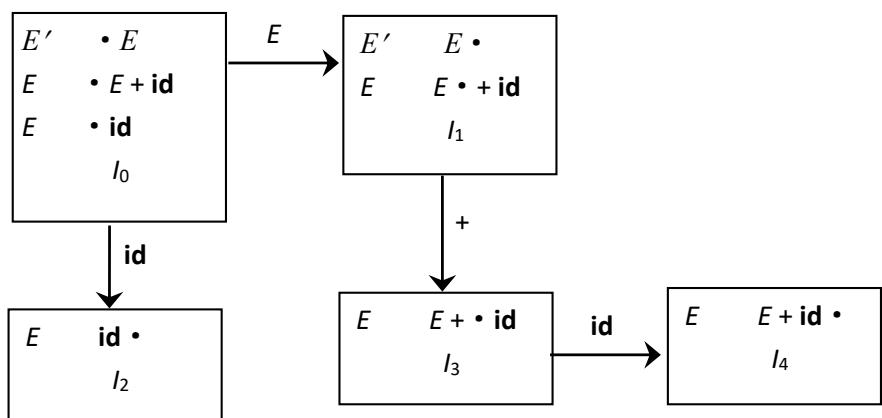

$I_{0}$ 和 $I_{3}$ 都只有移进项目，肯定不会引起冲突； $I_{2}$ 和 $I_{4}$ 都无移进项目并仅含一个归约项目，也肯定不会引起冲突；在 $I_{1}$ 中， $E'$ 的后继符号只有\$，同第 2 个项目的展望符号“+”不一样，因此 $I_{1}$ 也肯定不会引起冲突。由此可以断定该文法是 SLR(1)的。

3、语法制导定义如下。

4、对于函数 f1，局部变量 x 声明的作用域是整个函数体，导致在函数体中不可能访问形式参数 x。由于这是一个合法的 C 语言函数，因此编译器给出警告错误。

对于函数 f2，由于局部变量 x 的作用域只是函数体的一部分，不会出现上述问题，因而编译器不报错。

5、使用非优化编译时，变量 s, pi, r 在局部数据区都分配 4 个字节的空间。使用优化编译时，由于复写传播，pi\*r\*r 变成 3.14159\*r\*r，pi=3.14159 成为无用赋值而删去，函数中不再有 pi 的引用，因此不必为 pi 分配空间。类似地，s=3.14159\*r\*r 也是一个无用赋值（表达式要计算，但赋值是无用的），也不必为 s 分配空间。这样，和非优化情况相比，局部数据区少了 8 个字节，因此 r 的地址向高地址方向移动了 8 个字节。

6、正规式 b a(bb a) b 体现的特点是，每个 a 的左边都有若干 b，除非 a 是第一个字母。该正规式定义的语言是：至少含一个 a，但不含子串 aa 的所有 a 和 b 的串集。最简 DFA 如下：

7、消除左递归后的文法:

$$
\begin{array}{l l} \text {B} & 1 \text {B} ^ {\prime} \\ \text {B} ^ {\prime} & 0 \text {B} ^ {\prime} | 1 \text {B} ^ {\prime} | \end{array}
$$

## 原件第79页

相应的翻译方案如下:

$$
\begin{array}{l l} \text {B} & 1 \{\text {B} ^ {\prime}. i := 1 \} \text {B} ^ {\prime} \{\text {B}. v a l := \text {B} ^ {\prime}. v a l \} \\ \text {B} ^ {\prime} & 0 \{\text {B} _ {1} ^ {\prime}. i := \text {B} ^ {\prime}. i \qquad 2 \} \text {B} _ {1} ^ {\prime} \{\text {B} ^ {\prime}. v a l := \text {B} _ {1} ^ {\prime}. v a l \} \\ | & 1 \{\text {B} _ {1} ^ {\prime}. i := \text {B} ^ {\prime}. i \qquad 2 + 1 \} \text {B} _ {1} ^ {\prime} \{\text {B} ^ {\prime}. v a l := \text {B} _ {1} ^ {\prime}. v a l \} \\ | & \{\text {B} ^ {\prime}. v a l := \text {B} ^ {\prime}. i \} \end{array}
$$

8、表达式&i 的类型表达式是 pointer(long)，表达式&i &j 的类型表达式是 long。按照 C 语言的规定，指向同一个类型的两个指针可以相加减，它们值的差是它们之间的元素个数。

9、左边的编译器版本: 一般只为局部变量分配空间。调用函数前, 用若干次 pushl 指令将参数压栈, 返回后用 addl \$n, %esp 一次将所有参数退栈(常数 n 根据调用前做了多少次 pushl 来决定)。

右边的编译器版本：除了为局部变量分配空间外，同时还为本函数中出现的函数调用的参数分配空间，并且参数所用空间靠近栈顶。调用函数前，用 movl 指令将参数移入栈顶，调用结束后无需参数退栈指令。

优点是每次函数调用结束后不需要执行 addl \$n, %esp 指令，另外增加优化的可能性。

## 原件第80页

## 《编译原理》期末试题（三）

1、从优化的范围的角度，优化可以分哪两类？对循环的优化可以有哪三种？
答：从优化的范围的角度，优化可以分为局部优化和全局优化两类；

对循环的优化有三种：循环不变表达式外提、归纳变量删除与计算强度削减。

2、写出表达式 $a = b * c + b * d$ 对应的逆波兰式、四元式序列和三元式序列。

答：逆波兰式：abc\*bd\*+:=

四元式序列:

三元式序列：OP ARG1 ARG2

(1) $(*,\quad b,\quad c,\quad t_{1})$

(1) (\* b, c )

(2) $(*,\quad b,\quad d,\quad t_{2})$

(2) (\* b, d )

(3) $(+, t1, t_2, t_3)$

(3) (+ (1), (2))

(4) $(:= ,\quad t3,\quad / ,\quad a)$

(4) $(:=$ (3), a)

3、对于文法 $G(S)$ :

$\mathrm{S}\rightarrow \mathrm{bMb}$

$\mathrm{M}\rightarrow (\mathrm{L}\mid \mathrm{a}$

$\mathrm{L}\rightarrow \mathrm{Ma})$

答：1） $S\Rightarrow bMb\Rightarrow b(Lb\Rightarrow b(Ma)b$

2）短语：Ma），（Ma），b(Ma)b
直接短语：Ma）句柄：Ma）

### 三、设有字母表 $\{a, b\}$ 上的正规式 $R=(ab|a)*$ 。

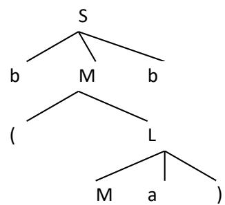

解: (1)

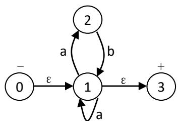

(2) 将 (1) 所得的非确定有限自动机确定化

<table><tr><td></td><td>ε</td><td>a</td><td>b</td></tr><tr><td>-0</td><td>1</td><td></td><td></td></tr><tr><td>1</td><td>3</td><td>12</td><td></td></tr><tr><td>2</td><td></td><td></td><td>1</td></tr><tr><td>+3</td><td></td><td></td><td></td></tr></table>

## 原件第81页

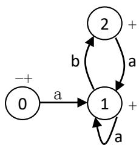

（3）对（2）得到的 DFA 化简，合并状态 0 和 2 为状态 2:

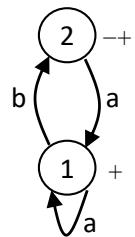

（4）令状态1和2分别对应非终结符B和A
G: A→aB|a|ε; B→aB|bA|a|b|ε; 可化简为: G: A→aB|ε; B→aB|bA|ε

四、设将文法 G 改写成等价的 LL(1) 文法，并构造预测分析表。

G: $S \rightarrow S * aT | aT | * aT;$ $T \rightarrow +aT | +a$

解：消除左递归后的文法 G' : S→aTS'|\*aTS'

$$
\mathrm{S} ^ {\prime} \rightarrow^ {*} \mathrm{aTS} ^ {\prime} \mid \varepsilon
$$

提取左公因子得文法 G'':

$$
\text { Select } (S \rightarrow a T S ^ {\prime}) = \{a \}
$$

$$
\text { Select } (S \rightarrow^ {*} a T S ^ {\prime}) = \{\ast \}
$$

$$
\text { Select } (S \rightarrow a T S ^ {\prime}) \cap \text { Select } (S \rightarrow^ {*} a T S ^ {\prime}) = \Phi
$$

$$
\text { Select } (S ^ {\prime} \rightarrow^ {*} a T S ^ {\prime}) = \{\ast \}
$$

$$
\text { Select } (S ^ {\prime} \rightarrow \varepsilon) = \text { Follow } (s ^ {\prime}) = \{\# \}
$$

$$
\text { Select } (S ^ {\prime} \to^ {*} a T S ^ {\prime}) \cap \text { Select } (S ^ {\prime} \to \varepsilon) = \Phi
$$

$$
\operatorname{Select} \left(\mathrm{T} ^ {\prime} \rightarrow \mathrm{T}\right) = \operatorname{First} (\mathrm{T}) = \{+ \}
$$

$$
\text { Select } (T ^ {\prime} \rightarrow \varepsilon) = \text { Follow } (T ^ {\prime}) = \{*, \# \}
$$

$$
\text { Select } (T ^ {\prime} \rightarrow T) \cap \text { Select } (T ^ {\prime} \rightarrow \varepsilon) = \Phi
$$

所以该文法是 LL(1) 文法。

预测分析表:

<table><tr><td></td><td>*</td><td>+</td><td>a</td><td>#</td></tr><tr><td>S</td><td>→*aTS'</td><td></td><td>→aTS'</td><td></td></tr><tr><td>S'</td><td>→*aTS'</td><td></td><td></td><td>→ε</td></tr><tr><td>T</td><td></td><td>→+aT'</td><td></td><td></td></tr><tr><td>T'</td><td>→ε</td><td>→T</td><td></td><td>→ε</td></tr></table>

## 原件第82页

6 设文法 G 为:

$S \rightarrow A; A \rightarrow BA \mid \varepsilon; B \rightarrow aB \mid b$

解：（1）拓广文法 G'：(0) S' → S (1) S → A (2) A → BA (3) A → ε (4)

B→aB (5) B→b ; FIRST(A) = { ε, a, b}; FIRST(B) = {a, b}
构造的DFA 如下:

(2) LR(1) 分析表如下:

<table><tr><td rowspan="2">状态</td><td colspan="3">Action</td><td colspan="3">Goto</td></tr><tr><td>a</td><td>B</td><td>#</td><td>S</td><td>A</td><td>B</td></tr><tr><td>0</td><td>S4</td><td>S5</td><td>r3</td><td>1</td><td>2</td><td>3</td></tr><tr><td>1</td><td></td><td></td><td>acc</td><td></td><td></td><td></td></tr><tr><td>2</td><td></td><td></td><td>r1</td><td></td><td></td><td></td></tr><tr><td>3</td><td>S4</td><td>S5</td><td>r3</td><td></td><td>6</td><td>3</td></tr><tr><td>4</td><td>S4</td><td>S5</td><td></td><td></td><td></td><td>7</td></tr><tr><td>5</td><td>r5</td><td>r5</td><td>r5</td><td></td><td></td><td></td></tr></table>

<table><tr><td>6</td><td></td><td></td><td>r2</td><td></td><td></td><td></td></tr><tr><td>7</td><td>r4</td><td>r4</td><td>r4</td><td></td><td></td><td></td></tr></table>

(3) 输入串 abab 的分析过程为:

## 原件第83页

<table><tr><td>步骤</td><td>状态栈</td><td>符号栈</td><td>当前字符</td><td>剩余字符串</td><td>动作</td></tr><tr><td>(1)</td><td>0</td><td>#</td><td>a</td><td>bab#</td><td>移进</td></tr><tr><td>(2)</td><td>04</td><td>#a</td><td>b</td><td>ab#</td><td>移进</td></tr><tr><td>(3)</td><td>045</td><td>#ab</td><td>a</td><td>b#</td><td>归约 B→b</td></tr><tr><td>(4)</td><td>047</td><td>#aB</td><td>a</td><td>b#</td><td>归约 B→aB</td></tr><tr><td>(5)</td><td>03</td><td>#B</td><td>a</td><td>b#</td><td>移进</td></tr><tr><td>(6)</td><td>034</td><td>#Ba</td><td>b</td><td>#</td><td>移进</td></tr><tr><td>(7)</td><td>0345</td><td>#Bab</td><td>#</td><td></td><td>归约 B→b</td></tr><tr><td>(8)</td><td>0347</td><td>#BaB</td><td>#</td><td></td><td>归约 B→aB</td></tr><tr><td>(9)</td><td>033</td><td>#BB</td><td>#</td><td></td><td>归约 A→ε</td></tr><tr><td>(10)</td><td>0336</td><td>#BBA</td><td>#</td><td></td><td>归约 A→BA</td></tr><tr><td>(11)</td><td>036</td><td>#BA</td><td>#</td><td></td><td>归约 A→BA</td></tr><tr><td>(12)</td><td>02</td><td># A</td><td>#</td><td></td><td>归约 S→A</td></tr><tr><td>(13)</td><td>01</td><td>#S</td><td>#</td><td></td><td>acc</td></tr></table>

简答题 3、设有文法 G[S]: S→S(S)S|ε，该文法是否为二义文法？说明理由。答：是二义的，因为对于（）（）可以构造两棵不同的语法树。

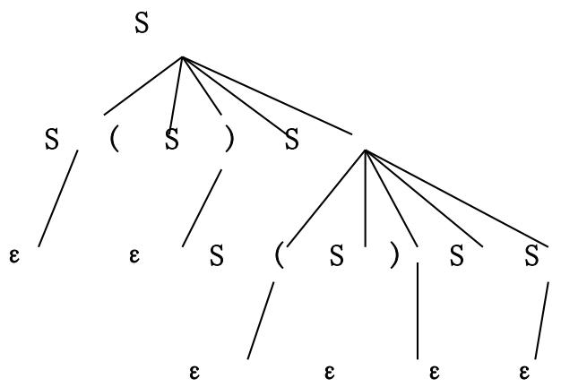

五、给定文法 G[S]:

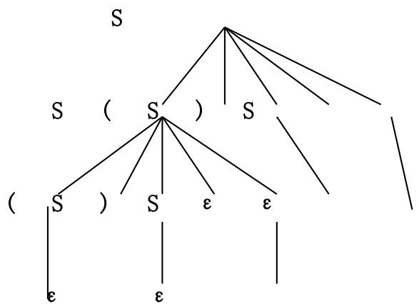

$S \rightarrow aA | bQ; \quad A \rightarrow aA | bB | b; \quad B \rightarrow bD | aQ; \quad Q \rightarrow aQ | bD | b; \quad D \rightarrow bB | aA; \quad E \rightarrow aB | bF$

$F \rightarrow bD | aE | b$

构造相应的最小的 DFA 。

解：先构造其NFA:

用子集法将 NFA 确定化:

<table><tr><td></td><td>a</td><td>b</td></tr><tr><td>S</td><td>A</td><td>Q</td></tr><tr><td>A</td><td>A</td><td>BZ</td></tr><tr><td>Q</td><td>Q</td><td>DZ</td></tr><tr><td>BZ</td><td>Q</td><td>D</td></tr><tr><td>DZ</td><td>A</td><td>B</td></tr><tr><td>D</td><td>A</td><td>B</td></tr><tr><td>B</td><td>Q</td><td>D</td></tr></table>
将 S、A、Q、BZ、DZ、D、B 重新命名，分别用 0、1、2、3、4、5、6 表示。

## 原件第84页

因为 3、4 中含有 z，所以它们为终态。

令 $P_{0}=\left(\{0,1,2,5,6\},\{3,4\}\right)$ 用b进行分割：

P1=（{0,5,6}, {1,2}, {3,4}）再用b进行分割：

P2=（{0}, {5, 6}, {1, 2}, {3, 4}）再用a、b进行分割，仍不变。再令{0}为A，{1, 2}为B，{3, 4}为C，{5, 6}为D。最小化为右上图。

### 六、对文法 G(S): S → a | ^ | (T); T → T, S | S

答: (1)

$$
F I R S T V T (S) = \{a, ^ {\wedge}, (\}
$$

$$
F I R S T V T (T) = \{,, a, ^ {\wedge}, (\}
$$

$$
L A S T V T (S) = \{a, ^ {\wedge},) \}
$$

$$
L A S T V T (T) = \{,, a, ^ {\wedge},) \}
$$

(2) 是算符优先文法, 因为任何两个终结符之间至多只有一种优先关系。(2 分)

<table><tr><td></td><td>a</td><td>^</td><td>(</td><td>)</td><td>,</td><td>#</td></tr><tr><td>a</td><td></td><td></td><td></td><td>&gt;</td><td>&gt;</td><td>&gt;</td></tr><tr><td>^</td><td></td><td></td><td></td><td>&gt;</td><td>&gt;</td><td>&gt;</td></tr><tr><td>(</td><td>&lt;</td><td>&lt;</td><td>&lt;</td><td>=</td><td>&lt;</td><td></td></tr><tr><td>)</td><td></td><td></td><td></td><td>&gt;</td><td>&gt;</td><td>&gt;</td></tr><tr><td>,</td><td>&lt;</td><td>&lt;</td><td>&lt;</td><td>&gt;</td><td>&gt;</td><td></td></tr><tr><td>#</td><td>&lt;</td><td>&lt;</td><td></td><td>&lt;</td><td></td><td>=</td></tr></table>

(3) 给出输入串 $(a, a)\#$ 的算符优先分析过程。

<table><tr><td>步骤</td><td>栈</td><td>当前输入字符</td><td>剩余输入串</td><td>动作</td></tr><tr><td>1</td><td>#</td><td>(</td><td>a, a#</td><td>#&lt;( 移进</td></tr><tr><td>2</td><td>#(</td><td>a</td><td>, a)#</td><td>(&lt;移进</td></tr><tr><td>3</td><td>#(a</td><td>,</td><td>a)#</td><td>a&gt;, 归约</td></tr><tr><td>4</td><td>#(N</td><td>,</td><td>a)#</td><td>(&lt;, 移进</td></tr><tr><td>5</td><td>#(N,</td><td>a</td><td>)#</td><td>,&lt;移进</td></tr><tr><td>6</td><td>#(N, a</td><td>)</td><td>#</td><td>a&gt;) 归约</td></tr><tr><td>7</td><td>#(N, N</td><td>)</td><td>#</td><td>,&gt;) 归约</td></tr><tr><td>8</td><td>#(N</td><td>)</td><td>#</td><td>(=) 移进</td></tr><tr><td>9</td><td>#(N)</td><td>#</td><td></td><td>)&gt;# 归约</td></tr><tr><td>10</td><td>#N</td><td>#</td><td></td><td>接受</td></tr></table>

## 原件第85页

## 《编译原理》期末试题（四）

### 一、简述编译程序的工作过程。（10）

编译程序的工作过程，是指从输入源程序开始到输出目标程序为止的整个过程，是非常复杂的，就其过程而言，一般可以划分为五个工作阶段：①词法分析，对构成源程序的字符串进行扫描和分解，识别出一个个的单词；②语法分析，根据语言的语法规则，把单词符号串分解成各类语法单位；③语义分析与中间代码产生，即对各类语法单位，分析其汉一并进行初步翻译；④代码优化，以期产生更高效的代码；⑤目标代码生成，把中间代码变换成特定机器上的低级语言指令形式。

二、构造下列正规式相应的 DFA（用状态转换图表示）（15）

(1) 1 (0 | 1) \*1

(2) $0*10*10*10*1$

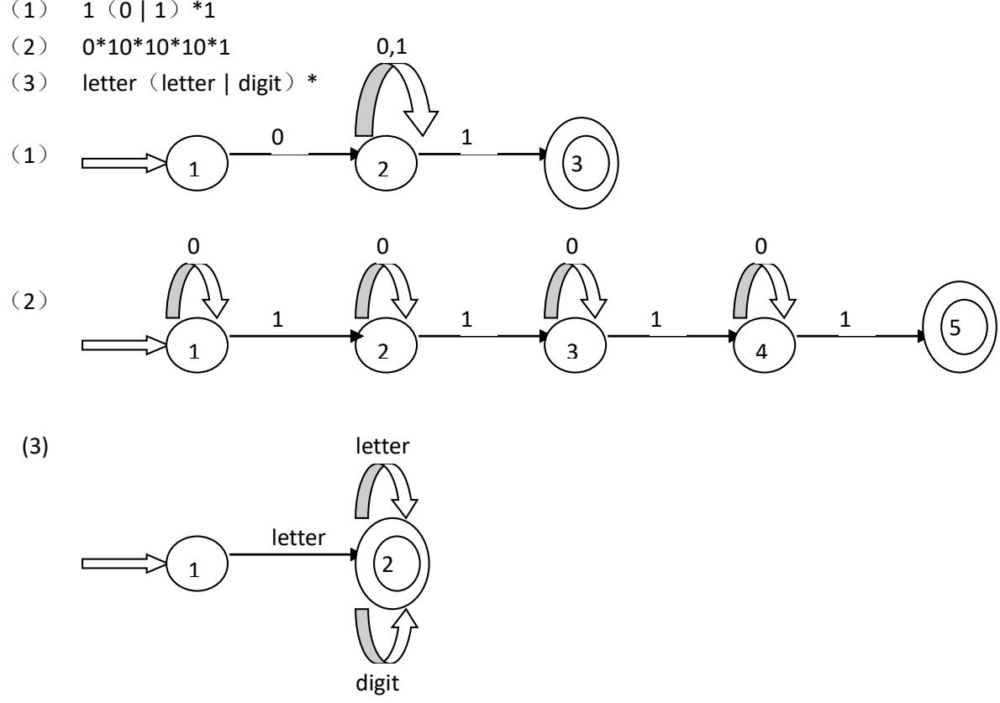

### 三、给出下面语言的相应文法：（15）

$L_{1}=\{a^{n}b^{n}\mid n\geqslant1\}$ $L_{2}=\{a^{n}b^{m+n}a^{m}\mid n\geqslant1,\ m\geqslant0\}$

G1:

$$
\mathrm{A} \rightarrow \mathrm{aAb} \quad | \mathrm{ab}
$$

G1:

## 原件第86页

四、对下面的文法 G:

$S \rightarrow a \mid b \mid (T)$ $T \rightarrow T, S \mid S$

(1) 消去文法的左递归，得到等价的文法 G2;

(2) 判断文法 G2 是否 LL（1）文法，如果是，给出其预测分析表。（15）
G2:

$S \rightarrow a \mid b \mid (T)$ $T \rightarrow ST'$ $T' \rightarrow, S T' \mid \varepsilon$

G2 是 LL（1）文法。

<table><tr><td></td><td>a</td><td>b</td><td>(</td><td>)</td><td>,</td><td>#</td></tr><tr><td>S</td><td> $S \rightarrow a$ </td><td> $S \rightarrow b$ </td><td> $S \rightarrow (T)$ </td><td></td><td></td><td></td></tr><tr><td>T</td><td> $T \rightarrow ST'$ </td><td> $T \rightarrow ST'$ </td><td> $T \rightarrow ST'$ </td><td></td><td></td><td></td></tr><tr><td>T&#x27;</td><td></td><td></td><td></td><td> $T' \rightarrow \varepsilon$ </td><td> $T' \rightarrow ,ST'$ </td><td></td></tr></table>

五、设有文法 G[A]:

(1) 计算该文法的每一个非终结符的 FIRST 集和 FOLLOW 集;

(2) 试判断该文法是否为 LL（1）文法。（15）

<table><tr><td></td><td>FIRST</td><td>FOLLOW</td></tr><tr><td>A</td><td>A, b, c, d, g</td><td></td></tr><tr><td>B</td><td>b</td><td>A, c, d</td></tr><tr><td>C</td><td>A, c, d</td><td>C, d, g</td></tr><tr><td>D</td><td>D</td><td>A, b, c, g</td></tr><tr><td>E</td><td>C, g</td><td></td></tr></table>
是LL（1）文法。

六、对表达式文法 G:

$E \rightarrow E+T \mid T$

T → T\*F | F

F → (E) | I

（1）造各非终结符的 FIRSTVT 和 LASTVT 集合；

(2) 构造文法的算符优先关系表。(15)

<table><tr><td></td><td>FIRSTVT</td><td>LASTVT</td></tr><tr><td>E</td><td>*, +, (, i</td><td>*, +,), i</td></tr><tr><td>T</td><td>*, (, i</td><td>*, ), i</td></tr><tr><td>F</td><td>(, i</td><td>), i</td></tr></table>

## 原件第87页

算符优先关系表
<table><tr><td></td><td>+</td><td>*</td><td>|</td><td>(</td><td>)</td><td>#</td></tr><tr><td>+</td><td>&gt;</td><td>&lt;</td><td>&lt;</td><td>&lt;</td><td>&gt;</td><td>&gt;</td></tr><tr><td>*</td><td>&gt;</td><td>&gt;</td><td>&lt;</td><td>&lt;</td><td>&gt;</td><td>&gt;</td></tr><tr><td>|</td><td>&gt;</td><td>&gt;</td><td></td><td></td><td>&gt;</td><td>&gt;</td></tr><tr><td>(</td><td>&lt;</td><td>&lt;</td><td>&lt;</td><td>&lt;</td><td>=</td><td></td></tr><tr><td>)</td><td>&gt;</td><td>&gt;</td><td></td><td></td><td>&gt;</td><td>&gt;</td></tr><tr><td>#</td><td>&lt;</td><td>&lt;</td><td>&lt;</td><td>&lt;</td><td></td><td>=</td></tr></table>

七、有定义二进制整数的文法如下：

L →LB | B
B →0 | 1

构造一个翻译模式，计算该二进制数的值（十进制的值）。（15）引入 L、B 的综合属性 val，翻译模式为： $S \rightarrow L$ {print(L.val)} $L \rightarrow L_{1}B$ $\{L.val = L_{1}.val*2+B.val\}$ $L \rightarrow B$ $\{L.val = B.val\}$ $B \rightarrow 0$ $\{B.val=0\}$ $B \rightarrow 1$ $\{B.val=1\}$

《编译原理》期末试题（五）

## 原件第88页

### 一、单项选择题(共 10 小题，每小题 2 分，共 20 分)

1. 语言是
A. 句子的集合
B. 产生式的集合
C. 符号串的集合
D. 句型的集合

2. 编译程序前三个阶段完成的工作是
A. 词法分析、语法分析和代码优化
B. 代码生成、代码优化和词法分析
C. 词法分析、语法分析、语义分析和中间代码生成
D. 词法分析、语法分析和代码优化

3. 一个句型中称为句柄的是该句型的最左
A. 非终结符号 B. 短语 C. 句子 D. 直接短语

4. 下推自动机识别的语言是
A. 0型语言 B. 1型语言
C. 2型语言 D. 3型语言

5. 扫描器所完成的任务是从字符串形式的源程序中识别出一个个具有独立含义的最小语法单位即
A. 字符 B. 单词 C. 句子 D. 句型

6. 对应 Chomsky 四种文法的四种语言之间的关系是
A. $L_{0} \subset L_{1} \subset L_{2} \subset L_{3}$ B. $L_{3} \subset L_{2} \subset L_{1} \subset L_{0}$ C. $L_{3} = L_{2} \subset L_{1} \subset L_{0}$ D. $L_{0} \subset L_{1} \subset L_{2} = L_{3}$

7. 词法分析的任务是
A. 识别单词
B. 分析句子的含义
C. 识别句子
D. 生成目标代码

8. 常用的中间代码形式不含
A. 三元式 B. 四元式 C. 逆波兰式 D. 语法树

9. 代码优化的目的是
A. 节省时间 B. 节省空间
C. 节省时间和空间 D. 把编译程序进行等价交换

10. 代码生成阶段的主要任务是
A. 把高级语言翻译成汇编语言
B. 把高级语言翻译成机器语言
C. 把中间代码变换成依赖具体机器的目标代码
D. 把汇编语言翻译成机器语言

### 二、填空题（本大题共5小题，每小题2分，共10分）

1. 编译程序首先要识别出源程序中每个(单词)，然后再分析每个(句子)并翻译其意义。

2. 编译器常用的语法分析方法有(自底向上)和(自顶向下)两种。

3. 通常把编译过程分为分析前端与综合后端两大阶段。词法、语法和语义分析是对源程序的(分析)，中间代码生成、代码优化与目标代码的生成则是对源程序的(综合)。

4. 程序设计语言的发展带来了日渐多变的运行时存储管理方案，主要分为两大类，即(静态存储分配)方案和(动态存储分配)方案。

## 原件第89页

5. 对编译程序而言，输入数据是(源程序)，输出结果是(目标程序)。

### 三、名词解释题(共5小题，每小题4分，共20分)

### 1. 词法分析

词法分析的主要任务是从左向右扫描每行源程序的符号，按照词法规则从构成源程序的字符串中识别出一个个具有独立意义的最小语法单位，并转换成统一的内部表示(token)，送给语法分析程序。

### 2. LL(1)文法

若文法的任何两个产生式 A $\alpha / \beta$ 都满足下面两个条件：

(1) FIRST( $\alpha$ ) FIRST( $\beta$ ) = $\phi$ ;

(2) 若 $\beta \Rightarrow^{*}\varepsilon$ ，那么 FIRST( $\alpha$ ) FOLLOW(A) = $\phi$ 。

我们把满足这两个条件的文法叫做 LL(1)文法，其中的第一个 L 代表从左向右扫描输入，第二个 L 表示产生最左推导，1 代表在决定分析器的每步动作时向前看一个输入符号。除了没有公共左因子外，LL(1)文法还有一些明显的性质，它不是二义的，也不含左递归。

### 3. 语法树

句子的树结构表示法称为语法树(语法分析树或语法推导树)。

给定文法 $G = (V_{N}, V_{T}, P, S)$ ，对于 $G$ 的任何句型都能构造与之关联的语法树。这棵树具有下列特征：

(1)根节点的标记是开始符号 S。

(2)每个节点的标记都是 V 中的一个符号。

(3)若一棵子树的根节点为 A，且其所有直接子孙的标记从左向右的排列次序为 $A_{1}A_{2}\ldots A_{R}$ ，那么 $A \rightarrow A_{1}A_{2}\ldots A_{R}$ 一定是 P 中的一条产生式。

(4)若一标记为 A 的节点至少有一个除它以外的子孙，则 $A \in V_{N}$ 。

(5)若树的所有叶节点上的标记从左到右排列为字符串 w，则 w 是文法 G 的句型；若 w 中仅含终结符号，则 w 为文法 G 所产生的句子。

### 4. LR(0)分析器

所谓 LR(0) 分析，是指从左至右扫描和自底向上的语法分析，且在分析的每一步，只须根据分析栈当前已移进和归约出的全部文法符号，并至多再向前查看 0 个输入符号，就能确定相对于某一产生式左部符号的句柄是否已在分析栈的顶部形成，从而也就可以确定当前所应采取的分析动作（是移进还是按某一产生式进行归约等）。

### 5. 语言和文法

文法就是语言结构的定义和描述，是有穷非空的产生式集合。

文法 G 定义为四元组的形式:

$$
G = \left(V _ {N}, V _ {T}, P, S\right)
$$

其中： $V_{N}$ 是非空有穷集合，称为非终结符号集合； $V_{T}$ 是非空有穷集合，称为终结符号集合；P 是产生式的集合(非空)；S 是开始符号(或识别符号)。这里， $V_{N} \cap V_{T} = \varnothing$ ， $S \in V_{N}$ 。 $V = V_{N} \cup V_{T}$ ，称为文法 G 的字母表，它是出现文法产生式中的一切符号的集合。

文法 G 所描述的语言用 L(G)表示，它由文法 G 所产生的全部句子组成，即 $L(G)=\{x \mid S \Rightarrow^{*} x$ ，其中 S 为文法开始符号，且 $x \in V_{T}^{+}$

## 原件第90页

### 四、简答题(共 4 小题，每小题 5 分，共 20 分)

### 1. 编译程序和高级语言有什么区别?

用汇编语言或高级语言编写的程序，必须先送入计算机，经过转换成用机器语言表示的目标程序（这个过程即编译），才能由计算机执行。执行转换过程的程序叫编译程序。汇编程序是指没有编译过的汇编语言源文件。编译程序转换过的叫目标程序，也就是机器语言。

编译程序的工作情况有三种：汇编型、解释型和编译型。汇编型编译程序用来将汇编语言编写的程序，按照一一对应的关系，转换成用机器语言表示的程序。解释型编译程序将高级语言程序的一个语句，先解释成为一组机器语言的指令，然后立即执行，执行完了，取下一组语句解释和执行，如此继续到完成一个程序止。用解释型编译程序，执行速度很慢，但可以进行人和计算机的"对话"，随时可以修改高级语言的程序。BASIC 语言就是解释型高级语言。编译型编译程序将级语言编写的程序，一次就会部翻译成机器语言表示的程序，而且过程进行很快，在过程中，不能进行人机对话修改。FORTRAN 语言就是编译型高级语言。

### 2. 编译程序的工作分为那几个阶段?

词法分析、语法分析和语义分析是对源程序进行的分析(称为编译程序的前端)，而中间代码生成、代码优化和代码生成三个阶段合称为对源程序进行综合(称为编译程序的后端)，它们从源程序的中间表示建立起和源程序等价的目标程序。

3. 简述自下而上的分析方法。

所谓自下而上分析法就是从输入串开始，逐步进行“归约”，直至归约到文法的开始符号；或者说从语法树的末端开始，步步向上“归约”，直到根节点。

4. 简述代码优化的目的和意义。

代码优化是尽量生成“好”的代码的编译阶段。也就是要对程序代码进行一种等价变换，在保证变换前后代码执行结果相同的前提下，尽量使目标程序运行时所需要的时间短，同时所占用的存储空间少。

### 五、综合应用题(共3小题，每小题10分，共30分)

1. 证明下述文法 G:

S→aSbS|aS|d

是二义性文法。

解：

一个文法，如果存在某个句子有不只一棵语法分析树与之对应，那么称这个文法是二义性文法。

句子 aadbd 有两棵语法树。如下图：

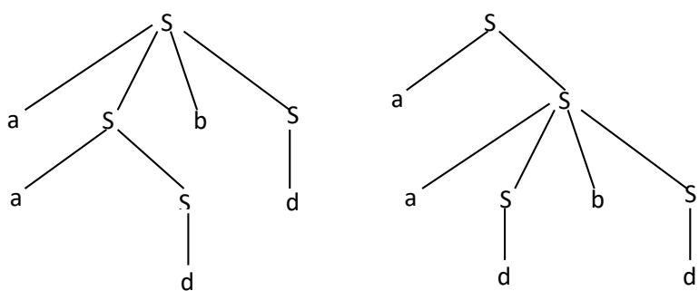

简单的说，文法描述的语言是该文法一切句子的集合。

## 原件第91页

(1) (2)

由此可知，S→aSbS|aS|d 定义的文法是二义性文法。

2. 对于文法 G[S]: S→AB, A→Aa|bB, B→a|Sb 求句型 baSb 的全部短语、直接短语和句柄? 句型 baSb 的语法树如图五(2)所示。

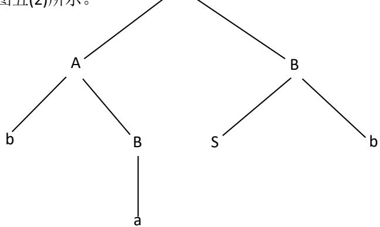

解: baSb 为句型 baSb 的相对于 S 的短语, ba 为句型 baSb 的相对于 A 的短语, Sb 为句型 baSb 的相对于 B 的短语, 且为直接短语, a 为句型 baSb 的相对于 B 的短语, 且为直接短语和句柄。

3. 设有非确定的有自限动机 NFA M=({A, B, C}, {0, 1}, δ, {A}, {C}), 其中: δ(A, 0)={C} δ(A, 1)={A, B} δ(B, 1)={C} δ(C, 1)={C}。请画出状态转换距阵和状态转换图。

解：状态转换距阵为：

<table><tr><td>δ</td><td>0</td><td>1</td></tr><tr><td>A</td><td>C</td><td>A, B</td></tr><tr><td>B</td><td></td><td>C</td></tr><tr><td>C</td><td></td><td>C</td></tr></table>

状态转换图为

## 《编译原理》期末试题（六）

### 编译原理 样题

【 】1. \_\_\_\_型文法也称为正规文法。
[A] 0    [B] 1    [C] 2    [D] 3

【 】2. \_\_\_\_文法不是 LL(1) 的。
[A] 递归 [B] 右递归 [C] 2 型 [D] 含有公共左因子的【 】3. 文法 $E \rightarrow E + E | E * E | i$ 的句子 $i * i + i * i$ 的不同语法分析树的总数为 \_\_\_\_。
[A]1    [B]3    [C]5    [D]7

## 原件第92页

【 】4．四元式之间的联系是通过\_\_\_\_实现。
[A]临时变量 [B]指示器 [C]符号表 [D]程序变量

【】5. 同心集合并可能会产生的新冲突为\_\_\_\_。
[A]二义 [B]移进/移进 [C]移进/归约 [D]归约/归约

【】6．代码优化时所依据的是 \_\_\_\_。
[A] 语法规则 [B] 词法规则 [C] 等价变换规则 [D] 语义规则

【 】7. 表达式 $a - (-b) * c$ 的逆波兰表示为 \_\_\_\_。
[A] a - b@c\* [B] ab@c\*- [C] ab@- [D] ab@c-\* （注：@为单）

目减运算符）

【】8. 过程的 DISPLAY 表记录了 \_\_\_\_。
[A] 过程的连接数据    [B] 过程的嵌套层次
[C] 过程的返回地址    [D] 过程的入口地址

### 二 填空题

3. 对于文法 G1 和 G2，若有 $L(G1)=L(G2)$ （或 G1 和 G2 的语言相同），则称文法 G1 和 G2 是等价的。

4. 对于文法 G[E]: E→T|E+T T→F|T\*F F→P^F|P P→(E)|i，句型 T+T\*F+i 的句柄是 I ，最左素短语是 T\*F。

5. 最右推导的逆过程称为规范归约，也称为最左归约。

6. 规范规约中的可规约串是句柄，算符优先分析中的可规约串是

7. （AV B）∧（CV ¬D ∧ E）的逆波兰式是 A B ∨ C D - E ∧ ∨ ∧。

8. 在属性文法中文法符号的两种属性分别称为继承属性和综合属性（次序可换）。
9. 符号表的每一项是由名字栏和\_地址分配\_两个栏目组成。在目标代码生成阶段，符号表是\_地址分配\_的依据。

10. 一个过程的 DISPLAY 表的内容是它的\_\_\_\_直接外层的 DISPLAY 表的内容加上本过程的 SP 的地址

三 有穷自动机 M 接受字母表 $\Sigma = \{0,1\}$ 上所有满足下述条件的串：每个 1 都有 0 直接跟在右边。构造一个最小的 DFA M 及和 M 等价的正规式。

【】【】

## 原件第93页

三 最小的 DFA M 如下图所示：

四 证明正规式 (ab) \*a 与正规式 a (ba) \*等价 （用构造他们的最小的 DFA 方法）。
【 答 案 ：】

四 正规式（ab）\* a 对应的 NFA 如图：

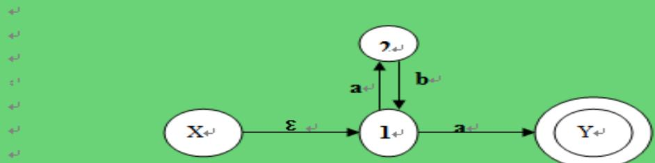

正规式 $a(ba)^*$ 对应的NFA如图：

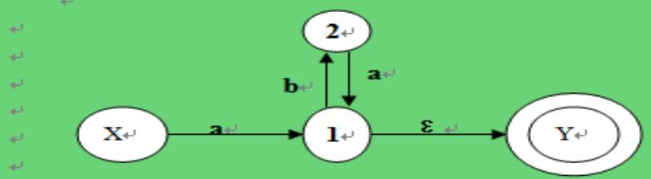

这两个正规式最终都可得到最简的 DFA 如图所示：

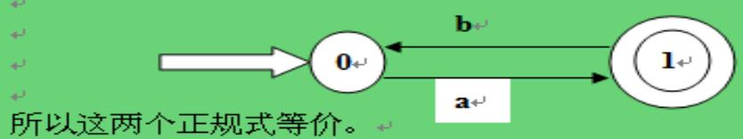

五 写一个文法，使其语言是：

$$
L = \left\{1 ^ {n} 0 ^ {m} 1 ^ {m} 0 ^ {n} \mid m, n \geqslant 0 \right\}
$$

【】【】五 文法 G: S → 1S0 | A

$$
\mathbb {A} \to 0 \mathbb {A} 1 \quad | \quad \varepsilon
$$

六 对文法 G[S]

$$
\mathrm{S} \rightarrow \mathrm{aSb} \mid \mathrm{P}
$$

$$
\mathrm{P} \rightarrow \mathrm{bPc} | \mathrm{bQc}
$$

## 原件第94页

(1) 它是否是算符优先文法？请构造算符优先关系表

(2) 文法 G[S] 消除左递归、提取左公因子后是否是 LL（1）文法？请证实。

【】【】1. 求出 G[S] 的 FIRSTVT 集和 LASTVT 集:

构造优先关系表为:

<table><tr><td></td><td>a</td><td>b</td><td>c</td></tr><tr><td>a</td><td>&lt; &gt;</td><td>&lt;</td><td>&gt;</td></tr><tr><td>b</td><td></td><td>&lt; &gt;</td><td></td></tr><tr><td>c</td><td></td><td>&gt;</td><td>&gt;</td></tr></table>

由于在优先关系中同时出现了 a<a 和 a>a 以及 b<b 和 b>b，所以该文法不是算符优先文法。

2. 消除左递归和提取左公因子后的文法为:

求具有相同左部的两个产生式的 Select 集的交集:

$$
\begin{array}{l} \text {Select (S\to a S b) \cap Select (S\to P) = \{a\} \cap First (P) = \{a\} \cap \{b\} = \Phi} \\ \text {Select (P^{\prime} \to Pc) \cap Select (P^{\prime} \to Qc) = First (P) \cap First (Q) = \{b\} \cap \{a\} = \Phi} \\ \text {Select (Q^{\prime} \to a Q^{\prime}) \cap Select (Q^{\prime} \to \varepsilon) = \{a\} \cap Follow (Q) = \{a\} \cap \{c\} = \Phi} \end{array}
$$

所以修改后的文法是 LL（1）文法。

七 已知文法 G 为:

试构造它的 LR（1）项目集、可归前缀图和 LR（1）分析表。

【】【答案：】

## 原件第95页

构造 LR(1) 分析表 如下:

<table><tr><td rowspan="2">状态</td><td colspan="6">action</td><td colspan="2">goto</td></tr><tr><td>a</td><td>b</td><td>c</td><td>d</td><td>e</td><td>#</td><td>S</td><td>A</td></tr><tr><td>0</td><td>S2</td><td>S3</td><td></td><td></td><td></td><td></td><td>1</td><td></td></tr><tr><td>1</td><td></td><td></td><td></td><td></td><td></td><td>ac</td><td></td><td></td></tr><tr><td>2</td><td></td><td></td><td></td><td></td><td>S5</td><td></td><td></td><td></td></tr><tr><td>3</td><td></td><td></td><td></td><td></td><td>S7</td><td></td><td></td><td></td></tr><tr><td>4</td><td></td><td></td><td></td><td>S8</td><td></td><td></td><td></td><td></td></tr><tr><td>5</td><td></td><td></td><td>S9</td><td>r5</td><td></td><td></td><td></td><td></td></tr><tr><td>6</td><td></td><td></td><td>S10</td><td></td><td></td><td></td><td></td><td></td></tr><tr><td>7</td><td></td><td></td><td>r5</td><td>S11</td><td></td><td></td><td></td><td></td></tr><tr><td>8</td><td></td><td></td><td></td><td></td><td></td><td>r1</td><td></td><td></td></tr><tr><td>9</td><td></td><td></td><td></td><td></td><td></td><td>r3</td><td></td><td></td></tr><tr><td>10</td><td></td><td></td><td></td><td></td><td></td><td>r2</td><td></td><td></td></tr><tr><td>11</td><td></td><td></td><td></td><td></td><td></td><td>r4</td><td></td><td></td></tr></table>

试按语法制导翻译法将源程序翻译成四元式序列（设 A 是数组 a 的起始地址，B 是数组 b 的起始地址；机器按字节编址，每个数组元素占四个字节）。

【答案:】

## 原件第96页

九 设有以下程序段

若参数传递的方法分别为（1）传值、（2）传地址、（3）传名，试问结果分别什么？

十 对以下文法，请写出关于括号嵌套层数的属性文法。(为 S, L 引入属性 h, 用来记录输出配对的括号个数)

<table><tr><td>文法规则</td><td>语义规则</td></tr><tr><td>S→(T)</td><td></td></tr><tr><td>S→i</td><td></td></tr><tr><td>T→T,S</td><td></td></tr><tr><td>T→S</td><td></td></tr><tr><td>S→(T)</td><td>{S.h:=T.h+1;}</td></tr><tr><td>S→i</td><td>{s.h:=0}</td></tr><tr><td>T→T,S</td><td>{T.h:=T.h+S.h;}</td></tr><tr><td>T→S</td><td>T.h:=S.h;}</td></tr></table>

## 原件第97页

答案:

十一 对 PL/0 语言的 while 语句 while 条件 B DO 语句 S 的编译程序，请在空缺处填空，完成该语句的编译算法：

### 《编译原理》期末试题（七）

### 一、回答下列问题：(30 分)

1. 什么是 S-属性文法？什么是 L-属性文法？它们之间有什么关系？解答：

S-属性文法是只含有综合属性的属性文法。（2分）

L-属性文法要求对于每个产生式A→X1X2...Xn，其每个语义规则中的每个属性或者是综合属性，或者是Xj的一个继承属性，且该属性仅依赖于：

(1) 产生式Xj的左边符号X1,X2...Xj-1的属性;

(2) A的继承属性。(2分)

S-属性文法是 L-属性文法的特例。（2 分）

## 原件第98页

2. 什么是句柄？什么是素短语？

一个句型的最左直接短语称为该句型的句柄。（3 分）素短语是这样的一个短语，它至少包含一个终结符并且不包含更小的素短语。（3 分）

3. 划分程序的基本块时，确定基本块的入口语句的条件是什么？解答：

(1) 程序第一个语句，或

（2）能由条件转移语句或无条件转移语句转移到的语句，或

（3）紧跟在条件转移语句后面的语句。

4. (6 分)运行时的 DISPLAY 表的内容是什么？它的作用是什么？

答：DISPLAY 表是嵌套层次显示表。每当进入一个过程后，在建立它的活动记录区的同时建立一张嵌套层次显示表 diaplay. 假定现在进入的过程层次为 i，则它的 diaplay 表含有 i+1 个单元，自顶向下每个单元依次存放着现行层、直接外层、...、直至最外层 (主程序，0 层) 等每层过程的最新活动记录的起始地址。通过 DISPLAY 表可以访问其外层过程的变量。

5. (6 分)对下列四元式序列生成目标代码:

$$
G := A + D
$$

其中，H 是基本块出口的活跃变量，R0 和 R1 是可用寄存器

答:

LD R0, B

MUL R0, C

LD R1, E

二、设 $= \{0, 1\}$ 上的正规集 S 由倒数第二个字符为 1 的所有字符串组成，请给出该字集对应的正规式，并构造一个识别该正规集的 DFA。(8 分)

答:

构造相应的正规式: $(0|1)^{*}1(0|1)$ (3 分)

NFA: (2 分)

## 原件第99页

0

确定化：(3 分)

<table><tr><td>I</td><td> $I_0$ </td><td> $I_1$ </td></tr><tr><td>{0,1,2}</td><td>{1,2}</td><td>{1,2,3}</td></tr><tr><td>{1,2}</td><td>{1,2}</td><td>{1,2,3}</td></tr><tr><td>{1,2,3}</td><td>{1,2,4}</td><td>{1,2,3,4}</td></tr><tr><td>{1,2,4}</td><td>{1,2}</td><td>{1,2,3}</td></tr><tr><td>{1,2,3,4}</td><td>{1,2,4}</td><td>{1,2,3,4}</td></tr></table>

0

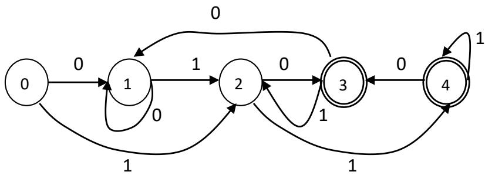

三、写一个文法使其语言为 $L(G) = \{anbmambn\mid m,n\geqslant 1\}$ 。(6分)答：文法 $G(S)$ : $S\to aSb\mid B$ $B\rightarrow bBa\mid ba$

四、对于文法 G(E): (8 分)

T→F|T\*F

$F \rightarrow (E) | i$

1. 写出句型 $(T^{*}F + i)$ 的最右推导并画出语法树。

2. 写出上述句型的短语，直接短语、句柄和素短语。

答:

1. (4 分)

$E \Rightarrow T \Rightarrow F \Rightarrow (E) \Rightarrow (E + T) \Rightarrow (E + F)$

$$
\Rightarrow (E + i) \Rightarrow (T + i) \Rightarrow (T ^ {*} F + i)
$$

( E )

2. (4分)  
短语： $(T^{*}F + i)$ ， $T^{*}F + i$ ， $T^{*}F$ ，i  
直接短语： $T^{*}F, i$ 句柄： $T^{*}F$ 素短语： $T^{*}F, i$

## 原件第100页

五、设文法 G(S): (12 分) $S \rightarrow SiA \mid A$ $A \rightarrow A + B \mid B$ $B \rightarrow )A^{*}|($

1. 构造各非终结符的 FIRSTVT 和 LASTVT 集合;

2. 构造优先关系表和优先函数。(12 分)

答：(6 分)
FIRSTVT(S)={i, +, ), ( }
FIRSTVT(A)={+, ), ( }
FIRSTVT(B)={), ( }

LASTVT(S)={ i, +, \*, ( }
LASTVT(A)={ +, \*, ( }
LASTVT(B)={ \*, ( }

优先关系表:(3 分)

<table><tr><td></td><td>i</td><td>+</td><td>(</td><td>)</td><td>*</td></tr><tr><td>i</td><td>&gt;</td><td>&lt;</td><td>&lt;</td><td>&lt;</td><td></td></tr><tr><td>+</td><td>&gt;</td><td>&gt;</td><td>&lt;</td><td>&lt;</td><td>&gt;</td></tr><tr><td>(</td><td>&gt;</td><td>&gt;</td><td></td><td></td><td>&gt;</td></tr><tr><td>)</td><td></td><td>&lt;</td><td>&lt;</td><td>&lt;</td><td></td></tr><tr><td>*</td><td>&gt;</td><td>&gt;</td><td></td><td></td><td>&gt;</td></tr></table>

优先函数:(3 分)

<table><tr><td></td><td>i</td><td>+</td><td>(</td><td>)</td><td>*</td></tr><tr><td>f</td><td>2</td><td>6</td><td>6</td><td>1</td><td>6</td></tr><tr><td>g</td><td>1</td><td>4</td><td>6</td><td>6</td><td>1</td></tr></table>

六、设某语言的 do-while 语句的语法形式为 (9 分) $S \rightarrow do \quad S^{(1)} \quad While \quad E$

其语义解释为:

针对自下而上的语法分析器，按如下要求构造该语句的翻译模式：

(1) 写出适合语法制导翻译的产生式;

## 原件第101页

U→R S $^{(1)}$ While
{ U.QUAD:=R.QUAD;
BACKPATCH(S.CHAIN, NXQ) }(2) 写出每个产生式对应的语义动作。

答: (1). 适合语法制导翻译的文法 (3 分)

(2). (6分)
R→ do
{ R.QUAD:=NXQ }

S→U E
{ BACKPATCH(E.TC, U.QUAD);
S.CHAIN:=E.FC }

### 答案二：

(1) S → do M₁ S $^{(1)}$ While M₂ E
M → ε (3 分)
(2) M → ε { M.QUAD := NXQ } (6 分)
S → do M₁ S $^{(1)}$ While M₂ E
{
BACKPATCH(S $^{(1)}$ .CHAIN, M₂.QUAD);
BACKPATCH(E.TC, M₁.QUAD);
S.CHAIN:=E. FC
}

### 七、(8 分)将语句

if $(A<X) \land (B>0)$ then while C>0 do C:=C+D

翻译成四元式。(8 分)

答:

100 (j<, A, X, 102)

101 (j, -, -, 109)

## 原件第102页

答: (1) DAG 如右图: (6 分)

## 原件第103页

的 LR 分析表如下

<table><tr><td rowspan="2">状态</td><td colspan="3">ACTION</td><td colspan="2">GOTO</td></tr><tr><td>a</td><td>b</td><td>#</td><td>S</td><td>B</td></tr><tr><td>0</td><td>s3</td><td>s4</td><td></td><td>1</td><td>2</td></tr><tr><td>1</td><td></td><td></td><td>acc</td><td></td><td></td></tr><tr><td>2</td><td>s6</td><td>s7</td><td></td><td></td><td>5</td></tr><tr><td>3</td><td>s3</td><td>s4</td><td></td><td></td><td>8</td></tr><tr><td>4</td><td>r3</td><td>r3</td><td></td><td></td><td></td></tr><tr><td>5</td><td></td><td></td><td>r1</td><td></td><td></td></tr><tr><td>6</td><td>s6</td><td>s7</td><td></td><td></td><td>9</td></tr><tr><td>7</td><td></td><td></td><td>r3</td><td></td><td></td></tr><tr><td>8</td><td>r2</td><td>r2</td><td></td><td></td><td></td></tr><tr><td>9</td><td></td><td></td><td>r2</td><td></td><td></td></tr></table>

假定输入串为 abab，请给出 LR 分析过程(即按照步骤给出状态，符号，输入串的变化过程)。

答:

<table><tr><td>步骤</td><td>状态</td><td>符号</td><td>输入串</td></tr><tr><td>0</td><td>0</td><td>#</td><td>abab#</td></tr><tr><td>1</td><td>03</td><td>#a</td><td>bab#</td></tr><tr><td>2</td><td>034</td><td>#ab</td><td>ab#</td></tr><tr><td>3</td><td>038</td><td>#aB</td><td>ab#</td></tr><tr><td>4</td><td>02</td><td>#B</td><td>ab#</td></tr><tr><td>5</td><td>026</td><td>#Ba</td><td>b#</td></tr><tr><td>6</td><td>0267</td><td>#Bab</td><td>#</td></tr><tr><td>7</td><td>0269</td><td>#BaB</td><td>#</td></tr><tr><td>8</td><td>025</td><td>#BB #</td><td></td></tr><tr><td>9</td><td>01</td><td>#S</td><td># acc</td></tr></table>

### 《编译原理》期末试题（八）

1. （10 分）处于/\* 和 \*/之间的串构成注解，注解中间没有\*/。画出接受这种注解的 DFA 的状态转换图。

2. 为语言 $L = \{a^{m}b^{n} \mid 0 \leq m \leq 2n\}$ （即 a 的个数不超过 b 的个数的两倍）写一个 LR（1）文法，不准超过 6 个产生式。（若超过 6 个产生式，不给分。若所写文法不是 LR（1）文法，最多给 5 分。）

3.（10 分）构造下面文法的 LL（1）分析表。

D → TL
T → int | real
L → id R
R → , id R | ε

## 原件第104页

给出一个语法制导定义，它输出配对括号的个数。

给出一个翻译方案，它输出每个 a 的嵌套深度。

如句子(a, (a, a))，第一小题的输出是2，第二小题的输出是122。

5.（10 分）Pascal 语言 for 语句的含义见教材第 222 页习题 7.13。请为该语句设计一种合理的中间代码结构。你可以按第 215 页图 7.17 的方式或者第 219 页图 7.19 的方式写出你的设计，不需要写产生中间代码的语法制导定义。

该程序在某种机器的 Linux 上的运行结果如下:

从上面的结果可以看出，func 函数的 3 个形式参数的地址依次升高，而 3 个局部变量的地址依次降低。试说明为什么会有这个区别。

7.（15 分）一个 C 语言程序及其在某种机器 linux 操作系统上的编译结果如下。根据所生成的汇编程序来解释程序中四个变量的作用域、生存期和置初值方式等方面的区别。

## 原件第105页

8.（10 分）C 语言是一种类型语言，但它不是强类型语言，因为编译时的类型检查不能保证所接受的程序没有运行时的类型错误。例如，编译时的类型检查一般不能保证运行时没有数组越界。请你再举一个这样的例子说明 C 语言不是强类型语言。

## 原件第106页

9.（10 分）如果在 A 机器上我们有 C 语言编译器 $CC_{A}$ ，也有它的源码 $S_{A}$ （用 C 语言写成）。如何利用它通过尽量少的工作来得到 B 机器的 C 语言编译器 $CC_{B}$ 。

10.（5 分）表达式 $(\lambda x.(\lambda yz.(x+y)+z)$ 3) 4 5 和 $(\lambda x.(\lambda yz.(x+y)+z)$ 3 5) 4 有同样的结果。在抽象机 FAM 上，哪一个表达式对应的目标代码的执行效率高？为什么？

### 参考答案

1.

## 原件第107页

6. 由于实参表达式是反序进入活动记录，而局部变量是顺序在活动记录中分配。
7. aa 是静态外部变量，而 bb 是外部变量，它们都分配在静态数据区（由.data伪指令开始），但是 bb 由伪指令.globl 指明为全局的，用来解决其它文件中对 bb 的外部引用，而 aa 只能由本文件引用。cc 是静态局部变量，同 aa 和 bb 一样，它的生存期是整个程序并分配在静态数据区。由于 cc 在源程序中的作用域是函数 func 的体，而在目标文件中，它的作用域至少已是整个文件了，为避免同源文件中外部变量和其它函数的静态局部变量的名字冲突，所以要对它进行改名，成了 cc.2。由于 cc 不是全局的，因此 cc.2 前面没有伪指令.globl。dd 是自动变量，其作用域是函数 func 的体，其生存期是该函数激活期间，因此它分配在栈区，并且置初值是用运行时的赋值来实现。

8. 例如联合体的类型检查一般也不可能在编译时完成，虽然下面例子是可静态判断类型错误的。

将 $S_{B}$ 提交给上述可执行程序进行编译，得到所需的编译器 $CC_{B}$ 。

10. 第一个表达式在执行 $\lambda yz.(x + y) + z)$ 3时出现参数个数不足的情况，因此有FUNVAL的值进入栈顶，然后发现参数个数不足，又把它做成FANVAL的情况。而第二个表达式执行的是 $(\lambda yz.(x + y) + z)$ 35，不会出现参数个数不足的情况。因此第二个表达式的执行效率比第一个表达式的高。

### 《编译原理》期末大题

## 原件第108页

①求各产生式的 FIRST 集, FOLLOW(A) 和 FOLLOW(B), 以及各产生式的 SELECT 集。
②构造 LL(1) 分析表，并分析符号串 baabbb 是否是。

解：（1）FIRST(aBc)={a}, FIRST(bAB)={b} FIRST(aAb)={a}, A→b: FIRST(A→b)={b}, B→b: FIRST(b)={b}, FIRST(ε)={ε}

SELECT(S → aBc)={a}, SELECT(S → bAB) = {b}, SELECT(A → aAb)={a}, SELECT(A → b)={b}, SELECT(B → b)={b}, SELECT(B → ε)={c, #}

因此，所得的 LL(1)分析表如表 A-4 所示。

表 A-4 LL(1)分析表
<table><tr><td rowspan="2">输入 $V_N$ </td><td colspan="4">输入符号</td></tr><tr><td>a</td><td>b</td><td>c</td><td>#</td></tr><tr><td>S</td><td>S→aBc</td><td>S→bAB</td><td></td><td></td></tr><tr><td>A</td><td>A→aAb</td><td>A→b</td><td></td><td></td></tr><tr><td>B</td><td></td><td>B→b</td><td>B→ε</td><td>B→ε</td></tr></table>

（2）分析符号串 baabbb 成功，baabbb 是该文法的句子，如图 A-16 所示。

图 A-16 识别串 baabbb 的过程
<table><tr><td>步骤</td><td>符号栈</td><td>输入串</td><td>所用的产生式</td></tr><tr><td>1</td><td>#S</td><td>baabbb#</td><td> $S \rightarrow bAB$ </td></tr><tr><td>2</td><td>#BAb</td><td>baabbb#</td><td></td></tr><tr><td>3</td><td>#BA</td><td>aabbb#</td><td> $A \rightarrow aAb$ </td></tr><tr><td>4</td><td>#BbAa</td><td>aabbb#</td><td></td></tr><tr><td>5</td><td>#BbA</td><td>abbb#</td><td> $A \rightarrow aAb$ </td></tr><tr><td>6</td><td>#BbbAa</td><td>abbb#</td><td></td></tr><tr><td>7</td><td>#BbbA</td><td>bbb#</td><td> $A \rightarrow b$ </td></tr><tr><td>8</td><td>#Bbbb</td><td>bbb#</td><td></td></tr><tr><td>9</td><td>#Bbb</td><td>bb#</td><td></td></tr><tr><td>10</td><td>#Bb</td><td>b#</td><td></td></tr><tr><td>11</td><td>#B</td><td>#</td><td> $B \rightarrow \varepsilon$ </td></tr><tr><td>12</td><td>#</td><td>#</td><td>成功</td></tr></table>

4. 对下列文法 G(S):
S—>D(R) R—>R;P|P
P—>S|I D—>i

①计算文法 G 中每个非终结符的 FIRSTVT 集和 LASTVT 集。

②构造文法 G 的算符优先关系矩阵。

解：（1）FIRSTVT(S)={{, i}, FIRSTVT(D)={i}, FIRSTVT(R)={;, (, i}, FIRSTVT(P)={i, (},{ LASTVT(S)={}}, LASTVT(D)={i}, LASTVT(R)={;, (, i}, LASTVT(P)={i, }}

## 原件第109页

(2) 算符优先矩阵, 如表 A-5 所示。

表 A-5 优先矩阵
<table><tr><td></td><td>(</td><td>)</td><td>;</td><td>i</td><td>#</td></tr><tr><td>(</td><td>&lt;.</td><td>B</td><td>&lt;.</td><td>&lt;.</td><td></td></tr><tr><td>)</td><td></td><td>.&gt;</td><td>.&gt;</td><td></td><td>.&gt;</td></tr><tr><td>;</td><td>&lt;.</td><td>.&gt;</td><td>.&gt;</td><td>&lt;.</td><td></td></tr><tr><td>i</td><td>.&gt;</td><td>.&gt;</td><td>.&gt;</td><td></td><td></td></tr><tr><td>#</td><td>&lt;.</td><td></td><td></td><td>&lt;.</td><td>B</td></tr></table>

5. 已知文法 G(S):

S—>a | (T)

T—>T, S | S

①给出句子((a, a), a)的最左推导并画出语法树；②给出句型(T, a, (T))所有的短语、直接短语、素短语、最左素短语、句柄和活前缀。

解：（1）最左推导： $S \Rightarrow (T) \Rightarrow (T,S) \Rightarrow (S,S) \Rightarrow (a,S) \Rightarrow (a,(T)) \Rightarrow (a,(T,S)) \Rightarrow (a,(S,S)) \Rightarrow (a,(a,S)) \Rightarrow (a,(a,a))$

语法树：如图 A-16 所示。

(2) 句型(T, a, (T))的短语、直接短语、素短语、最左素短语、句柄、活前缀及语法树（图 A-17）。

短语：a || T, a || (T) || T, a, (T) || (T, a, (T))

直接短语：a || (T)

素短语：a || (T)

最左素短语：a

句柄：a

活前缀： $\varepsilon$ || ( || (T || (T, || (T, a

6. 设文法G（S）为：
S—＞a | a A b    S—＞b | b B a

## 原件第110页

A—>1 A 0 | ε B—>1 B 0 | ε

求①LR（0）项目集族；②构造识别文法G（E）的DFA；

③构造文法G（E）的SLR（1）的分析表；

④分析句子 a 1 1 0 0 b 的识别过程。

解：（1）、（2）LR(0)项目集族和识别活前缀的 DFA，如图 A-19 所示。

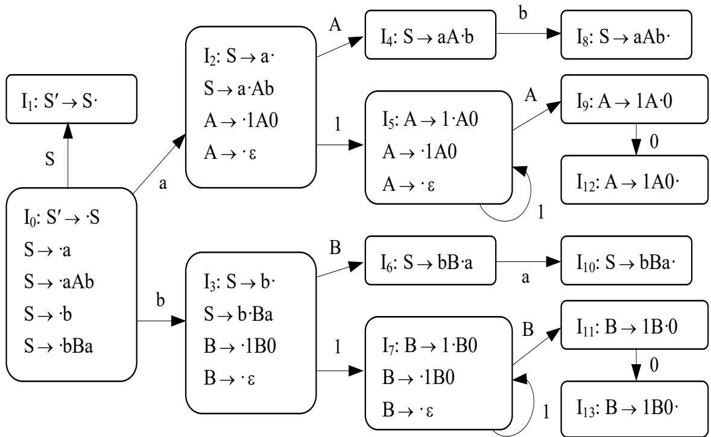

(3)、(4)略。
