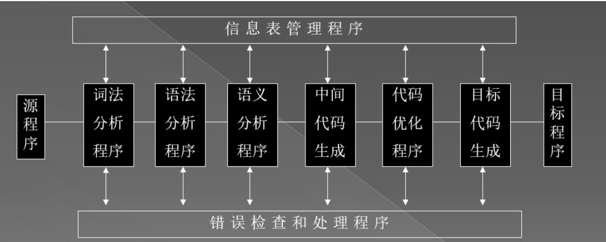
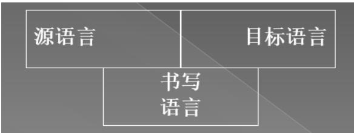
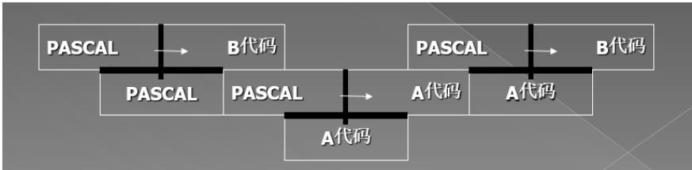
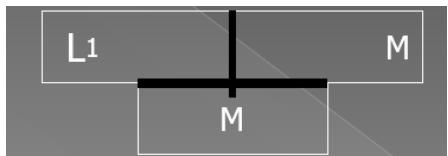
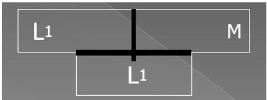
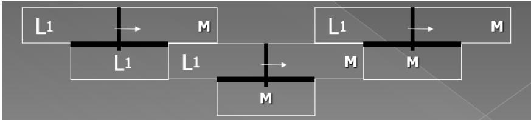
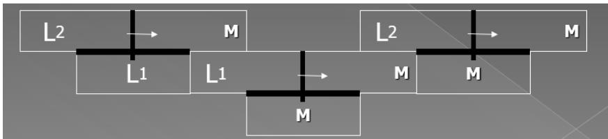
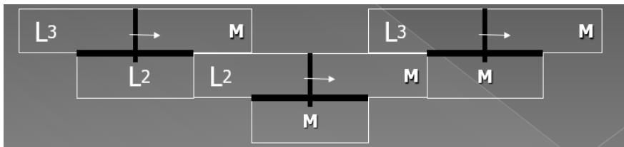
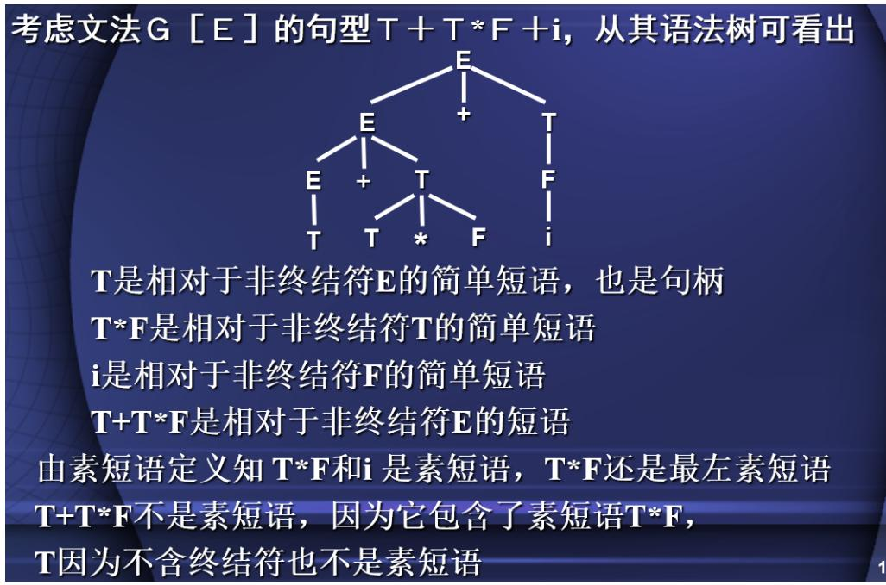

# 《编译原理》知识点整理（第一章至第二章）

原件经识别和整理；“参考解答”是我们补的。

# 《编译原理》知识点整理（第一章至第二章）

## 第一章 引论

### 1. 翻译程序的分类

- **汇编程序**：将汇编语言源程序转换为机器语言目标程序。
- **解释程序**：边解释边执行，保存中间结果。
- **编译程序**：将高级语言源程序转换为目标语言（机器语言/汇编语言）程序。

知识点：[翻译程序、编译程序与编译系统](../../../topics/编译原理/翻译程序与编译程序.md)、[编译的基本过程（词法、语法、语义、优化、目标代码生成）](../../../topics/编译原理/编译过程概述.md)

### 2. 编译程序的组成

编译程序主要由以下模块组成：
1. 词法分析程序
2. 语法分析程序
3. 语义分析程序
4. 中间代码生成程序
5. 代码优化程序
6. 目标代码生成程序
7. 错误检查和处理程序
8. 信息表管理程序

知识点：[编译的基本过程（词法、语法、语义、优化、目标代码生成）](../../../topics/编译原理/编译过程概述.md)、[翻译程序、编译程序与编译系统](../../../topics/编译原理/翻译程序与编译程序.md)

### 3. 编译程序的分遍（趟程）

- **概念**：从头到尾扫描源程序并做有关加工处理。
- **决定因素**：
    - 计算机存储容量大小
    - 编译程序功能强弱
    - 源语言繁简程度
    - 目标程序优化程度
    - 设计和实现编译程序时使用工具的先进程度
    - 参加人员多少和素质
- **适用情况**：当源语言较繁，编译程序功能很强，目标程序优化程度较高且计算机存储容量较小时，采用多遍扫描方式。

知识点：[编译器在计算机系统中的位置](../../../topics/编译原理/编译器与计算机系统.md)

### 4. 系统程序设计语言

能够编写编译程序或其他系统软件的高级语言。

知识点：[程序设计语言的发展历程（机器语言到超高级语言）](../../../topics/编译原理/程序设计语言发展历程.md)、[编译器在计算机系统中的位置](../../../topics/编译原理/编译器与计算机系统.md)

### 5. 自编译

一种高级语言与之对应的编译程序也能直接用该语言本身写出来。

知识点：[编译程序的构建方法（T型图、自编译、自展、交叉编译、移植）](../../../topics/编译原理/编译程序构建方法.md)

### 6. 交叉编译

一个 A 机器上的编译程序能产生 B 机器的目标代码。

知识点：[编译程序的构建方法（T型图、自编译、自展、交叉编译、移植）](../../../topics/编译原理/编译程序构建方法.md)、[翻译程序、编译程序与编译系统](../../../topics/编译原理/翻译程序与编译程序.md)、[编译的基本过程（词法、语法、语义、优化、目标代码生成）](../../../topics/编译原理/编译过程概述.md)

### 7. 自展技术

由一个功能较小的编译程序，一级一级扩充而变成一个功能较强的编译程序。

**(1) 用机器语言 M 建立 L1（语言核心部分）**

**(2) 用 L1 重写 L1，通过原来机器语言编译程序验证**

**(3) 把语言功能从 L1 扩展到 L2**

**(4) 把语言功能从 L2 扩展到 L3**

**(5) 把语言功能扩展到 L**

知识点：[编译程序的构建方法（T型图、自编译、自展、交叉编译、移植）](../../../topics/编译原理/编译程序构建方法.md)、[翻译程序、编译程序与编译系统](../../../topics/编译原理/翻译程序与编译程序.md)、[程序设计语言的发展历程（机器语言到超高级语言）](../../../topics/编译原理/程序设计语言发展历程.md)

### 8. 移植

1. 综合几种型号计算机抽象出一个通用的汇编语言。
2. 利用交叉编译方法。

## 第二章 语言的基本知识

知识点：[编译程序的构建方法（T型图、自编译、自展、交叉编译、移植）](../../../topics/编译原理/编译程序构建方法.md)、[编译的基本过程（词法、语法、语义、优化、目标代码生成）](../../../topics/编译原理/编译过程概述.md)

### 1. 巴科斯范式 (BNF)

为了在 ALGOL60 报告中描述 ALGOL 语言而提出的一种符号体系。

知识点：[文法的其他表示法（扩充BNF、语法图）](../../../topics/编译原理/文法其他表示法.md)

### 2. 终结符与非终结符

- **例**：$S ::= 0S1, \quad S ::= 01$
- **非终结符**：$V_N = \{S\}$
- **终结符**：$V_T = \{0, 1\}$
- **字汇表**：$V = \{S, 0, 1\}$

知识点：[形式语言的提出与文法的引入](../../../topics/编译原理/形式语言与文法引入.md)、[文法产生式、推导与规约](../../../topics/编译原理/文法产生式与推导.md)、[字母表与符号串的基本概念](../../../topics/编译原理/字母表与符号串.md)

### 3. 文法的定义

文法是规则的有穷集合，用四元组 $(V_N, V_T, P, Z)$ 形式定义：
- $P$：产生式集
- $Z \in V_N$ 为 G 的开始符号（识别符）

知识点：[文法产生式、推导与规约](../../../topics/编译原理/文法产生式与推导.md)、[字母表与符号串的基本概念](../../../topics/编译原理/字母表与符号串.md)、[语法树、最左/最右推导与文法的二义性](../../../topics/编译原理/语法树与二义性.md)

### 4. 推导类型

- **直接推导 $\Rightarrow$**：仅使用一次规则，长度为 1。
- **推导 $\Rightarrow^+$**：至少使用一次规则，长度 $\geqslant 1$。
- **广义推导 $\Rightarrow^*$**：经过 0 步或若干步的推导，长度 $\geqslant 0$。

知识点：[文法产生式、推导与规约](../../../topics/编译原理/文法产生式与推导.md)

### 5. 句型、句子与语言

- **句型**：如果符号串 $x$ 由识别符 $Z$ 推导（长度 $\geqslant 1$）而得，称 $x$ 为 $G$ 的一个句型。
- **句子**：如果 $x$ 仅由终结符组成，则称句型 $x$ 为该文法的一个句子。
- **语言**：由某文法所产生的一切句子的集合称为由该文法所确定的语言。

知识点：[字母表与符号串的基本概念](../../../topics/编译原理/字母表与符号串.md)、[文法产生式、推导与规约](../../../topics/编译原理/文法产生式与推导.md)、[短语、简单短语与句柄](../../../topics/编译原理/短语与句柄.md)

### 6. 递归规则与递归文法

- **递归规则**：在规则左部和右部具有相同的非终结符规则（参见 P78 改写法消除左递归）。
- **递归文法**：至少含有一个递归非终结符的文法。
- **判断**：如果一个语言是无穷的，则描述该语言的文法必定是递归的。

知识点：[递归下降分析法](../../../topics/编译原理/递归下降分析法.md)、[文法产生式、推导与规约](../../../topics/编译原理/文法产生式与推导.md)、[自顶向下分析的问题（左递归、回溯）及解决办法](../../../topics/编译原理/自顶向下问题与解决.md)

### 7. 无穷语言与递归文法的关系

如果一个语言是无穷的，则描述该语言的文法必定是递归的。（同第 6 点结论）

知识点：[文法产生式、推导与规约](../../../topics/编译原理/文法产生式与推导.md)、[形式语言的提出与文法的引入](../../../topics/编译原理/形式语言与文法引入.md)

### 8. 短语、简单短语、句柄与素短语

- **短语**：$Z \Rightarrow^* xUy, U \in V_N$ 且 $U \Rightarrow^+ u, u \in V^+$
- **简单短语**：$Z \Rightarrow^* xUy, U \in V_N$ 且 $U \Rightarrow u$
- **句柄**：句型最左边的简单短语（语法树最下层最左侧）。
- **素短语**：至少包含一个终结符号，且除自身外，不再包含其他的素短语。
- **最左素短语**：句型中最左边的素短语。

知识点：[短语、简单短语与句柄](../../../topics/编译原理/短语与句柄.md)、[语法树、最左/最右推导与文法的二义性](../../../topics/编译原理/语法树与二义性.md)、[算符优先分析法（算符优先关系、最左素短语）](../../../topics/编译原理/算符优先分析法.md)

### 9. 规范推导与规范规约

- **最右推导**：规范推导。
- **最左规约**：规范规约。
- 两者互为逆过程。

知识点：[文法产生式、推导与规约](../../../topics/编译原理/文法产生式与推导.md)、[短语、简单短语与句柄](../../../topics/编译原理/短语与句柄.md)、[语法树、最左/最右推导与文法的二义性](../../../topics/编译原理/语法树与二义性.md)

### 10. 语法树

文法推导过程的图形表示。

知识点：[语法树、最左/最右推导与文法的二义性](../../../topics/编译原理/语法树与二义性.md)

### 11. 文法的二义性

一个文法中的某句型对应两棵不同的语法树（或者说：一个文法中的某句子对应两个不同的最左推导或最右推导）。

知识点：[语法树、最左/最右推导与文法的二义性](../../../topics/编译原理/语法树与二义性.md)

### 12. 文法和语言的分类

| 文法类型 | 别名 | 对应自动机 | 产生式特征 |
| :--- | :--- | :--- | :--- |
| **0 型** | 短语结构文法 | 图灵机 (TM) | $a ::= b$ 其中 $a \in V^+$，且至少含有一个非终结符，$b \in V^*$ |
| **1 型** | 上下文有关/敏感文法 | 线性界限自动机 (LBA) | $aAb ::= awb$ 其中 $a, b \in V^*, A \in V_N, w \in V^+$ |
| **2 型** | 上下文无关文法 | 下推自动机 (PDA) | $A ::= w$ $A \in V_N, w \in V^*$ |
| **3 型** | 正规文法 | 有穷状态自动机 (FA) | $A ::= aB$ 或 $A ::= a$ （右线性） $A ::= Ba$ 或 $A ::= a$ （左线性） $A, B \in V_N, a \in V_T$ |

**文法的判断技巧：**
- **3 型**：左边有且仅有一个非终结符；右边格式确定（右线性或左线性）。
- **2 型**：左边有且仅有一个非终结符；右边字符个数有限。
- **1 型**：左边至少有一个非终结符；右边字符个数有限（通常要求左右长度相等或右边更长，即单调性）。

知识点：[乔姆斯基文法分类（0型、1型、2型、3型）](../../../topics/编译原理/文法分类.md)

### 13. 压缩过文法

文法中不含有形如 $A ::= A$ 的规则。需满足以下条件以去除多余规则：
1. 每一个非终结符必须在某句型中出现（**不可到达**）。
2. 非终结符 A 必须推出终结符串 t（**不可终止**）。

**示例：**
已知文法 G，其产生规则 P 为：
$$
Z ::= Be \quad A ::= Ae \mid e \quad B ::= Ce \mid Af \quad C ::= Cf \quad D ::= f
$$

**分析：**
1. 规则 $D ::= f$ 中非终结符 D 不在其它任何规则右部出现，所以规则 D::=f 在推导中不起作用，为多余规则（不可到达），应将其删除。
2. 规则 $C ::= Cf$ 也是多余规则，因为一旦使用了这条规则，便会使推导无限制进行下去，最终无法推出终结符号串，所以也是该删除的多余规则（不可终止）。
3. 同理，$B ::= Ce$ 也是多余规则，因为它含有非终结符 C（C 已被判定为不可终止）。

**压缩后的文法 G' 规则为：**
$$
Z ::= Be \quad A ::= Ae \mid e \quad B ::= Af
$$

## 简单优先文法与分析算法

知识点：[文法实用性限制与压缩过文法](../../../topics/编译原理/压缩过文法.md)、[短语、简单短语与句柄](../../../topics/编译原理/短语与句柄.md)、[简单优先分析法（优先关系、简单优先文法）](../../../topics/编译原理/简单优先分析法.md)

### 简单优先关系

- 关系 $R$：$\mathrm{R} = \{ (\mathrm{U}, \mathrm{S}) \mid \mathrm{U} \rightarrow \ldots \mathrm{S},\ \mathrm{S} \in (\mathrm{V}_{\mathrm{T}} \cup \mathrm{V}_{\mathrm{N}}) \}$。意思是：由文法规则左部符号与右部尾符号组成的有序偶集合。
- 简单优先文法：
  - 在字汇表中，任意两个符号之间至多只有一种优先关系成立；
  - 任意两条规则都没有相同的右部。
- 简单优先文法优先关系矩阵如下：

|   | Z | b | M | L | a | ( | ) |
|---|---|---|---|---|---|---|---|
| Z |   |   |   |   |   |   |   |
| b |   |   | I |   | < | < |   |
| M |   | I |   |   | I |   |   |
| L |   | > |   |   | > |   |   |
| a |   | > |   |   | > |   | I |
| ( |   |   | < | I | < | < |   |
| ) |   | > |   |   | > |   |   |

分析符号串 `b(aa)b`：

| 步骤 | 符号栈 | 关系 | 输入串 | 规则 |
|---|---|---|---|---|
| 1 | # | < | b(aa)b# |  |
| 2 | #b | < | (aa)b# |  |
| 3 | #b( | < | aa)b# |  |
| 4 | #b(a | > | a)b# |  |
| 5 | #b(M | - | a)b# | M::=a |
| 6 | #b(Ma | - | )b# |  |
| 7 | #b(Ma) | > | b# |  |
| 8 | #b(L | > | b# | L::=Ma) |
| 9 | #bM | - | b# | M::=(L |
| 10 | #bMb | > | # |  |
| 11 | #Z | > | # | Z::=bMb |

## 算符优先文法

知识点：[简单优先分析法（优先关系、简单优先文法）](../../../topics/编译原理/简单优先分析法.md)、[短语、简单短语与句柄](../../../topics/编译原理/短语与句柄.md)、[文法产生式、推导与规约](../../../topics/编译原理/文法产生式与推导.md)

### 算符优先关系

- $A \cdot< B$：$A \rightarrow \mathrm{aB}$，$\mathrm{B} \Rightarrow^+ \mathrm{b}$ 或 $\mathrm{B} \Rightarrow^+ \mathrm{Cb}$
- $A \doteq B$：$A \Rightarrow \mathrm{ab}$ 或 $A \Rightarrow \mathrm{aBb}$
- $A \cdot> B$：$A \Rightarrow \mathrm{Bb}$，$\mathrm{B} \Rightarrow^+ \mathrm{a}$ 或 $\mathrm{B} \Rightarrow^+ \mathrm{aC}$

知识点：[算符优先分析法（算符优先关系、最左素短语）](../../../topics/编译原理/算符优先分析法.md)、[短语、简单短语与句柄](../../../topics/编译原理/短语与句柄.md)

### 算符文法（OG）

不含有形如 $U ::= \ldots AB\ldots$ 的规则（$A, B \in V_N$）的文法。

知识点：[算符优先分析法（算符优先关系、最左素短语）](../../../topics/编译原理/算符优先分析法.md)、[语法树、最左/最右推导与文法的二义性](../../../topics/编译原理/语法树与二义性.md)

### 算符优先文法（OPG）

一个算符文法的任意两个终结符号对 $(a, b)$ 之间至多只满足 $\doteq$、$\cdot>$、$\cdot<$ 三个关系之一。

分析过程如下：

| 符号栈 S | 关系 | 输入串 | 最左素短语 |
|---|---|---|---|
| # | $\cdot<$ | i\*(i+i)# |  |
| #i | $\cdot>$ | \*(i+i)# | i |
| #V | $\cdot<$ | \*(i+i)# |  |
| #V\* | $\cdot<$ | (i+i)# |  |
| #V\*( | $\cdot<$ | i+i)# |  |
| #V\*(i | $\cdot>$ | +i)# | i |
| #V\*(V | $\cdot<$ | +i)# |  |
| #V\*(V+ | $\cdot<$ | i)# |  |
| #V\*(V+i | $\cdot>$ | )# | i |
| #V\*(V+V | $\cdot>$ | )# | V+V |
| #V\*(V | $\doteq$ | )# |  |
| #V\*(V) | $\cdot>$ | # | (V) |
| #V\*V | $\cdot>$ | # | V\*V |
| #V |  | # |  |

## 优先函数与 LR 分析

对于简单优先文法，若字汇表中包含 $n$ 个符号，构造优先函数后，所需存储空间大小由 $n \times n$ 减少到 $2n$。

知识点：[算符优先分析法（算符优先关系、最左素短语）](../../../topics/编译原理/算符优先分析法.md)、[优先函数及其构造（Bell方法）](../../../topics/编译原理/优先函数.md)、[语法分析的任务与方法分类](../../../topics/编译原理/语法分析概述.md)

### LR(K) 分析

- LR(K) 分析器是这样一种分析程序：它总是从左到右扫描输入串，并按自底向上进行规范规约；在这种分析过程中，它至多只向前查看 K 个输入符号就能确定当前的动作是移进还是规约。
- 从逻辑上来说，一个 LR 分析器包括两部分：一个总控程序和一张分析表。一般来说，所有 LR 分析器总控程序是一样的，只是分析表各不相同。

知识点：[LR分析法基本思想与LR分析器结构](../../../topics/编译原理/LR分析法概述.md)、[LR(1)分析表构造](../../../topics/编译原理/LR1分析表构造.md)、[LALR分析表构造（同心集合并）](../../../topics/编译原理/LALR分析表构造.md)

### LR(0)、SLR(1)、LALR 文法类型的判断

- LR(0) 文法中不存在移进-规约冲突（如 $S ::= E \cdot$，$E ::= E \cdot +$）。
- SLR(1)：存在冲突的 $I_i$ 中，$\{$移进项目 $V_T\} \cap \mathrm{FOLLOW}($归约项目左部 $V_N) = \varnothing$。
- LALR：同心集合并后没有“归约-归约”冲突。
- 不满足以上：LR(1)。

知识点：[LR(0)分析表构造（活前缀、LR(0)项目、项目集规范族）](../../../topics/编译原理/LR0分析表构造.md)、[SLR(1)分析表构造](../../../topics/编译原理/SLR1分析表构造.md)、[LALR分析表构造（同心集合并）](../../../topics/编译原理/LALR分析表构造.md)

### LR(0) 分析表的构造

1. 对于项目集 $I_i$ 中有形如 $A ::= \beta_1 \cdot X \beta_2$ 的项目，且 $\mathrm{GO}(I_i, X) = I_j$：若 $X = a \in V_T$，则置 $\mathrm{ACTION}[i, a] = S_j$；若 $X \in V_N$，则置 $\mathrm{GOTO}[i, X] = j$。
2. 若归约项目 $A ::= \beta \cdot$ 属于 $I_i$，设 $A ::= \beta$ 是文法第 $j$ 个规则，则对任意终结符 $a$ 和句子右界符 `#`，均置 $\mathrm{ACTION}[i, a\ \text{或}\ \#] = r_j$，表示按文法第 $j$ 条规则将符号栈顶符号串 $\beta$ 归约为 $A$。
3. 若接受项目 $S' ::= S \cdot$ 属于 $I_i$，则置 $\mathrm{ACTION}[i, \#] = \mathrm{acc}$。
4. 分析表中，凡不能用前 3 个规则填入信息的空白格位置上，均表示出错。

知识点：[LR(0)分析表构造（活前缀、LR(0)项目、项目集规范族）](../../../topics/编译原理/LR0分析表构造.md)、[LR分析法基本思想与LR分析器结构](../../../topics/编译原理/LR分析法概述.md)

### LR(1) 分析表的构造

LR(1) 项目集规范族：

- $I$ 的任何项目都属于 $\mathrm{CLOSURE}(I)$。
- 若项目 $[A ::= \alpha \cdot B \beta]$ 属于 $\mathrm{CLOSURE}(I)$，$B ::= \eta$ 是一个规则，那么对 $\mathrm{FIRST}(\beta a)$ 中的每个终结符 $b$，则有形如 $[B ::= \cdot \eta, b]$ 的所有项目也属于 $\mathrm{CLOSURE}(I)$。

LR(1) 分析表的构造（$\mathrm{GO}(I, X) = \mathrm{CLOSURE}(J)$）：

1. 若项目 $[A ::= \alpha \cdot a \beta, b]$ 属于 $I_i$，且 $\mathrm{GO}(I_i, a) = I_j$，$a \in V_T$，则置 $\mathrm{ACTION}[i, a] = S_j$。
2. 若项目 $[A ::= \alpha \cdot, a]$ 属于 $I_i$，设 $A ::= \alpha$ 是文法的第 $j$ 个规则，则置 $\mathrm{ACTION}[i, a] = r_j$。
3. 若项目 $[S' ::= S \cdot]$ 属于 $I_i$，则置 $\mathrm{ACTION}[i, \#]$ 为 $\mathrm{acc}$。
4. 若 $\mathrm{GO}(I_i, A) = I_j$，$A \in V_N$，则置 $\mathrm{GOTO}[i, A] = j$。

知识点：[LR(1)分析表构造](../../../topics/编译原理/LR1分析表构造.md)、[LR分析法基本思想与LR分析器结构](../../../topics/编译原理/LR分析法概述.md)

### LALR 分析表的构造

1. 构造文法 $G$ 的 LR(1) 的项目集族 $C = \{I_0, I_1, \ldots, I_n\}$。
2. 把全部同心集合并，记为 $C' = \{J_0, J_1, \ldots, J_n\}$，其中含有项目 $[S' ::= \cdot S, \#]$ 的 $J_i$ 为分析表的初态。
3. 从 $C'$ 构造 ACTION 表：
   - 若 $[A ::= \alpha \cdot a \beta, b] \in J_i$，且 $\mathrm{GO}(J_i, a) = J_j$，$a \in V_T$，则置 $\mathrm{ACTION}[i, a] = S_j$。
   - 若 $[A ::= \alpha \cdot] \in J_i$，则置 $\mathrm{ACTION}[i, a] = r_i$。
   - 若 $[S' ::= S \cdot, \#] \in J_i$，则置 $\mathrm{ACTION}[i, \#] = \mathrm{acc}$。
4. 构造 GOTO 表：若 $\mathrm{GO}(J_i, A) = J_j$，$A \in V_N$，则置 $\mathrm{GOTO}[i, A] = j$。

## 第五章 语法制导翻译技术

知识点：[LALR分析表构造（同心集合并）](../../../topics/编译原理/LALR分析表构造.md)、[LR(1)分析表构造](../../../topics/编译原理/LR1分析表构造.md)、[语法分析的任务与方法分类](../../../topics/编译原理/语法分析概述.md)

### 语法制导翻译方法

语法制导翻译方法就是以语法分析为主导的语义处理，在对源程序进行语法分析的过程中嵌入语义动作。

知识点：[语法制导翻译的基本思想与语法制导定义](../../../topics/编译原理/语法制导翻译概述.md)、[中间语言（逆波兰、三元式、树形、四元式）](../../../topics/编译原理/中间语言.md)、[简单算术表达式与赋值语句的翻译](../../../topics/编译原理/简单算术表达式翻译.md)

### 中间语言的表示

逆波兰表示（后缀表示）：

$$
\begin{array}{r l}
\mathrm{x:=5} & \\
\mathrm{x5:=} & \\
\mathrm{x:= a * b - c / d} & \\
\mathrm{xab * cd / - :=} &
\end{array}
$$

用后缀式来表示条件语句：

if $E$ then $S_1$ else $S_2$ 可表示为 $E' p_1 \mathrm{JEZ}\ S_1' p_2 \mathrm{JUMP}\ S_2'$，其中 $E'$、$S_1'$、$S_2'$ 分别为 $E$、$S_1$、$S_2$ 的后缀式；$p_1$ 表示 $S_2'$ 在数组 POST 的起始位置，$p_2$ 表示 $S_2'$ 之后那个符号位置。

知识点：[中间语言（逆波兰、三元式、树形、四元式）](../../../topics/编译原理/中间语言.md)、[控制语句的翻译（if、while、for、goto）](../../../topics/编译原理/控制语句翻译.md)

### 三元式

$x := -b * (c + d)$

1. $(-, b, \quad)$
2. $(+, c, d)$
3. $(*, (1), (2))$
4. $(:=, x, (3))$

知识点：[中间语言（逆波兰、三元式、树形、四元式）](../../../topics/编译原理/中间语言.md)、[简单算术表达式与赋值语句的翻译](../../../topics/编译原理/简单算术表达式翻译.md)

### 四元式（OP, ARG1, ARG2, RESULT）

$x := -b * (c + d)$

1. $(-, b, \quad, T_1)$
2. $(+, c, d, T_2)$
3. $(*, T_1, T_2, T_3)$
4. $(:=, T_3, \quad, x)$

知识点：[语法制导翻译的基本思想与语法制导定义](../../../topics/编译原理/语法制导翻译概述.md)、[中间语言（逆波兰、三元式、树形、四元式）](../../../topics/编译原理/中间语言.md)、[简单算术表达式与赋值语句的翻译](../../../topics/编译原理/简单算术表达式翻译.md)
