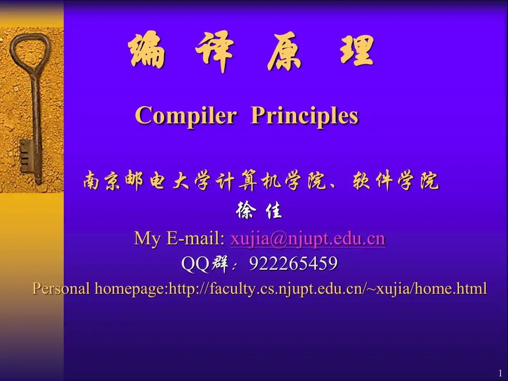
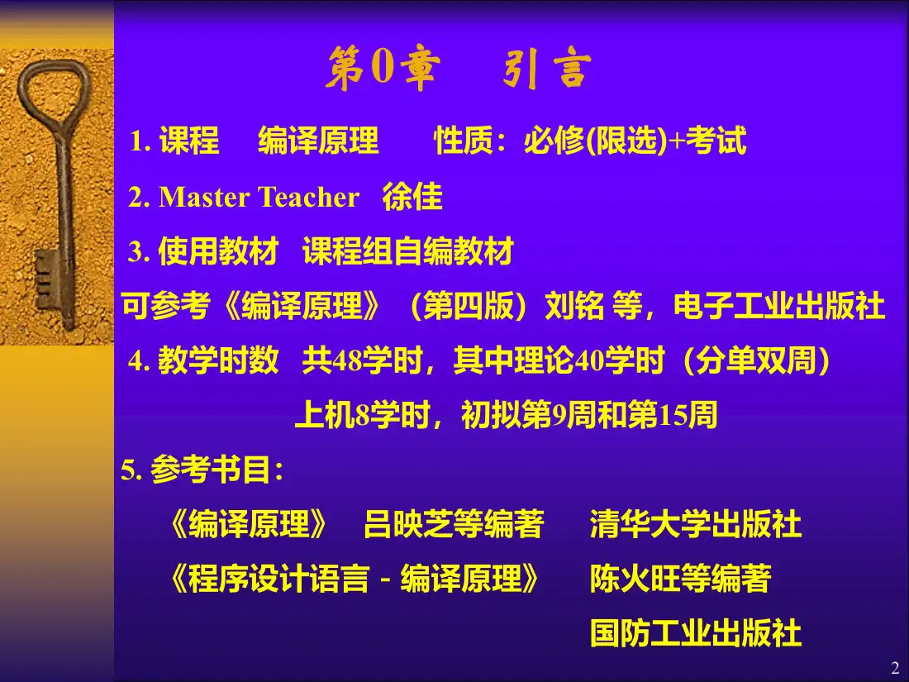
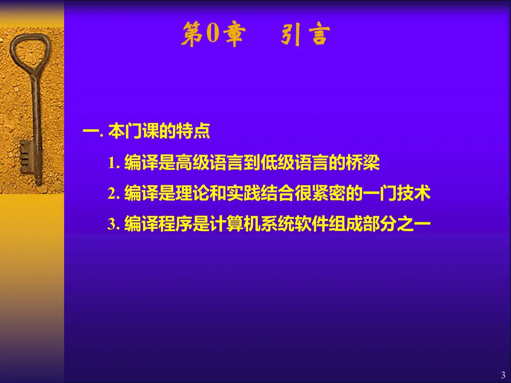
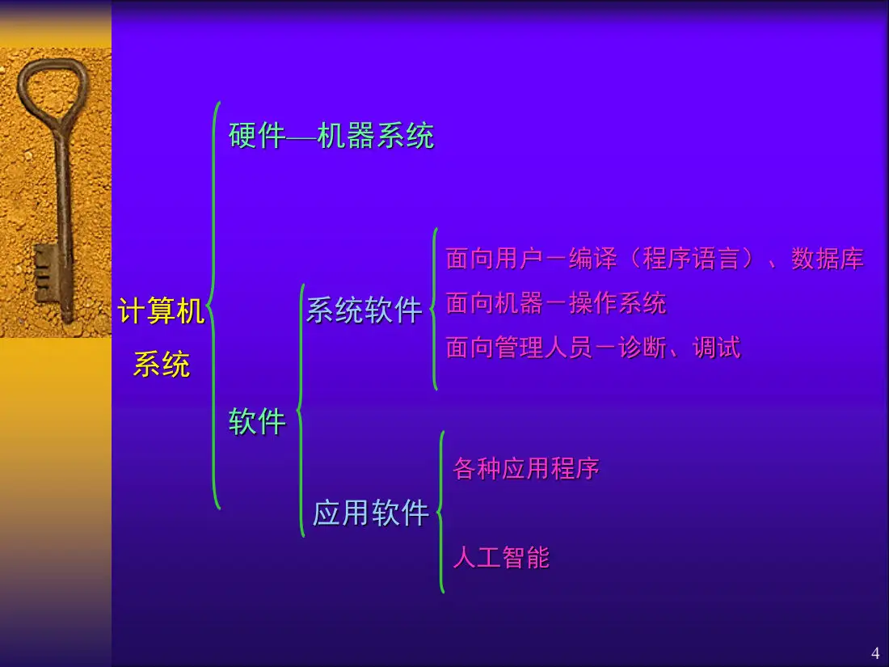
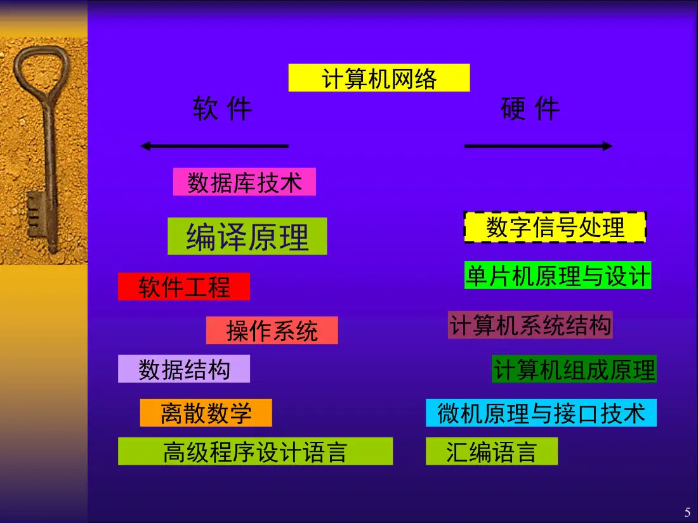
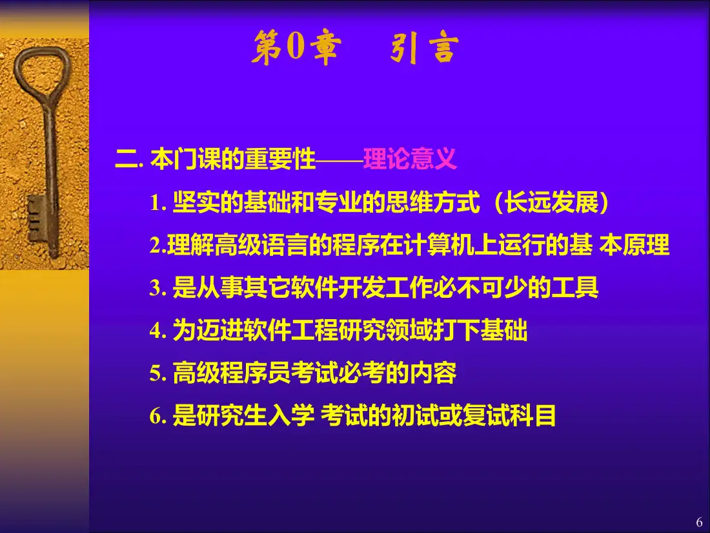
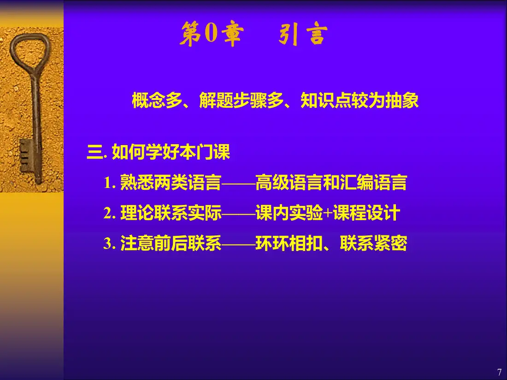
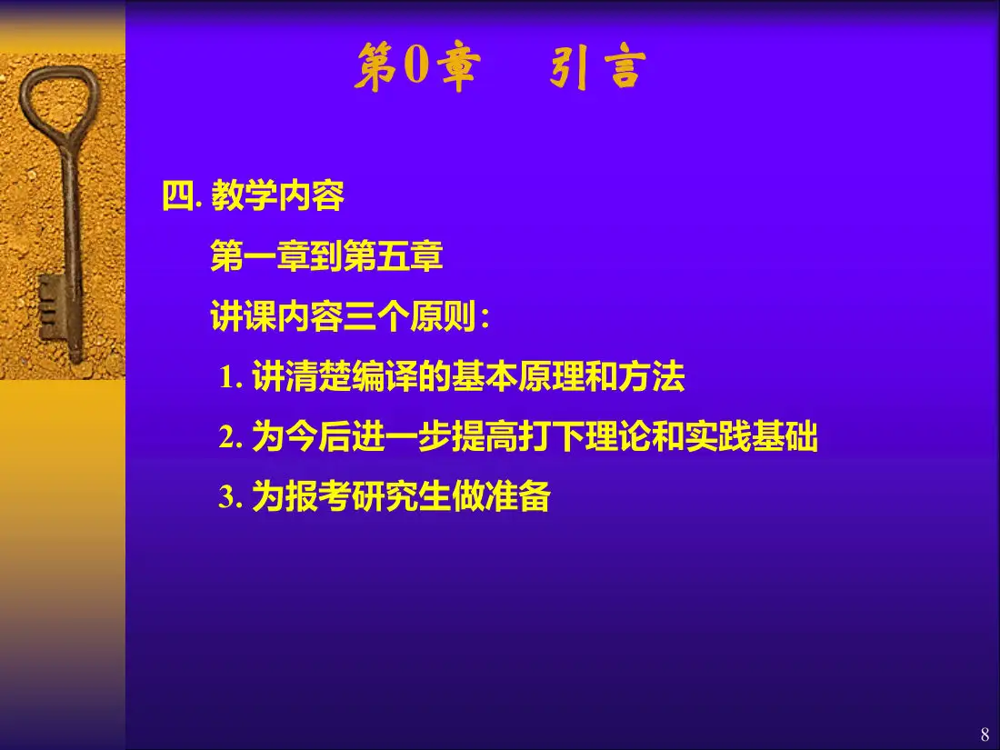
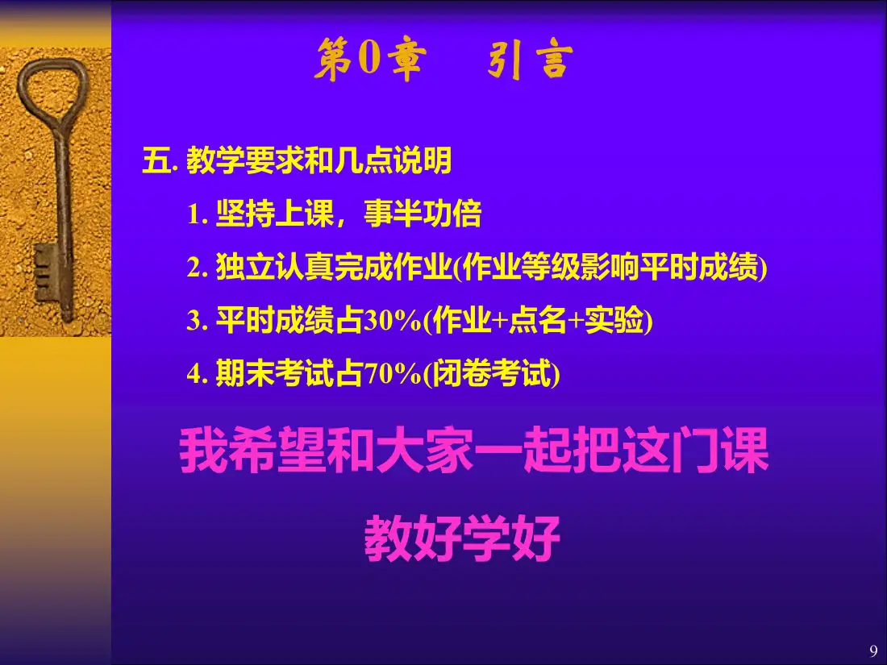

# 《编译原理》第0章 引言（课件）

原件的每一页，下面附识别出的文字。

### Compiler Principles

原文：

Compiler Principles

南京邮电大学计算机学院、软件学院

徐佳

My E-mail: xujia@njupt.edu.cn

QQ群：922265459

Personal homepage:http://faculty.cs.njupt.edu.cn/\~xujia/home.html

编译原理

1

### 第0章 引言

原文：

第0章 引言

1. 课程 编译原理 性质：必修(限选)+考试

2. Master Teacher 徐佳

3. 使用教材 课程组自编教材

可参考《编译原理》（第四版）刘铭等，电子工业出版社

4. 教学时数 共48学时，其中理论40学时（分单双周）

上机8学时，初拟第9周和第15周

5. 参考书目:

《编译原理》 吕映芝等编著

《程序设计语言 - 编译原理》

清华大学出版社

陈火旺等编著

国防工业出版社

2

### 第0章 引言

原文：

第0章 引言

一. 本门课的特点

1. 编译是高级语言到低级语言的桥梁

2. 编译是理论和实践结合很紧密的一门技术

3. 编译程序是计算机系统软件组成部分之一

3

### 计算机系统

原文：

计算机系统

硬件—机器系统

系统软件

软件

应用软件

面向用户一编译（程序语言）、数据库

面向机器一操作系统

面向管理人员一诊断、调试

各种应用程序

人工智能

4

### 计算机网络

原文：

计算机网络

软件

数据库技术

编译原理

软件工程

硬件

操作系统

数据结构

离散数学

高级程序设计语言

数字信号处理

单片机原理与设计

计算机系统结构

计算机组成原理

微机原理与接口技术

汇编语言

5

### 第0章 引言

原文：

第0章 引言

二. 本门课的重要性——理论意义

1. 坚实的基础和专业的思维方式（长远发展）

2.理解高级语言的程序在计算机上运行的基本原理

3. 是从事其它软件开发工作必不可少的工具

4. 为迈进软件工程研究领域打下基础

5. 高级程序员考试必考的内容

6. 是研究生入学 考试的初试或复试科目

6

### 第0章 引言

原文：

第0章 引言

概念多、解题步骤多、知识点较为抽象

三. 如何学好本门课

1. 熟悉两类语言——高级语言和汇编语言

2. 理论联系实际——课内实验+课程设计

3. 注意前后联系——环环相扣、联系紧密

7

### 第0章 引言

原文：

第0章 引言

四. 教学内容

第一章到第五章

讲课内容三个原则：

1. 讲清楚编译的基本原理和方法

2. 为今后进一步提高打下理论和实践基础

3. 为报考研究生做准备

8

### 第0章 引言

原文：

第0章 引言

五. 教学要求和几点说明

1. 坚持上课，事半功倍

2. 独立认真完成作业(作业等级影响平时成绩)

3. 平时成绩占 $30 \%$ (作业+点名+实验)

4. 期末考试占70%(闭卷考试)

我希望和大家一起把这门课

教好学好

9
