# 《编译原理》第10章 编译程序实例分析（自编参考教材）

原件经识别和整理；“参考解答”是我们补的。

## 第十章 编译程序实例分析

通过前面几章的学习，对于构造一个编译程序从理论上已经了解，但编译是一门理论和实践紧密结合的学科，本章通过对 C--语言程序进行词法分析、语法分析和简单的语义处理，将学过的编译理论和编译系统联系起来，从而获得对编译的整体概念。

### 10.1 C--语言的文法规则

C--语言是一个非常简单的 C++ 语言的一个子集（输入输出采用了简化的方式），它描述的功能为从键盘上输入整数串，进行整数的加法和乘法运算，可以将计算结果输出。用 BNF 范式描述 C--语言的文法规则如下：

*(注：原文此处缺失具体文法规则内容，仅保留标题及说明)*

### 10.2 C--语言的编译程序分析

C--语言的编译程序主要完成编译的前端实现，对该语言进行词法分析、语法分析和简单的语义处理。既可以通过手动方式编写编译程序，也可以利用编译程序自动生成工具进行编写。C--语言的编译程序的设计流程图如图10.1所示。本章主要简单介绍如何利用编译程序自动生成工具实现C--语言的编译程序。

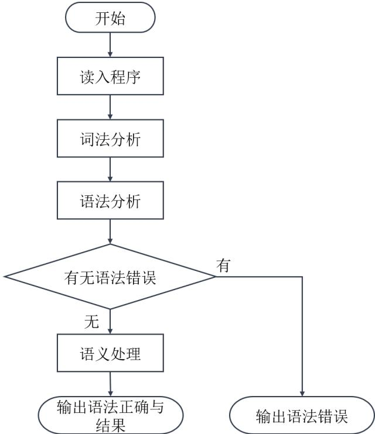

### 10.3 编译程序自动生成器简介

#### 10.3.1 Lex

**(1) Lex 介绍**

Lex 代表 Lexical Analyzar，是一种生成扫描器的工具。扫描器是一种识别文本中的词汇模式的程序。这些词汇模式（或者常规表达式）在一种特殊的句子结构中定义。

一种匹配的常规表达式可能会包含相关的动作。这一动作可能还包括返回一个标记。当 Lex 接收到文件或文本形式的输入时，它试图将文本与常规表达式进行匹配。它一次读入一个输入字符，直到找到一个匹配的模式。如果能够找到一个匹配的模式，Lex 就执行相关的动作（可能包括返回一个标记）。另一方面，如果没有可以匹配的常规表达式，将会停止进一步的处理，Lex 将显示一个错误消息。

一个 `.lex` 文件 (Lex 文件具有 `.lex` 或者 `.l` 的扩展名) 通过 Lex 公用程序来传递，并生成 C 的输出文件。这些文件被编译为词法分析器的可执行版本。

Lex 表达式由符号组成。符号一般是字符和数字，但是 Lex 中还有一些具有特殊含义的其他标记。下面两个表格 10.1 和 10.2 定义了 Lex 中使用的一些标记并给出了几个典型的例子。

**表 10.1 Lex 表达式常用符号及含义**

| 字符 | 含义 |
| :--- | :--- |
| A-Z, 0-9, a-z | 构成了部分模式的字符和数字。 |
| . | 匹配任意字符,除了 `\n`。 |
| - | 用来指定范围。例如:A-Z 指从 A 到 Z 之间的所有字符。 |
| [ ] | 一个字符集合。匹配括号内的字符。如果第一个字符是 `^` 那么它表示否定模式。例如:`[abC]` 匹配 a, b, 和 C 中的任何一个。 |
| * | 匹配 0 个或者多个上述的模式。 |
| + | 匹配 1 个或者多个上述模式。 |
| ? | 匹配 0 个或 1 个上述模式。 |
| $ | 作为模式的最后一个字符匹配一行的结尾。 |
| {} | 指出一个模式可能出现的次数。例如:`A{1,3}` 表示 A 可能出现 1 次或 3 次。 |
| \ | 用来转义元字符。同样用来覆盖字符在此表中定义的特殊意义,只取字符的本意。 |
| ^ | 否定。 |
| \| | 表达式间的逻辑或。 |
| () | 将一系列常规表达式分组。 |

**表 10.2 Lex 常规表达式举例**

| 常规表达式 | 含义 |
| :--- | :--- |
| joke[rs] | 匹配 jokes 或 joker。 |
| A{1,2}shis+ | 匹配 AAshis, Ashis, AAshis, Ashis。 |
| (A[b-e])+ | 匹配在 A 出现位置后跟随的从 b 到 e 的所有字符中的 0 个或 1 个。 |

**(2) Lex 源程序的写法**

Lex 源程序必须按照 Lex 语言的规范来写，其核心是一组词法规则（正规式）。一般而言，一个 Lex 源程序分为三部分，三部分之间以符号 `%%` 分隔。即

```text
[第一部分：定义段]

%%

[第二部分：词法规则段]

%%

[第三部分：辅助函数段]
```

第一部分定义段可以分为两步:

第一步以符号 `%{` 和 `%}` 包裹，里面为以 C 语法写的一些定义和声明：例如，文件包含，宏定义，常数定义，全局变量及外部变量定义，函数声明等。这一部分被 Lex 翻译器处理后会全部拷贝到文件 `lex.yy.c` 中。

第二步是一组正规定义和状态定义。正规定义是为了简化后面的词法规则而给部分正规式定义了名字。如：

```lex
letter [A-Za-z]
digit [0-9]
id {letter}({letter}|{digit})*
```

**第二部分词法规则段的写法:**

词法规则段列出的是词法分析器需要匹配的正规式，以及匹配该正规式后需要进行的相关动作。如：

```lex
while {return (WHILE);}
do {return (DO);}
{id} {yylval = installID (); return (ID);}
```

**第三部分辅助函数段的写法:**

辅助函数段用 C 语言语法来写，辅助函数一般是在词法规则段中用到的函数。这一部分一般会被直接拷贝到 `lex.yy.c` 中。

**(3) Lex 源程序中常用到的变量及函数**

*   **yyin 和 yyout**: 这是 Lex 中本身已定义的输入和输出文件指针。这两个变量指明了 Lex 生成的词法分析器从哪里获得输入和输出到哪里。默认：键盘输入，屏幕输出。
*   **yytext 和 yyleng**: 这也是 Lex 中已定义的变量，直接用就可以了。
    *   `yytext`: 指向当前识别的词法单元（词文）的指针
    *   `yyleng`: 当前词法单元的长度。
*   **yylex()**: 词法分析器驱动程序，用 Lex 翻译器生成的 `lex.yy.c` 内必然含有这个函数。
*   **yywrap()**: 词法分析器遇到文件结尾时会调用 `yywrap()` 来决定下一步怎么做:
    *   若 `yywrap()` 返回 0，则继续扫描；
    *   若返回 1，则返回报告文件结尾的 0 标记。

由于词法分析器总会调用 `yywrap`，因此辅助函数中最好提供 `yywrap`，如果不提供，则在用 C 编译器编译 `lex.yy.c` 时，需要链接相应的库，库中会给出标准的 `yywrap` 函数（标准函数返回 1）。

#### 10.3.2 Yacc

**(1) Yacc 介绍**

Yacc 代表 Yet Another Compiler Compiler。它是一种工具，将任何一种编程语言的所有语法翻译成针对此种语言的 Yacc 语法解析器。它用巴科斯范式（BNF 范式）来书写。按照惯例，Yacc 文件有 `.y` 后缀。

**(2) Yacc 源程序的写法**

同 Lex 源程序的写法一样，Yacc 也分为三个阶段：定义段、规则段、函数段。写法为：

**[第一部分：定义段]**

**第一部分定义段:**

定义段包括文字块,逐字拷贝到生成的C文件开头部分的C代码,通常包括声明和 `#include` 行。可能有 `%union` `%start` `%token` `%type` `%left` `%right` 和 `%nonassoc` 声明。也可以包含普通的C语言风格的注释,所有这些都是可选的,在简单的语法分析程序中,定义段可能完全是空的。

**第二部分语法规则段：**

规则段由语法规则和包括 C 代码的动作组成。规则中目标或非终端符放在左边，后跟一个冒号（:），然后是产生式的右边，之后是对应的动作（用 `{}` 包含）。如：

*(注：原文此处缺失具体示例代码)*

**第三部分辅助函数段:**

yacc 将用户子例程段的内容完全拷贝到 C 文件中，通常这部分包括从动作调用的例程。该部分是函数部分。当 yacc 解析出错时，会调用函数 `yyerror()`，用户可自定义函数的实现。main 函数是调用 yacc 解析入口函数 `yyparse()`。如：

*(注：原文此处缺失具体示例代码)*

#### 10.3.3 Parser Generator

**(1) Parser Generator 介绍**

Parser Generator 是由英国 Bumble-Bee Software 公司开发，是一款在 windows 下编写 Lex/Yacc 程序的工具。这个工具使用 Yacc 和 Lex 能够生成 Visual C++, Borland C++, Other C/C++ 以及相关 Java 代码。

**(2) Parser Generator 配置与使用**

Parser Generator 的环境配置步骤如下:

(a) 首先打开 Parser Generator 编辑器，选择 Project->LibBuilder;

(b) 在 LibBuilder 对话框中选中 Visual C++(32-bit)，按属性键 Properties 后将修改各个属性，具体修改参考表 10.3；

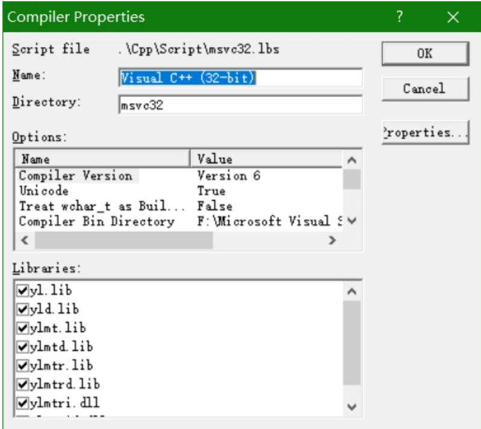

(d) LibBuilder 对话框->Build（编译过程可能几分钟），如图 10.3 所示。

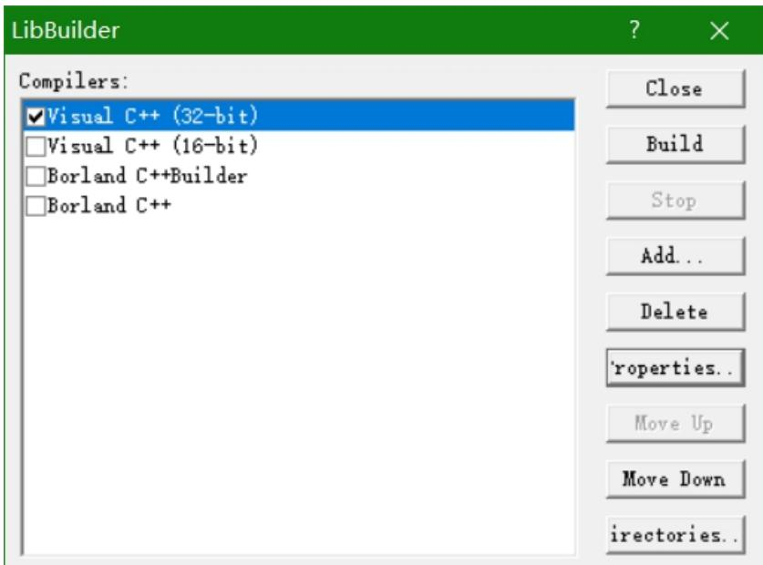

编译完成后我们就可以使用 Parser Generator 编写 Lex 或是 Yacc 程序了。

**表 10.3 属性配置**

| Script file name | `\Cpp\Script\msvc32.lbs` |
| :--- | :--- |
| Name | Visual C++(32-bit) |
| Directory | msvc32 |
| Compiler Version | Version 6 |
| Unicode | True |
| Treat wchar_t as Built-in Type | False |
| Compiler Bin Directory | 安装路径\Microsoft Visual Studio\Vc98\bin |
| Compiler Bin Directory(2) | 安装路径\Microsoft Visual Studio\Common\MSDev98\bin |
| Compiler Include Directory | 安装路径\Microsoft Visual Studio\Vc98\include |
| Compiler Include Directory(2) | 无 |
| Compiler Library Directory | 安装路径\Microsoft Visual Studio \Vc98\lib |

Parser Generator 工程的建立过程如下:

(a) Project->ParserWizard;

(b) 工程设定（需要注意语言可以选择 C 或 C++或 java，本章中选择为 C），如图 10.4 所示；

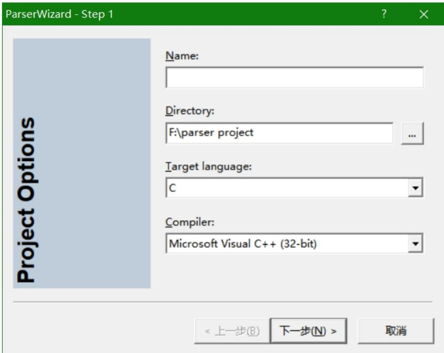

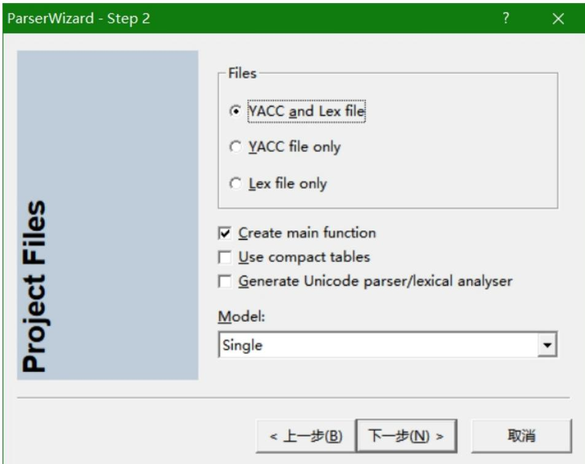

(d) Yacc 文件设定如图 10.6;

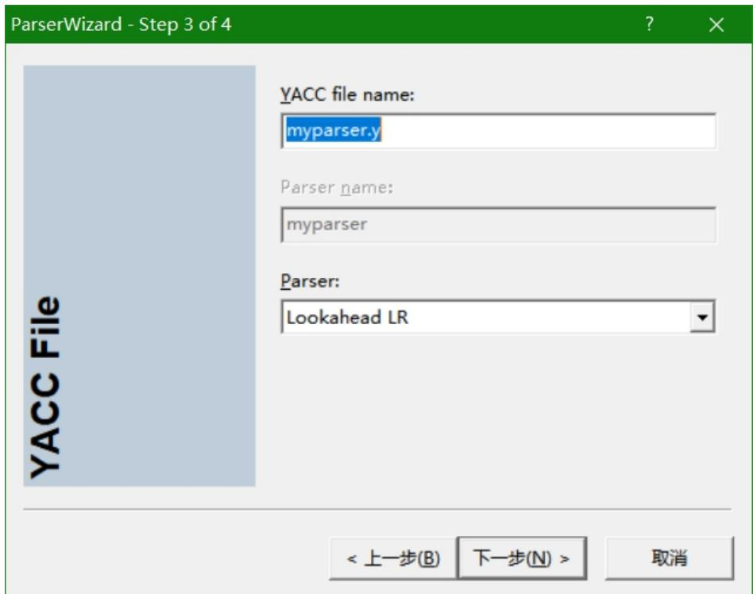

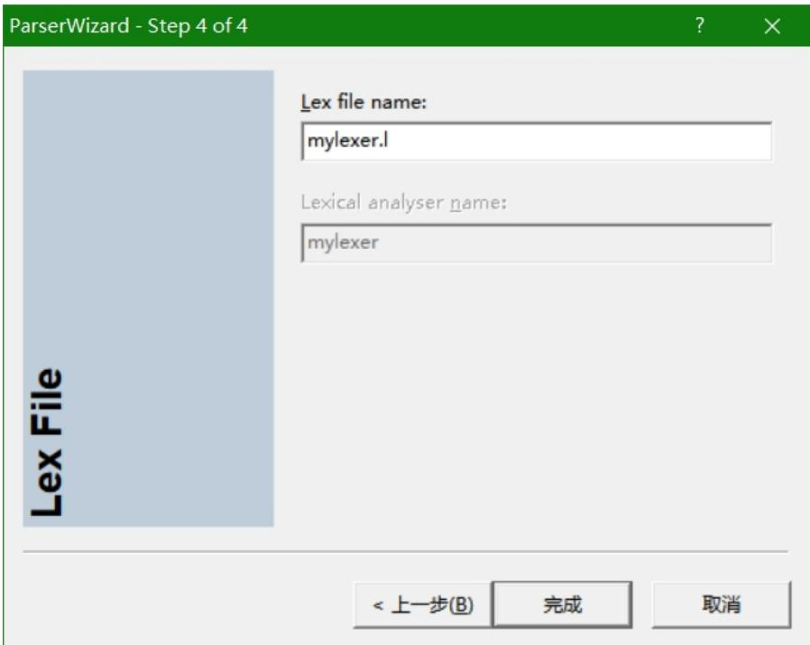

(f) 编辑好代码后 Project->Rebuild All，在你创建好的工程下自动生成第一步选定的语言文件。

为了在 VC++集成开发环境中快捷地使用 ParserGenerator，需要进行以下的环境设置（在 VC++中执行以下步骤，每个步骤只执行一次）：

(a) 选择 Tools 菜单中的 Options 命令，在屏幕上即会出现 Options 对话框；

(b) 选择 Directories 选项卡;

(c) 在 Show Directories for 下拉列表框中选择 Include Files;

(d) 在 Directories 框中，点击最后的空目录，并填入 Parser Generator 的 include 子目录的路径，如图 10.8 所示：

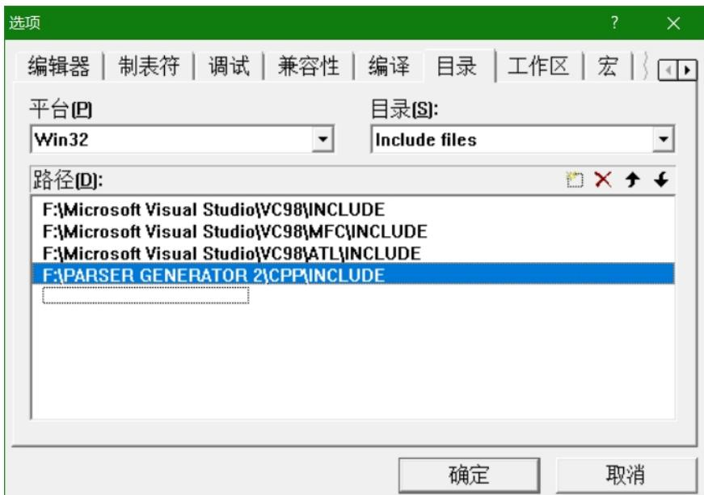

(e) 在 Show Directories for 下拉列表框中选择 Library Files;

(f) 在 Directories 框中，点击最后的空目录，并填入 Parser Generator 的 CPP\LIB\MSVC32 子目录的路径，如图 10.9;

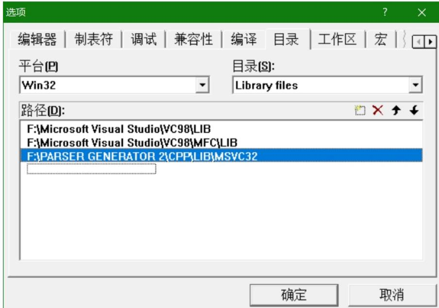

(g) 在 Show Directories for 下拉列表框中选择 Source Files;

(h) 在 Directories 框中，点击最后的空目录，并填入 Parser Generator 的 Source 子目录的路径，如图 10.10;

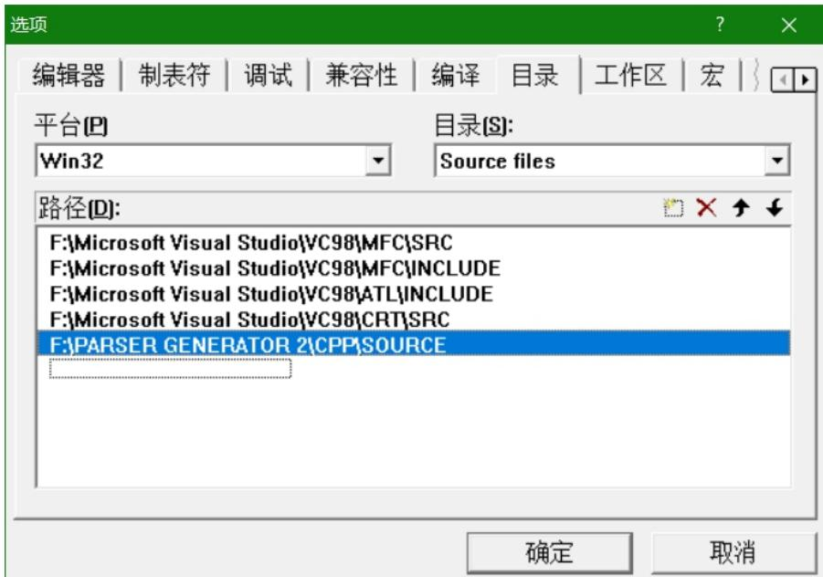

VC++现在就可以找到包含文件 YACC.h 和 LEX.h 以及 YACC 和 LEX 的库文件。对于每个 VC++项目（示例中的项目名为 test2），都需在 VC++中执行以下步骤：

(a) 选择 Project 菜单中的 Settings 命令，在屏幕上即会出现 Project Settings 对话框，如图 10.11；

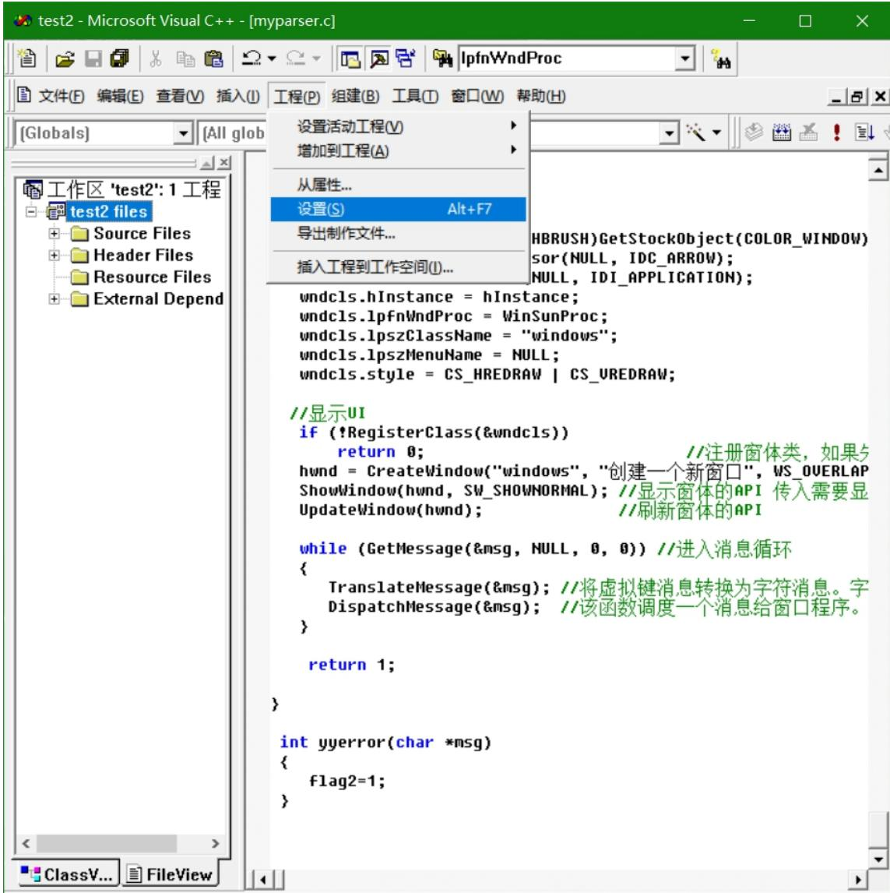

(c) 选择 C/C++ 标签;

(d) 在 Category 下拉列表框中选择 General;

(e) 在 Preprocessor Definitions 框中，在当前文本的最后，输入 YYDEBUG，如图 10.12;

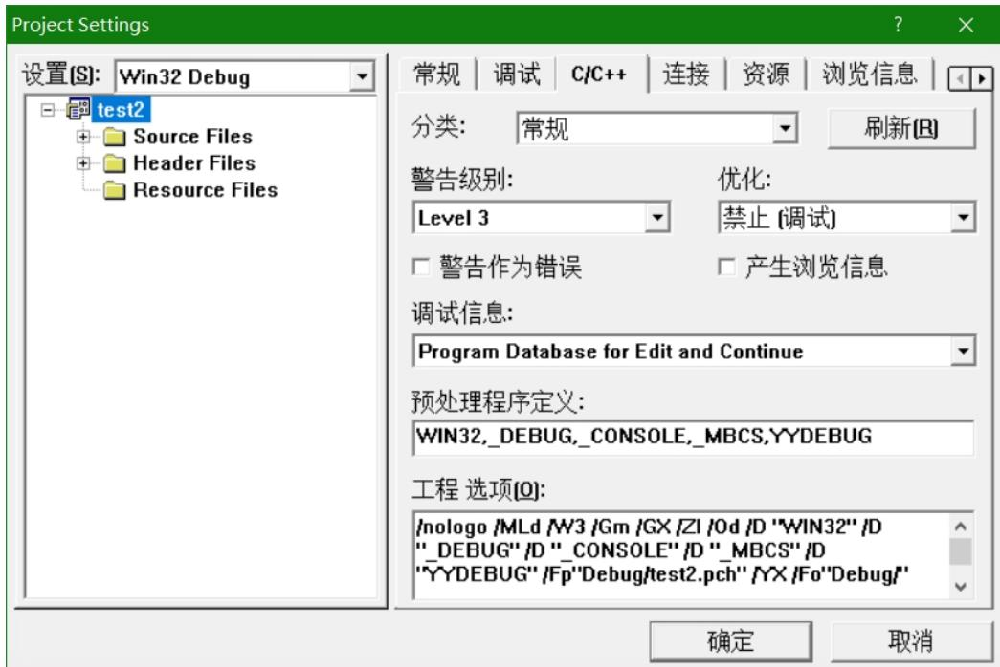

(f) 选择 Link 标签;

(g) 在 Category 下拉列表框中选择 General;

(h) 在 Object/Library Modules 框中，在当前文本的后面，输入 yld.lib，如图 10.13；

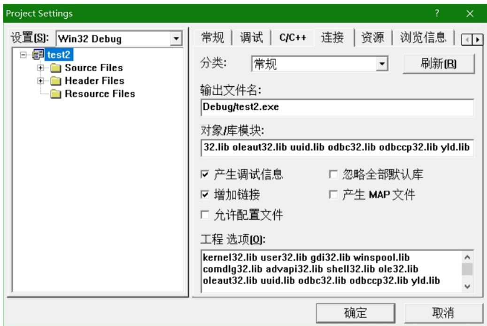

(i) 在 Settings for 下拉列表框中选择 Win32 Release，如图 10.14;

(j) 重复第（h）步的工作；

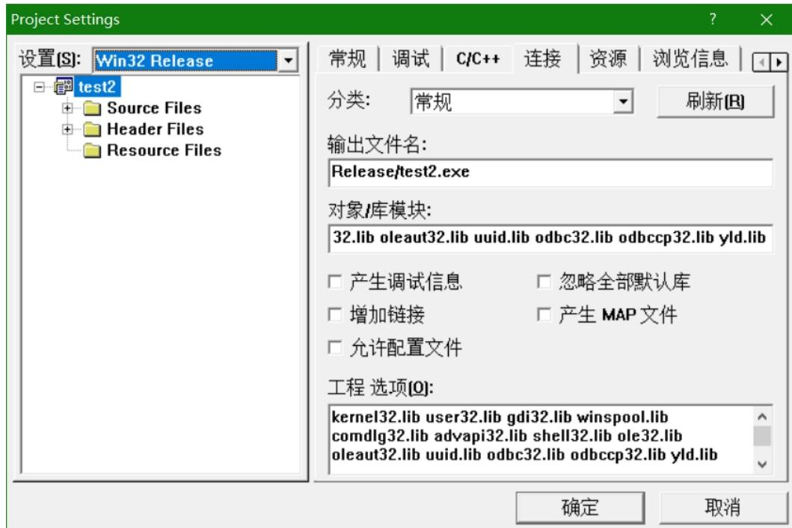

(k) 点击 OK 按钮，Project Settings 对话框将接受设置并关闭。

VC++现在就可以从特定的库中接受 YACC 和 Lex 所需的函数和变量。下面给出一个具体的应用实例，其具体步骤如下：

(a) 在 Parser Generator 下的编辑窗口输入 Lex 与 Yacc 源程序（扩展名分别为 .1 与 .y），如图 10.15；

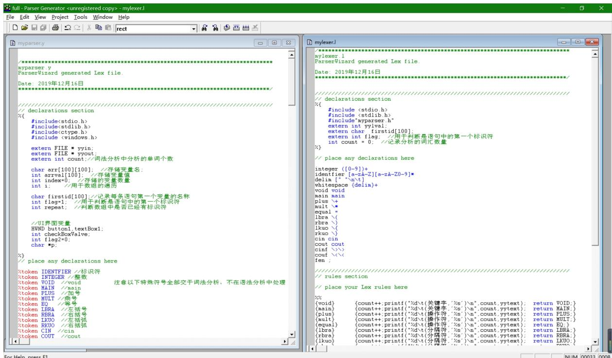

(b) 用 Parser Generator 下的 Project 菜单的 Compile file 命令编译源程序，生成相应的 C 语言源程序（.cpp），如图 10.16；

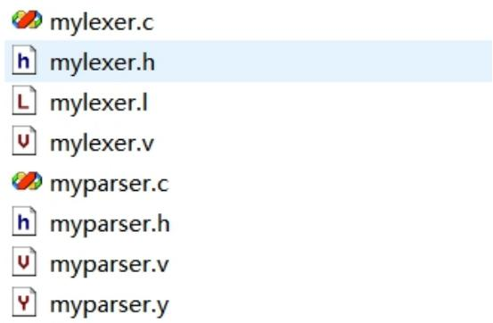

(c) 将 Parser Generator 生成的文件（.cpp 或者.c）添加到一个 VC 的新建工程中，用 VC++ 编译，编译链接 C 语言源程序，生成可执行程序（.exe）后即可执行，如图 10.17。

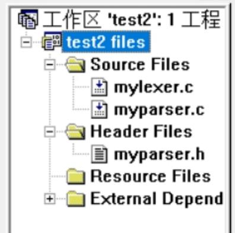

在 Windows 环境下，全部配置好之后，有时会出现 unresolved external symbol \_WinMain@16 的错误，解决方法如下：

1. 进入 project->setting->c/c++，在 category(第一行)中选择 preprocessor，在 processor definitions 中删除 WINDOWS，添加 CONSOLE
2. 进入 project->setting->Link，在 Project options 中将 /subsystem:windows. 改为 /subsystem:console

### 10.4 利用 Parser Generator 生成编译程序

### 10.4.1 Lex 源程序设计

#### (1) Lex 声明、定义段

首先在声明段添加声明，部分声明的内容包括：

```c
#include <stdio.h>
#include <stdlib.h>

int count = 0; //记录分析的词汇数量
```

根据题目要求中的 BNF 范式可知，用于词汇匹配的文法有：

$$
\begin{aligned}
\langle \text{整数} \rangle &::= \langle \text{整数串} \rangle \langle \text{数字} \rangle \mid \langle \text{数字} \rangle \\
\langle \text{整数串} \rangle &::= \langle \text{整数串} \rangle \langle \text{数字} \rangle \mid \langle \text{非0数字} \rangle \\
\langle \text{非0数字} \rangle &::= 1 \mid 2 \mid 3 \mid \dots \mid 9 \\
\langle \text{数字} \rangle &::= 0 \mid \langle \text{非0数字} \rangle
\end{aligned}
$$

根据这些文法，通过分析后消除递归，我们容易得到如下的单词的匹配模式：

*   整数: `integer` `0|[1-9][(0-9)]\*`
*   标识符：`identifier` `[a-zA-Z][a-zA-Z0-9]\*`

对于程序中的空格与换行，利用如下的匹配模式：

*   分隔符：`delim` `[" "\n\t]`

#### （2）对应词法规则段的模式如下：（以匹配整数为例）

```lex
{integer} {count++; printf("%d\t(整数，‘%s’)\n",count,yytext); return INTEGER;}
```

其中 yytext 在前面介绍 Lex 时已经提及，就是指向当前识别的词法单元的指针，即 yytext 里面保存的就是匹配到的一个字符串，这里这个字符串表示的是个整数；而 count 就是最前面声明部分声明的变量，存储了当前已经匹配到的字符个数，只是用于在输出时显示，并没有其他的实际作用。

#### （3）函数段部分不添加新的功能函数，只令 yywrap() 返回 1。

### 10.4.2 Yacc 源程序设计

BNF 范式中用于语法分析的语句为:

$$
\begin{aligned}
\langle \text{程序} \rangle &::= \text{void main()} \langle \text{语句块} \rangle \\
\langle \text{语句块} \rangle &::= \{ \langle \text{语句串} \rangle \} \\
\langle \text{语句串} \rangle &::= \langle \text{语句串} \rangle \langle \text{语句} \rangle \mid \epsilon \\
\langle \text{语句} \rangle &::= \langle \text{赋值语句} \rangle \mid \langle \text{输入语句} \rangle \mid \langle \text{输出语句} \rangle \\
\langle \text{赋值语句} \rangle &::= \langle \text{标识符} \rangle = E; \\
T &::= F \mid T * F \\
F &::= (E) \mid \langle \text{标识符} \rangle \\
\langle \text{输入语句} \rangle &::= cin >> \langle \text{标识符} \rangle;
\end{aligned}
$$

#### (1) Yacc 声明、定义段

由 BNF 范式可知，C--语言含有 “void”、“main”、“()”、“{}”、“;” 等特定的组成部分，所以为了便于程序判断是否带有 void”、“main”、“()”、“{}”、“;” 等词汇，我们利用词法分析对程序进行分析，如果检测到程序中存在这些特定的词汇，则通过返回值的方式则将其告知语法分析程序。将以上过程体现在程序中，具体来说，就是在语法分析中利用 %token 定义一个记号，如 %token VOID，然后当词法分析中识别了 void 这个词汇，我们在其匹配时的执行动作中添加就会产生 “return VOID” 语句，就会返回 VOID 这个记号；这时语法分析程序通过接收这个返回的值得知当前已经识别到了 void，并将其带入后续的语法分析中。而词法分析程序能够利用语法分析中定义的记号的原理是，当语法分析的.y文件编译时，除了会生成.c文件，还会生成相应的.h文件，而这个.h文件中存储有对于token变量的宏定义，本章中.y文件定义token的语句如图10.18所示，生成的.h文件如图10.19所示：

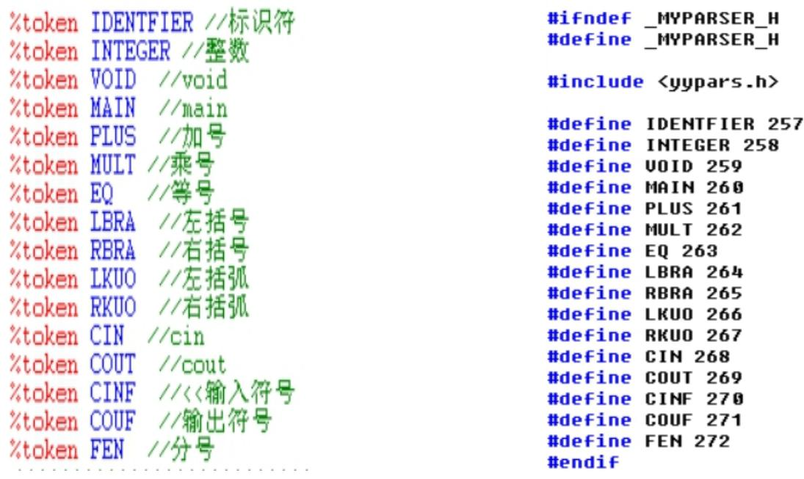

由图 10.18 可知，token 定义记号的实质就是一个常数，而词法分析返回的就是这个在语法分析中定义的常数。所以只需要在词法分析的声明部分包含这个.h 头文件，就可以直接返回对应的 token 记号，因此目前为止词法分析的声明部分如图 10.20 所示：

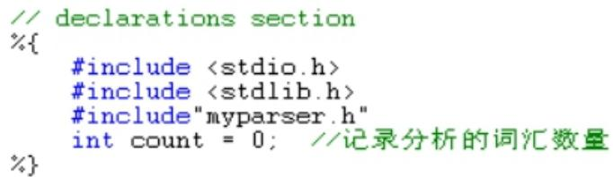

#### (2) 语法规则部分

语法规则部分编写的本质上就是某种语言对应的文法，本章则是利用其BNF范式的表示形式。（1）中利用词法分析将一些特定词汇的识别结果返回给语法，并将其带入后续的语法分析。分析完了特定词汇，接下来就是利用Yacc的语法分析规则对剩余的程序进行判别，如： $1 + 3^{*}4 + 2^{*}(2 + 4)$ 这种表达式是否符合语法要求，或者某条赋值语句、输入输出语句符合语法规则。

为了便于分析，这里将用于语法分析的 BNF 范式分为三部分：程序块分析部分、语句分析部分、表达式分析部分。

第一部分为程序块分析，需要用到的文法有：

$$
\begin{aligned}
\langle \text{程序} \rangle &::= \text{void main()} \langle \text{语句块} \rangle \\
\langle \text{语句块} \rangle &::= \{ \langle \text{语句串} \rangle \}
\end{aligned}
$$

由于程序编写的需要，要对文法中出现的每个词汇用对应的英文名称进行表示，如用 program 代表程序，用 block 代表语句块等。将出现的所有字符用相应的英文进行标识后，便得到了如下的内容：

以上内容便是需要写入语法分析器中的代码，只不过仍需按照一定的格式要求进行调整，最后在程序中的代码书写规格如图 10.21 所示：

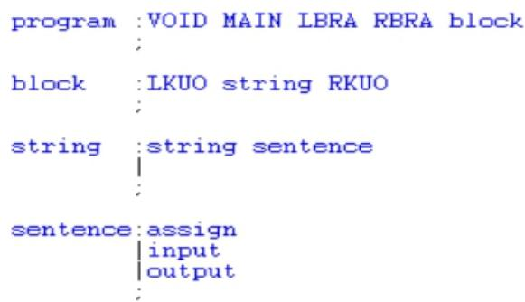

仿照此方法，我们对语句分析的 BNF 范式进行代码编写，结果为:

同理，对最后的表达式分析进行编写，结果为:

#### （3）辅助函数部分

当 Lex 词法分析程序与 Yacc 语法分析程序同时出现时，我们将 main 主函数写进语法分析中，即 .y 文件中。main 函数需要处理的任务很简单，打开存放有待判别的程序的文本文件，并读取其中的内容，然后调用 yyparser()函数进行语法分析，分析结束后关闭文件。

由于程序在进行语法分析前首先进行了词法分析，所以文件的读入的任务本应该是由Lex程序完成的，而我们前面在介绍Lex时也提到过两个函数，yyin和yyout，这是Lex中本身已定义的输入和输出文件指针。这两个变量指明了Lex生成的词法分析器从哪里获得输入和输出到哪里。利用这两个函数就可以从指定的文件中读取文本，但是由于它们是属于Lex的函数，而我们读取文件实在Yacc语法分析中实现的，所以要在Yacc中使用这两个函数，必须在Yacc的声明部分进行外部变量的声明，如图10.22所示：

文件读入后，语法分析驱动程序 yyparse()将会调用 yylex()这个词法分析驱动程序获取记号。记号由记号名和属性值构成，记号名一般作为 yylex 的返回值（这里记号名就是前面提到的由%token 等定义的终结符名，这些终结符名在 Yacc 内部会被宏定义成一些常数）。而属性值则由 Yacc 内部定义的变量 yylval 来传递。yylval 的类型与属性值栈元素的类型相同，即，默认状态下，yylval 为 int 类型，若使用#define YYSTYPE double 将属性值栈元素定义为 double 类型，则 yylval 就是 double 类型。语法分析程序会根据从词法分析中接收到的各种记号，进行相应的语法规则的分析，每分析完一条语法规则有时会进行相应的语义处理动作。

语法分析成功结束时，yyparse 返回 0，而发现错误时，则返回 1，并且调用 yyerror 函数输出错误信息。yyerror 是错误报告例程。

### 10.4.3 语义分析

本章要求能实现语义分析功能，具体来说就是：如果用表达式对多个变量赋值，那么在进行了一系列的数学运算（本章中主要为加法与乘法）后，如果程序中有输出语句要求输出某个变量的值，那么程序应该通过添加一些语义处理步骤能够正确的将变量的数值输出。

例如，输入文本中的程序如下：

则程序需要具有正确地识别不同的变量并赋值的能力，从而准确地输出变量 c 的实际值（程序中为 20）。

观察语法规则程序，不难发现需要进行语义处理的语法主要为赋值语句和表达式语句的语法判别部分。

表达式语句的语义处理较为简单，如图 10.23 所示:

## 10.4 语义处理

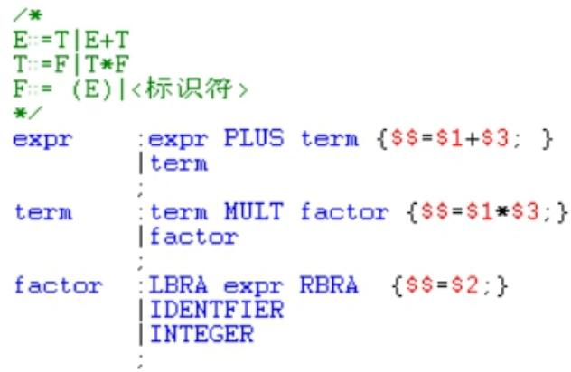

即利用 $1$、$2$ 等符号进行赋值。

最为关键的部分便是对赋值语句的语义处理。

在上面的内容中已经提到赋值语句表示为 assign: IDENTIFIER EQ expr FEN，即“标识符=表达式”，表达式的值根据表达式语句的语义处理方式不难得到，然而难点在于语法分析从上层的词法分析中识别出了标识符，如果对于 IDENTIFIER EQ expr FEN 仅仅简单地使用“{\$1=\$3}”的方式进行赋值的语义处理，例如对于“a=2”，那么此时将数值 2 赋值给变量（标识符）a。当分析到“c=a\*b+a\*b”这一句时，我们希望此时将之前赋予 a 的值 2 带入表达式进行运算，但是遗憾的是，此时的语法分析程序，只是简单地知道它识别出了标识符 a，而却不知道 a 的值是多少，原因在于我们用“{\$1=\$3}”的方式对 a 赋值时并未做到对变量 a 赋值，而只是对这个标识符赋了值。（这个地方可能有些难以理解，可以尝试从这个角度看：C 语言中我们学过如果写了“a=2”的赋值语句，那么除非对 a 变量重新赋值，否则 a 的数值将永远为 2；但是这里的语义处理程序不同，它并不像 C 语言那么智能，它不能永久地保存着这个值，实际上，这个值仅保存在每一条语句的归约阶段。再说得通俗一点就是，被赋予值的标识符的记忆能力有限，仅在当前语句的识别阶段，它知道自己的值是什么，当正在分析的该条程序结束时，它就立刻忘记了自己的值是什么）。

解决该问题的方法是引入数组。既然语义处理记不住赋的值，那么就借助外部的数组保存给谁赋的值，以及赋的什么值。数组的引入如图 10.24 所示：

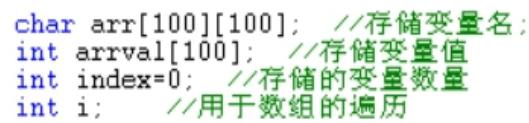

只要在赋值语句 IDENTFIER EQ expr FEN 后添加语义处理的代码内容是将被赋值的变量以及赋予的值保存进数组，即数组 arr[100][100] 存储变量，另一个数组 arrival[100] 存储值，那么就可以将赋值结果永久性地保存下来。

最后一个问题在于数组存储的这个变量从何而来。我们可以很自然地联想到从词法分析中返回，我们可以使用 yylval 这个既可以用于词法分析中也可以用于语法分析中的变量，当词法分析匹配标识符 identifier 时，令 yylval=yytext 即可以实现，然后令 arr 数组存储这个 yylval 值即可。但是在对于“c=a\*b+a\*b”这种语句，首先返回的是 c，我们希望是 arr[index]=yylval（index 代表数组中已经存储的变量的个数），但是语法分析会在后面分析到 a 和 b 两个标识符，从而将 yylval 的值覆盖，这种情况下，就会变成 arr[index]=b，最后存入数组中的不是标识符 c，而是最后识别到的标识符 b。

因此，我们需要引入一个新的数组 char firstid[100] 用于记录每条语句第一个变量的名称，这样就能准确保存下标识符 c。

然后当进行表达式的计算时，如果识别出了标识符，只需要在数组中寻找，利用 strcmp() 函数，找到标识符对应的值。程序中具体的处理过程如图 10.25 所示：

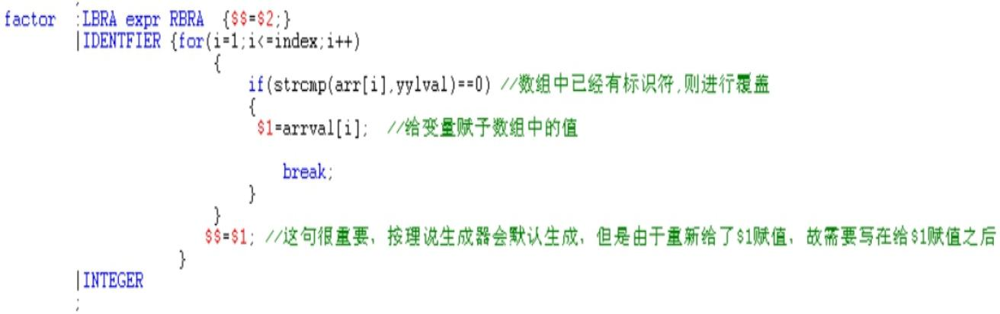

如此，程序便实现了语义处理功能。

最后，对于输出语句，其语义处理的过程如图 10.26 所示:

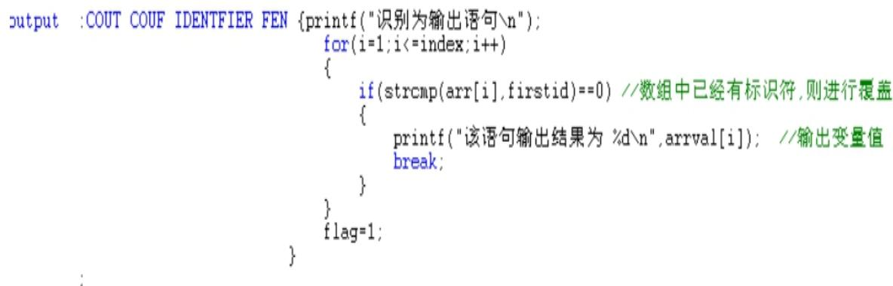

### 10.5 部分核心代码

下面给出了部分核心代码，读者可以根据这些代码写出自己的编译程序。

首先给出了 mylexer.l 的源程序，可以实现词法分析程序的自动生成。

```c
/*************************************************************
ParserWizard generated Lex file.
*************************************************************/

// place any declarations here

/////

// rules section

// place your Lex rules here

/*************************************************************
ParserWizard generated Lex file.
Date: 2019 年 12 月 16 日
*************************************************************/

/////

// declarations section
%{
    #include<stdio.h>
    #include<stdlib.h>
    #include<ctype.h>
    #include<windows.h>

    extern FILE *yyin;
    extern FILE *yyout;
    extern int count; //词法分析中分析的单词个数

    char arr[100][100]; //存储变量名;
    int arrival[100]; //存储变量值
    int index=0; //存储的变量数量
    int i; //用于数组的遍历

    char firstid[100]; //记录每条语句第一个变量的名称
    int flag=1; //用于判断是语句中的第一个标识符
    int repeat; //判断数组中是否已经有标识符

    //UI 界面变量
    HWND button1, textBox1;
    int checkboxesValve;
    int flag2=0;
    char *p;
%} // place any declarations here

%token IDENTIFIER    //标识符
%token INTEGER    //整数
%token VOID    //void 注意以下特殊符号全部交于词法分析, 不在语法分析中处理
```

```c
//将文本框中的文本写入文件

//将文本框中的字符写入文本

ShowWindow(hwnd, SW_SHOWNORMAL); //显示窗体的 API 传入需要显示的窗体句柄和显示方式

TranslateMessage(&msg); //将虚拟键消息转换为字符消息。字符消息被送到调用线程的消息队列中，在下一次线程调用函数 GetMessage 或 PeekMessage 时被读出
```

### 10.6 软件测试及其结果分析

下面给出了部分测试用例，以及测试的结果。读者可以根据文法，写出自己的测试用例。

（1）测试用例 1，运行结果如图 10.27 所示：

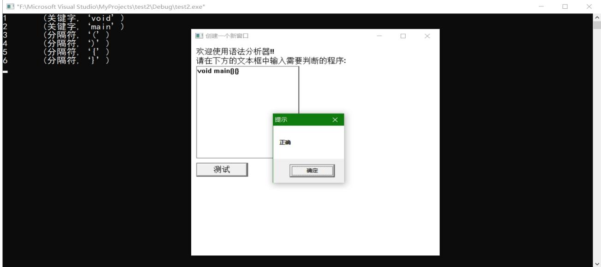

（2）测试用例 2，运行结果如图 10.28 所示：

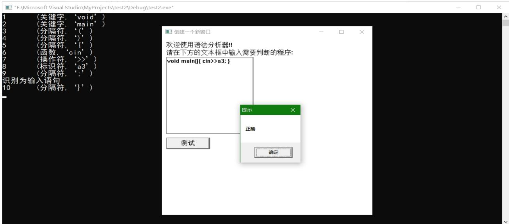

（3）测试用例 3，运行结果如图 10.29 所示：

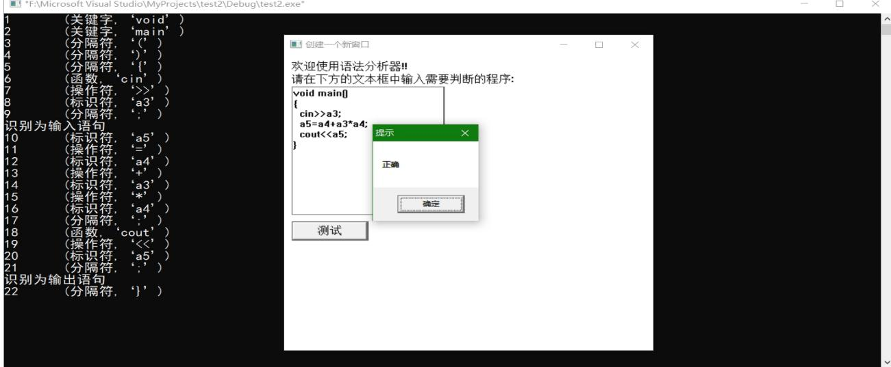

（4）测试用例 4，运行结果如图 10.30 所示：

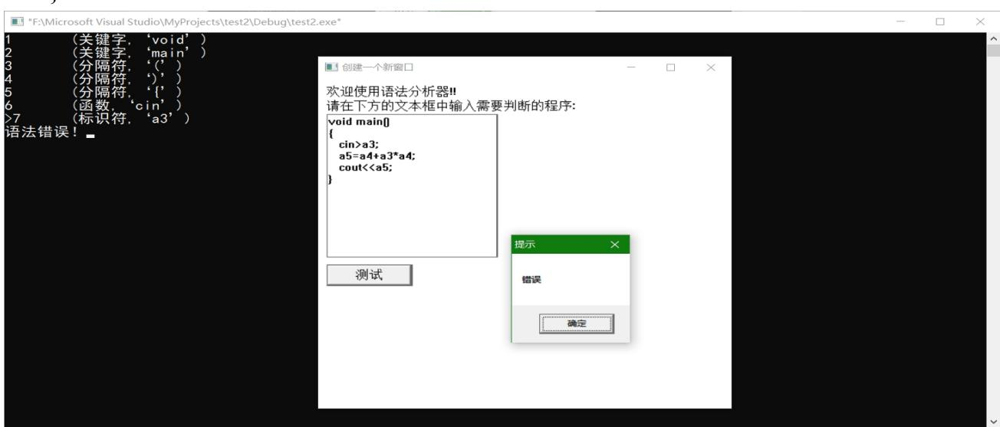

（5）测试用例 5，运行结果如图 10.31 所示：

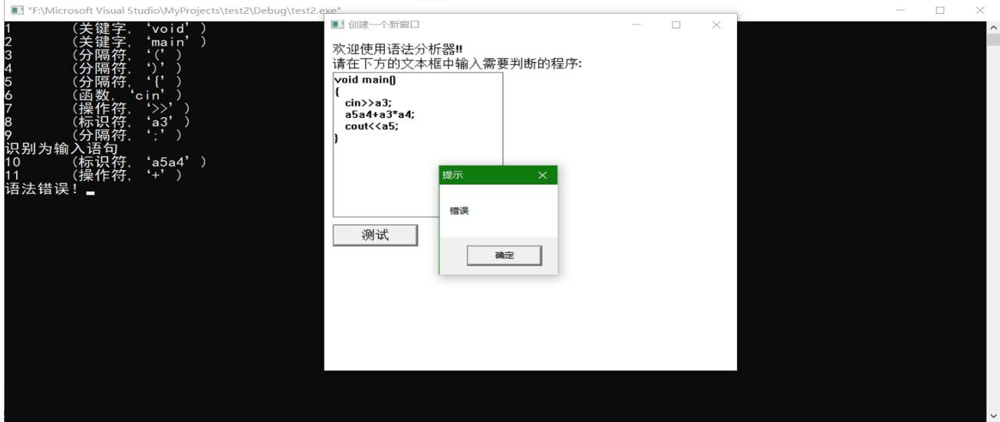

（6）测试用例 6，运行结果如图 10.32 所示：

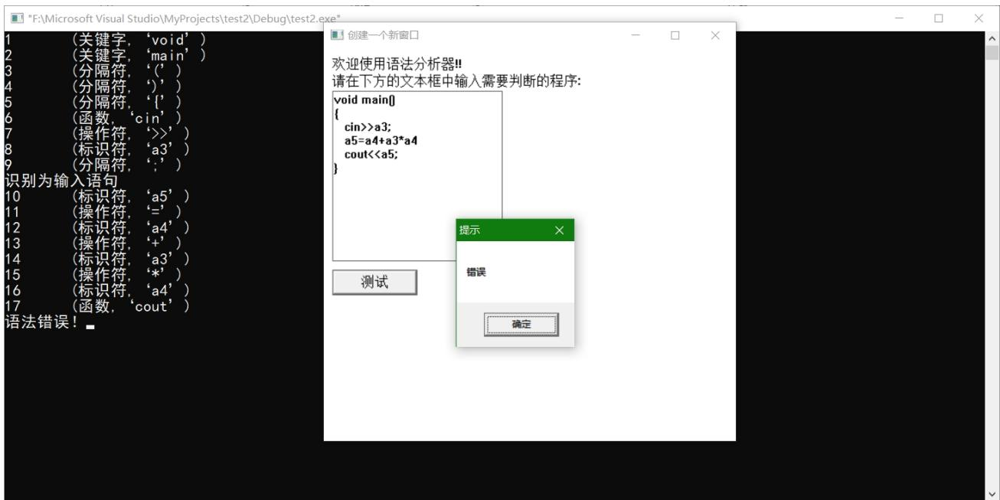

（7）测试用例 7，运行结果如图 10.33 所示：

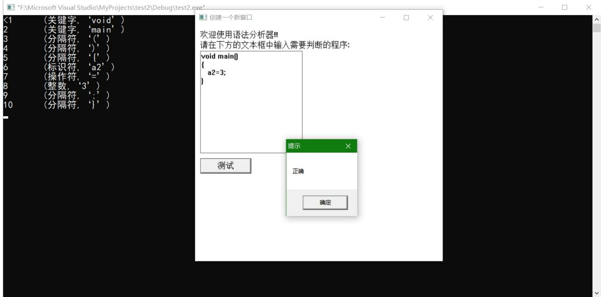

（8）测试用例 8，运行结果如图 10.34 所示：

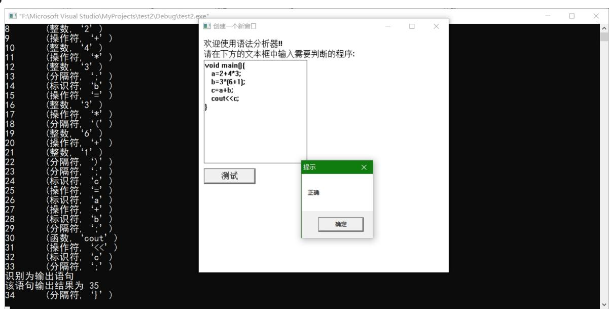

（9）测试用例 9，运行结果如图 10.35 所示：

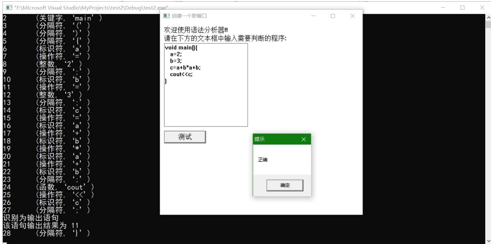

### 10.7 本章小结

本章给出了一个简单的 C--语言的编译程序实例，主要完成了词法分析、语法分析和简单的语义处理。词法分析和语法分析是编译原理课程中重要的理论知识组成，具有举足轻重的作用。

如果人工手动编写词法和语法分析程序，存在代码量大、编写周期长、后期需要进行大量的调试的问题；而通过使用 Parser Generator 等工具自动生成词法和语法分析器，可以大大减少编码量，提高代码生成效率。

Parser Generator 实际上也是对 Lex 与 Yacc 这两个工具的集成，通过 Lex 编写词法分析器，通过 Yacc 编写语法分析器，使得开发人员即使没有很好的编程功底，也能够编写大工程的编译分析器。

通过 Lex 和 Yacc，使用者可以在不去深究词法和语法分析的底层原理的同时利用简单的词汇表达式和语法规则的 BNF 范式生成词法和语法分析器，并同时进行一定的语义处理，对于工程项目而言，这无疑大大提高了开发者开发效率，也意味着降低了开发者的开发门槛。这些工具都具有智能与轻便的特点，智能之处在于可以自动生成分析器，而轻便之处不仅体现在使用的工具的轻便（本文使用的 Parser Generator 的安装包仅有 2MB），更体现在设计的 Lex 和 Yacc 代码的轻便，因此建议有兴趣的读者查看一下 Lex 和 Yacc 的源码。

本文给出的样例依旧存在诸多不足之处，例如代码的复用性差。本次设计针对的是 C--语言的词法与语法分析，该门语言本就是虚构的语言，它的语法规则并无普遍的适用性，因此编写的代码也具有较强的针对性，包括一些变量的设计都是针对这门特定的语言而使用的，如果想要将代码复用到其他的语法分析中难度较大。同时由于时间有限，开发设计周期短，总会存在部分逻辑上的问题没有考虑到，导致一些设计上的缺陷。同时针对一些极端的判例程序亦有可能输出错误结果或者甚至崩溃情况的出现。希望读者能够在这个样例的基础上继续修改完善。
