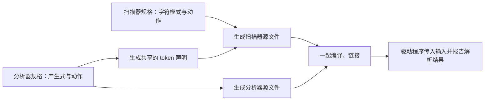
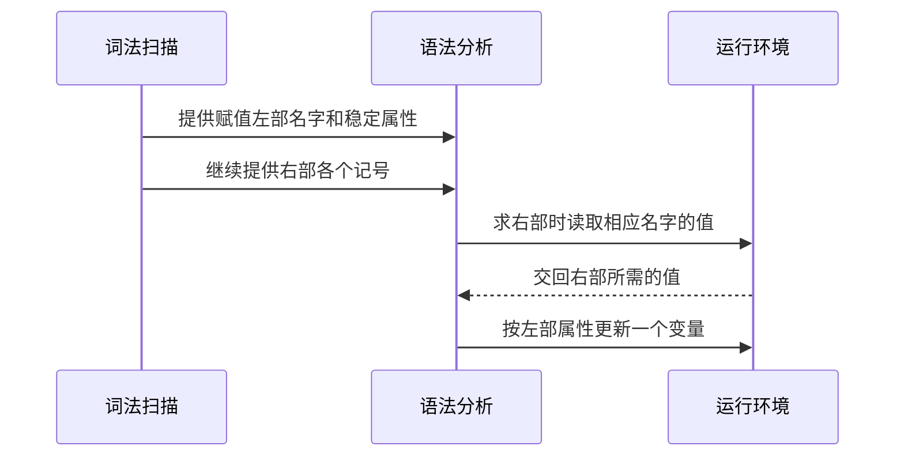

# 《编译原理》第10章 编译程序实例分析（自编参考教材）

这一章把若干原理接成同一个可检查的系统：词法分析交出带值的记号，语法分析确认语句结构，执行语义时再按变量读写保存结果。原件示例借助 Lex、Yacc 和旧版 Windows 工具实现一个教学 C-- 前端，未实现通用 C++ 编译，也未展示完整机器码后端。下面的伴读和测试独立编写；历史工程界面及代码见页首原件。

## 先规定语言接受什么（原件 10.1–10.2）

教学语言只保留一个程序入口、一个用花括号围住的语句块，以及输入、输出、赋值三种语句。语句块可以为空；整数、标识符和带括号的表达式能作为运算对象。表达式可由“因子、项、表达式”三层组织：因子是最小可组合单元；若干因子由乘法结合成一项；最后各项由加法结合。于是 `2+4*3` 的树先形成乘法子树，和写成 `(2+4)*3` 时不同。原件的 `void main()` 是这套教学语言规定的入口，不能当成标准 C++ 的写法建议。

词法和语法要从同一规格出发。原件开头文法允许标识符含下划线，但后面实际列出的匹配式只包含字母和数字；开头整数规则拒绝多位前导零，后面部分代码则匹配任意连续数字。读原件时把这两处看成**规格与实现没有对齐**，不要从某个截图被接受反推语言定义。独立检验时可约定按开头文法：下划线允许，`0` 是合法整数，而整个数字记号 `002` 不合法。相应给词法器明确的失败路由，不要悄悄把错误输入回显后继续处理。

## 生成器的产物要在同一份词法接口上接起来（10.3）

原件分别介绍 [Lex](../../../topics/编译原理/LEX自动生成.md) 和 [Yacc](../../../topics/编译原理/YACC自动生成.md)。Lex 的核心输入是匹配模式与动作：匹配整个关键字时返回专用 token，标识符和整数则另附内容。Yacc 的输入是产生式与归约动作：同一个记号编号在扫描器和分析器里必须表示同一类东西。两份规格通常都分为声明、规则、辅助程序三段；规格生成的是 C/C++ 源代码等中间产物，还需编译与链接。



原件用 Parser Generator 向导、旧版 VC 工程设置和库配置演示此流程。迁移到另一套工具时不照抄目录名，应核对三个接口：生成的头文件能否被扫描器找到；两侧是否同意函数名与值类型；编译输出与运行库是否都参与链接。若报的是“外部符号未解析”，先确认生成文件和对应库是否参与链接，不要先改语言文法。生成器只替人生成控制程序，不会替人决定错误处理和语义。

## 一个变量名怎样安全走完一次归约（10.4–10.5）

用 Yacc 风格的接口看，解析驱动向扫描器索取下一记号。记号类型是“这是名字还是整数”；属性是“哪个名字或哪个整数”。扫描器可以用 `yylval` 交出当前记号的属性，但分析器可能在一条赋值归约之前已经读取了后续多个记号。==当前扫描属性不是即将归约的左部变量名==。同样，若扫描缓冲区会被复用，只保存指向临时文本的引用也不安全。可以在读取标识符时把其值复制或驻留到稳定存储，再让归约直接索引产生式右部中属于左值的那个属性槽。

原件用“每条语句的第一个标识符”和名称、数值并排的数组延续数据，是教学上的可用约定，但只对它设计的语句形状、容量、重置时序有效。可将它分成两个层次：

- **局部语义栈**对应产生式右部。表达式归约时计算或组装一个结果；赋值规则中，左值使用这个规则位置上的名称属性，而不重读扫描器的全局变量。
- **程序环境**保存名称与值的关系，跨语句存在。重赋值更新同一个变量；读一个从未设置的名称应按语言规范处置。下面的独立模型明确报错，不能让未定义读入偶然变成固定的零值。



> [!CAUTION]
> ==把值写进一次归约的属性槽，不等于把值保存进变量环境==。同样，输出一个 token 的拼写不等于读取了这个变量的值。两层混在一起，短例可能过关，下一条语句就丢值。

教材后面的扫描和语法代码还把界面输入、文件和错误提示连进程序。复用时可让驱动层读入文本并提供 I/O，再由扫描、解析与执行层分别报告词法、语法、语义错误；这样不需要打开旧 GUI 也能测同一条规则。原件代码和截图说明了组成方式，不等于它在所有错误输入或跨平台设置下都正确。

## 用小输入分别检验结构和结果（10.6–10.7）

**独立算例。** 约定输入来自已准备的整数序列，输出按执行顺序记录：

```text
void main(){
  cin >> units;
  split = units + 2 * (1 + 3);
  units = units + 1;
  cout << split;
  cout << units;
}
```

输入 `5` 时，先保存 `units=5`；右部括号内得 4，乘法得 8，再得到 `split=13`；下一条赋值让 `units=6`，不回头修改 `split`。两个输出依次是 `13, 6`。若用读到的最后一个变量名替代左值，程序环境会改错键；若直接按 token 顺序计算，不尊重乘法和括号，数值也可能错。这里的测试同时核验名字绑定、运算树与分条执行。

| 原件实验位置 | 可独立核对的现象 |
|---|---|
| 测试 1、2、7 | 空语句块、单输入、单赋值都符合语法；输入能否执行还依赖运行时是否真的提供整数 |
| 测试 3 | 结构合法，但摘出的程序段没有给 `a4` 赋值；不能仅凭语法通过推导唯一输出 |
| 测试 4、5、6 | 单个方向符号不能替代完整输入符，缺少赋值符或分号也应被诊断；究竟在哪一层首次报告，取决于扫描器是否把该符号定义为 token |
| 测试 8、9 | 独立执行分别得到 35 与 11；分别检验乘法优先、括号和跨语句变量值 |

> [!TIP]
> 只测试一条赋值会漏掉“值没跨语句保存”的错误。改成==先设初值，再用它赋给另一个变量，再修改旧变量，最后同时输出两者==；加上非法字符、缺分号、未赋值使用三类对照，才能看清前端的哪一层出了问题。

参见 [词法分析器功能](../../../topics/编译原理/词法分析器功能.md)、[语法分析概述](../../../topics/编译原理/语法分析概述.md)、[语法制导翻译概述](../../../topics/编译原理/语法制导翻译概述.md)。
