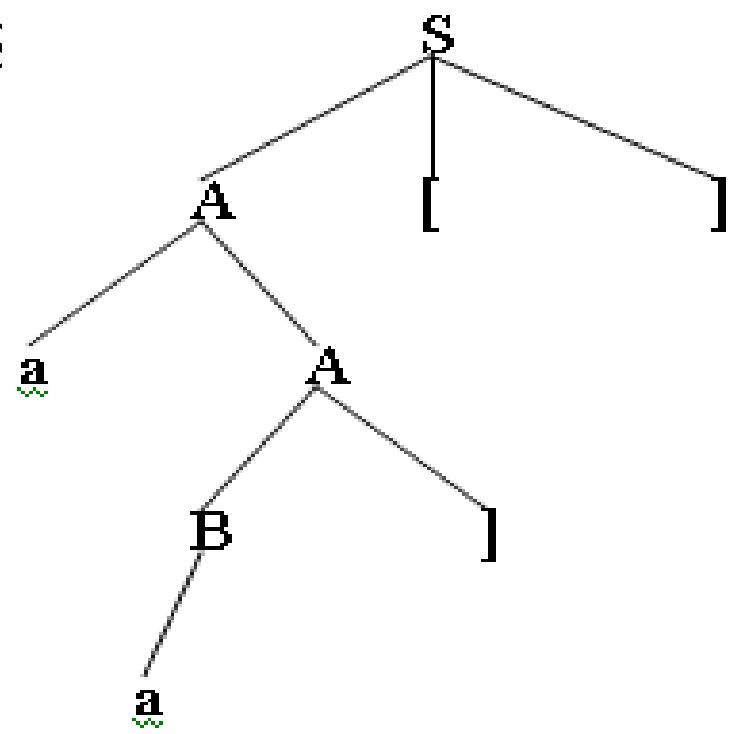

# 《编译原理》第14次作业答案

原件经识别和整理；“参考解答”是我们补的。

# 《编译原理》第14次作业答案

整理自《编译原理》第14次作业，包含算符优先文法证明及算符优先分析法分析过程。

## 一、证明题

### 证明 1

题干：证明下面文法不是算符优先文法：
$$ S ::= A[] \mid [ $$
$$ A ::= aA \mid B] $$
$$ B ::= aS $$

参考解答：
由产生式 $A \rightarrow aA$ 和 $B \rightarrow aS$（注：原文此处推导逻辑似有跳跃，通常需结合 FIRSTVT 或 FOLLOWVT 集合判断，以下按原卷面推导逻辑整理）：

1.  由 $A \rightarrow aA$，可知 $a$ 在 $A$ 的开头，故 $a <\cdot ]$ （假设后续能推导出右括号）。
2.  由 $A \rightarrow B]$ 和 $B \rightarrow aS$，可知 $B$ 以 $a$ 开头，且 $B$ 后面紧跟 $]$，故 $a >\cdot ]$。

因为同时存在 $a <\cdot ]$ 和 $a >\cdot ]$，两者矛盾，所以该文法非算符优先文法。

知识点：[算符优先分析法（算符优先关系、最左素短语）](../../../topics/编译原理/算符优先分析法.md)

### 分析 2

题干：已知文法 G[E]：
$$ E ::= E + T \mid T $$
$$ T ::= T * F \mid F $$
$$ F ::= (E) \mid i $$

利用算符优先分析法分析 $(i+)$ 是不是文法 G[E] 的句子。

补充：注意与 $(i+i)$ 的分析过程进行对比。

参考解答：

首先给出算符优先关系表：

|   | + | * | ( | ) | i |
|---|---|---|---|---|---|
| + | > | < | < | > | < |
| * | > | > | < | > | < |
| ( | < | < | < | = | < |
| ) | > | > |   | > |   |
| i | > | > |   | > |   |

*注：表格中空位表示该关系不存在或无效。*

算符优先分析过程如下：

| 符号栈 | 关系 | 输入串 | 最左素短语 |
| :--- | :--- | :--- | :--- |
| # | < | (i+)# | |
| #( | < | i+)# | |
| #(i | >· | +)# | i |
| #(∨ | < | +)# | |
| #(∨+ | >· | )# | ∨+ |
| #(∨ | = | )# | |
| #(∨) | >· | # | (∨) |
| #∨ | | # | |

**结论：**
在分析过程中，当符号栈为 `#(∨`，输入串剩余 `)#` 时，栈顶元素 `∨` 与输入串首字符 `)` 的关系为 `=`。根据算符优先分析算法，当关系为 `=` 时，应进行归约。但此时 `(∨)` 并不是文法中的任何产生式右部（文法中只有 `F -> (E)`，而 `∨` 代表的是 `E` 或 `T` 等中间状态，具体取决于上下文标记，但在标准算符优先分析中，若无法匹配到具体的产生式右部进行归约，或者出现非法操作，则报错）。

更严谨地看，`(i+)` 中 `+` 后面直接跟了 `)`，缺少右操作数。在算符优先分析中，当遇到 `)` 时，如果栈顶是 `(` 且关系为 `=`，说明括号内内容已归约为一个单元。这里 `(i+)` 试图将 `i+` 归约，但 `i+` 不是一个合法的句柄（缺少右侧项）。最终导致分析失败，因此 **$(i+)$ 不是文法 G[E] 的句子**。

知识点：[算符优先分析法（算符优先关系、最左素短语）](../../../topics/编译原理/算符优先分析法.md)、[文法产生式、推导与规约](../../../topics/编译原理/文法产生式与推导.md)、[语法树、最左/最右推导与文法的二义性](../../../topics/编译原理/语法树与二义性.md)
