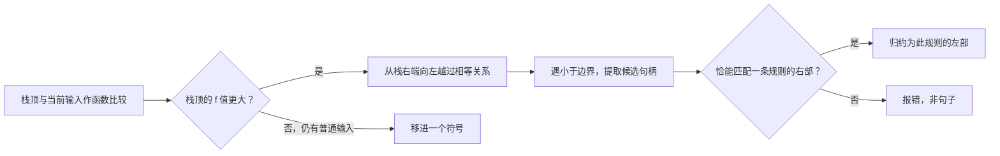

# 《编译原理》第15次作业（优先函数与LR分析表分析）

原件两页分别要求按优先函数和给定 LR 表走一遍。下面给出独立验算的**参考解答**。第一题判断靠栈顶符号与预读符号的关系；第二题判断靠栈顶**状态**与预读符号。两题都不能凭输入看上去有括号或某些关键字就宣告成功。

## 第一题：用优先函数检查 `b(b)`

原件的文法信息可简记为 `Z→bMb`、`M→(L | a`、`L→Ma)`。印刷的左括号和右括号分别位于 **M 与 L 的不同规则**末端或开头，不是只在同一规则里本来就配好一对。题给函数如下，结束符 `#` 没有给数字；复算按通常边界约定取 $f(\#)=g(\#)=0$，并把“栈为 `#Z` 且预读为 `#`”作为接受的特殊情况。

| 函数 | Z | b | M | L | a | `(` | `)` |
|---|---|---|---|---|---|---|---|
| $f$，用于栈侧 | 1 | 2 | 3 | 4 | 4 | 1 | 4 |
| $g$，用于输入侧 | 1 | 3 | 2 | 1 | 3 | 3 | 4 |

参见 [简单优先分析法](../../../topics/编译原理/简单优先分析法.md)。这张表的列**含非终结符**，所以它是简单优先关系的数值表示，不是只比较终结符的算符优先表。每步取栈顶 $x$ 和预读 $y$ 比较 $f(x)$ 与 $g(y)$。小于或等于时可以移进普通输入符号；大于时定下句柄尾，再在栈内向左跨过相等关系，直到遇到小于边界。截出的那一段必须**恰好**匹配一条产生式右部，否则拒绝。

### 参考解答

以下各行的左端为栈底、右端为栈顶，显示的是**操作前**状态：

| 栈 | 待处理输入 | 比较及动作 |
|---|---|---|
| `#` | `b(b)#` | $0<3$，移进 `b` |
| `#b` | `(b)#` | $2<3$，移进 `(` |
| `#b(` | `b)#` | $1<3$，移进 `b` |
| `#b(b` | `)#` | $2<4$，移进 `)` |
| `#b(b)` | `#` | $4>0$，定句柄末尾。栈内左邻 `b` 与 `)` 满足 $2<4$，所以候选句柄只有 `)`；无这样的右部，拒绝 |

结论：`b(b)` 不是句子。还可以用生成规则独立核对：每次 `M` 经 L 递归，外面加一个 `(`，末尾加一个 `a)`；基础形态是 `a`，且最外层必须由 Z 加首尾两个 `b`。合法的最短串是 `bab`，一层括号的最短串是 `b(aa)b`。后者用同一张函数表可依次归约 `a→M`、`Ma)→L`、`(L→M`、`bMb→Z`。

> [!CAUTION]
> ==函数数值能比较，不代表原优先关系矩阵中该格有定义==。例如函数会让 `b` 与右括号得到小于关系，但在此文法的合法句型里它们不会以该顺序相邻。若实现还保留空白格标记，可以提前拒绝；本题按纯函数比较走，最终由“不存在候选右部”拒绝，而不是把移进当成已验证合法。

## 第二题：用给定 LR 表检查 `bcd`

原件已提供项目图和完整 ACTION/GOTO 表，这里不重画它，按给定编号实际走一遍。将 Z 题的符号记法放在一边，本题开始符号为 E，拓广后 `S'→E`；其中 r2 是 `E→bB`，r5 是 `B→cB`，r6 是 `B→d`。

### 参考解答

| 状态栈 | 符号栈 | 待处理输入 | 查表结果 |
|---|---|---|---|
| `0` | `#` | `bcd#` | s3 |
| `0,3` | `#b` | `cd#` | s5 |
| `0,3,5` | `#bc` | `d#` | s11 |
| `0,3,5,11` | `#bcd` | `#` | r6：弹出一个符号与状态，查 GOTO(5,B)=9 |
| `0,3,5,9` | `#bcB` | `#` | r5：弹出两个符号与状态，查 GOTO(3,B)=7 |
| `0,3,7` | `#bB` | `#` | r2：弹出两个符号与状态，查 GOTO(0,E)=1 |
| `0,1` | `#E` | `#` | acc |

所以 `bcd` 是该文法定义的句子。类型核验可直接看推导 `E⇒bB⇒bcB⇒bcd`，归约正好逆向撤去这三步。对照 `bc`：到达状态 5 时预读是 `#`，该列无动作，应拒绝；看到 `c` 的自环不意味着可以缺掉最末的 `d`。

> [!TIP]
> ==归约之后要用弹栈后露出的状态查 GOTO==，不是用归约发生时的旧状态。只有移进才消耗字符；以上三个归约都盯着同一个 `#`，最后由拓广完成状态接受。参见 [LR 分析表的移进与归约](../../../topics/编译原理/LR0分析表构造.md)。
