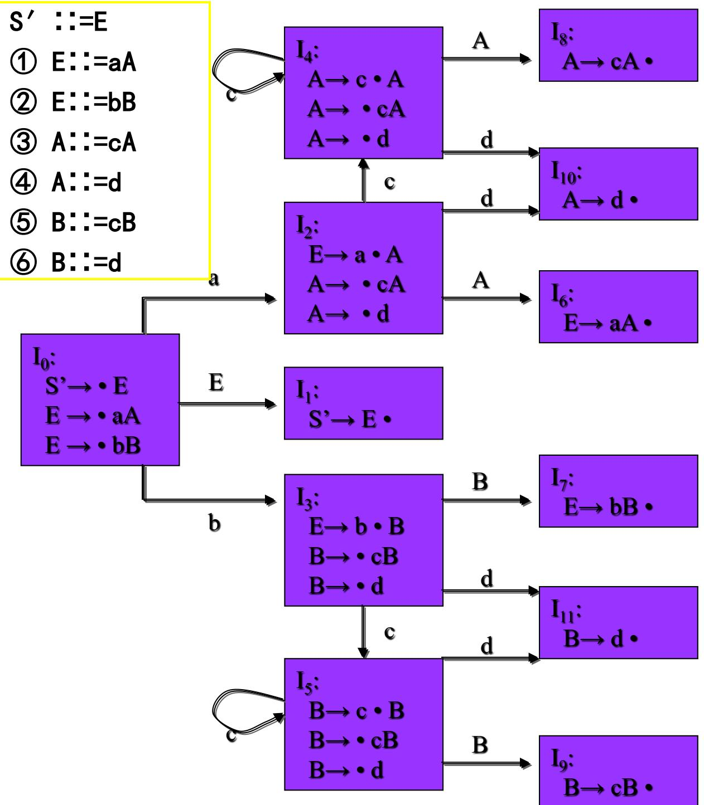

# 《编译原理》第15次作业（优先函数与LR分析表分析）

原件经识别和整理；“参考解答”是我们补的。

设有文法G [ Z ]：

$$
\begin{array}{l} Z: := b M b \\ M: := (L | a \\ L: := M a) \end{array}
$$

用优先函数表分析字符串b(b)

<table><tr><td></td><td>Z</td><td>b</td><td>M</td><td>L</td><td>a</td><td>(</td><td>)</td></tr><tr><td>f</td><td>1</td><td>2</td><td>3</td><td>4</td><td>4</td><td>1</td><td>4</td></tr><tr><td>g</td><td>1</td><td>3</td><td>2</td><td>1</td><td>3</td><td>3</td><td>4</td></tr></table>

④ A∷=d

⑤ B∷=cB

2、利用分析表分析bcd是否是文法所定义的句子
<table><tr><td rowspan="2">状态</td><td colspan="5">ACTION</td><td colspan="3">GOTO</td></tr><tr><td>a</td><td>b</td><td>c</td><td>d</td><td>#</td><td>E</td><td>A</td><td>B</td></tr><tr><td>0</td><td> $S_{2}$ </td><td> $S_{3}$ </td><td></td><td></td><td></td><td>1</td><td></td><td></td></tr><tr><td>1</td><td></td><td></td><td></td><td></td><td>acc</td><td></td><td></td><td></td></tr><tr><td>2</td><td></td><td></td><td> $S_{4}$ </td><td> $S_{10}$ </td><td></td><td></td><td>6</td><td></td></tr><tr><td>3</td><td></td><td></td><td> $S_{5}$ </td><td> $S_{11}$ </td><td></td><td></td><td></td><td>7</td></tr><tr><td>4</td><td></td><td></td><td> $S_{4}$ </td><td> $S_{10}$ </td><td></td><td></td><td>8</td><td></td></tr><tr><td>5</td><td></td><td></td><td> $S_{5}$ </td><td> $S_{11}$ </td><td></td><td></td><td></td><td>9</td></tr><tr><td>6</td><td> $r_{1}$ </td><td> $r_{1}$ </td><td> $r_{1}$ </td><td> $r_{1}$ </td><td> $r_{1}$ </td><td></td><td></td><td></td></tr><tr><td>7</td><td> $r_{2}$ </td><td> $r_{2}$ </td><td> $r_{2}$ </td><td> $r_{2}$ </td><td> $r_{2}$ </td><td></td><td></td><td></td></tr><tr><td>8</td><td> $r_{3}$ </td><td> $r_{3}$ </td><td> $r_{3}$ </td><td> $r_{3}$ </td><td> $r_{3}$ </td><td></td><td></td><td></td></tr><tr><td>9</td><td> $r_{5}$ </td><td> $r_{5}$ </td><td> $r_{5}$ </td><td> $r_{5}$ </td><td> $r_{5}$ </td><td></td><td></td><td></td></tr><tr><td>10</td><td> $r_{4}$ </td><td> $r_{4}$ </td><td> $r_{4}$ </td><td> $r_{4}$ </td><td> $r_{4}$ </td><td></td><td></td><td></td></tr><tr><td>11</td><td> $r_{6}$ </td><td> $r_{6}$ </td><td> $r_{6}$ </td><td> $r_{6}$ </td><td> $r_{6}$ </td><td></td><td></td><td></td></tr></table>
