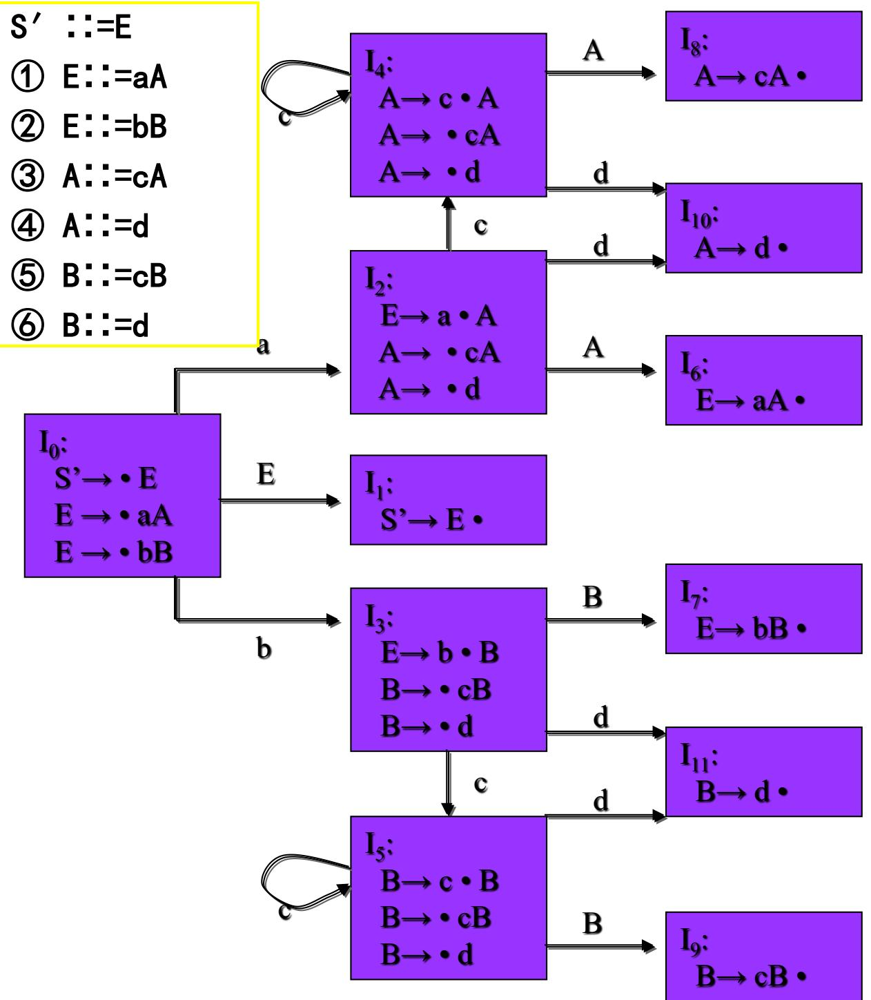
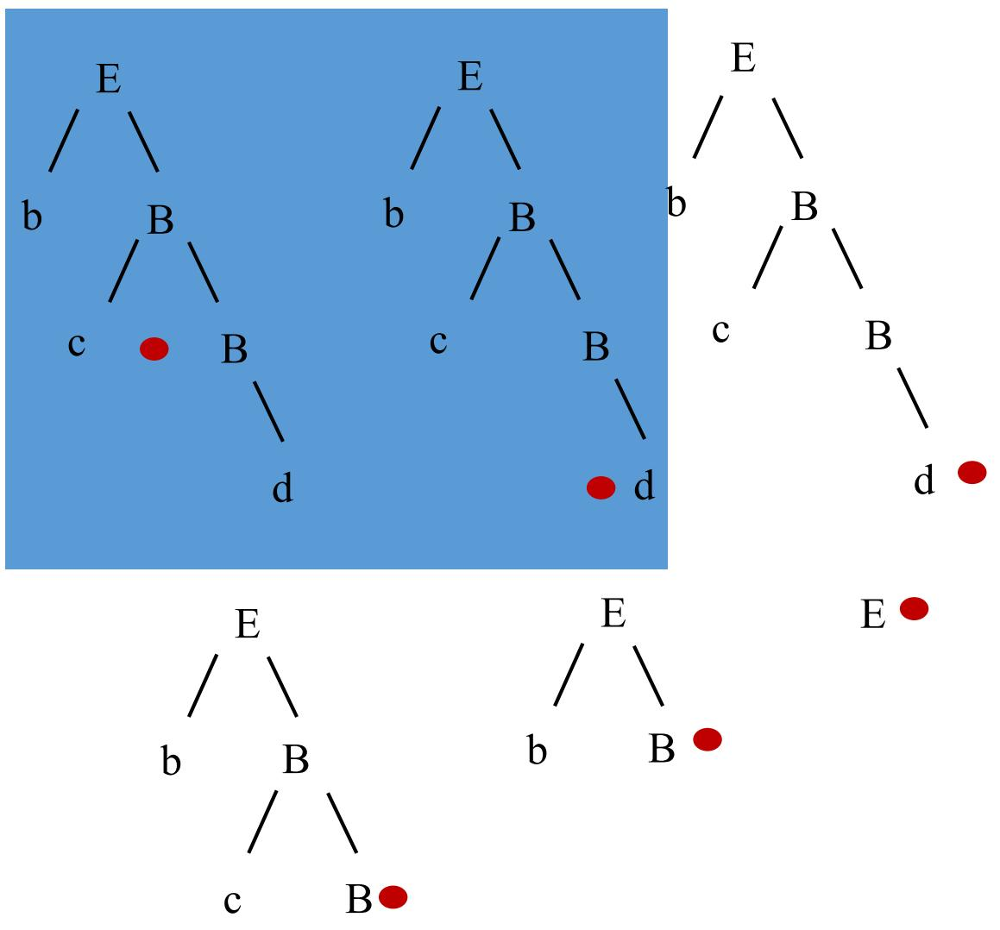
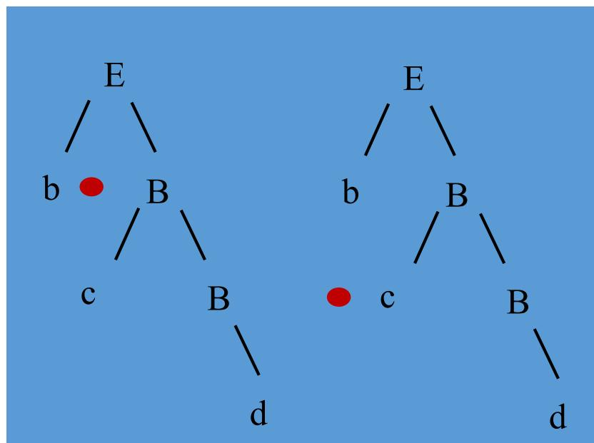

# 《编译原理》第15次作业答案（2020-2021学年第二学期）

原件经识别和整理；“参考解答”是我们补的。

设置文法 G[Z] 的优先函数表分析，以及 LALR 分析表对 bcd 的归约分析。下面是整理后的 Markdown。

---

设有文法 G[Z]：

$$
\begin{array}{l} Z: := b M b \\ M: := (L | a \\ L: := M a) \end{array}
$$

用优先函数表分析字符串 b(b)。

优先函数表：

|   | Z | b | M | L | a | ( | ) |
|---|---|---|---|---|---|---|---|
| f | 1 | 2 | 3 | 4 | 4 | 1 | 4 |
| g | 1 | 3 | 2 | 1 | 3 | 3 | 4 |

分析过程：

| 步骤 | 符号栈 | 关系 | 输入串 |
|---|---|---|---|
| 1 | # | f (#) < g (b) | b (b) # |
| 2 | #b | f (b) < g ( ) | (b) # |
| 3 | #b ( | f ( ) < g (b) | b) # |
| 4 | #b (b | f (b) < g ( ) | ) # |
| 5 | #b (b) | f ( ) > g (#) | # |

④ A::=d

⑤ B::=cB

### 计算 2

利用分析表分析 bcd 是否是文法所定义的句子。

分析表：

| 状态 | ACTION a | ACTION b | ACTION c | ACTION d | ACTION # | GOTO E | GOTO A | GOTO B |
|---|---|---|---|---|---|---|---|---|
| 0 | $S_2$ | $S_3$ | | | | 1 | | |
| 1 | | | | | acc | | | |
| 2 | | | $S_4$ | $S_{10}$ | | | 6 | |
| 3 | | | $S_5$ | $S_{11}$ | | | | 7 |
| 4 | | | $S_4$ | $S_{10}$ | | | 8 | |
| 5 | | | $S_5$ | $S_{11}$ | | | | 9 |
| 6 | $r_1$ | $r_1$ | $r_1$ | $r_1$ | $r_1$ | | | |
| 7 | $r_2$ | $r_2$ | $r_2$ | $r_2$ | $r_2$ | | | |
| 8 | $r_3$ | $r_3$ | $r_3$ | $r_3$ | $r_3$ | | | |
| 9 | $r_5$ | $r_5$ | $r_5$ | $r_5$ | $r_5$ | | | |
| 10 | $r_4$ | $r_4$ | $r_4$ | $r_4$ | $r_4$ | | | |
| 11 | $r_6$ | $r_6$ | $r_6$ | $r_6$ | $r_6$ | | | |

分析过程：

| 步骤 | 状态栈 | 符号栈 | 输入串 | 动作 | 下一状态 |
|---|---|---|---|---|---|
| 1 | 0 | # | bcd# | S3 | 3 |
| 2 | 03 | #b | cd# | S5 | 5 |
| 3 | 035 | #bc | d# | S11 | 11 |
| 4 | 03511 | #bcd | # | r6 | GOTO(5,B)=9 |
| 5 | 0359 | #bcB | # | r5 | GOTO(3,B)=7 |
| 6 | 037 | #bB | # | r2 | GOTO(0,E)=1 |
| 7 | 01 | #E | # | acc | |

分析表：

| 状态 | ACTION a | ACTION b | ACTION c | ACTION d | ACTION # | GOTO E | GOTO A | GOTO B |
|---|---|---|---|---|---|---|---|---|
| 0 | $S_2$ | $S_3$ | | | | 1 | | |
| 1 | | | | | acc | | | |
| 2 | | | $S_4$ | $S_{10}$ | | | 6 | |
| 3 | | | $S_5$ | $S_{11}$ | | | | 7 |
| 4 | | | $S_4$ | $S_{10}$ | | | 8 | |
| 5 | | | $S_5$ | $S_{11}$ | | | | 9 |
| 6 | $r_1$ | $r_1$ | $r_1$ | $r_1$ | $r_1$ | | | |
| 7 | $r_2$ | $r_2$ | $r_2$ | $r_2$ | $r_2$ | | | |
| 8 | $r_3$ | $r_3$ | $r_3$ | $r_3$ | $r_3$ | | | |
| 9 | $r_5$ | $r_5$ | $r_5$ | $r_5$ | $r_5$ | | | |
| 10 | $r_4$ | $r_4$ | $r_4$ | $r_4$ | $r_4$ | | | |
| 11 | $r_6$ | $r_6$ | $r_6$ | $r_6$ | $r_6$ | | | |

4

① E::=aA

④ A::=d

⑤ B::=cB

分析过程：

| 步骤 | 状态栈 | 符号栈 | 输入串 | 动作 | 下一状态 |
|---|---|---|---|---|---|
| 1 | 0 | # | bcd# | S3 | 3 |
| 2 | 03 | #b | cd# | S5 | 5 |
| 3 | 035 | #bc | d# | S11 | 11 |
| 4 | 03511 | #bcd | # | r6 | GOTO(5,B)=9 |
| 5 | 0359 | #bcB | # | r5 | GOTO(3,B)=7 |
| 6 | 037 | #bB | # | r2 | GOTO(0,E)=1 |
| 7 | 01 | #E | # | acc | |

作业：

- 分析 bcd 是否是文法所定义的句子

| 步骤 | 状态栈 | 符号栈 | 输入串 | 动作 | 下一状态 |
|---|---|---|---|---|---|
| 1 | 0 | # | bcd# | S3 | 3 |
| 2 | 03 | #b | cd# | S5 | 5 |
| 3 | 035 | #bc | d# | S11 | 11 |
| 4 | 03511 | #bcd | # | r6 | GOTO(5,B)=9 |
| 5 | 0359 | #bcB | # | r5 | GOTO(3,B)=7 |
| 6 | 037 | #bB | # | r2 | GOTO(0,E)=1 |
| 7 | 01 | #E | # | acc | |

参考解答：**结论：** $bcd$ 是该文法所定义的句子。

**分析过程：**

| 步骤 | 状态栈 | 符号栈 | 输入串 | 动作 | 下一状态 |
|:---:|:---:|:---:|:---:|:---:|:---:|
| 1 | $0$ | $\#$ | $bcd\#$ | $S_3$ | $3$ |
| 2 | $0\ 3$ | $\#\ b$ | $cd\#$ | $S_5$ | $5$ |
| 3 | $0\ 3\ 5$ | $\#\ b\ c$ | $d\#$ | $S_{11}$ | $11$ |
| 4 | $0\ 3\ 5\ 11$ | $\#\ b\ c\ d$ | $\#$ | $r_6$ | $\text{GOTO}(5,B)=9$ |
| 5 | $0\ 3\ 5\ 9$ | $\#\ b\ c\ B$ | $\#$ | $r_5$ | $\text{GOTO}(3,B)=7$ |
| 6 | $0\ 3\ 7$ | $\#\ b\ B$ | $\#$ | $r_2$ | $\text{GOTO}(0,E)=1$ |
| 7 | $0\ 1$ | $\#\ E$ | $\#$ | $\text{acc}$ | |

**关键步骤说明：**

- **步骤 1–3（移进）：** 依次读入终结符 $b, c, d$，根据 ACTION 表执行移进操作，分别进入状态 $3, 5, 11$。
- **步骤 4（归约 $r_6$）：** 栈顶状态为 $11$，当前输入符号为 $\#$，查 $\text{ACTION}[11, \#] = r_6$，按产生式⑥（由上下文可知为 $B ::= d$）归约。弹出状态 $11$ 和符号 $d$，露出栈顶状态 $5$；查 $\text{GOTO}[5, B] = 9$，将 $B$ 和状态 $9$ 压栈。
- **步骤 5（归约 $r_5$）：** 栈顶状态为 $9$，$\text{ACTION}[9, \#] = r_5$，按产生式⑤ $B ::= cB$ 归约。弹出 $c, B$ 及对应状态 $5, 9$，露出栈顶状态 $3$；查 $\text{GOTO}[3, B] = 7$，将 $B$ 和状态 $7$ 压栈。
- **步骤 6（归约 $r_2$）：** 栈顶状态为 $7$，$\text{ACTION}[7, \#] = r_2$，按产生式②（由上下文可知为 $E ::= bB$）归约。弹出 $b, B$ 及对应状态 $3, 7$，露出栈顶状态 $0$；查 $\text{GOTO}[0, E] = 1$，将 $E$ 和状态 $1$ 压栈。
- **步骤 7（接受）：** 栈顶状态为 $1$，当前输入符号为 $\#$，查 $\text{ACTION}[1, \#] = \text{acc}$，分析成功。

最终到达接受状态 $\text{acc}$，因此 $bcd$ 是文法的句子。

知识点：[LR(0)分析表构造（活前缀、LR(0)项目、项目集规范族）](../../../topics/编译原理/LR0分析表构造.md)、[LR分析法基本思想与LR分析器结构](../../../topics/编译原理/LR分析法概述.md)
