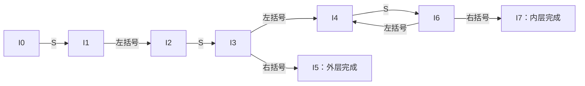

# 《编译原理》第17次作业

原件要求为文法 $S\to S(S)\mid\varepsilon$ 构造规范 LR(1) 项目集及分析表，指定 $r_1:S\to S(S)$、$r_2:S\to\varepsilon$。以下保留这两个归约号，状态号按下框图编排。原件只给出题设和拓广文法，表与分析过程为补充解答。

## 参考解答

将 $S'\to S$ 作为拓广产生式，在项目 $[S'\to \cdot S,\,\$]$ 上做闭包。对任意 $[A\to\alpha\cdot B\beta,a]$，预测 $B$ 的项目时，不能把 $a$ 一律照搬：要从 $\operatorname{FIRST}(\beta a)$ 取向前看符号。这里有三个位置容易混淆：

| 正在展开哪个 $S$ | 点后这个 $S$ 以后的片段 | 闭包所带的向前看符号 |
| --- | --- | --- |
| 初态中的 $S'\to\cdot S$ | 无 | 输入结束符 `$` |
| $S\to\cdot S(S)$ 最左侧的 $S$ | `(S)` | 左括号 |
| $S\to S(\cdot S)$ 括号内的 $S$ | `)` | 右括号；继续做闭包时，左递归还补入左括号 |

==预测新项目看后缀，移动原项目的点保留原展望==。例如，从 $I_1$ 移进左括号到 $I_2$，原项目 `S → S(·S)` 仍带外层的左括号和结束符；新增的预测项目才改用内层的右括号和左括号。这样在嵌套结束时不会把内外层的归约条件混在一起。

### 规范项目集

同一带点产生式的多个展望合写在花括号中。空产生式用 `S → ·` 表示，点已经在产生式末尾。

```text
I0
  S' → · S       { $ }
  S  → · S ( S ) { (, $ }
  S  → ·         { (, $ }

I1
  S' → S ·       { $ }
  S  → S · ( S ) { (, $ }

I2
  S  → S ( · S ) { (, $ }
  S  → · S ( S ) { (, ) }
  S  → ·         { (, ) }

I3
  S  → S ( S · ) { (, $ }
  S  → S · ( S ) { (, ) }

I4
  S  → S ( · S ) { (, ) }
  S  → · S ( S ) { (, ) }
  S  → ·         { (, ) }

I5
  S  → S ( S ) · { (, $ }

I6
  S  → S ( S · ) { (, ) }
  S  → S · ( S ) { (, ) }

I7
  S  → S ( S ) · { (, ) }
```



$I_5$ 与 $I_7$ 的项目都有同一个已完成产生式，却不能在**规范 LR(1)** 中合并：前者允许在文件末尾归约，后者允许看到右括号时归约。类似地，$I_2/I_4$、$I_3/I_6$ 各有相同的 LR(0) 核，却有不同的 LR(1) 展望。本题只构造规范表，不做 [LALR 同核合并](../../../topics/编译原理/LALR分析表构造.md)。

### 分析表与验算

`sN` 表示移进并进入状态 `N`，`r1/r2` 表示按相应产生式归约，空格表示报错。终结符的边填 ACTION，非终结符 `S` 的边填 GOTO；完成拓广项目且看到 `$` 才填 `acc`。

| 状态 | ACTION `(` | ACTION `)` | ACTION `$` | GOTO `S` |
| --- | --- | --- | --- | --- |
| 0 | r2 |  | r2 | 1 |
| 1 | s2 |  | acc |  |
| 2 | r2 | r2 |  | 3 |
| 3 | s4 | s5 |  |  |
| 4 | r2 | r2 |  | 6 |
| 5 | r1 |  | r1 |  |
| 6 | s4 | s7 |  |  |
| 7 | r1 | r1 |  |  |

每个 ACTION 单元至多一个操作，故规范族共八个状态、无冲突。输入 `(())` 的关键是先做内层的 $r_1$，再为外层移进右括号：

| 执行前状态栈 | 未读输入 | 动作 |
| --- | --- | --- |
| `0` | `(())$` | r2 |
| `0 1` | `(())$` | s2 |
| `0 1 2` | `())$` | r2 |
| `0 1 2 3` | `())$` | s4 |
| `0 1 2 3 4` | `))$` | r2 |
| `0 1 2 3 4 6` | `))$` | s7 |
| `0 1 2 3 4 6 7` | `)$` | r1 |
| `0 1 2 3` | `)$` | s5 |
| `0 1 2 3 5` | `$` | r1 |
| `0 1` | `$` | acc |

> [!TIP]
> $r_2$ 的右侧长度为零，归约时不弹栈，也不读走当前括号；直接以原栈顶查 GOTO，再入栈。例如在状态 2 看到右括号时先压入状态 3，下一步才由状态 3 移进该右括号。

> [!WARNING]
> “状态含有左括号展望”不等于“遇到左括号就移进”。初态所有带点且未完成的项目，点后都不是左括号；所以 ACTION[0, `(`] 是 `r2`，不是移进。反之，`())` 读完前两个符号后栈顶为 5，而 ACTION[5, `)`] 为空，立即报错。

独立检查这个结果不必再造一张表：文法每次生成一个平衡前缀，再附上包住平衡串的一对括号；反过来，任何非空平衡串都可以沿着与末尾右括号配对的左括号分成这两部分。空串也由 $r_2$ 推出。因而既可以用括号深度与分析表交叉核验，也能解释为什么多出的右括号应被拒绝。具体填表步骤参见 [LR(1) 分析表构造](../../../topics/编译原理/LR1分析表构造.md)，栈操作参见 [LR 分析法概述](../../../topics/编译原理/LR分析法概述.md)。
