# 《编译原理》第1章 引言（课件）

原件的每一页，下面附识别出的文字。

### 编译原理 Compiler Principles

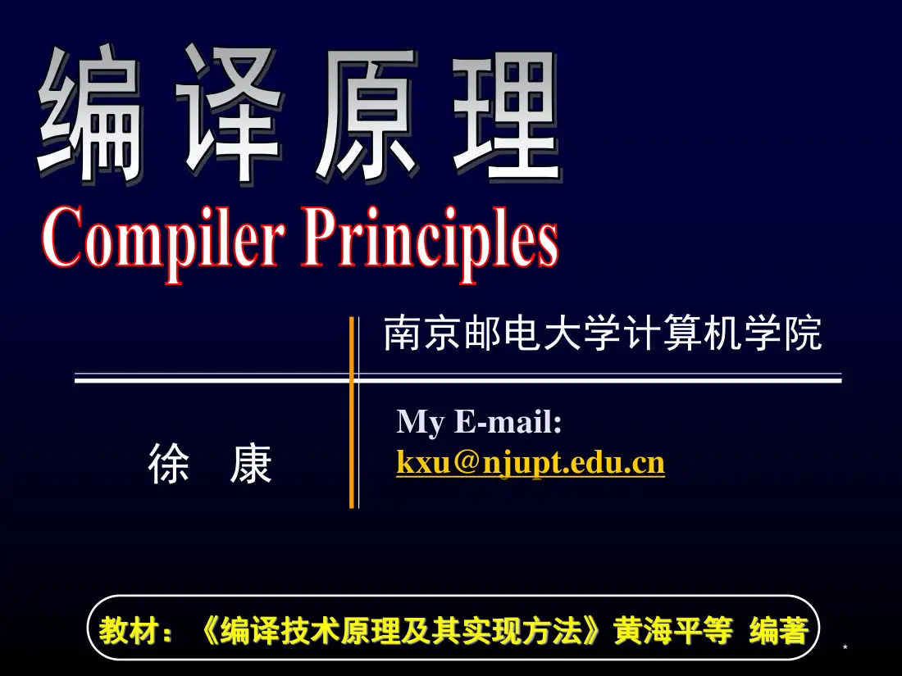

原文：

编译原理 Compiler Principles

南京邮电大学计算机学院

徐 康

My E-mail:

kxu@njupt.edu.cn

教材：《编译技术原理及其实现方法》黄海平等 编著

### 第0章 引言

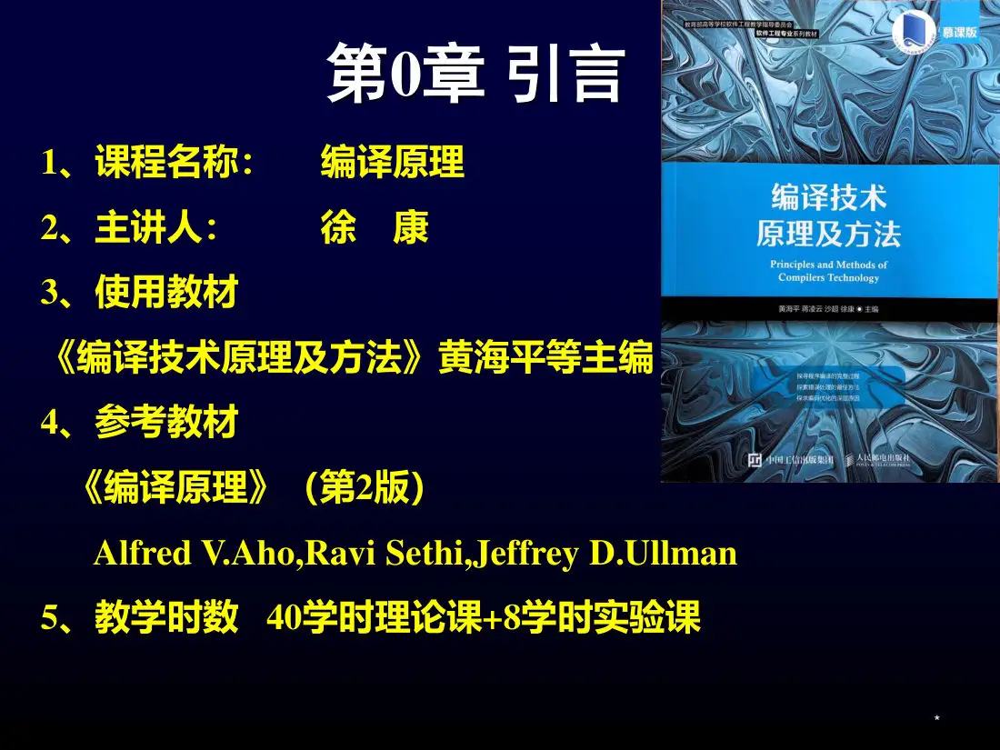

原文：

第0章 引言

1、课程名称： 编译原理

2、主讲人： 徐 康

3、使用教材《编译技术原理及方法》 黄海平等主编

4、参考教材

《编译原理》 （第2版）

编译技术原理及方法

Principles and Methods of Compilers Technology

Alfred V.Aho,Ravi Sethi,Jeffrey D.Ullman

5、教学时数 40学时理论课+8学时实验课

\*

### 什么是编译原理？

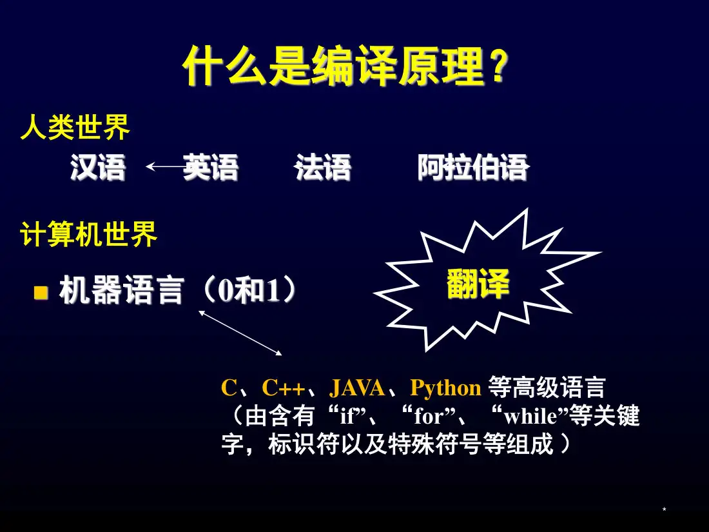

原文：

什么是编译原理？

人类世界

汉语 英语 法语 阿拉伯语

计算机世界

◼ 机器语言（0和1）

C、C++、JAVA、Python 等高级语言（由含有“if”、“for”、“while”等关键字，标识符以及特殊符号等组成）

\*

### 什么是编译器？

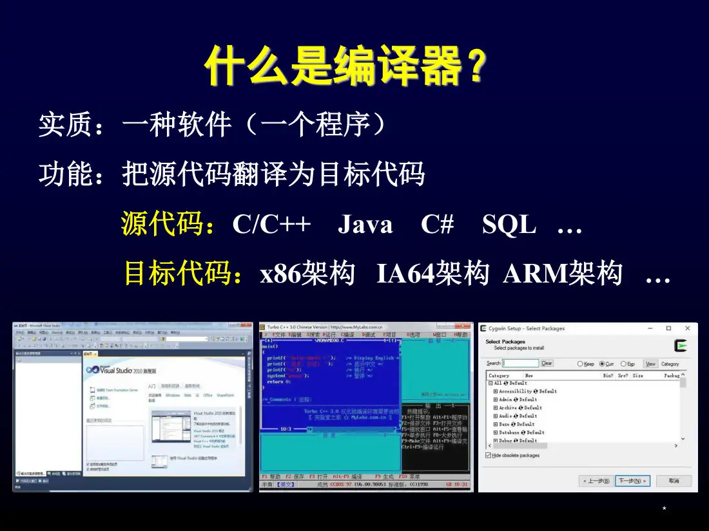

原文：

什么是编译器？

实质：一种软件（一个程序）

功能：把源代码翻译为目标代码

源代码：C/C++ Java C# SQL …

目标代码：x86架构 IA64架构 ARM架构 …

\*

### 本门课的特点

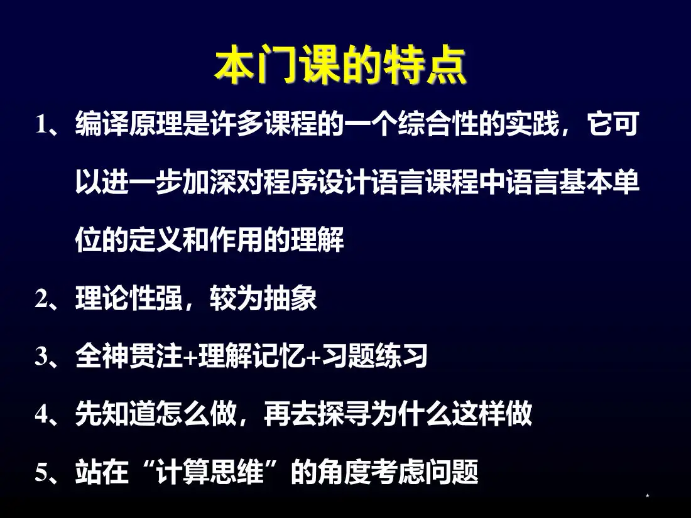

原文：

本门课的特点

1、编译原理是许多课程的一个综合性的实践，它可

以进一步加深对程序设计语言课程中语言基本单

位的定义和作用的理解

2、理论性强，较为抽象

3、全神贯注+理解记忆+习题练习

4、先知道怎么做，再去探寻为什么这样做

5、站在“计算思维”的角度考虑问题

\*

### 教学重点：1-5章

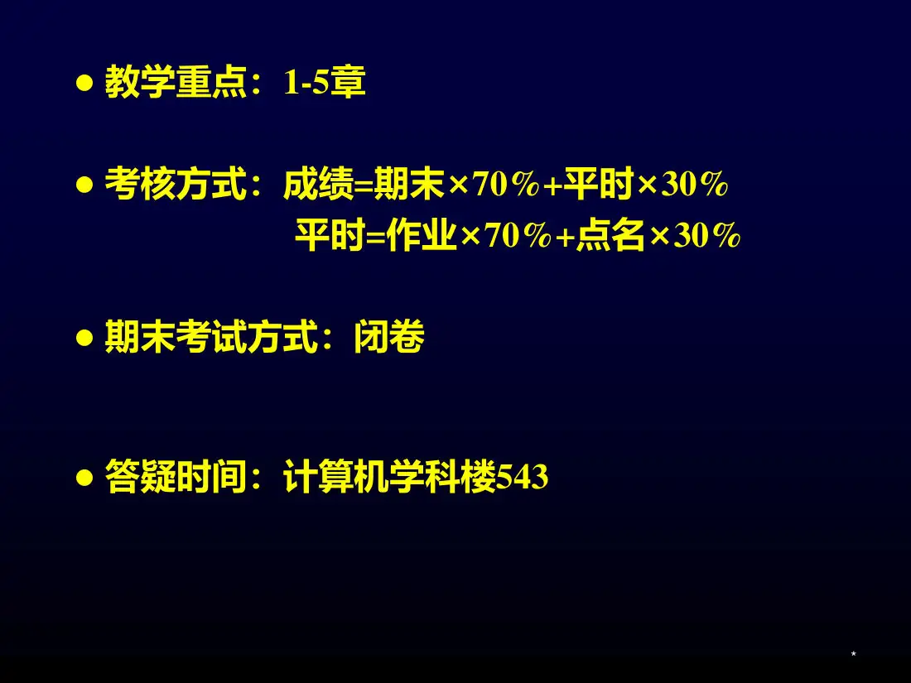

原文：

教学重点：1-5章

●考核方式：成绩=期末×70%+平时×30%平时=作业×70%+点名×30%

期末考试方式：闭卷

答疑时间：计算机学科楼543

\*

### 第一章 概 述

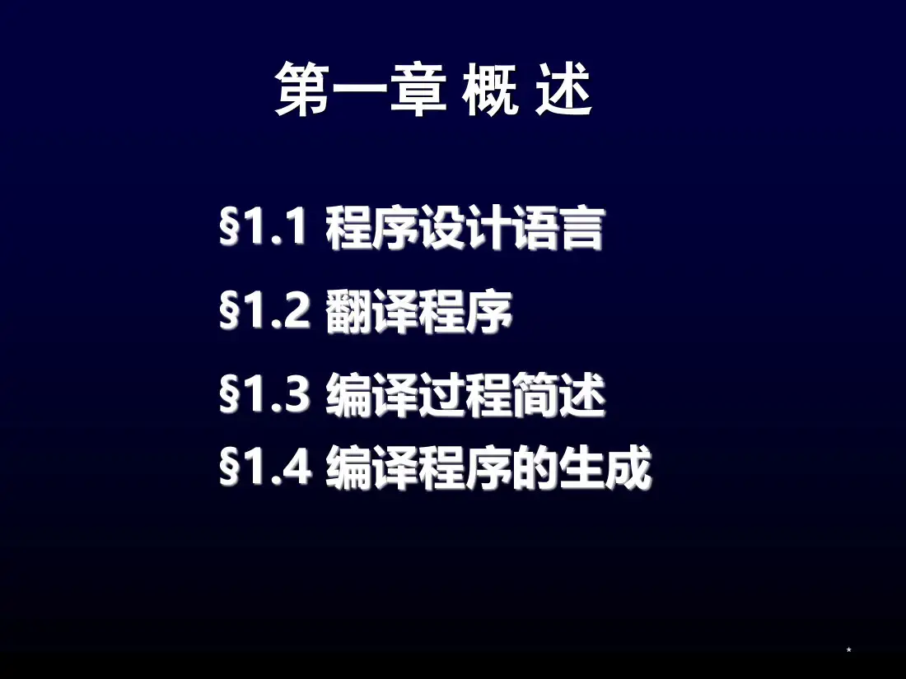

原文：

第一章 概 述

§1.1 程序设计语言

§1.2 翻译程序

§1.3 编译过程简述

§1.4 编译程序的生成

\*

### 第一章 概 述

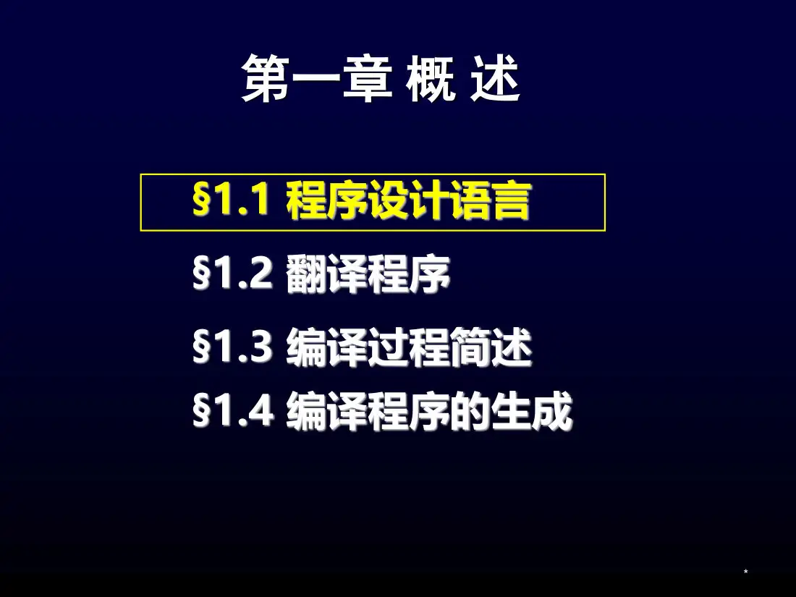

原文：

第一章 概 述

§1.1 程序设计语言

§1.2 翻译程序

§1.3 编译过程简述

§1.4 编译程序的生成

\*

### 第一章 概 述§1.1 程序设计语言

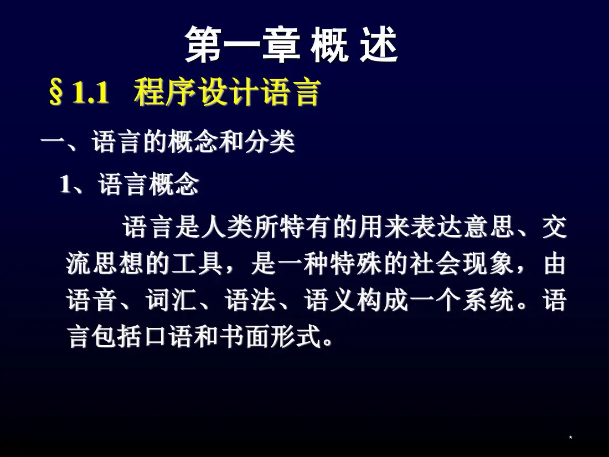

原文：

第一章 概 述§1.1 程序设计语言

一、语言的概念和分类

1、语言概念

语言是人类所特有的用来表达意思、交流思想的工具，是一种特殊的社会现象，由语音、词汇、语法、语义构成一个系统。语言包括口语和书面形式。

### 第一章 概 述

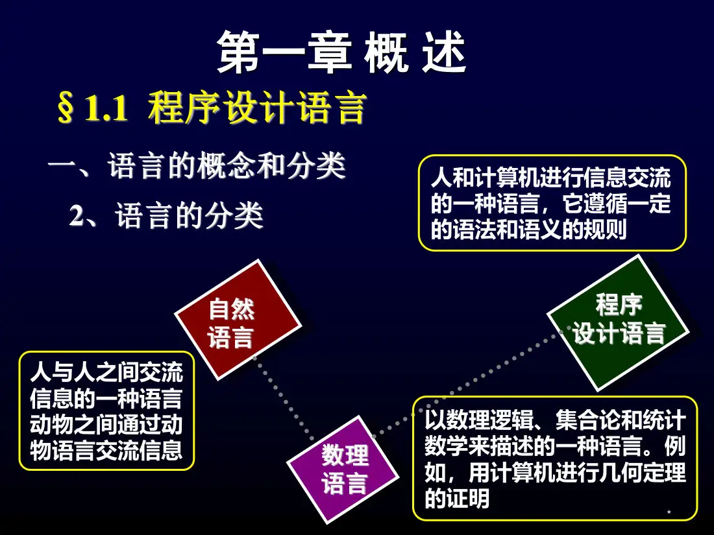

原文：

第一章 概 述

§1.1 程序设计语言

一、语言的概念和分类

2、语言的分类

自然语言

人与人之间交流信息的一种语言动物之间通过动物语言交流信息

数理语言

人和计算机进行信息交流的一种语言，它遵循一定的语法和语义的规则

程序设计语言

以数理逻辑、集合论和统计数学来描述的一种语言。例如，用计算机进行几何定理的证明大

### 第一章 概 述

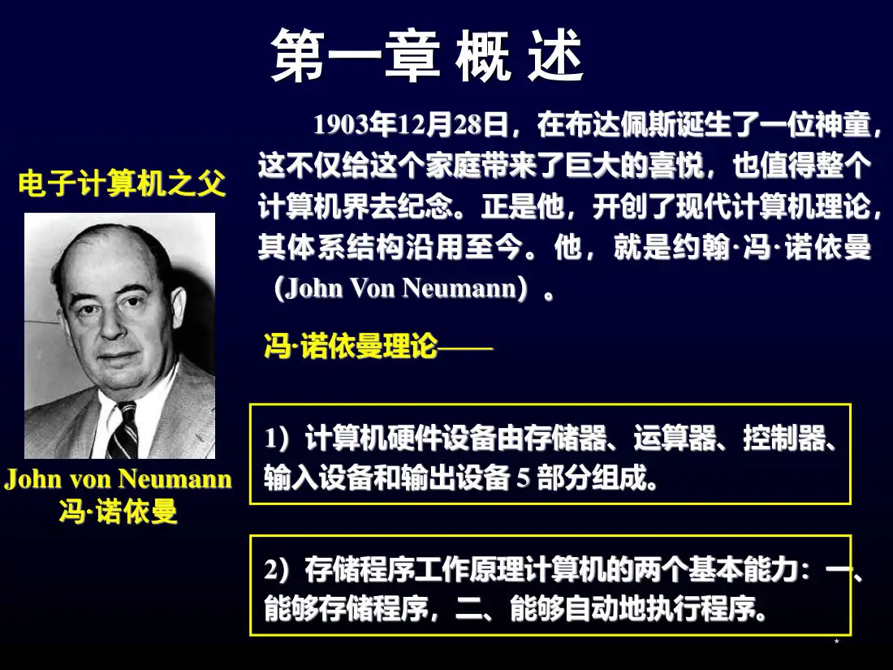

原文：

第一章 概 述

电子计算机之父

1903年12月28日，在布达佩斯诞生了一位神童，这不仅给这个家庭带来了巨大的喜悦，也值得整个计算机界去纪念。正是他，开创了现代计算机理论，其体系结构沿用至今。他，就是约翰·冯·诺依曼（John Von Neumann）。

冯·诺依曼理论—

1）计算机硬件设备由存储器、运算器、控制器、输入设备和输出设备 5 部分组成。

2）存储程序工作原理计算机的两个基本能力：能够存储程序，二、能够自动地执行程序。

\*

### 第一章 概 述

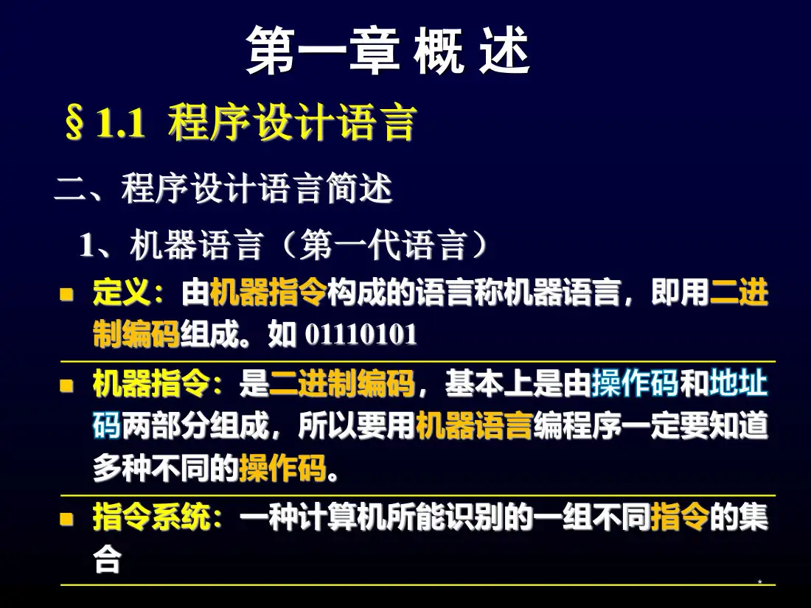

原文：

第一章 概 述

§1.1 程序设计语言

二、程序设计语言简述

1、机器语言（第一代语言）

定义：由机器指令构成的语言称机器语言，即用二进制编码组成。如 01110101

机器指令：是二进制编码，基本上是由 和两部分组成，所以要用机器语言编程序一定要知道多种不同的操作码。

指令系统：一种计算机所能识别的一组不同指令的集合

### 第一章 概 述

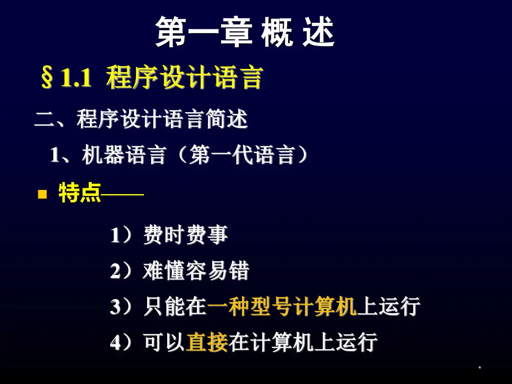

原文：

第一章 概 述

§1.1 程序设计语言

二、程序设计语言简述

1、机器语言（第一代语言）

特点—

1）费时费事

2）难懂容易错

3）只能在一种型号计算机上运行

4）可以直接在计算机上运行

### 第一章 概 述

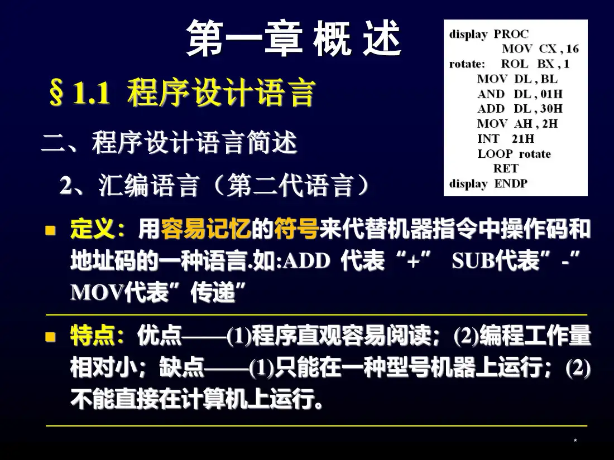

原文：

第一章 概 述

§1.1 程序设计语言

二、程序设计语言简述

2、汇编语言（第二代语言）

display PROC MOV CX, 16 rotate: ROL BX,1 MOV DL, BL AND DL, 01H ADD DL, 30H MOV AH,2H INT 21H LOOP rotate RET display ENDP

定义：用容易记忆的符号来代替机器指令中操作码和地址码的一种语言.如:ADD 代表“+” SUB代表”MOV代表”传递”

特点：优点——(1)程序直观容易阅读；(2)编程工作量相对小；缺点——(1)只能在一种型号机器上运行；(2)不能直接在计算机上运行。

\*

### 第一章 概 述

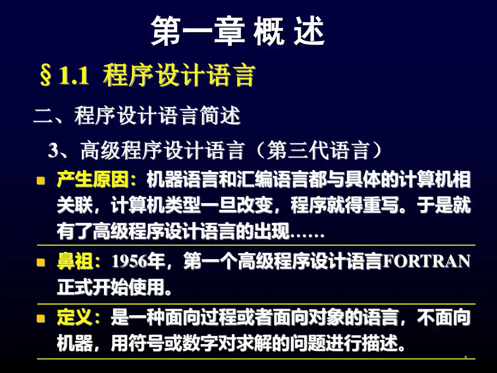

原文：

第一章 概 述

§1.1 程序设计语言

二、程序设计语言简述

3、高级程序设计语言（第三代语言）

产生原因：机器语言和汇编语言都与具体的计算机相关联，计算机类型一旦改变，程序就得重写。于是就有了高级程序设计语言的出现

鼻祖：1956年，第一个高级程序设计语言FORTRAN正式开始使用。

定义：是一种面向过程或者面向对象的语言，不面向机器，用符号或数字对求解的问题进行描述。

### 第一章 概 述

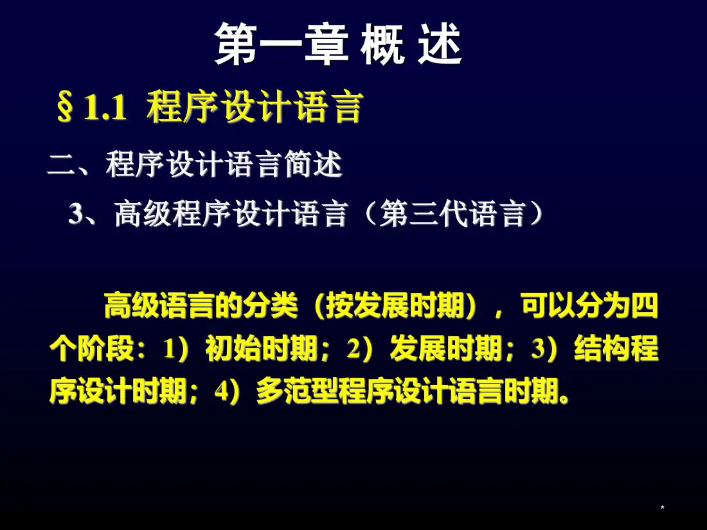

原文：

第一章 概 述

§1.1 程序设计语言

二、程序设计语言简述

3、高级程序设计语言（第三代语言）

高级语言的分类（按发展时期），可以分为四个阶段：1）初始时期；2）发展时期；3）结构程序设计时期；4）多范型程序设计语言时期。

### 第一章 概 述

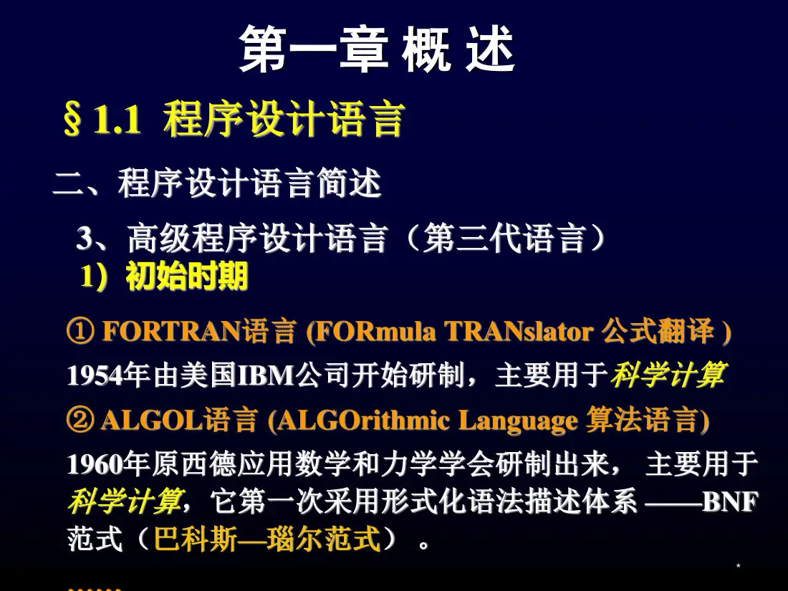

原文：

第一章 概 述

§1.1 程序设计语言

二、程序设计语言简述

3、高级程序设计语言（第三代语言）

1）初始时期

① FORTRAN语言 (FORmula TRANslator 公式翻译 )1954年由美国IBM公司开始研制，主要用于科学计算② ALGOL语言 (ALGOrithmic Language 算法语言)1960年原西德应用数学和力学学会研制出来，主要用于，它第一次采用形式化语法描述体系——BNF范式（巴科斯—瑙尔范式）

### 第一章 概 述

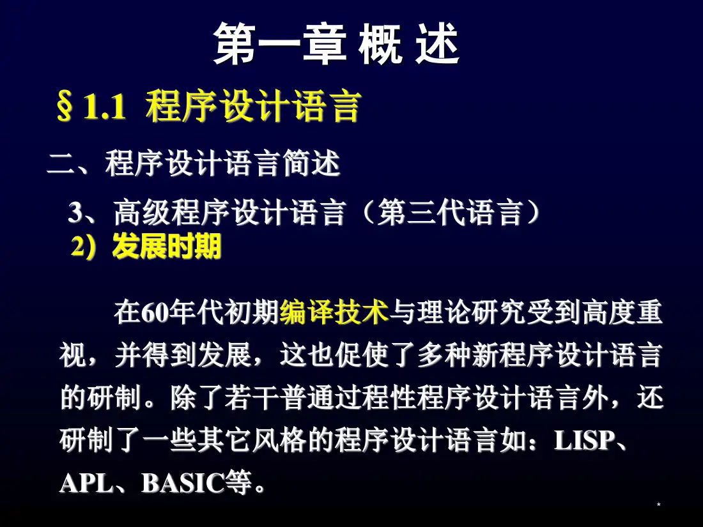

原文：

第一章 概 述

§1.1 程序设计语言

二、程序设计语言简述

3、高级程序设计语言（第三代语言）

2）发展时期

在60年代初期编译技术与理论研究受到高度重视，并得到发展，这也促使了多种新程序设计语言的研制。除了若干普通过程性程序设计语言外，还研制了一些其它风格的程序设计语言如：LISP、APL、BASIC等。

### 土豆网

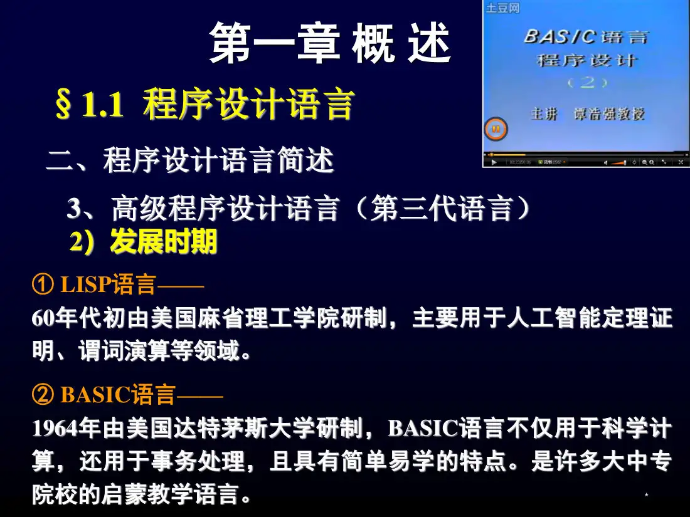

原文：

土豆网

第一章 概 述

§1.1 程序设计语言

BAS/C语言程序设计

主讲 谭浩强教授

二、程序设计语言简述

3、高级程序设计语言（第三代语言）

2）发展时期

① LISP语言— —

60年代初由美国麻省理工学院研制，主要用于人工智能定理证明、谓词演算等领域。

② BASIC语言— —

1964年由美国达特茅斯大学研制，BASIC语言不仅用于科学计算，还用于事务处理，且具有简单易学的特点。是许多大中专院校的启蒙教学语言。

### 第一章 概 述

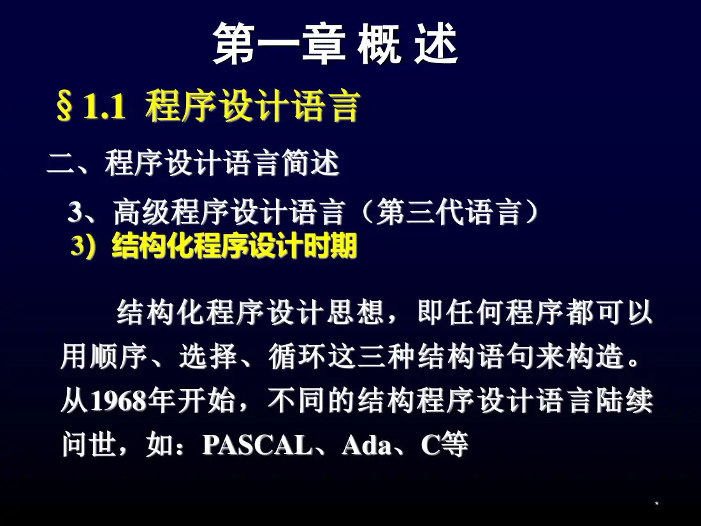

原文：

第一章 概 述

§1.1 程序设计语言

二、程序设计语言简述

3、高级程序设计语言（第三代语言）

3）结构化程序设计时期

结构化程序设计思想，即任何程序都可以用顺序、选择、循环这三种结构语句来构造。从1968年开始，不同的结构程序设计语言陆续问世，如：PASCAL、Ada、C等

\*

### 第一章 概 述

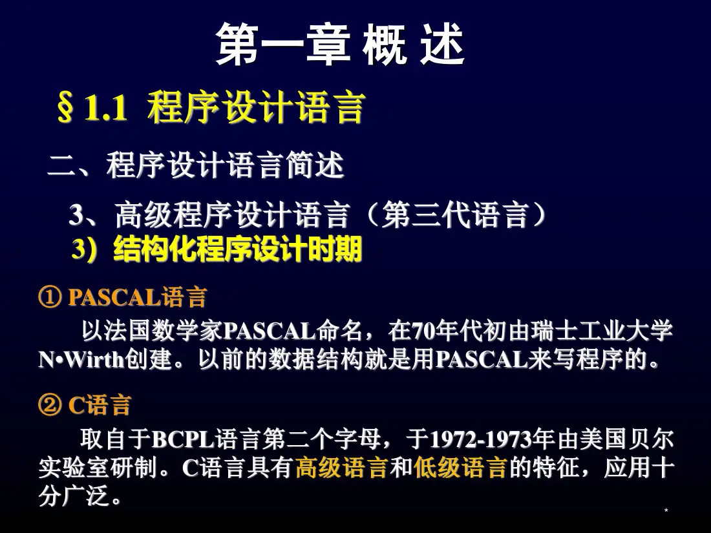

原文：

第一章 概 述

§1.1 程序设计语言

二、程序设计语言简述

3、高级程序设计语言（第三代语言）

3）结构化程序设计时期

① PASCAL语言

以法国数学家PASCAL命名，在70年代初由瑞士工业大学N•Wirth创建。以前的数据结构就是用PASCAL来写程序的。

② C语言

取自于BCPL语言第二个字母，于1972-1973年由美国贝尔实验室研制。C语言具有高级语言和低级语言的特征，应用十分广泛。

### 第 22 页

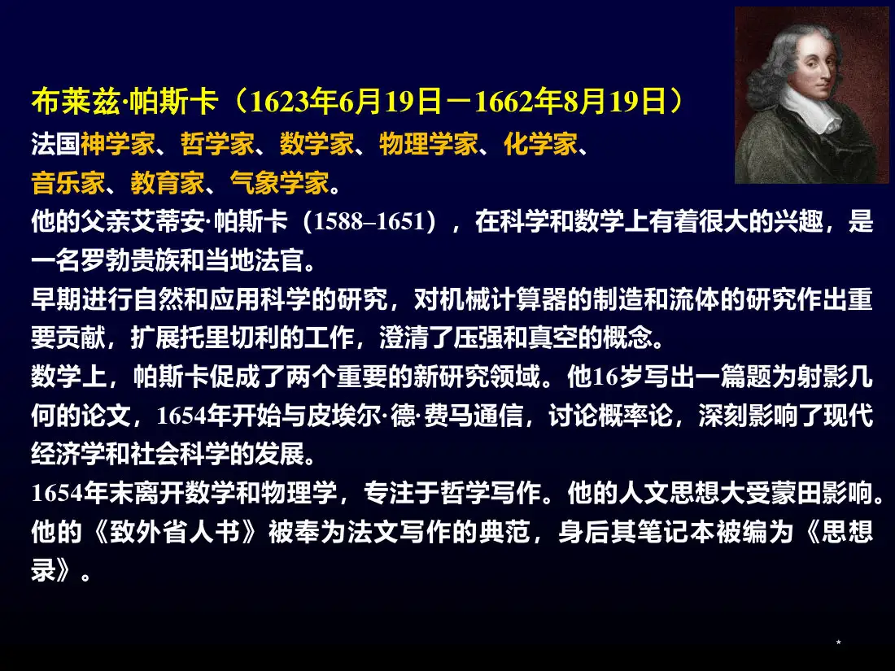

原文：

布莱兹‧帕斯卡（1623年6月19日－1662年8月19日）法国神学家、哲学家、数学家、物理学家、化学家、音乐家、教育家、气象学家。

他的父亲艾蒂安·帕斯卡（1588–1651），在科学和数学上有着很大的兴趣，是名罗勃贵族和当地法官。

早期进行自然和应用科学的研究，对机械计算器的制造和流体的研究作出重要贡献，扩展托里切利的工作，澄清了压强和真空的概念。

数学上，帕斯卡促成了两个重要的新研究领域。他16岁写出一篇题为射影几何的论文，1654年开始与皮埃尔·德·费马通信，讨论概率论，深刻影响了现代经济学和社会科学的发展。

1654年末离开数学和物理学，专注于哲学写作。他的人文思想大受蒙田影响。他的《致外省人书》被奉为法文写作的典范，身后其笔记本被编为《思想录》。

\*

### 第一章 概 述

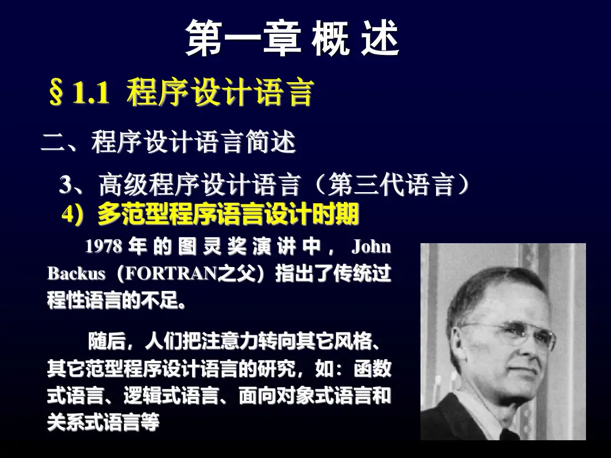

原文：

第一章 概 述

§1.1 程序设计语言

二、程序设计语言简述

3、高级程序设计语言（第三代语言）

4）多范型程序语言设计时期

1978 年 的 图 灵 奖 演 讲 中 ， JohnBackus（FORTRAN之父）指出了传统过程性语言的不足。

随后，人们把注意力转向其它风格、其它范型程序设计语言的研究，如：函数式语言、逻辑式语言、面向对象式语言和关系式语言等

### 第一章 概 述

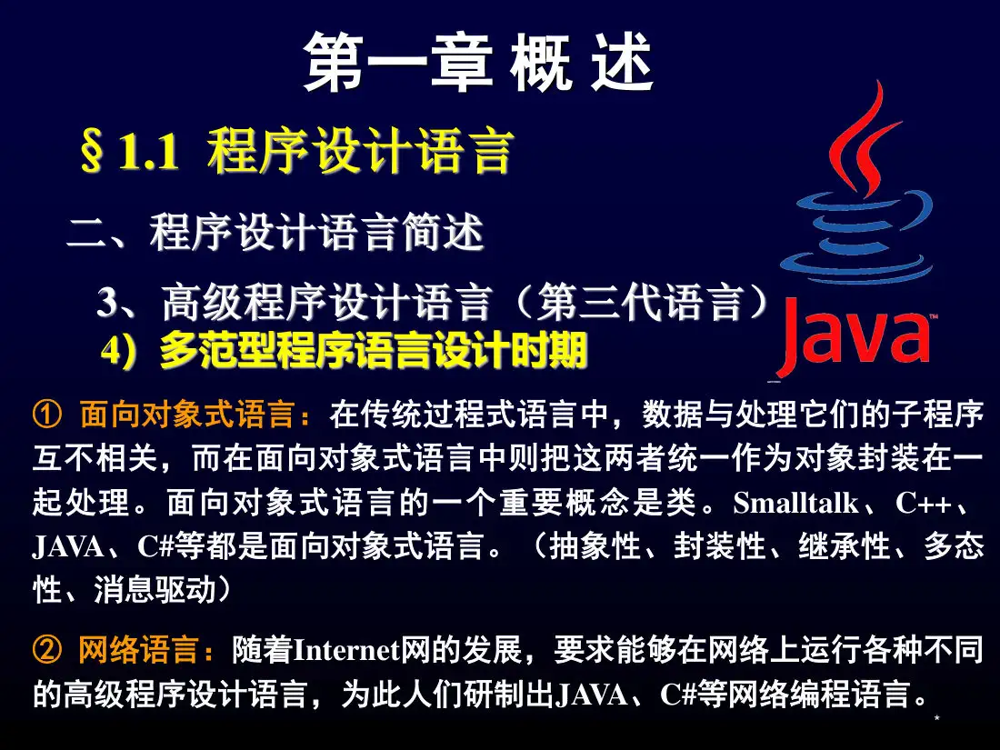

原文：

第一章 概 述

§1.1 程序设计语言

二、程序设计语言简述

3、高级程序设计语言（第三代语言）

4）多范型程序语言设计时期

ava

① 面向对象式语言：在传统过程式语言中，数据与处理它们的子程序互不相关，而在面向对象式语言中则把这两者统一作为对象封装在一起处理。面向对象式语言的一个重要概念是类。Smalltalk、C++、JAVA、C#等都是面向对象式语言。（抽象性、封装性、继承性、多态性、消息驱动）

② 网络语言：随着Internet网的发展，要求能够在网络上运行各种不同的高级程序设计语言，为此人们研制出JAVA、C#等网络编程语言。

### 第一章 概 述

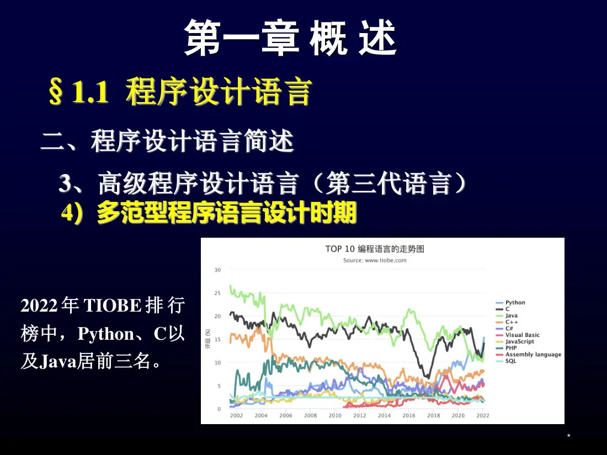

原文：

第一章 概 述

§1.1 程序设计语言

二、程序设计语言简述

3、高级程序设计语言（第三代语言）多范型程序语言设计时期

2022 年 TIOBE 排 行榜中，Python、C以及Java居前三名。

TOP 10 编程语言的走势图

\*

### 第一章 概 述

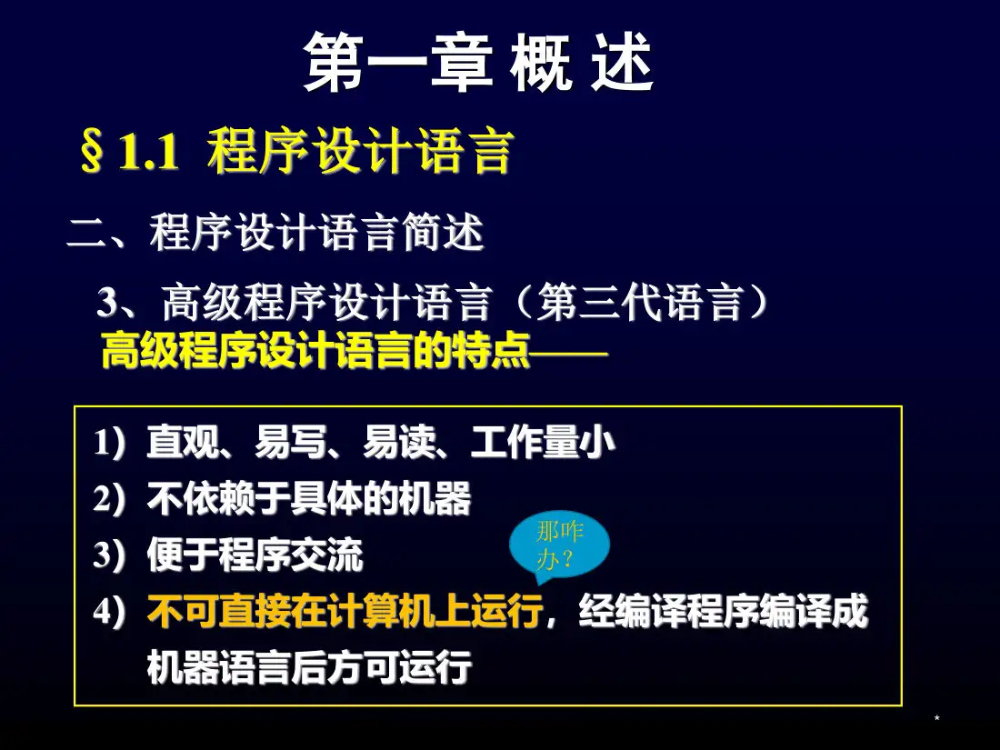

原文：

第一章 概 述

§1.1 程序设计语言

二、程序设计语言简述

3、高级程序设计语言（第三代语言）高级程序设计语言的特点—

1）直观、易写、易读、工作量小

2）不依赖于具体的机器

3）便于程序交流

那咋办？

4）不可直接在计算机上运行，经编译程序编译成机器语言后方可运行

### 第一章 概 述

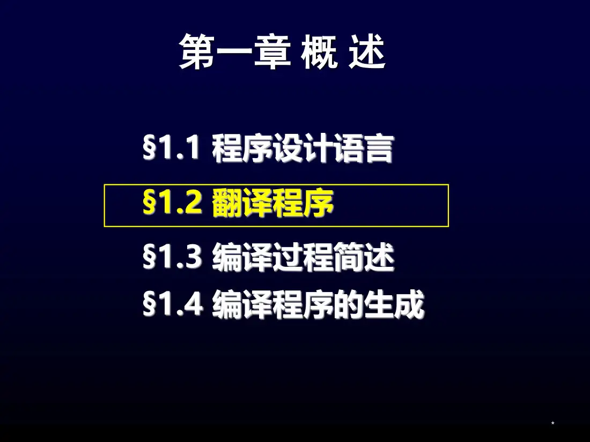

原文：

第一章 概 述

§1.1 程序设计语言

§1.2 翻译程序

§1.3 编译过程简述

§1.4 编译程序的生成

\*

### 第一章 概 述§1.2 翻译程序

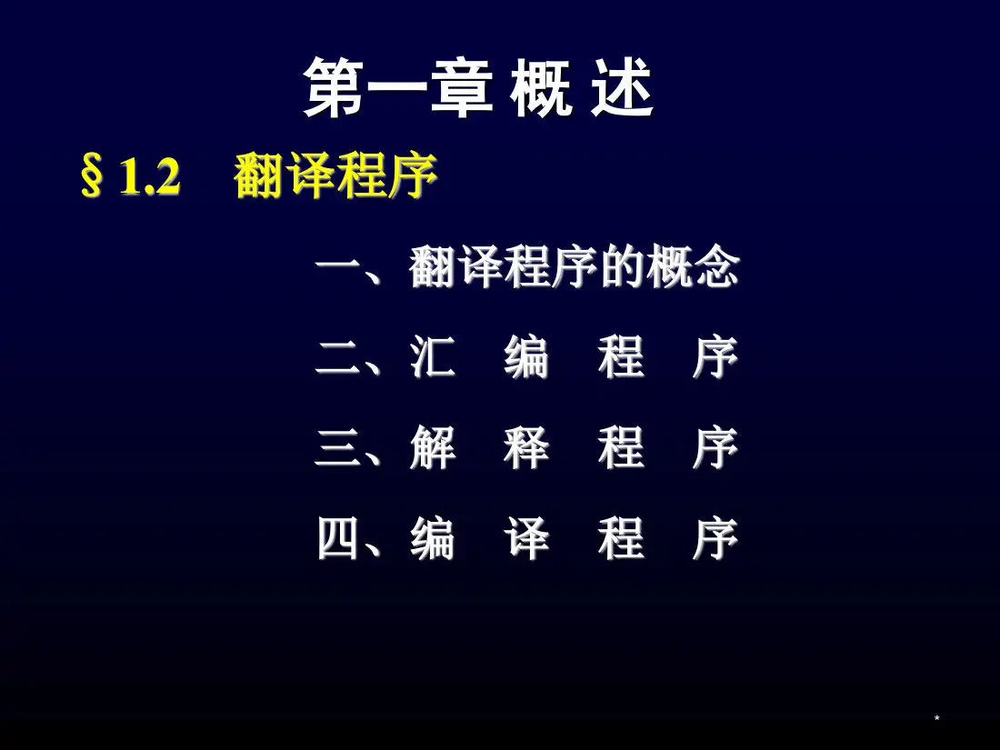

原文：

第一章 概 述§1.2 翻译程序

一、翻译程序的概念

二、汇 编 程 序

三、解 释 程 序

四、编 译 程 序

\*

### 第一章 概 述§1.2 翻译程序

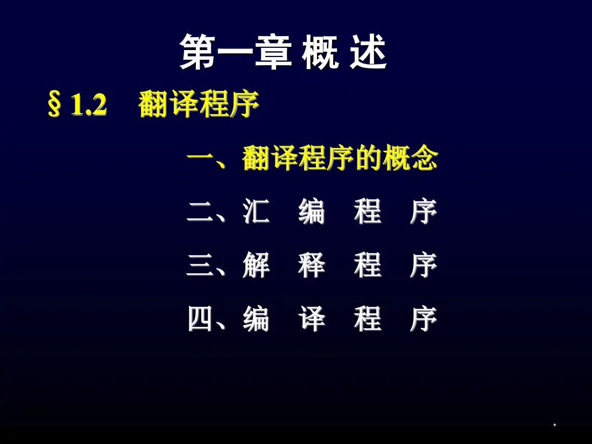

原文：

第一章 概 述§1.2 翻译程序

一、翻译程序的概念

二、汇 编 程 序

三、解 释 程 序

四、编 译 程 序

\*

### 第一章 概 述

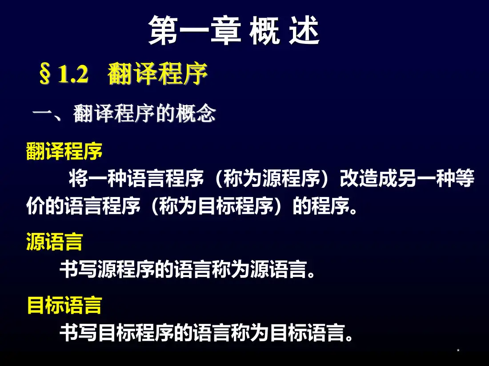

原文：

第一章 概 述

§1.2 翻译程序

一、翻译程序的概念

翻译程序

将一种语言程序（称为源程序）改造成另一种等价的语言程序（称为目标程序）的程序。

源语言

书写源程序的语言称为源语言。

目标语言

书写目标程序的语言称为目标语言。

### 第一章 概 述

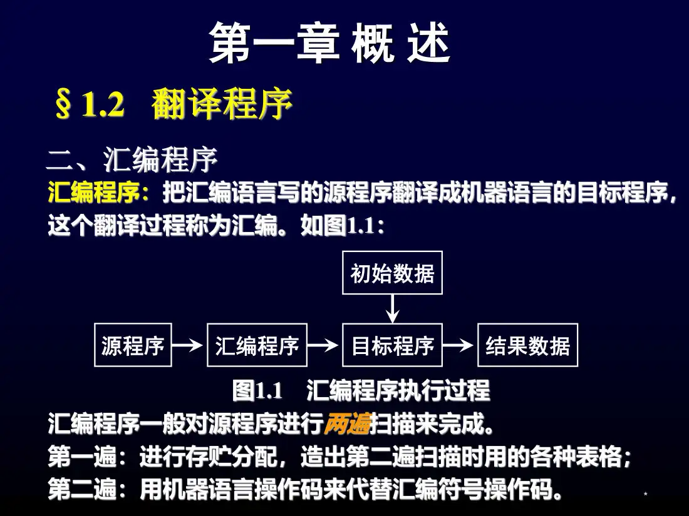

原文：

第一章 概 述

§1.2 翻译程序

二、汇编程序

汇编程序：把汇编语言写的源程序翻译成机器语言的目标程序，这个翻译过程称为汇编。如图1.1：

初始数据

源程序

汇编程序

目标程序

结果数据

图1.1 汇编程序执行过程

汇编程序一般对源程序进行两遍扫描来完成。

第一遍：进行存贮分配，造出第二遍扫描时用的各种表格；

第二遍：用机器语言操作码来代替汇编符号操作码。

### 第一章 概 述

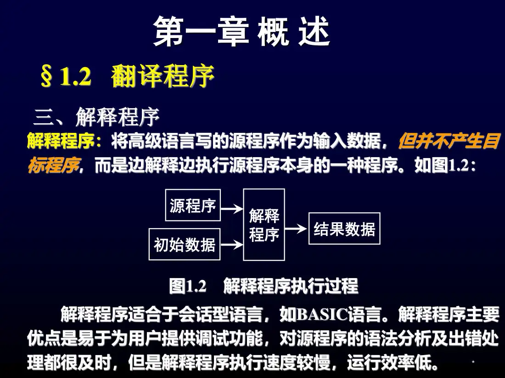

原文：

第一章 概 述

§1.2 翻译程序

三、解释程序

解释程序：将高级语言写的源程序作为输入数据，但并不产生目，而是边解释边执行源程序本身的一种程序。如图1.2：

源程序

初始数据解释程序结果数据

图1.2 解释程序执行过程

解释程序适合于会话型语言，如BASIC语言。解释程序主要优点是易于为用户提供调试功能，对源程序的语法分析及出错处理都很及时，但是解释程序执行速度较慢，运行效率低。

### 第一章 概 述

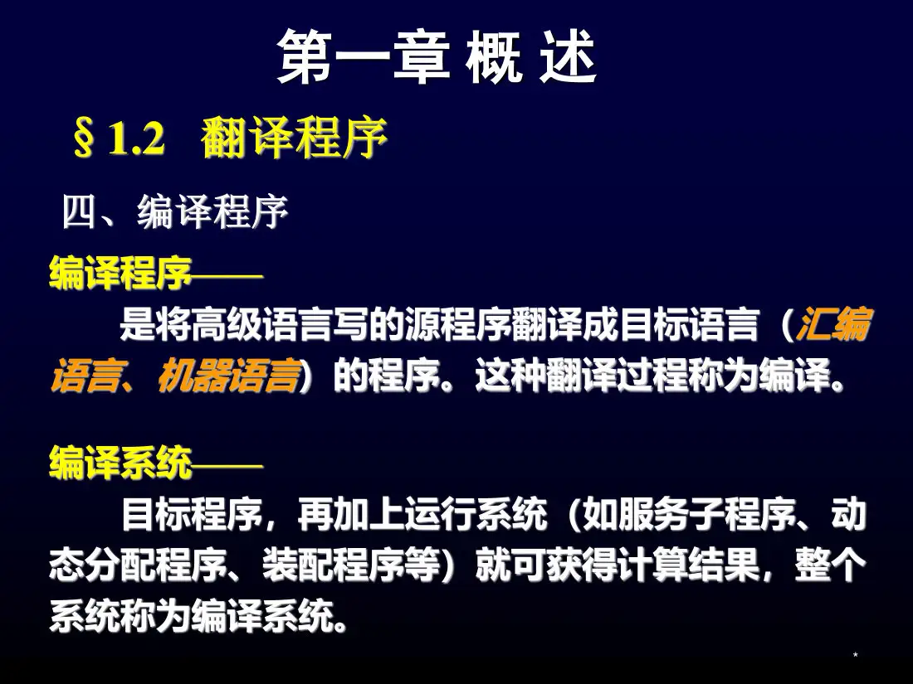

原文：

第一章 概 述

§1.2 翻译程序

四、编译程序

编译程序—

是将高级语言写的源程序翻译成目标语言（汇编）的程序。这种翻译过程称为编译。

编译系统—

目标程序，再加上运行系统（如服务子程序、动态分配程序、装配程序等）就可获得计算结果，整个系统称为编译系统。

### 第一章 概 述

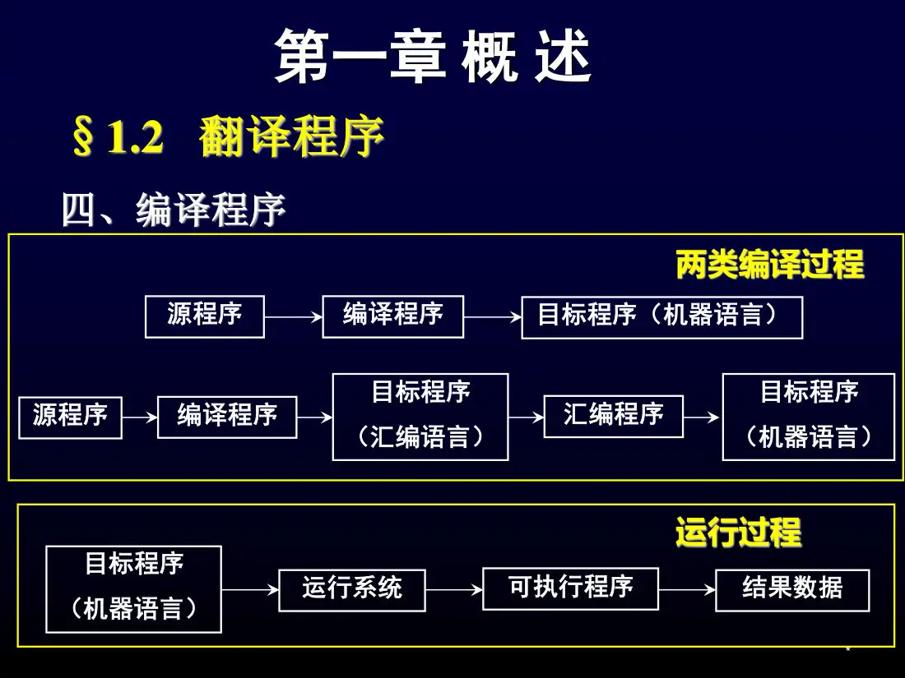

原文：

第一章 概 述

§1.2 翻译程序

四、编译程序

两类编译过程

源程序

编译程序

目标程序（机器语言）

源程序

编译程序目标程序（汇编语言）

汇编程序目标程序（机器语言）

目标程序

（机器语言）

运行系统

可执行程序

运行过程

结果数据

### 第一章 概 述

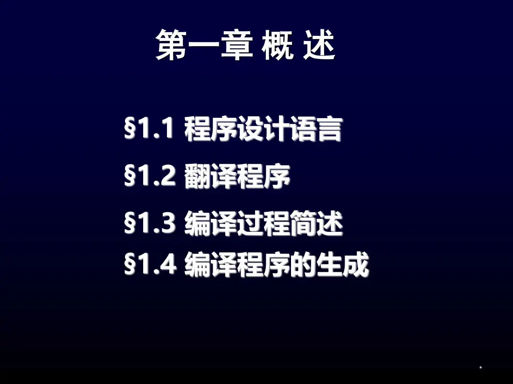

原文：

第一章 概 述

§1.1 程序设计语言

§1.2 翻译程序

§1.3 编译过程简述

§1.4 编译程序的生成

\*

### 第一章 概 述

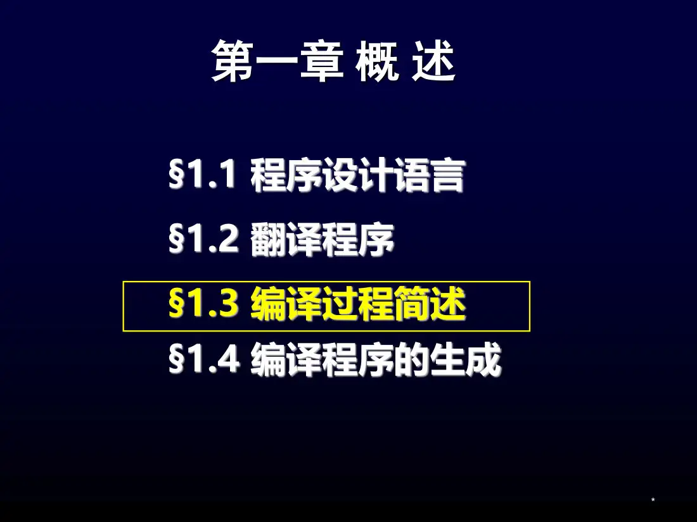

原文：

第一章 概 述

§1.1 程序设计语言

§1.2 翻译程序

§1.3 编译过程简述

§1.4 编译程序的生成

\*

### 第一章 概 述

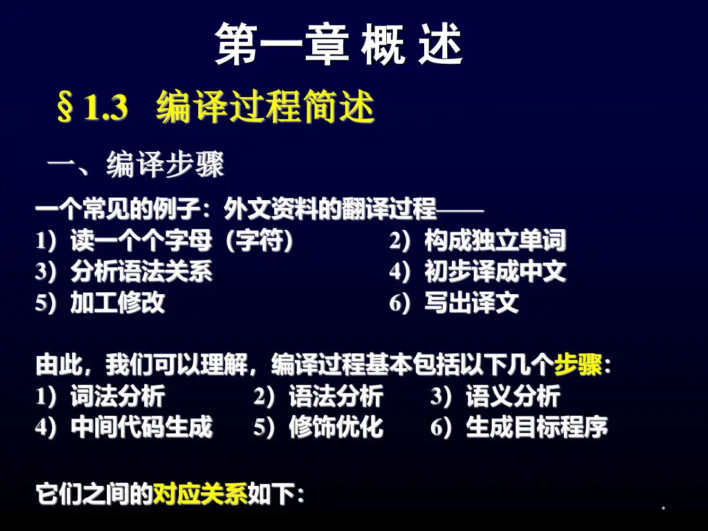

原文：

第一章 概 述

§1.3 编译过程简述

一、编译步骤

一个常见的例子：外文资料的翻译过程—

1）读一个个字母（字符）

3）分析语法关系

5）加工修改

2）构成独立单词

4）初步译成中文

6）写出译文

由此，我们可以理解，编译过程基本包括以下几个步骤：

1）词法分析

4）中间代码生成

2）语法分析

5）修饰优化

3）语义分析

6）生成目标程序

它们之间的对应关系如下：

\*

### 第一章 概 述

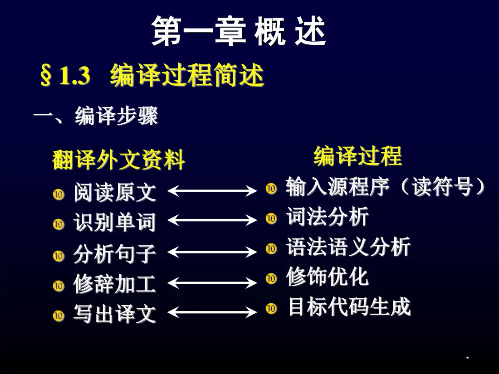

原文：

第一章 概 述

§1.3 编译过程简述

一、编译步骤

翻译外文资料

编译过程

阅读原文←输入源程序（读符号）

识别单词  词法分析 

 分析句子  语法语义分析

 修辞加工  修饰优化

 写出译文  目标代码生成

### 第一章 概 述

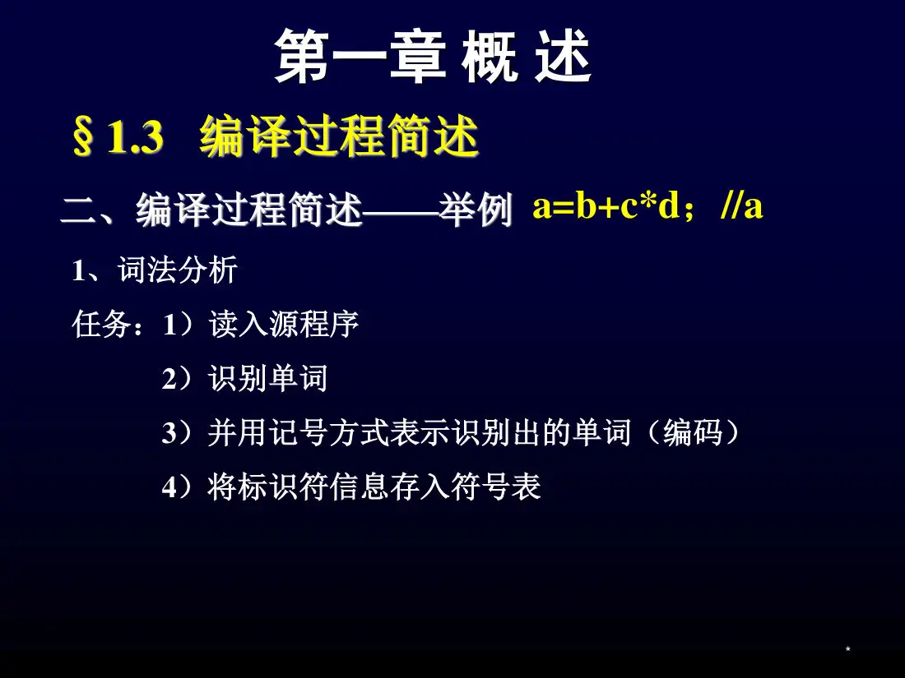

原文：

第一章 概 述

§1.3 编译过程简述

二、编译过程简述——举例 $\Theta \equiv [ \ m = 0 ]$ ；//a

1、词法分析

任务：1）读入源程序

2）识别单词

3）并用记号方式表示识别出的单词（编码）

4）将标识符信息存入符号表

### 第一章 概 述

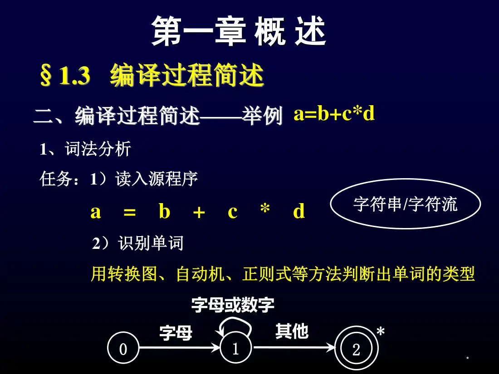

原文：

第一章 概 述

§1.3 编译过程简述

二、编译过程简述— 举例 $\operatorname { g } \operatorname { E } \operatorname { i n } ^ { \prime } = \operatorname { i n } ^ { \prime } = \operatorname { i n } ^ { \prime } ( 0 \leq 0 )$

1、词法分析

任务：1）读入源程序

a = b + c \* d

字符串/字符流

2）识别单词

用转换图、自动机、正则式等方法判断出单词的类型

字母或数字

字母

其他

### 第一章 概 述

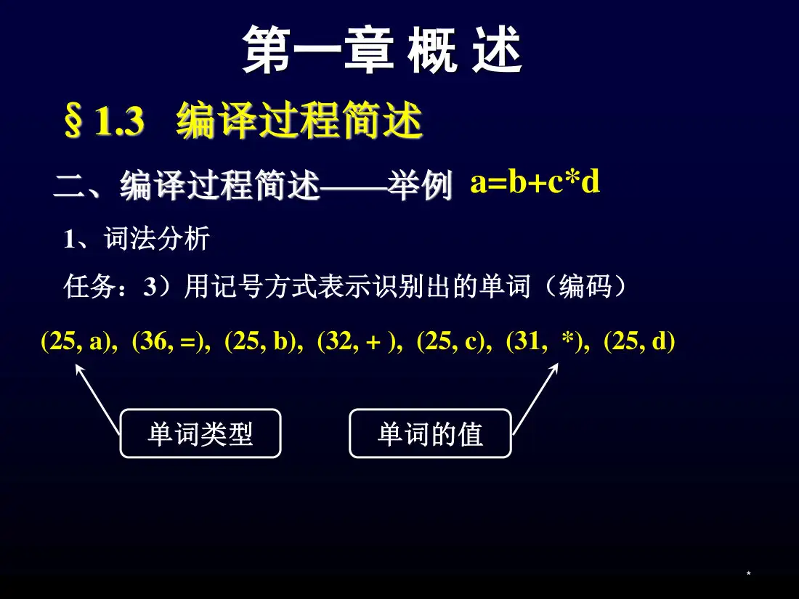

原文：

第一章 概 述

§1.3 编译过程简述

二、编译过程简述——举例 $\operatorname { g } \operatorname { E } \operatorname { i n } ^ { \prime } \operatorname { i n } ^ { \prime } ( \operatorname { v } \operatorname { v } \operatorname { i n } )$

1、词法分析

任务：3）用记号方式表示识别出的单词（编码）

(25, a), (36, =), (25, b), (32, + ), (25, c), (31, \*), (25, d)

单词类型

单词的值

### 第一章 概 述

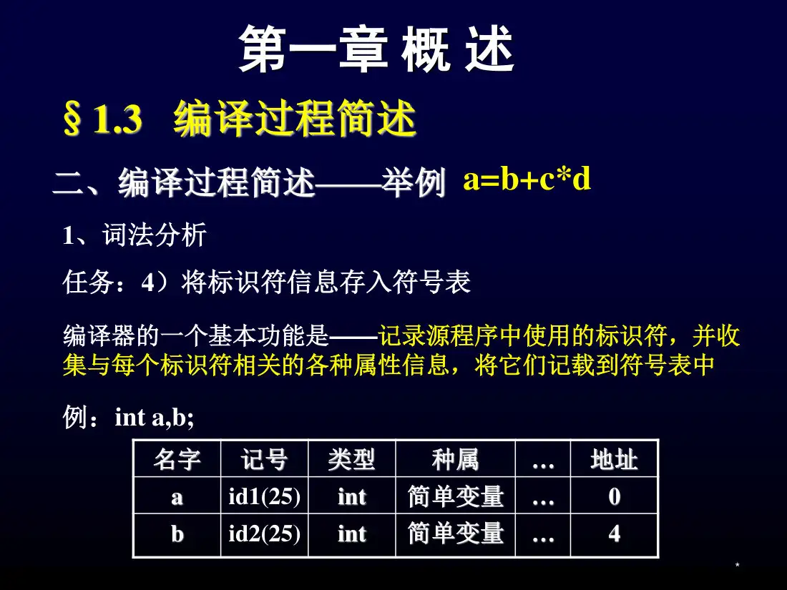

原文：

第一章 概 述

§1.3 编译过程简述

二、编译过程简述——举例 $\operatorname { g } \operatorname { E } \operatorname { i n } ^ { \prime } \operatorname { i n } ^ { \prime } ( \operatorname { v } \operatorname { v } \operatorname { i n } )$

1、词法分析

任务：4）将标识符信息存入符号表

编译器的一个基本功能是——记录源程序中使用的标识符，并收集与每个标识符相关的各种属性信息，将它们记载到符号表中

例： $\mathrm { I m } \cdot \mathrm { e m } \cdot \mathrm { m }$

<table><tr><td>名字</td><td>记号</td><td>类型</td><td>种属</td><td>...</td><td>地址</td></tr><tr><td>a</td><td>id1(25)</td><td>int</td><td>简单变量</td><td>...</td><td>0</td></tr><tr><td>b</td><td>id2(25)</td><td>int</td><td>简单变量</td><td>...</td><td>4</td></tr></table>

\*

### 第一章 概 述

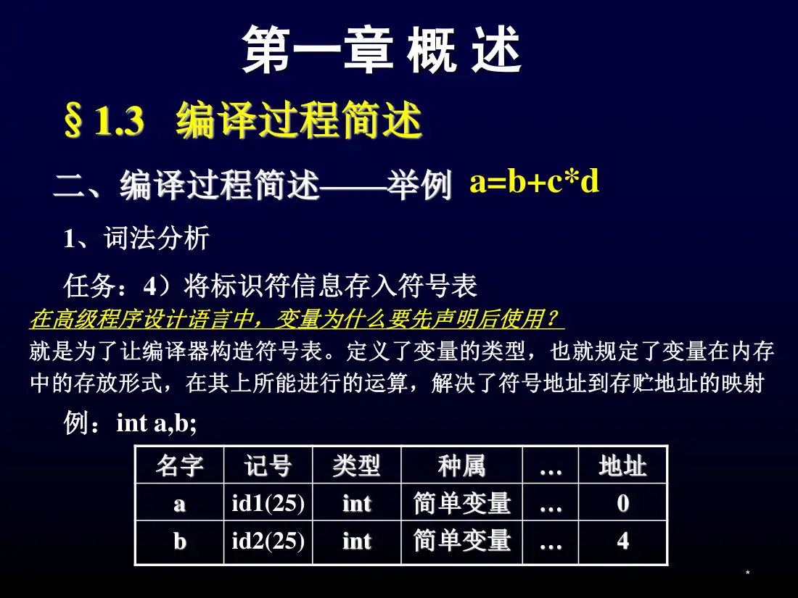

原文：

第一章 概 述

§1.3 编译过程简述

二、编译过程简述— —举例 $\Theta \equiv [ \pmb { 0 } ] = \Theta \chi \chi _ { 0 } ^ { 2 } ( \pmb { 0 } ) = 0$

1、词法分析

任务：4）将标识符信息存入符号表在高级程序设计语言中，变量为什么要先声明后使用？

就是为了让编译器构造符号表。定义了变量的类型，也就规定了变量在内存中的存放形式，在其上所能进行的运算，解决了符号地址到存贮地址的映射

例： $\mathrm { I m } \mathrm { m e l m }$

<table><tr><td>名字</td><td>记号</td><td>类型</td><td>种属</td><td>...</td><td>地址</td></tr><tr><td>a</td><td>id1(25)</td><td>int</td><td>简单变量</td><td>...</td><td>0</td></tr><tr><td>b</td><td>id2(25)</td><td>int</td><td>简单变量</td><td>...</td><td>4</td></tr></table>

\*

### 第一章 概 述

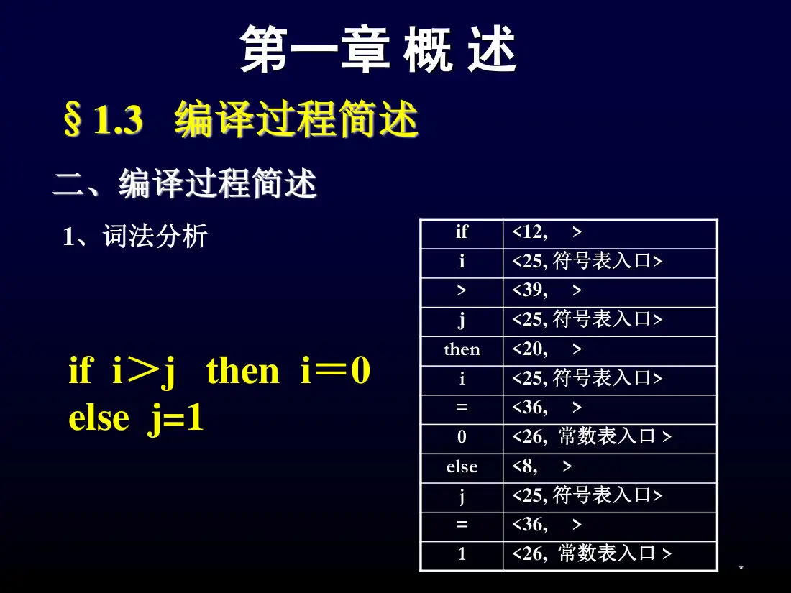

原文：

第一章 概 述

§1.3 编译过程简述

二、编译过程简述

1、词法分析

if i＞j then i＝0 else j=1

<table><tr><td>if</td><td>&lt;12, &gt;</td></tr><tr><td>i</td><td>&lt;25, 符号表入口&gt;</td></tr><tr><td>&gt;</td><td>&lt;39, &gt;</td></tr><tr><td>j</td><td>&lt;25, 符号表入口&gt;</td></tr><tr><td>then</td><td>&lt;20, &gt;</td></tr><tr><td>i</td><td>&lt;25, 符号表入口&gt;</td></tr><tr><td>=</td><td>&lt;36, &gt;</td></tr><tr><td>0</td><td>&lt;26, 常数表入口&gt;</td></tr><tr><td>else</td><td>&lt;8, &gt;</td></tr><tr><td>j</td><td>&lt;25, 符号表入口&gt;</td></tr><tr><td>=</td><td>&lt;36, &gt;</td></tr><tr><td>1</td><td>&lt;26, 常数表入口&gt;</td></tr></table>

### 第一章 概 述

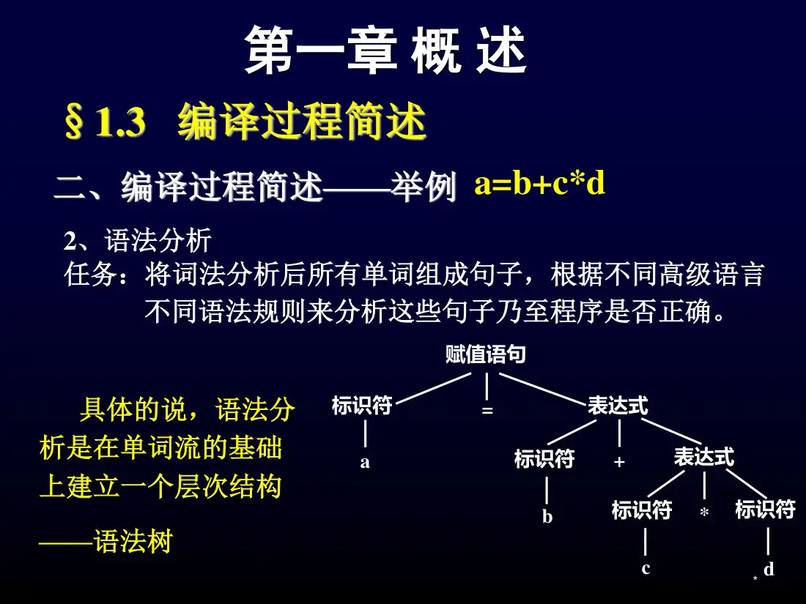

原文：

第一章 概 述

§1.3 编译过程简述

二、编译过程简述——举例 $\mathrm { \ell ^ { 2 } } = \mathrm { \ln } ( \mathrm { \ell ^ { 2 } } ) = \mathrm { \ell ^ { 2 } }$

2、语法分析

任务：将词法分析后所有单词组成句子，根据不同高级语言不同语法规则来分析这些句子乃至程序是否正确。

具体的说，语法分析是在单词流的基础上建立一个层次结构

语法树

### 第一章 概 述

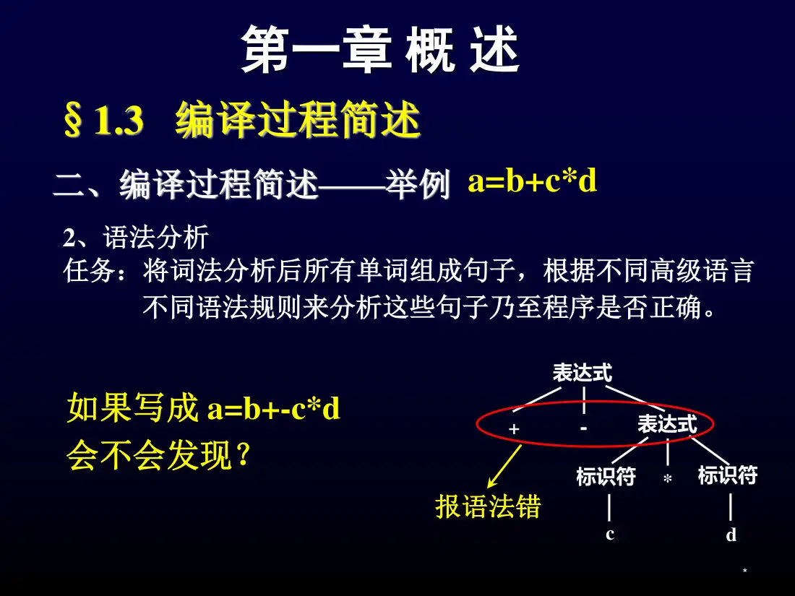

原文：

第一章 概 述

§1.3 编译过程简述

二、编译过程简述— 举例 $\operatorname { g } \operatorname { E } \operatorname { i n } ^ { \prime } \operatorname { i n } ^ { \prime } ( \operatorname { v } \operatorname { v } \operatorname { i n } )$

2、语法分析

任务：将词法分析后所有单词组成句子，根据不同高级语言不同语法规则来分析这些句子乃至程序是否正确。

如果写成 $: 0 \equiv \operatorname { l i m } = 0 \equiv \operatorname { l i m } ( 0 \equiv 0 )$ 会不会发现？

### 第一章 概 述

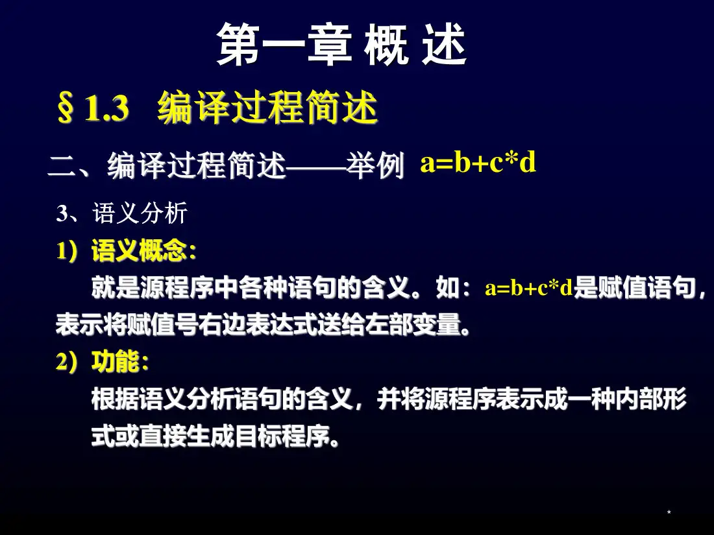

原文：

第一章 概 述

§1.3 编译过程简述

二、编译过程简述— —举例 $\operatorname { g } \operatorname { E } \operatorname { i n } ^ { \prime } \operatorname { i n } ^ { \prime } ( \operatorname { v } \operatorname { v } \operatorname { i n } )$

3、语义分析

1）语义概念：

就是源程序中各种语句的含义。如：a=b+c\*d是赋值语句，表示将赋值号右边表达式送给左部变量。

2）功能：

根据语义分析语句的含义，并将源程序表示成一种内部形式或直接生成目标程序。

### 第一章 概 述

原文：

第一章 概 述

§1.3 编译过程简述

二、编译过程简述——举例 $\operatorname { g } \operatorname { E } \operatorname { i n } = \operatorname { i n } = \operatorname { i n } ( 0 \leq 0 )$

3、语义分析

\*

### 第一章 概 述

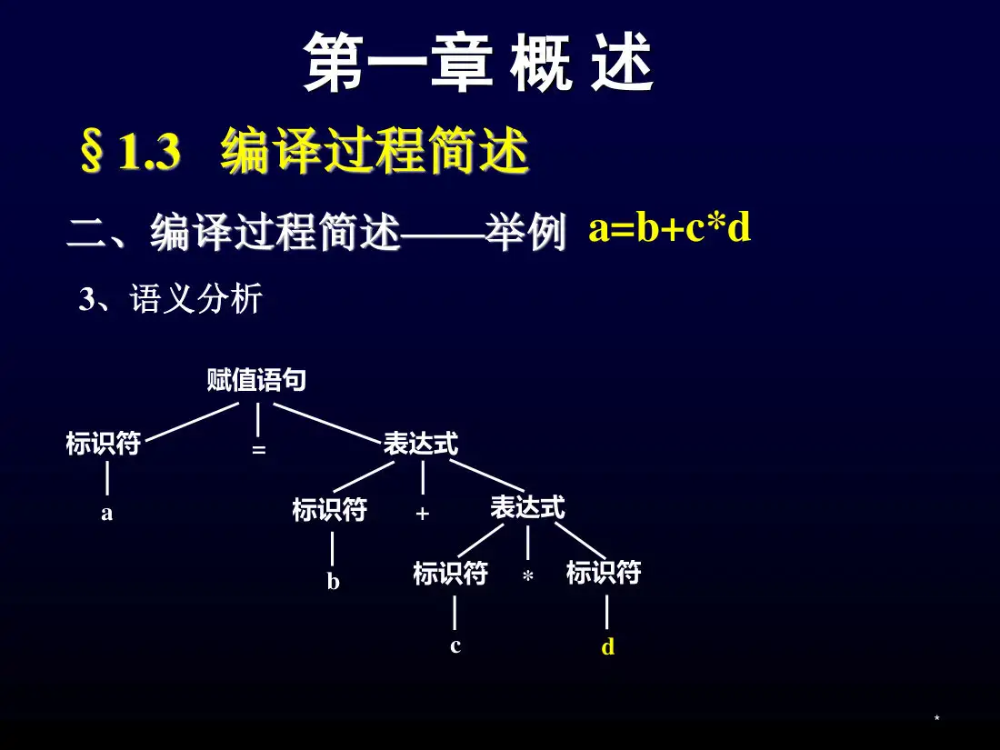

原文：

第一章 概 述

§1.3 编译过程简述

二、编译过程简述——举例 $\operatorname { g } \operatorname { E } \operatorname { i n } = \operatorname { i n } = \operatorname { i n } ( 0 \leq 0 )$

3、语义分析

\*

### 第一章 概 述

原文：

第一章 概 述

§1.3 编译过程简述

二、编译过程简述——举例 $\operatorname { g } \operatorname { E } \operatorname { i n } = \operatorname { i n } = \operatorname { i n } ( 0 \leq 0 )$

3、语义分析

\*

### 第一章 概 述

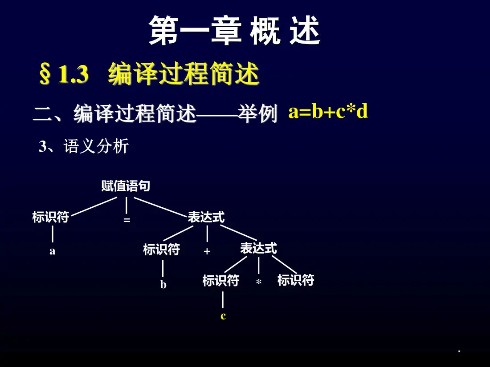

原文：

第一章 概 述

§1.3 编译过程简述

二、编译过程简述——举例 $\operatorname { g } \operatorname { E } \operatorname { i n } = \operatorname { i n } = \operatorname { i n } ( 0 \leq 0 )$

3、语义分析

\*

### 第一章 概 述

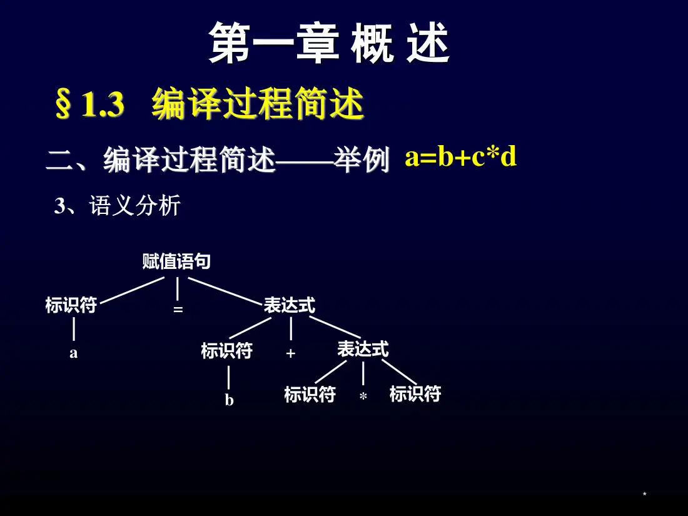

原文：

第一章 概 述

§1.3 编译过程简述

二、编译过程简述——举例 $\operatorname { g } \operatorname { E } \operatorname { i n } = \operatorname { i n } = \operatorname { i n } ( 0 \leq 0 )$

3、语义分析

\*

### 第一章 概 述

原文：

第一章 概 述

§1.3 编译过程简述

二、编译过程简述——举例 $\operatorname { g } \operatorname { E } \operatorname { i n } = \operatorname { i n } = \operatorname { i n } ( 0 \leq 0 )$

3、语义分析

\*

### 第一章 概 述

原文：

第一章 概 述

§1.3 编译过程简述

二、编译过程简述——举例 $\operatorname { g } \operatorname { E } \operatorname { i n } = \operatorname { i n } = \operatorname { i n } ( 0 \leq 0 )$

3、语义分析

Temp1=c\*d

\*

### 第一章 概 述

原文：

第一章 概 述

§1.3 编译过程简述

二、编译过程简述——举例 $\operatorname { g } \operatorname { E } \operatorname { i n } = \operatorname { i n } = \operatorname { i n } ( 0 \leq 0 )$

3、语义分析

Temp1=c\*d

\*

### 第一章 概 述

原文：

第一章 概 述

§1.3 编译过程简述

二、编译过程简述——举例 $: 0 = 0 = 0 0 0 0 0$

3、语义分析

$$
\mathbf {T e m p 1} = \mathbf {c} ^ {*} \mathbf {d}
$$

\*

### 第一章 概 述

原文：

第一章 概 述

§1.3 编译过程简述

二、编译过程简述——举例 $: 0 = 0 = 0 0 0 0 0$

3、语义分析

Temp1=c\*d

\*

### 第一章 概 述

原文：

第一章 概 述

§1.3 编译过程简述

二、编译过程简述——举例 $: 0 = 0 = 0 0 0 0 0$

3、语义分析

\*

### 第一章 概 述

原文：

第一章 概 述

§1.3 编译过程简述

二、编译过程简述——举例 $: 0 = 0 = 0 0 0 0 0$

3、语义分析

\*

### 第一章 概 述

原文：

第一章 概 述

§1.3 编译过程简述

二、编译过程简述——举例 $: 0 = 0 = 0 0 0 0 0$

3、语义分析

标识符

Temp1=c\*d

Temp2=b+Temp1

\*

### 第一章 概 述

原文：

第一章 概 述

§1.3 编译过程简述

二、编译过程简述——举例 $: 0 = 0 = 0 0 0 0 0$

3、语义分析

标识符

Temp1=c\*d

Temp2=b+Temp1

\*

### 第一章 概 述

原文：

第一章 概 述

§1.3 编译过程简述

二、编译过程简述— —举例 $: 0 = 0 = 0 0 0 0$

3、语义分析

赋值语句

Temp1=c\*d

Temp2=b+Temp1

a=Temp2

\*

### 第一章 概 述

原文：

第一章 概 述

§1.3 编译过程简述

二、编译过程简述——举例 $\mathrm { \textmu } \mathrm { \Sigma } \mathrm { \Sigma } \mathrm { \Sigma } \mathrm { \Sigma } \mathrm { \Sigma } \mathrm { \Sigma } \mathrm { \Sigma } \mathrm { \Sigma } \mathrm { \Sigma }$

4、中间代码生成中间表示可以看成是某种抽象的程序，通常与平台无关

基本要求：1、易于产生 2、易于翻译成目标程序

Temp1=c\*d

(\* , c , d , Temp1)

Temp2=b+Temp1

(+ , b, Temp1 , Temp2)

a=Temp2

(= , Temp2 , , a)

三地址码

四元式

### 第一章 概 述

原文：

第一章 概 述

§1.3 编译过程简述

二、编译过程简述——举例 $: 0 = 0 = 0 0 0 0 0$

5、代码优化

试图改进中间代码，以产生执行速度较快的机器代码

Temp1=c\*d

Temp2=b+Temp1

a=Temp2

Temp1=c\*d

a=b+Temp1

\*

### 第一章 概 述

原文：

第一章 概 述

§1.3 编译过程简述

二、编译过程简述——举例 $\operatorname { g } \operatorname { E } \operatorname { i n } ^ { \prime } \operatorname { i n } ^ { \prime } ( \operatorname { v } \operatorname { v } \operatorname { i n } )$

6、目标代码生成

生成可重定位的机器代码或汇编代码

Temp1=c\*d

a=b+Temp1

Movf R2, c

Mult R2, d

Movf R1, b

Addf R2, R1

Movf a, R2

\*

### 第一章 概 述

原文：

第一章 概 述

§1.3 编译过程简述

二、编译过程简述整个编译过程如下图—

\*

### 第一章 概 述

原文：

第一章 概 述

§1.3 编译过程简述

二、编译过程简述整个编译过程如下图—

编译器前端 与机器无关

目
标
程
序

源程序

错 误 检 查 和 处 理 程 序

\*

### 第一章 概 述

原文：

第一章 概 述

§1.3 编译过程简述

二、编译过程简述整个编译过程如下图—

编译器后端 与机器相关

源程序

### 第一章 概 述

原文：

第一章 概 述

§1.3 编译过程简述

三、趟程（遍）

1、定义

从头到尾扫描一遍源程序或等价源程序，并做有关加工处理，称趟程。

每经过一趟源程序都要进行等价变换并更接近目标程序。如果通过对源程序一遍扫描直接生成目标代码程序，则说编译程序是单遍的。

把源程序分为几遍来编译，每遍只完成编译程序中的一部分或几个部分工作，称为多遍的。

比如第一遍进行词法、语法分析，检查语法错误；第二遍生成中间语言进行存储分配；第三遍生成可运行的目标程序。

### 第一章 概 述

原文：

第一章 概 述

§1.3 编译过程简述

三、趟程（遍）

源程序

编译程序

目标程序

一遍扫描编译程序

源程序

第一遍扫描程序中间语言1多遍扫描的优点弥补了单遍的缺点，单遍却避免了多遍的缺点

中间语言n-1

第n趟扫描程序

目标程序

多遍扫描编译程序

优点：加工充分；出错处理细致；目标程序质量高

缺点：编译时间长，开销大

### 第一章 概 述

原文：

第一章 概 述

§1.3 编译过程简述

三、趟程（遍）

2、决定趟程的因素

1）计算机存贮容量大小；

2）编译程序功能强弱；

3）源语言繁简；

4）目标程序优化程度；

5）设计和实现编译程序时使用工具的先进性；

6）参加人员多少和素质等。

### 第一章 概 述

原文：

第一章 概 述

§1.1 程序设计语言

§1.2 翻译程序

§1.3 编译过程简述

§1.4 编译程序的生成

### 第一章 概 述

原文：

第一章 概 述

§1.4 编译程序的生成

一、编写编译程序的一般方法

直接用机器语言编写编译程序机器语言是早期编写编译程序的唯一工具， 但由于机器语言难读难写 ，现在几乎没有人再用它。

2、用汇编语言编写编译程序由于汇编语言太依赖于硬件环境, 且程序过于冗长, 现在也不常用, 不过由于它通过汇编程序产生的目标代码效率比较高, 所以在编译程序核心部分常用它编写。

### 第一章 概 述

原文：

第一章 概 述

§1.4 编译程序的生成

一、编写编译程序的一般方法

3、用系统程序设计语言编写

能够编写编译程序或其他系统软件的高级语言称系统程序设计语言。如PASCAL、C、C++

由于用机器语言和汇编语言编写编译程序其主要缺点是效率低，因此越来越多的人倾向于使用高级语言作为工具来编写编译程序。

注意：并非所有高级语言都适合于编写编译程序。

\*

### 第一章 概 述

原文：

第一章 概 述

§1.4 编译程序的生成

二、编译程序开发技术

1、自编译

1）概念

如果一种高级语言与之相应的编译程序也能直接用该语言本身写出来 , 具有这种性质语言称自编译语言 , 即自编译。能够编译自身的编译程序称自编译程序。

自编译语言除了书写自身编译程序外 , 一般还可以编写其它语言编译程序 。

### 第一章 概 述

原文：

第一章 概 述

§1.4 编译程序的生成

二、编译程序开发技术

1、自编译

2）T形图

源语言、目标语言和编译程序书写语言之间的关系可用T型图来表示，如下图：

源语言

目标语言

书写语言

\*

### 第一章 概 述

原文：

第一章 概 述

§1.4 编译程序的生成

二、编译程序开发技术

1、自编译

2）T形图

假设在 A机器上已有一个C语言可供运行 , 即用 A机器上的 A代码书写的、产生A目标代码的 C语言的编译程序，如下图：

C语言

A代码

A代码

### 第一章 概 述

原文：

第一章 概 述

§1.4 编译程序的生成

二、编译程序开发技术

1、自编译

2）T形图

由此我们可以用C语言书写C语言编译程序, 然后借助于原有C编译程序对新编写的C编译程序进行编译, 从而编译后可得到在 A 机器上运行的C编译程序 :

C语言

A代码

C语言

\*

### 第一章 概 述

原文：

第一章 概 述

§1.4 编译程序的生成

二、编译程序开发技术

1、自编译

2）T形图

在A机器上我们可用 C语言来书写Java语言编译程序, 即产生一个可生成A代 码的Java编译程序

Java语言

A代码

C语言

\*

### 第一章 概 述

原文：

第一章 概 述

§1.4 编译程序的生成

二、编译程序开发技术

1、自编译

3）自编译的过程

把已有的编译程序的T形图写在中间下方,即表示在A机器已有C的编译程序，左上方是需要编写的编译程序的T形图，即表示用C语言写一个C语言的编译程序，右边是要得到的编译程序的T形图，即表示用机器语言写的C语言的编译程序。

C语言 A代码

C语言 A代码

C语言 C语言 A代码 A代码

A代码

### 第一章 概 述

原文：

第一章 概 述

§1.4 编译程序的生成

二、编译程序开发技术

1、自编译

3）自编译的过程

下图中间表示在A机器已有C的编译程序，左边表示用C语言写个JAVA语言的编译程序左边表示用机器语言写的JAVA语言的编译程序

JAVA A代码

JAVA A代码

C语言 C语言 A代码 A代码

A代码

\*

### 第一章 概 述

原文：

第一章 概 述

§1.4 编译程序的生成

二、编译程序开发技术

2、交叉编译

1）概念

如果一个 A 机器上编译程序能产生 B 机器的目标代码 , 则称这种程序为交叉编译程序。

C语言

B代码

A代码

### 第一章 概 述

原文：

第一章 概 述

§1.4 编译程序的生成

二、编译程序开发技术

2、交叉编译

1）概念

若 A 机器上已有C语言可以运行, 则可用 A 机器C语言写一个编译程序, 它的源语言是 C，目标语言是 B 代码

C语言

B代码

C语言

\*

### 第一章 概 述

原文：

第一章 概 述

§1.4 编译程序的生成

二、编译程序开发技术

2、交叉编译

2）交叉编译的过程

把已有的编译程序的T形图写在中间下方，即表示在A机器已有C的编译程序，左上方是需要编写的编译程序的T形图，即表示用C语言写一个C语言的编译程序，变成B机器代码，右边是要得到的编译程序的T形图，即表示用A机器代码将C语言语言变成B机器代码的编译程序。

C语言 B代码

C语言 B代码

C语言 C语言 A代码 A代码

A代码

### 第一章 概 述

原文：

第一章 概 述

§1.4 编译程序的生成

二、编译程序开发技术

3、自展技术

1）定义

自展技术可以由一个功能较小的编译程序 ，一级级扩充而变成一个功能较强的编译程序。

\*

### 第一章 概 述

原文：

第一章 概 述

§1.4 编译程序的生成

二、编译程序开发技术

3、自展技术

2）自展技术的过程

设为一个高级语言 L 在某机器 M 上配置一个编译程序该机器语言为M,则自展技术过程如下：

选取 L 语言的一个子集 L1（语言核心部分），选取原则简单，刚够书写其自身的编译程序。首先用机器语言 M 来建立 L1的编译程序

### 第一章 概 述

原文：

第一章 概 述

§1.4 编译程序的生成

二、编译程序开发技术

3、自展技术

2）自展技术的过程

为了检验 L1 是否取得适当 ，以及建立 L1 编译程序是否正确 ，可用 L1 重写一次 L1 编译程序

\*

### 第一章 概 述

原文：

第一章 概 述

§1.4 编译程序的生成

二、编译程序开发技术

3、自展技术

2）自展技术的过程

● 然后把再把上图通过原来机器的编译程序

\*

### 第一章 概 述

原文：

第一章 概 述

§1.4 编译程序的生成

二、编译程序开发技术

3、自展技术

2）自展技术的过程

然后把语言功能由L1扩展到L2(L2包含 L1)，并进行编译加工

\*

### 第一章 概 述

原文：

第一章 概 述

§1.4 编译程序的生成

二、编译程序开发技术

3、自展技术

2）自展技术的过程

然后把语言功能由L2扩展到L3(L3包含L2)，并进行编译加工

\*

### 第一章 概 述

原文：

第一章 概 述

§1.4 编译程序的生成

二、编译程序开发技术

3、自展技术

2）自展技术的过程

● 类似地对 L4,L5, … ,Li, …(其中 Li+1 包含 Li )按上述过程进行多次 , 直到扩展到所需 L为止 , 这就是由核心语言 L1开始逐步扩展到 L 编译程序为止。

\*

### 第一章 概 述

原文：

第一章 概 述

§1.4 编译程序的生成

二、编译程序开发技术

4、移植技术（自编译+交叉编译）

已有L语言能在M机器上运行，希望其能在M 机器上运行

\*

### 第一章 概 述

原文：

第一章 概 述

§1.4 编译程序的生成

三、编译程序的自动生成

把源语言的定义以及机器语言的描述输入到这种软件中去自动生成该语言编译程序, 这就是编译程序的自动生成 , 也称编译程序生成器或编译程序的编译程序, 称 CC(Compiler-Compiler)。

著名的编译程序自动生成系统—

Unix下的LEX与YACC
