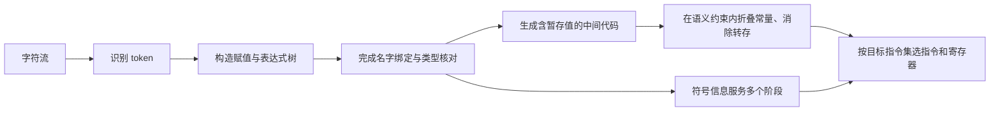
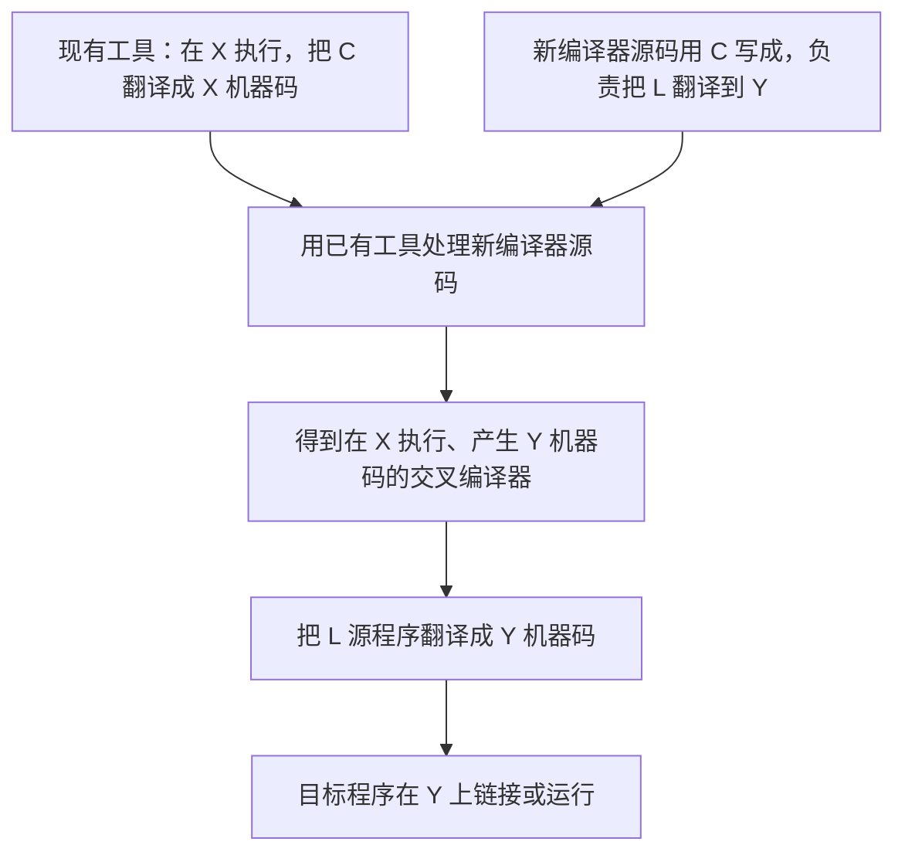

# 《编译原理》第1章 引言（课件）

编译器真正替程序员解决的，不是把一个词替换成另一个词，而是让同一个程序的约定在另一种表示上仍然成立。为什么优化能删掉几行中间代码，却不能随意换一次加法的括号？为什么在一台机器上生成另一台机器的程序，不要求两台机器都先装好同一个原生编译器？原件从语言层次、编译过程讲到编译器的构建。本导读按原件 93 页组织，图和独立算例重新编写。

## 不同语言把什么责任交给程序员（原件第 1–26 页）

原件开头介绍历史课程安排，并把编译原理放在语言定义、数据结构和系统实现之间；这些班级安排并非当前课程通知。学习上，先区分“程序可以怎样写”和“程序运行时做了什么”，再研究编译器怎样实现这些约定。

机器语言直接使用指令集定义的编码，需要知道机器能执行的操作及操作数布局。汇编把这些编码换成助记符、标签等形式，方便阅读和维护，却通常仍面向某个指令集。高级语言则尽量用更接近问题的对象描述计算，把许多机器细节留给实现。==源程序较少依赖目标硬件，不等于任何机器都能直接执行它==；仍需该平台的运行机制，而且内存布局、外部库和低层接口也可能影响可移植性。参见 [程序设计语言发展历程](../../../topics/编译原理/程序设计语言发展历程.md)。

原件举 FORTRAN、ALGOL、LISP、BASIC、Pascal、C 以及后来多范型语言作历史路标。科学计算推动数值表达，形式化语法让人能清楚陈述哪些串是程序，函数式、逻辑式和对象式等范型则改变了“什么是程序的基本组合单位”。这些是解释语言结构的线索，不是按照年代或课件中的一次历史排名为语言判优。

## 同样是翻译，产物与运行时机不同（第 27–36 页）

| 工具 | 直接处理的对象 | 主要产出或观察到的结果 |
|---|---|---|
| 汇编程序 | 助记符、标签、数据与指令 | 机器目标代码；两遍教学模型先确定布局和符号，再编码并填引用 |
| 编译程序 | 高级语言程序及其约定 | 保持语义的目标表示，例如汇编、机器目标文件或字节码；之后可能还要汇编、链接、装载 |
| 解释程序 | 程序或某种内部形式，以及执行所需输入 | 直接驱动本次计算；即使内部已先翻译成字节码，也不意味着解释执行这一环节消失 |

原件用一张图分别说明直接出机器目标码和先出汇编的编译路线；另一张图把运行系统接到目标程序之后。工具角色取决于它做什么，不由语言名字决定。同一语言也可先编译成字节码，在运行时解释一部分、再即时编译热点。参见 [翻译程序与编译系统](../../../topics/编译原理/翻译程序与编译程序.md)、[编译器与计算机系统](../../../topics/编译原理/编译器与计算机系统.md)。

## 跟着一条赋值跨过六道边界（第 37–68 页）

用独立算例 `out = base + (3 * 4)`，约定 `out`、`base` 已声明为整数，参与计算的值可表示且没有易变访问。先看每一阶段掌握的证据：

| 阶段 | 例子走到哪里 | 它还不能决定什么 |
|---|---|---|
| 词法 | 识别名字 `out`、`base`，以及括号、整数、运算符等 token | 仅凭 token 不知道输入是否组成完整赋值、名字引用哪个声明 |
| 语法 | 识别赋值，右部是加法且乘法为其子树 | 树正确也未必类型正确或引用合法 |
| 语义 | 绑定名字，确认加、乘、赋值的类型与效果 | 可以尚不选择物理寄存器和机器指令 |
| 中间代码生成 | 把子表达式命名为临时值，用明确的依赖顺序传递结果 | 有了临时名不等于它必须在目标机器中占一个独立内存槽 |
| 优化 | 折叠常量表达式，检查是否可消除只用于转存的临时量 | 不能以加速为由改变源语言可观察的值、异常或副作用 |
| 目标代码生成 | 根据具体机器选择装载、带立即数的加法、存回，安排寄存器 | 指令能生成不意味着对象文件已经完成链接、装载和执行 |



> [!TIP]
> 做定位题：字符不符合 token 规则是词法问题；`out=(base + )` 的字符都可识别，但右操作数缺失是语法问题；在要求先声明的示例语言中，语法完整却引用未声明的名字是语义问题。原件把 `b+-c*d` 判为语法错，前提是所用教学文法不允许此处的一元负号；不能据此说所有语言都判错。

原件用另一条含两个运算符的赋值，将字符、token、符号表、分组树和四元式逐步对应起来；符号表不只是已出现字符串的清单，后续还可保存声明、作用域、类型及存储位置等信息。源程序中的赋值右部应先计算、再写左部，因此中间代码先求乘积、再加另一项、最后写回；课件最后用一组示意寄存器搬运和浮点算术实现同一结果。参见 [编译过程概述](../../../topics/编译原理/编译过程概述.md) 与 [中间语言](../../../topics/编译原理/中间语言.md)。

### 先证明临时量未被观察，再删它

上面独立算例未优化时的三个动作是：

```text
t0 := 3 * 4
t1 := base + t0
out := t1
```

先在编译时求得常量乘积 `12`。若 `t1` 只是编译器生成的临时量，且除了紧接的赋值外无其他读取，就可以让加法直接写 `out`。检查点是==定义到使用的关系==，而不是“看起来两行能挤成一行”。例如若后面还要额外使用 `t1`，不能删掉定义而让一次使用失去来源；把直线代码推广到分支时，要检查所有可到达该使用的路径，不只查看紧挨着的几行。原件第 64 页优化示意做的正是临时量转存消除，不是删掉最后写入可见变量的动作。

若目标机有立即数加法，可选择如下指令；没有这项指令则可以另装载常量，再使用寄存器加法：

```text
LOAD  R, base
ADDI  R, 12
STORE out, R
```

当 `base=7` 时，未优化中间码的两条算术得到 12、19，优化后显式保留一次加法，目标序列最后仍写入 19。这里“动作少了一条算术”不等于所有平台上都能保证相同的速度增益，寄存器压力、指令延迟、内存访问与其他代码一起决定实际耗时。

> [!CAUTION]
> ==优化首先是等价变换==。在二进制双精度、按通常的最近舍入下，`(1e20 + (-1e20)) + 3.25` 得 3.25；`1e20 + ((-1e20) + 3.25)` 却可得 0，因为内层的小增量被舍掉。整数规则也依具体溢出语义而定。不能直接把纸上可用的结合律默认为目标代码中的结合律。

## 遍与阶段不是同一种切分（第 69–72 页）

阶段按职责区分；趟程按一次扫描或遍历的实现过程区分。一趟可把词法、语法和部分语义检查边读边做，也可以在同一个中间表示上运行多个分析和改写趟。原件的多遍例子先分析、再生成中间表示和分配存储、最后出目标程序。较早定下的表示可能简化程序结构，也可能要为全局信息预留下一遍；多趟有机会细化诊断和改写，但增加编译时间及中间表示开销。前端、中端、后端是通常的职责划分；某些优化与机器无关，某些要用目标机成本模型，不能看到“优化”二字就一律归到同一区。

## 编译器怎样被编译出来（第 73–93 页）

早期可以直接用机器码或汇编实现少量功能，已有适合的系统语言和工具后，通常用高级语言让实现更易读、易修改和可移植。源码能用某语言写，与源码已经能运行，是两件事。原件的 T 形图在左右翼分别记**输入源语言／输出目标代码**，在下方记**编译器本身的表示**。如编译器已经是机器码，下方可用它实际运行的平台表示；如果下方仍是 C 源文件，就还没有可直接执行的该编译器。参见 [编译程序的构建方法](../../../topics/编译原理/编译程序构建方法.md)。



- **自编译**关注实现语言：用语言 L 写 L 的编译器，先要能编译该源码的初始工具。若已有一份可运行的旧 L 编译器，可先由它编出新版；之后再用新版编译自身。能生成结果不等于结果已经正确，仍要验证行为。
- **交叉编译**关注运行平台与产出平台：上图的 X 不必能执行生成的 Y 机器码。编译器由 C 写成也不改变这点。
- **自展**关注怎样得到第一份有用的工具：先用已有工具实现一个足够编写自身的语言核心，再逐步扩大所支持的特性。每轮扩展必须仍能由上一阶段可用的工具编译，而不是先假定完整版可运行。
- **移植**可组合以上办法：在旧平台上建立新平台的目标代码生成能力，再用它编出可在新平台运行的编译器，最后在新平台验证。需要分别验证目标程序与目标平台上的编译器，不要只看文件名。
- **自动生成**让形式规格决定部分组件，例如 [Lex](../../../topics/编译原理/LEX自动生成.md) 把词法规格变成扫描器，[YACC](../../../topics/编译原理/YACC自动生成.md) 把文法及动作变成分析器。两者能减少手工实现，却不会凭空得到完整的语言定义、运行系统或目标机规则。

> [!IMPORTANT]
> 判断 T 形图能否组合，先核对已有工具能否读取新编译器当前的**书写语言**、产出的是哪台机器能运行的**编译器**；然后才问新编译器生成的**用户程序**跑在哪台机器。两次“目标”指的对象不同。
