# 《编译原理》第2章 形式语言基本知识（课件）

原件的每一页，下面附识别出的文字。

### 编译原理 Compiler Principles

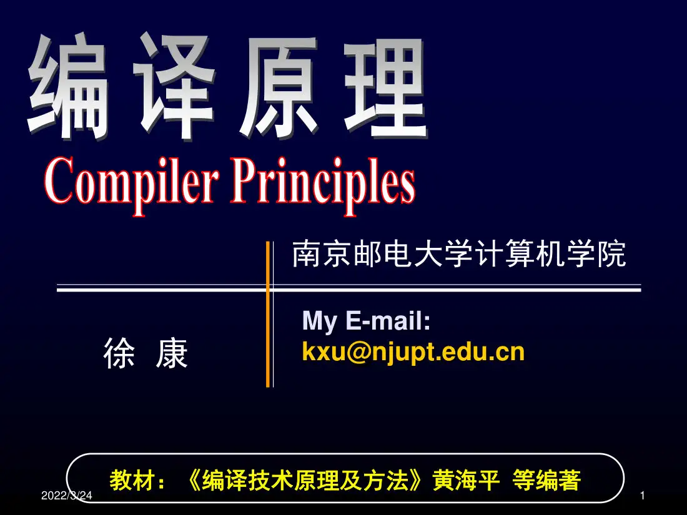

原文：

编译原理 Compiler Principles

南京邮电大学计算机学院

徐 康

My E-mail: kxu@njupt.edu.cn

教材：《编译技术原理及方法》黄海平 等编著

2022/3/24

1

### 第二章 形式语言基本知识

原文：

第二章 形式语言基本知识

§2.1 引言§2.2 语言的描述§2.3 形式语言的基本概念§2.4 语法分析初步§2.5 文法及语言的分类§2.6 文法的其它表示方法

2022/3/24

2

### 第二章 形式语言基本知识

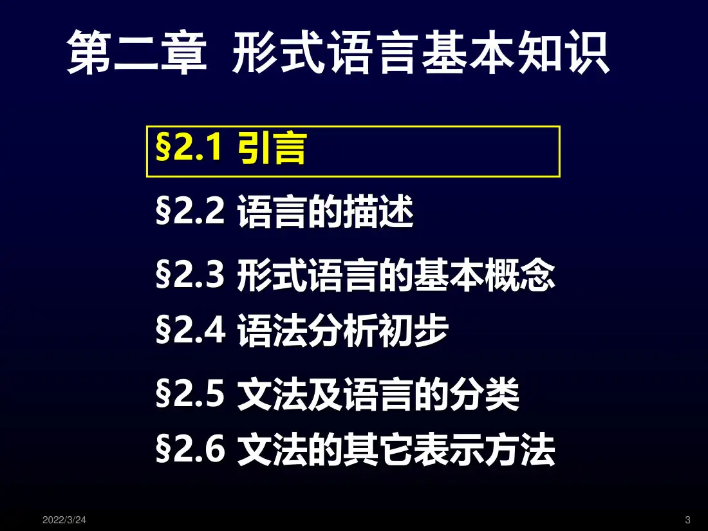

原文：

第二章 形式语言基本知识

§2.1 引言§2.2 语言的描述§2.3 形式语言的基本概念§2.4 语法分析初步§2.5 文法及语言的分类§2.6 文法的其它表示方法

2022/3/24

3

### §2.1 引言

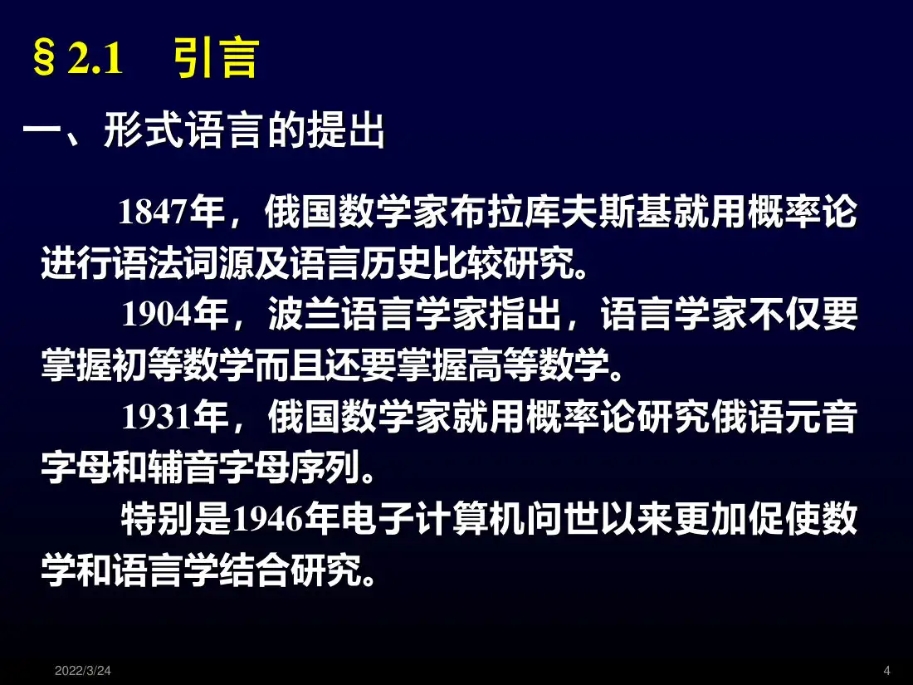

原文：

§2.1 引言

一、形式语言的提出

1847年，俄国数学家布拉库夫斯基就用概率论进行语法词源及语言历史比较研究。

1904年，波兰语言学家指出，语言学家不仅要掌握初等数学而且还要掌握高等数学。

1931年，俄国数学家就用概率论研究俄语元音字母和辅音字母序列。

特别是1946年电子计算机问世以来更加促使数学和语言学结合研究。

2022/3/24

4

### §2.1 引言

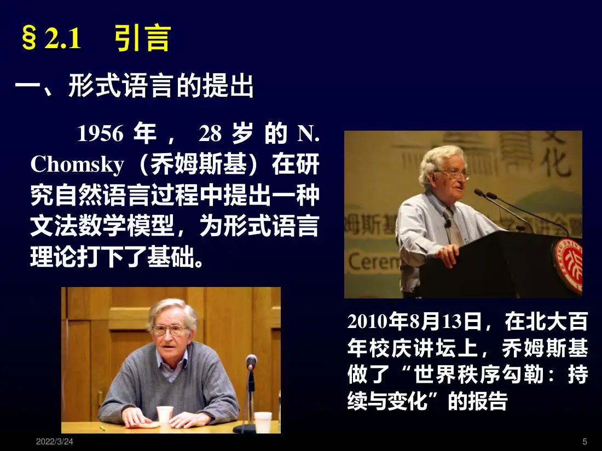

原文：

§2.1 引言

一、形式语言的提出

1956 年 ， 28 岁 的 N.Chomsky（乔姆斯基）在研究自然语言过程中提出一种文法数学模型，为形式语言理论打下了基础。

2010年8月13日，在北大百年校庆讲坛上，乔姆斯基做了“世界秩序勾勒：持续与变化”的报告

2022/3/24

5

### §2.1 引言

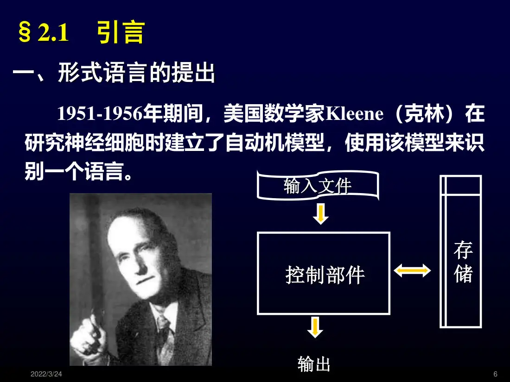

原文：

§2.1 引言

一、形式语言的提出

1951-1956年期间，美国数学家Kleene（克林）在研究神经细胞时建立了自动机模型，使用该模型来识别一个语言。

输入文件

控制部件

存储

输出

2022/3/24

6

### §2.1 引言

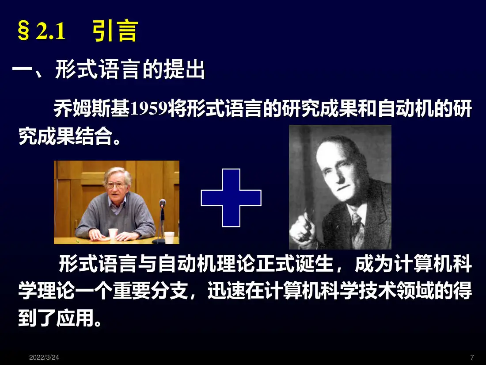

原文：

§2.1 引言

一、形式语言的提出

乔姆斯基1959将形式语言的研究成果和自动机的研究成果结合。

形式语言与自动机理论正式诞生，成为计算机科学理论一个重要分支，迅速在计算机科学技术领域的得到了应用。

2022/3/24

7

### §2.1 引言

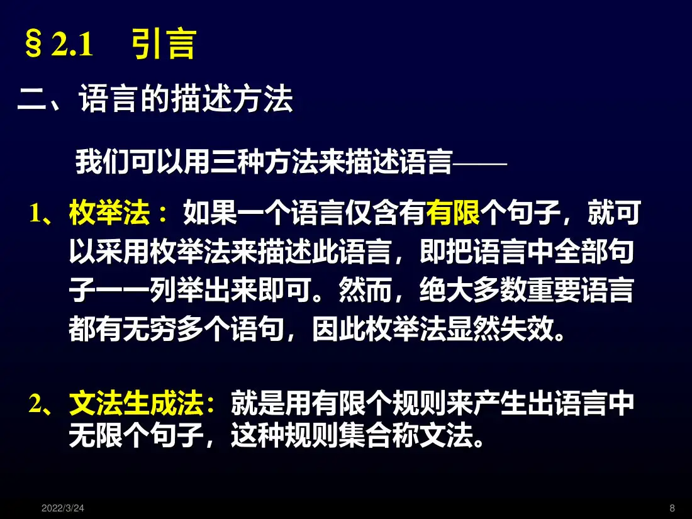

原文：

§2.1 引言

二、语言的描述方法

我们可以用三种方法来描述语言—

1、枚举法：如果一个语言仅含有有限个句子，就可以采用枚举法来描述此语言，即把语言中全部句子一一列举出来即可。然而，绝大多数重要语言都有无穷多个语句，因此枚举法显然失效。

文法生成法：就是用有限个规则来产生出语言中无限个句子，这种规则集合称文法。

2022/3/24

8

### §2.1 引言

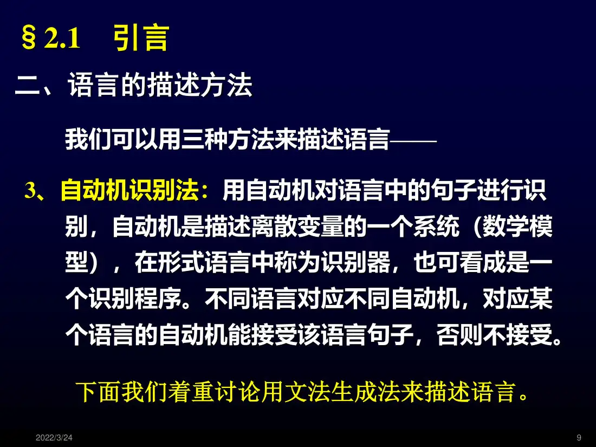

原文：

§2.1 引言

二、语言的描述方法

我们可以用三种方法来描述语言—

3、自动机识别法：用自动机对语言中的句子进行识别，自动机是描述离散变量的一个系统（数学模型），在形式语言中称为识别器，也可看成是一个识别程序。不同语言对应不同自动机，对应某个语言的自动机能接受该语言句子，否则不接受。

下面我们着重讨论用文法生成法来描述语言。

2022/3/24

9

### 第二章 形式语言基本知识

原文：

第二章 形式语言基本知识

§2.1 引言§2.2 语言的描述§2.3 形式语言的基本概念§2.4 语法分析初步§2.5 文法及语言的分类§2.6 文法的其它表示方法

2022/3/24

10

### 第二章 形式语言基本知识

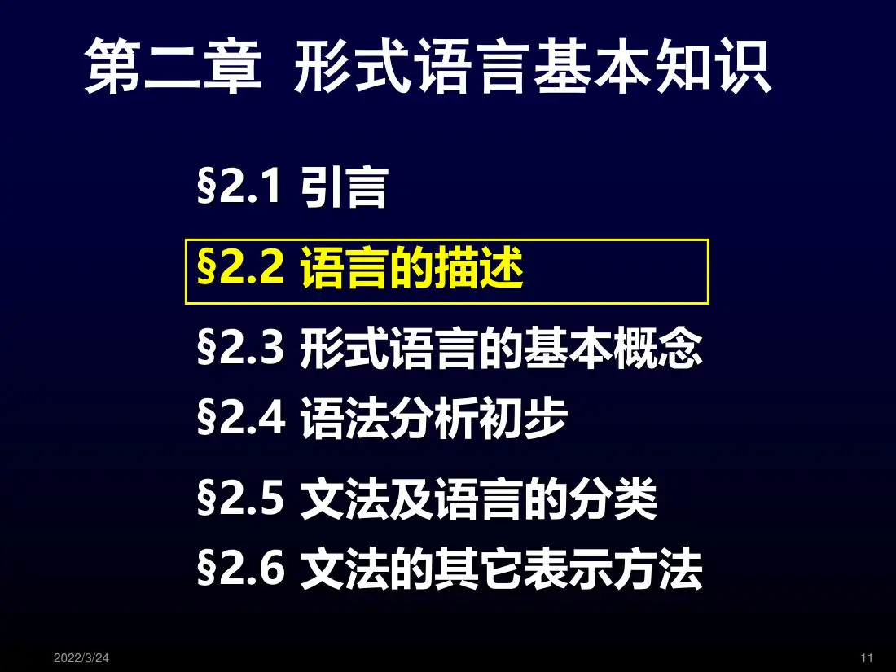

原文：

第二章 形式语言基本知识

§2.1 引言

§2.2 语言的描述

§2.3 形式语言的基本概念§2.4 语法分析初步§2.5 文法及语言的分类§2.6 文法的其它表示方法

2022/3/24

11

### §2.2 语言的描述

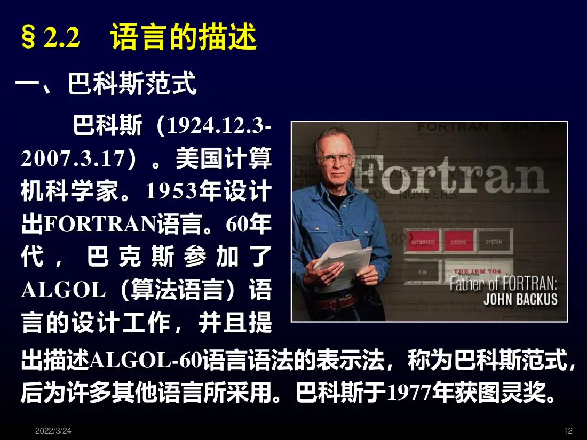

原文：

§2.2 语言的描述

一、巴科斯范式

巴科斯（1924.12.3-2007.3.17）。美国计算机科学家。1953年设计出FORTRAN语言。60年代 ， 巴 克 斯 参 加 了ALGOL（算法语言）语言的设计工作，并且提

出描述ALGOL-60语言语法的表示法，称为巴科斯范式，后为许多其他语言所采用。巴科斯于1977年获图灵奖。

2022/3/24

12

### §2.2 语言的描述

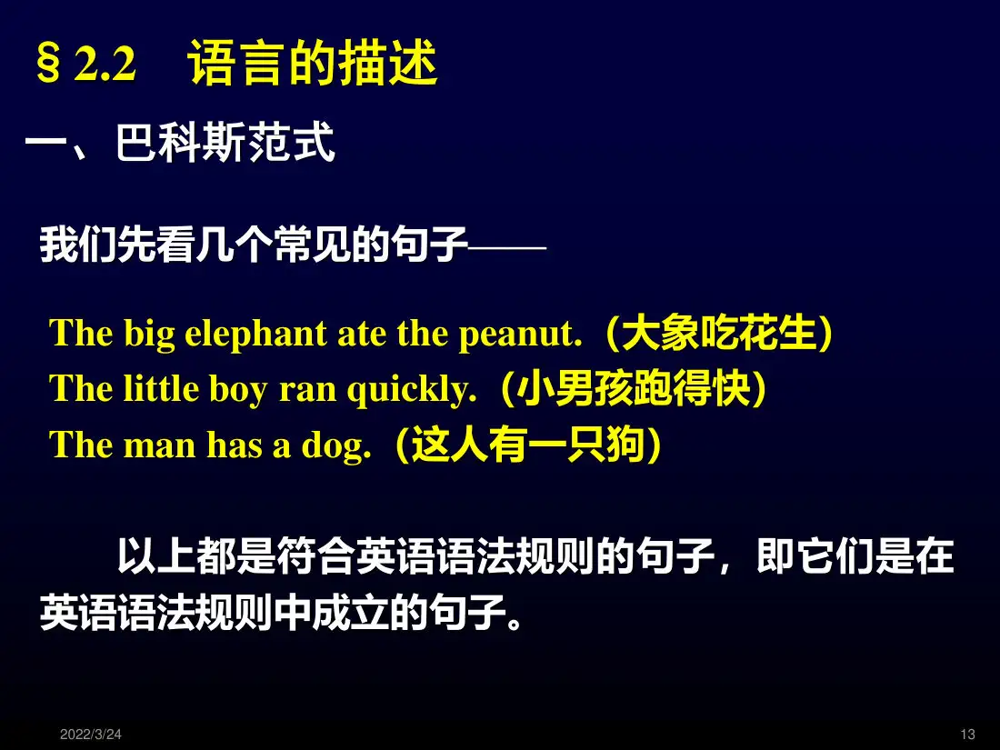

原文：

§2.2 语言的描述

一、巴科斯范式

我们先看几个常见的句子—

The big elephant ate the peanut.（大象吃花生） The little boy ran quickly.（小男孩跑得快） The man has a dog.（这人有一只狗）

以上都是符合英语语法规则的句子，即它们是在英语语法规则中成立的句子。

2022/3/24

13

### §2.2 语言的描述

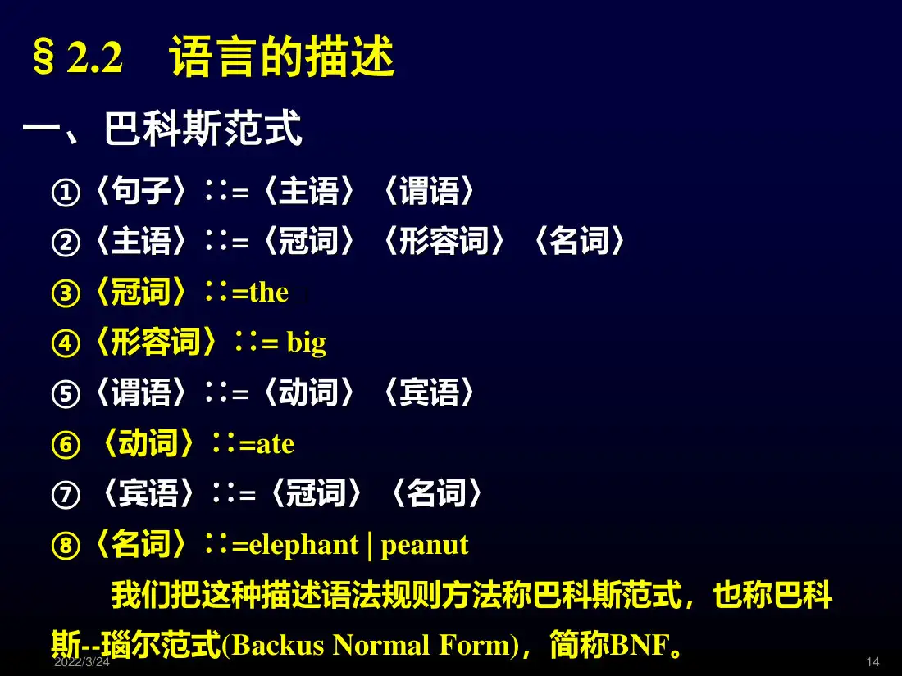

原文：

§2.2 语言的描述

一、巴科斯范式

①〈句子〉∷=〈主语〉〈谓语〉

②〈主语〉∷=〈冠词〉〈形容词〉〈名词〉

③〈冠词〉 $\operatorname { a n g } = \operatorname { i n } ( \operatorname { i n } )$

④ 〈形容词〉 $\angle B A E = \angle D F B$

⑤ 〈谓语〉∷=〈动词〉 〈宾语〉

⑥ 〈动词〉∷=ate

⑦ 〈宾语〉∷=〈冠词〉 〈名词〉

⑧〈名词〉∷=elephant | peanut

我们把这种描述语法规则方法称巴科斯范式，也称巴科

斯--瑙尔范式(Backus Normal Form)，简称BNF。

14

### §2.2 语言的描述

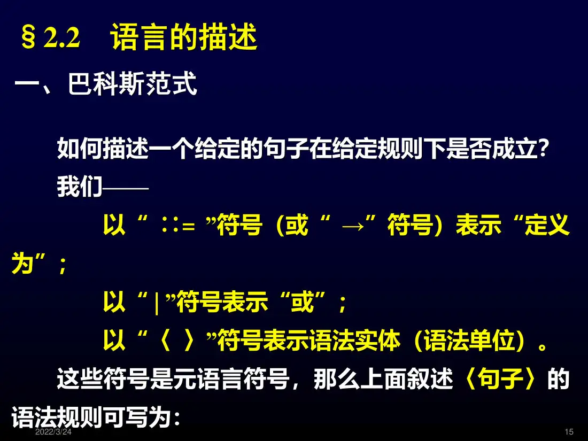

原文：

§2.2 语言的描述

一、巴科斯范式

如何描述一个给定的句子在给定规则下是否成立？我们—

以“ ∷= ”符号（或“ →”符号）表示“定义

为”；

以“ | ”符号表示“或”；

以“〈 〉”符号表示语法实体（语法单位）。

这些符号是元语言符号，那么上面叙述〈句子〉的

语法规则可写为：

2022/3/24

15

### §2.2 语言的描述

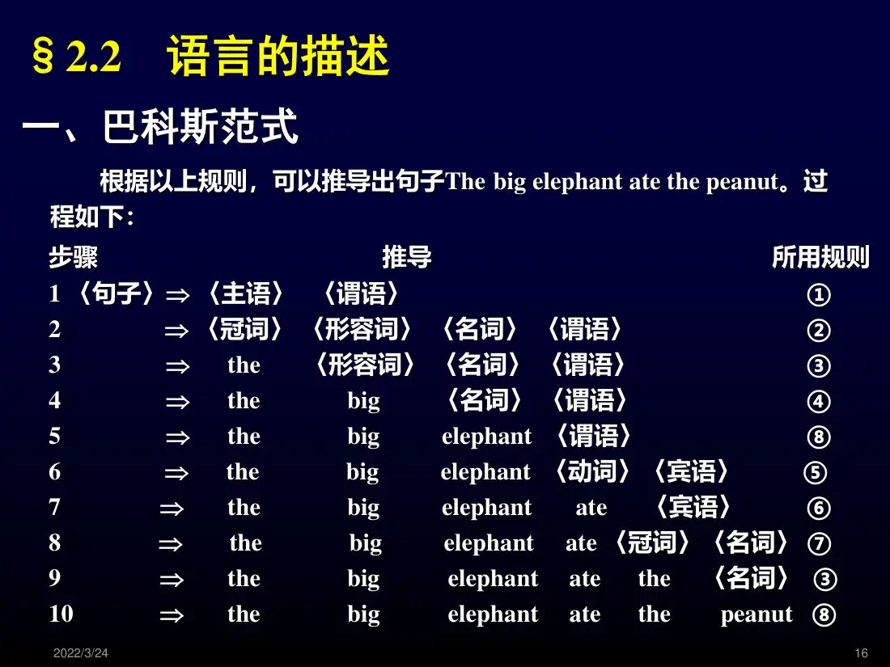

原文：

§2.2 语言的描述

一、巴科斯范式

根据以上规则，可以推导出句子The big elephant ate the peanut。过程如下：

<table><tr><td>步骤</td><td colspan="4">推导</td><td>所用规则</td></tr><tr><td>1〈句子〉⇒〈主语〉</td><td colspan="4">〈谓语〉</td><td>1</td></tr><tr><td>2□⇒〈冠词〉</td><td>〈形容词〉</td><td>〈名词〉</td><td colspan="2">〈谓语〉</td><td>2</td></tr><tr><td>3□⇒the</td><td>〈形容词〉</td><td>〈名词〉</td><td colspan="2">〈谓语〉</td><td>3</td></tr><tr><td>4□⇒the</td><td>big</td><td>〈名词〉</td><td colspan="2">〈谓语〉</td><td>4</td></tr><tr><td>5□⇒the</td><td>big</td><td>elephant</td><td colspan="2">〈谓语〉</td><td>8</td></tr><tr><td>6□⇒the</td><td>big</td><td>elephant</td><td>〈动词〉</td><td>〈宾语〉</td><td>5</td></tr><tr><td>7□⇒the</td><td>big</td><td>elephant</td><td>ate</td><td>〈宾语〉</td><td>6</td></tr><tr><td>8□⇒the</td><td>big</td><td>elephant</td><td>ate</td><td>〈冠词〉〈名词〉</td><td>7</td></tr><tr><td>9⇒the</td><td>big</td><td>elephant</td><td>ate</td><td>the〈名词〉</td><td>3</td></tr><tr><td>10⇒the</td><td>big</td><td>elephant</td><td>ate</td><td>thepeanut</td><td>8</td></tr></table>

2022/3/24

16

### §2.2 语言的描述

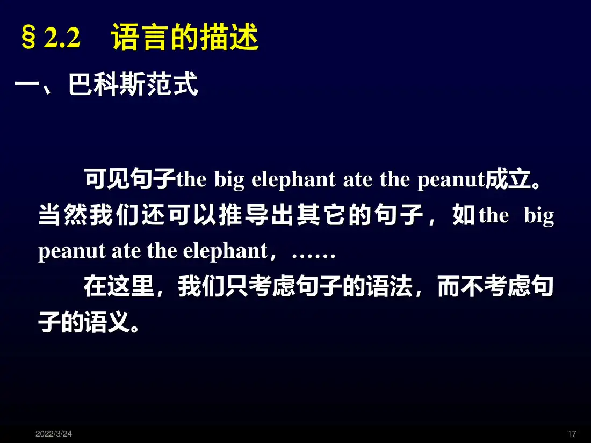

原文：

§2.2 语言的描述

一、巴科斯范式

可见句子the big elephant ate the peanut成立。当然我们还可以推导出其它的句子，如the bigpeanut ate the elephant，

在这里，我们只考虑句子的语法，而不考虑句子的语义。

2022/3/24

17

### §2.2 语言的描述

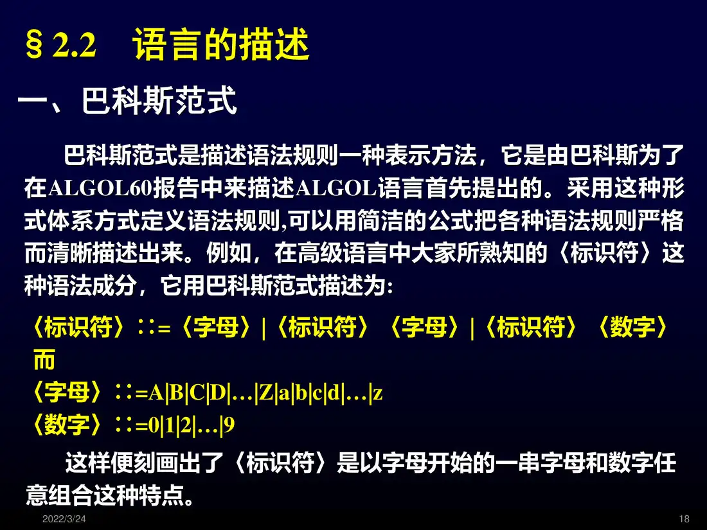

原文：

§2.2 语言的描述

一、巴科斯范式

巴科斯范式是描述语法规则一种表示方法，它是由巴科斯为了在ALGOL60报告中来描述ALGOL语言首先提出的。采用这种形式体系方式定义语法规则,可以用简洁的公式把各种语法规则严格而清晰描述出来。例如，在高级语言中大家所熟知的〈标识符〉这种语法成分，它用巴科斯范式描述为:

〈标识符〉∷=〈字母〉|〈标识符〉〈字母〉|〈标识符〉 〈数字而

〈字母〉∷=A|B|C|D|…|Z|a|b|c|d|…|z〈数字〉∷=0|1|2|…|9

这样便刻画出了〈标识符〉是以字母开始的一串字母和数字任意组合这种特点。

2022/3/24

18

### §2.2 语言的描述

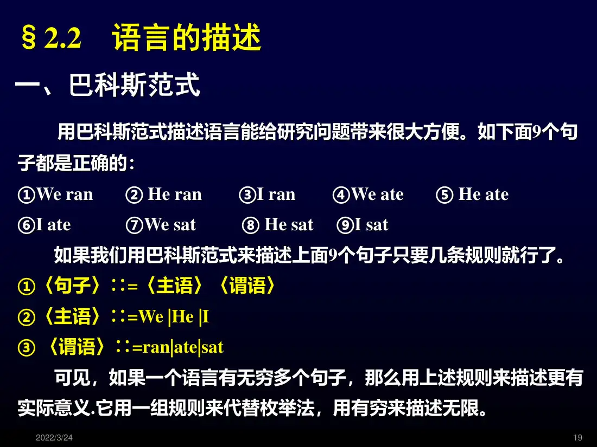

原文：

§2.2 语言的描述

一、巴科斯范式

用巴科斯范式描述语言能给研究问题带来很大方便。如下面9个句子都是正确的：

①We ran

② He ran

③I ran

④We ate

⑤ He ate

⑥I ate

⑦We sat

⑧ He sat ⑨I sat

如果我们用巴科斯范式来描述上面9个句子只要几条规则就行了。

①〈句子〉∷=〈主语〉 〈谓语〉

②〈主语〉∷=We |He |I

③ 〈谓语〉∷=ran|ate|sat

可见，如果一个语言有无穷多个句子，那么用上述规则来描述更有实际意义.它用一组规则来代替枚举法，用有穷来描述无限。

2022/3/24

19

### §2.2 语言的描述

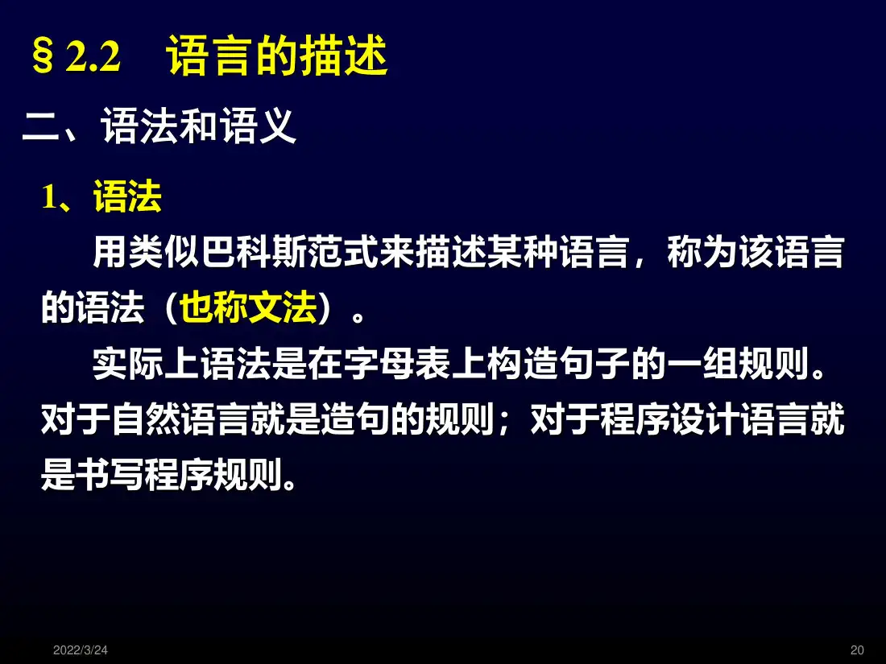

原文：

§2.2 语言的描述

二、语法和语义

1、语法

用类似巴科斯范式来描述某种语言，称为该语言的语法（也称文法）。

实际上语法是在字母表上构造句子的一组规则。对于自然语言就是造句的规则；对于程序设计语言就是书写程序规则。

2022/3/24

20

### §2.2 语言的描述

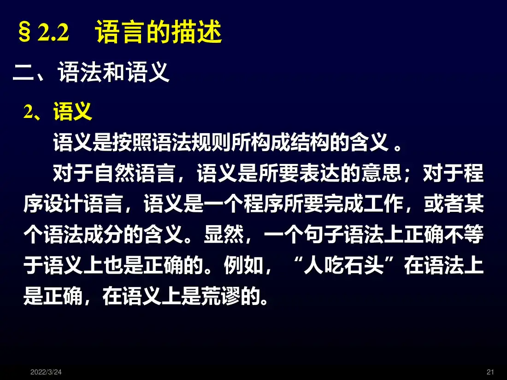

原文：

§2.2 语言的描述

二、语法和语义

2、语义

语义是按照语法规则所构成结构的含义 。

对于自然语言，语义是所要表达的意思；对于程序设计语言，语义是一个程序所要完成工作，或者某个语法成分的含义。显然，一个句子语法上正确不等于语义上也是正确的。例如，“人吃石头”在语法上是正确，在语义上是荒谬的。

2022/3/24

21

### §2.2 语言的描述

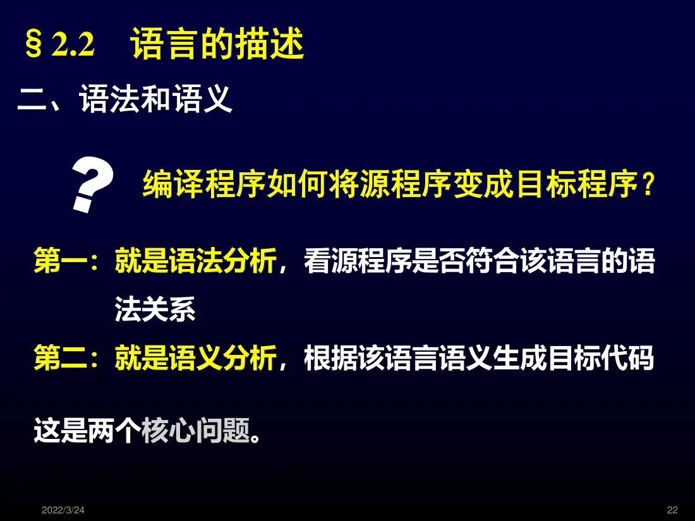

原文：

§2.2 语言的描述

二、语法和语义

编译程序如何将源程序变成目标程序？

第一：就是语法分析，看源程序是否符合该语言的语法关系

第二：就是语义分析，根据该语言语义生成目标代码这是两个核心问题。

2022/3/24

22

### §2.2 语言的描述

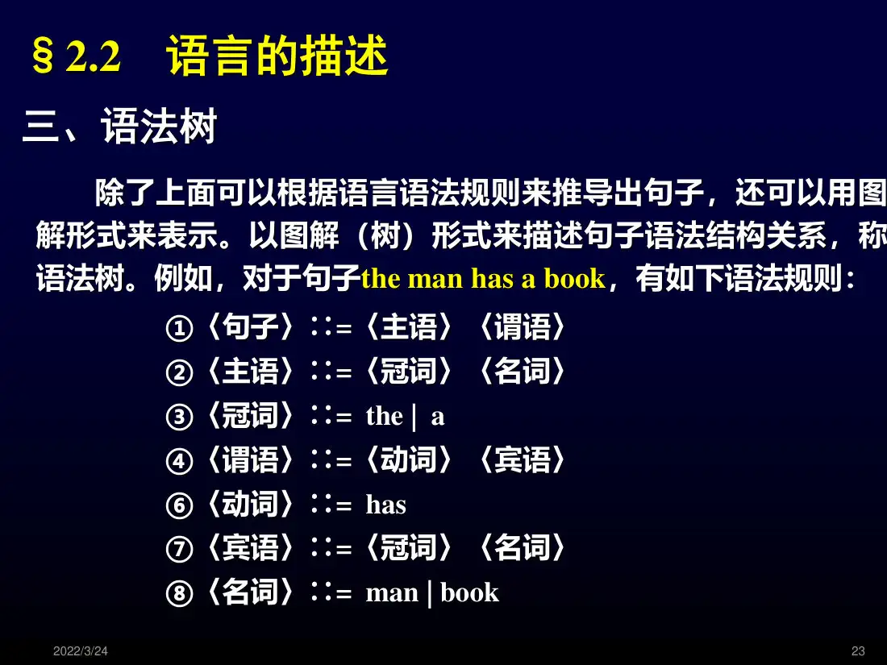

原文：

§2.2 语言的描述

三、语法树

除了上面可以根据语言语法规则来推导出句子，还可以用图解形式来表示。以图解（树）形式来描述句子语法结构关系，称语法树。例如，对于句子the man has a book，有如下语法规则：

①〈句子〉∷=〈主语〉〈谓语〉

②〈主语〉∷=〈冠词〉〈名词〉

③〈冠词〉∷= the | a

④ 〈谓语〉∷=〈动词〉〈宾语〉

⑥〈动词〉∷= has

⑦〈宾语〉∷=〈冠词〉〈名词〉

⑧〈名词〉∷= man | book

2022/3/24

23

### §2.2 语言的描述

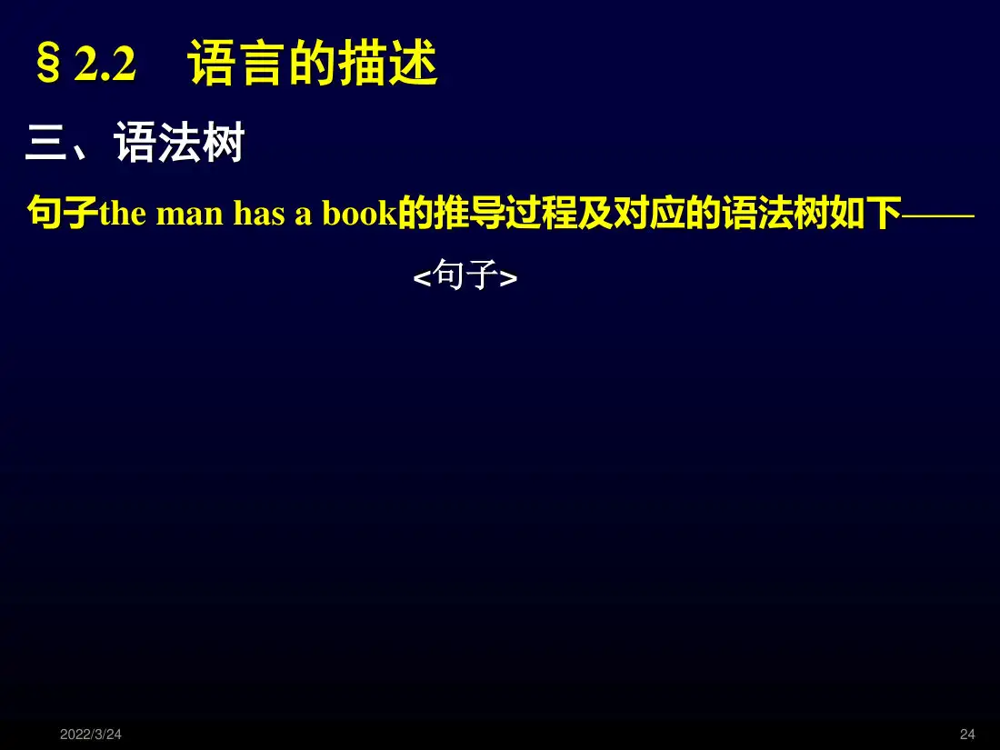

原文：

§2.2 语言的描述

三、语法树

句子the man has a book的推导过程及对应的语法树如下—

<句子>

2022/3/24

24

### §2.2 语言的描述

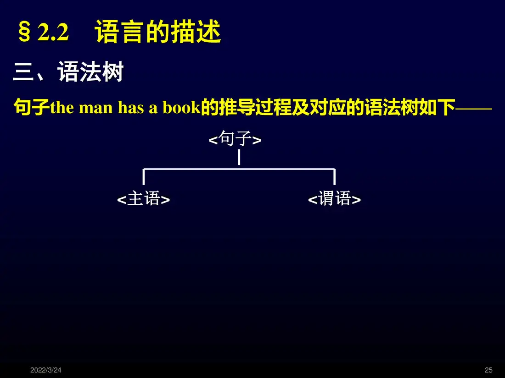

原文：

§2.2 语言的描述

三、语法树

句子the man has a book的推导过程及对应的语法树如下——

<句子>

<主语>

<谓语>

2022/3/24

25

### §2.2 语言的描述

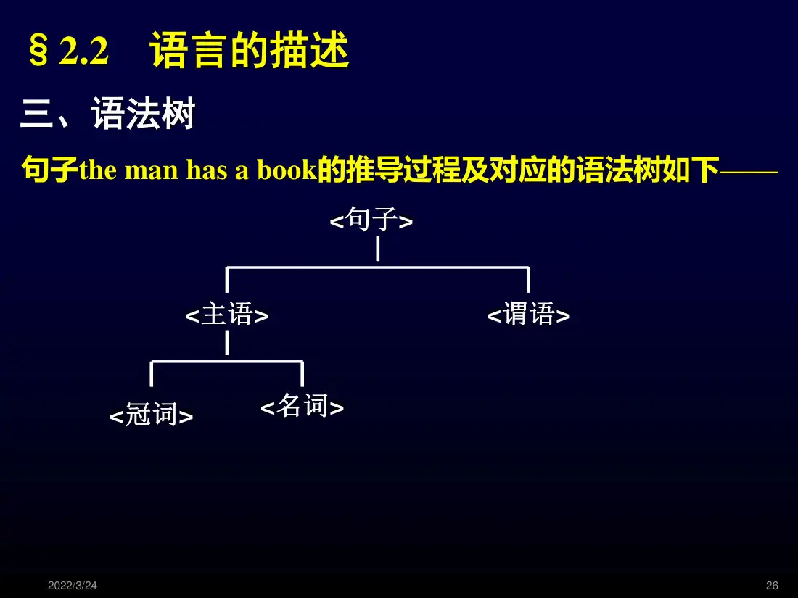

原文：

§2.2 语言的描述

三、语法树

句子the man has a book的推导过程及对应的语法树如下——

<句子>

<主语>

<冠词>

<名词>

2022/3/24

26

### §2.2 语言的描述

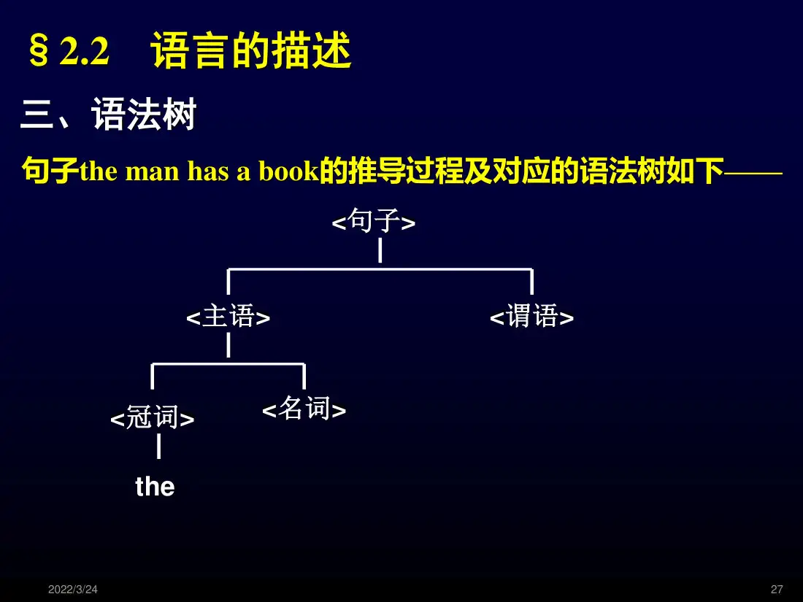

原文：

§2.2 语言的描述

三、语法树

句子the man has a book的推导过程及对应的语法树如下——

2022/3/24

27

### §2.2 语言的描述

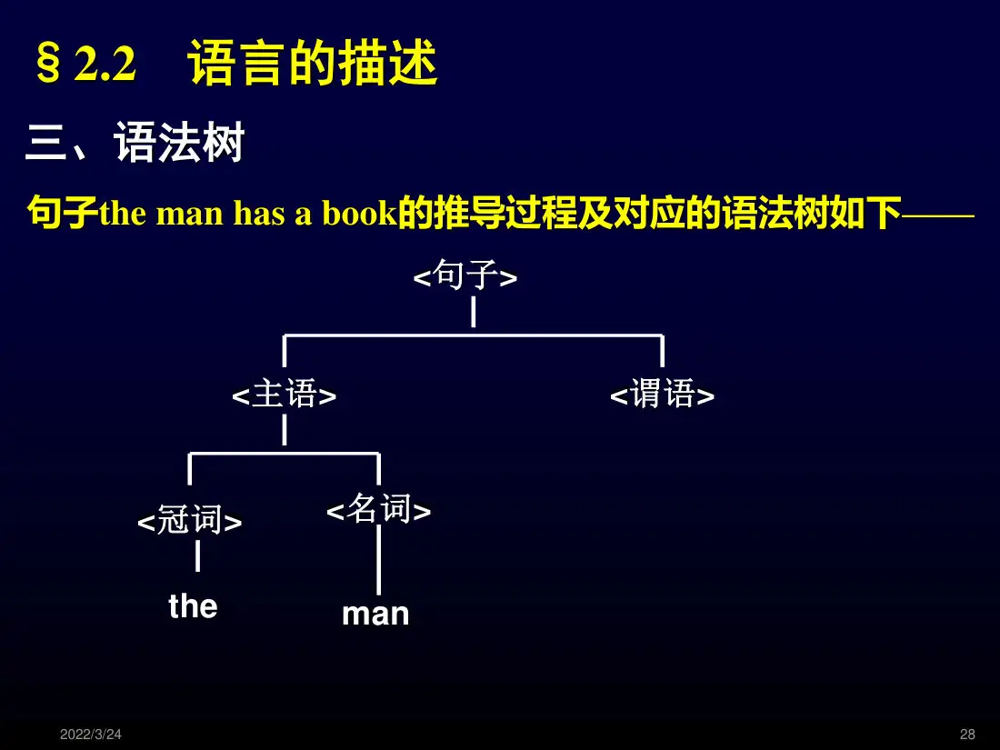

原文：

§2.2 语言的描述

三、语法树

句子the man has a book的推导过程及对应的语法树如下——

2022/3/24

28

### §2.2 语言的描述

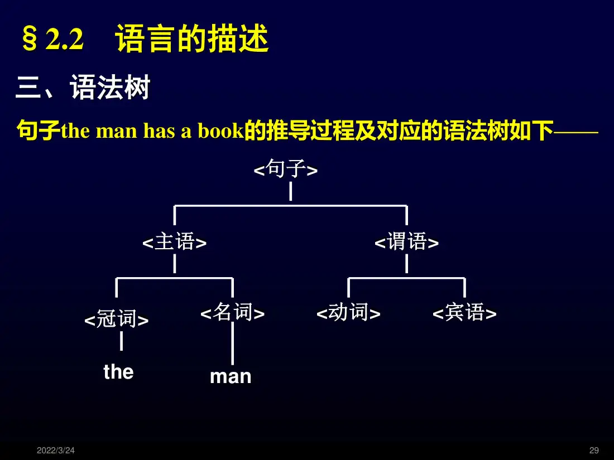

原文：

§2.2 语言的描述

三、语法树

句子the man has a book的推导过程及对应的语法树如下——

2022/3/24

29

### §2.2 语言的描述

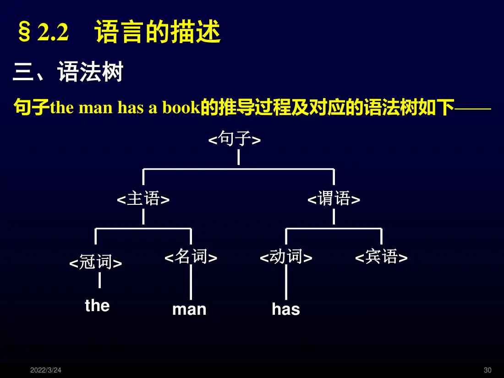

原文：

§2.2 语言的描述

三、语法树

句子the man has a book的推导过程及对应的语法树如下——

2022/3/24

30

### §2.2 语言的描述

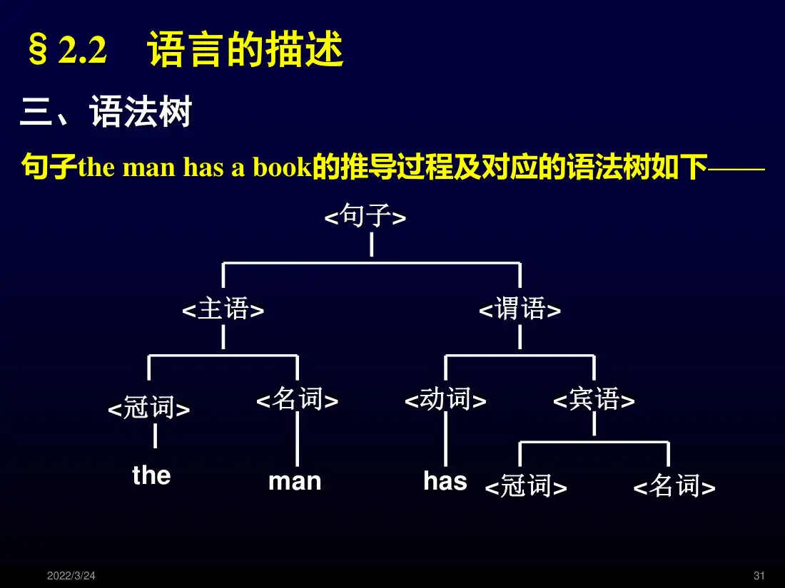

原文：

§2.2 语言的描述

三、语法树

句子the man has a book的推导过程及对应的语法树如下——

2022/3/24

31

### §2.2 语言的描述

原文：

§2.2 语言的描述

三、语法树

句子the man has a book的推导过程及对应的语法树如下——

2022/3/24

32

### §2.2 语言的描述

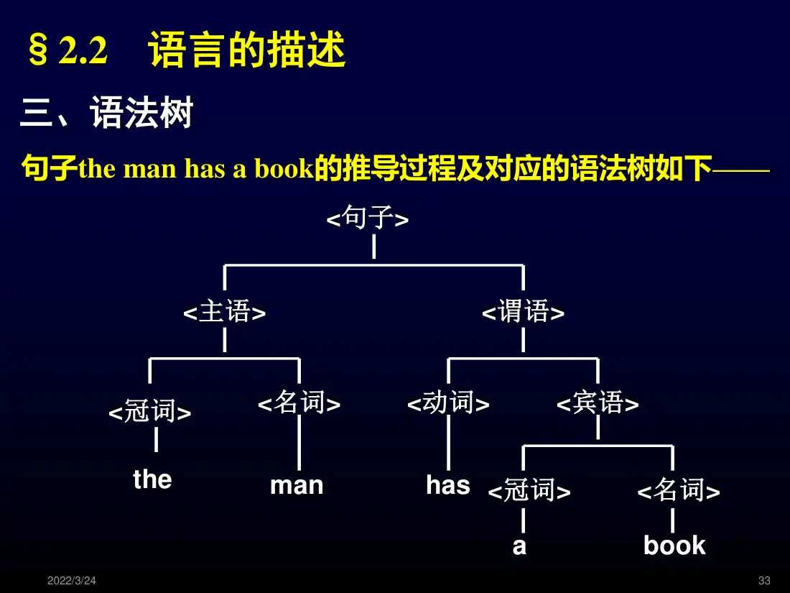

原文：

§2.2 语言的描述

三、语法树

句子the man has a book的推导过程及对应的语法树如下——

2022/3/24

33

### 第二章 形式语言基本知识

原文：

第二章 形式语言基本知识

§2.1 引言§2.2 语言的描述§2.3 形式语言的基本概念§2.4 语法分析初步§2.5 文法及语言的分类§2.6 文法的其它表示方法

2022/3/24

34

### 第二章 形式语言基本知识

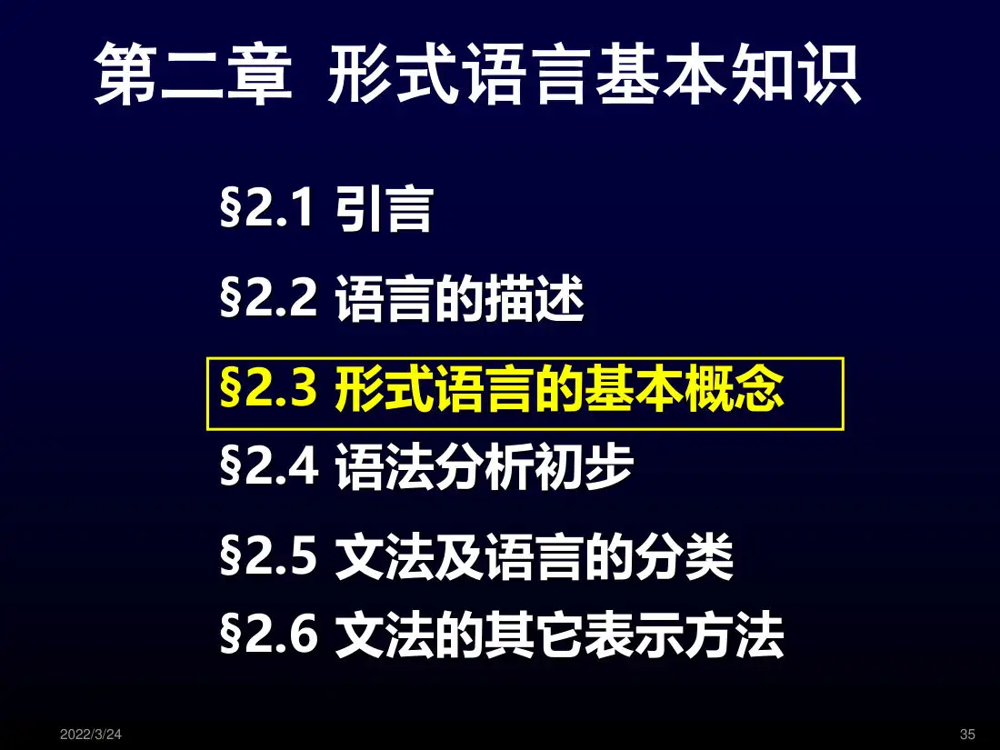

原文：

第二章 形式语言基本知识

§2.1 引言

§2.2 语言的描述

§2.3 形式语言的基本概念

§2.4 语法分析初步

§2.5 文法及语言的分类

§2.6 文法的其它表示方法

2022/3/24

35

### §2.3 形式语言的基本概念

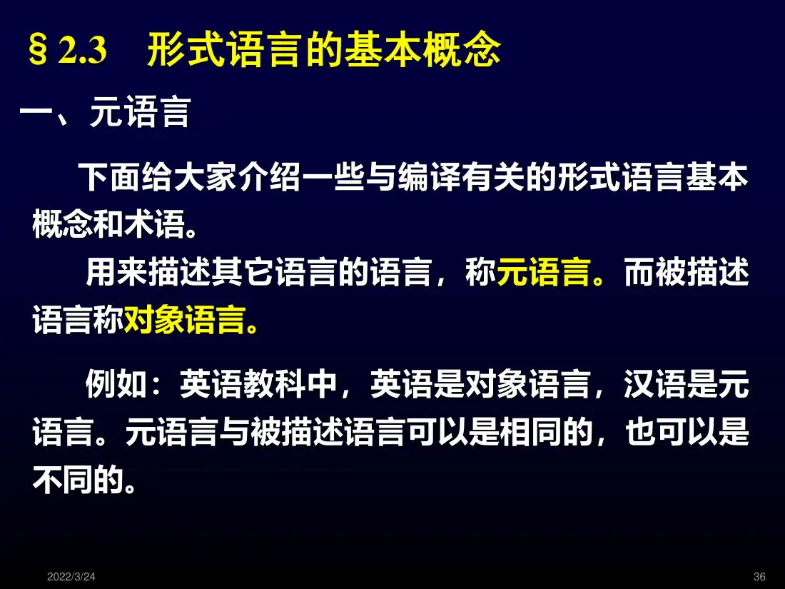

原文：

§2.3 形式语言的基本概念

一、元语言

下面给大家介绍一些与编译有关的形式语言基本概念和术语。

用来描述其它语言的语言，称元语言。而被描述语言称对象语言。

例如：英语教科中，英语是对象语言，汉语是元语言。元语言与被描述语言可以是相同的，也可以是不同的。

2022/3/24

36

### §2.3 形式语言的基本概念

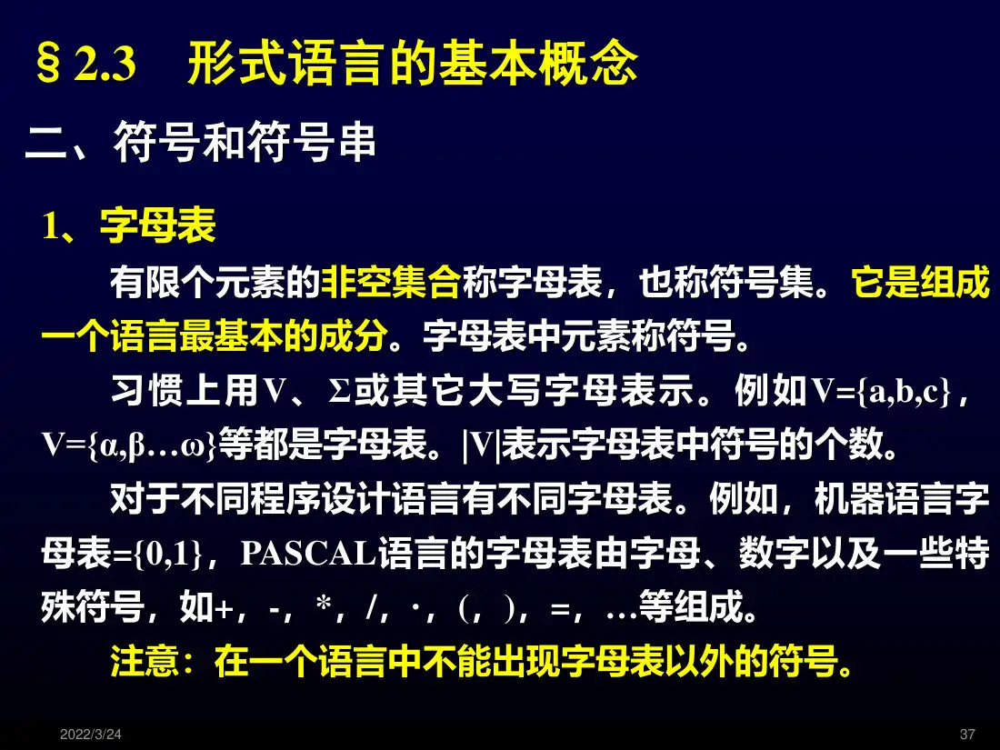

原文：

§2.3 形式语言的基本概念

二、符号和符号串

1、字母表

有限个元素的非空集合称字母表，也称符号集。它是组成一个语言最基本的成分。字母表中元素称符号。

习惯上用V、Σ或其它大写字母表示。例如 $V _ { 1 } = \sqrt { 1 0 } \times 9$ $V _ { 1 } = \lbrace 0 . 5 \rbrace 1 3 \cos \textcircled { 2 } \times$ 等都是字母表。|V|表示字母表中符号的个数。

对于不同程序设计语言有不同字母表。例如，机器语言字母表={0,1}，PASCAL语言的字母表由字母、数字以及一些特殊符号，如+，-，\*，/，·，(，)，=，…等组成。

注意：在一个语言中不能出现字母表以外的符号。

2022/3/24

37

### §2.3 形式语言的基本概念

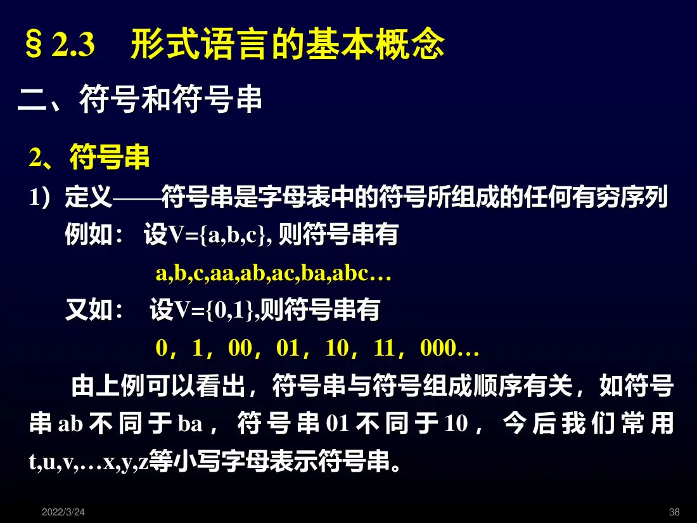

原文：

§2.3 形式语言的基本概念

二、符号和符号串

2、符号串

1）定义——符号串是字母表中的符号所组成的任何有穷序列例如： 设 $V _ { 1 } = \lbrace \mathbf { 0 } \rbrace  { \bf 0 } \rbrace$ 则符号串有$( 1 ) ( 1 0 0 0 0 0 0 0 0 0 0 0 0 0 0 0 0 0 0 0 0 0 0 0 0 0 0 0 0 0 0 0 0 0 0 0 0 0 0 0 0 0 0 0 0 0 0 0 0 0 0 0 0 0 0 0 0 0 0 0 0 0 0 0 0 0 0 0 0 0 0 0 0 0 0 0 0 0 0 0 0 0 0 0 0 0 0 0 0 0 0 0 0 0 0 0 0 0 0 0 0 0 0 0 0 0 0 0 0 0 0 0 0 0 0 0 0 0 0 0 0 0 0 0 0 0 0 0 0 0 0 0 0 0 0 0 0 0 0 0 0 0 0 0 0 0 0 0 0 0 0 0 0 0 0 0 0 0 0 0 0 0 0 0 0 0 0 0 0 0 0 0 0 0 0 0 0 0 0 0 0 0 0 0 0 0 0 0 0 0 0 0 0 0 0 0 0 0 0 0 0 0 0 0 0 0 0 0 0 0 0 0 0 0 0 0 0 0 0 0 0 0 0 0 0 0 0 0 0 0 0 0 0 0 0 0 0 0 0 0 0 0 0 0 0 0 0 0 0 0 0 0 0 0 0 0 0 0 0 0 0 0 0 0 0 0 0 0 0 0 0 0 0 0 0 0 0 0 0 0 0 0 0 0 0 0 0 0 0 0 0 0 0 0 0 0 0 0 0 0 0 0 0 0 0 0 0 0 0 0 0 0 0 0 0 0 0 0 0 0 0 0 0 0 0 0 0 0 0 0 0 0 0 0 0 0$

又如： 设 $\forall \equiv \operatorname { f } ( 0 , \operatorname { f } )$ 则符号串有0，1，00，01，10，11，000…

由上例可以看出，符号串与符号组成顺序有关，如符号串ab不同于ba，符号串01不同于10，今后我们常用t,u,v,…x,y,z等小写字母表示符号串。

2022/3/24

38

### §2.3 形式语言的基本概念

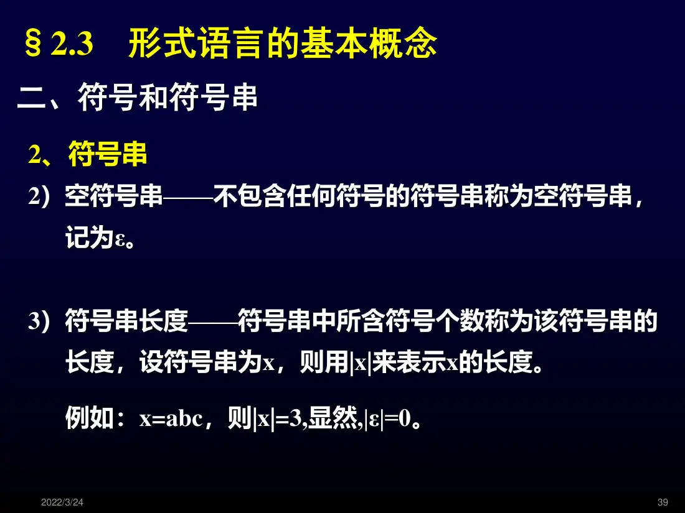

原文：

§2.3 形式语言的基本概念

二、符号和符号串

2、符号串

2）空符号串— 不包含任何符号的符号串称为空符号串，记为ε。

3）符号串长度—— 符号串中所含符号个数称为该符号串的长度，设符号串为x，则用|x|来表示x的长度。

例如： $V _ { 4 } = \frac { \sqrt { 3 } } { 2 } \sqrt { 3 }$ ，则 $| \overrightarrow { \mathbf { B } } | = \overrightarrow { \mathbf { B } } )$ ,显然, $\sf { F e l } \sf { E m }$ 。

2022/3/24

39

### §2.3 形式语言的基本概念

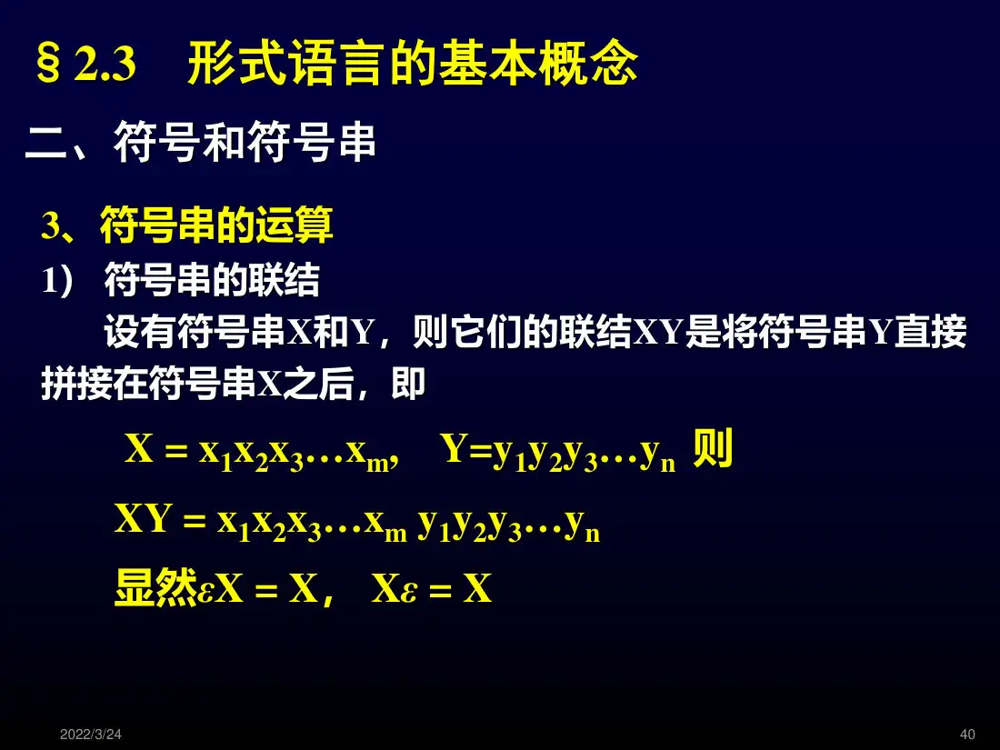

原文：

§2.3 形式语言的基本概念

二、符号和符号串

3、符号串的运算

1） 符号串的联结设有符号串X和Y，则它们的联结XY是将符号串Y直接拼接在符号串X之后，即

$$
\mathbf {X} = \mathbf {x} _ {1} \mathbf {x} _ {2} \mathbf {x} _ {3} \dots \mathbf {x} _ {\mathrm{m}}, \quad \mathbf {Y} = \mathbf {y} _ {1} \mathbf {y} _ {2} \mathbf {y} _ {3} \dots \mathbf {y} _ {\mathrm{n}}
$$

$$
\mathbf {X Y} = \mathbf {x} _ {1} \mathbf {x} _ {2} \mathbf {x} _ {3} \dots \mathbf {x} _ {\mathrm{m}} \mathbf {y} _ {1} \mathbf {y} _ {2} \mathbf {y} _ {3} \dots \mathbf {y} _ {\mathrm{n}}
$$

显然εX = X， Xε = X

2022/3/24

40

### §2.3 形式语言的基本概念

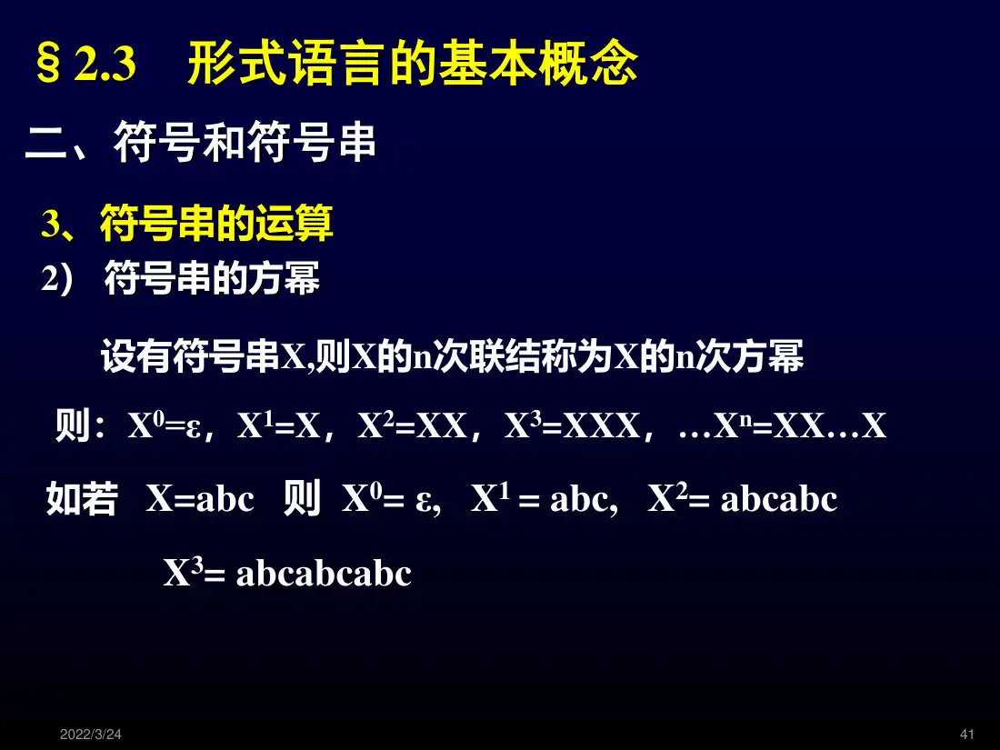

原文：

§2.3 形式语言的基本概念

二、符号和符号串

3、符号串的运算

2） 符号串的方幂

设有符号串X,则X的n次联结称为X的n次方幂

则： $\therefore \angle B = \angle 3$ ，X1=X，X2=XX，X3=XXX，… $V _ { 4 } = 0 . 5 m / s$

如若 X=abc 则 $\because \angle C = \angle C$ $0 . 0 6 \times 0 . 0 1 0$ $0 . 0 2 \times 0 . 1 1 0 0 1 0$

X3= abcabcabc

2022/3/24

41

### §2.3 形式语言的基本概念

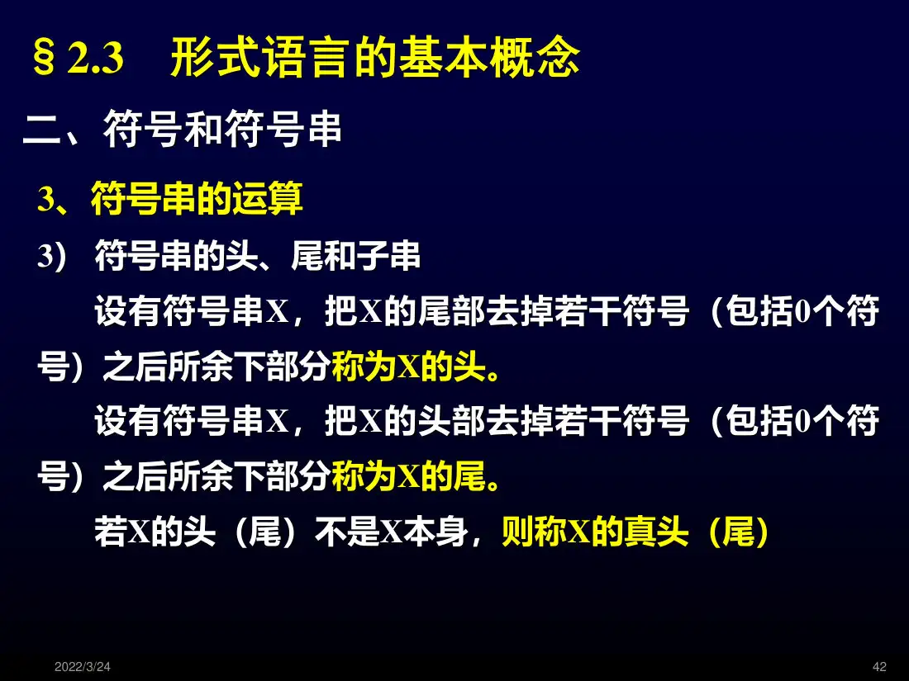

原文：

§2.3 形式语言的基本概念

二、符号和符号串

3、符号串的运算

3） 符号串的头、尾和子串设有符号串X，把X的尾部去掉若干符号（包括0个符

号）之后所余下部分称为X的头。设有符号串X，把X的头部去掉若干符号（包括0个符

号）之后所余下部分称为X的尾。

若X的头（尾）不是X本身，则称X的真头（尾）

2022/3/24

42

### §2.3 形式语言的基本概念

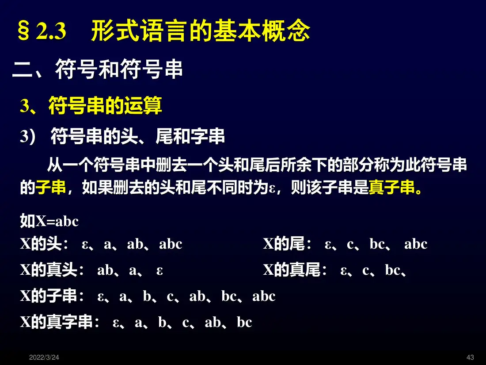

原文：

§2.3 形式语言的基本概念

二、符号和符号串

3、符号串的运算

3） 符号串的头、尾和字串

从一个符号串中删去一个头和尾后所余下的部分称为此符号串的子串，如果删去的头和尾不同时为ε，则该子串是真子串。

如X=abc

X的头： ε、a、ab、abc

X的尾： ε、c、bc、 abc

X的真头： ab、a、 ε

X的真尾： ε、c、bc、

X的子串： ε、a、b、c、ab、bc、abc

X的真字串： ε、a、b、c、ab、bc

2022/3/24

43

### §2.3 形式语言的基本概念

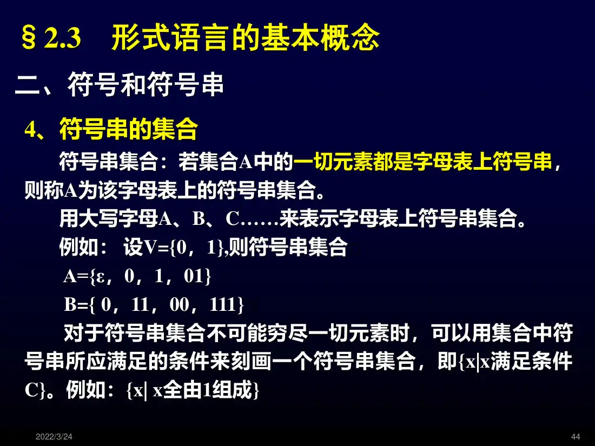

原文：

§2.3 形式语言的基本概念

二、符号和符号串

4、符号串的集合

符号串集合：若集合A中的一切元素都是字母表上符号串，则称A为该字母表上的符号串集合。

对于符号串集合不可能穷尽一切元素时，可以用集合中符号串所应满足的条件来刻画一个符号串集合，即{x|x满足条件C}。例如：{x| x全由1组成}

2022/3/24

44

### §2.3 形式语言的基本概念

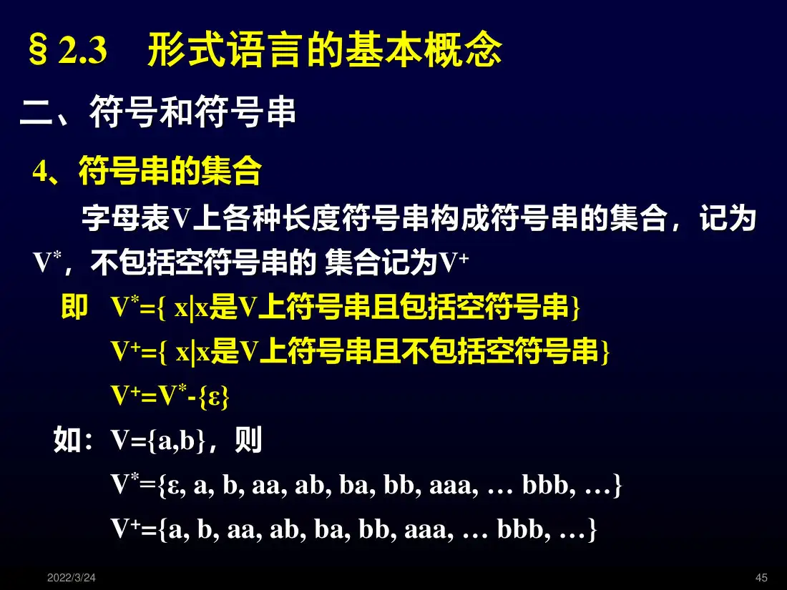

原文：

§2.3 形式语言的基本概念

二、符号和符号串

4、符号串的集合字母表V上各种长度符号串构成符号串的集合，记为V\*，不包括空符号串的 集合记为V+即 V\*={ x|x是V上符号串且包括空符号串}V+={ x|x是V上符号串且不包括空符号串}V+=V\*-{ε}

如：V={a,b}，则$\mathtt { V _ { 2 } } = \mathtt { S _ { 2 } } \mathtt { e _ { 2 } } \mathtt { e _ { 2 } } \mathtt { e _ { 2 } } \mathtt { e _ { 2 } } \mathtt { e _ { 2 } } \mathtt { e _ { 2 } } \mathtt { e _ { 2 } } \mathtt { e _ { 2 } } \mathtt { e _ { 2 } } \mathtt { e _ { 2 } } \mathtt { e _ { 2 } } \mathtt { e _ { 2 } } \mathtt { e _ { 2 } } \mathtt { e _ { 2 } } \mathtt { e _ { 2 } } \mathtt { e _ { 2 } } \mathtt { e _ { 2 } } \mathtt { e _ { 2 } } \mathtt { e _ { 2 } } \mathtt { e _ { 2 } } \mathtt { e _ { 2 } } \mathtt { e _ { 2 } } \mathtt { e _ { 2 } } \mathtt { e _ { 2 } } \mathtt { e _ { 2 } } \mathtt { e _ { 2 } } \mathtt { e _ { 2 } } \mathtt { e _ { 2 } } \mathtt { e _ { 2 } } \mathtt { e _ { 2 } } \mathtt { e _ { 2 } } \mathtt { e _ { 2 } } \mathtt { e _ { 2 } } \mathtt { e _ { 2 } } \mathtt { e _ { 2 } } \mathtt { e _ { 2 } } \mathtt { e _ { 2 } } \mathtt { e _ { 2 } } \mathtt { e _ { 2 } } \mathtt { e _ { 2 } } \mathtt { e _ { 2 } } \mathtt { e _ { 2 } } \mathtt { e _ { 2 } } \mathtt { e _ { 2 } } \mathtt { e _ { 2 } } \mathtt { e _ { 2 } } \mathtt { e _ { 2 } } \mathtt { e _ { 2 } } \mathtt { e _ { 2 } } \mathtt { e _ { 2 } } \mathtt { e _ { 2 } } \mathtt { e _ { 2 } } \mathtt { e _ { 2 } } \mathtt { e _ { 2 } } \mathtt { e _ { 2 } } \mathtt { e _ { 2 } } \mathtt { e _ { 2 } } \mathtt { e _ { 2 } } \mathtt { e _ { 2 } } \mathtt { e _ { 2 } } \mathtt { e _ { 2 } } \mathtt { e _ { 2 } } \mathtt { e _ { 2 } } \mathtt { e _ { 2 } } \mathtt { e _ { 2 } } \mathtt { e _ { 2 } } \mathtt { e _ { 2 } } \mathtt { e _ { 2 } } \mathtt { e _ { 2 } } \mathtt  e _ { 2 }$ V+={a, b, aa, ab, ba, bb, aaa, … bbb, …}§2.3 形式语言的基本概念

2022/3/24

45

### 二、符号和符号串

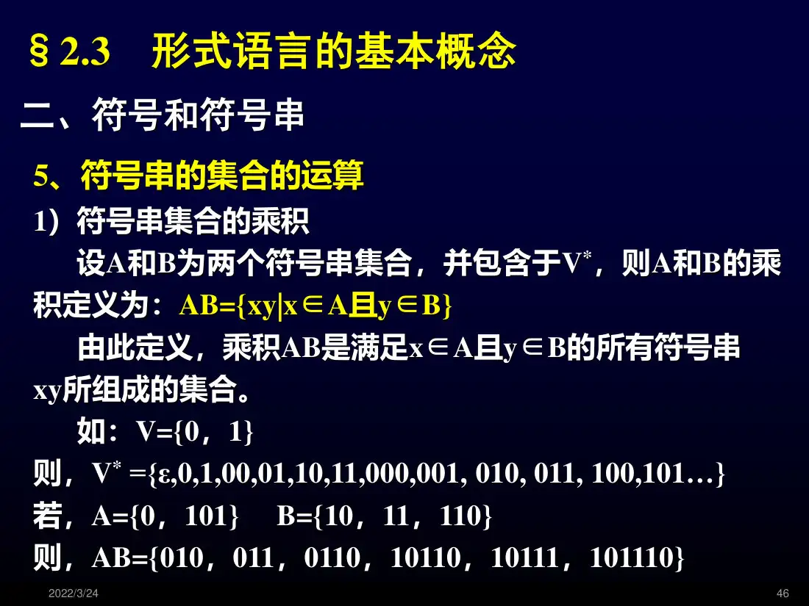

原文：

二、符号和符号串

5、符号串的集合的运算

1）符号串集合的乘积设A和B为两个符号串集合，并包含于V\*，则A和B的乘积定义为： $1 0 0 0 0 0 0 0 0 0 0 0 0 0 0 0 0 0 0 0 0 0 0 0 0 0 0 0 0 0 0 0 0 0 0 0 0 0 0 0 0 0 0 0 0 0 0 0 0 0 0 0 0 0 0 0 0 0 0 0 0 0 0 0 0 0 0 0 0 0 0 0 0 0 0 0 0 0 0 0 0 0 0 0 0 0 0 0 0 0 0 0 0 0 0 0 0 0 0 0 0 0 0 0 0 0 0 0 0 0 0 0 0 0 0 0 0 0 0 0 0 0 0 0 0 0 0 0 0$ 由此定义，乘积AB是满足x∈A且y∈B的所有符号串xy所组成的集合。

如：V={0，1}则， V \* ={ε,0,1,00,01,10,11,000,001, 010, 011, 100,101…}若，A={0，101} B={10，11，110}则，AB={010，011，0110，10110，10111，101110}

2022/3/24

46

### §2.3 形式语言的基本概念

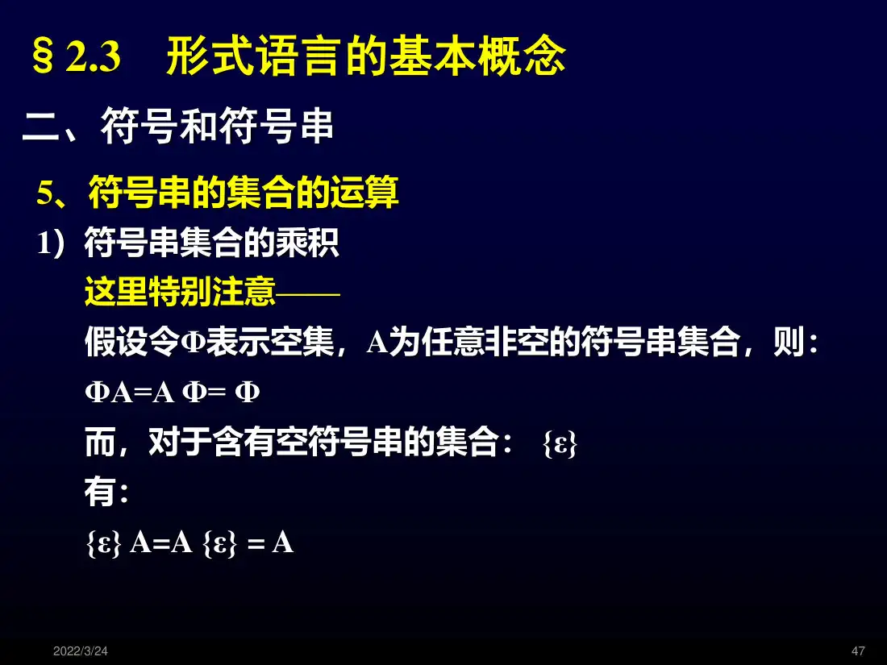

原文：

§2.3 形式语言的基本概念

二、符号和符号串

5、符号串的集合的运算

1）符号串集合的乘积这里特别注意—

假设令Φ表示空集，A为任意非空的符号串集合，则：

ΦA=A Φ= Φ

而，对于含有空符号串的集合： {ε}有：

{ε} $0 . 5 \times 1 0 ^ { 3 } k g = 0 . 5$

2022/3/24

47

### §2.3 形式语言的基本概念

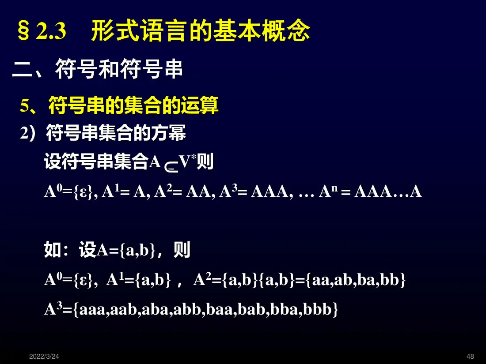

原文：

§2.3 形式语言的基本概念

二、符号和符号串

5、符号串的集合的运算

2）符号串集合的方幂设符号串集合 $\pmb { \psi } _ { \pm } \pmb { \psi } _ { \pm } = \pmb { \psi } _ { \pm }$ 则$\angle A = \angle B = \angle C = \angle A = \angle C = \angle C = \angle C = \angle C = \angle C = \angle C = \angle C = \angle C = \angle C = \angle C = \angle C = \angle C = \angle C = \angle C = \angle C = \angle C = \angle C = \angle C = \angle C = \angle C = \angle C = \angle C = \angle C = \angle C = \angle C = \angle C = \angle C = \angle C = \angle C = \angle C = \angle C = \angle C = \angle C = \angle C = \angle C = \angle C = \angle C = \angle C = \angle C = \angle C = \angle C = \angle C = \angle C = \angle C = \angle C = \angle C = \angle C = \angle C = \angle C = \angle C = \angle C = \angle C$

如：设 $\bf \delta \in \mathbb { E } \mathbb { E } \mathbb { M }$ 则$\therefore \angle B A C = \angle C D E = \angle C D E = \angle C B A = \angle C A B = \angle C A B = 9 0 ^ { \circ }$ $\therefore S _ { \Delta } C D B = \frac { S _ { \Delta } B D } { S _ { \Delta } C D } = \frac { 1 } { 2 } ( \Delta \sqrt { 2 } \cdot \sqrt { 2 } \cdot \sqrt { 2 } \cdot \sqrt { 2 } \cdot \sqrt { 2 } \cdot \sqrt { 2 } \cdot \sqrt { 2 } \cdot \sqrt { 2 } \cdot \sqrt { 2 } \cdot \sqrt { 2 } \cdot \sqrt { 2 } \cdot \sqrt { 2 } \cdot \sqrt { 2 } \cdot \sqrt { 2 } \cdot \sqrt { 2 } \cdot \sqrt { 2 } \cdot \sqrt { 2 } \cdot \sqrt { 2 } \cdot \sqrt { 2 } \cdot \sqrt { 2 } \cdot \sqrt { 2 } \cdot \sqrt { 2 }$

2022/3/24

48

### $$

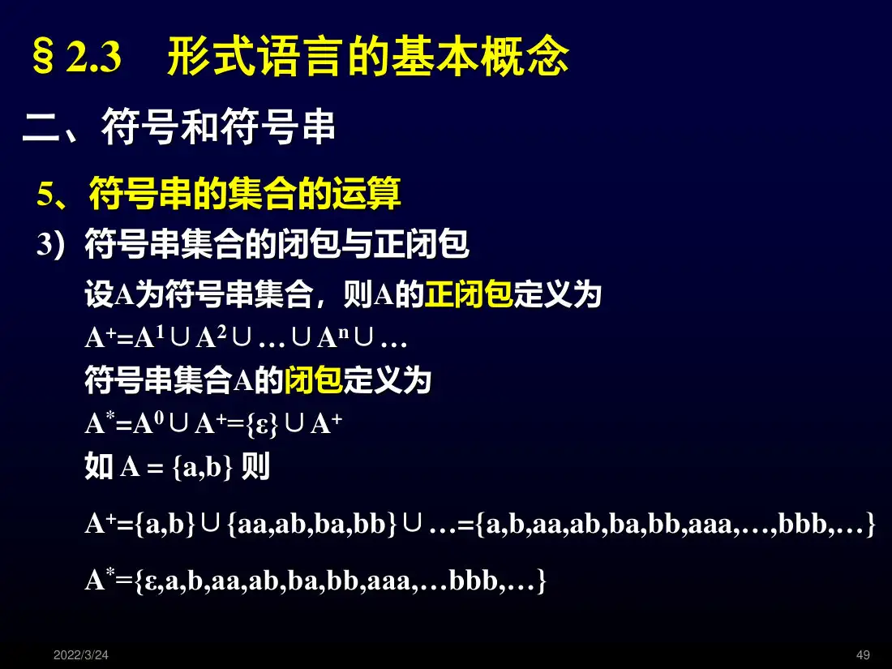

原文：

§2.3 形式语言的基本概念 二、符号和符号串 5、符号串的集合的运算 3）符号串集合的闭包与正闭包 设A为符号串集合，则A的正闭包定义为 $1 0 0 0 0 0 0 0 0 0 0 0 0 0 0 0 0 0 0 0 0 0 0 0 0 0 0 0 0 0 0 0 0 0 0 0 0 0 0 0 0 0 0 0 0 0 0 0 0 0 0 0 0 0 0 0 0 0 0 0 0 0 0 0 0 0 0 0 0 0 0 0 0 0 0 0 0 0 0 0 0 0 0 0 0 0 0 0 0 0 0 0 0 0 0 0 0 0 0 0 0 0 0 0 0 0 0 0 0 0 0 0 0 0 0 0 0 0 0 0 0 0 0 0 0 0 0 0 0 0 0 0 0 0 0 0 0 0 0 0 0 0 0 0 0 0 0 0 0 0 0 0 0 0 0 0 0 0 0 0 0 0 0 0 0 0 0 0 0 0 0 0 0 0 0 0 0 0 0 0 0 0 0 0 0 0 0 0 0 0 0 0 0 0 0 0 0 0 0 0 0 0 0 0 0 0 0 0 0 0 0 0 0 0 0 0 0 0 0 0 0 0 0 0 0 0 0 0 0 0 0 0 0 0 0 0 0 0 0 0 0 0 0 0 0 0 0 0 0 0 0 0 0 0 0 0 0 0 0 0 0 0 0 0 0 0 0 0 0 0 0 0 0 0 0 0 0 0 0 0 0 0 0 0 0 0 0 0 0 0 0 0 0 0 0 0 0 0 0 0 0 0 0 0 0 0 0 0 0 0 0 0 0 0 0 0 0 0 0 0 0 0 0 0 0 0 0 0 0 0 0 0 0 0 0 0 0 0 0 0 0 0 0 0 0 0 0 0 0 0 0 0 0 0 0 0 0 0 0 0 0 0 0 0 0 0 0 0 0 0 0 0 0 0 0 0 0 0 0 0 0 0 0 0 0 0 0 0 0 0 0 0 0 0 0 0 0 0 0 0 0 0 0 0 0 0 0 0 0 0 0 0 0 0 0 0 0 0 0 0 0 0 0 0 0 0 0 0 0 0 0 0 0 0 0 0 0 0 0 0 0 0 0 0 0 0 0 0 0 0 0 0 0 0 0 0 0 0 0 0 0 0 0 0 0 0 0 0 0 0 0 0 0 0 0 0 0 0 0 0 0 0 0 0 0 0 0 0 0 0 0 0 0 0 0 0 0 0 0 0 0 0 0 0 0 0 0 0 0 0 0 0 0 0 0 0 0 0 0 0 0 0 0 0 0 0 0 0 0 0 0 0 0 0 0 0 0 0 0 0 0 0 0 0 0 0 0 0 0 0 0 0 0 0 0 0 0 0 0 0 0 0 0 0 0 0 0 0 0 0 0 0 0 0 0 0$ 符号串集合A的闭包定义为 $1 . 5 \times 1 . 5 \times 1 0 ^ { 3 } k g \times 1 0 ^ { - 3 } k g \times 1 0 ^ { - 3 } k g$ 如 $\bf \delta \psi _ { \sf 4 } = \bf \delta \psi _ { \sf 4 } \bf \delta \psi _ { \sf 4 } \bf \delta \psi _ { \sf 4 }$ 则 A+={a,b}∪{aa,ab,ba,bb}∪…={a,b,aa,ab, $\angle A = \angle C = \angle B = \angle C = \angle D = \angle D = \angle C = \angle B = \angle C = \angle D = \angle C$

$$
\mathrm{A} ^ {+} = \{\mathrm{a}, \mathrm{b} \} \cup \{\mathrm{aa}, \mathrm{ab}, \mathrm{ba}, \mathrm{bb} \} \cup \dots = \{\mathrm{a}, \mathrm{b}, \mathrm{aa}, \mathrm{ab}, \mathrm{ba}, \mathrm{bb}, \mathrm{aaa}, \dots , \mathrm{bbb}, \dots \}
$$

2022/3/24

49

### §2.3 形式语言的基本概念

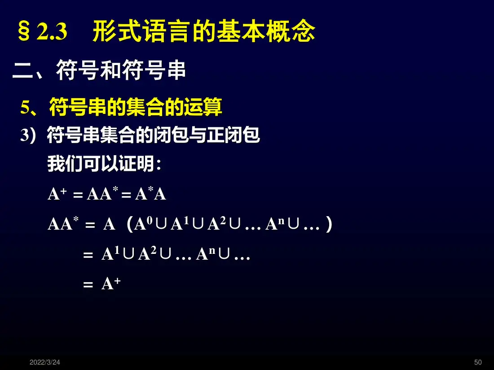

原文：

§2.3 形式语言的基本概念

二、符号和符号串

5、符号串的集合的运算

3）符号串集合的闭包与正闭包我们可以证明：

$$
\mathbf {A} ^ {+} = \mathbf {A A} ^ {*} = \mathbf {A} ^ {*} \mathbf {A}
$$

$$
\begin{array}{r l} \mathbf {A A} ^ {*} = & \mathbf {A} (\mathbf {A} ^ {0} \cup \mathbf {A} ^ {1} \cup \mathbf {A} ^ {2} \cup \dots \mathbf {A} ^ {n} \cup \dots) \\ & = \mathbf {A} ^ {1} \cup \mathbf {A} ^ {2} \cup \dots \mathbf {A} ^ {n} \cup \dots \\ & = \mathbf {A} ^ {+} \end{array}
$$

2022/3/24

50

### §2.3 形式语言的基本概念三、产生式（规则）

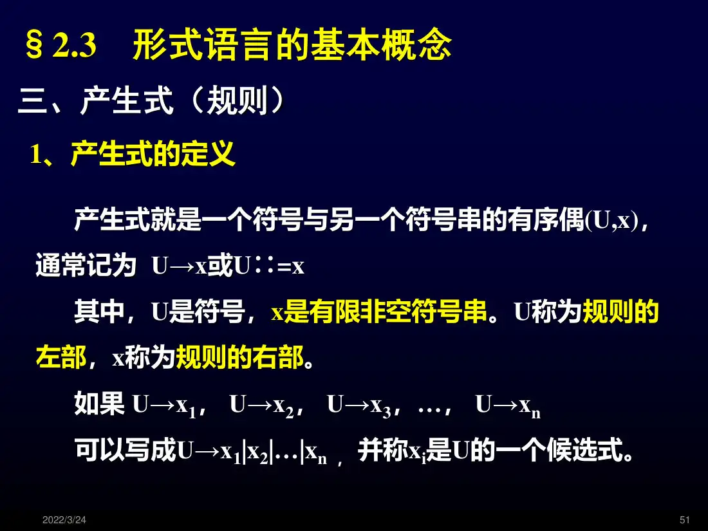

原文：

§2.3 形式语言的基本概念三、产生式（规则）

1、产生式的定义

产生式就是一个符号与另一个符号串的有序偶(U,x)，通常记为 U→x或U∷=x

其中，U是符号，x是有限非空符号串。U称为规则的左部，x称为规则的右部。

如果 $( 1 ) 2 5 \times ( 1 0 - 2 ) \times ( 1 0 - 2 ) \times ( 2 0 - 2 ) \times ( 1 0 - 2 ) \times ( 2 0 - 2 ) \times ( 1 0 - 2 ) \times ( 2 0 - 2 ) \times ( 2 0 - 2 )$ 可以写成U $= 2 . 5 \times ( 2 . 5 \times 2 ) \times 2 \times 1 0$ 并称x是U的一个候选式。

2022/3/24

51

### §2.3 形式语言的基本概念三、产生式（规则）

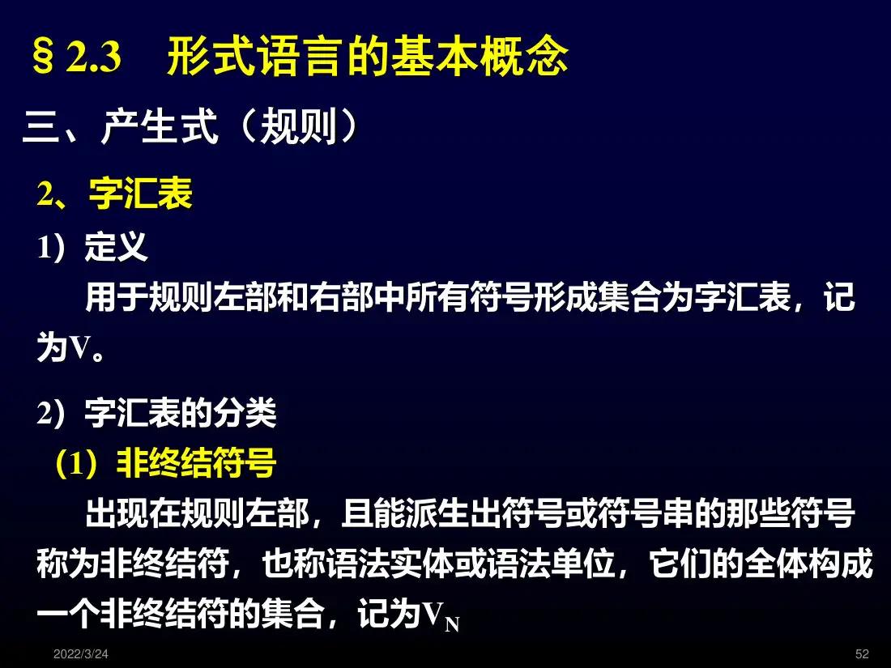

原文：

§2.3 形式语言的基本概念三、产生式（规则）

2、字汇表

1）定义

用于规则左部和右部中所有符号形成集合为字汇表，记为V。

2）字汇表的分类

（1）非终结符号

出现在规则左部，且能派生出符号或符号串的那些符号称为非终结符，也称语法实体或语法单位，它们的全体构成一个非终结符的集合，记为 $\sqrt [ 3 ] { \frac { 3 } { 5 } }$

2022/3/24

52

### §2.3 形式语言的基本概念

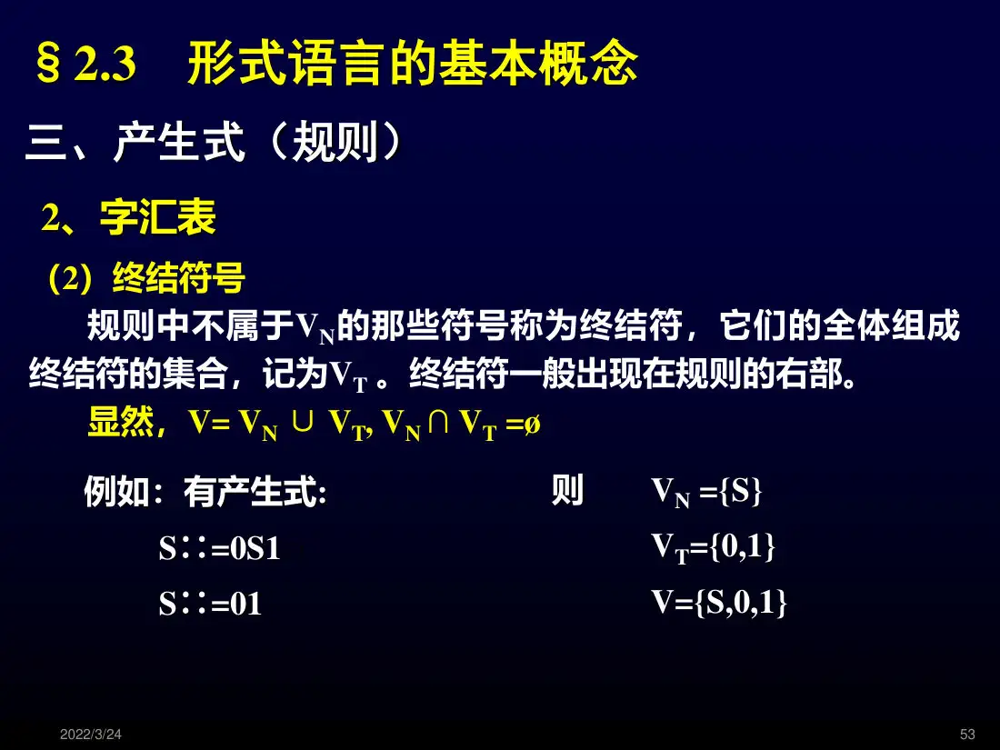

原文：

§2.3 形式语言的基本概念

三、产生式（规则）

2、字汇表

（2）终结符号

规则中不属于 $\pmb { \mathbb { W } }$ 的那些符号称为终结符，它们的全体组成终结符的集合，记为 $1 \frac { 4 } { 1 1 }$ 。终结符一般出现在规则的右部。

显然， $\Delta C E A \cong \Delta C E D ( A A S )$

例如：有产生式:

则

$$
\mathbf {V} _ {\mathrm{N}} = \{\mathbf {S} \}
$$

S∷=0S1

$$
\mathrm{V} _ {\mathrm{T}} = \{0, 1 \}
$$

$$
\mathrm{S} \mathrel {\mathop :} := 0 1
$$

V={S,0,1}

2022/3/24

53

### §2.3 形式语言的基本概念三、产生式（规则）

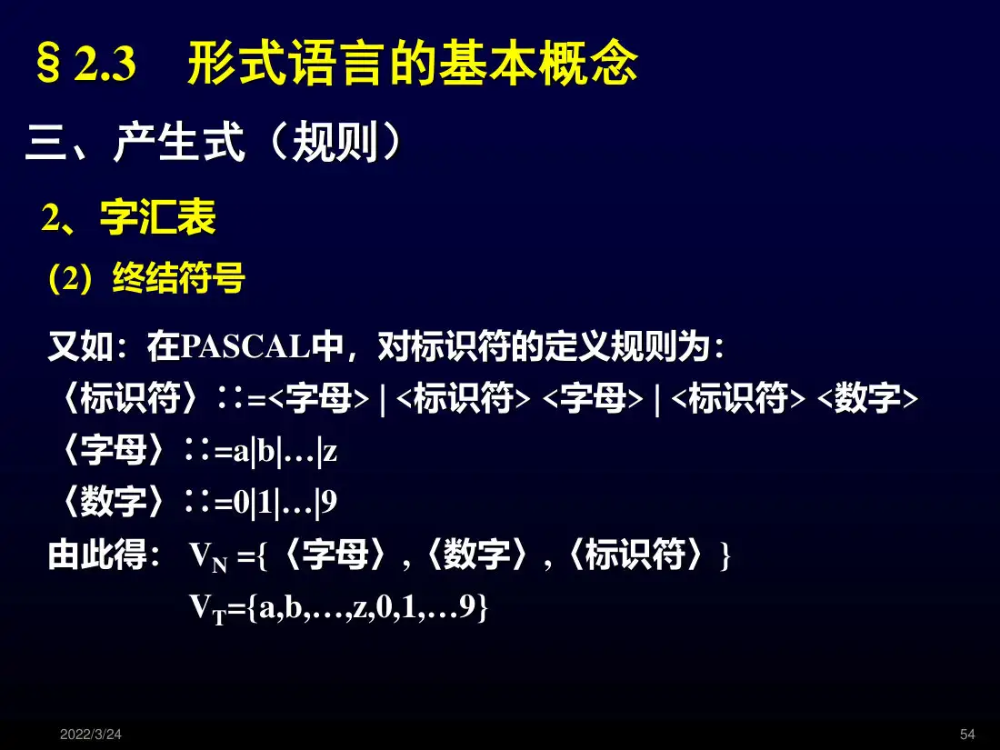

原文：

§2.3 形式语言的基本概念三、产生式（规则）

2、字汇表

（2）终结符号

又如：在PASCAL中，对标识符的定义规则为：〈标识符〉 $8 0 = 1 3$ 字母>|<标识符><字母> |<标识符><数字>〈字母〉 $\mathrm { R e } = 0 . 1 0 \mathrm { m } \mathrm { m }$ 〈数字〉 $\mathtt { B C } = \mathtt { C D } \mathtt { H } \mathtt { I } \mathtt { C D } \mathtt { C }$ 由此得： $\because \angle B A C = 9 0 ^ { \circ }$ 〈字母〉,〈数字〉,〈标识符〉}$\because \angle B = \angle B = \angle C A = \angle C B = 9 0 ^ { \circ }$

2022/3/24

54

### §2.3 形式语言的基本概念

原文：

§2.3 形式语言的基本概念

四、文法

定义：文法是规则的有穷集合,形式定义为四元组形式为$( 6 - 1 ) \times ( 1 0 - 1 ) \times ( 1 0 - 1 ) = 1 0 ( 1 )$

其中： $| \bigstar \bigstar |$ 是非终结符集合,

$| | \bigstar \bigstar | \bigstar$ 是终结符集合,

P 代表产生式集,

$\boxed { \pmb { \mathscr { M } } } = \boxed { \pmb { \mathscr { N } } }$ 是文法G开始符号，也称识别符号，它至少要在一条产生式左部出现。

文法G通常记为G［Z

2022/3/24

55

### §2.3 形式语言的基本概念

原文：

§2.3 形式语言的基本概念

四、文法

对于下面例子中用8条文法规则来描述英语句子,其文法可表示为：$\textcircled { 6 } = \textcircled { 1 } \times \textcircled { 2 } \times \textcircled { 1 } \times \textcircled { 2 }$ 〈句子〉)

其中:

$V _ { 1 } = \sqrt { 1 }$ <句子>，<主语>，<谓语>，<宾语>，<冠词>，<动词>，

V ={ the, big, elephant, peanut, ate }

P是右边的8条规则

Z=〈句子〉

①〈句子〉∷=〈主语〉〈谓语〉

②〈主语〉∷=〈冠词〉〈形容词〉〈名词〉

③〈冠词〉∷=the

④〈形容词〉∷= big

⑤〈谓语〉∷=〈动词〉 〈宾语〉

⑥〈动词〉∷= ate

⑦〈宾语〉∷=〈冠词〉〈名词〉

⑧〈名词〉∷= elephant | peanut

2022/3/24

56

### §2.3 形式语言的基本概念

原文：

§2.3 形式语言的基本概念

四、文法

又例如：标识符文法可定义如下:G $\vert V A \vert = ( 1 \times \sqrt { 1 0 ^ { 2 } - 1 0 ^ { 2 } } + 1 0 ) \times 1 0 ^ { 2 } ( 1 )$ $\because m = 1$ 〈字母〉,〈数字〉,〈标识符〉}$\because \angle B = \angle B = \angle C A = \angle C D = 9 0 ^ { \circ }$ P由下列规则组成:〈标识符〉∷=<字母>|<标识符><字母>|<标识符><数字>〈字母〉 $\mathrm { R e } = 0 . 1 1 0 \mathrm { m } \mathrm { m }$ 〈数字〉 $\mathtt { B C } = \mathtt { C D } \mathtt { H } \mathtt { I } \mathtt { C m } \mathtt { C }$ Z=〈标识符

2022/3/24

57

### §2.3 形式语言的基本概念五、推导和规约

原文：

§2.3 形式语言的基本概念五、推导和规约

定义1：设G为一个文法，U∷=u是G中一个规则，x和y是V\*上符号串，使得——v=xUy 与 w=xuy则称符号串v直接推导出符号串w，或称w直接归约到v，并把w叫做v直接派生式，记做 v  w

注意三点： 1）v ，w是两个不同符号串

2）有一规则U∷=u

3）直接推导v  w

2022/3/24

58

### §2.3 形式语言的基本概念五、推导和规约

原文：

§2.3 形式语言的基本概念五、推导和规约

若 $v \Longleftrightarrow v = v _ { 0 }$ 则 $\therefore \angle B A C = 1 0 ^ { \circ }$ $\mathrm { w } = \mathrm { w } = \mathrm { w } = \mathrm { w }$ 可见 $\therefore \angle B = \angle C$ 即 $\boxed { 1 } \boxed { 2 } \boxed { 1 }$ 说明一个规则就是一个直接推导。例如：

〈句子〉直接推导到<主语> <谓语>，而<主语> <谓语>直接归约到<句子>。

2022/3/24

59

### §2.3 形式语言的基本概念

原文：

§2.3 形式语言的基本概念

五、推导和规约

再举一例——

$$
\mathbf {G} = \left(\mathrm{V} _ {\mathrm{N}}, \mathrm{V} _ {\mathrm{T}}, \mathrm{P}, \mathrm{Z}\right)
$$

$$
\mathbf {V} _ {\mathrm{N}} = \{\mathbf {S} \},
$$

$$
\mathrm{V} _ {\mathrm{T}} = \{0, 1 \}
$$

$$
\mathrm{P}: \mathrm{S} \because = 0 \mathrm{S} 1
$$

$$
\textbf {S}: := 0 1
$$

$$
\mathrm{Z} = \mathrm{S}
$$

$\therefore \angle B = \angle A$ $\therefore \angle B = \angle M ($ 因为S $\mathbb { G } \mathbb { \equiv } \mathbb { 1 }$ $( \textcircled { 1 } \textcircled { 6 } \textcircled { 6 } \textcircled { = } \textcircled { 1 }$ 即 $\forall \equiv \operatorname { s u p }$ $\mathbf { \partial } \cdot \mathbf { \partial } \mathbf { \hat { v } } = \mathbf { \partial } \cdot \mathbf { \partial } ( \mathbf { J } \mathbf { v }$ 若 $v = v = 3$ 则 $\mathfrak { S } \equiv \mathfrak { N }$ （一个规则就是一个直接推导）同样 $\mathfrak { S } \mathrm { a } \mathrm { \overline { { 0 } } \mathrm { = } \overline { { 0 } } \mathrm { \overline { { 0 } } } }$ $\chi = ( 1 1 1 3 ) g / m$ $\scriptstyle \sum _ { k = 1 } ^ { \prime } ( 1 , 1 , 1 , \sqrt { 1 1 6 } )$ 即 v  w 00S11  000S111

2022/3/24

60

### §2.3 形式语言的基本概念

原文：

§2.3 形式语言的基本概念

五、推导和规约

注意—

从v出发应用规则U∷=u，把v=xUy中U替换为右部u，即v直接推导到w，这时长度可能增加，至少不会缩小。即：|w|≥|v|。

从w出发应用规则U∷=u,把w=xuy中u替换为左部U，即w直接归约为v，这时长度可能缩小，至少不会变长。即：|v|≤|w|。

2022/3/24

61

### §2.3 形式语言的基本概念

原文：

§2.3 形式语言的基本概念

五、推导和规约

定义2：设 $1 1 2 1 5 0 1 5 2 0 0 0 0 0 0 0$ 均为V\*上符号串,若w是v经过一系列直接推导得到的。

即： $( 1 1 1 - 2 1 ) \div ( 1 1 ) = ( 1 1 - 2 1 ) = ( 1 1 5 - 2 1 ) = ( 1 1 7 - 2 1 )$ 则称 v 推导到 w，或称w 归约到 v，记作：v  +w称这个直接推导序列为长度为n的推导。如果v  +w 或者v=w（表示0步推导），则记作$V = \frac { m } { v }$ 称v广义推导到w或称w广义归约到v。

2022/3/24

62

### §2.3 形式语言的基本概念五、推导和规约

原文：

§2.3 形式语言的基本概念五、推导和规约

显然，直接推导⇒的长度为1，推导→+的长度≥1，而广义推导 \*的长度≥0例如在前面的例子中,因 $: \angle B A C = \angle A B C = \angle B A C = \angle C$ 0S1 ⇒00S11 ⇒000S111 ⇒00001111所以 $\mathrm { ( l y ) ( z - z e a m ) } = \mathrm { ( l y l t ) ( l y l t ) ( l t - s ) }$

2022/3/24

63

### §2.3 形式语言的基本概念

原文：

§2.3 形式语言的基本概念

五、推导和规约

例2.16 设有文法G［〈整数〉］:

(1) <整数> ∷= <数字串>

(3) <数字串> ∷= <数字>

(2) <数字串> ∷= <数字串> <数字>

(4) <数字> ∷= 0

(5) <数字> ∷= 1

(6) <数字> ∷=2 (7) <数字> ∷= 3

(8) <数字> ∷= 4

(9) <数字> ∷= 5

(10) <数字> ∷=6 (11) <数字> ∷= 7 (12) <数字> ∷=8 (13) <数字>∷=9

ε 〈整数〉

ε 〈数字串〉

ε 〈数字串〉

ε 〈数字〉

2 〈数字〉

ε  ε

ε ε

〈数字〉  ε

〈数字〉  ε

ε  2

〈数字串〉

〈数字串〉

〈数字〉

〈数字〉

规则1

规则2

〈数字〉 规则3

〈数字〉 规则6

ε 规则7

2022/3/24

64

### §2.3 形式语言的基本概念

原文：

§2.3 形式语言的基本概念

五、推导和规约

例2.16 设有文法G［〈整数〉］:

(1) <整数> ∷= <数字串>

(3) <数字串> ∷= <数字>

(2) <数字串> ∷= <数字串> <数字>

(4) <数字> $8 9 \equiv 0$

(5) <数字> $8 8 \equiv 1 1$

(6) <数字> ∷=2 (7) <数字> ∷= 3 (8) <数字> $8 8 \equiv 7 4$ (9) <数字> $8 9 \equiv 5 1$

(10) <数字> ∷=6 (11) <数字> ∷= 7 (12) <数字> ∷=8 (13) <数字>∷=9

由此建立下列推导:

<整数>⇒<数字串>⇒<数字串><数字>⇒><数字><数字>⇒>2<数字>⇒>23因此，<整数>+23，其推导长度为5。显而易见，在推导时，任意地选取规则(4)到(13)，就可以推导得到任意整数。

2022/3/24

65

### §2.3 形式语言的基本概念

原文：

§2.3 形式语言的基本概念

六、句型和句子

在上述推导过程中产生了一系列的符号串，它们或全由终结符组成（如：23），或全由非终结符组成（如：<数字串>，<数字串><数字>，<数字><数字>），或由终结符和非终结符混合组成（如：2<数字>）为了区别这些组成不同的符号串，我们引入句型和句子两个概念。定义：设G［Z］是一文法，若符号串x是由识别符Z推导而得，即$V _ { 1 } = \frac { \sqrt { 3 } } { 2 } \cdot \sqrt { 3 } = \sqrt { 3 }$

则称符号串x为该文法G的一个句型。如果一个句型x仅由终结符组成，即—

Z \*x x∈V \* T

则称句型x为该文法一个句子。

例如在例2.16中， 整数〉 〈数字〉 〈数字〉，2〈数字〉，23等都是文法G[<整数>]的句型，其中仅23是句子。

2022/3/24

66

### §2.3 形式语言的基本概念

原文：

§2.3 形式语言的基本概念

七、语言

设G［Z］为一文法，由该文法所产生的一切句子的集合称为由该文法所定义的语言，记为L(G［Z］) (或记为L(G) )，即：

$$
\mathrm{L} (\mathrm{G}) = \{\mathrm{x} | \mathrm{Z} \Rightarrow {} ^ {*} \mathrm{x} \text {且} \mathrm{x} \in \mathrm{V} _ {\mathrm{T}} ^ {*} \}
$$

有时我们称这样定义的语言为形式语言，以区别于自然语言。上述公式包含两层意思：

1）语言是句子集合，是 $\frac { \sqrt { 1 0 } } { \sqrt { 1 1 } }$ 一个子集合，即 $\sqrt [ n ] { \frac { y } { n } }$ 中符号串集合的子集。

2）句子必须由该语言文法的开始符号推出。

例如： $( \Theta | V A | \equiv \operatorname { ( v _ { A } ) } \operatorname { ( v _ { A } ) } | V A | )$

$$
\mathbf {V} _ {\mathrm{N}} = \{\mathbf {S} \}
$$

$$
\mathrm{V} _ {\mathrm{T}} = \{0, 1 \}
$$

$$
\mathrm{P}: \{\mathrm{S}:: := 0 1, \mathrm{S}:: := 0 \mathrm{S} 1 \}
$$

S:识别符

很容易推出：L $( \odot ) = ( 0 . 0 0 0 0 0 0 0 ) \times 5 = 0 . 0 0 0 0$

2022/3/24

67

### §2.3 形式语言的基本概念

原文：

§2.3 形式语言的基本概念

八、递归文法

1、定义

对于一个文法，若有一个规则U∷=…U…，则称直接递归，若有规则U∷=U…，则称直接左递归，若有规则U∷=…U，则称直接右递归。若有推导式U+…U…，则称间接递归，若有推导式U⇒+U...，则称间接左递归，若有推导式U⇒+...U，则称间接右递归。非终结符U称递归非终结符。如果一个文法中至少含有个递归非终结符，则将此文法称为递归文法。

例如：规则 $\bf \delta S$

规则 $\bf \Delta \Psi _ { 4 } ( \bf \Delta \Psi _ { 5 } ) _ { 4 } ( \bf \Delta \Psi _ { 5 } )$

是直接递归

规则 $\pm \pm \pm \pm \pm \pm \pm \pm \pm \pm \pm \pm \pm \pm \pm \pm \pm \pm \pm \pm \pm \pm \pm \pm \pm \pm \pm \pm \pm \pm \pm \pm \pm \pm \pm \pm \pm \pm \pm \pm \pm \pm \pm \pm \pm \pm \pm \pm \pm \pm \pm \pm \pm \pm \pm \pm \pm \pm \pm \pm \pm \pm \pm \pm \pm \pm \pm \pm \pm \pm \pm \pm \pm \pm \pm \pm \pm \pm \pm \pm \pm \pm \pm \pm \pm \pm \pm \pm \pm \pm \pm \pm \pm \pm \pm \pm \pm \pm \pm \pm \pm \pm \pm \pm \pm \pm \pm \pm \pm \pm \pm \pm \pm \pm \pm \pm \pm \pm \pm \pm \pm \pm \pm \pm \pm \pm \pm \pm \pm \pm \pm \pm \pm \pm \pm \pm \pm \pm \pm \pm \pm \pm \pm \pm \pm \pm \pm \pm \pm \pm \pm \pm \pm \pm \pm \pm \pm \pm \pm \pm \pm \pm \pm \pm \pm \pm \pm \pm \pm \pm \pm \pm \pm \pm \pm \pm \pm \pm \pm \pm \pm \pm \pm \pm \pm \pm \pm \pm \pm \pm \pm \pm \pm \pm \pm \pm \pm \pm \pm \pm \pm \pm \pm \pm \pm \pm \pm \pm \pm \pm \pm \pm \pm \pm \pm \pm \pm \pm \pm \pm \pm \pm \pm \pm \pm \pm \pm \pm \pm \pm \pm \pm \pm \pm \pm \pm \pm \pm \pm \pm \pm \pm \pm \pm \pm \pm \pm \pm \pm \pm \pm \pm \pm \pm \pm \pm \pm \pm \pm \pm \pm \pm \pm \pm \pm \pm \pm \pm \pm \pm \pm \pm \pm \pm \pm \pm \pm \pm \pm \pm \pm \pm \pm \pm \pm \pm \pm \pm \pm \pm \pm \pm \pm \pm \pm \pm \pm \pm \pm \pm \pm \pm \pm \pm \pm \pm \pm \pm \pm \pm \pm \pm \pm \pm \pm \pm \pm \pm \pm \pm \pm \pm \pm \pm \pm \pm \pm \pm \pm \pm \pm \pm \pm \pm \pm \pm \pm \pm \pm \pm \pm \pm \pm \pm \pm \pm \pm \pm \pm \pm \pm \pm \pm \pm \pm \pm \pm \pm \pm \pm \pm \pm \pm \pm \pm \pm \pm \pm \pm \pm \pm \pm \pm \pm \pm \pm \pm \pm \pm \pm \pm \pm \pm \pm$

是直接左递归

是直接右递归

2022/3/24

68

### §2.3 形式语言的基本概念

原文：

§2.3 形式语言的基本概念

八、递归文法

1、定义

又如：设有文法G的规则P为S∷=Qc|cQ∷=Rb|bR∷=Sa|a在这6条规则中，无直接递归规则，但有如下推导：$( 0 . 2 5 7 3 ) \div 3 . 5 7 1 7 = 3 . 0 7 6 9 . 7 1$ 所以 $\textcircled { 4 } = \times \textcircled { 1 } \textcircled { 4 } \textcircled { 1 }$ 因此是间接左递归。显然，直接递归是间接递归一种特殊情况。

2022/3/24

69

### §2.3 形式语言的基本概念

原文：

§2.3 形式语言的基本概念

八、递归文法

2、说明

如果一个语言是无穷的，则描述该语言的文法必定是递归的。一般说，程序设计语言是无穷的，因此描述它们的文法必定是递归的。应当指出，从语法定义的角度来看，递归定义使文法的形式比较简练，给无限的语言有限的表示提供了一种可用的方法。然而在后面我们将会看到，文法的左递归性将会给某些语法分析方法的实现带来很大的麻烦。

2022/3/24

70

### §2.3 形式语言的基本概念九、短语和简单短语

原文：

§2.3 形式语言的基本概念九、短语和简单短语

、短语与简单短语定义：设G［Z］是一文法，w=xuy 是其中一句型，若有$V _ { 1 } = V _ { 2 } \cdot V _ { 2 } \cdot V _ { 1 } = V _ { 1 } \cdot V _ { 2 } = 1 . 1 V \cdot 1 . 1 = V _ { 1 } \cdot V _ { 2 }$ 则称u是一个相对于非终结符U、句型w的短语。若 $\gamma _ { \ell } = \mathcal { L } _ { \ell } ( \mathbf { \bar { \rho } } _ { \ell } ) \mathbf { \bar { \rho } } _ { \ell } \equiv [ \mathbf { \bar { \rho } } _ { \ell } ] = 2 \pi$ 则称u是一个相对于非终结符U、句型w的简单短语。如例题2.16

<整数>⇒><数字串>⇒><数字串><数字>⇒><数字><数字>⇒2<数字>⇒23由定义可知： <整数>\* <数字串><数字> ， w=2<数字>所以<数字串> +2，即2是相对于非终结符<数字串>，句型2<数字>的短语，而<整数>⇒\*<数字><数字>，w=2<数字>，<数字>⇒2。所以2是相对于非终结符<数字>，句型2<数字>的简单短语

2022/3/24

71

### §2.3 形式语言的基本概念九、短语和简单短语

原文：

§2.3 形式语言的基本概念九、短语和简单短语

例2.22 设有文法G $\vert ( 5 ) = ( 1 5 0 , 0 ) ( 2 5 0 , 0 ) ( 2 5 )$ ,其中P为$\pmb { \mathbb { S } } \mathbf { \mathbb { H } } \mathbf { \Lambda } \mathbf { \vec { = } } \mathbf { \pmb { \mathbb { A } } } \mathbf { \Lambda } \mathbf { \vec { = } } \mathbf { \vec { = } } \mathbf { \vec { = } } \mathbf { \vec { = } } \mathbf { \vec { = } } \mathbf { \vec { = } } \mathbf { \vec { = } } \mathbf { \vec { = } } \mathbf { \vec { = } } \mathbf { \vec { = } } \mathbf { \vec { = } } \mathbf { \vec { = } } \mathbf { \vec { = } } \mathbf { \vec { = } } \mathbf { \vec { = } } \mathbf { \vec { = } } \mathbf { \vec { = } } \mathbf { \vec { = } } \mathbf { \vec { = } } \mathbf { \vec { = } } \mathbf { \vec { = } } \mathbf { \vec { = } } \mathbf { \vec { = } } \mathbf { \vec { = } } \mathbf { \vec { = } } \mathbf { \vec { = } } \mathbf { \vec { = } } \mathbf { \vec { = } } \mathbf { \vec { = } } \mathbf { \vec { = } } \mathbf { \vec { = } } \mathbf { \vec { = } } \mathbf { \vec { = } } \mathbf { \vec { = } } \mathbf { \vec { = } } \mathbf { \vec { = } } \mathbf { \vec { = } } \mathbf { \vec { = } } \mathbf { \vec { = } } \mathbf { \vec { = } } \mathbf { \vec { = } } \mathbf { \vec { = } } \mathbf { \vec { = } } \mathbf { \vec { = } } \mathbf { \vec { = } } \mathbf { \vec \Sigma } \mathbf { \pm \Sigma } \mathbf { \Sigma } \mathbf { \Sigma \Sigma } \mathbf \mathbf { \Sigma \Sigma } \mathbf \pm \mathbf { \Sigma \Sigma }$ $\mathbf { \Delta } _ { \mathbf { a } } \mathbf { a } \mathbf { a } = \mathbf { \Delta } _ { \mathbf { a } } \mathbf { e } ( \mathbf { \bar { \mathbf { a } } } \mathbf { \Delta } \mathbf { \bar { \mathbf { a } } } )$ $| \mathbf { \vec { \mathbf { \sigma } } } \mathbf { \cdot } \mathbf { \vec { \mathbf { \sigma } } } \mathbf { \cdot } | \mathbf { \vec { \mathbf { \sigma } } } | = | \mathbf { \vec { \mathbf { \sigma } } } | \mathbf { \vec { \mathbf { \sigma } } } \mathbf { \cdot } | \mathbf { \vec { \mathbf { \sigma } } }$ 找出句型baSb的全部短语，简单短语，根据句型推导过程有$( 3 ) = 2 . 0 1 3 = 2 . 0 1 3 3 : 2 = 2 . 0 1 3 : 2 = 2 . 0 1 3 : 2 = 2 . 0 1 3 : 2 0$ 由上可见， $v = 2 \sqrt { 1 + 1 } k = 1 \sqrt { 2 } = 2 \sqrt { 2 }$ 所以子串Sb是相对于非终结符B，句型baSb的简单短语。同样有 $( 3 ) ( 1 1 1 0 - 7 . 5 ) ( 1 1 1 0 - 7 . 1 ) ( 1 1 1 ) ( 1 1 1 ) = 3 . 7 9 ( 1 1 1 )$ 即 $( 3 ) ( 2 \times 1 ) ( 2 \times 1 ) = 1 1 ( 2 \times 1 )$ 子串a是相对于B，句型baSb的简单短语。还有 $\pmb { \Sigma } = \pmb { \Sigma } \pmb { \Sigma } \pmb { \Sigma } \pmb { \Sigma } \pmb { \Sigma } \pmb { \Sigma }$ 且 A  +ba即子串ba是相对于非终结符A，句型baSb的短语。对于句型baSb，再没有其它能产生新的短语推导了，所以句型baSb有短语ba，简单短语a和Sb

2022/3/24

72

### §2.3 形式语言的基本概念九、短语和简单短语

原文：

§2.3 形式语言的基本概念九、短语和简单短语

2、句柄

定义：一个句型最左边的简单短语称为该句型的句柄（或柄短语），而且句柄最左边的符号称句柄的头，句柄最右边的符号称句柄的尾。

如上例句型baSb简单短语为a和Sb，由于a是最左简单短语，所以a又是句柄。

2022/3/24

73

### §2.3 形式语言的基本概念九、短语和简单短语

原文：

§2.3 形式语言的基本概念九、短语和简单短语

3、再谈语法树

前面我们曾利用语法树直观地描述句子语法结构关系，现在我们仍然借助于语法树进行句型和句子的推导，同时，利用它寻找短语和简单短语也是十分直观和方便的。

2022/3/24

74

### §2.3 形式语言的基本概念九、短语和简单短语

原文：

§2.3 形式语言的基本概念九、短语和简单短语

3、再谈语法树

1）语法树形式定义

设有文法 $\cos \angle A C E = \cos \angle A C E = \frac { 1 } { 2 } ( \sqrt { 2 } \sqrt { 2 } )$ 满足下列条件的树即为 语法树

（1）树中每一个结点都有标记，且该标记是 $\nabla _ { \mathbf x } \mathbf { \equiv } \mathbf { \equiv } \mathbf { \equiv } \mathbf { \frac { \mathbf v } { \mathbf { \Theta } } }$ 中某一符号

（2）树根标记是识别符号

（3）若有一个结点至少有一个后继结点，则该结点标记必为非终结符

（4）若一个标记为U的结点，它有标记依次为 $3 . 5 \times 1 0 ^ { 3 } - 5 \times 1 0 ^ { 3 } - 5 \times 1 0 ^ { 3 } = 1 0 0 0 0$ $1 3$ 的直接后继结点，则U $\mathrm { R H }  \mathrm { R H }  \mathrm { R H }  \mathrm { R H }$ 必定是G的一条规则§2.3 形式语言的基本概念九、短语和简单短语

2022/3/24

75

### 3、再谈语法树

原文：

3、再谈语法树

我们以例2.22文法G［S］为例，句型baSb的推导设有文法G［S］=({S,A,B},{a,b},P,S),其中P为$\pmb { \mathbb { S } } \mathbf { \mathbb { H } } \mathbf { \Lambda } \mathbf { \vec { \mathbf { = } } } \mathbf { \pmb { \mathbb { A } } } \mathbf { \Lambda } \mathbf { \vec { \mathbf { \mathbf { \mathbf { \mathbf { \mathbf { \Lambda } } } } } } } $ $V _ { \mathbf { a } } \mathbf { a } _ { 0 } = \mathbf { a } _ { 0 } \mathbf { a } _ { 0 } \mathbf { a } _ { 0 } = \mathbf { a } _ { 0 } \mathbf { a } _ { 0 }$ $| \mathbf { \vec { \mathbf { \sigma } } } | \mathbf { \vec { \mathbf { \sigma } } } | = | \mathbf { \vec { \mathbf { \sigma } } } | \mathbf { \vec { \mathbf { \sigma } } } | )$ $( 3 ) = 2 . 0 1 3 = 2 . 0 1 3 3 6 3 = 2 . 0 1 3 2 = 2 . 0 7 3 3$ A画出语法树如右图所示

2022/3/24

76

### §2.3 形式语言的基本概念九、短语和简单短语

原文：

§2.3 形式语言的基本概念九、短语和简单短语

3、再谈语法树

3）结论

对于每一个语法树（或者子树）至少对应一个推导（可能是直接推导。可能是n步推导）

对于每个推导必存在有一个语法树，语法树中每个分支对应于个直接推导 。

● 不同推导可能有相同的语法树。

如： $( 3 ) = 2 . 0 1 3 = 2 . 0 1 3 3 6 = 2 . 0 9 3 3 = 2 . 0 9 3 3$

$$
\mathrm{S} \Rightarrow \mathrm{AB} \Rightarrow \mathrm{ASb} \Rightarrow \mathrm{bBSb} \Rightarrow \mathrm{baSb}
$$

同一句型的两个不同的推导对应的语法树却是相同的。

树的末端结点标记从左到右连接起来就是要推导的句型或句子§2.3 形式语言的基本概念九、短语和简单短语

2022/3/24

77

### 3、再谈语法树

原文：

3、再谈语法树

4）语法树的作用

（1）利用语法树可以构造文法的句型； （前面已经讲了句型baSb的语法树构造过程）

（2）根据语法树可以确定短语、简单短语和句柄——子树末端结点的符号串是相对于子树根的短语，分支结点的符号串是相对于分支名字的简单短语，最左简单子树（只有父子两代）的末端结点的符号串是句柄。

从右图语法树可直观看出：ba是句型baSb，相对于A的短语，Sb是句型baSb相对于B的简单短语，a是句型baSb相对于B简单短语，也是句柄。（3）当给定文法G后，我们可借助于推导语法树的逆过程把句型推导构造出来 （见下页举例）

2022/3/24

78

### §2.3 形式语言的基本概念九、短语和简单短语

原文：

§2.3 形式语言的基本概念九、短语和简单短语

3、再谈语法树

4）语法树的作用

① 对于右图baSb语法树，最左末端分支是文法G中一条规则B∷=a，若剪去此分支（将a归约为B），则得句型bBSb的语法树，也就是重新构造了一个直接推导为 bBSb  baSb

2022/3/24

79

### §2.3 形式语言的基本概念九、短语和简单短语

原文：

§2.3 形式语言的基本概念九、短语和简单短语

3、再谈语法树

4）语法树的作用

② 此时该语法树最左末端分支相应规则为 $\bf \delta _ { 4 }$ ，再剪去此分支（即将bB归约为A），又得到句型ASb的语法树，于是又构造了推导为$1 . 5 \times 1 0 = 3 0 ( 1 ) ( 3 ) ( 1 ) = 3 0 ( 1 ) ( 3 ) ( 1 )$

2022/3/24

80

### §2.3 形式语言的基本概念九、短语和简单短语

原文：

§2.3 形式语言的基本概念九、短语和简单短语

3、再谈语法树

4）语法树的作用

③ 此继续下去，再剪去最左末端分支（将Sb归约为B），则得句型AB的语 法 树 ， 又 建 立 了 推 导 为$1 0 0 \div 2 0 0 0 = 2 0 0 0 0 0 0 = 2 0 0 0 0 0$

2022/3/24

81

### §2.3 形式语言的基本概念

原文：

§2.3 形式语言的基本概念

九、短语和简单短语

3、再谈语法树

4）语法树的作用

最后剪去分支AB（将AB归约为S），得到树根S，建立了句型baSb推导为 $1 0 \div 2 . 0 1 = 2 . 0 1 0 = 2 0 . 0 1 0 = 2 0 . 0 1 0$

2022/3/24

82

### §2.3 形式语言的基本概念

原文：

§2.3 形式语言的基本概念

九、短语和简单短语

3、再谈语法树

4）语法树的作用

④ 最后剪去分支AB（将AB归约为S），得到树根S，建立了句型baSb推导为 $( 3 ) ( 1 0 - 2 0 ) \div ( 2 0 ) ( 1 0 - 2 0 ) ( 1 0 ) = 2 0 ( 1 0 ) ( 1 0 )$

S

2022/3/24

83

### §2.3 形式语言的基本概念九、短语和简单短语

原文：

§2.3 形式语言的基本概念九、短语和简单短语

3、再谈语法树

4）语法树的作用

结论—

从语法树构造推导也就是不断地重复构造最后直接推导和剪去相应分支直到无分支可剪过程。对于每个语法树至少存在一个推导。上例我们选用了最左归约，即每次剪去最左末端分支，实际上每次归约是句柄。如果改变剪去相应分支顺序便将得到不同推导。

2022/3/24

84

### §2.3 形式语言的基本概念十、最左推导和最右推导

原文：

§2.3 形式语言的基本概念十、最左推导和最右推导

对于一给定的文法来说，从其开始符号到某一句型，或从某一句型到另一句型间的推导序列可能不唯一。为了使句型或句子能按照一确定的推导序列来产生，通常我们仅考虑最左推导或最右推导。

2022/3/24

85

### §2.3 形式语言的基本概念十、最左推导和最右推导

原文：

§2.3 形式语言的基本概念十、最左推导和最右推导

定义1：在任何一步推导vw中，都是对符号串v的最左（右）的非终结符进行替换，则称最左（右）推导。

例如：G[S]

S∷=AB

$$
\mathrm{A} \because = \mathrm{Aa} | \mathrm{bB}
$$

$$
\mathrm{B} \because = \mathrm{a} | \mathrm{Sb}
$$

S⇒AB⇒bBB⇒baB

最左推导

$( 5 7 , 1 1 , 1 2 , 1 5 ) = 3 , ( 5 7 , 1 1 , 1 2 ) = 3 , ( 5 7 , 1 1 , 1 5 ) = 3 , ( 1 1 , 1 2 )$ -------最右推导

$( 3 = 2 , 1 1 ) = 2 , ( 5 ) = 2 0 ( 3 \times 2 ) = 2 0 ( 3 \times 2 )$ ------ 非左非右推导

2022/3/24

86

### §2.3 形式语言的基本概念十、最左推导和最右推导

原文：

§2.3 形式语言的基本概念十、最左推导和最右推导

定义2：最右推导叫规范推导。

如果推导v+w中每一步直接推导是规范的，则称推导v+w为规范推导。

2022/3/24

87

### §2.3 形式语言的基本概念十、最左推导和最右推导

原文：

§2.3 形式语言的基本概念十、最左推导和最右推导

相关概念—

规范句型：由规范推导所得的句型称为规范句型。

规范归约：我们把最左推导的逆过程称最右归约

最右推导的逆过程称最左归约

最左归约也称为规范归约

2022/3/24

88

### §2.3 形式语言的基本概念

原文：

§2.3 形式语言的基本概念

十、最左推导和最右推导

应当指出，对于文法中的每一句子都必定有最左和最右推导，但对于一个句型来说则不尽然。例如，对于文法G［E

E∷=E+T|T

T∷=T\*F|F

F∷=(E)|i

中句型T\*i+T，仅有唯一的推导$1 0 x = 2 0 0 0 0 - 3 0 0 0 = 3 0 0 0 0 0 0 0 0 0 0 0 0 0 0 0 0 0 0 0 0 0 0 0 0 0 0 0 0 0 0 0 0 0 0 0 0 0 0 0 0 0 0 0 0 0 0 0 0 0 0 0 0 0 0 0 0 0 0 0 0 0 0 0 0 0 0 0 0 0 0 0 0 0 0 0 0 0 0 0 0 0 0 0 0 0 0 0 0 0 0 0 0 0 0 0 0 0 0 0 0 0 0 0 0 0 0 0 0 0 0 0 0 0 0 0 0 0 0 0 0 0 0 0 0 0 0 0 0 0 0 0 0 0 0 0 0 0 0 0 0 0 0 0 0 0 0 0 0 0 0 0 0 0 0 0 0 0 0 0 0 0 0 0 0 0 0 0 0 0 0 0 0 0 0 0 0 0 0 0 0 0 0 0 0 0 0 0 0 0 0 0 0 0 0 0 0 0 0 0 0 0 0 0 0 0 0 0 0 0 0 0 0 0 0 0 0 0 0 0 0 0 0 0 0 0 0 0 0 0 0 0 0 0 0 0 0 0 0 0 0 0 0 0 0 0 0 0 0 0 0 0 0 0 0 0 0 0 0 0 0 0 0 0 0 0 0 0 0 0 0 0 0 0 0 0 0 0 0 0 0 0 0 0 0 0 0 0 0 0 0 0 0 0 0 0 0 0 0 0 0 0 0 0 0 0 0 0 0 0 0 0 0 0 0 0 0 0 0 0 0 0 0 0 0 0 0 0 0 0 0 0 0 0 0 0 0 0 0 0 0 0 0 0 0 0 0 0 0 0 0 0 0 0 0 0 0 0 0 0 0 0 0 0 0 0 0 0 0 0 0 0 0 0 0 0 0 0 0 0 0 0 0 0 0 0 0 0 0 0 0 0 0 0 0 0 0 0 0 0 0 0 0 0 0 0 0 0 0 0 0 0 0 0 0 0 0 0 0 0 0 0 0 0 0 0 0 0 0 0 0 0 0 0 0 0 0 0 0 0 0 0 0 0 0 0 0 0 0 0 0 0 0 0 0 0 0 0 0 0 0 0 0 0 0 0 0 0 0 0 0 0 0 0 0 0 0 0 0 0 0 0 0 0 0 0 0 0 0 0 0 0 0 0 0 0 0 0 0 0 0 0 0 0 0 0 0 0 0 0 0 0 0 0 0 0 0 0 0 0 0 0 0 0 0 0 0 0 0 0 0 0 0 0 0 0 0 0 0 0 0 0 0 0 0 0 0 0 0 0 0 0 0 0 0 0 0 0 0 0 0 $ 显然，推导E+T\*i+T既非最左推导亦非最右推导。

2022/3/24

89

### §2.3 形式语言的基本概念十一、文法的二义性

原文：

§2.3 形式语言的基本概念十一、文法的二义性

1、定义

如果一个文法中某个句型对应两棵不同的语法树，则称这个文法是二义性的。也就是说，若一个文法中的某句型对应两个不同的最左推导或最右推导，则这个文法是二义性的。

2022/3/24

90

### §2.3 形式语言的基本概念

原文：

§2.3 形式语言的基本概念

十一、文法的二义性

例如：文法G[E]

E∷=E+E|E\*E|(E)|i

符号串i+i\*i是L(G)中一个句子，有两个不同的最右推导

E⇒E+E⇒E+E\*E⇒E+E\*i⇒E+i\*i⇒i+i\*i(1)

E⇒E\*E⇒E\*i⇒E+E\*i⇒E+i\*i⇒i+i\*i (2)

对应两棵不同的语法树。

推导序列(1)和(2)分别对应两棵不同的语法树，所以文法G[E]是二义性的。

2022/3/24

91

### §2.3 形式语言的基本概念十一、文法的二义性

原文：

§2.3 形式语言的基本概念十一、文法的二义性

E E \_ \_ E E E \* E \_ \_ i E \* E E + E i \_ \_ \_ i i i i

2022/3/24

92

### §2.3 形式语言的基本概念

原文：

§2.3 形式语言的基本概念

十一、文法的二义性

对于不少高级语言，例如PASCAL语言，在描述条件语句（IF语句）时，使用文法G[C]，其规则P为—C∷=if B then CC∷=if B then C else CC∷=S其中C是开始符号，B代表布尔表达式，S代表语句，显然，句子 if B then if B then S else S存在两种不同最右推导为—

2022/3/24

93

### §2.3 形式语言的基本概念十一、文法的二义性

原文：

§2.3 形式语言的基本概念十一、文法的二义性

① C ⇒ if B then C ⇒ if B then if B then C else C if B then if B then C else S if B then if B then S else S

if B then

if B then C else C S S

2022/3/24

94

### §2.3 形式语言的基本概念

原文：

§2.3 形式语言的基本概念

十一、文法的二义性

② C ⇒ if B then C else C ⇒ if B then C else S

 if B then if B then C else S

 if B then if B then S else S§2.3 形式语言的基本概念十一、文法的二义性

2022/3/24

95

### 2、文法二义性的消除具体可采用两种途径来解决文法二义性问题。

原文：

2、文法二义性的消除具体可采用两种途径来解决文法二义性问题。

1）在语义上加些限制，或者加一些语法非形式规定例如对于上例中G[E]文法，我们可以通过规定运算符之间的优先级来避免文法的二义性。又例如对于条件语句文法G[C]，我们可以规定else永远与最靠近它前面一个尚未匹配then配对，这样就避免文法二义性 。

2）对原二义性文法加上一定条件，将其改造成一个等价的非二义性文法。

2022/3/24

96

### §2.3 形式语言的基本概念

原文：

§2.3 形式语言的基本概念

十一、文法的二义性

3、文法二义性的几点说明

1）业已证明，文法的二义性是不可判定的，即不存在一种算法，能在有限的步骤内确切地判定一个文法是否是二义性。

2）文法的二义性和语言的二义性是两个不同的概念。产生该语言的文法都是二义性文法，称该语言为二义性语言。至少有一个非二义文法产生该语言称此语言为非二义性语言。

对于由二义性文法描述的语言，有时可以找到等价的无二义性文法描述它，如上例文法G[E]和G’[E]，因此，我们只说文法二义性，而不说语言的二义性。

2022/3/24

97

### 第二章 形式语言基本知识

原文：

第二章 形式语言基本知识

§2.1 引言§2.2 语言的描述§2.3 形式语言的基本概念§2.4 语法分析初步§2.5 文法及语言的分类§2.6 文法的其它表示方法

2022/3/24

98

### 第二章 形式语言基本知识

原文：

第二章 形式语言基本知识

§2.1 引言§2.2 语言的描述§2.3 形式语言的基本概念§2.4 语法分析初步§2.5 文法及语言的分类§2.6 文法的其它表示方法

2022/3/24

99

### §2.4 语法分析初步

原文：

§2.4 语法分析初步

若已有文法G，如果给定一个符号串S，如何来确定该符号串是否是文法的句子呢? 一种直观的方法是，先由文法G求出该文法句子的集合L(G)，然后检查所给定的符号串是否属于L(G)。然而，编译程序的基本任务不是生成句子，而是识别句子和句子结构，也就是语法分析，即由给定句型根据文法规则进行推导或归约的过程，也就是构造语法树的过程

语法分析的方法大体上可划分为两大类，即自顶向下和自底向上语法分析。

下面对这两类分析方法只粗略地做些介绍。

2022/3/24

100

### §2.4 语法分析初步一、自顶向下语法分析（导出法）

原文：

§2.4 语法分析初步一、自顶向下语法分析（导出法）

自顶向下分析就是从文法的开始符号出发，利用其中产生式，逐步推导出要分析的符号串。换言之，对于任何给定的输入串，试图用一切可能的办法，从文法开始符号出发，自上而下、从左到右地为输入串建立语法树。这种分析过程本质上是一个试探过程，是反复使用不同规则谋求匹配输入串的过程。

2022/3/24

101

### §2.4 语法分析初步

原文：

§2.4 语法分析初步

一、自顶向下语法分析（导出法）

2、分析方法

例如： 设有文法 $( 0 = 1 4 8 0 0 \times 1 0 0 0 \times 2 )$ ，其中

VN={S, A}

$$
\mathrm{V} _ {\mathrm{T}} = \{\mathrm{a}, \mathrm{b}, \mathrm{c}, \mathrm{d} \}
$$

$$
\mathrm{P:S:} := \mathrm{cAd}
$$

A∷=ab|a

试分析符号串x=cad是否是文法G的句子.

根据推导S $\equiv \mathbf { { \vec { v } } } \mathbf { \cdot } \mathbf { \vec { v } } \mathbf { \cdot } \mathbf { \vec { \mathbf { \equiv } } } \mathbf { \vec { \mathbf { \equiv } } } \mathbf { \vec { \mathbf { \otimes } } } [ \mathbf { \vec { \mathbf { 0 } } } ]$ 容易判断出 $) = 0 . 0 7 \div 2$ 是该文法的句子。

若用画语法树的方法我们同样可以判断出cad是文法的句子。

2022/3/24

102

### §2.4 语法分析初步

原文：

§2.4 语法分析初步

一、自顶向下语法分析（导出法）

若按自上而下语法分析程序的步骤进行分析判断，其过程如下：

（1）为了自上而下为符号串x建立语法树，首先将文法的开始符号S作为树的根结点，并设输入串指针i指向其第一个符号c，然后用S为左部的产生式来扩展这棵树。

2022/3/24

103

### §2.4 语法分析初步

原文：

§2.4 语法分析初步

一、自顶向下语法分析（导出法）

2、分析方法若按自上而下语法分析程序的步骤进行分析判断，其过程如下：P: S∷=cAd A∷=ab|a

（2） 此时该树最左边末结点c与cad的第一个符号c相匹配，于是调整指针i使其指向输入串下一符号a。展语法树。

cad ← ScAd

2022/3/24

104

### §2.4 语法分析初步

原文：

§2.4 语法分析初步

一、自顶向下语法分析（导出法）

2、分析方法

若按自上而下语法分析程序的步骤进行分析判断，其过程如下：

P: S∷=cAd A∷=ab|a

（2） 我们再试图让树的中间末端结点A去匹配a，显然，由于A是非终结符，它不可能直接与终结符a匹配，我们只得在文法中选择以A为左部的产生式，这里以A为左部的产生式有两个，我们试着用第一个选择来匹配输入串，并扩展语法树。

cad ScAd cabd

2022/3/24

105

### §2.4 语法分析初步

原文：

§2.4 语法分析初步

一、自顶向下语法分析（导出法）

2、分析方法

若按自上而下语法分析程序的步骤进行分析判断，其过程如下：

P: S∷=cAd A∷=ab|a

（3）此时子树A最左端末结点a与i所指的符号a匹配。于是再调整i使其指向下一输入符号d，并试图用A的最右末端结点b与之匹配。但它们不匹配，因此，子树A的匹配失败，这意味着选用A的第一个候选式对此时的情况不适合，不能构造出输入串x的语法树。

cad ↑ i ScAd cabd

2022/3/24

106

### §2.4 语法分析初步

原文：

§2.4 语法分析初步

一、自顶向下语法分析（导出法）

2、分析方法

若按自上而下语法分析程序的步骤进行分析判断，其过程如下：

P: S∷=cAd A∷=ab|a

（3）此时子树A最左端末结点a与i所指的符号a匹配。于是再调整i使其指向下一输入符号d，并试图用A的最右末端结点b与之匹配。但它们不匹配，因此，子树A的匹配失败，这意味着选用A的第一个候选式对此时的情况不适合，不能构造出输入串x的语法树。

cad ← i ScAd cabd

无法继续匹配！错误！

2022/3/24

107

### §2.4 语法分析初步

原文：

§2.4 语法分析初步

一、自顶向下语法分析（导出法）

2、分析方法

若按自上而下语法分析程序的步骤进行分析判断，其过程如下：

P: S∷=cAd A∷=ab|a

（3）在这种情况下，我们应该回头看看(回溯)是否还有其它的候选式可供利用。

cad ScAd cabd

无法继续匹配！错误！

2022/3/24

108

### §2.4 语法分析初步

原文：

§2.4 语法分析初步

一、自顶向下语法分析（导出法）

2、分析方法若按自上而下语法分析程序的步骤进行分析判断，其过程如下：P: S∷=cAd A∷=ab|a

（4）我们应把A的第一个候选式所扩展的子树剪掉，还应把指针i恢复到进入A时所指的输入符号a，再选用A第二个候选式来构造语法树。

cad i ScAd

2022/3/24

109

### §2.4 语法分析初步

原文：

§2.4 语法分析初步

一、自顶向下语法分析（导出法）

2、分析方法

若按自上而下语法分析程序的步骤进行分析判断，其过程如下：

P: S∷=cAd $\pm \infty \mathrm { = } \pm \infty \mathrm { = } 0$

（5） 此时子树A的唯一末端结点a与i所指的输入符号a匹配，因此A匹配成功，调整指针i，使其指向下一个输入符号d。

cad i ScAd cad

2022/3/24

110

### §2.4 语法分析初步

原文：

§2.4 语法分析初步

一、自顶向下语法分析（导出法）

2、分析方法

若按自上而下语法分析程序的步骤进行分析判断，其过程如下：

P: S∷=cAd A∷=ab|a

（6） 最后考虑S的第三个末端结点d，它与i所指的最后一个输入符号匹配，因此完成了构造输入串x的语法树的任务，从而证明了x是所给文法推导出的一个句子。

cad ↑ ScAd cad

2022/3/24

111

### §2.4 语法分析初步

原文：

§2.4 语法分析初步

一、自顶向下语法分析（导出法）

2、分析方法下面我们将上述分析过程总结一下：

（1）自根开始建树试图生成一个和所给的符号串相一致的终结符号串

（2）选择不同的规则反复试探在建树过程中，反复选择不同的规则，每一步试图将语法树最左的叶子与所给的符号串进行匹配

（3）匹配失败退回出错点当匹配失败时，必须回到出错点，然后再选择其他规则进行试探— 这种方法称为回溯

2022/3/24

112

### §2.4 语法分析初步一、自顶向下语法分析（导出法）

原文：

§2.4 语法分析初步一、自顶向下语法分析（导出法）

2、分析方法

采用自顶向下分析时，不仅可能遇到回溯问题，而且还可能由于文法中有左递归规则而陷入无限循环。我们将在第四章中要介绍这两方面问题及其解决办法。

2022/3/24

113

### §2.4 语法分析初步

原文：

§2.4 语法分析初步

二、自底向上语法分析

自底向上分析是从所给的符号串w开始，在其中寻找与文法规则右部相匹配的子串，并用该规则的左部取代此子串（即归约），重复此过程，步步向上归约，最后试图将符号串w归约到文法识别符号，如归约成功，则符号串w是文法的句子。

2022/3/24

114

### §2.4 语法分析初步

原文：

§2.4 语法分析初步

二、自底向上语法分析

2、分析方法

例2.24 设有文法 $( 0 = 1 0 0 0 0 0 0 0 0 0 0 )$ 其中$V _ { 2 } = \sqrt { 1 0 } = 1 0$ $\because \angle B = \angle C = \angle A \angle B = \angle C = \angle C = 9 0 ^ { \circ }$ P: $\pmb { \mathbb { S } } \pmb { \mathbb { R } } \pmb { \mathbb { - } } \pmb { \mathbb { P } } \pmb { \mathbb { - } } \pmb { \mathbb { 0 } } \pmb { \mathbb { - } } \pmb { \mathbb { 0 } }$ $0 . 0 8 \times 0 . 0 1 0 1 0$ $\boxed { 1 } \boxed { 2 } \boxed { 4 } \boxed { 6 } \boxed { 7 }$ 试分析w=abbcde是否为此文法的句子。

2022/3/24

115

### §2.4 语法分析初步二、自底向上语法分析

原文：

§2.4 语法分析初步二、自底向上语法分析

2、分析方法

为了描述分析归约过程，先设立一个符号栈，即将输入串中符号逐个移进栈，当栈顶符号串形成一个句柄时，就进行次归约，把栈顶句柄那个符号串用相应规则左部的非终结符号来代替，接着再检查在栈顶是否形成新的句柄，若出现新的句柄，那么再进行归约；若没有形成新句柄，则再从输入符号串中移进新符号，……，

如此继续到整个输入符号串处理完毕。

最终，如栈底为开始符号，则输入符号串是该文法的句子报告成功，否则，是不合法的符号串，报告错误。2022/3/24

116

### §2.4 语法分析初步

原文：

§2.4 语法分析初步

二、自底向上语法分析

2、分析方法

为了具体实现方便，我们统一以符号“#”作为待分析符号串左右分界符，作为初始状态，先将符号串的左分界符压入符号栈，作为栈底符号。对符号串abbcde分析过程如下所示。

2022/3/24

117

### §2.4 语法分析初步

原文：

§2.4 语法分析初步

二、自底向上语法分析

2、分析方法

<table><tr><td>步骤</td><td>符号栈</td><td>输入符号串</td><td>动作</td></tr><tr><td>(1)</td><td>#</td><td>abbcde#</td><td>左界符进栈</td></tr><tr><td>(2)</td><td>#a</td><td>bbcde#</td><td>a进栈</td></tr><tr><td>(3)</td><td>#ab</td><td>bcde#</td><td>b进栈</td></tr><tr><td>(4)</td><td>#aA</td><td>bcde#</td><td>用A→b归约</td></tr><tr><td>(5)</td><td>#aAb</td><td>cde#</td><td>b进栈</td></tr><tr><td>(6)</td><td>#aA</td><td>cde#</td><td>用A→Ab归约</td></tr><tr><td>(7)</td><td>#aAc</td><td>de#</td><td>c进栈</td></tr><tr><td>(8)</td><td>#aAcd</td><td>e#</td><td>d进栈</td></tr><tr><td>(9)</td><td>#aAcB</td><td>e#</td><td>用B→d归约</td></tr><tr><td>(10)</td><td>#aAcBe</td><td>#</td><td>e进栈</td></tr><tr><td>(11)</td><td>#S</td><td>#</td><td>用S→AcBe归约</td></tr><tr><td>(12)</td><td>#S</td><td>#</td><td>接受</td></tr></table>

2022/3/24

118

### §2.4 语法分析初步

原文：

§2.4 语法分析初步

二、自底向上语法分析

2、分析方法

由上述可知，自底向上分析中，每次归约时，应当归约当前句型的句柄，寻找或确定一个句型的句柄是一个关键问题，在第（3）步是b归约为A，但在第

（5）步，为什么不用b归约为A，而用Ab归约为A呢？在第四章将作进一步讨论这个问题。

2022/3/24

119

### 第二章 形式语言基本知识

原文：

第二章 形式语言基本知识

§2.1 引言§2.2 语言的描述§2.3 形式语言的基本概念§2.4 语法分析初步§2.5 文法及语言的分类§2.6 文法的其它表示方法

2022/3/24

120

### 第二章 形式语言基本知识

原文：

第二章 形式语言基本知识

§2.1 引言§2.2 语言的描述§2.3 形式语言的基本概念§2.4 语法分析初步§2.5 文法及语言的分类§2.6 文法的其它表示方法

2022/3/24

121

### §2.5 文法及语言的分类

原文：

§2.5 文法及语言的分类

一、文法的分类

1、0型文法若在文法G中，P中规则具有如下形式：

$$
\alpha : := \beta
$$

其中 ${ \bf \langle { \bf { \bar { \Psi } } } \mathbf { \langle { \bf { \bar { \Psi } } } \mathbf { \langle { \bf { \bar { \Psi } } } \mathbf { \langle { \bf { \bar { \Psi } } } \mathbf { \langle { \bf { \bar { \Psi } } } \mathbf { \langle { \bf { \bar { \Psi } } } } \mathbf { \langle { \bf { \bar { \Psi } } } \mathbf { \langle { \bf { \bar { \Psi } } } } \mathbf { \langle { \bf { \bar { \Psi } } } \mathbf { \langle { \bf { \bar { \Psi } } } } } } } } } } }$ 且至少含一个非终结符， $[ [ 1 ] ] = [ 1 , 1 ]$ 则文法G称为0型文法或称短语结构文法。

由0型文法所描述和定义的语言称为0型语言，即L0

2022/3/24

122

### §2.5 文法及语言的分类

原文：

§2.5 文法及语言的分类

一、文法的分类

1、0型文法例2.25 设文法 $( 0 = 0 . 7 7 , 0 . 7 5 )$ ,其中$V _ { n } = ( 1 0 , 0 ) = 0 . 5 ( 0 , 0 ) = 0 . 5 ( 0 , 0 )$ $V _ { 1 } = \{ 1 0 , \frac { 1 } { 2 }$ P: $\mathrm  \Omega _ { \mathrm { { S } } } \mathrm  \Delta \Omega _ { \mathrm { { S } } } \mathrm  \Delta \Omega _ { \mathrm { { S } } } \mathrm  \langle \Omega _ { \mathrm { { S } } } \mathrm  \langle \Omega _ { \mathrm { { S } } } \mathrm  \langle \Omega _ { \mathrm { { S } } } \mathrm  \langle \Omega _ { \mathrm { { S } } } \mathrm  \langle \Omega _ { \mathrm { { S } } } \mathrm  \langle \Omega _ { \mathrm { { S } } } \mathrm  \langle \Omega _ { \mathrm { { S } } } \mathrm  \langle \Omega _ { \mathrm { { S } } } \mathrm  \langle \Omega _ { \mathrm { { S } } } \mathrm  \langle \Omega _ { \mathrm { { S } } } \mathrm  \langle \Omega _ { \mathrm { { S } } } \mathrm  \langle \Omega _ { \mathrm { { S } } } \mathrm  \langle \Omega _ { \mathrm { { S } } } \mathrm  \langle \Omega _ { \mathrm { { S } } } \mathrm  \langle \Omega _ { \mathrm { { S } } } \mathrm  \langle \Omega _ { \mathrm { { S } } } \mathrm  \langle \Omega _ { \mathrm { { S } } } \mathrm  \langle \Omega _ { \mathrm { { S } } } \mathrm \langle \Omega _ { \mathrm { { S } } } \mathrm  \langle \Omega _ { \mathrm { { S } } } \mathrm \langle \Omega _ { \mathrm { { S } } } \mathrm \rangle _  \Omega _ { \mathrm { { S } } } \mathrm \langle \Omega _ { \mathrm { { S } } } \mathrm \langle \Omega _ { \mathrm { { S } } } \mathrm \rangle _  \Omega _ { \mathrm { { S } } } \mathrm \langle \Omega _ { \mathrm { { S } } } \mathrm \langle \Omega _ { \mathrm { { S } } } \mathrm \langle \Omega _ { \mathrm { { S } } } \mathrm \rangle _  \Omega _ { \mathrm { { S } } } \mathrm \langle \Omega _ { \mathrm { { S } } } \mathrm \langle \Omega _ { \mathrm { { S } } } \mathrm \langle \Omega _ { \mathrm { { S } } } \mathrm \rangle _ { \Omega _ { \mathrm { S } } } \mathrm  \langle \Omega _ { \mathrm { S } } \mathrm { \langle \Omega _ { S } } \mathrm  \langle \Omega _ { \mathrm { S } } \mathrm { \langle \Omega _ { S } } \mathrm  \langle \Omega _ { \mathrm { S } } \mathrm  \langle $ $\mathbf { ( 0 ) ( 3 7 7 - 7 ) ( 2 7 ) } : = 0 . 1 7 : = 1 0$ $( 1 ) ( 2 0 - 1 1 ) \div ( 2 0 - 1 ) ( 2 0 - 1 ) = 0 . ( 2 0 )$ $2 . 7 7 6 \div 2 = 1 0 0 ( m )$ 这是一个0型文法,它所产生语言为L(G)={ai|i是2的正整次方}即— L(G)={aa, aaaa, aaaaaaaa,…}

2022/3/24

123

### §2.5 文法及语言的分类

原文：

§2.5 文法及语言的分类

一、文法的分类

若在文法G中，P中规则具有如下形式：

$$
\alpha \mathrm{A} \beta : := \alpha \mathrm{w} \beta
$$

其中 $( 1 . 5 ) ^ { 2 } = ( 1 . 5 ) ^ { 2 } \cdot ( - 2 ) ^ { 2 } \cdot ( - 2 ) ^ { 2 } = ( 1 . 5 ) ^ { 2 }$ ,则称文法G为1型文法或上下文有关文法。

之所以如此命名，是因为在一个句型中，只有当非终结符A的上下文为α和β时，方可用w去替换A。同时产生式右部不得为空(仅仅S→ε例外，但S不得出现在产生式右部)。1型文法相应的语言称1型语言，即 $]$ 。

2022/3/24

124

### §2.5 文法及语言的分类

原文：

§2.5 文法及语言的分类

一、文法的分类

2、1型文法

例2.26 设文法 $( 5 - 1 ) \times ( 1 0 - x ) = 0$ ),其中$\because \angle A C B = \angle B A C = \angle C A B = \angle C A B = 9 0 ^ { \circ }$ P: $\mathrm { s u m } = \mathrm { p s u m }$ S∷=aBC $\textcircled { 4 } \textcircled { 5 } \textcircled { 6 } \textcircled { < } \textcircled { 1 } \textcircled { 6 }$ $( 1 ) 1 0 0 \div ( 1 0 0 \% ) = 0 . 0 0 0 0 0 ( 1 0 0 \% ) = 0 . 0 0 0 0 0 ( 1 0 0 \% ) = 0 . 0 0 0 0 0 ( 1 0 0 \% ) = 0 . 0 0 0 0 ( 1 0 0 \% )$ 这也是一个1型文法,它所产生的语言为—$\begin{array} { r } { | D ( \Theta ) | \mathcal { ( 0 ) } | \mathcal { ( 0 ) } | | D ( \Theta ) | | , | \Theta | | , | \Theta | | } \end{array}$

2022/3/24

125

### §2.5 文法及语言的分类

原文：

§2.5 文法及语言的分类

一、文法的分类

3、2型文法若在文法G中，P中规则具有如下形式：

A∷=w

其中 $V _ { 2 } = V _ { 2 } \cdot \cos 3 0 ^ { \circ } = V _ { 2 }$ 则称文法G为2型文法或称上下文无关文法。之所以称上下文无关文法，是由于利用规则将A替换成w时，无需考虑A的上下文出现情况。

2022/3/24

126

### §2.5 文法及语言的分类

原文：

§2.5 文法及语言的分类

一、文法的分类

3、2型文法

由2型文法所确定的语言称2型语言，即 $[ \frac { 1 } { 4 } x - 1 ] = \frac { 1 } { 4 }$ 。大部分程序设计语言的文法近似于2型文法。通常使用BNF表示法等价于上下文无关文法。凡是用BNF定义的语言都是上下文无关语言。

例2.27 设文法 $\cos \angle A C E = \cos \angle B C E = \frac { 1 } { 2 } \cos \angle A$ 其中$\because \angle A C E = \angle B A C = \angle E B D$ P: $3 8 0 - 1 9 0 = 3 8 0 ( m ^ { 2 } )$ 这是一个上下文无关文法，它所定义的语言是$| \pmb { \vert \vert } ( \pmb { \mathscr { G } } ) - \pmb { \vert \mathscr { G } \vert } ( \pmb { \mathscr { n } } ) \vert \pmb { \vert \mathscr { G } \vert } ( \pmb { \mathscr { G } } ) \vert$

2022/3/24

127

### §2.5 文法及语言的分类

原文：

§2.5 文法及语言的分类

一、文法的分类

若在文法G中，P中规则具有如下形式：

$$
\mathrm{A} \because = \mathrm{aB}
$$

$$
\mathrm{A} \because = \mathrm{a}
$$

其中A , $1 3 3 = 1 3 0 0 0 = 1 3 0 0$ 则称文法G为右线性文法。类似地，如P中规则有如下形式:

$$
\mathrm{A} \because = \mathrm{Ba}
$$

$$
\mathrm{A} \because = \mathrm{a}
$$

则称文法G为左线性文法。

通常，我们把左线性文法和右线性文法称3型文法或正规文法。

由3型文法所产生的语言称3型语言，即 $| | \mathbf { \delta } _ { \mathbf { b } _ { 2 } } | | \mathbf { \delta } _ { 2 }$ 。

3型文法与词法分析密切相关.

2022/3/24

128

### §2.5 文法及语言的分类

原文：

§2.5 文法及语言的分类

一、文法的分类

4、3型文法

$$
\mathbf {G} = (\mathbf {V _ {N}}, \mathbf {V _ {T}}, \mathbf {P}, \mathbf {S})
$$

$$
\mathrm{S} \mathrel {\mathop :} = \mathrm{A0} | \mathrm{B1}
$$

$$
\mathbf {B}: := 0 | \mathbf {1}
$$

$$
\mathrm{L} (\mathrm{G}) = \{0 0, 0 1, 1 0, 1 1 \}
$$

2022/3/24

129

### §2.5 文法及语言的分类

原文：

§2.5 文法及语言的分类

一、文法的分类

由于将文法分为0型、1型、2型、3型四类，是逐渐增加对规则限制条件而得到的。因此，由它们所定义的语言是依次缩小，如果分别用 $\perp \perp$ $| | \nu _ { 5 } \rangle$ $1 0 5 \div 1 1 = 6 3$ 表示0型1型、2型和3型语言，则有—

$$
\mathrm{L} _ {0} \supset \mathrm{L} _ {1} \supset \mathrm{L} _ {2} \supset \mathrm{L} _ {3}
$$

编译中分别借助于2型(上下文无关)文法和3型（正规）文法来研究语法分析和词法分析。

2022/3/24

130

### §2.5 文法及语言的分类二、文法和自动机

原文：

§2.5 文法及语言的分类二、文法和自动机

能识别或生成语言的识别器（某种算法或过程）称为自动机。自动机给出了有穷的方式来描述无穷的语言的另一种手段。对于 $\mathbf { \Delta }$ 、 $| | \mathbf { \Delta }$ 、 $| | \nu _ { 5 } \rangle$ 和 $| | \mathbf { \frac { \partial } { \mathbf { k } } } | |$ 四种语言，正好有一类自动机与它相对应。

2022/3/24

131

### §2.5 文法及语言的分类二、文法和自动机

原文：

§2.5 文法及语言的分类二、文法和自动机

3型文法 对应 有穷状态自动机

2型文法 对应 下推自动机

1型文法 对应 线性界限自动机

0型文法 对应 图灵机

2022/3/24

132

### §2.5 文法及语言的分类

原文：

§2.5 文法及语言的分类

三、压缩过文法

1、在文法中不含有形如 $\mathbb { A } \mathbb { \mathrm { ~ \frac { ~ 6 ~ 9 ~ } { ~ 9 ~ } ~ } } \mathbb { E } \mathbb { \mathrm { ~ \frac { ~ 1 } { ~ 5 ~ } ~ } } \mathbb { A }$ 的规则

这样的规则显然是没有必要的，并且还会引起文法的二义性。由于这样的规则是有害的，所以应删除。

如：文法G，其产生式P为： $: S _ { \Delta B } = ( 1 5 - 1 ) \times 1 5 = 1 5$ 显然它是一个无二义文法，其描述的语言L $( 0 ) = ( 1 ) ( 1 ) ( 1 ) ( 2 )$ 若将规则P改为： $\angle B A C = \angle C D A = \angle C D C$ 对于句子0011可以画出多棵语法树，引起二义性。

2022/3/24

133

### §2.5 文法及语言的分类

原文：

§2.5 文法及语言的分类

三、压缩过文法

1、在文法中不含有形如A∷=A的规则

$$
\begin{array}{c} \text {S} \\ 0 \quad \text {S} \\ 0 \quad 1 \end{array}
$$

$$
\begin{array}{c} \text {S} \\ \text {0} \quad \text {S} \quad \text {1} \\ \text {S} \\ \text {0} \quad \text {1} \end{array}
$$

$$
\begin{array}{c c c} \text {S} & \text {1} \\ 0 & \text {S} & 1 \\ & \text {S} & \\ & \text {S} & \\ & \text {S} & \\ 0 & & 1 \end{array}
$$

所以应将S∷=S 这样的有害规则删除掉。

2022/3/24

134

### §2.5 文法及语言的分类

原文：

§2.5 文法及语言的分类

三、压缩过文法

2、在文法中不包含多余规则

（1）每一个非终结符号A（Z除外）必须在某句型中出现（否则为不可到达的），即$V _ { 1 } = \cos \left( 0 . 0 2 \sqrt { 1 3 } \right)$ 其中 $\mathrm { C D } \cong \mathrm { C D }$

（2）非终结符A必须推出终结符串t来（否则为不可终止的），即$0 . 5 \div 5 0 . 5 = 0 . 5 0$

2022/3/24

135

### §2.5 文法及语言的分类

原文：

§2.5 文法及语言的分类

三、压缩过文法

2、在文法中不包含多余规则例如：已知文法G，其产生规则P为：Z∷=Be A∷=Ae|e B∷=Ce|Af $\textcircled { 6 } \textcircled { < } \textcircled { < } \textcircled { < } \textcircled { < } \textcircled { < }$ $1 0 0 \times 1 = 1 1$

由该文法可知，因为规则D∷=f中非终结符D不在其它任何规则右部出现，所以规则D∷=f在推导中不起作用，为多余规则，应将其删除.

另外，规则 $\textcircled { 6 } \times \frac { 2 } { 5 } = \textcircled { 6 }$ 也是多余规则，因为一旦使用了这条规则，便会使推导无限制进行下去，最终无法推出终结符号串，所以也是该删除的多余规则；

同理， $\angle B A C = 1 0 ^ { \circ }$ 也是多余规则，因为它含有非终结符C。所以，将该文法多余文法删除得到压缩过文法为G’，其规则为：2022/3/24 Z∷=Be A∷=Ae|e B∷=Af 136

### 第二章 形式语言基本知识

原文：

第二章 形式语言基本知识

§2.1 引言§2.2 语言的描述§2.3 形式语言的基本概念§2.4 语法分析初步§2.5 文法及语言的分类§2.6 文法的其它表示方法

2022/3/24

137

### 第二章 形式语言基本知识

原文：

第二章 形式语言基本知识

§2.1 引言§2.2 语言的描述§2.3 形式语言的基本概念§2.4 语法分析初步§2.5 文法及语言的分类§2.6 文法的其它表示方法

2022/3/24

138

### §2.6 文法的其它表示方法

原文：

§2.6 文法的其它表示方法

一、扩充的巴科斯范式（BNF）

在前面我们介绍了文法的形式定义，对于形式定义中的规则我们用巴科斯范式（BNF）来表示，但是除了用BNF表示来定义文法以外，还可以用其它一些表示方法。

在文法BNF表示中，使用下列4个元语言符号：<，>，=，|。在扩充的BNF中，除了使用上述4个元符号外，还引入以下6个元语言符号使用，

这6个符号是{，}，［，］，(，)。和普通括号一样，这6个符号在文法中是两两成对出现。下面简单介绍这些符号的使用。

2022/3/24

139

### §2.6 文法的其它表示方法一、扩充的巴科斯范式（BNF）

原文：

§2.6 文法的其它表示方法一、扩充的巴科斯范式（BNF）

1、花括号 { }

(1) $[ 1 4 ] \div m$ 表示符号串t 可重复出现m次、m+1次、m+2次,…,直到n次

(2) $\textcircled { 1 4 }$ 表示符号串t不出现或至多出现n次

(3) $\textcircled { 1 4 }$ 表示符号串t至少重复m次

(4) {t} 表示符号串t不出现或出现任意多次

2022/3/24

140

### §2.6 文法的其它表示方法一、扩充的巴科斯范式（BNF）

原文：

§2.6 文法的其它表示方法一、扩充的巴科斯范式（BNF）

1、花括号 { }

例如，用BNF表示下列文法规则：

〈标识符〉∷=〈字母〉|〈标识符〉〈字母〉|〈标识符〉〈数字〉

E∷=T|E+T T∷=F|T\*F

引入花括号，用扩展BNF表示上面同样文法规则为

〈标识符〉∷=〈字母〉{〈字母〉|〈数字〉}

E∷=T{+T} T∷=F{\*F}

采用花括号表示文法，除能方便表示重复次数外，还能消除文法中左递归，这在采用自顶向下语法分析时将是十分有用的。

2022/3/24

141

### §2.6 文法的其它表示方法一、扩充的巴科斯范式（BNF）

原文：

§2.6 文法的其它表示方法一、扩充的巴科斯范式（BNF）

2、方括号 [ ]方括号用来表示可供选择的符号串，即［t］=ε或t例如，关于〈语句〉的BNF表示为〈语句〉∷=〈变量〉:=〈表达式〉| IF〈布尔表达式〉THEN〈语句〉| IF〈布尔表达式〉THEN〈语句〉ELSE〈语句〉〈变量〉∷=i | i(〈表达式〉)引入方括号以后，可表示为〈语句〉∷=〈变量〉:=〈表达式〉| IF〈布尔表达式THEN〈语句〉［ELSE〈语句〉〈变量〉∷=i［(〈表达式〉)2022/3/24 142

### §2.6 文法的其它表示方法

原文：

§2.6 文法的其它表示方法

一、扩充的巴科斯范式（BNF）

3、圆括号 （ ）

引入圆括号以后，可以在规则中提取因子，但是要注意不要把元语言符号圆括号和规则中出现的 (和) 终结符相混。

设文法规则 $r e a = 0 . 0 3 \times 0 . 5 = 0 . 0 3 ( c m )$ 可以表示成 $r \mathcal { B } \mathcal { B } \mathcal { = } \mathcal { A } \left( \left( \mathbf { 0 } \right) \left( \mathbf { 0 } \right) \right)$ 规则含义不变；又如： $0 . 0 8 \times 0 . 3 0 0 0 0 0 0 0 0 0 0 0 0 0 0 0 0 0 0 0 0 0 0 0 0 0 0 0 0 0 0 0 0 0 0 0 0 0 0 0 0 0 0 0 0 0 0 0 0 0 0 0 0 0 0 0 0 0 0 0 0 0 0 0 0 0 0 0 0 0 0 0 0$ 则可表示为 $0 . 0 0 0 0 0 0 0 0 0 0 0 0 0 0 0 0 0 0 0 0 0 0 0 0 0 0 0 0 0 0 0 0 0 0 0 0 0 0 0 0 0 0 0 0 0 0 0 0 0 0 0 0 0 0 0 0 0 0 0 0 0 0 0 0 0 0 0 0 0 0 0$ 还可表示为 $0 . 0 8 \equiv 1 1 ( 0 . 0 ( 0 . 0 ) ) 1 0 )$

2022/3/24

143
