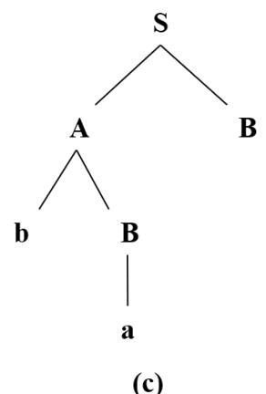
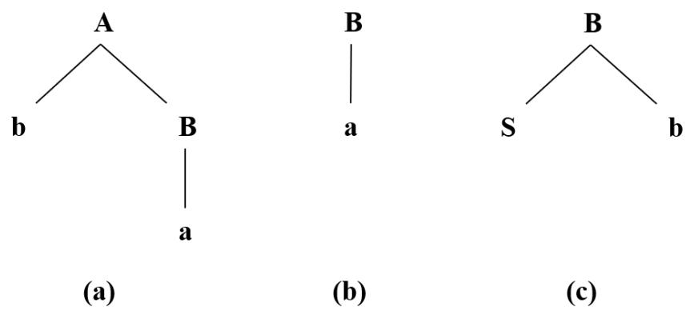
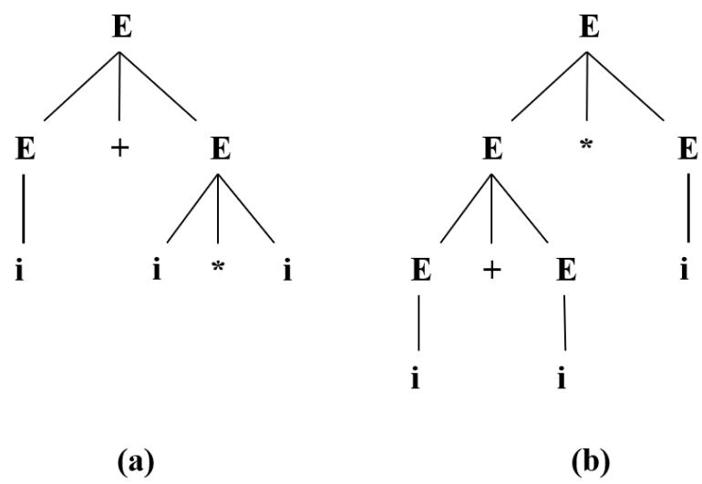
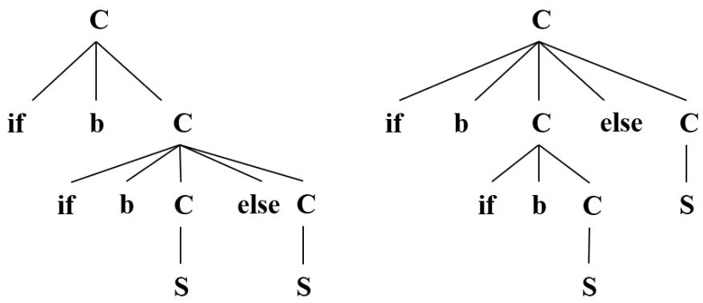
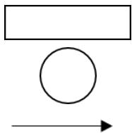

# 《编译原理》第2章 形式语言的基本知识

原件经识别和整理；“参考解答”是我们补的。

## 第二章 形式语言的基本知识

编译程序的核心功能就是把某一种高级程序设计语言书写的源程序翻译成另一种目标程序代码，因此要构造一个编译程序，首先要解决的问题是如何确切地描述或定义一种高级程序设计语言。实践已经证明，形式语言理论是编译理论的重要基础。利用形式语言理论，用数学符号和规则可以对语言进行形式化的描述，例如可以采用正规文法描述词法结构，采用上下文无关文法描述目前已经出现过的大多数程序设计语言的语法结构。

自 1956 年语言学家诺姆·乔姆斯基（Noam Chomsky）首次提出形式语言理论以来，形式语言与自动机理论已经得到了迅速的发展，成为计算机科学领域的分支。本章主要讨论与编译技术相关的一些形式语言的基本概念和知识，为后续内容的学习打下良好的基础。

### 2.1 字母表和符号串的基本概念

在人类社会中，人们使用语言进行沟通和交流。例如汉语、英语等都是语言的一种类型，这些语言被称为“自然语言”。自从 1946 年电子计算机出现以后，出现了另一种类型的语言“程序设计语言”。“自然语言”是人与人之间交流思想的工具，而“程序设计语言”则是人与计算机之间“交流”的工具。无论是“自然语言”或是“程序设计语言”，都是由单词按照一定的语法规则构成的复杂的符号系统。下面我们首先介绍字母表和符号串的基本概念。

定义 2.1（字母表）字母表是符号的有穷非空集合，通常记为 $\Sigma$。字母表中的元素称为符号，符号是字母表中不能再分解的最小单位。

例 2.1 机器语言的字母表 $\Sigma = \{0, 1\}$，该字母表中只有 0 和 1 两个符号。机器语言不能出现字母表以外的符号。

不同的语言有不同的字母表，例如，英语的字母表由 26 个字母和一些标点符号等组成，C 语言的字母表由 ASCII 码表中的字母、数字以及一些特殊符号等组成。

定义 2.2（符号串）字母表 $\Sigma$ 上的符号串（也称为符号串）是字母表中的符号组成的任何有穷序列，可以按照下述规则定义：

1. $\varepsilon$ 是 $\Sigma$ 上的符号串，称为“空符号串”，它不包含 $\Sigma$ 上的任何符号；
2. $\Sigma$ 中的每个符号 $a$，都是 $\Sigma$ 上的符号串；
3. 如果 $x$ 是 $\Sigma$ 上的符号串，$y$ 是 $\Sigma$ 上的符号串，则 $xy$ 也是 $\Sigma$ 上的符号串（其中 $xy$ 被称为符号串 $x$ 和 $y$ 的连接）。

通常用 $x, y, z, \ldots$ 这些小写字母表示符号串。符号串 $x$ 中包含的符号个数称为 $x$ 的长度，记为 $|x|$，显然 $|\varepsilon| = 0$。

例 2.2 设 $\Sigma = \{0, 1\}$，则符号串有

$\varepsilon$ 是 $\Sigma$ 上的符号串，0，1 是 $\Sigma$ 上的符号串，00，01，10，11 是 $\Sigma$ 上的符号串，000，100，……也都是 $\Sigma$ 上的符号串。其中 $|000| = 3$。

从上例可以看出，符号串 01 和 10 是两个不同的符号串，通常情况下 $xy$ 与 $yx$ 是两个不同的符号串（$\varepsilon x = x \varepsilon = x$ 是其中的特例）。

定义 2.3（符号串的头、尾、子串）符号串 $x, y, z$ 都是 $\Sigma$ 上的符号串（它们都可能是空符号串），那么 $x$ 被称为 $xy$ 的头（或前缀），$y$ 被称为 $xy$ 的尾（或后缀），$y$ 被称为 $xyz$ 的子串。当 $x$ 是 $xy$ 的前缀，且 $x \neq xy$，则 $x$ 被称为 $xy$ 的真头（或真前缀）；当 $y$ 是 $xy$ 的后缀，且 $y \neq xy$，则 $y$ 被称为 $xy$ 的真尾（或真后缀）；当 $y$ 是 $xyz$ 的子串，且 $y \neq xyz$，则 $y$ 被称为 $xyz$ 的真子串。

例 2.3 设 $\Sigma = \{a, b\}$，有符号串 $x = abaa$，$\varepsilon, a, ab, aba, abaa$ 都是该符号串 $x$ 的头，其中真头有 $\varepsilon, a, ab, aba$，而 $abaa, baa, aa, a, \varepsilon$ 都是该符号串 $x$ 的尾，其中真尾有 $baa, aa, a, \varepsilon$，而 $\varepsilon, a, b, ab, ba, aa, aba, baa, abaa$ 是该符号串 $x$ 的子串。

定义 2.4（符号串的幂运算）假设 $x$ 自身进行 $n$ 次连接运算得到符号串 $x^n$，记为 $xx \ldots x$（$n$ 个 $x$），称为符号串 $x$ 的幂运算。特别的，任何符号串的 0 次连接为 $\varepsilon$。

例 2.4 设 $\Sigma = \{a, b\}$，有符号串 $x = ab$，$x^0 = \varepsilon$，$x^1 = ab$，$x^2 = abab$。

定义 2.5（符号串集合）如果集合 $A$ 中的所有元素都是某字母表 $\Sigma$ 上的符号串，则称 $A$ 为字母表 $\Sigma$ 上定义的符号串集合。

每个形式语言都是某个字母表上按照某种规则构成的所有符号串的集合，因此也可以把符号串集合 $A$ 称为字母表 $\Sigma$ 上定义的某种语言。

通常用大写字母 $A$、$B$、$C$……来表示字母表上符号串集合。显然 $\Sigma$ 本身也是字母表 $\Sigma$ 上的符号串集合。

例 2.5 假设字母表 $\Sigma = \{a, b\}$，则 $A = \{\varepsilon, a, b, ab\}$ 是 $\Sigma$ 上定义的符号串集合，$B = \{\varepsilon, a, b, abc\}$ 不是 $\Sigma$ 上定义的符号串集合。

也可以用集合中的符号串所满足的条件来刻画一个符号串集合，例如 $C = \{x \mid x \text{ 仅包含 } a \text{ 的任意长度的符号串}\}$，$D = \{y \mid |y| < 5\}$。

既然语言是符号串的集合，那么符号串集合的运算（并、交、差、补）等运算对语言都适用。但语言又是特殊的集合，它的元素都是符号串，因此对这种集合还有特殊的运算，即集合的连接运算和闭包运算。

定义 2.6（符号串集合的连接）假设 $L_1$ 是定义在 $\Sigma_1$ 上的符号串集合，$L_2$ 是定义在 $\Sigma_2$ 上的符号串集合，$L_1$ 和 $L_2$ 的连接运算由以下公式定义：

$$
L_1 L_2 = \{xy \mid x \in L_1, y \in L_2\}
$$

从上述公式可以看出，符号串集合的连接运算和集合的乘积计算非常相似，但只有两个符号串集合在同一个集合上定义，才能进行集合的乘积运算，而连接运算对此没有要求。

由此，我们也可以定义符号串集合的幂运算，即 $(L_1)^0 = \{\varepsilon\}$，$(L_1)^1 = L_1$，$(L_1)^2 = L_1 L_1$，$(L_1)^n = (L_1)^{n-1}(L_1) = (L_1)(L_1)^{n-1}$（其中 $n \geq 1$）。

例 2.6 $A = \{a, b\}$，$B = \{cc, cd\}$，$AB = \{acc, acd, bcc, bcd\}$，$A^0 = \{\varepsilon\}$，$A^1 = \{a, b\}$，$A^2 = \{aa, ab, ba, bb\}$，$A^3 = \{aaa, aab, aba, abb, baa, bab, bba, bbb\}$。

定义 2.7（符号串集合的闭包）符号串集合 $L$ 是定义在 $\Sigma$ 上的集合，$L$ 的闭包记为 $L^*$，其定义如下：

1. $L^0 = \{\varepsilon\}$；
2. 对于 $n \geq 1$，$L^n = L L^{n-1}$；
3. $L^* = \cup L^n$，$n \in \{0, 1, 2, \ldots\}$。

符号串集合 $L$ 的正闭包记为 $L^+$，$L^+ = \cup L^n$（$n \geq 1$），显然 $L^* = L^+ \cup \{\varepsilon\}$。

例 2.7 假设 $A = \{1, 01\}$ 是字母表 $\Sigma = \{0, 1\}$ 上的符号串集合，因为 $A^0 = \{\varepsilon\}$，$A^1 = \{1, 01\}$，$A^2 = \{11, 101, 011, 0101\}, \ldots$，$A^* = \{\varepsilon, 1, 01, 11, 101, 011, 0101, \ldots\}$。

# 2.2 用文法产生法描述语言

本章节内容整理自《编译原理》教材第 2 章，主要介绍形式语言的文法描述方法、BNF 范式、产生式定义及推导过程。

## 一、行集合与语言描述方法

### 定义 2.8（行集合）
因为 $\Sigma$ 本身也是字母表 $\Sigma$ 上的符号串集合，因此将闭包 $\Sigma^*$ 称为行集合，表示字母表 $\Sigma$ 中的符号以任意次序、任意个数和任意长度所组成的符号串集合（包括 $\varepsilon$ 符号串）。显然对于 $\Sigma$ 上定义的任何符号串集合 $L$ 都是行集合 $\Sigma^*$ 的子集，任何符号串集合的闭包 $L^*$ 都是行集合 $\Sigma^*$ 的子集。

### 语言描述的三种方法
无论是自然语言或者是程序设计语言，都是由许多句子组成，当然这些句子是由本语言字母表上符号按照一定规则组成的符号串。对一个语言的描述，就是如何刻画哪些句子是属于该语言的句子，哪些句子是不属于该语言的句子。通常可以用三种方法来描述语言：

1.  **枚举法**：如果一个语言仅包含有限条句子，就可以采用枚举法来描述此语言，把语言中每条句子都列举出来即可。然而，绝大多数重要语言都有无穷多个语句，因此枚举法显然失效。
2.  **自动机识别法**：在这种方法中，每种语言对应一种自动机（即某种算法），由它判定一个符号串是否属于该语言。
3.  **文法产生法**：这种方法是为每种语言定义一组文法规则，从而产生该语言中的每条句子。本小节主要介绍一种利用巴科斯 - 诺尔范式（Backus Normal Form，简称为巴科斯范式，简记为 BNF 范式）产生语言的方法。

## 二、BNF 范式

### 基本概念
BNF 范式是由约翰·巴克斯（John Backus）和彼得·诺尔（Peter Naur）提出的一种采用形式化符号来描述语言的文法规则的方法，最早用于描述 ALGOL 语言的文法规则。它采用形式化方式定义语言的造词和造句规则，同时用简洁的公式严格清晰地定义各种语言。

BNF 范式引入 `::=`（读成“定义为”，简写为 `→`）来描述文法规则：

$$ <\text{符号}> ::= <\text{符号串表达式}> $$

这条规则的意思是左部的“符号”可以用右部的“符号串表达式”来表示。例如，在英语中语句由主语、谓语、宾语组成，用 BNF 范式可以描述成：

$$ <\text{语句}> ::= <\text{主语}><\text{谓语}><\text{宾语}> $$

如果同一个 `<符号>` 可以定义为多个不同的表达式，则引入 `|` 符号，表示多种不同的选择：

$$ <\text{符号}> ::= <\text{符号串表达式 1}> | <\text{符号串表达式 2}> $$

这条规则实际上是 `<符号> ::= <符号串表达式 1>` 和 `<符号> ::= <符号串表达式 2>` 这两条规则的合并缩写形式。`<符号串表达式 1>` 和 `<符号串表达式 2>` 被称为 `<符号>` 的右部候选式。

### 示例：C 语言标识符
**例 2.8** 采用 BNF 范式描述 C 语言的标识符：以字母或下划线开头的，其后是任意个数的字母、下划线和数字的任意长度组合。

```bnf
<标识符> ::= <字母> | <下划线> | <标识符><字母> | <标识符><下划线> | <标识符><数字>
<字母> ::= A | B | C | ... | Z | a | b | c | ... | z
<下划线> ::= _
<数字> ::= 0 | 1 | 2 | ... | 9
```

用 `<<` 和 `>>` 括起来的符号表示文法实体（或文法单位），如果能够明确看出文法实体的情况下，`<<` 和 `>>` 也可以省略不写。

**例 2.9** 采用 BNF 范式描述这种语言：以 0 开头的，其后是任意个数的 1（1 的个数大于 0）。

$$ S \rightarrow 0A \quad A \rightarrow 1A | 1 $$

## 三、产生式与文法的形式化定义

### 定义 2.9（产生式）
可以将 `<符号> ::= <符号串表达式>` 的定义形式进行扩展和抽象，得到一条产生式的定义。产生式是只有一个候选式的文法规则，是一个非空符号串和另一个符号串的有序偶 $(\alpha, \beta)$，记为 $\alpha ::= \beta$ 或 $\alpha \rightarrow \beta$。$\alpha$ 称为产生式的左部，$\beta$ 是产生式的右部。$\alpha \rightarrow \beta$ 表示左部 $\alpha$ 定义为右部 $\beta$。

产生式左部和右部所有符号的集合称为字汇表（symbol collection set），记为 $V$。
*   如果出现在左部，并且能派生出其他符号或符号串的那些符号称为**非终结符号**（non-terminal symbol），也称为文法实体或文法单位，它们的全体构成一个非终结符号集合，记为 $V_N$。
*   $V$ 中不属于 $V_N$ 的那些符号，被称为**终结符号**（terminal symbol），它们的全体组成了终结符号集合，记为 $V_T$。
*   显然 $V = V_N \cup V_T$，$V_N \cap V_T = \emptyset$。
*   $\alpha \in (V_N \cup V_T)^+$，$\beta \in (V_N \cup V_T)^*$。
*   $V_N \cup V_T \cup \{\varepsilon\}$ 称为文法符号集合（此处空符号串 $\varepsilon$ 看成特殊的符号）。

特别的，如前所述，如果非终结符号 $\alpha$ 有多个候选式 $(\alpha ::= \beta_1, \alpha ::= \beta_2, ..., \alpha ::= \beta_n)$，那么可以写成合并规则 $\alpha ::= \beta_1 | \beta_2 | ... | \beta_n$。

**例 2.10** 有产生式：
$$ S \rightarrow aSb \quad S \rightarrow ab $$
则 $V_N = \{S\}$，$V_T = \{a, b\}$，$V = \{S, a, b\}$。这两条产生式，也是两条规则，也可以合并写成一条规则 $S \rightarrow aSb | ab$。

通常需要多条产生式（规则）才能完成某种语言的定义（例如，如果用文法生成法描述 C 语言，则大约需要 3000-5000 条产生式），从而进一步得到文法的形式化定义。

### 定义 2.10（文法）
文法 $G$ 是规则的有穷集合，可以定义为四元组形式：

$$ G = (V_N, V_T, P, S) $$

其中：
*   $V_N$ 是非终结符号集合；
*   $V_T$ 是终结符号集合；
*   $P$ 是产生式（规则）的集合；
*   $S \in V_N$，是文法 $G$ 产生句子的开始符号（$S$ 也称为文法的识别符号，它至少要在一条产生式左部出现）。

文法 $G$ 也通常记为文法 $G[S]$。

**例 2.11** 标识符的文法定义如下：

$$ G[S] = (V_N, V_T, P, S) $$

*   $V_N = \{<\text{标识符}>, <\text{字母}>, <\text{数字}>, <\text{下划线}>\}$
*   $V_T = \{A, B, \dots, Z, a, b, \dots, z, 0, 1, \dots, 9, \_\}$
*   $P$ 由下列规则组成：
    ```bnf
    <标识符> ::= <字母> | <下划线> | <标识符><字母> | <标识符><下划线> | <标识符><数字>
    <字母> ::= A | B | C | ... | Z | a | b | c | ... | z
    <下划线> ::= _
    <数字> ::= 0 | 1 | 2 | ... | 9
    ```
*   $S = <\text{标识符}>$

通常情况下，在对文法进行描述时可以省略 $V_N$ 和 $V_T$，文法的开始符号也可以不需要“显式地”指定，仅需将开始符号写在 $G$ 后的中括号中即可。上述文法也可以简单描述为：

$$ G[A]: A \rightarrow Bc, \quad B \rightarrow d $$

## 四、通过文法产生语言的方式

### 定义 2.11（直接推导和直接归约）
文法 $G = (V_N, V_T, P, S)$ 有一条产生式 $\alpha \rightarrow \beta$，$\alpha \in (V_N \cup V_T)^+$，$\beta \in (V_N \cup V_T)^*$。假设存在符号串 $x, y \in (V_N \cup V_T)^*$，使得有符号串 $v$ 和 $w$ 满足 $v = x\alpha y$ 和 $w = x\beta y$，则称符号串 $v$ 直接推导出符号串 $w$，符号串 $w$ 直接归约到符号串 $v$，并把符号串 $w$ 叫做符号串 $v$ 的直接派生式，记为：

$$ v \Rightarrow w $$

显然，如果 $x = y = \varepsilon$，对于文法 $G$ 的任何规则 $\alpha \rightarrow \beta$，一定有 $\alpha \Rightarrow \beta$。一次直接推导其实就是用产生式右部去替换左部的过程。

**例 2.13** 文法 $G[S]$: $S \rightarrow 0S | 01$

**例 2.14** $G[<\text{标识符}>]$：
```bnf
<标识符> ::= <字母> | <下划线> | <标识符><字母> | <标识符><下划线> | <标识符><数字>
<下划线> ::= _
<数字> ::= 0 | 1 | 2 | ... | 9
```
推导过程示例：
$$ <\text{标识符}> \Rightarrow <\text{字母}> $$
$$ <\text{标识符}> \Rightarrow <\text{标识符}><\text{数字}> \Rightarrow <\text{字母}><\text{数字}> \Rightarrow A<\text{数字}> \Rightarrow A4 $$

### 定义 2.12（推导和归约）
假设 $u_0 \in (V_N \cup V_T)^+$，$u_1, u_2, ..., u_n$ 都是 $(V_N \cup V_T)^*$ 上定义的符号串。如果存在直接推导序列 $v = u_0 \Rightarrow u_1 \Rightarrow u_2 \Rightarrow \ldots \Rightarrow u_n = w$ ($n \geq 1$)，则称符号串 $v$ 推导出符号串 $w$，符号串 $w$ 归约到符号串 $v$，记为：

$$ v \Rightarrow^+ w $$

$v = u_0 \Rightarrow u_1 \Rightarrow u_2 \Rightarrow \ldots \Rightarrow u_n = w$ ($n \geq 1$) 也被称为长度为 $n$ 的推导。

**例 2.15**
1.  $S \Rightarrow 0S \Rightarrow 00S \Rightarrow 0001$ 称为长度为 3 的推导，记为 $S \Rightarrow^+ 0001$。
2.  $<\text{标识符}> \Rightarrow <\text{标识符}><\text{数字}> \Rightarrow <\text{标识符}><\text{数字}> \Rightarrow <\text{字母}><\text{数字}> \Rightarrow A<\text{数字}> \Rightarrow A4$ 称为长度为 5 的推导，记为 $<\text{标识符}> \Rightarrow^+ A4$。

### 定义 2.13（广义推导和广义归约）
假设 $v \Rightarrow^+ w$，或者 $v = w$（表示 0 步推导），则记为 $v \Rightarrow^* w$。

## 2.3 句型的分析

所谓句型的分析，是指判断输入的符号串是否为某一文法的句型（或句子）的过程。对于一个编译程序来说，无论在词法分析阶段，还是在语法分析阶段，都存在句型分析，这是编译程序要解决的首要问题。

$$
\mathrm{v} \Rightarrow {} ^ {*} \mathrm{w}
$$

则称符号串 v 广义推导出符号串 w，符号串 w 广义归约到符号串 v，或者称为长度大于等于 0 的推导序列。

显然，直接推导的长度为 1，推导的长度 ≥1，广义推导的长度 ≥0。

有了文法和直接推导、推导和广义推导的定义，就可以用形式化的方法定义句型、句子和语言了。

**定义 2.14（句型和句子）** 假设 G[S] 是一文法，如果有符号串 $\mathbf{x} \in (\mathrm{V_N} \cup \mathrm{V_T})^*$ 是由 S 广义推导而得的，即 $\mathbf{S} \Rightarrow^* \mathbf{x}$，则称符号串 x 是该文法 G[S] 的一个句型。

如果句型 x 仅由终结符号组成，即 $\mathbf{S} \Rightarrow^* \mathbf{x}$，$\mathbf{x} \in \mathrm{V_T}^*$，则称符号串 x 是该文法 G[S] 的一个句子。

一个正确的源程序是文法所定义的句子。

**例 2.16** 在推导序列 $\mathrm{S} \Rightarrow 0\mathrm{S} \Rightarrow 00\mathrm{S} \Rightarrow 0001$ 中，S、0S、00S、0001 都是句型，其中 0001 是句子。在推导序列 <标识符> ⇒ <标识符><数字> ⇒ <字母><数字> ⇒ A<数字> ⇒ A4 中，<标识符>、<标识符><数字>、<字母><数字>、A<数字>、A4 都是句型，其中 A4 是句子。

**定义 2.15（语言）** 假设 G[S] 是一文法，由这个文法所产生的所有句子的集合称为“由该文法所定义的语言”，记为 L(G[S])（或简记为 L(G)），即

$$
\mathrm{L}(\mathrm{G}) = \{\mathrm{x} \mid \mathrm{S} \Rightarrow^* \mathrm{x}, \text{且} \mathrm{x} \in \mathrm{V_T}^*\}
$$

由定义 2.15 可以看出，语言是 $\mathrm{V_T}^*$ 的一个子集，即所有终结符号以任意次序、任意个数和任意长度所组成的符号串集合（包含 ε 在内）的一个子集，用形式化的方式描述为：$\mathrm{L}(\mathrm{G}) \subseteq \mathrm{V_T}^*$。

### 例 2.17

设有文法 G[A]：A→Bc，B→d

因为从开始符号 A 出发，只能推导出唯一的一条句子 dc

$$
\mathrm{A} \Rightarrow \mathrm{Bc} \Rightarrow \mathrm{dc}
$$

所以 $\mathrm{L}(\mathrm{G}) = \{\mathrm{dc}\}$。

### 例 2.18

文法 G[S]：

$$
\begin{array}{ll}
\mathrm{S} \rightarrow \mathrm{ab} & \text{产生式1} \\
\mathrm{S} \rightarrow 0\mathrm{S} & \text{产生式2}
\end{array}
$$

首先应用产生式 1，得到 $\mathrm{S} \Rightarrow \mathrm{ab}$，则 ab 是文法 G[S] 的一条句子。

然后应用产生式 2，得到 $\mathrm{S} \Rightarrow 0\mathrm{S} \Rightarrow 00\mathrm{S} \Rightarrow \ldots \Rightarrow 0^n\mathrm{S}$，其中 n≥1，显然 $0^n\mathrm{S}$ 是一个句型，不是句子，因此再应用产生式 1，得到 $\mathrm{S} \Rightarrow 0\mathrm{S} \Rightarrow 00\mathrm{S} \Rightarrow \ldots \Rightarrow 0^n\mathrm{S} \Rightarrow 0^n\mathrm{ab}$，n≥1。

综上所述，$\mathrm{L}(\mathrm{G}) = \{0^n\mathrm{ab} \mid n \geq 0\}$。

由上面两例可以看出，已知文法，求其所定义的语言时，可以通过推导，即从文法的开始符号出发，反复连续地使用文法规则推导一些句子，从这些句子中找到规律。

而已知语言构造其文法，目前还没有形式化的方法，更多的是凭经验。

### 例 2.19

构造如下语言的相应文法 $\mathrm{L}(\mathrm{G}) = \{0^n1^n \mid n \geq 0\}$

$$
\mathrm{G}[\mathrm{S}] : \mathrm{S} \rightarrow 0\mathrm{S}1 \quad \mathrm{S} \rightarrow \varepsilon
$$

给定语言 L(G) 后，构造出能正确描述此语言的文法 G 是有一定难度的。若要使一个文法 G 能正确描述相应语言 L(G)，必须保证：由文法 G 所产生的每个句子在语言集 L(G) 中；在语言集 L(G) 中的每个符号串均能由 G 产生。

### 例 2.20

构造如下语言的相应文法 $\mathrm{L}(\mathrm{G}) = \{0^m1^n \mid m, n \geq 1\}$

方法一：$\mathrm{G}[\mathrm{S}] : \mathrm{S} \rightarrow \mathrm{AB} \quad \mathrm{A} \rightarrow 0\mathrm{A} \mid 0 \quad \mathrm{B} \rightarrow 1\mathrm{B} \mid 1$

方法二：$\mathrm{G}[\mathrm{S}] : \mathrm{S} \rightarrow 0\mathrm{S} \quad \mathrm{S} \rightarrow \mathrm{S}1 \quad \mathrm{S} \rightarrow 01$

从例 2.20 可以看出，两个文法不相同，但它们描述的语言完全相同，由此得到文法等价的定义。

**定义 2.16（文法等价）** 如果有两个文法 $\mathrm{G_1}$ 和 $\mathrm{G_2}$，如果它们的规则不完全相同，但所描述的语言完全相同，即 $\mathrm{L}(\mathrm{G_1}) = \mathrm{L}(\mathrm{G_2})$，则称这两个文法是等价的。

等价文法的存在，使我们能在不改变文法所确定的语言的前提下，为了某种目的而对文法进行改写。

构成一个语言的句子集合可以是有穷的，也可以是无穷的，例 2.17 文法所描述的语言中仅有一条句子，例 2.18 文法所描述的语言中包含无穷多个句子。不难发现，两个文法的根本区别在于文法例 2.18 中有形如：S→0S 的规则。在这个规则中左部和右部皆出现了非终结符 S。这种借助于自己来定义自己的规则，即在规则左部和右部具有相同的非终结符的规则称为递归规则。

**定义 2.17（直接递归文法）** 对于任意文法 G，如果至少有一条形如 U→…U… 的规则，则称该文法为直接递归文法。如果包含左递归规则：U→U…，则此文法为直接左递归文法，如果包含右递归规则：U→…U，则此文法为直接右递归文法。

**定义 2.18（间接递归文法）** 对于任意文法 G，如果至少有一个形如 $\mathrm{U} \Rightarrow^+ \ldots \mathrm{U} \ldots$ 的推导序列，则称该文法为间接递归文法。如果包含 $\mathrm{U} \Rightarrow^+ \mathrm{U} \ldots$，则此文法为间接左递归文法，如果包含 $\mathrm{U} \Rightarrow^+ \ldots \mathrm{U}$，则此文法为间接右递归文法。显然，直接递归是间接递归的一种特殊情况。

### 例 2.21

设有文法 G 的规则 P 为：

$$
\mathrm{S} ::= \mathrm{Qc} \mid \mathrm{c} \quad \mathrm{Q} ::= \mathrm{Rb} \mid \mathrm{b} \quad \mathrm{R} ::= \mathrm{Sa} \mid \mathrm{a}
$$

在这 6 条规则中，无直接递归规则，但有如下推导：

$$
\mathrm{S} \Rightarrow \mathrm{Qc} \Rightarrow \mathrm{Rbc} \Rightarrow \mathrm{Sabc}
$$

所以，$\mathrm{S} \Rightarrow^+ \mathrm{Sabc}$ 存在间接左递归。

如果一个语言是无穷的，则描述该语言的文法一定是递归的。一般而言，程序设计语言是无穷的，因此描述它们的文法必定是递归的。应当指出，从语法定义的角度来看，递归定义是一种简明的方式，因为它不仅使文法的形式比较简练，而且也给无限语言的有限表示提供了一种可用的方法。然而在后面我们将会看到，文法的左递归规则将会给某些语法分析方法的实现造成很大的困扰。

# 《编译原理》第2章 形式语言的基本知识（第4部分）

本资料整理自教材《编译原理》第2章第4部分（原书第8–10页），主要涵盖短语、句柄、语法树、规范推导及文法二义性等核心概念。

## 一、短语、简单短语与句柄

### ### 定义 2.19（短语和简单短语）

设 $G[Z]$ 是一个文法，$\mathbf{W} = \mathbf{xuy}$ 是其中某个句型，若有

$$
Z \Rightarrow^* x U y, U \in V_N \text{且} U \Rightarrow^+ u, u \in V^+
$$

则称 $u$ 是一个相对于非终结符 $U$、句型 $w$ 的**短语**。

若 $Z \Rightarrow^* x U y$ 且 $U \Rightarrow u$，则称 $u$ 是一个相对于非终结符 $U$、句型 $w$ 的**简单短语**。

### ### 例 2.21

设有文法 $G[S] = (\{S, A, B\}, \{a, b\}, P, S)$，其中 $P$ 为：

$$
\begin{aligned}
S &::= AB \\
A &::= a \mid Sb \\
B &::= a \mid Sb
\end{aligned}
$$

找出句型 `baSb` 的全部短语和简单短语。根据句型推导过程有：

$$
S \Rightarrow AB \Rightarrow bBB \Rightarrow baB \Rightarrow baSb
$$

由上可见，下式成立：$S \Rightarrow^* baB$ 且 $B \Rightarrow Sb$。所以子串 `Sb` 是相对于非终结符 $B$，句型 `baSb` 的简单短语。

同样有 $S \Rightarrow AB \Rightarrow ASb \Rightarrow bBSb \Rightarrow baSb$，即 $S \Rightarrow^* bBSb$ 且 $B \Rightarrow a$。子串 `a` 是相对于 $B$，句型 `baSb` 的简单短语。

还有 $S \Rightarrow^* ASb$ 且 $A \Rightarrow^+ ba$。即子串 `ba` 是相对于非终结符 $A$，句型 `baSb` 的短语。

对于句型 `baSb`，再没有其它推导能产生新的短语了，所以句型 `baSb` 有短语 `ba`，简单短语 `a` 和 `Sb`。

### ### 定义 2.20（句柄）

一个句型最左边的简单短语称为该句型的**句柄**（或柄短语），而且句柄最左边的符号称句柄的头，句柄最右边的符号称句柄的尾。

如上例句型 `baSb`，简单短语为 `a` 和 `Sb`，由于 `a` 是最左简单短语，所以 `a` 又是句柄。

利用语法树可以非常直观地求出句型的全部短语、简单短语和句柄。下面给出语法树的形式定义。

## 二、语法树

### ### 定义 2.21（语法树）

对于任意文法 $G$，设有文法 $G = (V_N, V_T, P, Z)$，满足下列条件的树即为一棵语法树：

1. 树中每一个结点都有标记，且该标记是 $V_N \cup V_T \cup \{\varepsilon\}$ 中的某一符号；
2. 树根标记是开始符号；
3. 若有一个结点至少有一个后继结点，则该结点的标记一定为非终结符；
4. 若一个标记为 $U$ 的结点，它有标记依次为 $X_1, X_2, X_3, ..., X_n$ 的直接后继结点，则 $U ::= X_1 X_2 ... X_n$ 必定是 $G$ 的一条规则。

从定义上看，语法树就是一种句型推导的图形化描述方式。

语法树中的几个术语如下：

1. **末端结点**：语法树中再没有分支从它射出的结点称为末端结点。
2. **子树**：语法树中的某结点连同从它向下射出的所有部分（如果有的话），称为该语法树的子树。

### ### 例 2.22

设有文法 $G[S] = (\{S, A, B\}, \{a, b\}, P, S)$，其中 $P$ 为：

$$
\begin{aligned}
S &::= AB \\
A &::= Aa \mid bB \\
B &::= a \mid Sb
\end{aligned}
$$

有推导序列 $S \Rightarrow AB \Rightarrow bBB \Rightarrow baB \Rightarrow baSb$。

其语法树构造过程如图 2.1 所示。从文法开始符号 $S$ 先画一分支，表示第一个直接推导 $S \Rightarrow AB$（如图 2.1(a)），从分支结点 $A$ 继续向下画分支，表示第二个直接推导 $AB \Rightarrow bBB$（如图 2.1(b)），再从分支结点 $B$ 向下画分支，表示第三个直接推导 $bBB \Rightarrow baB$（如图 2.1(c)），最后由句型 `baB` 中标记为 $B$ 的结点向下画分支，表示最后一个推导 $baB \Rightarrow baSb$（如图 2.1(d)）。这时末端结点自左向右排列起来就是句型 `baSb`。



根据语法树确定短语、简单短语和句柄的方法如下：

1. 子树末端结点形成的符号串是相对于子树根的短语；
2. 只有两层的简单子树末端结点形成的符号串是相对于该子树根的简单短语；
3. 最左边的简单子树的末端结点形成的符号串是句柄。

图 2.2 给出了句型 `baSb` 的三棵子树，其中图 2.2(b) 和 (c) 是简单子树，从图中可以直观的看出：`ba` 是相对于非终结符号 $A$，句型 `baSb` 的短语；`a` 是相对于非终结符号 $B$，句型 `baSb` 的简单短语，同时也是句柄（最左简单短语）；`Sb` 是相对于非终结符号 $B$，句型 `baSb` 的简单短语。



## 三、规范推导与文法的二义性

对于给定的文法来说，从其开始符号到某一句型，或从某一句型到另一句型的推导序列可能不唯一。为了使句型或句子能按照确定的推导序列来产生，通常我们仅考虑最左推导或最右推导。

### ### 定义 2.22（最左（右）推导（归约））

在任何一步推导 $v \Rightarrow w$ 中，都是对符号串 $v$ 的最左（右）的非终结符进行替换，称之为最左（右）推导。我们把最左推导的逆过程称最右归约，最右推导的逆过程称最左归约。

### ### 定义 2.23（规范推导（归约）和规范句型）

最右推导叫做**规范推导**，即在规范推导过程中，每步直接推导 $xUy \Rightarrow xuy$ 中，符号串 $y$ 只含有终结符。如果推导 $v \Rightarrow^+ w$ 中每一步直接推导是规范的，则称推导 $v \Rightarrow^+ w$ 为规范推导。由规范推导所得的句型称为**规范句型**。最左归约也称为规范归约。

例 2.22 中的推导序列是最左推导。对于文法中的每一句子都必定有最左和最右推导，但对于句型来说则不一定。

### ### 例 2.23

文法 $G[E]$：

$$
\begin{aligned}
E &::= E + T \mid T \\
T &::= T * F \mid F \\
F &::= (E) \mid i
\end{aligned}
$$

中句型 $T*i+T$，仅有唯一的推导：

$$
E \Rightarrow E + T \Rightarrow T + T \Rightarrow T * F + T \Rightarrow T * i + T
$$

显然，推导 $E \Rightarrow^+ T * i + T$ 既非最左推导亦非最右推导。

### ### 定义 2.24（文法的二义性）

如果一个文法中某个句子对应两棵不同的语法树，则称这个文法是**二义性的**。也就是说，若一个文法中的某句子对应两个不同的最左推导或最右推导，则这个文法是二义性的。

### ### 例 2.24

文法 $G[E]$：

$$
E ::= E + E \mid E * E \mid (E) \mid i
$$

符号串 $i+i*i$ 是 $L(G)$ 中一个句子，有两个不同的最右推导：

$$
\begin{aligned}
(1) \quad & E \Rightarrow E + E \Rightarrow E + E * E \Rightarrow E + E * i \Rightarrow E + i * i \Rightarrow i + i * i \\
(2) \quad & E \Rightarrow E * E \Rightarrow E + E * E \Rightarrow E + i * E \Rightarrow E + i * i \Rightarrow i + i * i
\end{aligned}
$$

推导序列 (1) 和 (2) 分别对应两棵不同的语法树（如图 2.3 所示），所以文法 $G[E]$ 是二义性的。

# 《编译原理》第2章 形式语言的基本知识

本节内容整理自教材《编译原理》第2章第5部分（第11–13页），主要涵盖文法二义性的解决途径、语言的二义性定义以及乔姆斯基对文法的四种分类体系。

## 2.3 文法的二义性及其处理

### 二义性文法的处理途径

二义性文法的存在使得语法分析遇到麻烦，为此可以采用两种途径来解决：

1. **在语义上加些限制**，或者说加一些语法非形式的规定。
    - 例如对于上例中 $G[E]$ 文法，可以通过规定运算符之间的优先级来避免文法的二义性。
    - 例如对于条件语句文法 $G[C]$，可以规定 `else` 永远与最靠近它的不带 `else` 的 `if` 配对。
    - 对于算术表达式文法 $G[E]$，可以规定运算的优先级（例如加法和乘法）。

2. **将原二义性文法改造成一个等价的无二义性文法**。
    - 例如对于上述 $G[E]$ 文法，可以构造出一个无二义性文法 $G'[E]$：
      $$
      E \rightarrow T \mid E + T \\
      T \rightarrow F \mid T * F \\
      F \rightarrow (E) \mid i
      $$

> **[!NOTE] 关于语言二义性的说明**
> 已经证明，不存在一种算法，它能在有限的步骤内确切地判定一个文法是否是二义性。
> - **定义 2.25（语言的二义性）**：产生该语言的文法都是二义性文法，称该语言为**二义性语言**，也称先天二义性。
> - 对于由二义性文法描述的语言，有时可以找到等价的无二义性文法描述它（如上例文法 $G[E]$ 和 $G'[E]$）。
> - 因此，我们只说文法的二义性，而不说语言的二义性。





## 2.4 文法和语言的分类

### 1. 文法的乔姆斯基分类

根据对文法 $G = (V_N, V_T, P, S)$ 中产生式集合 $P$ 中的规则施加不同限制条件，乔姆斯基（Chomsky）将文法分为 0型、1型、2型和3型四种类型，通常称为 Chomsky 体系。

#### 定义 2.26（0型文法）

文法 $G$ 的产生式集合 $P$ 中的每个产生式都满足下列形式：

$$
\alpha \rightarrow \beta
$$

其中 $\alpha \in (V_N \cup V_T)^+$，且至少含有一个 $V_N$ 中的非终结符号，$\beta \in (V_N \cup V_T)^*$。

- 则文法 $G$ 称为 **0型文法** 或 **短语结构文法**（Phrase Structure Grammar），简记为 PSG。
- 从上述定义可以看出，0型文法产生式对产生式左部和右部基本上没有加任何额外的限制条件。$\alpha$ 和 $\beta$ 都是由文法的终结符号和非终结符号组成的符号串，且 $\beta$ 可能为空符号串，而 $\alpha$ 不允许为空，即允许 $|\alpha| > |\beta|$。
- 由 0型文法产生的语言称之为 **0型语言** 或者 **短语结构语言**，简记为 PSL。

**示例 2.26**

设文法 $G = (V_N, V_T, P, S)$，其中：

$$
\begin{aligned}
V_N &= \{S, A, B, C, D, E\} \\
V_T &= \{a\} \\
P: & \\
& S \rightarrow ACaB & Ca \rightarrow aaC \\
& CB \rightarrow DB & CB \rightarrow E \\
& aD \rightarrow Da & AD \rightarrow AC \\
& aE \rightarrow Ea & AE \rightarrow \varepsilon
\end{aligned}
$$

这是一个 0型文法，它所产生语言为：

$$
L(G) = \{ a^i \mid i \text{ 是 2 的正整数次方} \}
$$

即 $L(G) = \{ aa, aaaa, aaaaaaaa, \dots \}$

#### 定义 2.27（1型文法）

文法 $G$ 的产生式集合 $P$ 中的每个产生式都满足下列形式：

$$
\alpha A \beta \rightarrow \alpha \omega \beta
$$

其中 $\alpha, \beta \in (V_N \cup V_T)^*$, $A \in V_N$, $\omega \in (V_N \cup V_T)^+$。

- 则文法 $G$ 称为 **1型文法** 或 **上下文有关文法**（Context-Sensitive Grammar），简记为 CSG。
- 之所以称为上下文有关文法，是因为非终结符号 $A$ 只有在 $\alpha$ 和 $\beta$ 这样的上下文环境时才能替换成 $\omega$。
- 从上述定义可以看出产生式右部不允许出现空符号串。通常可以将这种条件放宽，允许 1型文法中包含有形如 $S \rightarrow \varepsilon$ 的产生式，但这种情况下就要求 $S$ 不能再出现在任何产生式右部。
- 由 1型文法产生的语言称为 **1型语言** 或 **上下文有关语言**，简记为 CSL。

**示例 2.27**

设文法 $G = (V_N, V_T, P, S)$，其中：

$$
\begin{aligned}
V_N &= \{S, B, C\} \\
V_T &= \{a, b, c\} \\
P: & \\
& S \rightarrow aSBC \mid aBC \\
& CB \rightarrow AB \\
& AB \rightarrow AC \\
& AC \rightarrow BC \\
& aB \rightarrow ab \\
& bB \rightarrow bb \\
& bC \rightarrow bc \\
& cC \rightarrow cc
\end{aligned}
$$

这是一个 1型文法，它所产生的语言为 $L(G) = \{ a^n b^n c^n \mid n \ge 1 \}$。

#### 定义 2.28（2型文法）

文法 $G$ 的产生式集合 $P$ 中的每个产生式都满足下列形式：

$$
A \rightarrow \omega
$$

其中 $A \in V_N$, $\omega \in (V_N \cup V_T)^*$。

- 则文法 $G$ 称为 **2型文法** 或 **上下文无关文法**（Context-Free Grammar），简记为 CFG。
- 之所以称为上下文无关文法，是因为利用规则将非终结符号 $A$ 替换成 $\omega$ 时不需要考虑 $\alpha$ 和 $\beta$ 这样的上下文环境。
- 由 2型文法产生的语言称为 **2型语言** 或 **上下文无关语言**，简记为 CFL。
- 大部分程序设计语言的文法近似于 2型文法。

**示例 2.28**

设文法 $G = (V_N, V_T, P, S)$，其中：

$$
\begin{aligned}
V_N &= \{S, B, C\} \\
V_T &= \{a, b, c\} \\
P: & \\
& S \rightarrow aSc \mid ac
\end{aligned}
$$

这是一个 2型文法，它所产生的语言为 $L(G) = \{ a^n c^n \mid n \ge 1 \}$。

#### 定义 2.29（3型文法）

3型文法有右线性文法和左线性文法两种形式。

- **右线性文法**中产生式集合 $P$ 中的每个产生式都具有如下形式：
  $$
  A \rightarrow a \quad \text{或} \quad A \rightarrow aB
  $$
  其中 $A, B \in V_N$, $a \in V_T$。

- **左线性文法**中产生式集合 $P$ 中的每个产生式都具有如下形式：
  $$
  A \rightarrow a \quad \text{或} \quad A \rightarrow Ba
  $$
  其中 $A, B \in V_N$, $a \in V_T$。

- 3型文法也称为**正规文法**或**正则文法**（regular grammar, RG），是因为凡是能用 3型文法产生的语言一定能够用正规表达式描述，这部分内容将在第3章中详细介绍。
- 由 3型文法产生的语言称为 **3型语言** 或 **正规语言**，简记为 RL。

**示例 2.29**

设文法 $G = (V_N, V_T, P, S)$，其中：

$$
\begin{aligned}
V_N &= \{S\} \\
V_T &= \{d\} \\
P: & \\
& S \rightarrow d \mid Sd
\end{aligned}
$$

这是一个 3型文法，它所产生的语言为 $L(G) = \{ d^n \mid n \ge 1 \}$。如果 $d$ 代表任一数字，则该文法将产生无符号整数。

### 文法类型的关系与判断准则

0型文法和 1型文法在计算机的高级程序设计语言中很少使用，很多计算机语言的语法结构使用 2型文法来描述，而词法单词结构使用 3型文法来描述。因此，在本书的后续章节中涉及的几乎都是 2型和3型文法。

乔姆斯基通过对文法的规则加以更多的限制条件将文法分为四大类。最基本的是 0型文法，读者可以将它理解为其它所有文法的基础，后面的 1、2、3型三种文法，是分别对于 0型文法产生式的两边作了不同的限制。因此：

- 每一种正规文法都是上下文无关文法。
- 每一种上下文无关文法都是上下文有关文法。
- 每一种上下文有关文法又都是 0型文法。

我们在判断一个文法时应该以什么准则来判断呢？这个准则当然是：**3 → 2 → 1 → 0**。

也就是说，我们判断是从高到低来进行的。比如：一旦判断其属于正规文法之后就没必要再判断其是否属于上下文无关文法了，因为它必定属于上下文无关文法。我们应该以最高准则来判定其属于的文法类型，其它情况以此类推。只有当我们判断不属于 3型文法时，我们才向下判断，其是不是属于 2型文法；若不属于 2型文法，则依此类推再向下判断。最终的结果如果不属于 3、2和1这三种类型，那就是 0型文法。

由于将文法分成四种类型是逐渐增加对规则的限制条件而得到的，因此，由它们定义的语言是依次缩小的。如果分别用 $\mathrm{L}_0$、$\mathrm{L}_1$、$\mathrm{L}_2$ 和 $\mathrm{L}_3$ 表示 0 型、1 型、2 型和 3 型语言，则有 $\mathrm{L}_0 \supset \mathrm{L}_1 \supset \mathrm{L}_2 \supset \mathrm{L}_3$。

### 2. 文法与自动机

语言是字母表上符号串所组成集合的子集，即句子的集合。除了使用文法定义相应的语言外，还可以从识别句子的角度出发，设计一种模型，这种模型以字母表上的符号串为输入，判断该符号串是否是该语言的句子，如果是，则接受它，反之，则拒绝接受。我们将这种模型称为自动机。自动机给出了有穷的方式来描述无穷的语言的另一种手段。理论上已经证明，对于 $\mathrm{L}_0$、$\mathrm{L}_1$、$\mathrm{L}_2$ 和 $\mathrm{L}_3$ 四种语言，正好有一类自动机与之对应，如表 2.1 所示。

表 2.1 文法与自动机

| 文法类型 | 文法名称 | 自动机名称 |
| --- | --- | --- |
| 0 | 短语结构文法 | 图灵机 |
| 1 | 上下文有关文法 | 线性界限自动机 |
| 2 | 上下文无关文法 | 下推自动机 |
| 3 | 正规文法 | 有穷状态自动机 |

本书主要讨论 2、3 型语言及相应的自动机，将在第三章、第四章分别阐述。如果读者对其他两类语言和自动机感兴趣，可以参阅有关形式语言和自动机理论方面的书籍。

### 3. 文法实用性限制

对于 2 型和 3 型文法，从实用的角度增加以下两条限制：

（1）文法中不能包含 $\mathrm{A} ::= \mathrm{A}$ 这样的产生式。

这样的规则显然是没有必要的，并且包含这种规则的文法一定是二义性文法，所以应该删除。

（2）每个非终结符号 A 必须在某个句型中出现，即 $\mathrm{S} \stackrel{*}{\Longrightarrow} \alpha \mathrm{A} \beta$，其中 $\alpha, \beta \in (\mathrm{V}_\mathrm{N} \cup \mathrm{V}_\mathrm{T})^*$，即非终结符号 A 必须在其他任一规则右部出现（文法开始符号 S 除外），否则 A 是无法到达的；同时要求非终结符号 A 必须能够推导出终结符号串，即 $\mathrm{A} \stackrel{+}{\Longrightarrow} \mathrm{t}$，其中 $\mathrm{t} \in \mathrm{V}_\mathrm{T}^*$，否则 A 是无法终止的。

如果非终结符号 A 不能满足上述条件，则以 A 为左部的那些规则不能在任何推导中使用，则包含 A 的规则都是多余的规则，应该删除。

满足上述两点限制条件的文法称为压缩过文法。

例 2.29 设文法 G[S]：

$$
\mathrm{S} ::= \mathrm{Bd} \quad \mathrm{A} ::= \mathrm{Sd} \mid \mathrm{d} \quad \mathrm{B} ::= \mathrm{Cd} \mid \mathrm{Ae} \quad \mathrm{C} ::= \mathrm{Ce} \quad \mathrm{D} ::= \mathrm{e}
$$

在该文法中，因为非终结符号 D 不出现在任何规则右部，所以删除有关 D 的规则 $\mathrm{D} ::= \mathrm{e}$，又因为非终结符号 C 推导不出终结符号串，因此有关 C 的规则 $\mathrm{B} ::= \mathrm{Cd}$ 和 $\mathrm{C} ::= \mathrm{Ce}$ 也应该删除。

删除多余规则后的文法变为：$\mathrm{S} ::= \mathrm{Bd}$，$\mathrm{A} ::= \mathrm{Sd} \mid \mathrm{d}$，$\mathrm{B} ::= \mathrm{Ae}$。

## 2.5 文法的其他表示法

在前面我们介绍了文法的形式定义，对于形式定义中的规则，我们用巴科斯范式（BNF）来表示，但是除了用 BNF 来定义文法外，还可以用其他方法来表示。

### 1. 扩充的 BNF

在文法 BNF 表示中，使用下列 4 个元语言符号：$\langle$，$\rangle$，$::=$，$\mid$。在扩充的 BNF 中，除了使用上述 4 个元语言符号外，还引入了 6 个元语言符号：$\{$，$\}$，$[$，$]$，$($，$)$。和普通括号一样，这 6 个符号在文法中是两两成对出现的。下面简单介绍这些符号的使用。

（1）花括号 $\{\}$

① $\{\mathrm{t}\}_m^n$ 表示符号串 t 可重复出现 m 次、m+1 次、m+2 次，……，直到 n 次；

② $\{\mathrm{t}\}^n$ 表示符号串 t 不出现或至多出现 n 次；

③ $\{\mathrm{t}\}_m$ 表示符号串 t 至少重复 m 次；

④ $\{\mathrm{t}\}$ 表示符号串 t 不出现或出现任意多次。

例 2.30 用扩充 BNF 表示下列文法规则：

$$
\mathrm{S} ::= \mathrm{a} \quad \mathrm{S} ::= \mathrm{Sd}
$$

引入花括号，用扩充 BNF 表示上面同样文法规则为：

$$
\mathrm{S} ::= \mathrm{a}\{\mathrm{d}\}
$$

采用花括号表示文法，除能方便地表示重复次数外，还能消除文法中的左递归，这在采用自顶向下语法分析时将是十分奏效的。

### （2）方括号 $[\,]$

方括号用来表示可供选择的符号串，即 $[\mathrm{t}] = \varepsilon$ 或 $\mathrm{t}$。

例 2.31 关于〈语句〉的 BNF 可表示为：

〈语句〉$::=$〈变量〉$=$〈表达式〉$\mid$ IF〈布尔表达式〉〈语句〉$\mid$ IF〈布尔表达式〉〈语句〉ELSE〈语句〉

〈变量〉$::=$ i $\mid$ i(〈表达式〉)

引入方括号以后，可用扩充 BNF 表示为：

〈语句〉$::=$〈变量〉$=$〈表达式〉$\mid$ IF〈布尔表达式〉〈语句〉[ELSE〈语句〉]

〈变量〉$::=$ i[(〈表达式〉)]

（3）圆括号 $(\,)$

引入圆括号以后，可以在规则中提取因子，但是要注意不要把元语言符号圆括号和规则中出现的“(”和“)”终结符相混。

例 2.32 设文法规则 $\mathrm{Z} ::= \mathrm{AB} \mid \mathrm{AC}$，可以表示成 $\mathrm{Z} ::= \mathrm{A}(\mathrm{B} \mid \mathrm{C})$，规则含义不变；

又如：$\mathrm{A} ::= \mathrm{BYX} \mid \mathrm{BYC} \mid \mathrm{BD}$

则可表示为 $\mathrm{A} ::= \mathrm{B}(\mathrm{YX} \mid \mathrm{YC} \mid \mathrm{D})$

还可表示为 $\mathrm{A} ::= \mathrm{B}((\mathrm{Y}(\mathrm{X} \mid \mathrm{C})) \mid \mathrm{D})$

### 2. 语法图

用图形结构来表示语言文法结构称为语法图，语法图比 BNF 表示显得更直观更形象。

语法图一般由下面三种符号组成：



分别表示文法的非终结符、文法的终结符号、文法规则的路径。

例 2.33 $\mathrm{A} ::= \mathrm{BC}$ 对应的语法图如图 2.5 所示：

![图 2.5 G[A] 文法对应的语法图](figure:0122210d771a238f7d134083fa1ff88c6332322fdb79b008aa778929f4196a4a-0/7a6cf3be9302e7b4c06f9a87df4e35d6051a98f1e891d1b14b091c868962d2f0.jpg)

〈标识符〉$::=$（〈字母〉$\mid$〈下划线〉）$\{$〈字母〉$\mid$〈数字〉$\mid$〈下划线〉$\}$，其语法图如图 2.6 所示：

![图 2.6 G[〈标识符〉] 对应的语法图](figure:0122210d771a238f7d134083fa1ff88c6332322fdb79b008aa778929f4196a4a-0/d30c6f3791ebdc69c96e8b038db54a43aeb00c5231a28e8a343c1d9b5aacd723.jpg)

## 2.6 C--语言的形式定义

为了弥补编译技术原理和编译程序具体实现之间的巨大鸿沟，将后续部分章节所介绍的编译原理和具体的编译程序开发有机地结合起来，此处选取 C++ 语言规范的子集，定义了一个被称为“C--”语言的小型语言。“C--”语言可以完成部分的 C++ 语言功能。

C-- 语言是一个非常简单 C++ 语言的一个子集（输入输出采用了简化的方式），可以从键盘上输入整数串，进行整数的加法和乘法运算，并将计算结果输出。用 BNF 描述 C-- 语言的文法规则如下：

〈程序〉$::=$ void main() 〈语句块〉

〈语句块〉$::=$ $\{$〈语句串〉$\}$

〈语句串〉$::=$ 〈语句串〉〈语句〉$\mid \varepsilon$

〈语句〉$::=$ 〈赋值语句〉$\mid$〈输入语句〉$\mid$〈输出语句〉

## 2.7 应用案例

典型的编程语言中都使用括号，并且一般都是嵌套地、匹配地使用。换句话说：找到一个左括号和一个在它后面且紧跟着它的右括号，同时去掉这两个括号，并且重复这个过程，那么最终应该能够去掉所有的括号。如果在这个过程中找不到一对匹配的括号了，那么这个串中的括号就是不匹配的。括号匹配的串如：(())，()()，(()()) 和 $\varepsilon$，不匹配的如：)( 和 (()。

可以用一个上下文无关文法 G[B] = ({B}, {(, )}, P, B) 产生所匹配的圆括号串（包括空串，即没有括号的情况），其中 P 包含如下的产生式：

### B → BB | (B) | ε

第一个产生式 B → BB 的内涵：把两个括号匹配的串连接起来得到的串仍然是括号匹配的。第二个产生式 B → (B) 的内涵：把一个括号匹配的串用一对括号括起来所得到的串仍然是括号匹配的。第三个产生式 B → ε 是基础，其内涵为：空串是括号匹配的。因此，文法 G[B] 所产生的语言恰好是一切匹配的圆括号串的集合。

常用的程序设计语言中有很多结构和圆括号匹配很相似。例如一个代码块的开始和结束，就像 Pascal 语言中的“begin”和“end”，C 语言中的花括号“{”和“}”，它们在整个程序中必须是匹配的。

## 2.8 本章小结

本章是编译原理课程的理论基础，介绍了形式语言的基本概念和理论，主要内容如下：

1. 形式语言是指用一组数学符号和规则来描述的语言。任何一种语言，都是由该语言的字母表中的基本符号所组成的满足一定规则的符号串的集合。符号串的基本概念及有关运算（连接运算、幂运算和闭包运算等）是理解形式语言的前提。

2. 文法是描述语言语法结构的规则，可以形式化地表示为一个四元组 $\mathrm{G} = (\mathrm{V}_\mathrm{N}, \mathrm{V}_\mathrm{T}, \mathrm{P}, \mathrm{S})$。语言是文法所产生的所有句子的集合。给定一个文法，可以通过推导从而确定它所产生的语言。给定一个语言，能确定其文法，但目前还没有形式化的方法，而且得到的文法可能不是唯一形式，但这些文法都是等价的。如果语言是无穷的，描述该语言的文法一定是递归的。

3. 对于给定的句型，可以通过自顶向下推导和自底向上的归约对其进行分析，本章给出了在句型分析的过程中会涉及短语、简单短语和句柄的概念，语法树的构造过程，以及二义性文法的定义和消除方法。

4. 乔姆斯基通过对文法产生式左部和右部给予了不同限制，将文法分成四种类型，分别对应四种不同的语言和自动机。

5. 文法除了 BNF 范式表示方法外，还可以使用诸如 EBNF 和语法图等其他表示方法。最后给出了“C--”这个教学语言的语法规则的形式化描述和形式语言的应用案例。

## 习题

### 习题 1

设 $\mathrm{T}_1 = \{11, 010\}$，$\mathrm{T}_2 = \{0, 01, 1001\}$，计算：$\mathrm{T}_2\mathrm{T}_1$，$\mathrm{T}_1^*$，$\mathrm{T}_2^+$。

### 习题 2

令 $A = \{0, 1, 2\}$，写出集合 $A^+$ 和 $A^*$ 的七个最短符号串。

### 习题 3

试证明：$\mathrm{A}^+ = \mathrm{AA}^* = \mathrm{A}^*\mathrm{A}$。

### 习题 4

设有文法 G[S]：$\mathrm{S} ::= \mathrm{A}$，$\mathrm{A} ::= \mathrm{B} \mid \mathrm{iAtAeA}$，$\mathrm{B} ::= \mathrm{C} \mid \mathrm{B}+\mathrm{C} \mid +\mathrm{C}$，$\mathrm{C} ::= \mathrm{D} \mid \mathrm{C}^*\mathrm{D} \mid {}^*\mathrm{D}$，$\mathrm{D} ::= \mathrm{x} \mid (\mathrm{A}) \mid -\mathrm{D}$。

## 习题

### 填空 4

试写出 $V_N$ 和 $V_T$。

### 简答 5

设有文法 $G[S]$：
$$
\begin{aligned}
S &::= aAb \\
A &::= BcA \mid B \\
B &::= idt \mid \varepsilon
\end{aligned}
$$

试问下列符号串（1）`aidtcBcAb` （2）`ab` （3）`adibt` （4）`aidtcidtcidtb` 是否为该文法的句型或句子。

### 简答 6

给定文法：
$$
\begin{aligned}
S &::= aB \mid bA \\
A &::= aS \mid bAA \mid a \\
B &::= bS \mid aBB \mid b
\end{aligned}
$$
该文法所描述的语言是什么？

### 简答 7

试分别描述下列文法所产生的语言（文法开始符号为 S）：

（1）$S ::= 0S \mid 01$

（2）$S ::= aaS \mid bc$

（3）$\begin{aligned} S &::= aSd \mid aAd \\ A &::= aAc \mid bc \end{aligned}$

（4）$\begin{aligned} S &::= AB \\ A &::= aAb \mid ab \\ B &::= cBd \mid \varepsilon \end{aligned}$

### 简答 8

试分别构造产生下列语言的文法：

（1）$\{ ab^n a \mid n = 0, 1, 2, 3, \dots \}$

（2）$\{ a^n b^n \mid n = 1, 2, 3, 4, \dots \}$

（3）$\{ aba^n \mid n \ge 1 \}$

（4）$\{ a^n b a^m \mid n, m \ge 1 \}$

（5）$\{ a^n b^m c^p \mid n, m, p \ge 0 \}$

（6）$\{ a^m b^m c^p \mid m, p \ge 0 \}$

### 简答 9

设文法 $G$ 规则为：
$$
\begin{aligned}
S &::= ABB \\
A &::= a \mid Sb \\
B &::= Aa \mid bB
\end{aligned}
$$
对下列句型给出推导语法树，并求出其句型短语、简单短语和句柄。
（1）`baabaab`
（2）`bBABb`

### 简答 10

分别对 `i+i*i` 和 `i+i+i` 中每一个句子构造两棵语法树，从而证明下述文法 $G[\langle\text{表达式}\rangle]$ 是二义的。
$$
\begin{aligned}
\langle\text{表达式}\rangle &::= i \mid (\langle\text{表达式}\rangle) \mid \langle\text{表达式}\rangle \langle\text{运算符}\rangle \langle\text{表达式}\rangle \\
\langle\text{运算符}\rangle &::= + \mid - \mid * \mid /
\end{aligned}
$$

### 简答 11

证明下述文法是二义的：

（1）$S ::= iSeS \mid iS \mid i$

（2）
$$
\begin{aligned}
S &::= A \mid B \\
A &::= aCbA \mid a \\
B &::= BCC \mid a \\
C &::= ba
\end{aligned}
$$

### 简答 12

令文法：
$$
\begin{aligned}
N &::= D \mid ND \\
D &::= 0 \mid 1 \mid 2 \mid 3 \mid 4 \mid 5 \mid 6 \mid 7 \mid 8 \mid 9
\end{aligned}
$$
给出句子 `0127`, `34`, `568` 的最左推导和最右推导。

### 简答 13

下面文法哪些是短语结构文法，上下文有关文法，上下文无关文法及正规文法？

（1）
$$
\begin{aligned}
S &::= aB \\
B &::= cB \\
B &::= b \\
C &::= c
\end{aligned}
$$
*(注：原文此处可能有误，通常 $B::=cB$ 和 $B::=b$ 应合并或视为不同规则，且 $C$ 未出现在其他规则中，按原文保留)*

（2）
$$
\begin{aligned}
S &::= aB \\
B &::= bC \\
C &::= c \\
C &::= \varepsilon
\end{aligned}
$$

（3）
$$
\begin{aligned}
S &::= aAb \\
aA &::= aB \\
aA &::= aaA \\
B &::= b \\
A &::= a
\end{aligned}
$$

（4）
$$
\begin{aligned}
S &::= aCd \\
aC &::= B \\
aC &::= aaA \\
B &::= b
\end{aligned}
$$

（5）
$$
\begin{aligned}
S &::= AB \\
A &::= a \\
B &::= bC \\
B &::= b \\
C &::= c
\end{aligned}
$$

（6）
$$
\begin{aligned}
S &::= AB \\
A &::= a \\
B &::= bC \\
C &::= c \\
C &::= \varepsilon
\end{aligned}
$$

（7）
$$
\begin{aligned}
S &::= aA \\
S &::= \varepsilon \\
A &::= aA \\
A &::= aB \\
A &::= a \\
B &::= b
\end{aligned}
$$

（8）
$$
\begin{aligned}
S &::= aA \\
S &::= \varepsilon \\
A &::= bAb \\
A &::= a
\end{aligned}
$$

### 简答 14

给出产生下列语言 $L(G) = \{ W \mid W \in \{0, 1\}^+ \text{ 且 } W \text{ 不含相邻 } 1 \}$ 的正规文法。

### 简答 15

给出一个产生下列语言 $L(G) = \{ W \mid W \in \{a, b\}^* \text{ 且 } W \text{ 中含 } a \text{ 的个数是 } b \text{ 个数的两倍} \}$ 的上下文无关文法。

### 简答 16

用扩充的 BNF 表示以下文法规则：

（1）$Z ::= AB \mid AC \mid A$

（2）$A ::= BC \mid BCD \mid AXZ \mid AXY$

（3）$S ::= aABb \mid ab$

（4）$A ::= Aab \mid \varepsilon$

### 判断 17

判断题：

（1）由递归文法产生的语言集合一定是无限集合。 ( )

（2）文法 $G[S]: S ::= aCd, aC ::= Ba, C ::= aaC, B ::= b$ 是上下文有关文法。 ( )

（3）直接推导“$\Rightarrow$”的长度为 1，推导“$\Rightarrow^+$”的长度 $\ge 1$，而广义推导“$\Rightarrow^*$”的长度 $\ge 0$。 ( )

（4）如果一个文法是上下文无关文法，那么它一定不是上下文有关文法。 ( )

（5）某文法是二义性的，该文法对应的语言一定是二义性的。 ( )

（6）规范归约又称为最右归约。 ( )

（7）一个语言可以有多个文法来描述。 ( )

（8）句子也是句型。 ( )

（9）字汇表中的某个符号不可能既是终结符又是非终结符。 ( )

（10）每个简单短语都是某条产生式的右部。 ( )

（11）设 $A$ 是符号串集合，则 $A^0 = \{\}$ ( )

（12）正规文法所对应的自动机是图灵机。 ( )
