# 《编译原理》第3章 文法与语言（课件）

原件的每一页，下面附识别出的文字。

### 编译原理

原文：

编译原理

第三章

南京郵電大学 Nanjing University of Posts and Telecommunications aand

### 整个编译过程如下图—

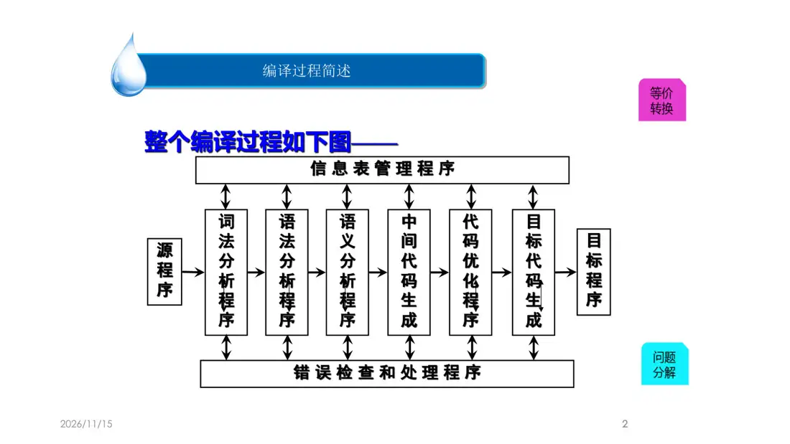

原文：

整个编译过程如下图—

编译过程简述

等价转换

2026/11/15

2

### 2型文法与语法分析密切相关：

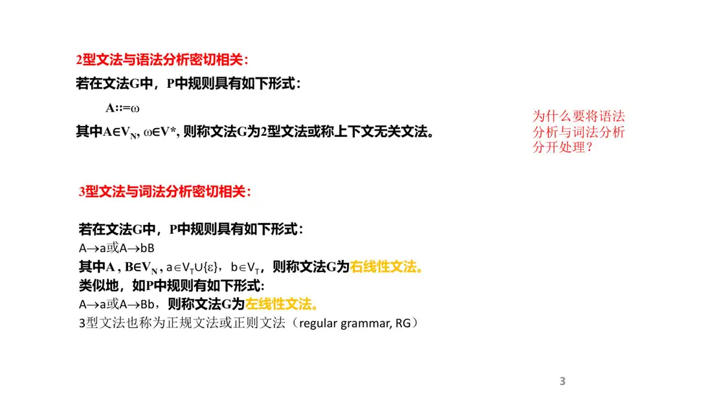

原文：

2型文法与语法分析密切相关：

若在文法G中，P中规则具有如下形式：

$$
\mathbf {A}: := \omega
$$

其中 $\mathbf { A } \in \mathbf { V } _ { \mathbf { N } } , \omega \in \mathbf { V } ^ { * }$ , 则称文法G为2型文法或称上下文无关文法。

为什么要将语法分析与词法分析分开处理？

3型文法与词法分析密切相关：

若在文法G中，P中规则具有如下形式：

A→a或A→bB

其中 $\mathbf { A } , \mathbf { B } { \in } \mathbf { V } _ { \mathbf { N } } , { \mathsf { a } } { \in } \mathsf { V } _ { \mathsf { T } } { \cup } \{ { \varepsilon } \} , \mathsf { b } { \in } \mathsf { V } _ { \mathsf { T } } ,$ ，则称文法G为右线性文法。

类似地，如P中规则有如下形式:

A→a或A→Bb，则称文法G为左线性文法。

3型文法也称为正规文法或正则文法（regular grammar, RG）

3

### 第三章 词法分析

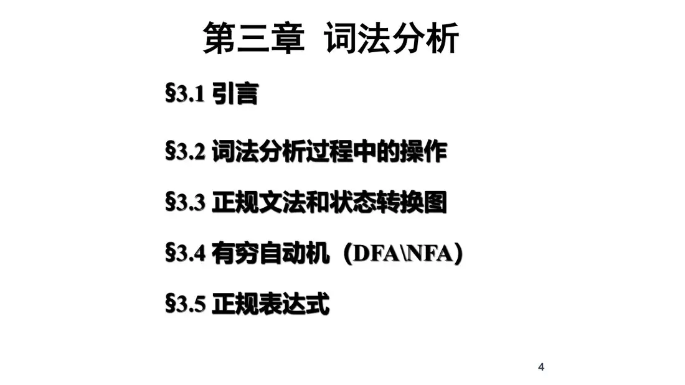

原文：

第三章 词法分析
§3.1 引言
§3.2 词法分析过程中的操作
§3.3 正规文法和状态转换图
§3.4 有穷自动机 (DFA\NFA)
§3.5 正规表达式

4

### 词法分析器实现方案

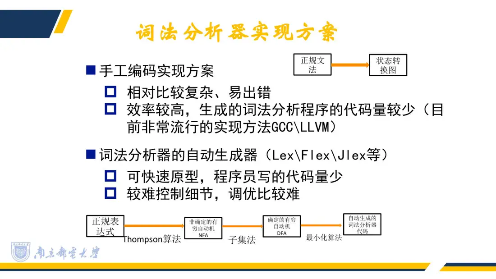

原文：

词法分析器实现方案

◼手工编码实现方案

 相对比较复杂、易出错

 效率较高，生成的词法分析程序的代码量较少（目前非常流行的实现方法GCC\LLVM）

◼词法分析器的自动生成器（Lex\Flex\Jlex等）

 可快速原型，程序员写的代码量少

 较难控制细节，调优比较难

### 第三章 词法分析

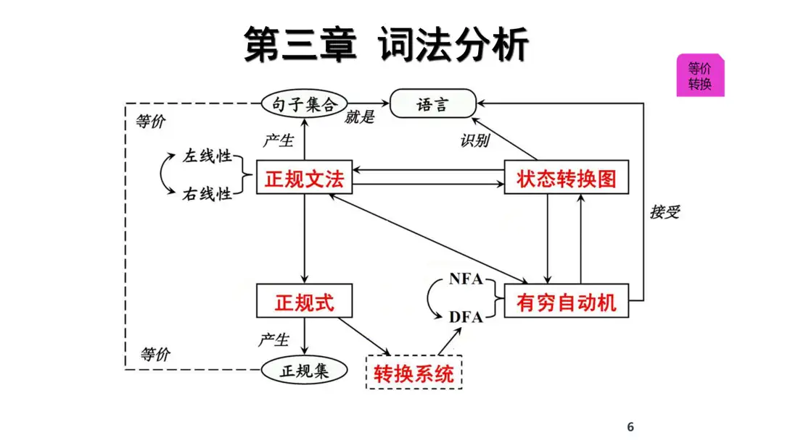

原文：

第三章 词法分析

等价

句子集合

等价转换

就是

语言

产生

左线性

识别

正规文法

右线性

状态转换图

NFA

正规式

DFA

接受

有穷自动机

等价

产生

正规集

转换系统

6

### §3.1 引言

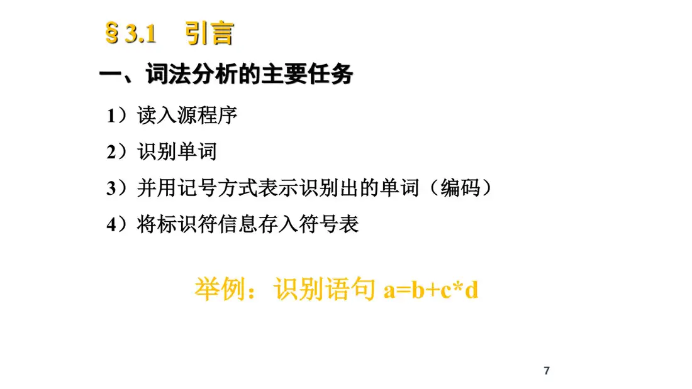

原文：

§3.1 引言

一、词法分析的主要任务

1）读入源程序

2）识别单词

3）并用记号方式表示识别出的单词（编码）

4）将标识符信息存入符号表

举例：识别语句 $\mathrm { { a } = \mathrm { { b } + e ^ { * } c } }$

7

### §3.1 引言

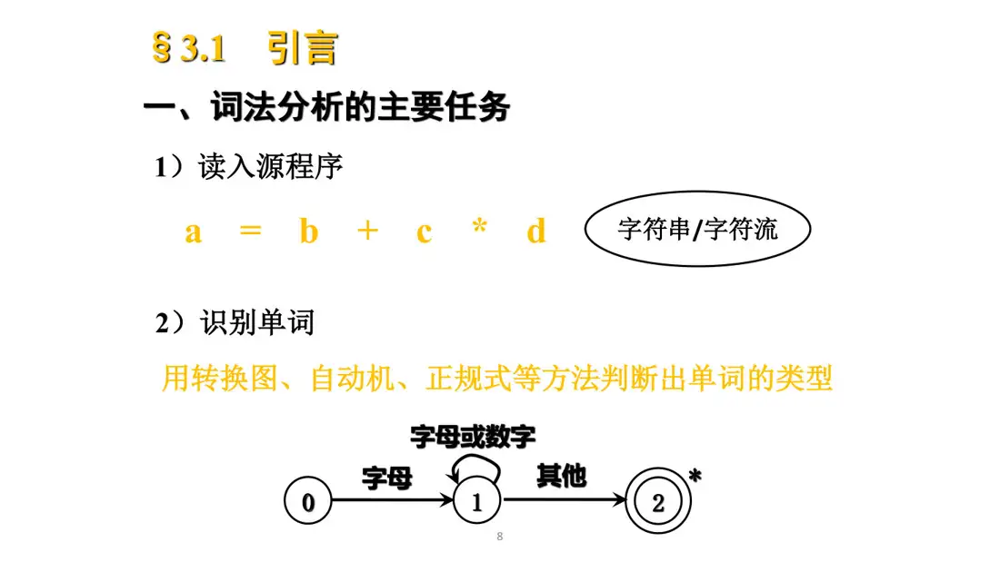

原文：

§3.1 引言

一、词法分析的主要任务

1）读入源程序

字符串/字符流

2）识别单词

用转换图、自动机、正规式等方法判断出单词的类型

### §3.1 引言

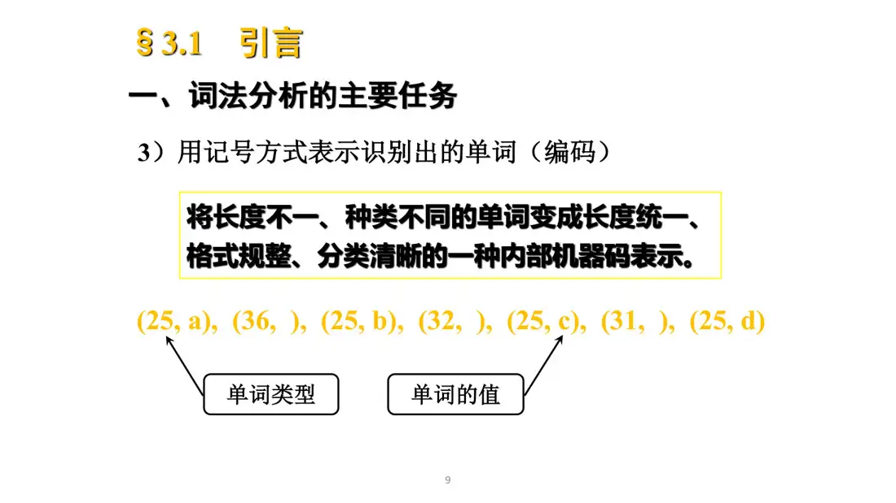

原文：

§3.1 引言

一、词法分析的主要任务

3）用记号方式表示识别出的单词（编码）

将长度不一、种类不同的单词变成长度统一、格式规整、分类清晰的一种内部机器码表示。

(25, a), (36, ), (25, b), (32, ), (25, c), (31, ), (25, d)

单词类型

单词的值

9

### §3.1 引言

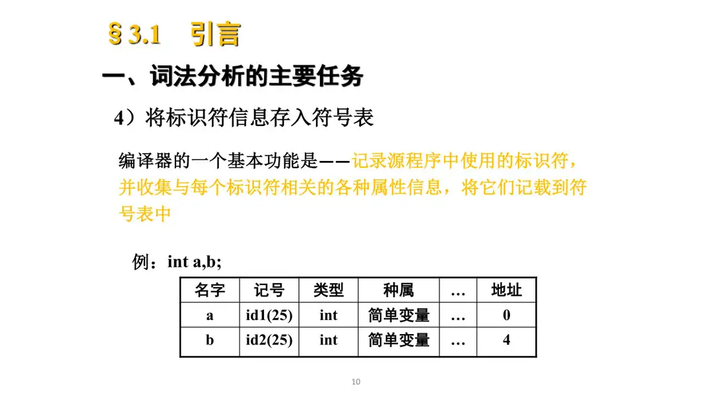

原文：

§3.1 引言

一、词法分析的主要任务

4）将标识符信息存入符号表

编译器的一个基本功能是——记录源程序中使用的标识符，并收集与每个标识符相关的各种属性信息，将它们记载到符号表中

例：int a,b;

<table><tr><td>名字</td><td>记号</td><td>类型</td><td>种属</td><td>...</td><td>地址</td></tr><tr><td>a</td><td>id1(25)</td><td>int</td><td>简单变量</td><td>...</td><td>0</td></tr><tr><td>b</td><td>id2(25)</td><td>int</td><td>简单变量</td><td>...</td><td>4</td></tr></table>

10

### §3.1 引言

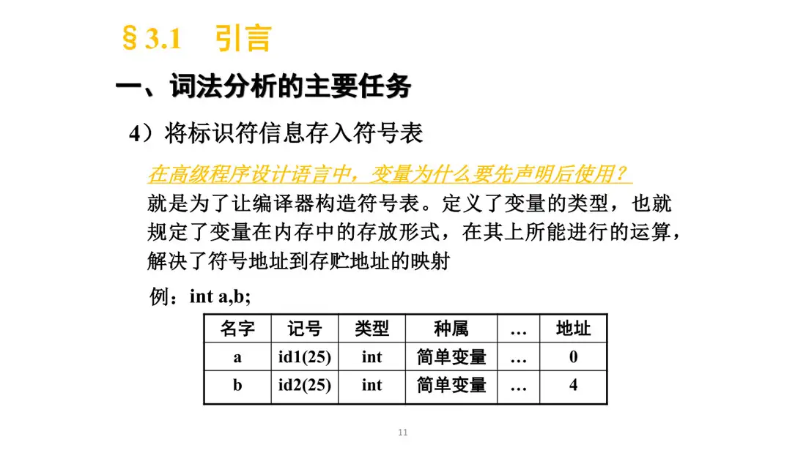

原文：

§3.1 引言

一、词法分析的主要任务

4）将标识符信息存入符号表

就是为了让编译器构造符号表。定义了变量的类型，也就规定了变量在内存中的存放形式，在其上所能进行的运算，解决了符号地址到存贮地址的映射

例：int a,b;

<table><tr><td>名字</td><td>记号</td><td>类型</td><td>种属</td><td>...</td><td>地址</td></tr><tr><td>a</td><td>id1(25)</td><td>int</td><td>简单变量</td><td>...</td><td>0</td></tr><tr><td>b</td><td>id2(25)</td><td>int</td><td>简单变量</td><td>...</td><td>4</td></tr></table>

11

### §3.1 引言

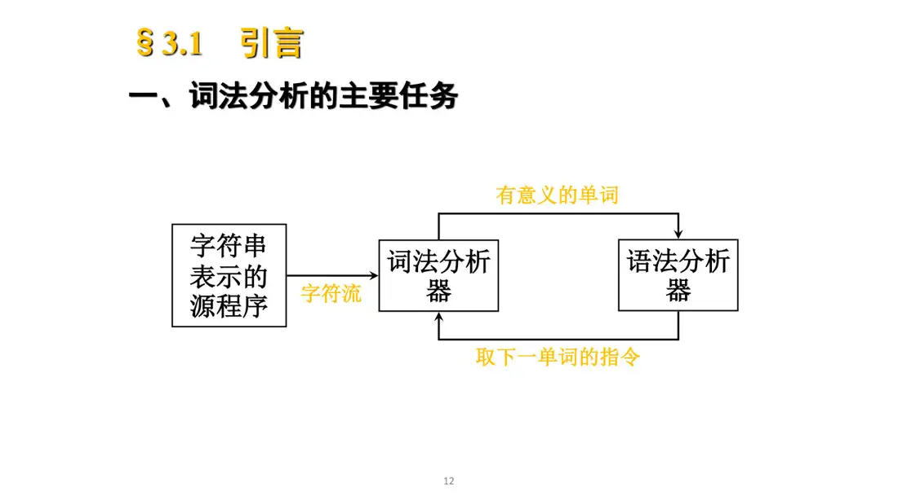

原文：

§3.1 引言

一、词法分析的主要任务

取下一单词的指令

12

### §3.1 引言

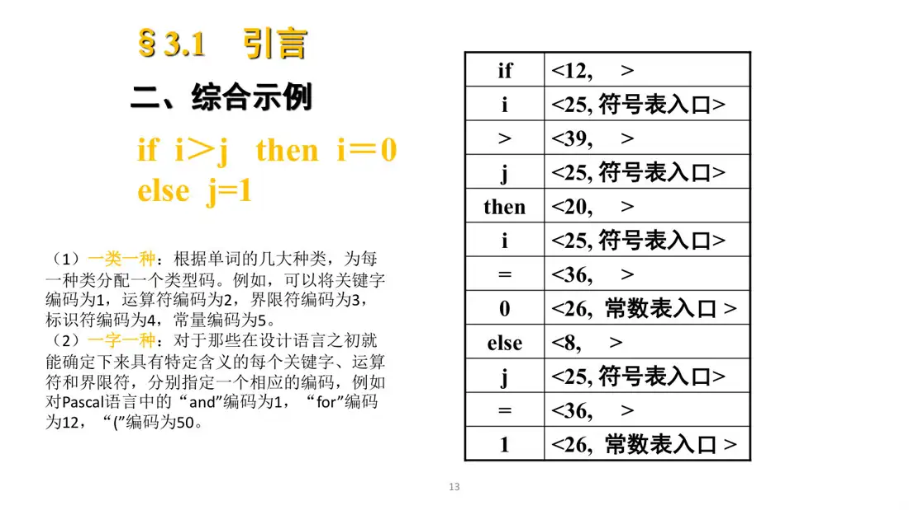

原文：

§3.1 引言

二、综合示例

if i＞j then i＝0 else j=1

（1）一类一种：根据单词的几大种类，为每一种类分配一个类型码。例如，可以将关键字编码为1，运算符编码为2，界限符编码为3，标识符编码为4，常量编码为5。

（2）一字一种：对于那些在设计语言之初就能确定下来具有特定含义的每个关键字、运算符和界限符，分别指定一个相应的编码，例如对Pascal语言中的“and”编码为1，“for”编码为12，“(”编码为50。

<table><tr><td>if</td><td>&lt;12, &gt;</td></tr><tr><td>i</td><td>&lt;25, 符号表入口&gt;</td></tr><tr><td>&gt;</td><td>&lt;39, &gt;</td></tr><tr><td>j</td><td>&lt;25, 符号表入口&gt;</td></tr><tr><td>then</td><td>&lt;20, &gt;</td></tr><tr><td>i</td><td>&lt;25, 符号表入口&gt;</td></tr><tr><td>=</td><td>&lt;36, &gt;</td></tr><tr><td>0</td><td>&lt;26, 常数表入口&gt;</td></tr><tr><td>else</td><td>&lt;8, &gt;</td></tr><tr><td>j</td><td>&lt;25, 符号表入口&gt;</td></tr><tr><td>=</td><td>&lt;36, &gt;</td></tr><tr><td>1</td><td>&lt;26, 常数表入口&gt;</td></tr></table>

13

### 第三章 词法分析

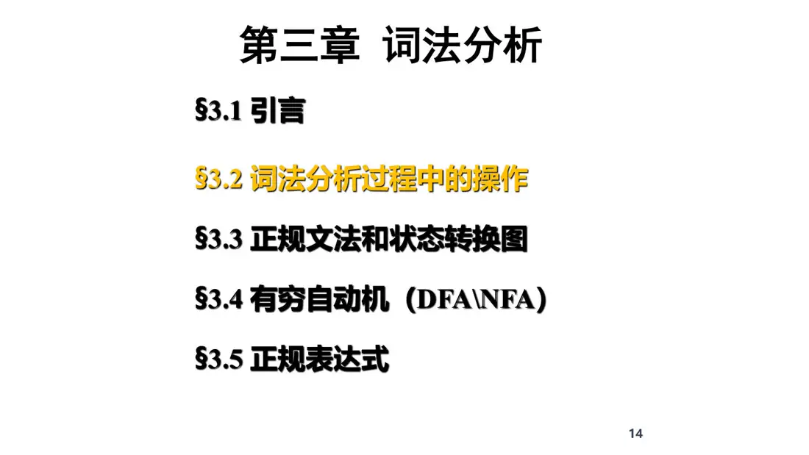

原文：

第三章 词法分析
§3.1 引言
§3.2 词法分析过程中的操作
§3.3 正规文法和状态转换图
§3.4 有穷自动机 (DFA\NFA)
§3.5 正规表达式

14

### §3.2 词法分析过程中的操作

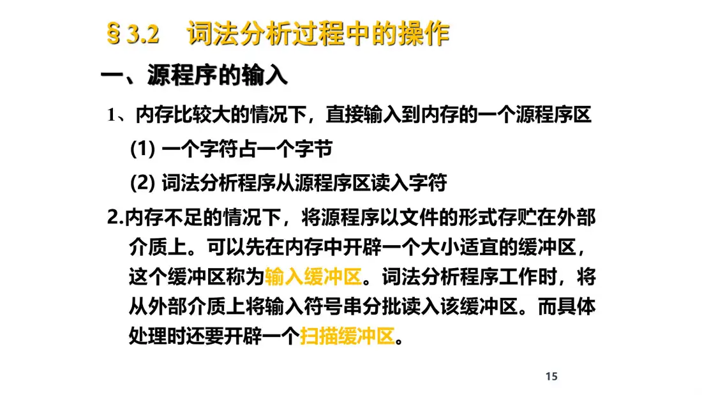

原文：

§3.2 词法分析过程中的操作

一、源程序的输入

1、内存比较大的情况下，直接输入到内存的一个源程序区

(1) 一个字符占一个字节

(2) 词法分析程序从源程序区读入字符

2.内存不足的情况下，将源程序以文件的形式存贮在外部介质上。可以先在内存中开辟一个大小适宜的缓冲区，这个缓冲区称为输入缓冲区。词法分析程序工作时，将从外部介质上将输入符号串分批读入该缓冲区。而具体处理时还要开辟一个扫描缓冲区。

15

### 预处理目的是将一些无用的空白符、跳格符、回车换行符等编辑性字符剔除掉。

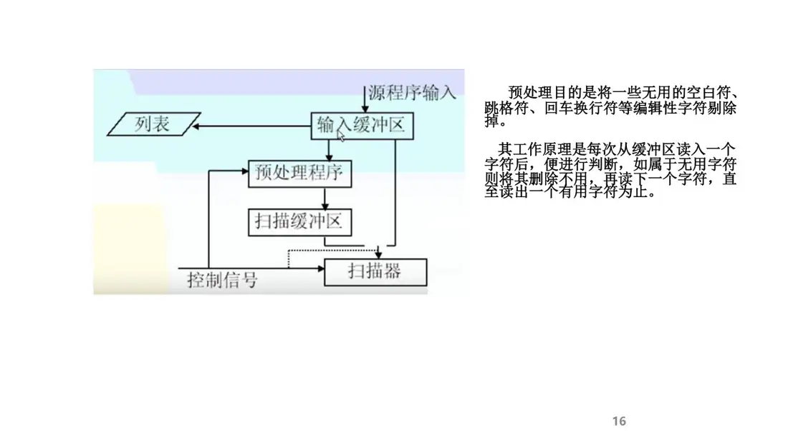

原文：

预处理目的是将一些无用的空白符、跳格符、回车换行符等编辑性字符剔除掉。

其工作原理是每次从缓冲区读入一个字符后，便进行判断，如属于无用字符则将其删除不用，再读下一个字符，直至读出一个有用字符为止。

16

### §3.2 词法分析过程中的操作

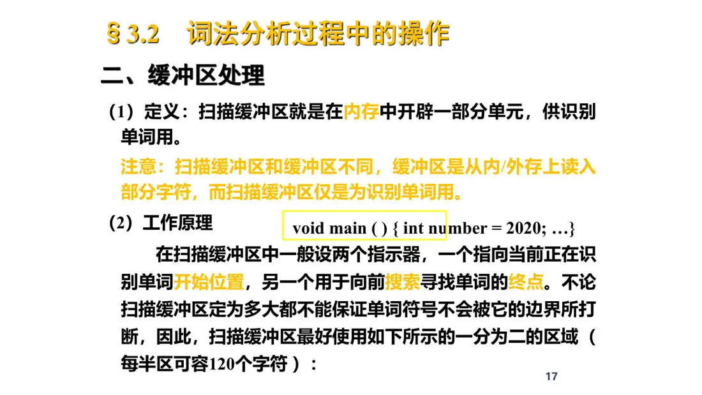

原文：

§3.2 词法分析过程中的操作

二、缓冲区处理

（1）定义：扫描缓冲区就是在内存中开辟一部分单元，供识别单词用。

注意：扫描缓冲区和缓冲区不同，缓冲区是从内/外存上读入部分字符，而扫描缓冲区仅是为识别单词用。

（2）工作原理

在扫描缓冲区中一般设两个指示器，一个指向当前正在识别单词开始位置，另一个用于向前搜索寻找单词的终点。不论扫描缓冲区定为多大都不能保证单词符号不会被它的边界所打断，因此，扫描缓冲区最好使用如下所示的一分为二的区域（每半区可容120个字符）：

17

### §3.2 词法分析过程中的操作

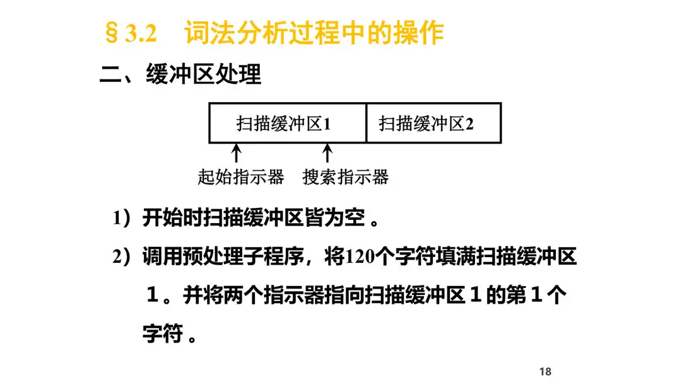

原文：

§3.2 词法分析过程中的操作

二、缓冲区处理

1）开始时扫描缓冲区皆为空 。

2）调用预处理子程序，将120个字符填满扫描缓冲区1。并将两个指示器指向扫描缓冲区1的第1个字符 。

18

### §3.2 词法分析过程中的操作

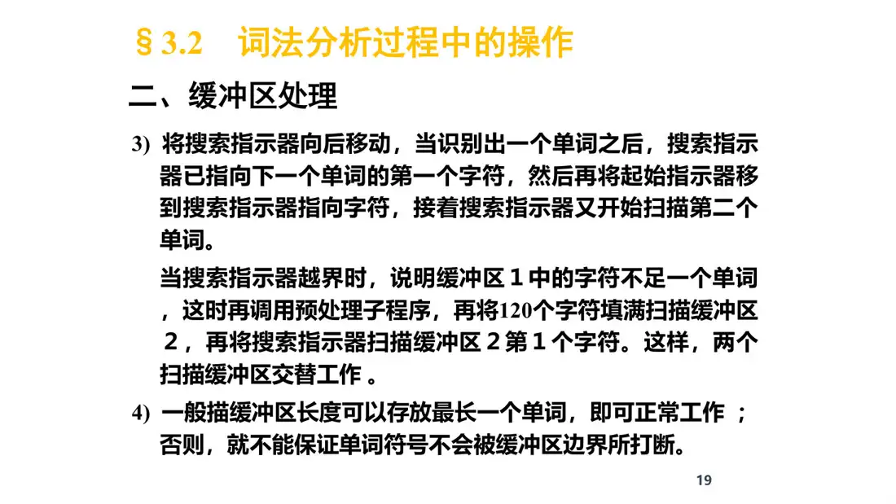

原文：

§3.2 词法分析过程中的操作

二、缓冲区处理

3) 将搜索指示器向后移动，当识别出一个单词之后，搜索指示器已指向下一个单词的第一个字符，然后再将起始指示器移到搜索指示器指向字符，接着搜索指示器又开始扫描第二个单词。

当搜索指示器越界时，说明缓冲区1中的字符不足一个单词，这时再调用预处理子程序，再将120个字符填满扫描缓冲区2，再将搜索指示器扫描缓冲区2第1个字符。这样，两个扫描缓冲区交替工作 。

4) 一般描缓冲区长度可以存放最长一个单词，即可正常工作 ；否则，就不能保证单词符号不会被缓冲区边界所打断。

19

### §3.2 词法分析过程中的操作

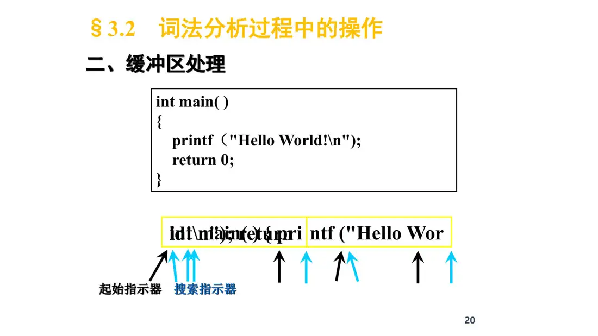

原文：

§3.2 词法分析过程中的操作

二、缓冲区处理

20

### §3.2 词法分析过程中的操作

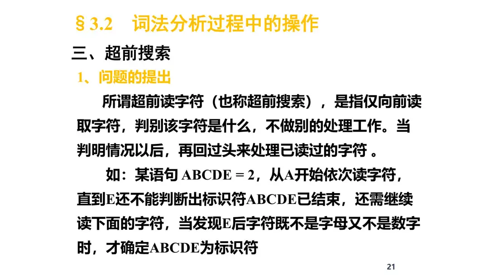

原文：

§3.2 词法分析过程中的操作

三、超前搜索

1、问题的提出

所谓超前读字符（也称超前搜索），是指仅向前读取字符，判别该字符是什么，不做别的处理工作。当判明情况以后，再回过头来处理已读过的字符 。

如：某语句 $\mathbf { A B C D E } = 2$ ，从A开始依次读字符，直到E还不能判断出标识符ABCDE已结束，还需继续读下面的字符，当发现E后字符既不是字母又不是数字时，才确定ABCDE为标识符

21

### §3.2 词法分析过程中的操作

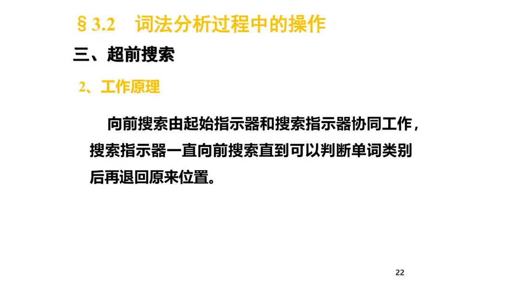

原文：

§3.2 词法分析过程中的操作

三、超前搜索

2、工作原理

向前搜索由起始指示器和搜索指示器协同工作，搜索指示器一直向前搜索直到可以判断单词类别后再退回原来位置。

22

### 第三章 词法分析

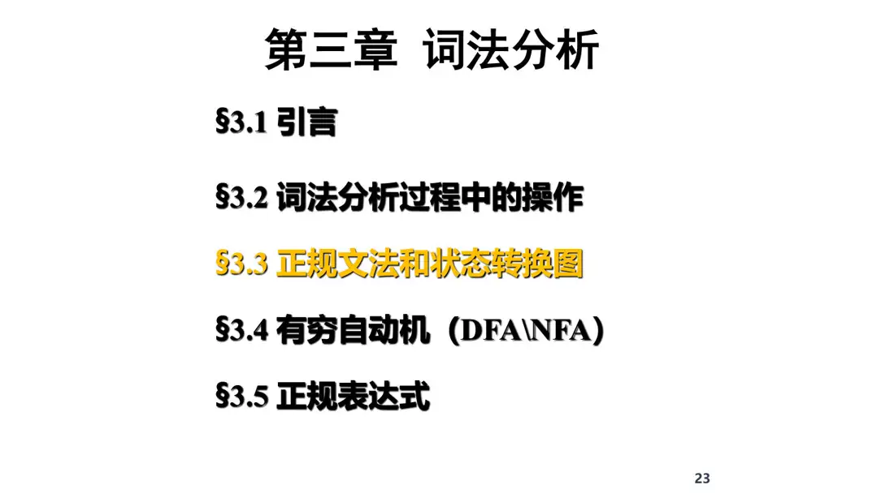

原文：

第三章 词法分析
§3.1 引言
§3.2 词法分析过程中的操作
§3.3 正规文法和状态转换图
§3.4 有穷自动机 (DFA\NFA)
§3.5 正规表达式

23

### §3.3 正规文法和状态转换图

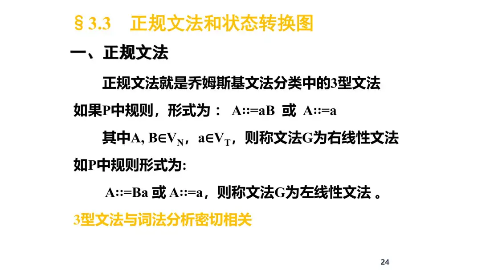

原文：

§3.3 正规文法和状态转换图

一、正规文法

正规文法就是乔姆斯基文法分类中的3型文法如果P中规则，形式为 ： $\mathbf { A } { \boldsymbol { : } } { \boldsymbol { : } } { = } \mathbf { a } \mathbf { B }$ 或 $\mathbf { A } { : : } \mathbf { = } \mathbf { a }$

其中A, $\mathbf { B } { \in } \mathbf { V } _ { \mathrm { N } } , \mathbf { a } { \in } \mathbf { V } _ { \mathrm { T } }$ ，则称文法G为右线性文法如P中规则形式为:

$\mathbf { A } { \boldsymbol { : } } { \mathbf { : } } { = } \mathbf { B } \mathbf { : }$ 或 $\mathbf { A } { : : } \mathbf { = } \mathbf { a }$ ，则称文法G为左线性文法 。

3型文法与词法分析密切相关

24

### §3.3 正规文法和状态转换图

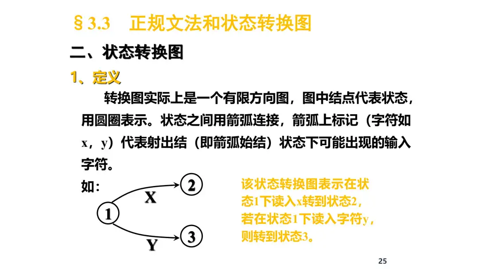

原文：

§3.3 正规文法和状态转换图

二、状态转换图

1、定义

转换图实际上是一个有限方向图，图中结点代表状态，用圆圈表示。状态之间用箭弧连接，箭弧上标记（字符如x，y）代表射出结（即箭弧始结）状态下可能出现的输入字符。

如：

该状态转换图表示在状 态1下读入x转到状态2， 若在状态1下读入字符y， 则转到状态3。

25

### §3.3 正规文法和状态转换图

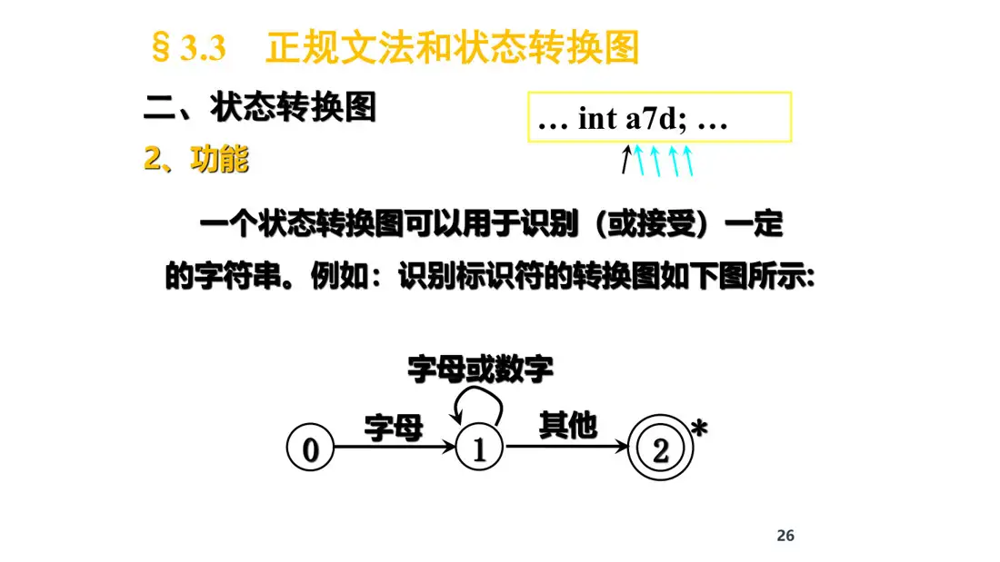

原文：

§3.3 正规文法和状态转换图

二、状态转换图

2、功能

一个状态转换图可以用于识别（或接受）一定的字符串。例如：识别标识符的转换图如下图所示:

26

### §3.3 正规文法和状态转换图

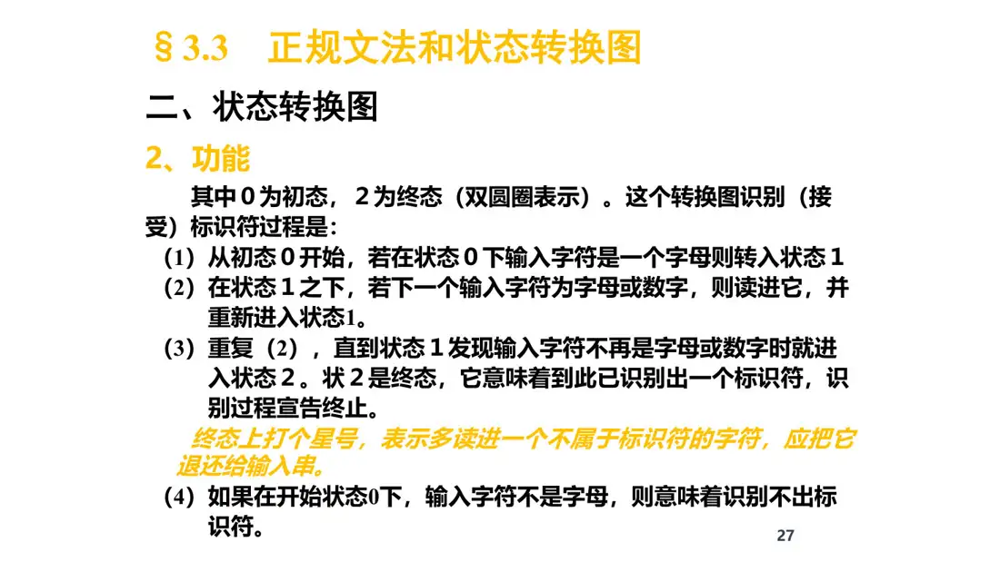

原文：

§3.3 正规文法和状态转换图

二、状态转换图

2、功能

其中0为初态，2为终态（双圆圈表示）。这个转换图识别（接受）标识符过程是：

（1）从初态0开始，若在状态0下输入字符是一个字母则转入状态1

（2）在状态1之下，若下一个输入字符为字母或数字，则读进它，并重新进入状态1。

（3）重复（2），直到状态1发现输入字符不再是字母或数字时就进入状态2。状2是终态，它意味着到此已识别出一个标识符，识别过程宣告终止。

（4）如果在开始状态0下，输入字符不是字母，则意味着识别不出标识符。 27

### ∷=字母|字母|数字

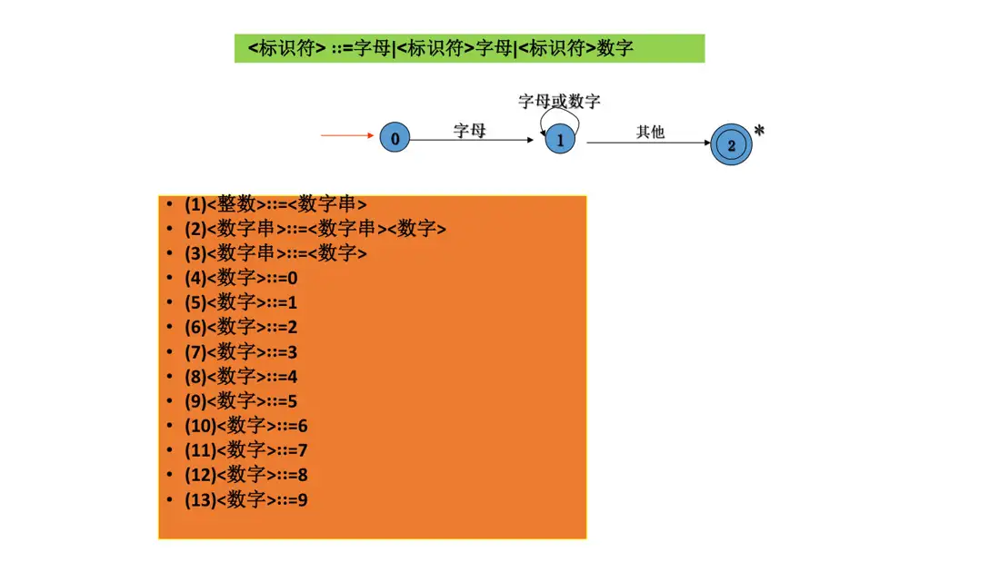

原文：

<标识符> ∷=字母|<标识符>字母|<标识符>数字

• (1)<整数>∷=<数字串>

• (2)<数字串>∷=<数字串><数字>

• (3)<数字串>∷=<数字>

• (4)<数字>∷=0

• (5)<数字>∷=1

• (6)<数字>∷=2

• (7)<数字>∷=3

• (8)<数字>∷=4

• (9)<数字>∷=5

• (10)<数字>∷=6

• (11)<数字>∷=7

• (12)<数字>∷=8

• (13)<数字>∷=9

### §3.3 正规文法和状态转换图

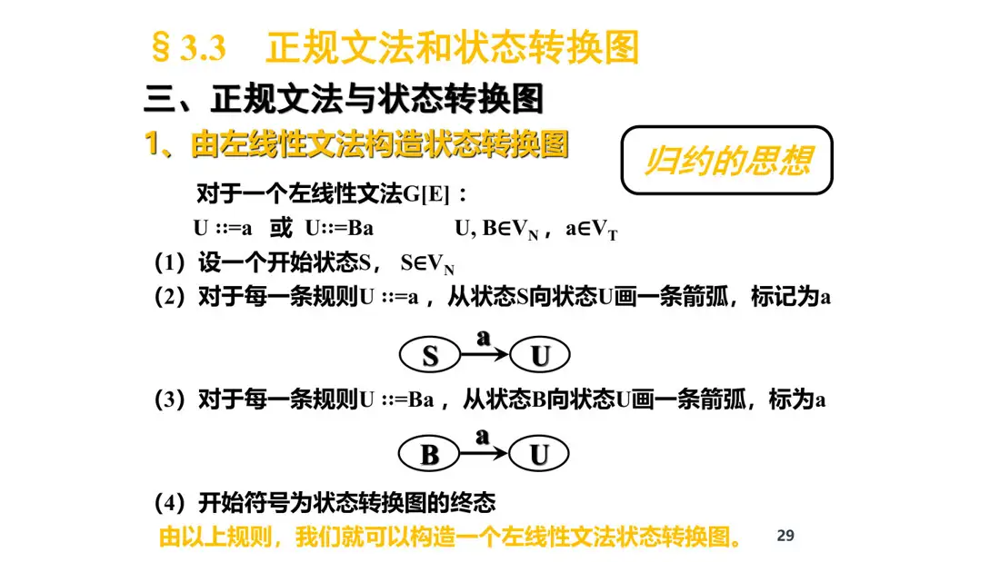

原文：

§3.3 正规文法和状态转换图

三、正规文法与状态转换图

1、由左线性文法构造状态转换图

归约的思想

对于一个左线性文法G[E] ：U ∷=a 或 $\mathbf { U } { : } { : } = \mathbf { B } \mathbf { a }$ U, $\mathbf { B } { \in } \mathbf { V } _ { \mathrm { ~ N ~ } } , \mathbf { a } { \in } \mathbf { V } _ { \mathrm { ~ T ~ } }$

（1）设一个开始状态S， $\mathbf { S } { \in } \mathbf { V } _ { \mathbf { N } }$

（2）对于每一条规则U ∷=a ，从状态S向状态U画一条箭弧，标记为a

（3）对于每一条规则U ∷=Ba，从状态B向状态U画一条箭弧，标为aB a U

（4）开始符号为状态转换图的终态由以上规则，我们就可以构造一个左线性文法状态转换图。

29

### §3.3 正规文法和状态转换图

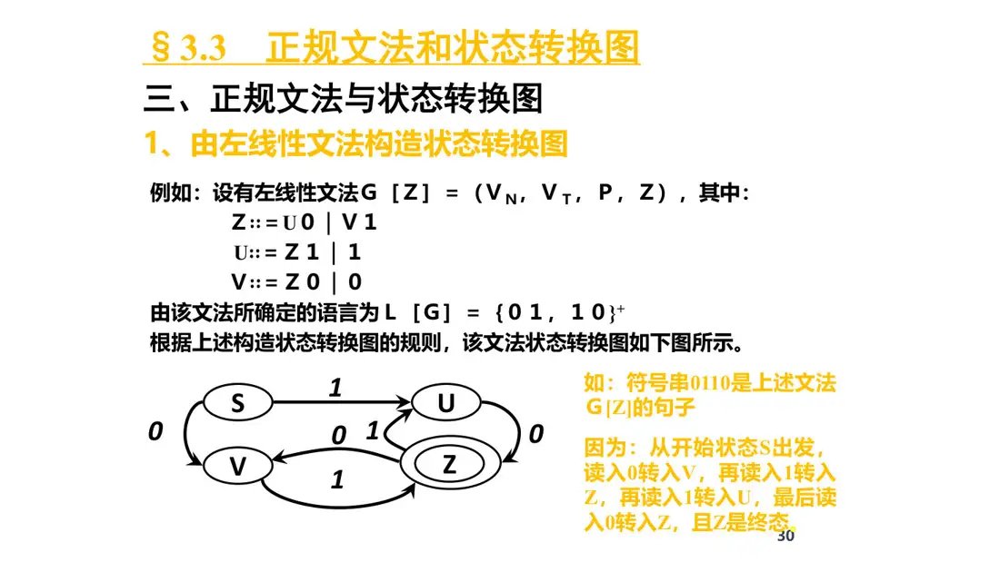

原文：

§3.3 正规文法和状态转换图

三、正规文法与状态转换图

1、由左线性文法构造状态转换图

例如：设有左线性文法G $\left[ \mathsf { Z } \right] ~ = ~ \left( \mathsf { V } _ { \mathsf { N } } , \mathsf { V } _ { \mathsf { T } } , \mathsf { P } , \mathsf { Z } \right)$ ，其中：

$$
\begin{array}{l} \mathbf {Z}: := \mathbf {U 0} | \mathbf {V 1} \\ \mathbf {U}: := \mathbf {Z 1} | \mathbf {1} \\ \mathbf {V}: := \mathbf {Z 0} | \mathbf {0} \end{array}
$$

由该文法所确定的语言为L $[ { \bf G } ] ~ = ~ \{ { \bf 0 \ 1 } , ~ { \bf 1 0 } \} ^ { + }$

根据上述构造状态转换图的规则，该文法状态转换图如下图所示。

如：符号串0110是上述文法G[Z]的句子

因为：从开始状态S出发，读入0转入V，再读入1转入$\mathbf { Z } _ { \parallel }$ 再读入1转入U，最后读

### §3.3 正规文法和状态转换图

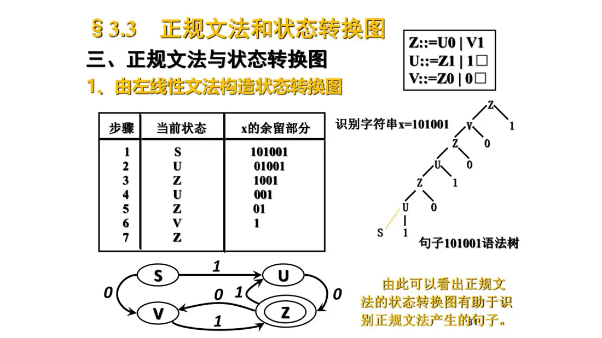

原文：

§3.3 正规文法和状态转换图

三、正规文法与状态转换图

1、由左线性文法构造状态转换图

<table><tr><td>步骤</td><td>当前状态</td><td>x的余留部分</td></tr><tr><td>1</td><td>S</td><td>101001</td></tr><tr><td>2</td><td>U</td><td>01001</td></tr><tr><td>3</td><td>Z</td><td>1001</td></tr><tr><td>4</td><td>U</td><td>001</td></tr><tr><td>5</td><td>Z</td><td>01</td></tr><tr><td>6</td><td>V</td><td>1</td></tr><tr><td>7</td><td>Z</td><td></td></tr></table>

由此可以看出正规文法的状态转换图有助于识31别正规文法产生的句子。

### §3.3 正规文法和状态转换图

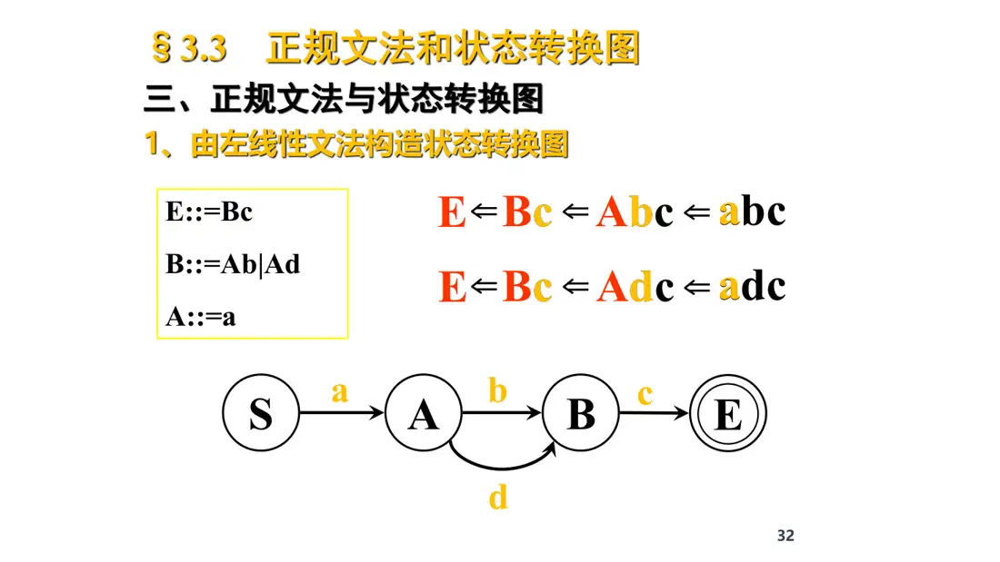

原文：

§3.3 正规文法和状态转换图

三、正规文法与状态转换图

1、由左线性文法构造状态转换图

$$
\begin{array}{l} \mathbf {E}: := \mathbf {B c} \\ \mathbf {B}: := \mathbf {A b} | \mathbf {A d} \\ \mathbf {A}: := \mathbf {a} \end{array}
$$

$$
\mathbf {E} \Leftarrow \mathbf {B c} \Leftarrow \mathbf {A b c} \Leftarrow \mathbf {a b c}
$$

$$
\mathbf {E} \Leftarrow \mathbf {B c} \Leftarrow \mathbf {A d c} \Leftarrow \mathbf {a d c}
$$

$$
ⓢ \xrightarrow {a} Ⓐ A \xrightarrow {b} Ⓑ B \xrightarrow {c} ⓕ
$$

d

32

### §3.3 正规文法和状态转换图

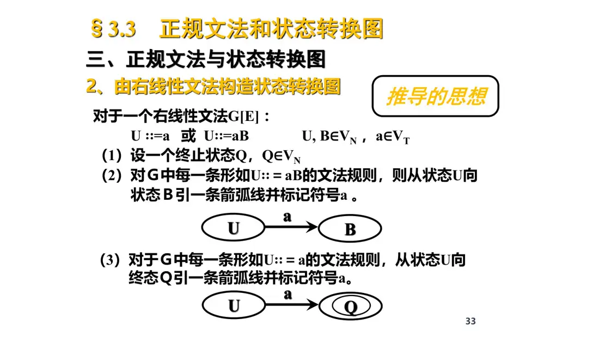

原文：

§3.3 正规文法和状态转换图

三、正规文法与状态转换图

2、由右线性文法构造状态转换图

推导的思想

对于一个右线性文法 $\bf G [ E ]$ ：

$\mathbf { U } : : = \mathbf { a }$ 或 $\mathbf { U } { : : = } \mathbf { a } \mathbf { B }$ U, $\mathbf { B } { \in } \mathbf { V } _ { \mathrm { ~ N ~ } } , \mathbf { a } { \in } \mathbf { V } _ { \mathrm { ~ T ~ } }$

（1）设一个终止状态Q， $\mathbf { Q } \in \mathbf { V } _ { \mathbf { N } }$

（2）对G中每一条形如 $\mathbf { U } { \boldsymbol { : : } } = \mathbf { a } \mathbf { B }$ 的文法规则，则从状态U向状态B引一条箭弧线并标记符号a 。

（3）对于G中每一条形如 $\mathbf { U } { : } { : } \mathbf { \partial } \mathbf { = } \mathbf { a }$ 的文法规则，从状态U向终态Q引一条箭弧线并标记符号a。

33

### §3.3 正规文法和状态转换图

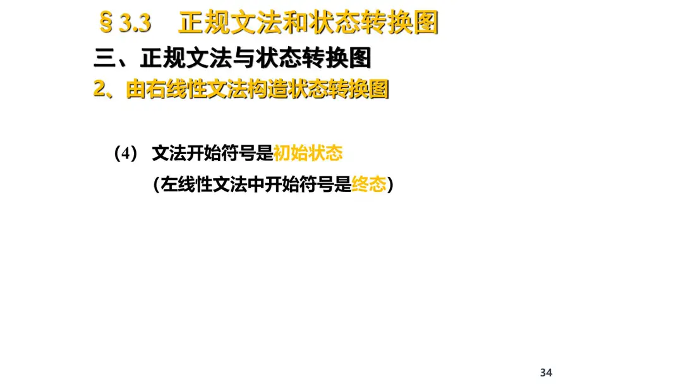

原文：

§3.3 正规文法和状态转换图

三、正规文法与状态转换图

2、由右线性文法构造状态转换图

（4） 文法开始符号是初始状态

（左线性文法中开始符号是终态）

34

### §3.3 正规文法和状态转换图

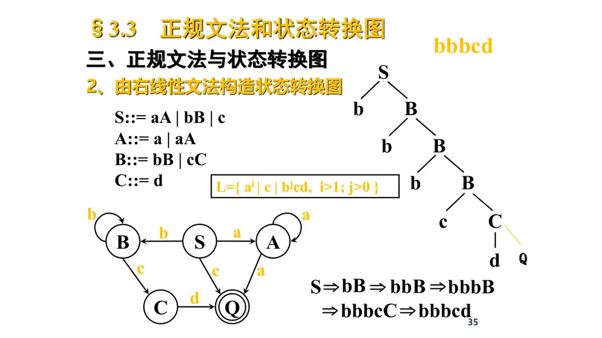

原文：

§3.3 正规文法和状态转换图

三、正规文法与状态转换图

2、由右线性文法构造状态转换图

$$
\mathbf {S}: := \mathbf {a A} | \mathbf {b B} | \mathbf {c}
$$

$$
\mathbf {A}: := \mathbf {a} \mid \mathbf {a A}
$$

$$
\mathbf {B}: := \mathbf {b B} \mid \mathbf {c C}
$$

$$
\mathbf {C}: := \mathbf {d}
$$

$$
\mathrm{L} = \{\mathrm{a} ^ {\mathrm{i}} | \mathrm{c} | \mathrm{b} ^ {\mathrm{j}} \mathrm{cd}, \mathrm{i} > 1; \mathrm{j} > 0 \}
$$

bbbcd

$$
\begin{array}{r l} & {\mathbf {S} \Rightarrow \mathbf {b B} \Rightarrow \mathbf {b b B} \Rightarrow \mathbf {b b b B}} \\ & {\quad \Rightarrow \mathbf {b b b c C} \Rightarrow \mathbf {b b b c d} _ {3 5}} \end{array}
$$

### §3.3 正规文法和状态转换图

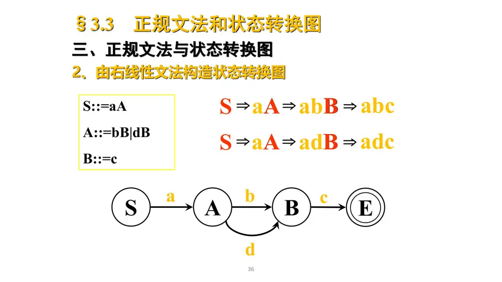

原文：

§3.3 正规文法和状态转换图

三、正规文法与状态转换图

2、由右线性文法构造状态转换图

$$
\begin{array}{l} \mathrm{S::=aA} \\ \mathrm {A:: = bB|dB} \\ \mathrm {B:: = c} \end{array}
$$

$$
\mathbf {S} \Rightarrow \mathrm{aA} \Rightarrow \mathrm{abB} \Rightarrow \mathrm{abc}
$$

$$
\mathbf {S} \Rightarrow \mathrm{aA} \Rightarrow \mathrm{adB} \Rightarrow \mathrm{adc}
$$

$$
ⓢ \xrightarrow {a} Ⓐ A \xrightarrow {b} Ⓑ B \xrightarrow {c} ⓕ
$$

d

36

### §3.3 正规文法和状态转换图

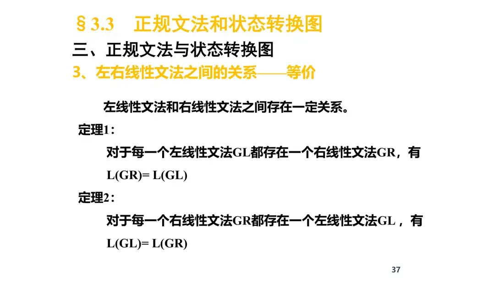

原文：

§3.3 正规文法和状态转换图

三、正规文法与状态转换图

3、左右线性文法之间的关系— —等价

左线性文法和右线性文法之间存在一定关系。

定理1：

对于每一个左线性文法GL都存在一个右线性文法GR，有

$$
\mathrm{L} (\mathrm{GR}) = \mathrm{L} (\mathrm{GL})
$$

定理2：

对于每一个右线性文法GR都存在一个左线性文法GL ，有

37

### §3.3 正规文法和状态转换图

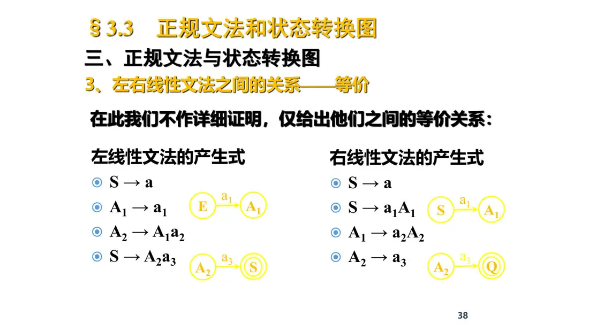

原文：

§3.3 正规文法和状态转换图

三、正规文法与状态转换图

3、左右线性文法之间的关系——等价

在此我们不作详细证明，仅给出他们之间的等价关系：

左线性文法的产生式

 $\mathbf { S } \longrightarrow \mathbf { a }$

右线性文法的产生式

 ${ \bf A _ { 1 } } \to { \bf a _ { 1 } }$

 $\mathbf { S } \longrightarrow \mathbf { a }$

$$
Ef \xrightarrow {a _ {1}} A _ {1}
$$

$$
oS \to a _ {1} A _ {1}
$$

 ${ \bf A } _ { 2 }  { \bf A _ { 1 } a } _ { 2 }$

 ${ \bf S }  { \bf A } _ { 2 } { \bf a } _ { 3 }$

$$
ⓞ \mathbf {A} _ {1} \rightarrow \mathbf {a} _ {2} \mathbf {A} _ {2}
$$

 ${ \bf A } _ { 2 } \to { \bf a } _ { 3 }$

38

### §3.3 正规文法和状态转换图

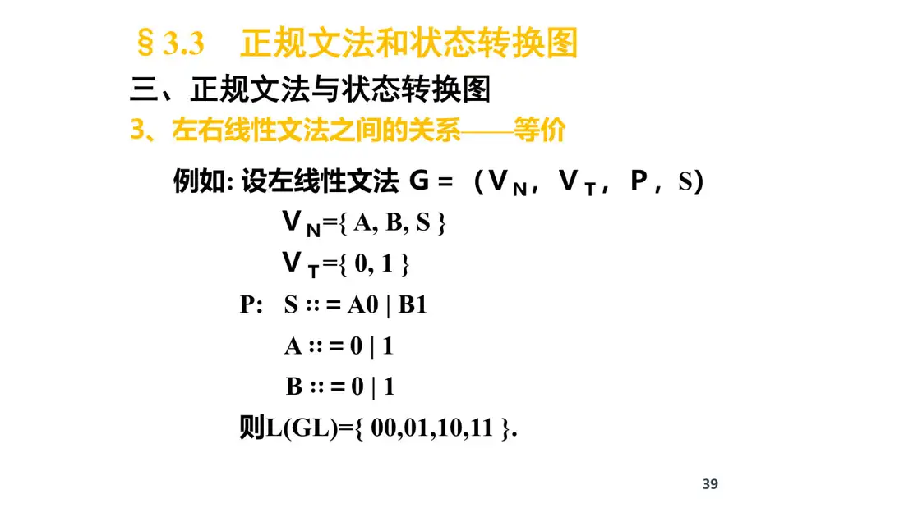

原文：

§3.3 正规文法和状态转换图

三、正规文法与状态转换图

3、左右线性文法之间的关系— —等价

例如: 设左线性文法 $\boldsymbol { \mathsf { G } } = \mathrm { ~  ~ ( ~ } \mathsf { V } _ { \mathrm { ~ N ~ } } , \mathrm { ~  ~ \mathsf { V } ~ } _ { \mathrm { T } } , \mathrm { ~  ~ \mathsf { P } ~ } , \mathrm { ~  ~ \mathsf { S } ~ } )$ VN={ A, B, S }VT={ 0, 1 }P: S ∷＝A0 | B1A ∷＝0 | 1B ∷＝0 | 1则L $\scriptstyle ( \mathbf { G } \mathbf { L } ) = \{ { \mathbf { 0 0 } } , \mathbf { 0 1 } , \mathbf { 1 0 } , \mathbf { 1 1 } \}$

39

### §3.3 正规文法和状态转换图

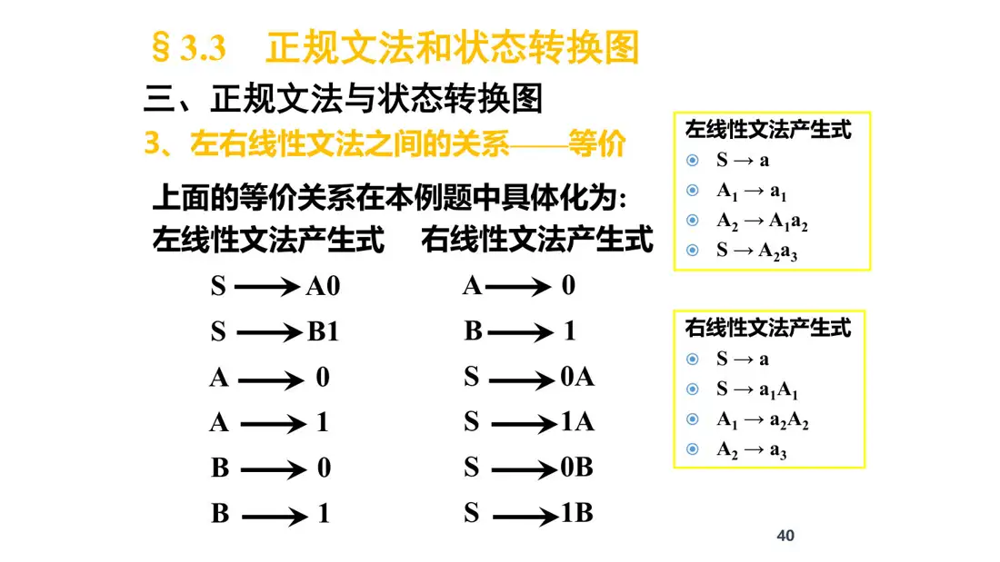

原文：

§3.3 正规文法和状态转换图

三、正规文法与状态转换图

3、左右线性文法之间的关系— —等价

上面的等价关系在本例题中具体化为:

左线性文法产生式 右线性文法产生式

$$
\mathrm{S} \longrightarrow \mathrm{A0} \qquad \qquad \mathrm{A} \longrightarrow 0
$$

$$
\mathrm{S} \longrightarrow \mathrm{B1} \qquad \qquad \mathrm{B} \longrightarrow 1
$$

$$
\mathrm{A} \longrightarrow 0 \qquad \mathrm{S} \longrightarrow 0 \mathrm{A}
$$

$$
\mathrm{A} \longrightarrow 1
$$

$$
\mathrm{S} \longrightarrow 1 \mathrm{A}
$$

$$
\mathrm{S} \longrightarrow 0 \mathrm{B}
$$

$$
\mathbf {B} \longrightarrow \mathbf {0}
$$

左线性文法产生式

$$
Ⓞ \mathbf {S} \rightarrow \mathbf {a}
$$

$$
\mathrm{B} \longrightarrow 1
$$

 ${ \bf A _ { 1 } } \to { \bf a _ { 1 } }$

$$
\mathrm{S} \longrightarrow 1 \mathrm{B}
$$

 ${ \bf A } _ { 2 }  { \bf A _ { 1 } a } _ { 2 }$

$$
ⓞ \mathbf {S} \rightarrow \mathbf {a}
$$

$$
ⓞ \quad \mathbf {S} \rightarrow \mathbf {A _ {2}} \mathbf {a _ {3}}
$$

右线性文法产生式

$$
ⓞ \quad \mathbf {S} \rightarrow \mathbf {a _ {1}} \mathbf {A _ {1}}
$$

$$
ⓞ \quad \mathbf {A _ {1}} \rightarrow \mathbf {a _ {2}} \mathbf {A _ {2}}
$$

$$
ⓞ \quad \mathbf {A} _ {2} \rightarrow \mathbf {a} _ {3}
$$

40

### §3.3 正规文法和状态转换图

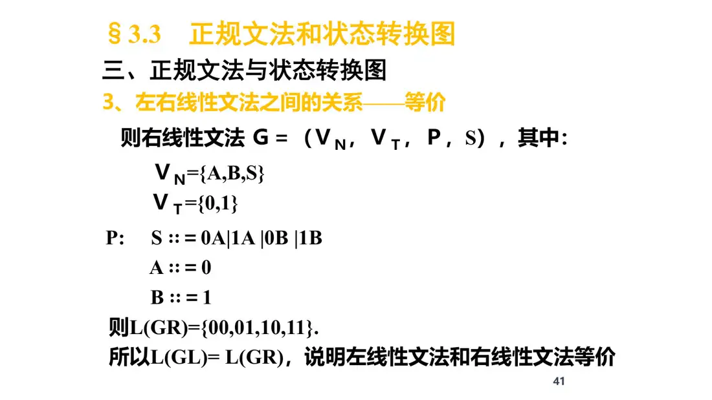

原文：

§3.3 正规文法和状态转换图

三、正规文法与状态转换图

3、左右线性文法之间的关系— —等价

则右线性文法 $\boldsymbol { \mathsf { G } } = \mathrm { ~  ~ ( ~ } \mathsf { V } _ { \mathrm { ~ N ~ } } , \mathrm { ~  ~ \mathsf { V } ~ } _ { \mathrm { T } } , \mathrm { ~  ~ \mathsf { P } ~ } , \mathrm { ~  ~ \mathsf { S } ~ } )$ ，其中：

所以L(GL)= L(GR)，说明左线性文法和右线性文法等价

41

### §3.3 正规文法和状态转换图

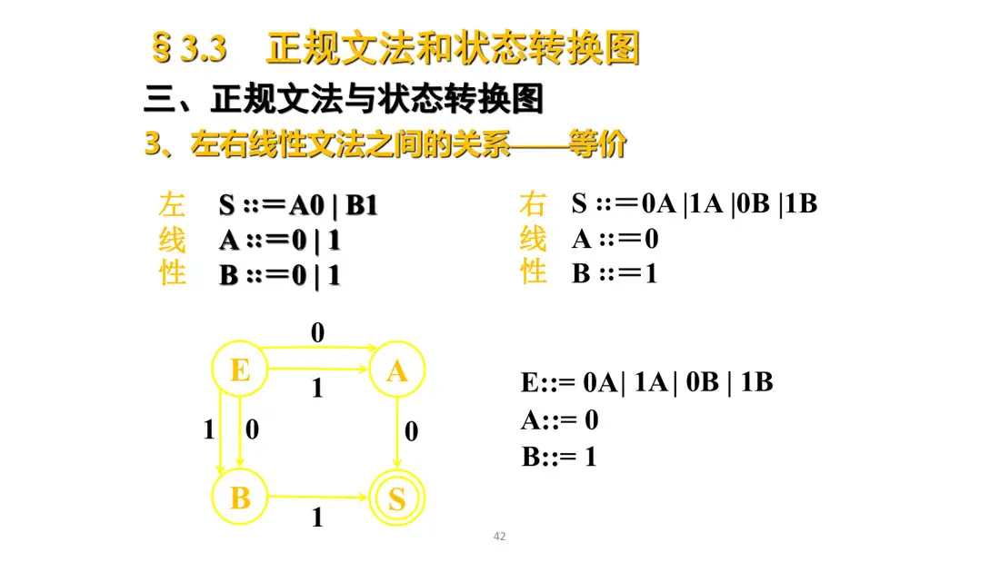

原文：

§3.3 正规文法和状态转换图

三、正规文法与状态转换图

3、左右线性文法之间的关系——等价

左 $\mathbf { S } : : = \mathbf { A 0 } \mid \mathbf { B 1 }$

线 $\mathbf { A } : : = \mathbf { 0 } \mid \mathbf { 1 }$

性 $\mathbf { B } : : = \mathbf { 0 } \mid \mathbf { 1 }$

右 $\mathbf { S } : : = 0 \mathbf { A } | 1 \mathbf { A } | 0 \mathbf { B } | 1 \mathbf { B }$

线 $\mathbf { A } : : = \mathbf { 0 }$

性 $\mathbf { B } : : = 1$

$$
\begin{array}{l} \mathbf {E}: := 0 \mathbf {A} | 1 \mathbf {A} | 0 \mathbf {B} | 1 \mathbf {B} \\ \mathbf {A}: := 0 \\ \mathbf {B}: := 1 \end{array}
$$

42

### 希望和大家携手完成本课程的学习！

原文：

希望和大家携手完成本课程的学习！

更希望和各位成为可以交流的朋友！

预祝大家顺利通过本课程并取得好成绩！

谢谢！

南志命生大摩 南志都生大学

计算机学院软件学院网络空间安全学院School of Computer Science
